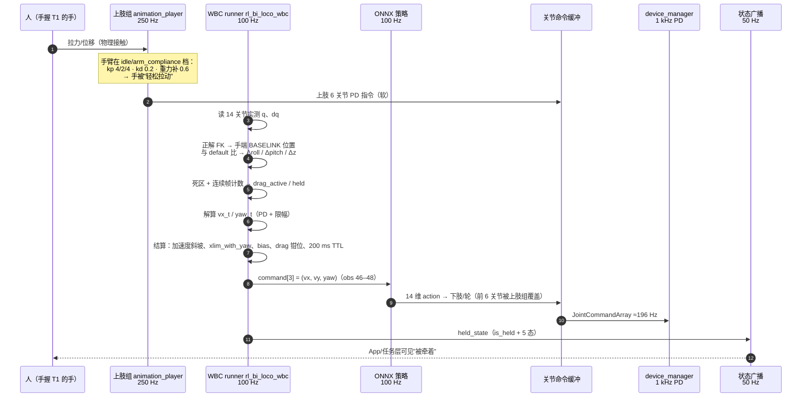
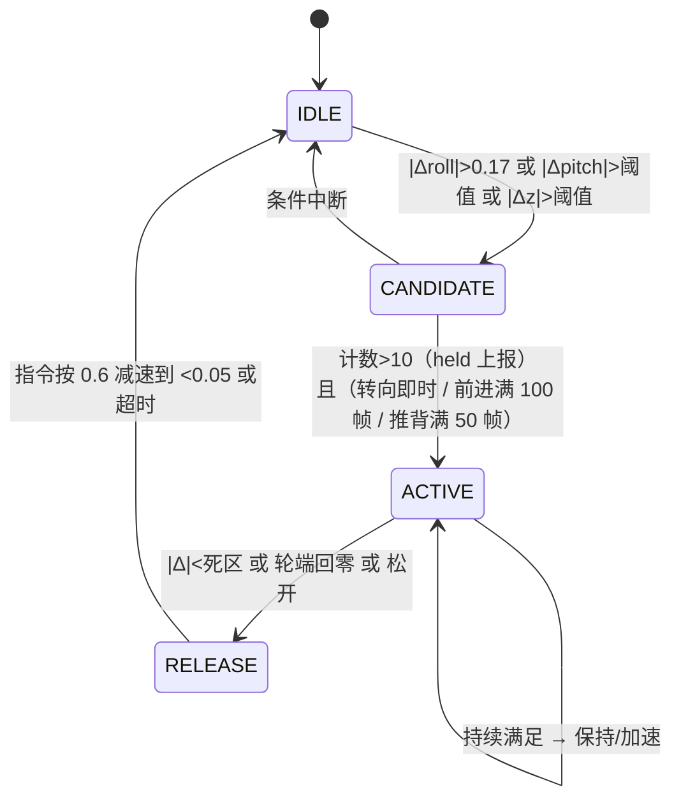
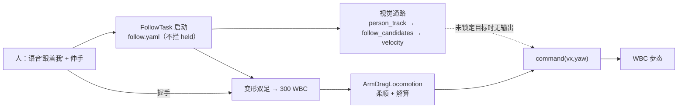

# 【假设稿，不是证据】T1 牵手跟随机制深度分析（V0.1）

> 这是本项目内部的分析假设。请先独立读配置，再逐条裁决本文；不要把它当作事实复述。

# T1 牵手跟随机制深度分析：从"软臂"到速度解算

**版本**：V0.1　**状态**：草稿（内部迭代）　**日期**：2026-11-27
**读者**：运控 / 策略 / 软件 / 测试 / 产品
**范围**：回答"人牵着 T1 的手走"时，T1 到底怎么从**手臂被动**走到**整机随行**；重点拆"柔顺（阻尼感）→ 检测 → 速度解算 → 整形 → 进策略"这条链。**不回答**：视觉跟随（YOLO/ReID/跟随控制律）、Collie 最终参数、牵手外观工业设计。
**证据级别**：全文统一用【配置】【设计】【推断】【待定】；【配置】= 板端 YAML 可直接核对；【推断】= 由字段名/数值关系/控制常识推出，未在真机日志中逐项验证；【待定】= 现有证据无法判定，需实验。
**与其它文档的关系**：补充 [T1 运控架构详解](T1运控架构详解.md) §11.2（那里只写了"有两条通路"）；细化 [运控领域对外接口与场景交互说明](../../01_需求与场景/运控领域对外接口与场景交互说明.md) §4.4 中"手牵=WBC+手臂柔顺【推断】"这一行；给 [Collie Runner 对接总稿](../02_Runner与策略/Collie运控策略Runner架构对接总稿.md) 提供一个"物理交互→速度"的可复用模式。

---

## 0. 结论先行

**一句话**：T1 的牵手跟随不是"进阻尼模式再读速度"，而是——

> **把手臂变成一根很软的弹簧（阻抗/重力补偿），人手的力让这根弹簧产生形变；运控从形变里"解算"出人想走的速度，再用死区、确认计数、限幅、加速度斜坡把它"结算"成 WBC 能吃的速度指令；WBC 本身完全不知道有人在牵手。**

五个关键结论：

1. **不是 `DAMPING_DEFAULT`（动作 2）**。那个是全机身 `kp=0` 的终端安全态，`action_ruler.yaml` 里它**只能回 `PASSIVE_DEFAULT`**（出度 1），根本走不了路。牵手时用的是**手臂级柔顺**：`kp=[4,2,4] N·m/rad`、`kd=0.2`、重力前馈只补 60%。
2. **"速度"是算出来的，不是测出来的**。配置里没有任何"手部力传感器/六维力"字段，检测量是**关节角偏差**与由此正解出的**手端前向位移**（BASELINK 系 +z，单位 m）；输出是**速度指令**（vx、yaw），不是力矩。
3. **能力挂在 bundle 上，不是全局模式**。只有 `BIPED_LOCOMOTION_WBC`(300) 和 `BIPED_GIMBAL` 两份配置有 `arm_drag`；普通双足行走 `bi_walk.yaml` 手臂 `kp=30`，**牵不动**。换句话说：**"能不能被牵"是策略配置的属性**。
4. **牵手是"控制输入 + 任务约束"双身份**。同一个检测结果既驱动速度，又通过 `held_state`（5 态）以 50 Hz 广播出去，让 `task_engine` 的 **9 条**任务规则以 `allow_held_state: false` 拒绝进入。
5. **体验上的两个硬代价**：`0.17 rad（≈10°）`的 roll 死区，和 `100 帧 = 1 s` 的前进确认。前者让"轻轻带一下"不转，后者让"起步要等 1 秒"——这不是 bug，是抗步态摆臂/抗误触的必然代价。

---

## 1. 先把三个"阻尼"分开

现场和文档里都叫"阻尼"，但在 T1 里它们是**三个不同层、不同后果**的东西。混在一起会得出完全错误的结论（比如"牵着手的时候机器人是软的、会倒"）。

| # | 名字 | 在哪 | 数值 | 范围 | 后果 | 证据 |
|---|---|---|---|---|---|---|
| ① | **`DAMPING_DEFAULT`**（Action 2，阻尼急停） | `action_setting.yaml` / `damping_default.yaml` | 全身 `kp=0`、`kd` 3.0（另有 `kd_d: 1.5`，按 1.5 s 相位过渡【推断】），同时把 14 关节往躺姿 `position` 缓慢送【推断】 | **整机 14 关节** | 像泡在糖浆里缓慢倒下；**只能回 PASSIVE**，是终端安全态 | 【配置】[damping_default.yaml](../../04_真机与模型数据/运控模型库/真机/qd1_t2d0/配置/classic/damping_default.yaml) `kp: 0.0 / kd: 3.0 / kd_d: 1.5 / position`；[action_ruler.yaml](../../04_真机与模型数据/运控模型库/真机/qd1_t2d0/配置/action_ruler.yaml) `DAMPING_DEFAULT: next_actions: [PASSIVE_DEFAULT]`；[action_state.yaml](../../04_真机与模型数据/运控模型库/真机/qd1_t2d0/配置/action_state.yaml) `estimator.secure_action: DAMPING_DEFAULT` |
| ② | **手臂 idle 柔顺档**（animation_player） | `classic/animation_player.yaml` | `kp=[4,2,4]`、`kd=0.2`、`gravity_scale=0.6/0.75`、`clip_tau 1.0/1.5` | **6 个上肢关节**（双足形态下 FL/FR 的 roll/pitch/knee） | 手臂"有重量但推得动"，松手会慢慢回到 default；【推断】这是 300 动作下（无动画播放时）手臂的常态 | 【配置】[animation_player.yaml](../../04_真机与模型数据/运控模型库/真机/qd1_t2d0/配置/classic/animation_player.yaml) `idle:` 与 `gravity_comp: idle: enable true` |
| ③ | **拖拽柔顺档（arm_drag / arm_compliance）** | `rl/bi_wbc_run.yaml`、`rl/bi_gimbal.yaml` | `t=[1.0,0.5,1.0]`、`kp=[4,2,4]`、`kd=0.2`（WBC）；gimbal 另有 `arm_compliance`：`kp[4,2,4]/kd 0.2/gravity 0.6/clip_tau 1.0/rest_return_rate 0.5` | **6 个上肢关节** | 拖拽生效时把"牵引手"设成**重力补偿浮动**（可被轻松拉动），相机手保持刚性；gimbal 松手按 0.5 rad/s 回 default | 【配置】[bi_wbc_run.yaml](../../04_真机与模型数据/运控模型库/真机/qd1_t2d0/配置/rl/bi_wbc_run.yaml) `arm_drag:`；[bi_gimbal.yaml](../../04_真机与模型数据/运控模型库/真机/qd1_t2d0/配置/rl/bi_gimbal.yaml) `arm_compliance:` |

**三者关系**：②是"待机"，③是"被牵时切换/覆盖"，①是"出事时兜底"。②③ 在同一量级（kp 4/2/4），所以**人一摸上去就已经是软的了**——不需要先"进入"某个模式；③ 只是把"牵引手"进一步明确成浮动、并开始解算速度。

> **纠偏 1**：牵手时机器人并没有"进阻尼动作"。它仍在 `BIPED_LOCOMOTION_WBC`(300) 里正常走路，`security_guard.yaml` 的 `monitored_actions_biped` 依然把 300 列入跌倒监控——**牵手不解除摔倒保护**。
> **纠偏 2**：`DAMPING_DEFAULT` 的周期是 2 ms（500 Hz，`action_setting.yaml`），实测单拍约 2.28 ms；它是个高频阻尼环（外加一个很慢的躺姿目标），和走路策略不是一条线程。

---

## 2. 证据地图

| 文件 | 关键字段 | 能证明什么 | 级别 |
|---|---|---|---|
| `rl/bi_wbc_run.yaml`（qd1_t2d0） | `dt 0.01`、`kps` 前 6 关节 `1.0/0.5/0.5`、`command_scales.drag_x/drag_yaw`、整段 `arm_drag`（含 wheel / push 子段） | 300 动作里存在"拖拽→速度"的完整参数面；拖拽指令有独立钳位 | 【配置】 |
| `rl/bi_wbc_run.yaml`（qd1_t1d5） | `arm_drag.drag_count_threshold: 10`（注释"某只手连续满足触发条件且计数大于该值**才上报**"）、`arm_above/below_default_pitch_threshold`、`bx_qz_cmd_kp: 3.14` | 检测是**计数式**的；同一检测既解算速度**又上报牵手态**；上下 pitch 各有一个"死区补充"判据 | 【配置】+【推断】 |
| `rl/bi_gimbal.yaml` | 注释"手臂拖拽（牵手 + 推背）：**复用 WBC 的 ArmDragLocomotion**"、`arm_compliance`、`user_arm`、`bx_qz_cmd_ka/kb` | 机制有名字（ArmDragLocomotion）；gimbal 是"一手持相机、一手牵引"的变体，且**相机手从检测屏蔽** | 【配置】 |
| `classic/animation_player.yaml` | `idle / animation / hold / rigid / planner` 五档 profile、`gravity_comp` 按模式开关、`clip_tau`、`gravity_friction` | 手臂"软"是**分档配置**出来的，不是写死；重力补偿是**按动作类型**开关的 | 【配置】 |
| `action_setting.yaml` | 300 = `rl_bi_loco_wbc` 10 ms + `animation_player` 4 ms；`DAMPING_DEFAULT` 2 ms | 双执行组结构：策略 100 Hz + 上肢 250 Hz，两个线程同核 | 【配置】 |
| `action_ruler.yaml` / `action_state.yaml` | `DAMPING_DEFAULT → PASSIVE_DEFAULT`；`estimator.secure_action` | 阻尼是终端态；跌倒兜底的目标就是它 | 【配置】 |
| `interface/.../McHandHeldState.idl`、`McCommonState.msg`、`InteractionState.msg` | `UNKNOWN/BOTH_NOT_HELD/LEFT_HELD_ONLY/RIGHT_HELD_ONLY/BOTH_HELD`、`is_held` | 牵手态是**对外一等状态**，不是内部标志 | 【配置】 |
| `task_engine/cfg/rule/t1/*.yaml` | 9 份文件 `allow_held_state: false` | 牵手态反向门控任务 | 【配置】 |
| `AmRequest.srv` | `REASON_HELD = 41`（"机器人被牵手中"） | 运控对外拒绝动作时，把"被牵"作为一等 reason 返回 | 【配置】 |

---

## 3. 能力挂在哪个 bundle 上

| Action | bundle / runner | 推理周期 | 上肢刚度 | 有 `arm_drag`？ | 能否被牵 |
|---|---|---|---|---|---|
| 102 四足行走 | `rl_quad_loco`（`quad_walk.yaml`） | 10 ms | 四足前肢当腿，`kp 30` | ❌ | 否 |
| 双足行走 `BIPED_LOCOMOTION_DEFAULT` | `rl_bi_loco`（`bi_walk.yaml`） | 10 ms | **`kp 30`**（前 6 关节） | ❌ | **否（硬臂）** |
| **300 `BIPED_LOCOMOTION_WBC`** | `rl_bi_loco_wbc` + `animation_player` | 10 ms + 4 ms | WBC 前 6 关节 `1.0/0.5/0.5`，实际生效的是 animation_player 的 `4/2/4`【推断：高频组覆盖】 | ✅ | **是** |
| **`BIPED_GIMBAL`** | `rl_bi_gimbal`（单 runner） | 10 ms | `kp 50/30/30` 下肢 + 上肢 `arm_compliance` 动态切 | ✅（复用 ArmDragLocomotion） | **是** |

由此得到三条架构结论：

1. **"牵手"不是 MC 的一个模式，也不是一个 Action**。没有任何 `SetMcAction(牵手)`；它发生在 300 内部，靠配置打开。
2. **软臂和拖拽必须成对出现**。`bi_walk.yaml` 手臂 `kp=30`，就算把 `arm_drag` 拷过去也牵不动——形变量不够，检测不到。软臂是"传感器"，拖拽是"读传感器"。
3. **gimbal 变体证明这是可复用的子能力**：同一套 `ArmDragLocomotion` 既能驱动"双手牵引的 WBC 行走"，也能驱动"一手持相机、一手被牵"的云台模式，差别只在"哪只手参与检测"和"限幅多宽"。

> **对照证据**：`bi_gimbal.yaml` 里 `drag_x ±1.0`、`drag_yaw ±1.5`，而速度指令本身是 `cmd_x ±1.2`、`cmd_yaw ±3.0`——**拖拽通道的钳位比正常速度源更窄**。WBC 里两者都是 `±1.4 / ±3.0`（拖拽没有额外收紧）。这是"拖拽通道有独立安全边界"的直接证据。

---

## 4. 端到端链路（逐拍）



按阶段拆（时刻以"手被握住"为 t=0，均为标称 100 Hz 节拍）：

| 阶段 | 时间尺度 | 发生什么 | 证据 |
|---|---|---|---|
| ① 接触 | 0 ms | 人握住手。手臂已在软档，**不需要切换动作** | 【配置】idle/arm_compliance 档 |
| ② 形变 | 10–100 ms | 肩 roll/pitch、膝随力偏转；手的空间位置相对 BASELINK 变化 | 【推断】阻抗 + FK |
| ③ 检测 | 10–1000 ms | roll 越 0.17 rad 立刻可用于转向；pitch 越 ±阈值补判"被牵"；前向位移越 0.24/0.30 m 且**连续 100 帧**才允许给 vx | 【配置】 |
| ④ 上报 | ≤100 ms | `drag_count_threshold 10`（100 ms）满足后置 `is_held`，50 Hz 广播 | 【配置】+【推断】 |
| ⑤ 解算 | 每拍 10 ms | yaw ← roll 误差 PD（过死区 1–2 拍即响应）；vx ← 前向位移/推背 | 【推断】 |
| ⑥ 结算 | 0.2–1.5 s | 加速度斜坡 `acc_x/acc_x_accel 1.0`、偏置 `bias_vx −0.02`、`xlim_with_yaw 0.3`、`drag_x/yaw` 钳位、`cmd_guard 200 ms` | 【配置】 |
| ⑦ 执行 | 10 ms | 速度指令进 obs，策略出 14 维动作；下肢/轮按 `kp 180/30/30/0` 执行 | 【配置】 |
| ⑧ 退出 | 0.5–2 s | 松手 → 形变回零 → 低于死区/停止阈值 → vx 以 `0.6` 减速回落；手臂按 `rest_return_rate 0.5 rad/s` 回 default | 【配置】+【推断】 |

---

## 5. 触发判定：什么算"被牵着"

### 5.1 几何线索（全部来自关节角，不需要力传感器）

| 线索 | 阈值（t2d0 WBC / t1d5 WBC / gimbal） | 用途 | 注释原文 |
|---|---|---|---|
| 肩 **roll** 偏差 | `deadzone 0.17 rad`（≈10°）；`roll_threshold 0.2`（WBC t2d0）/ `0.3`（t1d5 的重复键末值、gimbal） | **转向**：死区内不转；越死区按比例转；持续贴近 `roll_threshold` 进入"持续加速转圈" | "rad，约 10°"；"持续贴近该 roll 角阈值后进入持续加速" |
| 肩 **pitch 上偏** | `arm_above_default_pitch_threshold 0.15 rad`（≈8.6°） | **判定"手被托着"**：人被牵手时手臂会被微微抬起 | "up 小(抬不起自己)" |
| 肩 **pitch 下偏** | `arm_below_default_pitch_threshold 1.50 rad`（≈86°） | 手臂自然下垂时**仍判为被牵**（不是自由摆动） | "down 须卡在自垂量与反手举到顶量之间" |
| 手端**前向位移** | `forward_pos_threshold 0.24`（t2d0 WBC）/ `0.30`（t1d5、gimbal），单位 **BASELINK z（m）**；`abs(z)` 低于此**前进/后退都不触发** | **前后速度** | "双手末端前向位移阈值（m）" |
| 轮端**推背** | `push_wheel_threshold 0.5`（t2d0 WBC）/ `5.0`（gimbal t2d0）/ `0.03`（gimbal t1d5） | 从背后推 → 加速前进 | "推背" |

> **坐标系**：T1 的 `BASELINK` 是 **x 向上、z 向前后**（不是常见的 z 向上）。所以"手往前伸"对应 **z 变大**，字段名 `bx_qz_cmd_*`（base-x 指令，来自 hand-z）也与此一致。见 [T1运控架构详解](T1运控架构详解.md) §10.8 与 `security_guard.yaml` 的 `foot_relative_guard` 注释。

### 5.2 计数与确认（防误触的核心）

| 参数 | 值 | 折算 | 作用 |
|---|---|---|---|
| `drag_count_threshold` | 10（t1d5 WBC） | **100 ms** | "某只手连续满足触发条件且计数大于该值**才上报**"——即 `held_state` 的上报门槛 |
| `forward_confirm_frames` | 100（WBC/gimbal） | **1.0 s** | 连续满足前进条件才下发 vx（防步态摆臂误触发） |
| `push_confirm_frames` | 50 | **0.5 s** | 推背确认 |
| `yaw_spin_confirm_frames` | 5 | **50 ms** | "持续加速转圈"的确认（转向要比前进灵敏得多） |
| `joystick_cooldown_frames` | 250 | **2.5 s** | 摇杆动过之后**禁止推背**，避免两种人力输入打架 |
| `release_confirm_frames` | 40（gimbal `user_arm`） | **0.4 s** | 控臂模式的退出确认（同族机制） |

**为什么转向 50 ms、前进 1 s？**【推断】转向信号（roll）在行走时受摆臂影响小，且人转向意图更急；前后位移在步态周期里天然抖动（手臂随躯干前后摆），必须用长窗口平滑。这个"快转向、慢前进"的非对称是整套参数里最能体现调参经验的地方。

### 5.3 状态机（推断）



【推断】依据：`drag_count_threshold`（计数上报）+ `forward_confirm_frames`（分通道确认）+ `push_stop_threshold/ push_release_decel`（释放减速）+ `wheel_decel_reset_threshold`（轮端复位）。**没有**证据表明存在显式的"松手检测"，更可能是"形变回零 + 指令衰减"的自然收敛。

### 5.4 屏蔽与例外

- **相机手不参与**：gimbal 场景"一只手持相机（`intent_.use_left` 控制手，从检测屏蔽），另一只手牵引"——即**左右手可独立屏蔽**，否则举着相机的手臂会被当成"被牵"。
- **摇杆优先**：`joystick_cooldown_frames 250` 说明拖拽/推背是"低优先级的人力输入"，摇杆一动就让路。
- **左右手独立**：`McHandHeldState` 有 `LEFT_HELD_ONLY / RIGHT_HELD_ONLY / BOTH_HELD`，说明检测是**逐手**做的，最后合并。

### 5.5 上报语义

`McHandHeldState`（`is_held` + `hand_held` 5 态）挂在 `McCommonState` 与 `InteractionState` 两个消息里，50 Hz 广播；`AmRequest` 里还有专门的 `REASON_HELD = 41`。也就是说：**"被牵"是一个可被上层消费的权威事实**，不是藏在运控里的私有变量。

---

## 6. 柔顺层：为什么摸起来像"阻尼"

### 6.1 电机端执行的是 MIT 五元组

T1 的关节命令是 `(p, v, t_ff, kp, kd)`，驱动器按

```
τ = t_ff + kp·(p* − p) + kd·(v* − v)
```

闭合力矩环（`device_manager` 1 kHz）。所以"软/硬"完全由 `kp/kd` 和重力前馈决定，配置里写的 `kp=[4,2,4]` 就是**电机端刚度**（N·m/rad）。

### 6.2 手感估算（把数字翻译成牛顿）

以肩 pitch 为例：`kp=2 N·m/rad`，力臂按 0.35–0.40 m 估：

| 手端位移 | 关节偏转（≈） | 回复力矩 | 等效手端力 |
|---|---|---|---|
| 5 cm | 0.13 rad | 0.26 N·m | ≈0.7 N |
| 10 cm | 0.26 rad | 0.52 N·m | ≈1.4 N |
| 20 cm | 0.52 rad | 1.04 N·m | ≈2.8 N |

再叠加 `gravity_scale 0.6`（**故意少补 40% 重力**，注释："<1 略欠补，避免上飘"）：人还要额外托住约四成手臂自重。结论：**牵 T1 的手，手上的力在"几牛顿"量级**——比牵一个成年人轻得多，但又不是"死鱼"，这正是产品想要的"有生命感的跟随"。

### 6.3 五档 profile：软是分场景配的

| 档 | kp（roll/pitch/knee） | kd | gravity_scale | 重力补偿开关 | 用途 |
|---|---|---|---|---|---|
| `idle` | 4 / 2 / 4 | 0.2 | 0.6 / 0.75 / 0.6 | ✅ | 站立待机、300 常态——**牵手就发生在这里** |
| `animation` | 4 / 2 / 4 | 0.5 | 0.9 / 0.9 / 0.7 | ✅ | 柔性动画播放（挥手、比心） |
| `planner` | 4 / 2 / 4 | 0.2 | 0.6 | ✅ | 进出场归位（enter/exit/putdown） |
| `hold` | 30 | 1.0 | 1.0 | ❌ | 播完保持末帧（举相机、举高不放）——**刚性** |
| `rigid` | 15 | 1.0 | 1.0 | ❌ | 刚性动画 |

**三个关键点**：

0. 【推断】300 动作下没有动画播放时，animation_player 走 `idle` 档，所以"牵手就发生在 idle 档"；gimbal 没有 animation_player，改用 `arm_compliance` 显式切柔顺。
1. **重力补偿按模式开关**（`gravity_comp` 段），不是全局常数。`hold/rigid` 关掉补偿 + 高 kp，是为了"举着相机不能塌"；`idle/animation/planner` 开补偿 + 低 kp，是为了"手臂不砸下来、但推得动"。
2. **`clip_tau` 只限 PD 项，不限重力前馈**：`τ = clip(kp·e − kd·q̇, ±clip_tau) + τ_g`。这是很讲究的一刀——**重力永远补满，纠偏力才限幅**，避免"低刚度 + 大误差"时 PD 项爆掉。

### 6.4 为什么不用纯阻尼（kp=0）

- 纯 `kp=0` 时手臂会**自由下垂**，松手后不会回到 default，下一次牵手起点随机；
- `rest_return_rate: 0.5 rad/s`（gimbal）说明设计上要求"**松手后慢慢回位**"，这必须有弱弹簧；
- 弱弹簧同时是**力传感器**：`F ≈ kp·Δq`，没有弹簧就没有可测的形变。

所以这里的"阻尼感"准确说是：**低刚度弹簧 + 阻尼 + 欠补偿重力**，工程上属于**阻抗控制（impedance）**，不是纯阻尼，也不是力控。

---

## 7. 解算层：速度到底怎么算出来

### 7.1 被测量

- 输入：14 关节实测位置/速度（`/aima/hal/joint/state`），其中前 6 个是上肢。
- 中间量【推断】：用 URDF 正解（`qd1.urdf`，`device_manager` 与 `foot_relative_guard` 都在用）算出**手端在 BASELINK 下的位置**，与 `default_dof_pos` 对应的标称手位相减，得到 `Δz`（前后）、`Δroll`、`Δpitch`。
- 输出：`vx_t`、`yaw_t`（可能还有 `vy=0`，配置里没有拖拽横向通道）。

> **证据边界**：配置只能证明"阈值以 rad 和 m 两种单位出现"。`forward_pos_threshold` 明确写 `(BASELINK z, m)`，说明**确有米制的手端位移**参与；但"用 FK 还是用简化几何映射"没有代码证据，标【推断】。

### 7.2 转向通道（roll → yaw）

```text
e = roll_arm − roll_default            # rad，右负左正（配置注释）
if |e| ≤ 0.17:            yaw_t = 0     # 死区，约 10°
else:                     yaw_t = kp_yaw·(e ∓ 0.17) + kd_yaw·ė
if |e| 持续 ≥ roll_threshold(0.2/0.3) 达 5 帧:
                          yaw_t 进入"持续加速"（yaw_spin_accel 0.8/2.0 rad/s²）
yaw_t = clamp(yaw_t, drag_yaw_min, drag_yaw_max)
```

| 参数 | t2d0 WBC | t1d5 WBC | gimbal | 含义 |
|---|---|---|---|---|
| `deadzone_roll_threshold` | 0.17 | 0.17 | 0.17 | 转向死区（rad） |
| `roll_threshold` | 0.2 | 0.17→0.3（**重复键**） | 0.3 | 进入"持续转圈"的角度 |
| `yaw_spin_confirm_frames` | 5 | —（缺） | 5 | 转圈确认帧 |
| `yaw_spin_accel` | 0.8 | —（缺） | 2.0 | 转圈角加速度（rad/s²） |
| `yaw_vel_scale_kp` | 20.0 | 10.0 | 10.0 | 比例增益 |
| `yaw_vel_scale_kd` | 0.4 | 0.8 | 0.8 | 微分增益 |
| `yaw_vel` | 1.2 | 1.2 | —（无） | 基础角速度项 |
| `drag_yaw_min/max` | ±3.0 | 未单独设（复用 cmd） | ±1.5 | 钳位 |

**读法**：`kp=20` 时，越过死区 0.05 rad（≈3°）就是 1 rad/s；越 0.1 rad 就是 2 rad/s，很快撞到 3.0 的上限。所以**转向是"开关感"很强的**：10° 以内不动，过了 10° 迅速到 1–3 rad/s。`kd` 项（0.4–0.8）提供"甩手"阻尼，防止人手腕一抖就猛转。

### 7.3 前后通道（Δz / 推背 → vx）

**前向（牵手）**：

```text
if |Δz| > forward_pos_threshold and 连续 100 帧:
    vx_t = Kx · Δz          # Kx 有两种写法，见下
vx_t = clamp(vx_t, drag_x_min, drag_x_max)
```

**两代增益写法**（同一功能，不同版本）：

| 写法 | 值 | 反推标定 | 证据 |
|---|---|---|---|
| 单增益 `bx_qz_cmd_kp` | 3.14（t1d5，实际生效）；3.56（注释掉的标定值，紧贴"1.5 m/s"） | `1.5 / 3.56 ≈ 0.42 m`：手前伸约 0.42 m 对应 1.5 m/s | 【配置】 |
| 双增益 `bx_qz_cmd_ka/kb` | 0.1 / 0.01（t2d0 WBC）；3.14 / 17.5（gimbal） | gimbal 的 `ka` 恰好等于旧 `kp` → **疑似"位置项 + 速度项"的 PD 写法**；t2d0 的 0.1/0.01 可能是**另一种量纲/滤波写法** | 【推断】/【待定】 |

> **诚实边界**：仅凭 YAML 无法唯一确定 `ka/kb` 的物理含义。两种自洽解释：
> (a) `vx_t = ka·Δz + kb·Δż`（PD，gimbal 的 ka 与旧 kp 数值相同，支持这一解释）；
> (b) 一阶滤波/积分形式（`vx ← vx + ka·Δz − kb·vx`，t2d0 的 0.1/0.01 支持"每拍小步长"）。
> 两者在"稳态速度 ∝ 位移"上一致，差别只在**起步快慢与超调**。要区分，必须抓 `Δz` 与 `vx_t` 的同步日志（见 §12 实验 E2）。

**推背（从背后推）**：

```text
if push_detect(轮端) 连续 50 帧:
    vx_t += push_accel_kp·...   # 加速，上限 push_vel_max 1.4 m/s
释放后: vx_t 以 push_release_decel 0.6 衰减，低于 push_stop_threshold 0.05 归零
```

| 参数 | 值 | 含义 |
|---|---|---|
| `push_wheel_threshold` | 0.5（t2d0 WBC）/ 5.0（gimbal t2d0）/ 0.03（gimbal t1d5） | "推"的检测阈值——**三个值差两个数量级，说明版本/量纲不一致，直接照抄会出问题** |
| `push_accel_kp / push_decel_kp` | 3.0 / 3.0 | 推的加速/减速增益 |
| `push_release_decel` | 0.6 | 松手减速度 |
| `push_vel_max` | 1.4 | 推背速度上限（= `cmd_x_max`） |
| `push_stop_threshold` | 0.05 | 低于此认为停了 |

### 7.4 轮端"结算"回路

配置里还有一组经常被忽略的参数：

| 参数 | t2d0 WBC | gimbal | 可能含义【推断】 |
|---|---|---|---|
| `wheel_default_x` | 0.0 | 0.0 | 轮角中性位（轮子是连续旋转，必须有参考零位） |
| `wheel_pos_threshold` | 0.02 | 0.02 | 轮角偏差阈值（0.02 rad × r=0.07 m ≈ **1.4 mm**，极小 → 是"有没有被带动"的开关量） |
| `wheel_cmd_reduce_kp` | 3.0 | 18.0 | 轮子往回走时**收**指令的增益 |
| `wheel_cmd_rise_kp` | 3.0 | 10.0 | 轮子被带动时**加**指令的增益 |
| `wheel_decel_reset_threshold` | 0.1 | 0.2 | 减速到该值以下复位轮端状态 |

**最合理的解释**：轮子 `kp=0`、`kd=0.5`（速度型伺服），被推/被拖时会**被动滚动**——轮角就是"机体实际被带走了多少"的积分。控制器拿它和"指令速度"比对：轮子被带得比指令快 → 加指令（`rise_kp`）；轮子被反向拖 → 收指令（`reduce_kp`）。这正是用户说的"**结算**速度"：把"人实际把机器人带多快"结算回指令，让机器人不是纯开环地猜，而是**跟着身体的实际运动收敛**。

这里其实有**两种"结算"语义**，配置里两条通道同时存在：

| 语义 | 观测量 | 方向 | 直觉 |
|---|---|---|---|
| **前馈解算** | 手端 Δz / Δroll | 人的意图 → 指令 | "手往前 = 想快走" |
| **反馈结算** | 轮角被带动的量 | 身体的实际运动 → 指令 | "轮子已经被拖动了，指令跟上" |

如果只有前者，是"人带意图、机器人猜速度"；如果只有后者，是"机器人先被拖、再补速度"。T1 两条都有（`Δz` 通道 + `wheel_*` 通道），最可能是**前馈给方向、反馈给幅度**的叠加关系【待定：谁占主导需 E4 实验】。

> 【待定】`push_wheel_threshold` 到底是"轮角"还是"轮力矩"：0.5/5.0 更像 N·m，0.03 更像 rad。同一字段在两个机型上差 100 倍，**只能说明这一支在快速迭代**，不能作为 Collie 的取值依据。

### 7.5 解算的完整伪代码（重构，非源码）

```text
# 每 10 ms，仅在 arm_drag.enable 且本手未屏蔽时
d_roll  = roll  - roll_default
d_pitch = pitch - pitch_default
z_hand  = FK(arm_q).z                    # BASELINK，+z 向前
d_z     = z_hand - z_default

# 1) 检测（逐手）
cand = (|d_roll| > 0.17) or (d_pitch > 0.15) or (d_pitch < -1.50) or (|d_z| > th_z)
cnt  = cand ? cnt+1 : 0
held = cnt > 10                          # 100 ms → 上报 held_state

# 2) 转向
if |d_roll| <= 0.17: yaw_t = 0
else:                yaw_t = 20*(|d_roll|-0.17)*sign(d_roll) + 0.4*d_roll_dot
if |d_roll| >= 0.2 for 5 frames: yaw_t += 0.8*dt   # 持续转圈
yaw_t = clamp(yaw_t, -3.0, 3.0)

# 3) 前后
if |d_z| > 0.24 for 100 frames: vx_t = 3.14*d_z
if push_detected for 50 frames:  vx_t = push_vel_max 方向加速
vx_t = clamp(vx_t, -1.4, 1.4)

# 4) 结算（与外部速度源共用后处理）
vx  = ramp(vx_t, acc_x_accel=1.0, acc_x=1.0)
yaw = ramp(yaw_t, acc_yaw=3.0)
vx  = min(vx, f(yaw))                    # xlim_with_yaw 0.3
vx += bias_vx(-0.02); yaw += bias_dyaw(-0.018)
vx/yaw = clamp 到 drag_x/drag_yaw
→ 写入 obs[46..48]
```

---

## 8. 结算与整形：进策略之前还过了几道

拖拽解算值**不直接**进网络，它要走和导航速度同一条后处理链（这也是"结算"的第二层含义）：

| # | 处理 | 真机值 | 作用 |
|---|---|---|---|
| 1 | 加速度斜坡 | `acc_x 1.0`（减速）、`acc_x_accel 1.0`（加速）、`acc_yaw 3.0` | 把解算出的阶跃目标变成 ≤1 m/s² 的斜坡，防踉跄 |
| 2 | 加速度钳位 | `x_acc_clip_scale 0.5` | 再削一道 |
| 3 | 转角-速度耦合 | `xlim_with_yaw 0.3` | 大转向时压前进速度，防侧翻 |
| 4 | 偏置补偿 | `bias_vx −0.02`、`bias_dyaw −0.018` | 补"发 0 却漂"的系统偏差 |
| 5 | 拖拽专用钳位 | `drag_x/drag_yaw`（gimbal 更窄：±1.0/±1.5） | 人力输入的速度上限 |
| 6 | 命令过期 | `cmd_guard.expiration_time_ms: 200` | 拖拽通道停更 200 ms → 归零，防"人手走了机器人还在走" |
| 7 | 观测缩放 | `lin_vel ×2.0`、`obs_clip 20`、`frame_stack 10` | 进策略前的量纲/裁剪/堆帧 |

**时间账单（从握手到走起来）**：

```
0 ms        手被握（手臂已是软的）
+10~50 ms   roll 偏转 → 可转向（死区外即时）
+100 ms     held_state 上报（计数 10）
+1000 ms    前向位移确认满 100 帧 → 开始给 vx
+1000~2000 ms  vx 以 1 m/s² 斜坡上升
≈2 s        稳定跟随（典型 0.5~1.0 m/s）
```

也就是说：**转得快（过死区 1–2 拍即响应，约 10–20 ms；转圈加速要 5 帧）、走得慢（约 1 s 才起步，2 s 到速）**。这与"牵着人走"的体感是匹配的——人不会一握手就要求机器人全速。

---

## 9. 对外语义：held_state 与任务门控

### 9.1 状态定义（5 态）

`UNKNOWN(0) / BOTH_NOT_HELD(1) / LEFT_HELD_ONLY(2) / RIGHT_HELD_ONLY(3) / BOTH_HELD(4)`，另有 `is_held`（有一只手被确认时为 true；组合态未知时为 false）。

**注意 `is_held` 的语义**："两只手都没确认"或"组合态未知"时都是 false——**未知不等于没牵**。任务层若把 false 当"安全可动作"，会在检测未收敛时误放行。Collie 应把 `UNKNOWN` 与 `BOTH_NOT_HELD` 分开消费【建议】。

### 9.2 反向门控：9 条规则

`task_engine/cfg/rule/t1/` 下共 **9** 份规则写了 `allow_held_state: false`：

`posture`、`whole_body`、`upper_body`、`rc_joystick`、`rc_gyro`、`motion_teach`、`motion_record`、`motion_playback`、`factory_reset`。

> 旧文档口径写"8 类"，以配置实际计数为准：**9 份**。差异可能来自是否把 `factory_reset` 计入。

语义很直白：**牵着手的时候，不许变形、不许改姿态、不许示教/录制/回放、不许体感遥控、不许恢复出厂**——因为这些都会和"人正握着的手"抢上肢或改变形态。`AmRequest` 用 `REASON_HELD=41` 把这个拒绝原因明确回给上层。

### 9.3 跟随任务本身**不**被 held 门控

`follow.yaml` 里**没有** `allow_held_state: false`（它有 `battery_min_percent 6`、`odom require_trusted`、目标丢失防抖 1500/3000 ms）。这正是"牵手跟随"能成立的前提：**跟随任务可以和人手同时存在**，视觉通路失败时由力导引兜底。



两条通路的**汇合点**是速度指令：视觉通路走 `SetMcInputSource` 抢输入源，力导引通路在 runner 内部直接写 `command`。这就是为什么"视觉全程 `follow/state=1 未发现目标`，机器人却跟着走了"。

---

## 10. 设计评价：意图、代价与失效模式

### 10.1 五个值得学的设计

1. **把柔顺放在"非承重、非平衡"的肢体上**。Base 始终由 WBC 闭环保持稳定，只有手臂变软。人力的引入**不破坏平衡控制**——这是与"全身导纳"最大的区别，也是它敢在量产机上开的原因。
2. **用"软弹簧"当力传感器**。没有六维力/关节力矩传感器，靠 `kp=4` 的弹簧形变反推力；省硬件、免标定、失效模式温和（最坏是"牵不动"，不是"力控发散"）。
3. **物理交互被翻译成策略的原生输入**。策略只会跟速度，那就把人力翻译成速度——**不需要为牵手重训一个策略**，也不需要在 ONNX 里塞交互逻辑。这是一个非常干净的"wrapper 模式"。
4. **快慢分离的确认策略**：转向 50 ms、前进 1 s、推背 0.5 s、摇杆冷却 2.5 s。每个通道按"误触代价 vs 响应代价"单独定窗。
5. **状态外发、门控外置**。`held_state` 广播出去，由 `task_engine` 用声明式规则拒绝 9 类任务；运控不硬编码"牵手时不许干什么"。职责边界清楚。

### 10.2 代价（必须承认的）

| 代价 | 具体表现 | 根因 |
|---|---|---|
| 起步慢 | 握手后约 1 s 才走 | `forward_confirm_frames 100` |
| 转向"段落感" | 10° 内不动，过了猛转 | 死区 0.17 + 高增益 10~20 |
| 松手后惯性 | 可能继续走 0.2~0.6 s（估） | 形变回零需要时间 + 减速 0.6 |
| 速度上限硬 | 人快走/小跑时跟不上（≤1.4 m/s，gimbal 仅 1.0） | `drag_x_max` |
| 单侧牵引不对称 | 只牵一只手时另一只手仍可能触发 | 逐手检测后合并 |
| 参数不可移植 | `push_wheel_threshold` 0.03/0.5/5.0 三个值 | 版本/量纲漂移 |

### 10.3 失效模式与现有缓解

| 失效 | 触发条件 | 现有缓解 | 残余风险 |
|---|---|---|---|
| 误触发（走路摆臂） | 步态让手臂前后摆 >0.24 m 且持续 1 s | 100 帧确认、roll 死区 | 慢速长距离摆臂仍可能命中 |
| 误触发（搬东西/抱物） | 手臂被物体顶住 | 无显式"载物"屏蔽 | **需要上层禁止在载物时开 300**【建议】 |
| 牵着却不动 | 形变被衣服/角度抵消，未越阈值 | 上下 pitch 双阈值补判 | 轻握 + 手臂自然下垂时可能漏判 |
| 拉太猛 | 人突然加速 | `drag_x_max`、`acc_x` 斜坡、`cmd_guard` | 手可能从手里滑脱 |
| 摔倒 | 人被带倒/机器人被拽倒 | `security_guard` 仍监控 300，3 帧/60° 或 6 rad/s+48° → 切 `DAMPING_DEFAULT`（实测 11 ms） | 阻尼后手臂仍软，需人扶 |
| 左右手冲突 | 两手往相反方向拉 | 合并态 `BOTH_HELD`；roll 取哪只未证实 | 【待定】 |
| 检测未收敛 | 上电/切换后 100 ms 内 | `is_held=false`（UNKNOWN 也 false） | 上层若把 false 当"没牵"会误判 |

### 10.4 与"全身导纳/协作机器人"的对比

| 维度 | T1 做法 | 协作机器人（UR/Franka） | 人形全身导纳 |
|---|---|---|---|
| 柔顺范围 | 仅 6 个上肢关节 | 全臂 | 全身 |
| 力感知 | 关节角形变（无 F/T） | 关节力矩传感器 | 力矩 + 足底力 |
| 输出 | **速度指令**（给步态策略） | 关节力矩/位置 | 关节力矩 |
| 稳定性责任 | 交给 WBC 平衡环 | 低增益 + 重力补偿 | 需要全身 QP |
| 代价 | 只能"带路"，不能"被精确拖到某点" | 精确 | 复杂、易失稳 |

T1 的定位很清楚：**它不是协作机械臂，它要的是"像人一样被牵着走"**，所以选了最便宜、最稳、最不改策略的那条路。

---

## 11. 对 Collie Runner 的映射【建议】

> 以下为 Collie 的契约建议，**不是** T1 的既有实现。

### 11.1 把"物理交互"做成一等能力，而不是策略里的 if

建议在 `RunnerManifest` 增加一个可选能力块（名字可改）：

```yaml
interaction:
  hand_held:
    enabled: true
    sensor: joint_kinematic      # 明确：不是 F/T
    arms: [left, right]          # 逐手
    mask: [camera_hand]          # 可屏蔽
    compliance:                  # 柔顺档（进入即生效，不是"模式切换"）
      kp: [4.0, 2.0, 4.0]
      kd: 0.2
      gravity_scale: 0.6
      clip_tau: 1.0
      rest_return_rate: 0.5
    detect:
      roll_deadzone_rad: 0.17
      pitch_up_rad: 0.15
      pitch_down_rad: 1.50
      forward_disp_m: 0.24
      hold_count_frames: 10
    resolve:
      yaw: {kp: 20.0, kd: 0.4, spin_accel: 0.8, spin_confirm: 5}
      vx:  {gain_form: pd, ka: 0.1, kb: 0.01, confirm_frames: 100}   # gain_form 也可为 filter
      push:{confirm_frames: 50, vel_max: 1.4, release_decel: 0.6}
    limits:
      vx: [-1.4, 1.4]
      yaw: [-3.0, 3.0]
    publish:
      held_state: McHandHeldState   # 5 态 + is_held；UNKNOWN≠NOT_HELD
    gates:
      deny_tasks: [posture, whole_body, upper_body, teach, record, playback, rc, reset]
```

### 11.2 三条硬契约

1. **谁写上肢，必须唯一**。T1 是 WBC（软输出）+ animation_player（250 Hz 覆盖）两个写者，靠"频率更高者胜"的隐含规则；Collie 应改成**显式所有权令牌**（`ArmOwnership`），拖拽激活时由 interaction 模块持牌，其余写者必须让位，否则会出现"两套 PD 打架"。
2. **`held_state` 必须由"感知事实"产生，不能由速度/动作反推**。T1 的 `drag_count_threshold` 就是"确认后才上报"；Collie 应同样定义 **UNKNOWN 独立态**，并要求消费方显式处理。
3. **拖拽速度必须走与外部速度源同一条后处理链**（限幅/斜坡/TTL/`OutputGuard`），不允许绕过。T1 用 `drag_x/drag_yaw` 独立钳位 + 共用 `cmd_guard`，这个结构值得保留。

### 11.3 必须补的测试

| 编号 | 用例 | 判据 |
|---|---|---|
| H1 | 静态握手不拉 | 100 ms 内 `is_held=true`，vx 保持 0 |
| H2 | 前向匀速牵引 0.3/0.5/0.8 m/s | 稳态速度误差 ≤20%，超调 ≤10% |
| H3 | 侧向 roll 阶跃 5°/10°/20° | 死区内不转；20° 时 yaw 在 200 ms 内到 1 rad/s |
| H4 | 松手 | 1 s 内 vx→0，无反向抖动 |
| H5 | 推背 0.5 s | 加速至 ≤1.4 m/s，松手 0.6 减速 |
| H6 | 步行中摆臂 | 不触发（连续 10 s 无误报） |
| H7 | 一手持物/相机 | 屏蔽手不参与；另一手正常 |
| H8 | 拖拽中摔倒 | `DAMPING` 在 50 ms 内触发，且拖拽指令立即失效 |

### 11.4 三个反模式（不要抄）

1. **不要为牵手单独训一个策略**。T1 的做法证明：把交互翻译成速度指令即可，策略无需知道"手"的存在。
2. **不要在 ONNX 里做阈值/计数**。这些是**安全与体验参数**，必须在可配置、可观测、可回滚的 runner 前处理里。
3. **不要把 `push_wheel_threshold` 这类跨版本漂移 100 倍的参数直接搬**。Collie 必须重新标定并写清量纲。

---

## 12. 待验证清单（按优先级）

| # | 问题 | 实验 | 需要的日志字段 |
|---|---|---|---|
| E1 | 拖拽指令与外部速度源是**覆盖**还是**叠加**？ | 同时发 `velocity(0.2)` 并牵手前拉 | `input_source`、`command[46..48]`、drag 标志 |
| E2 | `vx_t = kp·Δz` 还是 PD/滤波？ | 阶跃牵引 + 正弦牵引，扫频 | `Δz(t)`、`vx_t(t)`、`vx_final(t)` |
| E3 | `bx_qz_cmd_ka/kb` 的量纲 | 同上，看 gimbal 与 WBC 的差异 | 同上 |
| E4 | 轮端回路是"轮角积分"还是"轮力矩"？ | 轮子悬空/着地两种工况各拉一次 | `RL_FOOT/RR_FOOT` 的 q、dq、τ |
| E5 | 双手同时牵时 roll 取谁？ | 左手 +10°、右手 −10° | `held_state`、`yaw_t` |
| E6 | 松手判定是"形变回零"还是"计数清零"？ | 快速松手 vs 缓慢松手 | `Δz`、`is_held`、`vx` |
| E7 | `arm_drag` 的 kp/kd/t 是否真的覆盖 animation_player？ | 对比两线程的关节指令时间戳 | `rt_joint_pub` 的 UPPER 组 |
| E8 | 牵手时 `security_guard` 的跌倒判定阈值是否变化？ | 牵手中人为推倒（受控场地） | `is_fallen`、`action`、时间戳 |

> 建议采集方式：在 `mc.log` 里打开 `arm_drag.log_decimation: 1`（配置已有该字段，默认每拍打印），能直接拿到 roll/pitch/Δz 与解算中间量。

---

## 附录 A 参数总表（按"检测→解算→结算"排序）

| 参数 | t2d0 WBC | t1d5 WBC | gimbal | 单位 | 含义 | 级别 |
|---|---|---|---|---|---|---|
| `arm_drag.enable` | true | true | true | — | 总开关 | 配置 |
| `deadzone_roll_threshold` | 0.17 | 0.17 | 0.17 | rad | 转向死区 | 配置 |
| `w_deadzone_roll_threshold` | 0.17 | 0.17 | 0.17 | rad | 疑似新旧字段并存 | 待定 |
| `roll_threshold` | 0.2 | 0.17→0.3 | 0.3 | rad | 持续转圈阈值 | 配置 |
| `yaw_spin_confirm_frames` | 5 | — | 5 | 帧 | 转圈确认 | 配置 |
| `yaw_spin_accel` | 0.8 | — | 2.0 | rad/s² | 转圈加速度 | 配置 |
| `yaw_vel_scale_kp` | 20.0 | 10.0 | 10.0 | 1/s | 转向比例增益 | 配置 |
| `yaw_vel_scale_kd` | 0.4 | 0.8 | 0.8 | — | 转向微分增益 | 配置 |
| `yaw_vel` | 1.2 | 1.2 | — | rad/s | 基础角速度 | 配置 |
| `bx_qz_cmd_kp` | — | 3.14 | — | 1/s? | 前后单增益 | 配置 |
| `bx_qz_cmd_ka/kb` | 0.1 / 0.01 | — | 3.14 / 17.5 | — | 前后双增益 | 待定 |
| `forward_pos_threshold` | 0.24 | 0.30 | 0.30 | m | 前向位移门槛 | 配置 |
| `forward_confirm_frames` | 100 | 100 | 100 | 帧 | 前进确认 | 配置 |
| `arm_above_default_pitch_threshold` | 0.15 | 0.15 | — | rad | 上偏补判 | 配置 |
| `arm_below_default_pitch_threshold` | 1.50 | 1.50 | — | rad | 下偏补判 | 配置 |
| `drag_count_threshold` | — | 10 | — | 帧 | held 上报门槛 | 配置 |
| `wheel_default_x` | 0.0 | — | 0.0 | rad | 轮角零位 | 配置 |
| `wheel_pos_threshold` | 0.02 | — | 0.02 | rad | 轮角死区 | 配置 |
| `wheel_cmd_reduce_kp` | 3.0 | — | 18.0 | — | 轮端收指令 | 配置 |
| `wheel_cmd_rise_kp` | 3.0 | — | 10.0 | — | 轮端加指令 | 配置 |
| `wheel_decel_reset_threshold` | 0.1 | — | 0.2 | m/s? | 轮端复位 | 待定 |
| `push_wheel_threshold` | 0.5 | — | 5.0 / 0.03 | 待定 | 推背门槛 | 待定 |
| `push_confirm_frames` | 50 | — | 50 | 帧 | 推背确认 | 配置 |
| `push_accel_kp / decel_kp` | 3.0 / 3.0 | — | 3.0 / 3.0 | — | 推背增益 | 配置 |
| `push_release_decel` | 0.6 | — | 0.6 | m/s² | 推背释放减速 | 配置 |
| `push_vel_max` | 1.4 | — | 1.4 | m/s | 推背上限 | 配置 |
| `push_stop_threshold` | 0.05 | — | 0.05 | m/s | 推背停止 | 配置 |
| `joystick_cooldown_frames` | 250 | — | 250 | 帧 | 摇杆冷却 | 配置 |
| `command_scales.drag_x` | ±1.4 | 未设 | ±1.0 | m/s | 拖拽前后钳位 | 配置 |
| `command_scales.drag_yaw` | ±3.0 | 未设 | ±1.5 | rad/s | 拖拽转向钳位 | 配置 |
| `command_scales.cmd_x` | ±1.4 | −0.3~+1.0 | ±1.2 | m/s | 正常速度钳位 | 配置 |
| `acc_x / acc_x_accel` | 1.0 / 1.0 | 1.0 / 1.0 | 1.0 / 1.0 | m/s² | 加减速斜坡 | 配置 |
| `acc_yaw` | 3.0 | 3.0 | 3.0 | rad/s² | 转向斜坡 | 配置 |
| `xlim_with_yaw` | 0.3 | 未设 | 0.0 | — | 转向压前进 | 配置 |
| `bias_vx / bias_dyaw` | −0.02 / −0.018 | 0 / 0 | 0 / 0 | m/s, rad/s | 偏置 | 配置 |
| `cmd_guard.expiration_time_ms` | 200 | 200 | 200 | ms | 指令过期 | 配置 |
| `transition_frames` | 15 | 15 | — | 帧 | 进入过渡 | 配置 |
| `arm_compliance.kp` | — | — | [4,2,4] | N·m/rad | 牵引手柔顺 | 配置 |
| `arm_compliance.gravity_scale` | — | — | 0.6 | — | 重力补偿比例 | 配置 |
| `arm_compliance.clip_tau` | — | — | 1.0 | N·m | PD 限幅 | 配置 |
| `arm_compliance.rest_return_rate` | — | — | 0.5 | rad/s | 回位速率 | 配置 |

---

## 附录 B 原文摘录（便于复核）

1. `rl/bi_wbc_run.yaml`（qd1_t2d0）`arm_drag` 段头注释：**"拖拽双臂 roll 触发转向（覆盖手柄角速度；右负左正）"**——说明 roll 通道的优先级高于手柄，且符号右负左正。
2. `rl/bi_wbc_run.yaml`（qd1_t1d5）`drag_count_threshold` 注释：**"牵手判定计数阈值：某只手连续满足触发条件且计数大于该值才上报"**——检测→上报的因果链直接证据。
3. `rl/bi_gimbal.yaml` 注释：**"手臂拖拽（牵手 + 推背）：复用 WBC 的 ArmDragLocomotion。"**——机制名称与复用关系。
4. `rl/bi_gimbal.yaml` `arm_compliance` 注释：**"牵引手柔顺：拖拽生效时把牵引手（非相机手）设为『重力补偿浮动』，可被人轻松拉动；相机手保持刚性"**——"阻尼感"的准确描述与逐手策略。
5. `rl/bi_wbc_run.yaml`（qd1_t2d0）`arm_above_default_pitch_threshold` 注释：**"死区补充：手臂 pitch 偏离 default 超过阈值 -> 仍判为牵手。up 小(抬不起自己)；down 须卡在自垂量与反手举到顶量之间"**——检测不只靠前向位移。
6. `action_setting.yaml`：`BIPED_LOCOMOTION_WBC` 下 `rl_bi_loco_wbc` `period_ms: 10`、`animation_player` `period_ms: 4`；`DAMPING_DEFAULT` 下 `damping_default_t1` `period_ms: 2`。
7. `action_ruler.yaml`：`common_rules.allow_all_switch_to: [PASSIVE_DEFAULT, DAMPING_DEFAULT, QUAD_LIE_DOWN]`；`DAMPING_DEFAULT.next_actions: [PASSIVE_DEFAULT]`。
8. `McHandHeldState.idl`：`is_held` 注释 **"False when neither hand is held or the combined state is unknown"**。
9. `task_engine/cfg/rule/t1/follow.yaml`：无 `allow_held_state`；有 `battery_min_percent: 6`、`odom_condition.require_trusted: true`、`target_lost_debounce_biped_ms: 1500`。
10. `AmRequest.srv`：`REASON_HELD = 41  # 机器人被牵手中`。

---

*本文所有 T1 数值仅用于解释机制，不可直接复制到 Collie。Collie 的阈值、增益、限幅必须重新标定并在真机验收（见 §11.3）。*
