# 运控软件架构设计（4+1 视图 · 交付版）

> 用途：向软件团队交底——**要开发什么、有哪些接口、怎么验收**。
> 参考：`Design_T1Pro运控软件系统4+1架构设计简版.md`（视图组织方式与分层命名）。
> 关联：`T1运控MC拆解与自主设计.md`（T1 的做法与取舍依据）、`T1运控安全设计详解.md`（安全细节）。

---

## 0. 目的、读者与范围

### 0.1 这份文档回答什么

| 读者 | 关心的问题 | 看哪章 |
|---|---|---|
| 软件负责人 | 要投多少人、分几块、风险在哪 | §9 |
| 架构师 | 分层、模块边界、接口契约 | §3、§7 |
| 开发工程师 | 我负责哪个模块、它的接口和验收标准 | §3.3、§5 |
| 测试工程师 | 怎么注入故障、怎么判定通过 | §4.5、§8.5 |
| 算法团队 | 我的模型要怎么交付才被接收 | §5.4 |

### 0.2 范围

| 在范围内 | 不在范围内 |
|---|---|
| 运控运行时（行为调度、观测装配、控制环、安全、工具链） | 策略训练（算法团队交付 onnx） |
| 与设备层/上游的接口契约 | 上层任务编排（task_engine） |
| 配置体系与启动校验 | 设备驱动固件 |
| 测试体系（SIL/HIL/故障注入） | App/云端功能 |

### 0.3 相对 T1，我们**简化了什么**（先看这张表）

| T1 的复杂度 | 我们的做法 |
|---|---|
| 61 个动作枚举、58 个动作、62 个执行组 | **只有 2 种行为**（连续 / 一次性） |
| 11 个 RPC（动作/动作播放/预设动作各一套） | **4 个 RPC** |
| 每执行组一条线程（共 36 线程） | **3 条实时线程 + 2 条普通线程** |
| 上肢动画单独一套"叠加"机制 | **同一个行为概念 + 作用域**（UPPER/LEGS） |
| 4 种轨迹格式（CSV/NPZ/ONNX 内嵌） | **1 种 `.mref`**（构建期统一编译） |
| 8 层安全散落各处 | **1 个安全内核 + lease + 阶梯** |

> 一句话：**T1 用"枚举 + 组 + runner"表达行为；我们用"行为 + 作用域"。**

---

## 1. 术语（只有 7 个词）

| 词 | 含义 | 举例 |
|---|---|---|
| **Behavior（行为）** | 一个可独立加载、按固定节拍输出的计算单元 | 行走、变形、跳舞、挥手、阻尼 |
| **Mode（模式）** | 行为的时间形态：`CONTINUOUS`（一直跑）/ `ONE_SHOT`（跑完即止） | 行走=连续；跳舞=一次性 |
| **Scope（作用域）** | 行为写哪些关节：`ALL` / `LEGS` / `UPPER` | 挥手=UPPER；行走=LEGS |
| **MotionRef** | 参考轨迹文件（关节/机身/相位，字段可缺省） | `dance_joyous.mref` |
| **GainProfile** | 一组关节增益（kp/kd/重力系数） | `track` / `soft` / `hold` |
| **Lease（许可）** | 安全内核发给控制环的"可以输出"凭证，50 ms 有效 | — |
| **Manifest** | 唯一配置事实源 | `robot_manifest.yaml` |

### 1.1 只有两种行为（这是最重要的简化）

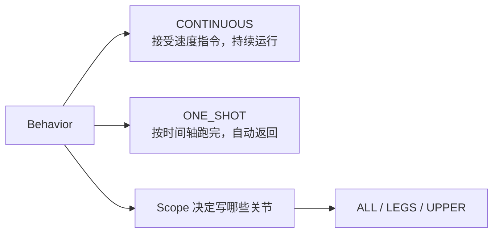

**把 T1 的所有动作映射过来，只有这几类**：

| T1 的动作 | 我们的表达 |
|---|---|
| 站立 / 行走 / 奔跑 / 越野 | `CONTINUOUS` + `scope=LEGS`（接受速度） |
| 四足⇄双足变形 | `ONE_SHOT` + `scope=ALL`（跑完自动回连续行为） |
| 跳舞 / 全身模仿 / 滑冰 | `ONE_SHOT` + `scope=ALL` + `ref=mref` |
| 挥手 / 比心 / 鼓掌（上肢） | `ONE_SHOT` + `scope=UPPER`（可与 LEGS 行为并行） |
| 阻尼 / 卸力 / 躺下 | 内置 `SAFE` 行为（只有安全内核能选） |

**没有"能力标签"、没有"执行组"、没有"叠加层"**——只有"连续还是跑完即止"和"写哪些关节"。

---

### 1.2 一页纸接口速查（开发先看这个）

```text
┌──────────────────────────── 4 个 RPC ────────────────────────────┐
│ SetVelocity(source, vx, vy, wz, ttl_ms)        → accepted, epoch │
│ SetBehavior(scope, id, ref?, params?, interrupt, via[])          │
│                                                → task_id, plan[] │
│ GetState()                                     → StateSnapshot   │
│ SetSafety(level, reason)                       → ok              │
└──────────────────────────────────────────────────────────────────┘
┌──────────────────────────── 2 个流 ───────────────────────────────┐
│ State   50 Hz   StateSnapshot（行为数组 + 速度 + 安全 + 健康）      │
│ Events  事件    切换完成 / 一次性完成 / 故障 / 降级                 │
└──────────────────────────────────────────────────────────────────┘
┌──────────────────────── 3 个作用域 / 2 种模式 ─────────────────────┐
│ Scope: ALL | LEGS | UPPER      （同域互斥，跨域并行）              │
│ Mode : CONTINUOUS | ONE_SHOT   （一次性必须有 return_to）          │
└──────────────────────────────────────────────────────────────────┘
```

**三个必记的约束**：

1. 同一 `scope` 同时只能有一个行为；`UPPER` 与 `LEGS` 可并行；
2. `ONE_SHOT` 必须声明 `return_to`（跑完自动回到连续行为）；
3. 安全行为（damp/passive）**只能由安全内核选择**，普通请求返回 `MC-SAFETY-5001`。

## 2. 场景视图（+1 Scenario）

五个场景覆盖了 95% 的日常使用与全部异常路径。**每个场景都标出用到的接口**，便于对照开发。

### 2.1 场景 A：跟随行走（连续行为 + 速度）

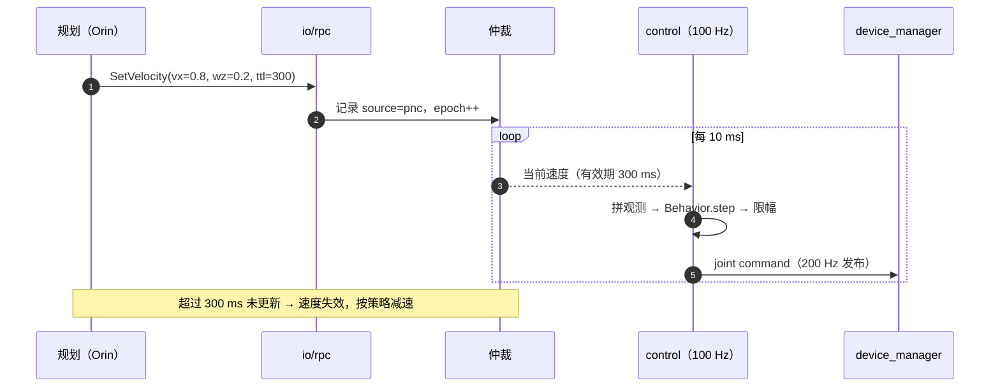

**用到的接口**：`SetVelocity`（唯一连续入口）。

### 2.2 场景 B：四足→双足变形（一次性行为）

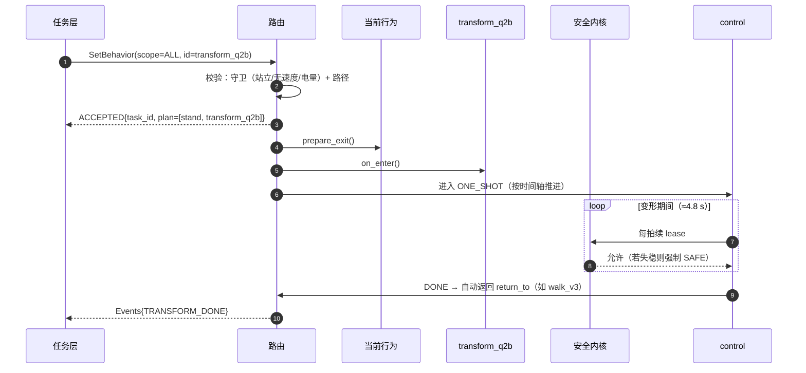

**用到的接口**：`SetBehavior`（一次性动作的唯一入口）、`Events`（完成通知）。

### 2.3 场景 C：播放舞蹈（一次性行为 + 参考轨迹）

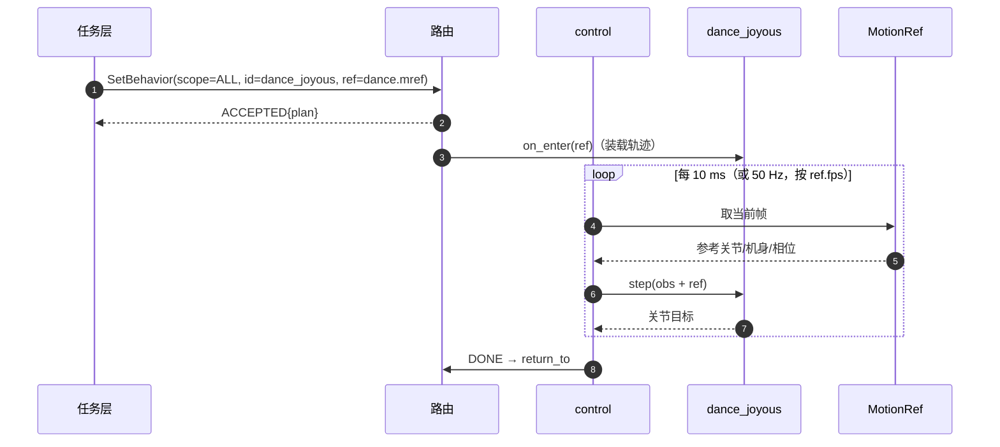

**用到的接口**：`SetBehavior`（带 `ref`）、`GetPlan`（查进度）。

### 2.4 场景 D：边走边挥手（两个作用域并行）

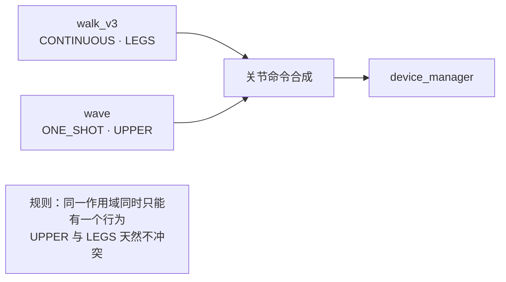

**用到的接口**：两次 `SetBehavior`（`scope=UPPER` 与 `scope=LEGS` 各一次），互不影响。

> 这就是 T1 "双 runner / animation_player 覆盖"的替代方案：**不靠"谁后写"，靠作用域隔离**。

### 2.5 场景 E：跌倒降级（安全路径）

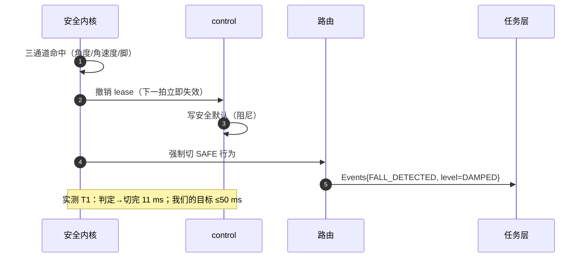

**用到的接口**：`Events`（安全事件）、`GetState`（查级别）。

### 2.6 场景与接口对照

| 场景 | 接口 | 说明 |
|---|---|---|
| A 跟随 | `SetVelocity` | 连续，带 TTL |
| B 变形 | `SetBehavior(ALL, ONE_SHOT)` | 跑完自动返回 |
| C 舞蹈 | `SetBehavior(ALL, ONE_SHOT, ref)` | 参考轨迹 |
| D 叠加 | `SetBehavior(UPPER, ONE_SHOT)` | 与 LEGS 并行 |
| E 跌倒 | `Events` / `GetState` | 安全内核驱动 |


---

## 3. 逻辑视图

### 3.1 分层（按数据流）

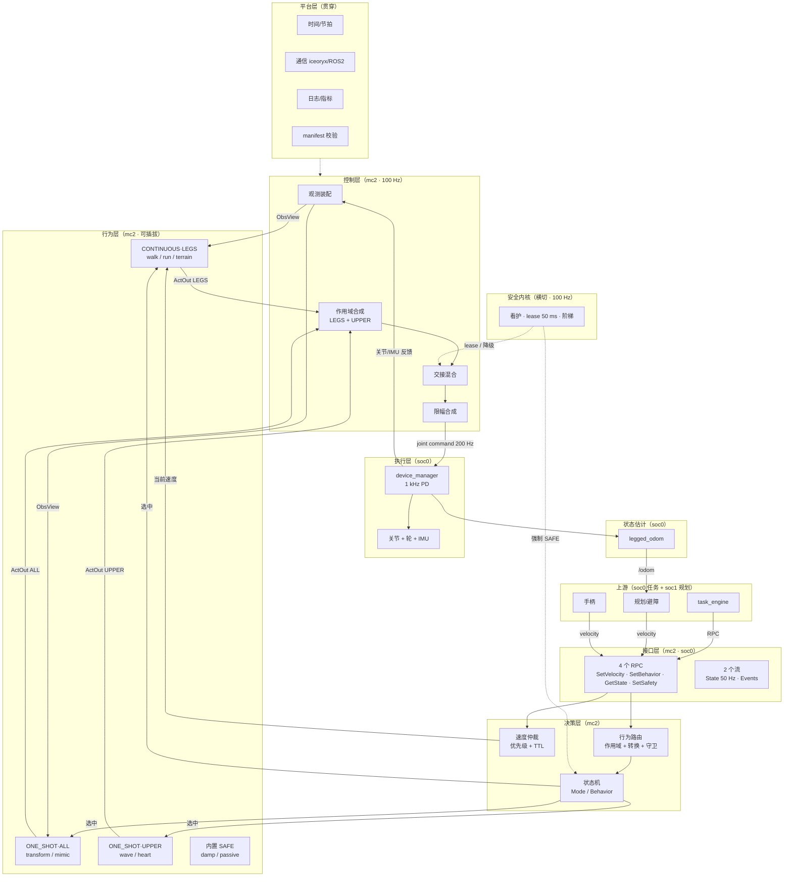

**读法**：实线是数据（意图向下、反馈向上、命令向下），虚线是约束（安全与平台）。每层标题里标了归属 SoC。

### 3.2 模块清单（这就是"要开发什么"）

| # | 模块 | 职责（一句话） | 对外接口 | 依赖 | 交付物 |
|---|---|---|---|---|---|
| 1 | `api/` | 稳定 ABI：Behavior 接口、Obs/Act、错误码 | 头文件 | 无 | `policy_api.h`、`error_code.h` |
| 2 | `core/manifest` | 解析 + 校验 + 生成运行期对象 | `load_and_validate()` | api | 库 + 单测 + 校验器 |
| 3 | `core/obs` | 多源输入 → 命名块观测（滤波/缩放/历史） | `on_*(...)`, `view(spec)` | api | 库 + 单测 |
| 4 | `core/scheduler` | 100 Hz 主循环、时间预算、超期统计 | `tick()` | obs, blender, limiter | 库 + 压测脚本 |
| 5 | `core/blender` | 交接混合（目标 + 增益淡化） | `apply(from,to,s)` | api | 库 + 单测 |
| 6 | `core/scope_sync` | 按作用域合成（LEGS+UPPER） | `merge(acts[])` | api | 库 + 单测 |
| 7 | `core/router` | 转换矩阵、守卫、plan 生成 | `plan(from,to)` | manifest | 库 + 单测 |
| 8 | `core/registry` | 行为加载（onnx/keyframe/builtin）、会话池 | `load(id)`, `preload(list)` | api | 库 + 单测 |
| 9 | `safety/kernel` | 唯一安全权威：lease、阶梯、故障 | `renew()`, `request()` | api | 库 + 故障注入测试 |
| 10 | `safety/guards` | 跌倒/超时/温度/负载判定 | `evaluate(inputs)` | 无 | 纯函数库 + 单测 |
| 11 | `io/rpc` | 4 个 RPC、参数校验、幂等 | RPC 服务 | router, arbiter | 服务实现 |
| 12 | `io/pubsub` | 命令发布（200 Hz）、状态（50 Hz）、订阅 | 话题 | obs, kernel | 服务实现 |
| 13 | `io/state` | 组装 `StateSnapshot`（同一采样） | `build()` | 全部只读 | 库 + 单测 |
| 14 | `tools/mrefc` | CSV/NPZ → `.mref` | CLI | — | 工具 |
| 15 | `tools/mcctl` | validate / plan / replay / bench | CLI | 全部 | 工具 |
| 16 | `test/` | SIL 回放 + HIL 故障注入 | — | 全部 | 测试套件 |

**每个模块都要交付**：代码 + 单测 + README（职责/接口/失败模式）。这是验收条件，不是"建议"。

### 3.3 关键模块的接口签名

```cpp
// 1) 行为接口（算法团队面向它交付，软件团队围绕它开发）
class Behavior {
public:
  virtual bool on_load(const BehaviorSpec&, const RobotModel&) = 0; // 启动期校验
  virtual bool on_enter(const EnterCtx&) = 0;                      // 装载参考（≤20 ms）
  virtual bool step(const ObsView&, ActOut&) = 0;                  // 每拍（≤5 ms）
  virtual void on_exit(ExitReason) = 0;
  virtual Progress progress() const = 0;                           // 一次性行为的进度
};

// 2) 观测：按命名块取
struct ObsView {
  const float* block(const char* name, size_t* len) const;  // "imu"/"joints"/"ref"/"cmd"
  uint64_t stamp_ns; bool fresh;
};

// 3) 输出：四段 + 作用域
struct ActOut {
  float q_des[14], dq_des[14], tau_ff[14], kp[14], kd[14];
  Scope scope;          // ALL / LEGS / UPPER
  uint32_t flags;       // DONE / FAULT / NEED_REF
};

// 4) 路由：先给计划，再执行
struct PlanStep { std::string behavior_id; uint32_t dwell_ms; };
Result<std::vector<PlanStep>> plan(const std::string& from, const std::string& to);
```

### 3.4 一次请求在模块间的流转

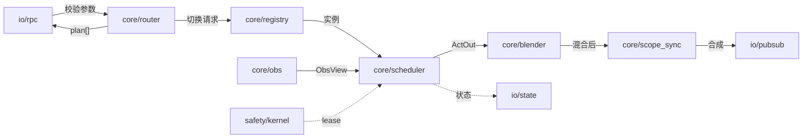

---

### 3.5 模块依赖与并行开发顺序

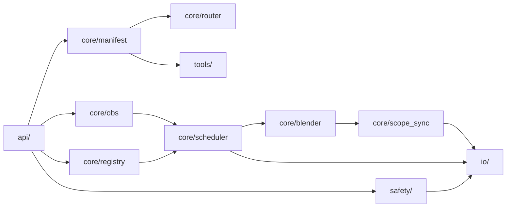

**建议的并行分工（5 条线可同时开工）**：

| 线 | 模块 | 前置 | 说明 |
|---|---|---|---|
| A | `api/` + `core/manifest` | 无 | 最先冻结，其他线依赖它 |
| B | `core/obs` + `core/scheduler` | A（接口） | 可用假行为先跑通 |
| C | `core/blender` + `scope_sync` + `router` | A | 纯算法，易单测 |
| D | `safety/` + `io/` | A | 独立线，互不阻塞 |
| E | `tools/` + `test/` | A | 可先做校验器与回放 |

**关键路径**：`api → manifest → scheduler → io → 集成`。其余线可并行，但**接口必须在 W2 前冻结**。

## 4. 过程视图

### 4.1 线程与周期

| 线程 | 频率 | 优先级 | 核 | 职责 |
|---|---|---|---|---|
| `th_control` | **100 Hz** | RR80 | CPU3 | 观测 → step → 混合 → 合成 → 写命令 |
| `th_safety` | **100 Hz** | **RR85** | CPU3 | 看护、lease、阶梯 |
| `th_publish` | **200 Hz** | RR80 | CPU3 | 关节命令发布 |
| `th_io` | 事件 | 普通 | CPU2 | RPC、订阅 |
| `th_log` | 10 Hz | 普通 | CPU2 | 日志、指标、状态发布 |

**只有 5 条线程**（T1 是 36 条）。原因：所有行为在同一拍内顺序执行，靠作用域与混合解决并发，不再"一组一线程"。

### 4.2 单拍预算（10 ms）

| 步骤 | 预算 |
|---|---|
| lease 续期 + 检查 | 0.1 ms |
| 观测装配 | 1.0 ms |
| Behavior.step（可能 2 个作用域） | ≤5.0 ms |
| 混合 + 作用域合成 + 限幅 | 0.7 ms |
| 写命令 + 统计 | 0.2 ms |
| **余量** | **3.0 ms** |

连续 3 拍超预算 → 请求 `DEGRADED`。

### 4.3 启动时序

```text
1. 加载 manifest 并校验（7 类检查，≤200 ms）
2. 注册内置行为（damp / passive）
3. 预加载 manifest 指定的 onnx（≤3 s）
4. 启动 th_safety → th_control → th_publish
5. 等待反馈就绪（5 s 超时 → 拒绝启动）
6. 进入 SAFE（阻尼），等待上层 SetBehavior
```

**永远从 SAFE 启动**，不做"上电即站立"。

### 4.4 切换规则（2 种模式 × 3 个作用域）

| 当前 \ 请求 | CONTINUOUS（同域） | ONE_SHOT（同域） | 不同作用域 |
|---|---|---|---|
| CONTINUOUS | 交叉淡化 150 ms | 淡出 → 执行 → 自动返回 | **允许并行** |
| ONE_SHOT | 完成后返回 | 排队或打断（参数控制） | **允许并行** |
| 空 | 直接进入 | 直接执行 | — |

**四条硬规则**：

1. **同一作用域同时只能有一个行为**（避免"谁覆盖谁"）；
2. **UPPER 与 LEGS 可并行**（上肢动画不影响行走）；
3. **SAFE 作用域 = ALL**，可抢占任何行为，且不可被普通请求打断；
4. **一次性行为必须有 `return_to`**（跑完自动回连续行为），否则拒绝加载。

### 4.5 切换时序（含混合）

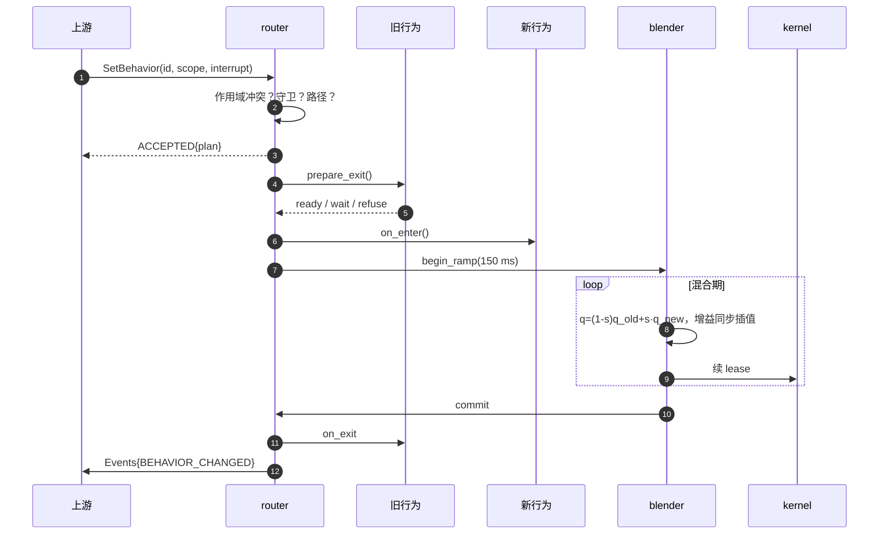

### 4.6 失败与降级

| 场景 | 行为 |
|---|---|
| `on_enter` 失败 | 不切换，返回 `MC-BEHAVIOR-4092`，旧行为继续 |
| 混合中断（用户取消） | 反向混合 ≤100 ms 回到旧行为 |
| 混合中断（安全降级） | 立即中止，进 SAFE |
| step 连续超时 | `DEGRADED`，限制为白名单行为 |
| 反馈过期 | lease 不续 → 输出安全默认 |


---

## 5. 开发视图

### 5.1 目录与构建

```text
mc2/
├── api/                 # 稳定 ABI（对外只暴露这里）
├── core/                # 纯逻辑，不碰 IO
│   ├── manifest/ obs/ scheduler/ blender/ scope_sync/ router/ registry/
├── safety/              # 安全内核与守卫（不依赖 core）
├── io/                  # 唯一知道 ROS2/iceoryx 的层
├── tools/               # mrefc / mcctl
├── manifest/            # robot_manifest.yaml + schema
├── behaviors/           # 行为实现（可含第三方 .so）
├── motions/             # *.mref
└── test/                # 单测 / SIL / HIL
```

**构建约束**：

| 约束 | 原因 |
|---|---|
| `api/` 只依赖标准库 | 保证行为实现与框架解耦 |
| `core/` 不含 IO | 可单测、可回放 |
| `safety/` 不依赖 `core/` | 安全逻辑不被业务带偏 |
| 控制环禁用堆分配 / 文件 IO | 保证确定性 |
| 第三方库需评审（许可证/实时性/体积） | 避免供应链与性能风险 |

### 5.2 `robot_manifest.yaml`（全字段示例）

```yaml
manifest_version: 1
robot: { model: T1Pro, dof: 14, wheels: [9, 13] }

io:
  control_rate_hz: 100
  publish_rate_hz: 200
  feedback_timeout_ms: 10
  velocity_ttl_ms: 300

safety:
  fall: { delta_deg: 60, count: 3, gyro_rps: 6.0, gyro_delta_deg: 48, gyro_count: 3 }
  lease_ms: 50
  ladder: { degraded_hold_s: 1.0, auto_recover: true }

gains:
  track: { kp: [30,30,30,30,30,30,100,30,30,0,100,30,30,0], kd: [1.0,1.0,1.0,1.0,1.0,1.0,1.5,1.0,1.0,0.5,1.5,1.0,1.0,0.5] }
  soft:  { kp: [4,2,4,4,2,4], kd: 0.2, gravity: 0.9 }
  hold:  { kp: 30, kd: 1.0, gravity: 1.0 }

behaviors:
  - id: damp
    mode: CONTINUOUS
    scope: ALL
    impl: { kind: builtin, preset: damping }
    gains: hold
  - id: walk_v3
    mode: CONTINUOUS
    scope: LEGS
    impl: { kind: onnx, path: behaviors/walk_v3/model.onnx }
    obs: { blocks: [imu, joints, prev_action, cmd], history: 10 }
    gains: track
  - id: transform_q2b
    mode: ONE_SHOT
    scope: ALL
    impl: { kind: onnx, path: behaviors/q2b/model.onnx }
    return_to: walk_v3
    duration_s: 4.8
  - id: dance_joyous
    mode: ONE_SHOT
    scope: ALL
    impl: { kind: onnx, path: behaviors/mimic/model.onnx }
    ref: { kind: mref, path: motions/dance_joyous.mref, use: [joints, base] }
    return_to: walk_v3
  - id: wave
    mode: ONE_SHOT
    scope: UPPER
    impl: { kind: keyframe, path: motions/wave.mref }
    gains: soft
    return_to: null            # 上肢动作结束即释放作用域

transitions:
  - { from: walk_v3, to: transform_q2b, guards: [velocity_zero, feet_down, mode_quad], blend_ms: 200 }
  - { from: transform_q2b, to: walk_v3, guards: [mode_biped] }
  - { from: "*", to: damp, priority: emergency }
```

### 5.3 `behavior.yaml`（行为交付格式）

行为目录下必须有一份描述文件，软件侧据此自动校验：

```yaml
id: walk_v3
mode: CONTINUOUS
scope: LEGS
impl: { kind: onnx, path: model.onnx, opset: 18 }
obs: { blocks: [imu, joints, prev_action, cmd], history: 10,
       scales: { dof_pos: 1.0, dof_vel: 0.05, ang_vel: 0.25, cmd: 2.0 }, clip: 20 }
act:
  dim: 14
  semantics: [pos,pos,pos,pos,pos,pos,pos,pos,pos,vel,pos,pos,pos,vel]
  scale: [0.1,0.1,0.1,0.1,0.1,0.1,0.1,0.2,0.2,2.0,0.1,0.2,0.2,2.0]
  default_pos: [...]
gains: track
limits: { tau: 30, dq: 20 }
provenance: { team: 算法, date: 2026-11-01, dataset: sim_v7 }
```

### 5.4 策略接入规范（与算法团队的合同）

| # | 交付物 | 必需 | 校验方式 |
|---|---|---|---|
| 1 | `model.onnx`（fp32、静态形状、opset ≤18） | ✅ | 加载 + 形状校验 |
| 2 | `behavior.yaml` | ✅ | schema + 引用校验 |
| 3 | 验证报告（指标 + 失败案例） | ✅ | 人工评审 |
| 4 | 参考轨迹（MIMIC） | 视情况 | `mrefc` 编译 + 校验 |
| 5 | 训练配置摘要（reward/观测/随机化） | ✅ | 存档 |

**自动验收 6 项（CI 执行，任一失败不合并）**：

```text
1 形状：onnx 输入 == 观测块总维度 × history；输出 == act.dim
2 语义：act.semantics 与 kp 一致（速度维度 kp 必须 0）
3 数值：黄金样本 100 帧，误差 < 1e-4
4 性能：单帧 p99 ≤ 5 ms（目标硬件）
5 稳定：10 分钟随机输入，无 NaN/Inf/超限
6 冲突：scope 与已有行为不冲突（由 manifest 校验）
```

**边界**：算法团队负责"模型在给定观测下输出合理动作"；软件团队负责"把它安全、确定、可切换地跑起来"。**安全行为不在合同内**。

### 5.5 工具链

| 工具 | 用途 | 谁用 |
|---|---|---|
| `mcctl validate` | 校验 manifest + behaviors（CI 门禁） | 全部 |
| `mcctl plan --from walk --to dance` | 预演转换路径，不执行 | 集成 |
| `mcctl replay log.mcap` | 离线回放复现 | 测试/算法 |
| `mcctl bench --rate 100` | 压测控制环（p99） | 性能 |
| `mrefc csv2mref / npz2mref` | 轨迹统一编译 | 算法/内容 |

### 5.6 CI 门禁

| 门 | 条件 |
|---|---|
| 编译 | `-Werror`，无警告 |
| 单测 | 全绿；`core/` 覆盖率 ≥70% |
| 静态检查 | clang-tidy 无 error；clang-format 一致 |
| 配置 | `mcctl validate` 通过 |
| 行为 | `mcctl verify behaviors/` 通过 |
| 性能 | `mcctl bench` p99 不劣化 >10% |

---

## 6. 物理视图

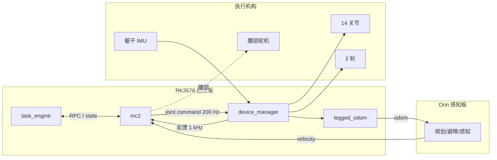

| 连接 | 介质 | 频率 | 备注 |
|---|---|---|---|
| mc2 ↔ device_manager | iceoryx（共享内存） | 200 Hz / 1 kHz | 零拷贝，同机 |
| mc2 ↔ task_engine | ROS2 RPC | 事件 | 跨进程 |
| mc2 ↔ 规划 | ROS2 话题 | 10~50 Hz | 跨板，带宽 ~2 Mbps |
| device_manager ↔ 关节 | CAN-FD 1M/5M | 1 kHz | 双路 can0/can1 |
| device_manager ↔ IMU | 串行/SPI | 500 Hz | — |

---

## 7. 接口规格

### 7.1 四个 RPC

| RPC | 用途 | 关键字段 | 返回 |
|---|---|---|---|
| `SetVelocity` | 连续控制 | `vx/vy/wz/ttl_ms/source` | `accepted, epoch` |
| `SetBehavior` | 离散行为 | `scope, id, ref?, params?, interrupt, via[], timeout_ms` | `task_id, plan[], state` |
| `GetState` | 查询 | — | `StateSnapshot` |
| `SetSafety` | 运维/急停 | `level, reason` | `ok` |

```text
SetBehavior 请求示例
  scope: ALL
  id: transform_q2b
  interrupt: false
  via: []
响应示例
  task_id: 100234
  plan: [stand_hub, transform_q2b]
  state: ACCEPTED
  error: null

失败示例
  state: REJECTED
  error: { code: MC-BEHAVIOR-4092, detail: "guard velocity_zero=false" }
```

### 7.2 两个流

| 流 | 频率 | 内容 |
|---|---|---|
| `State` | 50 Hz | `StateSnapshot`（模式/行为/速度/安全/健康） |
| `Events` | 事件 | 切换完成、一次性行为完成、故障、安全降级 |

```yaml
StateSnapshot:
  stamp_ns, seq
  mode: QUAD | BIPED | TRANSFORM | SAFE
  behaviors: [ { scope: LEGS, id: walk_v3, mode: CONTINUOUS, progress: 0.0 },
               { scope: UPPER, id: wave,   mode: ONE_SHOT,   progress: 0.4 } ]
  velocity: { vx, vy, wz, source, age_ms, epoch }
  safety:   { level: NORMAL|DEGRADED|DAMPED|PASSIVE|CUT, reason, since_ns }
  health:   { feedback_age_ms, cpu_pct, overrun_3s, lease_miss }
```

> 注意 `behaviors` 是**数组**：因为 LEGS 与 UPPER 可以同时存在。这是 T1 "5 个状态字段"的替代。

### 7.3 错误码

```text
MC-<DOMAIN>-<NNNN>
REQ:      4001 参数非法      4002 版本不兼容
BEHAVIOR: 4041 不存在        4091 无路径
          4092 守卫不满足     4093 作用域冲突
          4094 忙（不可打断） 4095 缺少 return_to
MOTION:   4221 参考不存在    4223 fps/长度不符
SAFETY:   5001 安全态拒绝     5002 lease 失效
IO:       6001 反馈超时       6002 发布失败
```

**规则**：一码一因；`detail` 只放字段名与数值。

### 7.4 版本兼容

- `api_version` 语义版本；次版本只加可选字段；
- 破坏性变更开新 RPC 名（`SetBehaviorV2`），旧接口保留一个发布周期；
- `StateSnapshot` 消费方必须容忍未知字段。

---

## 8. 安全设计（简化版）

### 8.1 机制：许可 + 阶梯

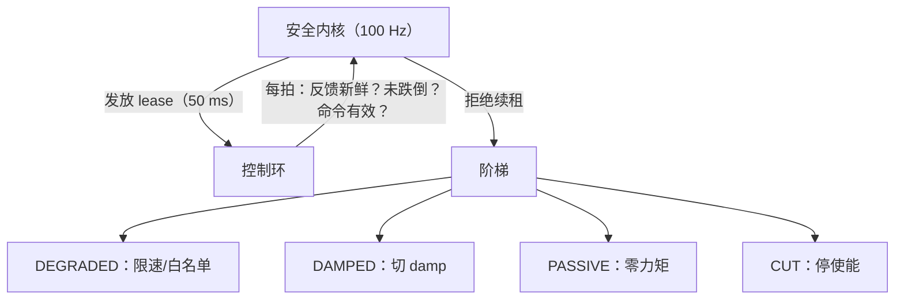

**只有内核能改安全级别**；控制环只能"请求"。

### 8.2 守卫清单

| Guard | 判定 | 后果 |
|---|---|---|
| Fall | 角度 60°/3 帧，或角速度 6 rad/s + 48°/3 帧，或脚 0.8/0.4 m/20 帧（双足） | DAMPED |
| Feedback | 关节/IMU 时间戳 >10 ms | DEGRADED |
| Cmd | 速度命令 >200 ms | DAMPED |
| Lease | 未续上 | 输出安全默认 |
| Temp | 关节温度超阈值 | DEGRADED |
| Load | 3 s 内超期 ≥3 次 | DEGRADED |

### 8.3 与 T1 的差别

| T1 | 我们 |
|---|---|
| 8 层散落，4 个守卫各自为政 | 1 个内核，统一 lease |
| 安全动作是普通 Action（可被任意切换） | SAFE 行为独占，普通请求被拒 `MC-SAFETY-5001` |
| 每层有自己的超时 | 超时统一表现为"lease 不续" |

---

## 9. 交付计划与人力

### 9.1 角色与工作量

| 角色 | 人数 | 负责模块 | 人日 |
|---|---|---|---|
| 架构师 | 1 | `api/`、manifest schema、评审、ADR | 20 |
| 实时控制工程师 | 2 | `core/obs`、`scheduler`、`blender`、`scope_sync`、`registry` | 70 |
| 安全工程师 | 1 | `safety/`、故障注入 | 30 |
| 平台工程师 | 1 | `io/`、`tools/`、CI | 45 |
| 测试工程师 | 1 | SIL/HIL/长跑 | 40 |
| 项目经理 | 0.5 | 计划/风险/对接 | 15 |
| **合计** | **6.5** | | **≈220 人日** |

### 9.2 里程碑

| 周 | 里程碑 | 交付 | 验收 |
|---|---|---|---|
| W2 | M1 接口冻结 | `api/` + 错误码 + schema | 评审签字 |
| W4 | M2 骨架 | scheduler + publish + 空行为 | 100/200 Hz 稳，p99 ≤2 ms |
| W6 | M3 首个行为 | walk + damp | 回放误差达标 |
| W8 | M4 切换与并行 | blender + scope_sync + router | 无跳变；LEGS/UPPER 并行 |
| W10 | M5 安全 | kernel + guards + 注入 | 故障矩阵 100% |
| W11 | M6 轨迹统一 | mrefc + 2 个 MIMIC | 与参考一致 |
| W12 | M7 交付 | 8 h 长跑 + 手册 | 发布标准全过 |

### 9.3 验收指标

| 指标 | 目标 |
|---|---|
| 控制环 | 100 Hz，单拍 p99 ≤8 ms |
| 命令发布 | 200 Hz，抖动 p99 ≤0.5 ms |
| 切换时延 | ≤150 ms（无预热）/ ≤600 ms（预热） |
| 跌倒→阻尼 | ≤50 ms |
| lease 丢失 | <1e-6 |
| 配置导致的现场故障 | 0 |

### 9.4 RACI

| 事项 | 架构 | 控制 | 安全 | 平台 | 测试 | 算法 |
|---|---|---|---|---|---|---|
| 接口 | A/R | C | C | C | I | C |
| 行为接口契约 | A | C | I | R | C | **R** |
| 安全策略 | A | C | **R** | I | C | I |
| 发布 | A | C | C | C | **R** | I |

---

## 10. 附录

### 10.1 术语映射（T1 → 本设计）

| T1 | 本设计 |
|---|---|
| Action（61 枚举） | Behavior（数据声明） |
| 执行组 / Runner | Behavior 实例（无分组概念） |
| `SetMcAction` | `SetBehavior` |
| `SetMcMotion` / `SetMcPresetMotion` | `SetBehavior` + `ref` |
| `action_ruler` | `transitions[]` |
| `action_setting` | manifest 的 `behaviors[]` |
| `action_state` | `mode` 字段 + 安全内核 |
| CSV/NPZ/ONNX 内嵌 | `.mref` |
| animation_player 覆盖 | `scope=UPPER` 并行 |
| `common/state` 9 组 | `StateSnapshot` |

### 10.2 错误码全表

见 §7.3。

### 10.3 与 T1 的架构对照（一页纸）

| 维度 | T1 | 本设计 |
|---|---|---|
| 行为表达 | 枚举 + runner + motion | manifest 声明 |
| 线程 | 36（每组一条） | 5（3 实时 + 2 普通） |
| 切换 | 自动寻路 + 隐式中转 | 显式 plan |
| 交接 | 各控制器自定义 | prepare/ramp/commit |
| 轨迹 | 4 种格式 | 1 种 |
| 安全 | 8 层分散 | 内核 + lease |
| 状态 | 5 字段 | 1 个 snapshot |
| 错误码 | 3 套域 | 1 套 |
| 配置 | 4 份 YAML | 1 份 manifest + CI |
