# T1 Pro 运控软件系统架构设计（4+1 视图 · 简化版）

| 项 | 内容 |
|---|---|
| 文档版本 | v1.0（2026-11-09 首版） |
| 适用对象 | 启元 T1 Pro 双形态轮足机器人（SKU T1-2X，硬件 v2d2） |
| 文档用途 | **内部方案讨论用**简化版架构设计文档：聚焦架构设计与架构图解读，以运动控制（motion control）为重点展开；不含测试实例与实测记录 |
| 内容基础 | 依据部署快照（`t1_deploy/rk_robot/`、`t1_deploy/orin_robot/`）与既有逆向分析文档整理；清单与命名以系统自身配置文件为核对基准（`action_setting.yaml`、`motion_list.yaml`、`mc_T1.yaml` 等） |
| 与主文档关系 | 《T1Pro运控软件系统4+1架构视图》为完整版（含证据标注与实测记录），本文为其方案讨论用的精简重构；深入细节（观测契约逆向、变形策略差异、动作逐条对比）另见《Design_T1_运动控制系统设计方案逆向分析》《T1Pro四足双足形态切换运动控制技术分析报告》《T1Pro动作能力对比表_基于motion_list》 |

---

## 0. 视图总览

本文按 Kruchten **4+1 视图模型**组织：场景视图（+1）牵引四个结构视图，运动控制详细设计按视图归位展开。

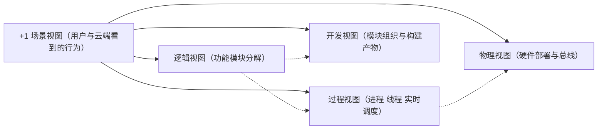

各视图回答的问题与本文落位：

| 视图 | 回答的问题 | 本文落位 |
|---|---|---|
| 场景视图（+1） | 用户/云端看到系统做什么，一条指令如何走完全链路 | §2（跟随、舞蹈、安全、形态切换四类核心场景） |
| 逻辑视图 | 功能分解为哪些模块，模块间如何协作 | §3（六层分解；运动控制层 mc 为重点） |
| 过程视图 | 运行态有哪些进程/线程，实时性如何保障 | §4（进程全景、mc 线程、调度阶梯、状态机、频率漏斗） |
| 开发视图 | 软件按什么模块组织、如何构建与平台化 | §5（部署模块、机型参数包、动作资产） |
| 物理视图 | 软件落到哪些硬件、走哪些总线 | §6（双 SoC、CAN-FD、传感器、外设） |

**全文内容提纲**：

| 章节 | 内容要点 |
|---|---|
| §1 系统概述 | 机型形态与执行机构（双形态、URDF 命名与语义、腰部舵机）；双 SoC 异构分工（soc0 实时域 / soc1 智能域、板间链路）；AimRT / ROS2 FastDDS / iceoryx 软件形态约定 |
| §2 场景视图 | 用例总览（用例 × 承载模块）；四个核心场景全链路时序/流程——目标跟随（速度级）、App/语音触发舞蹈（表演级）、安全守护（异常路径）、四足⇄双足形态切换（全栈联动） |
| §3 逻辑视图（全文重点） | §3.1 运控功能六层分解；§3.2 mc 详设——构件与输入（3.2.1–3.2.2）→ 动作体系两层 RPC 与动作全集（3.2.3）→ 调度与切换机制（3.2.4）→ 模型资产与 RL 推理（3.2.5）→ 三大能力域：模仿舞蹈 / 越障地形 / 拍照运镜（3.2.6–3.2.8）→ 安全与机型自适应（3.2.9–3.2.10）；§3.3–3.6 执行驱动层（device_manager）、状态估计层（legged_odom）、运动决策层（soc1）、交互与任务编排层 |
| §4 过程视图 | 两板进程全景；mc 36 线程架构；实时调度设计（优先级阶梯 + 核隔离 + cgroup）；SM 系统状态机；频率漏斗与实时性预算 |
| §5 开发视图 | 部署模块组织（两板 /robot/software）；mc 机型参数包机制与动作资产（平台化核心）；soc1 模型与地图资产（TensorRT 引擎 24 个）；AimRT 模块工程约定 |
| §6 物理视图 | 部署图（云端 / 双 SoC / CAN-FD 总线域 / 传感器 / 外设）；关键物理连接清单 |
| §7 接口清单 | 运控核心话题与 RPC：`/aima/hal/*`（joint/imu）、`/aima/mc/*`（velocity 等）、SetMcAction / SetMcMotion、ControlTask / FollowTaskCtrl / ControlInsta360 / InteractWithId 等 |
| §8 安全设计 | 九层纵深：电机 → 驱动 → 控制 → 变形专项 → 输入 → 决策 → 手动 → 系统 → 升级 |
| §9 设计特点与权衡 | 8 条设计取向供方案讨论：平台化单二进制、RL 优先、实时域单核收敛、板间解耦、分形态安全、仿真-实机同构、配置沉淀工程经验、"动作=数据"表驱动 |

**按需阅读路径**：快速建立架构概念 → §1 + §3.1 + §6.1；深入运动控制 → §3.2；关注实时性与部署 → §4 + §5；接口对接与二次开发 → §7 + §5.4 + t1-sdk；方案讨论与评审 → §8 + §9。

---

## 1. 系统概述

### 1.1 机型形态与执行机构

T1 Pro 是**双形态轮足机器人**，14 个旋转关节 + 2 个足端执行器 + 1 个腰部舵机：

- **四足形态（quadruped，form=1，z 轴向上）**：四条腿均为"髋滚转-髋俯仰-膝"3 关节构型，后腿足端为驱动轮（RL/RR_FOOT_Joint，行程 ±10 rad 连续旋转），即四轮足形态，支持行走/奔跑/越障/空翻；
- **双足形态（biped / 人形，form=2，x 轴向上）**：后腿站立承载，前腿作为双臂；支持站立、行走、奔跑、WBC（Whole Body Control，全身控制）、上肢动画、舞蹈模仿；
- 两形态经 **RL 过渡策略**切换（`QUADRUPED_TO_BIPED` / `BIPED_TO_QUADRUPED` 家族，含旋转变形 `_ROTATE` 与空翻式 `_FRONTFLIP` 变体）；
- **腰部舵机**是第 15 个自由度：位于前半躯干与后半躯干接合处，变双足时把前半躯干（连同前腿总成与头部）绕机体横轴翻转 90°。它不走 URDF/CAN 电机链路（RL 策略 action_nums=14 不含它），由 `hal_sensor` ServoModule 经 Feetech 串行总线驱动，与 RL 策略**开环并发**，时间对齐依赖策略相位时钟与技能编排顺序。

**URDF 命名不变，语义由形态决定**——14 个关节名按四足构型固化（FL/FR = 前左/前右腿，RL/RR = 后左/后右腿），两形态复用同一套名字，但同一批硬件扮演不同角色：

| URDF 关节（命名固定） | 四足形态（form=1）的角色 | 双足形态（form=2）的角色 |
|---|---|---|
| FL/FR_HIP_ROLL / HIP_PITCH / KNEE（6 个，挂 can0） | 前腿的髋外摆/髋俯仰/膝（行走支撑） | 左/右臂的肩部/上臂/肘部（手臂） |
| RL/RR_HIP_ROLL / HIP_PITCH / KNEE（6 个，挂 can1） | 后腿的髋/膝（行走支撑） | 站立腿的髋/膝（承重平衡） |
| RL/RR_FOOT（2 个，挂 can1） | 后腿足端驱动轮 | 站立足端的驱动轮（轮足） |

一个佐证：CAN 节点名就叫 `upper_node`（上肢）/`lower_node`（下肢）——总线命名按双足语义，关节命名按四足语义，两套语义指向同一批电机。

### 1.2 计算平台：双 SoC 异构分工

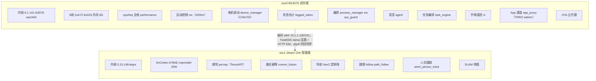

**图的读法与解释**：

- 两个大框（subgraph）各代表一块物理 SoC（部署节点）；框内**一行一个方块**：最上方一组（内核 / 核数与内存 / cpufreq）是该芯片的算力基座，其余按功能角色一行一项排列；
- **soc0（RK3576）定位为实时控制域**：承载 200Hz 控制闭环。运动控制进程 mc、电机驱动进程 device_manager、状态估计进程 legged_odom 全部在此板；cpufreq 全核锁定 performance 档消除变频抖动，与绑核 + SCHED_RR 优先级阶梯共同达成确定性调度（§4.3）；
- **soc1（Jetson Orin）定位为吞吐型感知推理与导航域**：DNN 推理走 TensorRT（GPU），导航/跟随/融合避障在此板；
- **板间链路刻意极简**：跨板话题层为 ROS2 FastDDS（`/aima/...` 命名空间，QoS=BEST_EFFORT 尽力交付——不重传不阻塞，可靠性由 mc 侧 200ms 指令超时守护兜底），另有 HTTP 通道承载 EM 事件管理/诊断事件服务；双板常驻 ptp4l 做 IEEE 1588 PTP 时钟同步，保证跨板日志时间戳可对齐。

**分工原则**：

- soc0 上无任何感知/导航进程，soc1 上无 mc；
- 实时控制闭环全部收敛在 soc0 单一 CPU 核（CPU3）；soc1 只产生**速度级/任务级指令**，两板以低带宽容松耦合话题接口衔接（速度下行、里程计上行）；
- 感知/导航全故障时 soc0 侧运动控制完全自治（手柄仍可救援）——降级路径清晰是设计目标而非副产品；
- 形态切换是全栈事件：同一时刻 soc0（Runner 切换、腰部舵机、里程计估计器重置）与 soc1（form 字段、避障布局切换）同步动作（§2.5）。

### 1.3 软件形态约定

- **AimRT v0.9.1-rc5.10**（自研通信框架）：进程以 `aimrt_main`/独立 app 加载 `bin/cfg/*.yaml`，插件化启用 iceoryx / ros2 / sm / net / mqtt 后端；构建接口基线统一 `release-v1.2.1.patch1004`；线程可用环境变量统一设置（如 `AIMRTE_THREAD_SETTING_UDPany=[2,3]|SCHED_RR:80`、`AIMRTE_THREAD_SETTING_SHM=[2,3]|SCHED_RR:80`，即 AimRT UDP/SHM 后端线程绑 CPU2-3 且 RR:80）；
- **ROS2 Humble + FastDDS**：跨板标准话题层（`/aima/...` 命名空间），消息统一在 `software/interface/aimdk_msgs`（737 msg + 238 srv）；
- **iceoryx 共享内存**：同板高频实时话题（关节指令/状态）零拷贝，`iox-roudi` 常驻；
- 每个 AimRT 模块统一携带 `bin/em_run.sh`（process_manager 统一入口）、`cfg/hds/` + `cfg/event/` 诊断事件库、`version.json`/`pipeline.json` CI 溯源。

---

## 2. 场景视图（+1 Scenarios）

### 2.1 运控相关用例总览

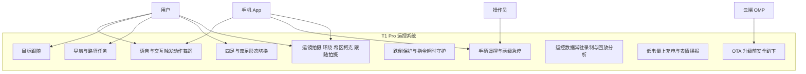

**用例与模块对应**（完整）：

| 用例 | 承载模块 |
|---|---|
| 语音/交互 | agent + task_engine |
| 跟随 | follow + coreon_fusion |
| 导航 | Nav2 + path_follow |
| 手柄 | rc |
| 形态切换与全部动作执行 | mc |
| 安全 | mc security_guard + sm EStop |
| OTA | ota |
| 录制 | drp |
| 上充电 | task_engine（SpeechTask/EmotionTask）+ app_proxy（BMS 上报） |
| 运镜拍摄 | task_engine（OrbitShotTask / HitchcockTask / FollowTask + PhotoSkill）+ insta360 + soc1 算法/follow 链路 |

下面四个核心场景覆盖了运动控制的三类指令形态：**速度级**（跟随）、**表演级**（舞蹈）、**模式级**（形态切换），以及贯穿所有场景的**异常路径**（安全守护）。

### 2.2 核心场景 A：目标跟随（速度级全链路）

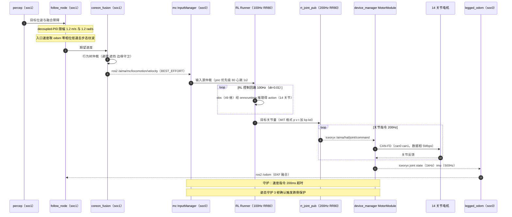

**解释**：这是"智能域发速度、实时域管关节"分层的标准样本：

- **指令下行**：follow_node（soc1）用 decoupled-PID（线速度/角速度各自独立反馈控制）产生期望速度 → coreon_fusion 行为树安全仲裁 → BEST_EFFORT 话题下发 mc → InputManager 按 7 输入源优先级仲裁（§3.2.2）→ RL Runner 策略推理 → rt_joint_pub 以 200Hz MIT 格式指令经 iceoryx 零拷贝到 device_manager → CAN-FD 到电机；
- **反馈上行**：device_manager 以 1kHz/500Hz 回读关节与 IMU → legged_odom 融合成 `/odom` 上行 soc1，作为跟随与导航的定位基准——形成"速度下行、里程计上行"的闭环；
- **可靠性兜底**：BEST_EFFORT 的可靠性缺口由 mc 侧 200ms 指令超时守护兜底——指令断流即触发保护，上层崩溃机器人不失控。

### 2.3 核心场景 B：App/语音触发舞蹈（表演级动作链路）

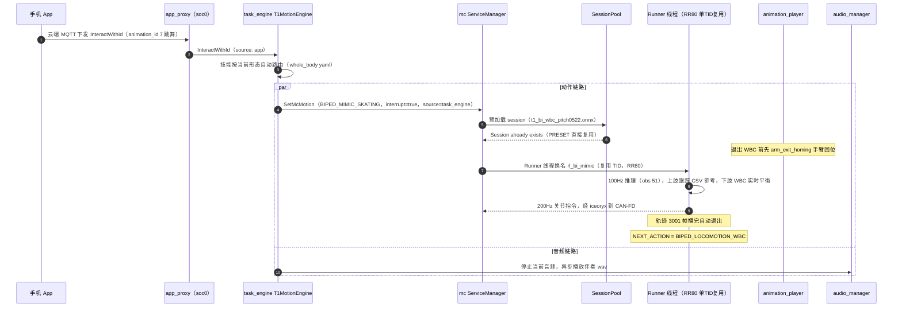

**解释**：表演级链路的关键设计有四点：

1. **统一技能入口**：App（`InteractWithId`，source 字段标识来源）与语音（agent → task_engine）共用技能编排层，动作体系与触发入口解耦；
2. **按形态自动路由**：同一个"跳舞"技能在四足/双足形态下路由到不同动作（whole_body.yaml），上层无需感知形态；
3. **动作与音频并行编排**：task_engine 生成动作任务的同时异步下发伴奏音频；
4. **"上层动作编排 + 底层 RL 平衡"解耦**：舞蹈技术内核是上肢跟踪 CSV 参考、下肢由 WBC 策略实时平衡（§3.2.6）；模仿动作逐帧推进、播完自动退出（frame 3000/3001 → NEXT_ACTION），无需上层干预；`interrupt_frames` 配置允许安全打断。

### 2.4 核心场景 C：安全守护（异常路径）

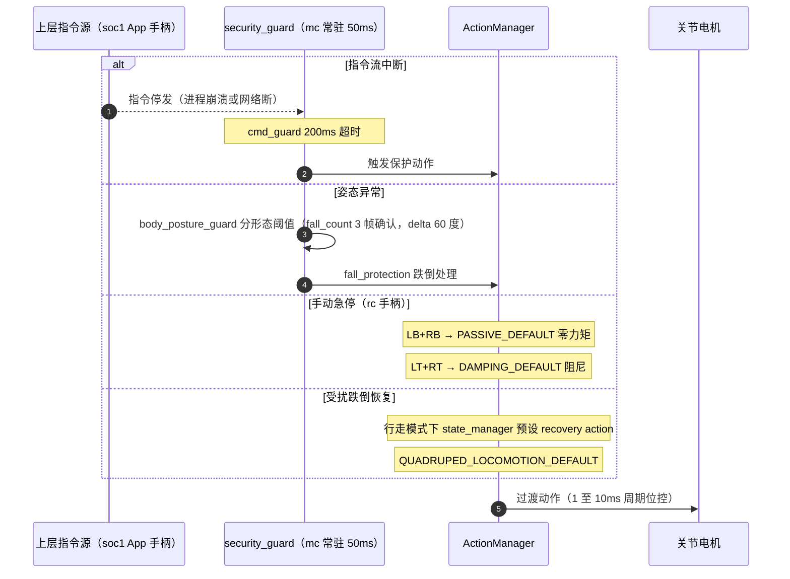

**解释**：安全守护不依赖正常路径，四条异常路径各有独立触发条件：

- **指令流中断**：200ms 超时兜底，上层崩溃机器人不失控；
- **姿态异常**：分形态阈值判定——双足（x 向上）/四足（z 向上）各自配置 `fall_count_threshold: 3` / `fall_delta_threshold: 60°` 与受监护动作白名单；
- **手动急停**：手柄双键组合提供人工两级急停（零力矩 PASSIVE / 阻尼 DAMPING）；
- **跌倒恢复**：走 `DAMPING_DEFAULT → PASSIVE_DEFAULT → QUADRUPED_RECOVERY → QUADRUPED_LOCOMOTION_STEP → QUADRUPED_STAND_DEFAULT` 恢复链，RecoveryRL 控制器以 ExitCheck 自检（姿态范数低于阈值且稳定 1s）后退出；
- **recovery action 兜底**：进入行走模式时 state_manager 预设 recovery action（双服务线程冗余下发，宁可重复不可丢失），跌倒/受扰后自动恢复行走模式。

### 2.5 核心场景 D：四足⇄双足形态切换（全栈联动）

形态切换不是独立的"变形管理器"，而是动作体系中的一类普通 transition action；但它同时是**贯穿全栈的状态变量**——同一变形窗口内，soc0 与 soc1 多模块同步联动。以四足→双足旋转变形（App 默认路径）为主线的全栈流程：

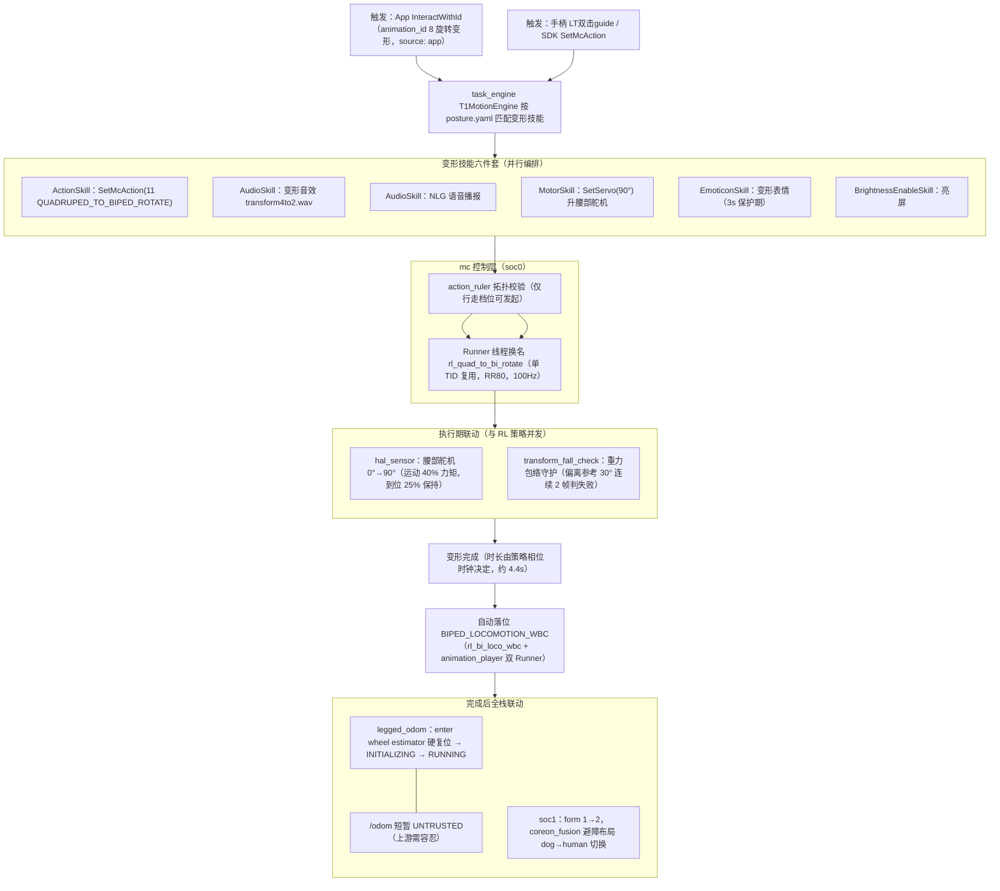

**图解释**（按流程阶段）：

- **触发与编排**：App（`InteractWithId`，source 标识来源）、手柄、SDK 三类入口统一收敛到 task_engine；posture.yaml 按当前动作匹配路由，生成**六件套 skill 并行编排**——ActionSkill 下发 `SetMcAction(11)`，AudioSkill 播变形音效与 NLG 播报，MotorSkill 升腰部舵机，EmoticonSkill 表情（3s 保护期），BrightnessEnableSkill 亮屏；
- **mc 控制层**：action_ruler 拓扑校验（仅行走档位可发起）→ Runner 线程换名 rl_quad_to_bi_rotate（同一实时线程复用，§3.2.4）→ 100Hz 策略推理；
- **执行期联动（与 RL 策略并发）**：腰部舵机 0°→90° 由 hal_sensor 经 Feetech 串行总线驱动（运动 40% 力矩防冲击、到位 25% 保持防堵转发热）——**与 RL 策略开环并发、无闭环耦合**，时间对齐依赖策略相位时钟与技能编排顺序；transform_fall_check 以成功经验重力包络线守护（§3.2.9）；
- **完成与落位**：时长由策略相位时钟确定性决定（约 4.4s），负载/地形不透传到时长——上层编排（音效/舵机时间对齐）可按常数处理；完成后自动落位 BIPED_LOCOMOTION_WBC（双 Runner：下肢 RL 平衡 + 上肢规划）；
- **完成后联动**：legged_odom 硬复位并切入轮式估计器（变形即运动学模型切换点——双足轮式 / 四足足式，旧状态全部作废；`/odom` 短暂 UNTRUSTED，上游 odom_plugin / Nav2 需容忍，§3.4）；soc1 侧 form 1→2（`/aima/interaction/state`，5s 周期订阅），coreon_fusion 切换避障布局 dog→human，跟随与路径规划按形态独立配置（`follow_params_dog/human.yaml`、`local_planner_path_follower_{dog,human}.yaml`）；
- **双足→四足方向对称**，差异三点：发起前需过 WBC 站定门控（见下拓扑规则）；腰部舵机 90°→0°；估计器走 exit wheel estimator + 站立门控后回到 RUNNING，form 2→1。

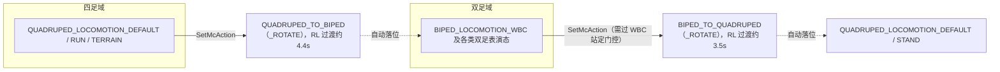

变形是动作体系中的普通 transition action：状态机拓扑校验、Runner 复用、线程复用、安全体系全部免费复用，上层零特判。拓扑规则（`action_ruler.yaml`）：

- **四足侧入口**：仅三个行走档位（DEFAULT / RUN / TERRAIN）可发起变形；踏步（STEP）态的变形出口被注释——踏步是表演类动作的"稳定闸门"，不兼做变形入口；
- **双足侧入口**：WBC 及全部双足表演态可发起变回四足，但需先过 WBC 退出门控（ExitCheck 要求速度指令归零 + 步数达到下限，期间上层以约 110ms 间隔重试 `SetMcAction` 直至放行）；
- **自动落位**：变形完成后自动落位到对侧基础态，无需上层干预；
- **越级拦截**：非法路径返回 `REASON_ACTION_NOT_MATCH` / `REASON_TRANSFORM_CONDITION`。

---

## 3. 逻辑视图（Logical View）——以运动控制为重点

### 3.1 运控功能六层分解

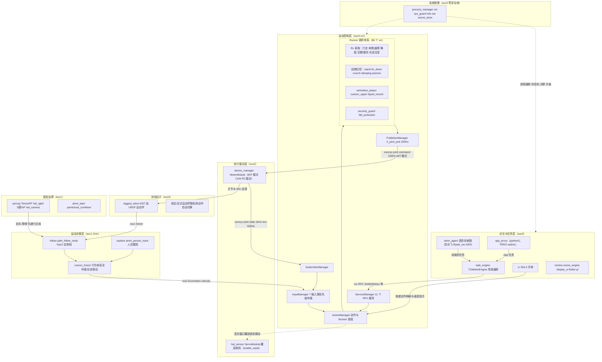

**图的读法与解释**：六个 subgraph 是逻辑分层，不是进程——每层的归属 SoC 标注在层标题中。关键结构 facts：

- **mc 是唯一同时连接决策层（速度输入）、执行层（关节输出）、估计层（状态反馈）的模块**，也是 software/ 下最大模块（1.4G，3057 文件）；
- 层间接口刻意单向化：交互层 → mc 走 RPC（SetMcAction/SetMcMotion 等），决策层 → mc 只走速度话题，mc → 执行层只走 iceoryx 关节指令，反馈沿反方向回流；
- 感知支撑层只喂决策层，不直接触碰 mc——感知/导航故障不影响运动控制闭环；
- 系统管理层（process_manager/sm/sys_guard）以虚线贯穿全栈，负责进程编排、系统状态机与诊断。

以下按"运动控制层（重点）→ 执行驱动层 → 状态估计层 → 运动决策层 → 交互任务层"的顺序展开。

### 3.2 运动控制层详细设计：mc（Motion Control Module）

**职责**：整机运动中枢。接收上层动作/速度指令，调度 Runner 产生 200Hz 关节指令，内置 RL 推理、WBC、安全守护。真机以 `mc_app_main --cfg_file_path=./cfg/mc_T1.yaml` 运行，环境变量 `ROBOT_CFG` 选择机型包（T1 生效 `qd1_t2d0`）。

#### 3.2.1 五大构件

| 构件 | 职责 | 设计要点 |
|---|---|---|
| InputManager | 7 输入源优先级仲裁 | 优先级 90/80/70 + 1000ms 心跳超时失权（§3.2.2） |
| ActionManager | 动作调度与 Runner 编排 | 两层 RPC + action_ruler 拓扑校验（§3.2.3/§3.2.4） |
| Runner 插件体系（86 个 `libmc_runner_*.so`） | 产生 200Hz 关节指令 | RL 家族 / 经典位控 / 安全 / 上肢播放器（§3.2.4） |
| PublisherManager / SubscriberManager | rt_joint_pub 200Hz 输出、反馈订阅 | iceoryx 同板零拷贝 |
| security_guard（常驻，period 50ms） | 指令超时 + 姿态守护 | 200ms / 3 帧确认，分形态阈值（§3.2.9） |

#### 3.2.2 输入源仲裁（InputManager）

7 类输入源按优先级 + 1000ms 心跳超时仲裁，超时失权防失效输入源卡死运动控制。配置来源 `mc_T1.yaml`：

| 输入源 | 优先级（0-100） | 心跳超时 | 说明 |
|---|---|---|---|
| app_proxy | 90 | 1000 ms | App 通道（App 摇杆速度经 `/aima/mc/locomotion/velocity` 下发） |
| app_proxy_t_mode | 90 | 1000 ms | App T 模式 |
| insta360 | 90 | 1000 ms | Insta360 拍摄稳定 |
| rc | 80 | 1000 ms | 手柄遥控（速度直发 mc） |
| interaction | 80 | 1000 ms | 交互（语音/任务引擎） |
| pnc | 80 | 1000 ms | 规划控制（soc1 经 coreon_fusion 下发） |
| vr | 70 | 1000 ms | VR 遥操作（`/aima/teleop_bridge/vr_data`） |

#### 3.2.3 动作体系：两层 RPC 与动作全集

本节是动作体系的**静态定义**——有哪些动作、两层入口如何分工；动作的调度与切换机制见 §3.2.4，模型资产清单见 §3.2.5。指令入口分**两层 RPC**，语义与资产边界如下：

| 维度 | SetMcAction（模式级） | SetMcMotion（表演级） |
|---|---|---|
| 语义 | 机器人**进入哪种运动模式/状态**（切到行走、越野、变形、急停、站立……） | 在模式基座上**具体表演什么内容**（跳哪支舞、放哪段上肢动画） |
| 定义来源 | `action_setting.yaml`：**57 个 transition action + 1 个常驻 action**（本节 ①） | `motion_list.yaml`：**108 项激活 + 12 项注释预留**（本节 ②） |
| 条目形态 | 动作名 → Runner 组合（cfg 固定绑定的编排表） | 动作名 → 类型 + 策略文件 + 参考轨迹 + 打断规则（**纯数据条目**） |
| 覆盖内容 | 行走档位、姿态、急停、恢复、变形、纯策略表演（空翻/太空步/舞蹈步态等）、云台、模仿基座 | 模仿类舞蹈（BIPED_MIMIC ×8 / QUADRUPED_MIMIC ×19 / BIPED_NPZ_MIMIC ×3）+ 上肢动画（ANIMATION ×78） |
| 模型加载 | Runner Init 时按 yaml 固定加载（RunnerFactory 启动预创建，不走动态会话） | 经 SessionPool 会话（PRESET 常驻 / DYNAMIC ≤10）；npz 类策略由 motion_list 逐条运行时下发 |
| 切换机制 | action_ruler 图上寻路 + 两阶段退出 + Runner 线程换名（§3.2.4） | 先按 motion_types 映射到底层模式级 action（走同样的切换机制），再下发轨迹与打断规则 |
| 打断语义 | 状态机拓扑裁决（非法路径拒绝） | `interrupt=true` 可打断当前（BIPED_NPZ_MIMIC 唯一不可打断） |

**两层的关系——表演级是"模式级动作 + 数据包"的封装，不是独立的执行通道**：`SetMcMotion` 先按 `motion_types` 映射到底层模式级动作完成 Runner 切换，再把轨迹与打断规则下发给该 Runner（`action_setting.yaml` 注释自述：`SetMcMotion(type=BIPED_NPZ_MIMIC) → SetNewAction("BIPED_NPZ_MIMIC")`，复用 rl_bi_npz_mimic 控制器）。映射关系：

| motion 类型（表演级） | 底层 action（模式级） | Runner（rl/*.yaml） | 模型来源 |
|---|---|---|---|
| BIPED_MIMIC | BIPED_MIMIC | rl_bi_mimic（bi_mimic.yaml） | t1_bi_wbc_pitch0522.onnx（runner 写死） |
| QUADRUPED_MIMIC | QUADRUPED_MIMIC | rl_quad_mimic（quad_mimic.yaml） | t2_quad_twist_xy_0725.onnx（runner 写死） |
| BIPED_NPZ_MIMIC | BIPED_NPZ_MIMIC | rl_bi_npz_mimic（bi_npz_mimic.yaml） | motion_list 逐条下发（policy.path 留空） |
| BIPED_LINGCHUANG_MIMIC | BIPED_LINGCHUANG_MIMIC | rl_bi_lingchuang_mimic | motion_list 逐条下发（轨迹内嵌 onnx，全部预留） |
| ANIMATION | BIPED_LOCOMOTION_WBC | rl_bi_loco_wbc + animation_player | 基座 wbcterrain2026092602.onnx（模式级资产）+ 上肢 CSV 零模型 |

模式级与表演级的**模型资产清单见 §3.2.5**——模式级按动作类别固定绑定；表演级仅 5 个模仿类模型 + ANIMATION 78 项零模型。

**动作全集（四层清单，完整）**——mc 两层入口的完整清单，加上层两个触发入口（技能层、手柄映射）：

**① mc 模式级动作（`action_setting.yaml`，57 个 transition action + 1 个常驻 action）**：

| 类别 | 动作（SetMcAction） |
|---|---|
| 常驻 | security_guard_t1（50ms 周期，resident_actions） |
| 急停 | PASSIVE_DEFAULT（零力矩急停）、DAMPING_DEFAULT（阻尼急停） |
| 四足姿态 | QUAD_LIE_DOWN、QUADRUPED_CROUCH_DEFAULT、QUADRUPED_GET_DOWN_DEFAULT、STORE_DEFAULT、QUADRUPED_SIT_DOWN_DEFAULT、QUADRUPED_READY_STAND_DEFAULT、QUADRUPED_STAND_DEFAULT、QUADRUPED_STAND_REVERSE_DEFAULT、QUADRUPED_BODY_ADJUST_DEFAULT |
| 四足行走/特技/仿生 | QUADRUPED_LOCOMOTION_DEFAULT、QUADRUPED_LOCOMOTION_REVERSE_DEFAULT、QUADRUPED_LOCOMOTION_STEP、QUADRUPED_LOCOMOTION_RUN、QUADRUPED_LOCOMOTION_TERRAIN、QUADRUPED_LOCOMOTION_JUMP、QUADRUPED_LOCOMOTION_HANDSHAKE、QUADRUPED_LOCOMOTION_FRONTFLIP、QUADRUPED_LOCOMOTION_BACKFLIP、QUADRUPED_LOCOMOTION_STRETCH、QUADRUPED_LOCOMOTION_DANCE、QUADRUPED_LOCOMOTION_BIONIC、QUADRUPED_LOCOMOTION_PRIDE、QUADRUPED_LOCOMOTION_PLEASURE、QUADRUPED_PUSH_UP、QUADRUPED_RECOVERY（任意姿态恢复四足） |
| 双足 | BIPED_STAND_DEFAULT、BIPED_RECOVERY、BIPED_LOCOMOTION_DEFAULT、BIPED_LOCOMOTION_RUN、BIPED_LOCOMOTION_TERRAIN、BIPED_LOCOMOTION_WBC、BIPED_LOCOMOTION_ANIMATION、BIPED_LOCOMOTION_WBCDANCE、BIPED_LOCOMOTION_ROTATE_LOCAL、BIPED_LOCOMOTION_BACKBEND、BIPED_LOCOMOTION_MOONWALK、BIPED_LOCOMOTION_DANCE、BIPED_GIMBAL（云台）、BIPED_YUZURU（羽生结弦）、BIPED_SPLIT（劈叉）、BIPED_RECORD_UPPER（录制）、BIPED_CUSTOM_UPPER（二开上肢） |
| 模仿 | BIPED_MIMIC、BIPED_NPZ_MIMIC、BIPED_LINGCHUANG_MIMIC、QUADRUPED_MIMIC |
| 形态切换 | QUADRUPED_TO_BIPED、QUADRUPED_TO_BIPED_ROTATE、QUADRUPED_TO_BIPED_FRONTFLIP、BIPED_TO_QUADRUPED、BIPED_TO_QUADRUPED_ROTATE、BIPED_TO_QUADRUPED_FRONTFLIP——共 6 条变形路径（§2.5） |
| 测试/工具 | TEST_PLATFORM、TRAJECTORY_GENERATOR、TEST_FOURIER |

> 注：两条 FRONTFLIP 变形路径（action ID 12/22）在 `action_ruler.yaml` 中入口被注释禁用（能力预留、现网不可达），Runner/onnx/估计器映射资产保留。

**② mc 表演级动作（`motion_list.yaml`，108 项激活 + 12 项注释预留）**：

| 分组 | 数量 | 明细 |
|---|---|---|
| 双足 npz 模仿（BIPED_NPZ_MIMIC） | 3 | BIPED_NPZ_MIMIC_JOYOUS、BIPED_NPZ_MIMIC_JOYOUS2、BIPED_NPZ_MIMIC_JOYOUS3 |
| 双足全身模仿（BIPED_MIMIC） | 8 | BIPED_MIMIC_SKATING（=App"跳舞"）、BIPED_MIMIC_SHOW、BIPED_MIMIC_DANCE_WORLDCUP_ONE、BIPED_MIMIC_YAOLAWU、BIPED_MIMIC_QIUMI、BIPED_MIMIC_NAOYANGYANG、BIPED_MIMIC_POSHUIWU、BIPED_MIMIC_POPPING |
| 四足全身模仿（QUADRUPED_MIMIC） | 19 | QUAD_MIMIC（通用）、QUAD_MIMIC_PRIDE、QUAD_MIMIC_PONDER、QUAD_MIMIC_HEED、QUAD_MIMIC_GLANCE、QUAD_MIMIC_DANCE_TWO、QUAD_MIMIC_DANCE_THREE、QUAD_MIMIC_TALK_ONE、QUAD_MIMIC_TALK_TWO、QUAD_MIMIC_TALK_THREE、QUAD_MIMIC_TALK_FOUR、QUAD_MIMIC_TALK_FIVE、QUAD_MIMIC_SCARED、QUAD_MIMIC_RHYTHM、QUAD_MIMIC_RHYTHM_TWO、QUAD_MIMIC_SAD、QUAD_MIMIC_HANDSHAKE、QUAD_MIMIC_GREET、QUAD_MIMIC_BREATH |
| 上肢动画（ANIMATION，数字 ID） | 78 | 1xxx 右手（7）：1001 右手挥手、1002 右手握手、1003 右手挥手（面对1.5m以上观众）、1004 右手碰拳、1005 右手加油欢呼、1006 右手抬起（持摄像杆）、1007 右手拍照抬起；1xxx 左手（6）：1011 左手挥手、1012 左手握手、1013 左手挥手（面对1.5m以上观众）、1014 左手碰拳、1015 左手加油欢呼、1016 左手抬起；2xxx（43）：2001 双手比心、2002 喜悦时双手挥动、2003 说话动作、2004 说话动作1、2005 说话动作2、2006 说话动作3、2007 说话动作4、2008 说话动作5、2009 说话动作6、2011 拍照动作1、2012 拍照动作2、2013 拍照动作3、2014 拍照动作4、2015 双手抬起、2016 双手加油欢呼（舞蹈动作1替换）、2017 骄傲、2020 三连拍、2021 跳舞动作、2022 蛇形舞动1、2023 舞蹈动作2和3拼接、2024 小幅度说话动作、2025 人形炫耀动作（只有上肢）、2026 人形拥抱、2027 人形炫耀（带腰部）、2028 人形炫耀（腰部更明显）、2029 人形滑冰30s（会下腰）、2030 人形滑冰、2031 人形律动、2032 人形喜悦、2033 人形难过、2034 人形害怕、2035 人形思考1、2036 人形思考2、2037 人形思考3、2038 人形思考4、2039 人形惯性转圈90度、2040 人形惯性转圈360度、2041 人形聆听、2042 人形31s配合讲话动作、2043 蛇形舞动2、2044 跳舞动作、2045 左手高举起不放下、2046 右手高举起不放下；3xxx（17）：3038 单臂击掌、3040 双手欢呼、3043 双手挥舞、3045 双手挥舞2、3046 双手挥舞3、3047 左右手挥舞、3048 双手欢呼1、3052 打招呼、3054 双手欢呼2、3055 双手欢呼3、3056 打招呼2、3061 全身跳舞2、3062 保持手臂动作1（点云采集）、3064 保持手臂动作2（点云采集）、3065 保持手臂动作3（点云采集）、3069 双足摇篮舞、3070 双足球迷舞蹈；5xxx 拍照姿势（5）：5001 放电脑用、5002 右手平举、5003 左手平举、5004 右手高举、5005 左手高举 |
| 注释预留（未激活） | 12 | 灵创模仿 6：BIPED_LINGCHUANG_MIMIC_DANCE_HISTORY、_HAICAO、_MEIXI、_QIUMI、_CLUO、_CLUO_JUMP；npz 模仿 5：BIPED_NPZ_MIMIC_FIGURE_SKATING、_AABATTERY、_IWILLBETHERE、_101、BIPED_NPZ_APRIL_LIE；上肢动画 1：100（Double_hand_default_pos.csv） |

> ANIMATION 78 项中 `animation_type` 区分「动画」（播完回默认位）与「保持末帧」（持物/拍照/点云采集保持）；播放 fps 混用 60（早期）/100（主流）/110~150（特殊剪辑）。108 项中约 70 项有 task_engine 技能入口。**二开注意**：同一数字在 mc 与 task_engine 语义可能不同（如 3069.csv 上肢版与全身版同名不同文件），引用必须以文件路径为准。

**③ 交互技能层（task_engine `motions/t1/`，约 100 项，App/语音入口）**：

| 分组 | 技能（animation_id → 名称） |
|---|---|
| 姿态 posture | 3 坐下、4 趴下、5 站起、8 旋转变形、9 简易变形、46 任意姿态恢复、55 前空翻变形、56 前空翻、100 双足默认姿态、4001~4004 室内/户外/超能力/搬运模式、9999 模拟动画 |
| 全身 whole_body | 1 打招呼、2 右手握手、7 跳舞、10 跳舞B、11 跳舞C、25 骄傲、26 喜悦、27 伸懒腰、38 摆姿势、40 俯卧撑、41 向前跳、43 律动、44 害怕、45 难过、49 聆听姿态、50 说话姿态、51 思考姿态、52 太空步、53 退出太空步、54 四处打量、57 律动2、62~65/68 四足说话×5、77 呼吸动作、80 随机跳舞、3061 跳舞、3081 牵引拉车、3086 元气热舞、3087 欢快劲舞、3088 机械舞步、凌空回旋、元气转圈、冰上旋舞、滑行登场、四月的谎言（部分预留） |
| 上肢 upper_body | 6 双手比心、20~22 拍照姿势×3、28/29 碰拳、30 左手握手、31 加油欢呼、32/33 单手抬起、34 双手抬起、35~37 放下、42 转圈、58~61/67 讲话动作、60 说话、66 掐腰、69~71 思考×3、72/73 惯性转圈90°/360°、74 拥抱（开箱）、75 人形舞蹈（开箱）、76 展示、78/79 举手过头顶、3038~3055 击掌/欢呼/挥舞×11 |
| 内置 inner | 3062 切菜、3063 投降、3064 敲门、3065 摇铃、3066 打羽毛球、3067 打鼓、3068 敲锣、3069 指挥、3070 打电话、3071 跳舞（上肢）、3072 拳击 |

**④ 手柄直达映射（rc `input_rules.yaml`，30+ 键位）**：

| 类别 | 按键 → 动作 |
|---|---|
| 急停 | LB+RB → PASSIVE_DEFAULT；LT+RT → DAMPING_DEFAULT |
| 四足模式 | LT+B 站立、LT+X 行走、LT+Y 越野、LT+A 奔跑、RS+X 反向行走、RS双击A 姿态调整 |
| 四足特技 | LS双击B 前空翻、LS双击Y 后空翻、LS双击A 跳跃、RS+B 四足舞蹈、Y+A 趴卧 |
| 仿生 | LT双击B 仿生、LT双击A 傲娇、LT三击A 愉快、LT双击Y 四足舞蹈 |
| 双足模式 | RS+Y 行走、RT+Y 越野、RT+A 奔跑、RT+X WBC、RT+B 原地旋转、RS+A 下腰、RS双击A 太空步、RS双击B 云台 |
| 变形 | LT+guide 变双足、LT双击guide 旋转变双足、LS+start 空翻变双足；RT+guide / RT双击guide / RS+start 对应变回四足 |
| 恢复 | LT双击back 四足自恢复、RT双击start 双足自恢复 |
| 组合技 | RT+start+X/Y/B/A、RS+start+X/Y → t1_skill_1~6 脚本（运镜环绕等，内含舵机 HTTP RPC 控制）；back+LS/RS+Y 挥手 |

**⑤ 变形路径六条（2 方向 × 3 风格，完整）**：

| 动作名 | action ID | Runner | 策略配置 | 机型包模型 |
|---|---|---|---|---|
| QUADRUPED_TO_BIPED | 10 | rl_quad_to_bi | quad_to_bi_run.yaml | t2.2_quad2bi_norm_0708.onnx |
| QUADRUPED_TO_BIPED_ROTATE | 11 | rl_quad_to_bi_rotate | quad_to_bi_rotate_run.yaml | t2_quad2bi_yaw_6837.onnx |
| QUADRUPED_TO_BIPED_FRONTFLIP | 12（禁用） | rl_quad_to_bi_frontflip | quad_to_bi_frontflip_run.yaml | t2_q2b_flip_0720.onnx |
| BIPED_TO_QUADRUPED | 20 | rl_bi_to_quad | bi_to_quad_run.yaml | t2_b2q_norm_v1.0_0601.onnx |
| BIPED_TO_QUADRUPED_ROTATE | 21 | rl_bi_to_quad_rotate | bi_to_quad_rotate_run.yaml | t15_bi2quad_rotate_v1.1_terrain.onnx |
| BIPED_TO_QUADRUPED_FRONTFLIP | 22（禁用） | rl_bi_to_quad_frontflip | bi_to_quad_frontflip_run.yaml | （frontflip 系） |

三种风格的设计差异（"从普通到旋转做加法，从旋转到空翻做减法"）：

| 维度 | 普通变形 | 旋转变形（App 默认路径） | 前空翻变形（现网禁用） |
|---|---|---|---|
| 观测维度 | 51 | 54（+imu_yaw_diff×2 + rotate_phase 独立相位时钟） | 47（裁掉 q_ref 参考） |
| 特有设计 | 无偏航观测 | 前腿髋滚转 action_scale=0 锁死、后腿 kp 100/80 承重、clip 50→200 放宽 | 收紧限幅（clip 20）、gravity_guard 放宽 40°、3s 超时兜底、落地渐进刚度 |
| 相位时间表 | start 0.5 / flip 1.5 | start 1.0 / flip 2.0 / rotate 2.5 | flip 2.0 + auto_switch_timeout 3.0 |
| 时长（相位时钟决定） | 约 2.2~3.0s | 约 4.4s（q2b）/ 3.5s（b2q） | 约 3.0s |

变形时长由策略相位时钟确定性决定（与重力参考 CSV 帧数、相位表参数三方吻合），负载/地形/起始微姿态不透传到时长——上层编排（音效/舵机时间对齐）可按常数做时间对齐。

#### 3.2.4 动作调度与切换机制（Runner 插件体系）

核心设计是**"动作（Action）= Runner 组合"的插件体系**，86 个 `libmc_runner_*.so` 按需加载：

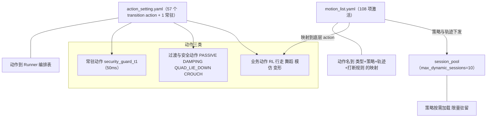

**Runner 家族**（按命名归纳，86 个 so 的完整分类）：

| 家族 | 代表 Runner | 说明 |
|---|---|---|
| 经典位控 | quad_stand / quad_lie_down / quad_crouch / biped_stand / damping_default_t1 | 关节空间 PD 轨迹跟踪（`classic/*.yaml` + `trajectory_generator.yaml`：dt=0.001s、kp=100/kd=1.5（get_down）、kp=50/kd=0.5 多项式插值） |
| RL 行走 | rl_quad_loco / rl_quad_loco_run / rl_quad_loco_terrain / rl_bi_loco / rl_bi_loco_run / rl_bi_terrain / rl_bi_loco_wbc | 四足/双足各档位行走策略（WBC 为组合 Runner，见本节组合 Runner 机制） |
| RL 表演 | rl_quad_dance / pushup / handshake / jump / backflip / frontflip / twist、rl_bi_dance / moonwalk / split / backbend / yuzuru | 舞蹈、空翻、特技——**纯策略动作**：整段动作端到端固化在策略权重中，不依赖轨迹资产，单模型对应单动作 |
| RL 模仿 | rl_mimic / rl_mimic_v2 / rl_bi_npz_mimic / rl_bi_lingchuang_mimic / rl_quad_mimic | **参考轨迹 + 策略**：动作内容外置在轨迹资产（CSV / npz）中，策略只学"跟踪参考 + 保持平衡"——同一模型配不同轨迹即得到不同动作（§3.2.6） |
| RL 变形 | rl_bi_to_quad（_frontflip / _rotate）/ rl_quad_to_bi（_frontflip / _rotate） | 双形态互变（含空翻式与旋转式变形） |
| 安全 | security_guard_t1 / fall_protection / passive_default / damping_default_t1 | 常驻守护与跌倒保护 |
| 上肢 | animation_player / custom_upper / biped_record | CSV 上肢动画回放、自定义上肢、动作录制（按需 TS→RR:80 实时化） |

> **RL 表演与 RL 模仿的区别在"动作内容的载体"**：表演类是纯策略动作——动作固化在 onnx 权重里，改动作必须重新训练；模仿类把动作内容外置为轨迹数据文件，策略只学跟踪与平衡，同一模型可复用出多个动作（motion_list 的 108 个表演级动作只依赖 5 个模型的根源，见 §3.2.5 模型清单），编舞迭代零模型成本。对照示例：四足"跳舞"技能路由到 `QUADRUPED_LOCOMOTION_DANCE`（纯策略步态），"跳舞B/C"走 `QUAD_MIMIC_DANCE_TWO/THREE`（CSV 轨迹模仿）——同一形态两类舞蹈并存。

支撑机制四件套（"动作=数据"的表驱动架构，108 项动作装进 8G 内存设备并持续扩展的关键）：

1. **Runner 线程单 TID 换名复用**：全部 RL 策略共享同一 RR:80 实时线程，切换 = 线程改名 + `SCHED_RR priority 80 set`，零线程创建开销；
2. **RunnerFactory 启动预创建 + SessionPool 会话管理**：全部 Runner 实例（含各档位 onnx 模型）在 mc 启动时创建并缓存；会话键 = `模型:后端:设备:类型:哈希`，PRESET 预置会话常驻、DYNAMIC 会话上限 `max_dynamic_sessions: 10`（motion_list.yaml 配置）——生效机型包 183 个 onnx/210M（六套机型包合计 640 个/849M）与 8G 内存的平衡点；
3. **表驱动的 policy 下发**：`bi_npz_mimic` / `bi_lingchuang_mimic` 的 `rl/*.yaml` 中 `policy.path` 为空，策略文件由 motion_list 每个动作条目运行时下发；
4. **极致复用**：motion_list.yaml 的 108 个表演级动作实际只依赖 **5 个推理模型**（全部为模仿类；ANIMATION 78 项零模型），差异全部收敛在轨迹资产（去重 99 个文件：96 CSV + 3 npz）——"同一模型 + 不同 CSV = 不同舞蹈"，编舞迭代零模型成本。

切换机制分三层——"谁发起、怎么翻译、怎么切"：

| 层 | 机制 |
|---|---|
| 触发层 | 四通道：App 模式按钮（`SetMode` RPC）、App 直连（app_proxy → `SetMcAction`）、语音（agent `AmRequest` + NLG 二次确认）、任务编排（task_engine 各 Task/Skill） |
| 编排层 | task_engine `T1MotionEngine`（动画→skill 编译）与 `ModeCore`（模式/速度持久状态机）；`SetMode.srv`：type=1 模式 / type=2 速度，mode 枚举 **1=标准、2=越障（Q 越障/T 越障）、3=超能**；机器人不可切换时（如坐下）SetMode 只记录偏好，站起进入行走态后延迟生效 |
| 执行层 | mc `action_ruler` 在**动作迁移图上做路径规划**（不直连的动作经中转节点多跳）→ 当前动作 controller 两阶段退出（ExitCheck）→ Runner 切换（单 TID 换名）→ 模型会话（RunnerFactory 启动预创建 + SessionPool 复用） |

三层协作总览：

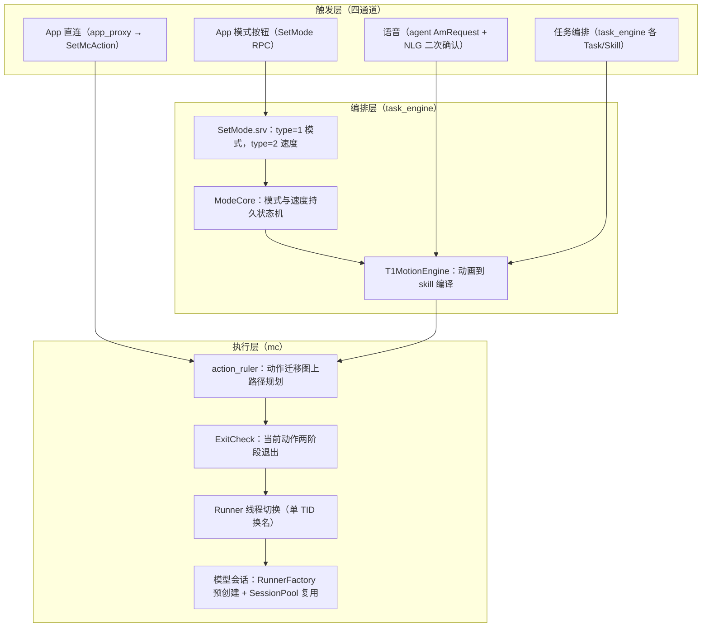

**图解释**：

- 四类触发入口在编排层收敛为统一的 `SetMcAction` / `SetMcMotion` 下发：App 模式按钮走 `SetMode` → ModeCore（模式偏好持久化，不可切换时只记录、可行走后延迟生效）→ ActionSkill；语音与任务编排走 T1MotionEngine 的 skill 编译；App 直连通道不经编排层直达 mc；
- 执行层内部是固定四步流水：寻路 → 两阶段退出 → Runner 切换 → 会话复用（下文①②③逐层展开）。

**① 动作图路径规划（action_ruler）——切换不是自由跳转，是图上寻路**。任意 `SetMcAction` 到达后，action_ruler 先在动作迁移图（`action_setting.yaml` 的邻接表）上搜索路径，再把中间动作逐一执行——**上层无需感知"要先踏步"，只声明目标动作，中转节点由规划器自动插入**。四足侧动作迁移图的典型局部：

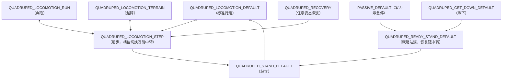

**图解释**：两条中转规律：

- `QUADRUPED_LOCOMOTION_STEP`（踏步）是行走档位间切换的**万能中转节点**（DEFAULT / RUN / TERRAIN 互不直连，都经 STEP）——任何步态切换前先经踏步把质心收拢、速度归零，再进新步态；
- 姿态恢复链统一走 `QUADRUPED_READY_STAND_DEFAULT`（先锁定就绪站姿再展开）——如 PASSIVE_DEFAULT 上电回站立（一跳中转）、QUADRUPED_GET_DOWN_DEFAULT 趴下回行走（三跳）。

**② 两阶段退出 + ③ 零加载切换**：

- **两阶段退出（ExitCheck stage1/stage2）**：切换源头的 controller 先"冻结站稳等落脚"（stage1: freeze CPG to stand, wait feet down），四脚落稳后才释放（stage2: feet settled, release）——保证任意步态间切换无腾空突变；
- **零加载切换**：同族档位 Runner（如 `rl_quad_loco_terrain` 与 `rl_quad_loco`）仅策略模型不同、接口全同，切换 = 换 Runner 指针 + 线程改名；Runner 实例与模型在 mc 启动时已由 RunnerFactory 预创建缓存。

一次完整的 DEFAULT → TERRAIN 切换流程：

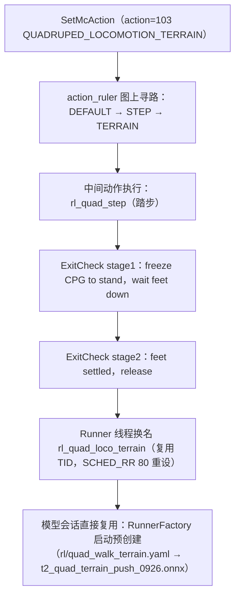

**图解释**：全流程 = 图上寻路 + 踏步中转 + 两阶段落脚检查 + 线程换名；模型侧因启动预创建而**零加载开销**——切换动作本身不触发 onnx 读取，仅完成 Runner 指针替换与实时线程改名（SCHED_RR 80 重设）。

**④ 组合 Runner**：`BIPED_LOCOMOTION_WBC = rl_bi_loco_wbc（10ms）+ animation_player（4ms）` 双 Runner 并行：

- **rl_bi_loco_wbc**：下肢 RL 平衡；
- **animation_player**：上肢位控规划（ArmHomingPlanner：default_pos [0°,90°,30°]、tau [0.5,0.2,0.5]、重力补偿 scale 0.6）。

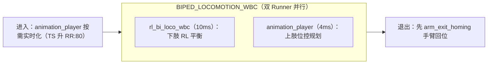

**图解释**：上肢永远是"叠加层"，基座动作管平衡——进入 WBC 时 animation_player 由 TS 按需实时化升 RR:80，退出 WBC 前必须先 `arm_exit_homing` 手臂回位，保证任何编舞到任何后续动作平滑衔接。

**⑤ 模仿动作的自动退出**：`BiMimicRLController` 逐帧检查轨迹完成度（如 frame 3000/3001）后自动切回 `NEXT_ACTION`，无需上层干预。

#### 3.2.5 模型资产与 RL 推理设计

**模式级的模型**（qd1_t2d0，`rl/*.yaml` 固定绑定、RunnerFactory 启动预创建）：

| 类别 | 代表动作（SetMcAction） | 模型（rl_models/） |
|---|---|---|
| 四足行走/越野 | QUADRUPED_LOCOMOTION_DEFAULT / REVERSE / STEP / RUN / TERRAIN | t2_quad_walk_0902 / t2_quad_walk_re_0907 / t2_quad_walk_lite_0713 / t2_quad_run_new_cpg / t2_quad_terrain_push_0926 |
| 双足行走/越野 | BIPED_LOCOMOTION_DEFAULT / RUN / TERRAIN / WBC | lift0514_swing / t2_bifast_0730 / terrain0313 / wbcterrain2026092602 |
| 变形（6 条路径） | QUADRUPED_TO_BIPED（_ROTATE / _FRONTFLIP）、BIPED_TO_QUADRUPED（_ROTATE / _FRONTFLIP） | t2.2_quad2bi_norm_0708 / t2_quad2bi_yaw_6837 / t2_q2b_flip_0720 / t2_b2q_norm_v1.0_0601 / t15_bi2quad_rotate_v1.1_terrain / t1_flip2quad_v1.0_0307_40k（§3.2.3 ⑤） |
| 纯策略表演 | QUADRUPED_LOCOMOTION_DANCE / PUSH_UP / JUMP / FRONTFLIP / BACKFLIP，BIPED_LOCOMOTION_DANCE / MOONWALK / WBCDANCE，BIPED_SPLIT / BACKBEND / YUZURU | t2_quad_twist_xy_v1.0_0708（舞蹈步态与俯卧撑共用）、t15_quad_jump_platform、t2_quad_frontflip_0703、actor_critic_rightfirst_backflip；bi_dance_liuxingwu_acc_1_model_12750、t1_bi_moonwalk_v2_0807、biped_rotation0711、t1_bi_split_v1.0_0307_15mm、actor_critic_20251110、t1_bi_yuzuru_v1.0_0123——单模型单动作 |
| 恢复 | QUADRUPED_RECOVERY / BIPED_RECOVERY | t1_quad_recovery_v2.0_0814 / t15_bi_recovery_v1.2_0402 |
| 云台 | BIPED_GIMBAL | wbc2026071201 |
| 模仿基座 | BIPED_MIMIC / QUADRUPED_MIMIC / BIPED_NPZ_MIMIC / BIPED_LINGCHUANG_MIMIC | t1_bi_wbc_pitch0522 / t2_quad_twist_xy_0725；NPZ 与灵创由 motion_list 下发（见上映射表）——**在 action_setting 中定义、仅经表演级入口触达** |
| 经典位控 | QUADRUPED_STAND / LIE_DOWN / CROUCH / SIT_DOWN / GET_DOWN / STORE / READY_STAND / HANDSHAKE、PASSIVE / DAMPING 等 | 无模型（1ms 关节空间 PD） |

**表演级的模型**：仅 **5 个模仿类模型**（下表）+ ANIMATION 78 项零模型——这是 108 个表演级动作的模型复用根基。

**5 个推理模型清单**（qd1_t2d0 生效包 `rl_models/`，覆盖 motion_list.yaml 全部 108 个表演级动作）：

| 模型（rl_models/） | 服务的激活动作 | obs / 频率 | 加载方式 | 轨迹资产 | 作用 |
|---|---|---|---|---|---|
| t1_bi_wbc_pitch0522.onnx | BIPED_MIMIC 双足全身模仿 ×8（SKATING / SHOW / DANCE_WORLDCUP_ONE / YAOLAWU / QIUMI / NAOYANGYANG / POSHUIWU / POPPING） | 51 / 100Hz | runner 写死（Init 加载） | `res/biped_mimic_motion/` 的 CSV（如 T1_bi_skating_30s.csv、3061.csv） | 上肢 6 关节跟踪 CSV 参考，下肢 WBC 实时平衡（上肢旁路，§3.2.6） |
| t2_quad_twist_xy_0725.onnx | QUADRUPED_MIMIC 四足全身模仿 ×19（PRIDE / PONDER / HEED / TALK_ONE~FIVE / DANCE_TWO / DANCE_THREE 等） | 52 / 100Hz | runner 写死（Init 加载） | `res/quad_mimic_motion/` 的 CSV（21 个） | 四足全身关节参考跟踪（情绪表达与拟人化动作） |
| bi_npz_mimic_joyous_260827.onnx | BIPED_NPZ_MIMIC_JOYOUS（元气热舞） | 83 / 50Hz | motion_list 逐条下发 | bi_npz_mimic_joyous_260827_10s.npz | 端到端全身模仿（参考内嵌 31 维 command 观测，不可打断） |
| bi_npz_mimic_joyous2_260908.onnx | BIPED_NPZ_MIMIC_JOYOUS2（欢快劲舞） | 83 / 50Hz | motion_list 逐条下发 | bi_npz_mimic_joyous2_260908.npz | 同上 |
| bi_npz_mimic_joyous3_260828.onnx | BIPED_NPZ_MIMIC_JOYOUS3（机械舞步） | 83 / 50Hz | motion_list 逐条下发 | bi_npz_mimic_joyous3_260828_10s.npz | 同上 |

> 说明：① 本表范围为**表演级动作（motion_list.yaml，SetMcMotion 入口）**——5 个模型均为模仿类（参考轨迹 + 策略）；**不含模式级动作（action_setting.yaml，SetMcAction 入口）的模型**：行走/越野见 §3.2.7 对照表，变形见 §3.2.3 ⑤ 六条路径（各有独立模型），纯策略表演类（空翻 / 太空步 / 四足舞蹈步态等，单模型单动作）与云台（wbc2026071201.onnx）等亦不在此列；② ANIMATION 上肢动画 78 项本身零推理模型（animation_player 直接回放 CSV），其下肢基座 `BIPED_LOCOMOTION_WBC` 所用 `wbcterrain2026092602.onnx` 属模式级动作资产，不计入这 5 个；③ QUADRUPED_MIMIC 实际生效模型以 `rl/quad_mimic.yaml` 为准（motion_list 中记录的 `t15_quad_twist_xy_v1.0.onnx` 为陈旧信息）；④ 3 个 npz 轨迹即去重 99 个轨迹资产中的 3 个 npz，其余 96 个为 CSV。


**推理部署形态**：onnxruntime **CPU 推理**（`type: onnx, device: cpu`），保留 `type: rknn` NPU 注释选项未启用（配置注释中 device 值写作 rk3588，为配置模板原文，本机芯片为 RK3576）；频率 100Hz（普通/CSV 模仿，dt=0.01）/ 50Hz（npz 模仿，dt=0.02）。

代表性观测-动作接口（`rl/bi_walk.yaml`、`rl/bi_npz_mimic.yaml` 等）：

```yaml
policy: {type: onnx, device: cpu, path: "./rl_models/lift0514_swing.onnx"}
obs_nums: 49     # 观测维度
q_nums: 14       # 关节数
action_nums: 14  # 输出 = 目标关节位置增量
```

**npz 模仿策略的观测契约**（83 维，与训练侧 mjlab `robot_motion_command` 逐项对齐）：

```
obs(83) = command(31) + motion_anchor_ori_b(6D) + projected_gravity(3)
        + base_ang_vel(3) + joint_pos(12) + joint_vel(14) + last_actions(14)
command(31) = 腿部ref_qj(12) | ref_dqj(12) | anchor线速度(3) | anchor角速度(3) | anchor高度(1)
```

**观测维度谱系**（设计分层意图：越端到端的路线观测越重）：经典位控无模型 → 普通 RL 47~57 → BIPED_MIMIC 51 → npz 模仿 83 → 灵创模仿 264（轨迹内嵌策略的代价）。

**obs 构造的代码级设计惯例**（ELF 逆向核实的部署侧契约）：

| # | 惯例 |
|---|---|
| 1 | 姿态不用欧拉角：投影重力（轴序 [z,-y,x]）+ 局部角速度；配置项名 `imu_euler` 实际喂的是旋转重力向量 |
| 2 | 量纲缩放进 obs：角速度 ×0.25、关节速度 ×0.05 |
| 3 | 历史帧 10 帧旧到新、首帧用初始观测填满；上肢动作槽历史强制置零 |
| 4 | 6D 旋转表示：相对旋转矩阵前两列按行展开 |
| 5 | NPZ 参考速度用世界系（不旋转到局部系）；参考位置为绝对值不减默认角 |
| 6 | 动作语义：位置目标 = 默认角 + scale·clip(action)；CSV 裁剪 ±20、NPZ ±16；轮速 = 2·action |
| 7 | 每动作独立 kp_kd_set / action_scale_set 参数表（不走配置顶层默认） |

**辅助算法栈（mc3th/）**：pinocchio 2.7（刚体动力学/雅可比）、hpp-fcl + fcl（碰撞检测）、nlopt（非线性优化）、trac-ik（逆运动学）、urdfdom（URDF 解析）——支撑 WBC 与经典控制。

#### 3.2.6 模仿与舞蹈体系（三层）

**① 技能"跳舞"的分形态路由**（task_engine whole_body.yaml）：

| 当前形态 | 执行动作 | 模型 | 轨迹 | 伴奏 |
|---|---|---|---|---|
| 四足 form=1 | `QUADRUPED_LOCOMOTION_DANCE` | t2_quad_twist_xy_0725.onnx | 内置步态舞蹈 | 四足舞蹈A.wav |
| 双足 form=2 | `BIPED_MIMIC_SKATING` | t1_bi_wbc_pitch0522.onnx | `T1_bi_skating_30s.csv`（3001 帧） | 人形舞蹈A-30s.wav |

**② 五类 motion_types 机制对比**（motion_list.yaml 的类型体系，完整）：

| 类型 | 数量 | 执行部位 | 底层动作 | Runner（配置） | 策略模型 | 模型来源 | 推理/播放频率 | obs | 轨迹格式 | interrupt_type |
|---|---|---|---|---|---|---|---|---|---|---|
| BIPED_MIMIC 双足全身模仿 | 8 | 全身（上肢轨迹+下肢平衡） | BIPED_MIMIC | rl_bi_mimic（bi_mimic.yaml） | t1_bi_wbc_pitch0522.onnx | runner 写死（Init 加载） | 100Hz | 51 | CSV：上肢 6 关节 + 基座姿态/高度 | 1（可打断） |
| QUADRUPED_MIMIC 四足全身模仿 | 19 | 全身 | QUADRUPED_MIMIC | rl_quad_mimic（quad_mimic.yaml） | t2_quad_twist_xy_0725.onnx | runner 写死（Init 加载） | 100Hz | 52 | CSV | 1（可打断） |
| BIPED_NPZ_MIMIC 双足 npz 模仿 | 3 | 全身 | BIPED_NPZ_MIMIC | rl_bi_npz_mimic（bi_npz_mimic.yaml） | 每动作独立 onnx | motion_list 逐条下发（runner path 留空） | 50Hz | 83 | npz（二进制） | **0（不可打断）** |
| ANIMATION 上肢动画 | 78 | 上肢 | BIPED_LOCOMOTION_WBC（基座） | animation_player（classic/animation_player.yaml） | 无（基座 WBC 用 wbcterrain2026092602.onnx） | — | CSV 回放 60~150fps | — | CSV 上肢关节 | 1（可打断） |
| BIPED_LINGCHUANG_MIMIC 灵创模仿 | 0（+6 预留） | 全身 | BIPED_LINGCHUANG_MIMIC | rl_bi_lingchuang_mimic | 每动作独立（轨迹内嵌 onnx） | motion_list 下发 | 100Hz | 264 | onnx 内嵌 | 1（可打断） |

两条模仿技术路线并行演进：**BIPED_MIMIC（CSV 半身）** 是现役主力——分层解耦、上手快、编舞便宜；**BIPED_NPZ_MIMIC（NPZ 全身）** 是新一代——端到端全身、上限高、轨迹即数据、不可打断保证长动作完整演绎。灵创模仿是第三方动作资产的接入机制（轨迹内嵌 onnx 单文件交付）。

**③ BIPED_MIMIC 的上肢旁路（混合控制的精华）**——手臂 6 关节的指令公式：

```
τ_upper = clamp(kp·(q_ref − q) − kd·q̇, ±clip_tau)        # 纠偏力矩限幅
        + gravity_comp_scale · gravity_scale · τ_pinocchio(q)  # 重力前馈，不限幅
→ 折算回位置指令 + 符号摩擦补偿 + 软限位 → {pos, vel:0, kp, kd}
```

- kp=[4,2,4]、kd=0.2、clip_tau=[1,1,0.5,1,1,0.5] N·m——**无论编舞多剧烈，手臂纠偏力矩不超过 0.5~1.0 N·m**（可被外力推开，人机安全）；重力前馈不限幅（否则下垂）；
- **策略与手臂的唯一交互是感知**：手臂实际位置/速度进 obs，下肢平衡策略据此实时补偿手臂扰动——"上层动作编排 + 底层 RL 平衡"解耦在执行层的精确含义；
- **基座参考通道**：CSV 每帧的 z/yaw/roll/pitch 写 obs——策略"感知编舞"的唯一通道；
- **Exit Homing 退出回位状态机**：轨迹到末帧或打断 → 冻结帧推进、快照手臂位置 → `lerp(快照, default_dof_pos, smoothstep(α))`，时长按编舞高度偏移自适应，期间基座参考持续进 obs（RL 腿持续平衡）→ 完成后进 `auto_next_actions`——保证任何编舞到任何后续动作平滑衔接。

#### 3.2.7 越障与地形模式（复杂地形通过）

**模式入口（用户语义 → mc 动作）**：四足/双足行走各有标准与越野两档。

- 用户侧经 `SetMode`（type=1，mode 枚举 **1=标准、2=越障（Q 越障/T 越障）、3=超能**）表达偏好，task_engine ModeCore 持久化并翻译为 mc 模式级动作（App 直连通道可直达 `SetMcAction`）；
- 越野档的进入同样走 action_ruler 图上寻路（DEFAULT → STEP → TERRAIN，即 §3.2.4 的 DEFAULT → TERRAIN 切换流程图所示：踏步中转 + 两阶段落脚检查）；
- `SetMode` 同 RPC 的 `robot_speed` 字段携带该模式下行进速度，`persist/config/mode_state.json` 持久化，mc 重启后 ModeCore 自动同步。

**地形系模式 / 模型 / 配置对照**（qd1_t2d0 生效包，均为 `type: onnx, device: cpu`、100Hz）：

| mc 动作（SetMcAction） | Runner（rl/*.yaml） | 模型（rl_models/） | obs | 说明 |
|---|---|---|---|---|
| QUADRUPED_LOCOMOTION_DEFAULT（标准行走，对照） | rl_quad_loco（quad_walk.yaml） | t2_quad_walk_0902.onnx | 57 | 标准档 |
| QUADRUPED_LOCOMOTION_TERRAIN（四足越野，action=103） | rl_quad_loco_terrain（quad_walk_terrain.yaml） | t2_quad_terrain_push_0926.onnx | 57 | 与标准档接口全同，切换零加载（§3.2.4 ③） |
| BIPED_LOCOMOTION_WBC（双足行走基座） | rl_bi_loco_wbc + animation_player（bi_wbc_run.yaml） | wbcterrain2026092602.onnx | 49 | 双足 WBC 基座模型本身即 terrain 系（按复杂地形训练） |
| BIPED_LOCOMOTION_TERRAIN（双足越野） | rl_bi_terrain（bi_walk_terrain.yaml） | terrain0313.onnx | 49 | action_setting 中另注释备用 rl_bi_loco_wbc 组合 |
| BIPED_TO_QUADRUPED_ROTATE（变形回四足） | rl_bi_to_quad_rotate（bi_to_quad_rotate_run.yaml） | t15_bi2quad_rotate_v1.1_terrain.onnx | 54 | 变形系模型带 terrain 后缀（越野工况迭代） |

> `rl_models/` 中地形系历史版本众多（quad_t15_terrain、t1/t2_quad_terrain、terrain0313~0315、wbc_terrain / wbcterrain 系列等），是机型包中迭代最频繁的模型家族；上表为 `rl/*.yaml` 配置绑定的现网版本。

**配套的分形态/地形相关配置**：

- `security_guard.yaml` 分形态阈值（§3.2.9）；
- 跟随与局部规划的双形态配置：`follow_params_dog/human.yaml`、`local_planner_path_follower_{dog,human}.yaml`（§3.5）；
- `avoidance_config_t1.yaml` 的 human/dog 双套 ToF 布局；
- 部分技能运行态内置 TERRAIN：如"牵引拉车"（animation_id 3081）的 `motion_action_name: QUADRUPED_LOCOMOTION_TERRAIN`——拉车需要越障模型的牵引力策略。

#### 3.2.8 拍照与运镜模式（跟拍、环绕运镜、希区柯克运镜）

**"机器人即摄影机"的任务体系**（task_engine `rule/t1/`，与舞蹈/变形共用同一套任务仲裁与安全基础设施）：

- **camera_move 任务**（`rule/t1/camera_move.yaml`）：task_type=long_task，real_task_type=OrbitShotTask，priority 45，allow_preempt=true；前置条件：电量 ≥15%、非充电态、非趴/躺/急停姿态（block_posture: PASSIVE_DEFAULT / DAMPING_DEFAULT / LYING_DEFAULT / LIE_FACE_UP / LIE_FACE_DOWN / STORE_DEFAULT）、motion_state 须为 idle/preemptable；
- **运行中独占机体运动权**（完整仲裁策略）：reject——camera_move / move / app_joystick_ctrl / upper_body / wake_turn / touch / app_gyro_ctrl / app_canvas / app_teach_demo / factory_reset / motion_playback / motion_record / shutdown；override——whole_body / posture / follow / navigation / idle / localization / mapping；parallel——interaction；
- **follow 任务**（`rule/t1/follow.yaml`）：long_task，FollowTask，priority 50，电量 ≥6%；目标丢失防抖分形态（双足 1500ms / 室内四足 3000ms / 户外四足 1500ms）与 10s 语音抑制；启动要求 odom 为 TRUSTED 态。

**控制接口**：

- **`ControlTask.srv`**（ros2 RPC + HTTP 双后端）：control_type（START=1 / STOP=2 / RESUME=3 / CANCEL=4）+ task_type 完整枚举——INTERACTION=1、FOLLOW=2、FILE=3、ANIMATION=4、MOVE=5、PHOTO=6、PICTURE=7、MAPPING=8、LIGHT=9、CALL=10、**ORBIT_SHOT=11、HITCHCOCK=12**、GROUP_PHOTO=13；
- **`FollowTaskCtrl`**：type=3 跟随启停、type=8 录像启停（跟拍核心）、type=6/7 电梯进出场；
- **`ControlInsta360`**（task_engine PhotoSkill → insta360 模块）：云台回正、自动人像跟踪、录像启停、连续变焦；
- **`SetServo`**：position 0-90° 腰部舵机（保双足形态）。

**触发入口与前置检查**（三通道；运镜仅双足形态支持，这一隐式耦合在触发侧解决）：

- **语音**：agent `skills.json` 技能 `camera_mode_orbit` / `camera_mode_dolly_zoom`（NLG 二次确认）；`follow_start` 扫描找人 front → 左 30° → 右 60° → 回正 + `need_face_id` 人脸确认后才开始跟随；`recording_on/off` 前置 `camera_authorized`（App 摄像头授权）；
- **App**：app_proxy → ControlTask RPC；
- **rc 组合技**：`t1_skill_1.sh` 环绕——先 HTTP RPC `SetServo(position=90, speed=400)` 升腰部舵机保双足、sleep 2s 再 `ControlTask(task_type=11)`；`t1_skill_2.sh` 希区柯克——task_type=12。

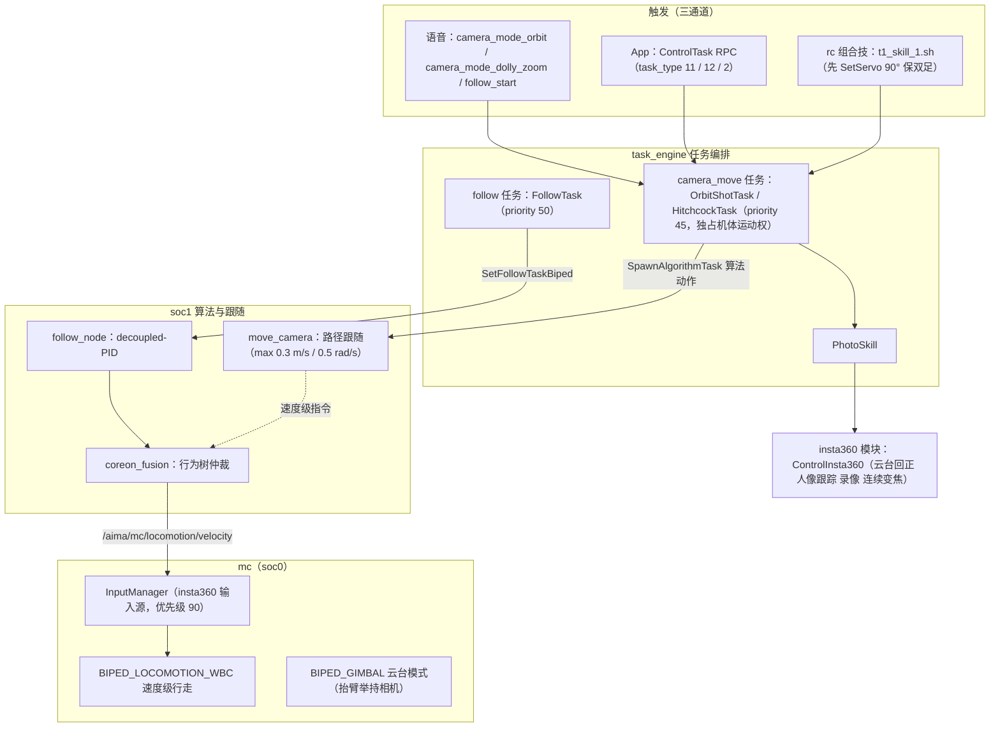

**图解释**：运镜三场景共用 camera_move 任务基础设施：

- **触发侧**解决形态耦合（rc 路径先升舵机保双足）；
- **task_engine 侧**：OrbitShotTask / HitchcockTask 经 `SpawnAlgorithmTask` 把运动规划下发给 soc1 的 move_camera 算法节点（速度级路径跟随），PhotoSkill 经 `ControlInsta360` 控制相机；跟拍场景复用跟随链路（follow_node → coreon_fusion → `/aima/mc/locomotion/velocity` → mc）；
- **mc 侧**：全程只收到速度级指令（WBC 行走），不出现关节级专用动作。

**三个场景的运动实现对照**：

| 场景 | 任务 | 运动规划 | 相机控制 |
|---|---|---|---|
| 环绕运镜 | OrbitShotTask | SpawnAlgorithmTask 算法动作：orbit_backward_action_1（后退取景）→ orbit_circle_2m（2m 半径环绕圆）；soc1 move_camera 执行（`move_camera_params.yaml`：kp_angular 1.5 / kp_linear 0.5 / max_linear_speed 0.3 m/s / max_angular_speed 0.5 rad/s / position_tolerance 0.1 m / angle_tolerance 0.05 rad / back_speed_kp 1.0） | PhotoSkill → ControlInsta360：云台回正 + 自动人像跟踪 + 录像 |
| 希区柯克运镜 | HitchcockTask | ACTION_ORBIT_BACKWARD_LINEAR 机器人后退 dolly，与 Insta360 连续变焦 zoom 构成**距离趋势闭环**（trend check 目标距离变化率、拐点切换变焦方向、3.0m 距离启动连续变焦） | 同上 + 连续变焦 |
| 跟随拍摄 | FollowTask | 复用跟随链路：follow_node decoupled-PID → coreon_fusion → `/aima/mc/locomotion/velocity` → mc InputManager | FollowTaskCtrl type=8 录像启停 |

**mc 侧的拍照相关模式与输入源**：

- **insta360 输入源**（InputManager，优先级 90，§3.2.2）：Insta360 拍摄稳定；
- **BIPED_GIMBAL 云台模式**（`action_setting.yaml` 注释自述"单 runner 下肢 RL + 上肢 gimbal"）：rl_bi_gimbal（`bi_gimbal.yaml` → wbc2026071201.onnx，obs 49，100Hz，period_ms 10）——机器人双足站立作为人形云台/相机支架，上肢经 gear_motion 轨迹抬起举持（默认 `classic/gimbal/arm_lift_smooth.csv` 90° 抬臂，可选 `arm_trajectory_120.csv` 120°）；user_arm 支持抬臂（level）、摆臂（roll）与左右手切换（motion id=4 UseRight）；rc 映射 RS双击B 进入；估计器将其归入 wheel standing 态（action value 303，§3.4）。

#### 3.2.9 mc 内安全机制

1. **指令超时守护**：`cmd_guard.expiration_time_ms: 200`——速度/动作指令 200ms 未刷新即保护，上层崩溃机器人不失控；
2. **姿态守护**（`body_posture_guard`）：分形态配置——双足（x 为上）与四足（z 为上）各自 `fall_count_threshold: 3` / `fall_delta_threshold: 60°` / `stand_arm_delta: 45°`，维护 `monitored_actions_biped/quadruped` 白名单（各 14 类动作受监护）；
3. **跌倒保护 Runner** + 过渡动作 `PASSIVE_DEFAULT`（零力矩软急停）/ `DAMPING_DEFAULT`（阻尼急停）——rc 手柄 LB+RB / LT+RT 直接映射两级急停；
4. **recovery action 兜底**：进入行走模式时 state_manager 预设 `Set recovery action: QUADRUPED_LOCOMOTION_DEFAULT`（双服务线程冗余下发）——跌倒/受扰后自动恢复行走模式；
5. **变形/模仿专用守护**：① `transform_fall_check`——为全部 6 个变形动作启用，绑定 `res/transition_gravity_record/*.csv` 成功经验重力包络线（按 100Hz 逐帧录制成功变形的机体系重力方向单位向量，运行时比对夹角，超 30°/40° 连续 2 帧判失败）——用"成功样本包络线"做异常检测，而非建模仿真；② `mimic_gravity_guard`（threshold_deg 30/40、count_threshold 2）——模仿动作的重力方向守护；③ `arm_drag`——手臂拖拽检测，触发时拒绝预置动作。

#### 3.2.10 机型自适应与运行态

- `robot_name: ${ROBOT_CFG}`：em_run.sh 按 `ROBOT_SERIES + 硬件版本` 映射机型包（T1→`qd1_t2d0`，T1 v1d5→`qd1_t1d5`，Q1→`q1_t2d0`…）——**同一 mc 二进制支持 Q1/T1/QD1 全系列 6 套机型包**（§5.2）；
- 运行态文件 `/robot/data/var/MotionControlModule/runtime.yaml`：`enable_waist`（腰部舵机联动开关）等；`mc_set/get_robot_runtime_model_service` 在线切换运行模型；
- `persist/config/mode_state.json`：用户可调运行态（mode 1/2 与 robot_speed）；
- `persist/config/high_speed_unlock_state.json`：高速解锁状态机制——按形态分别累计里程（`humanoid_distance_m` / `quadruped_distance_m`），维护 `lifetime_count` / `recent_30d_count` 计数与 `state_version` 递增版本号，支撑"按累计里程渐进解锁更高速度档位"的运营策略；
- 配套 `*_sim.yaml` 仿真配置 + device_manager 的 mujoco 话题，构成**仿真-实机同构**验证路径。

### 3.3 执行驱动层详细设计：device_manager / hal_sensor

**职责**：关节指令的最终消费者，把 `JointCommandArray` 转成 CAN-FD 帧驱动电机，并回读状态发布——运控链路的"最后一公里"。

**进程形态**：`aimrt_main` 加载 `libdevice_manager_pkg.so`，仅启用 `MotorModule`，按机型选 `cfg/t1_v2d0_config.yaml`（v2d2 硬件沿用 v2d0 命名配置）。

**线程与发布周期**：

| 线程/执行器 | 调度 | 周期 | 职责 |
|---|---|---|---|
| rt_iceoryx_sub | **SCHED_RR:85** | 事件驱动 | 订阅 `/aima/hal/joint/command`（全链路最高优先级，指令一到即处理） |
| rt_topic_sub | **SCHED_RR:85** | 事件驱动 | 话题订阅 |
| rt_topic_pub（joint） | SCHED_RR:80 | **1 ms** | 发布 `/aima/hal/joint/state`（1kHz 关节状态） |
| rt_topic_pub（imu） | — | 2 ms | 发布 `/aima/hal/imu/torso/state`（500Hz 躯干 IMU） |
| rt_dev_ioctl.0 / rt_dev_ioctl.1 + rt_dev_poll | SCHED_RR:80 | — | 双 CAN 口 ioctl + 轮询 |
| st_topic_pub | — | 2 ms 基拍 | 标准话题（HDS 诊断 500ms 等） |

**总线与关节拓扑**（`t1_v2d0_config.yaml`）：

| 节点 | 总线 | 波特率 | 关节（URDF 名） | module/submodule ID |
|---|---|---|---|---|
| upper_node（上肢 = 双足形态前腿/臂） | can0 | 1Mbps 仲裁 / **5Mbps FD** | FL/FR_HIP_ROLL、FL/FR_HIP_PITCH、FL/FR_KNEE（6 个） | 0x34 / 0x11~0x13、0x21~0x23 |
| lower_node（下肢 = 后腿） | can1 | 1Mbps / 5Mbps FD | RL/RR_HIP_ROLL、RL/RR_HIP_PITCH、RL/RR_KNEE、RL/RR_FOOT（8 个） | 0x34 / 0x41~0x44、0x51~0x54 |

**关键设计**：

- **电机协议为 MIT 模式**（力位混合）：每关节指令五元组 = 目标位置 p + 目标速度 v + 前馈力矩 t + 刚度 kp + 阻尼 kd，电机端执行 `τ = t + kp·(p_cmd − p_meas) + kd·(v_cmd − v_meas)`；每关节配置 pMin/pMax、vMin/vMax（±60rad/s）、tMin/tMax（±60Nm）、kp（0~500）、kd（0~10）区间——**力矩闭环在电机端执行**，mc 只做 100/200Hz 的规划/推理，用"指令通道余量 + 电机端闭环"换取对上层软件抖动的容忍度；
- 每关节带 `offset`（零位偏置，如 KNEE -2.618 rad）与 `direction`（方向翻转）——**运控栈用 URDF 语义关节名，驱动层翻译到硬件编号**；
- **限位双保险**：本层 `min/max_limits` + mc 层 `robot_model.yaml`（如 FL_HIP_ROLL ±0.43633 rad、max_velocity 17.802 rad/s、max_effort 30Nm、TN 曲线 tn_t0=56.67/tn_k=3.183 描述堵转扭矩-转速特性）——两层独立，任何一层配置错误都不会直接打坏机械；
- **三通道指令分治**：关节指令按 `UPPER_JOINT` / `LOWER_JOINT` / `WHEEL_JOINT` 三组标签分别聚合发布，各通道独立监控同步延迟——同一 14 维动作接口在不同模式下被不同 Runner 差异化消费（如 BIPED_MIMIC 舞蹈态上肢 kp 4/2/4 低刚度柔顺、下肢 kp 100/30/30 承重、足端轮 kp=0 速度型伺服）；
- 另发布 `/aima/hal/joint/mujoco/command`（默认关）——**同一驱动层可被 MuJoCo 仿真替换**，支撑软件在环测试。

**非关节执行器：腰部舵机（hal_sensor ServoModule）**——`runtime.yaml` `enable_waist: true` 时启用：

- 驱动方式：Feetech 串行总线（写寄存器 0x2A 位置 / 0x30 力矩限制）；
- 位置映射：0°（四足）↔ 703、90°（双足）↔ 303（400 步 × 0.225°/步）；
- SDK `SetServo` 契约：position 0-90°、speed 100-1000 步/s；
- 力矩策略：运动中限力矩 40% 防冲击、到位后 25% 保持防堵转发热；
- 另有头部升降舵机（GPIO120）。

### 3.4 状态估计层详细设计：legged_odom

`aima-legged-odom-app`：关节编码器（1kHz）+ 躯干 IMU（500Hz）+ 足端接触估计的 **EKF 融合里程计**，运动学模型用 URDF（`QD1-T1_5-URDF-140mm-0309.urdf`）。

| 输入 | 频率 | 提供的信息 |
|---|---|---|
| 关节编码器 | 1kHz | 经 URDF 运动学正解算出各足端相对机体的位移（足式模型）或轮子滚动里程（轮式模型） |
| 躯干 IMU | 500Hz | 加速度/角速度/姿态，提供运动学积分的短时基准 |
| 足端接触估计 | — | 判断哪只脚/轮着地（接触概率复用 mc RL 策略输出，比阈值法准），只有"着地的足"才提供位移观测 |

设计细节：

- `sensor_sync_strand` 串行化执行器——IMU/关节回调严格串行，避免状态估计竞态；
- `foot_contact_estimation_use_mc_rl`：**接触判断复用 mc 的 RL 状态**——估计器与控制器共享神经网络输出；
- **轮足切换门控**：按 MC action value 把动作分为五类，切换运动学模型：

| 估计器状态 | action values | 语义 |
|---|---|---|
| mode_transition | 10, 11, 12, 20, 21, 22 | 六条变形路径 |
| legged standing | 101, 102, 112, 103, 121 | 四足站立/行走/奔跑/越障/踏步 |
| wheel standing | 300, 201, 202, 203, 207, 303 | 双足 WBC/站立/行走/越障/奔跑/gimbal |
| action | 104~124, 204~210, 301/302, 400 | 表演类动作 |
| fallen | 1, 2, 3 | 跌倒 |

- 估计器对 action 的判定需 1.0s 稳定窗（`stable_duration 1.000s`）；变形窗口内 `/odom` 短暂 UNTRUSTED，上游（task_engine odom_plugin、Nav2）需容忍；
- 输出 `ros2:/odom`（best_effort, depth 10）上行 soc1——**导航栈定位基准来自 soc0 侧本体感知**，soc1 的 SLAM/激光定位只做增量修正。

### 3.5 运动决策层（soc1 侧）

soc1 不做关节级控制，只产生速度级指令，全部经 **coreon_fusion** 仲裁后下发。

**coreon_fusion（安全仲裁枢纽）**：AimRT 应用，三棵行为树（`bt_xml/`）：`avoidance_tree.xml`、`following_tree.xml`、`percep_fusion_tree.xml`，对应 `scene_avoidance/following/percep_fusion.yaml`。

- 输入：percep 融合点云 `/percep/fused_obstacle_cloud`、5 路 OFilm ToF 点云 `/ofilm/tof/{main,front,rear,left,right}/point_cloud`、双目/鱼眼图像、`/odom`、mc 状态；
- 输出：`ros2: /aima/mc/locomotion/velocity`、`/perception/target_info`；
- 形态联动：订阅 `/aima/interaction/state`（5s 周期），form 字段切换时同步重构避障传感器布局（dog/human 双套配置联动）；
- 避障设计（`avoidance_config_t1.yaml`）：双形态相机索引映射（human/dog 各自的前后左右 ToF 编号不同——变形后避障传感器布局随之切换）、遮挡检测（occlusion_analysis：无效点比例 + 低曝光 + 多帧确认 → 传感器失效诊断）、近光心脏污/飞点过滤（origin_noise_analysis：候选距离窗 + 体素聚类 + SVD 主轴分析区分细杆/墙面/飞线）、`/fall_guard/edge_xs` 台阶边缘检测输入。

**follow（目标跟随）**：纯 ROS2 包，按形态独立配置 `follow_params_dog.yaml` / `follow_params_human.yaml`。

- decoupled-PID：线速度 P 增益 0.8、角速度 -1.0、限幅 1.2 m/s / 1.2 rad/s、横向 0.4 m/s（四足开、人形另配）；
- 规划入口速度用 odom 零相位低通（fs 50Hz、fc 1.5Hz、窗口 15）去步态纹波；
- 目标位置做"离群剔除而非平滑"的取舍（`enable_target_velocity_outlier_reject`，拒绝物理不可能瞬跳）——"宁可滞后一点也不能画龙/翻车"的工程取向；
- 控制服务入口 `/aimdk_5Fmsgs/srv/SetFollowTaskBiped`。

**path_follow_node 与 Nav2 定制栈**：

- trajectory_tracker：预置轨迹 CSV（倒退、转向圆等密集采样）+ waypoint 导航，`local_planner_path_follower_{dog,human}.yaml` 双形态局部规划；
- Nav2 栈：`ros2 launch nav2_bringup` → component_container_mt + lifecycle_manager；定制点：**JPS（Jump Point Search，跳点搜索）全局规划器**、**nav2_recharge 自动回充**、静态 TF 链（map→odom→base_link→camera_point_cloud→前后 ToF）；地图为位姿图栅格 + 虚拟墙。

**感知支撑进程**：hal_camera（GMSL 双目/鱼眼）、hal_rgbd（5 路 ToF，跨板曝光联动 inter_board_topic）、pointcloud_combiner（点云合并）、percep（TensorRT 推理）、perception_node（Nav2 感知节点、点云滤波）、aimrt_person_track（人员跟踪）。

### 3.6 交互与任务编排层（触发运控的入口）

- **task_engine**：yaml 场景编排器（T1MotionEngine）。`action_manager.yaml` 定义任务仲裁矩阵（touch/motion/follow 等 running×incoming 的 parallel/override/reject）；`motions/{t1,q1}/` 动作定义（约 100 项技能，§3.2.3 ③）+ 中文命名动作轨迹 CSV + 语音资源——"语音→动作→mc RPC→RL Runner"表演链路在此编排；InteractWithId 为 App/语音统一技能入口（source 字段标识来源）；**运镜拍摄任务族**（camera_move.yaml 仲裁）：OrbitShotTask（环绕运镜）、HitchcockTask（希区柯克滑动变焦：机器人后退 dolly 与 Insta360 连续变焦 zoom 的距离趋势闭环）、FollowTask（跟随拍摄 + 录像控制，FollowTaskCtrl 控制族 type=3 跟随启停 / type=8 录像启停 / type=6/7 电梯进出场）——均仅双足形态支持，运动规划经 SpawnAlgorithmTask 下发算法动作（速度级指令，详见 §3.2.8）；低电量时 SpeechTask 播充电音 + EmotionTask 电量表情；
- **rc**：SDL3 读手柄，`input_rules.yaml` 按键→动作映射（双击/三击组合触发仿生模式、空翻、握手、跳跃，§3.2.3 ④）；`locomotion_velocity.yaml`/`body_pose.yaml` 直接产生速度/姿态指令；
- **agent**：技能调用 task_engine 或直接 mc 服务（含 `mc_status_exe` 线程监控运动状态）；含讯飞 iflytek_esr ASR；语音入口经 NLG 二次确认；
- **app_proxy**：python3，App 入口（TRRO/webrtc 上行、MQTT/云通道、BMS 状态上报）；App 摇杆速度经 `/aima/mc/locomotion/velocity`（优先级 90）下发；
- **VR**：`teleop_bridge` 遥操作入口。

---

## 4. 过程视图（Process View）

### 4.1 进程全景

```mermaid
flowchart TB
    ROOT["systemd → entry system_entry.sh → process_manager"]

    subgraph ROUDI["iox-roudi（root 常驻，iceoryx 共享内存中枢）"]
        RSHM["roudi_config.toml mempool"]
    end

    subgraph RKRT["soc0 实时域进程（run 用户，sudo 降权拉起）"]
        direction TB
        MCP["mc_main（36 线程，全绑 CPU3）"]
        DMP["device_manager（26 线程，绑核 0-1 4-7，显式排除 CPU3）"]
        LOP["legged_odom"]
    end

    subgraph RKBG["soc0 业务进程"]
        direction TB
        BG1["agent（语音交互）"]
        BG2["task_engine（任务编排）"]
        BG3["rc（手柄）"]
        BG4["drp_main（常驻 mcap 录制）"]
        BG5["app_proxy（App 通道）"]
        BG6["flutter-pi / lumina_server / display_ui（屏幕与 UI）"]
        BG7["audio_manager（音频）"]
        BG8["hal_camera（RK 侧，BMI08 头部 IMU）"]
        BG9["insta360（全景相机）"]
        BG10["sm / sys_guard / process_manager（系统管理）"]
        BG11["ota / cloud_proxy（升级与云）"]
    end

    subgraph ORNP["soc1 Orin 进程"]
        direction TB
        O1["Nav2 栈（component_container_mt / lifecycle_manager / perception_node）"]
        O2["pointcloud_combiner / static_transform_publisher"]
        O3["follow_node / trajectory_tracker"]
        O4["coreon_fusion / percep / aimrt_person_track"]
        O5["hal_camera（GMSL 双目鱼眼）"]
        O6["hal_rgbd（5 路 ToF）/ hal_sensor"]
    end

    ROOT --> ROUDI
    ROOT --> RKRT
    ROOT --> RKBG
    ROOT -.->|板间编排与状态| ORNP
```

**解释**：

- 进程拉起链路：systemd → `system_entry.sh` → process_manager（root），实时域进程以 run 用户降权运行；
- soc0 上分两个进程组：**实时域**（mc_main、device_manager、legged_odom——绑核与调度见 §4.3）与**业务进程**（交互、编排、录制、系统管理）；soc1 上为感知/导航进程组；
- iox-roudi 作为 iceoryx 共享内存中枢独立常驻，mc 与 device_manager 的高频实时话题经它零拷贝中转。

### 4.2 mc 线程架构

mc_main 共 36 线程，**全部绑 CPU3**（`taskset -c 3 ./mc_app_main`）：

| 线程 | 调度 | 职责 |
|---|---|---|
| rt_iceoryx_sub | **RR:85** | 订阅 joint/state、imu/state（输入），全链路最高优先级 |
| rl_* Runner | RR:80 | **RL 策略推理**（onnxruntime CPU）；随动作换名复用同一 TID |
| rt_joint_pub | RR:80 | **200Hz 关节指令发布**（hrtimer_nanosleep 定时） |
| animation_player | TS→**RR:80** | 上肢动画/手臂回位（4ms 周期）；按需实时化——WBC 激活时由 TS 升 RR:80 |
| com_data_pub | TS | 50Hz mc/common/state 等状态发布 |
| mc_sm_thread | TS | SM 状态联动 |
| security_guard | TS | 常驻 action（period 50ms），安全守护 |
| ros2_executor ×2 / RTPS* / UDP* | TS | FastDDS 收发 |
| MotionControlModule 执行器 ×2、common_server ×2 等 | TS | 业务/RPC |

device_manager 侧线程：`rt_iceoryx_sub` RR:85、`rt_topic_pub` RR:80（1kHz joint state）、`rt_dev_ioctl.0/.1` + `rt_dev_poll` RR:80（双 CAN 口 + 轮询）、`rt_topic_sub` RR:85。

**通信后端分工**：实时话题走 **iceoryx**（joint/command、joint/state、imu），控制性低速话题走 **ros2**（locomotion/velocity、body_pose、action），跨板只走 ros2。

### 4.3 实时调度设计（优先级阶梯 + 核隔离 + 资源域）

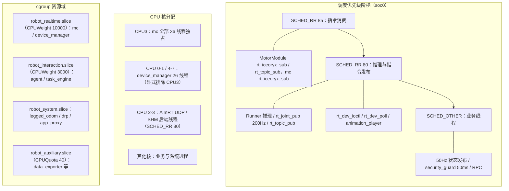

**解释**：在无 PREEMPT_RT 补丁的 6.1 内核上，以"绑核 + RR 优先级阶梯 + cgroup 权重 + cpufreq 全核 performance"组合达成确定性调度：

- **优先级语义**：指令消费者（RR 85，MotorModule 的 rt_iceoryx_sub——指令到达即抢占转发，不留排队延迟）高于状态订阅与推理（RR 80），保证指令→电机延迟抖动最小；业务线程退居 SCHED_OTHER；
- **核隔离语义**：mc 全线程独占 CPU3；device_manager 显式排除 CPU3（避免与 mc 抢核）；AimRT UDP/SHM 后端线程绑 CPU2-3 且 RR:80（环境变量统一设置）；
- **资源域语义**：四档 cgroup slice 按实时性分域，sys_guard 按场景（bootup/follow/ota/急停等）动态调整权重。

该取向的代价是单核收敛（mc 全部线程收敛在 CPU3 单核），实时余量依赖电机端 MIT 闭环兜底维持——若后续增加更重策略，合理的演进方向是 Runner 线程拆核或启用 NPU（rknn 选项已预留）。

### 4.4 SM 系统状态机（进程组随状态差量启停）

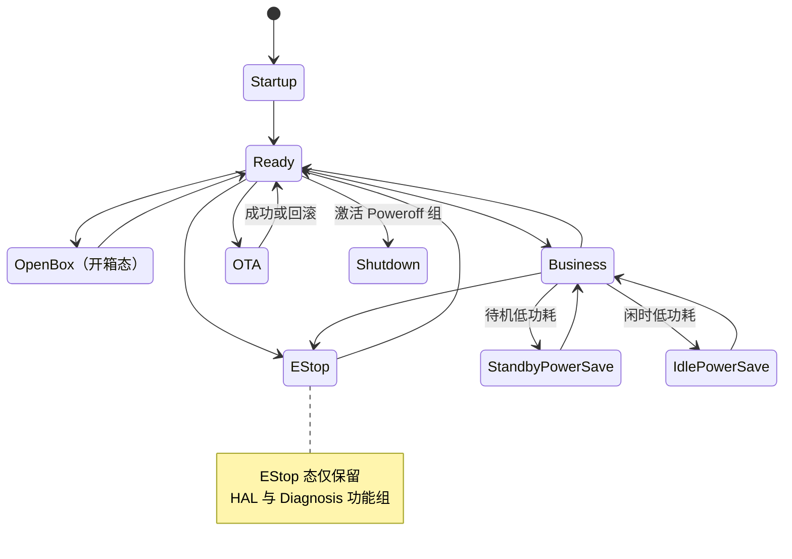

**解释**：sm 维护系统级状态机，**进程组随 SM 状态差量启停**（进某态拉起该态功能组、出态差量停止）。EStop 态仅保留 HAL 与 Diagnosis 功能组——急停时砍掉一切非必要负载；OTA 态承接升级流程（安装前电量 ≥50% + 趴下动作 + TTS 播报 + 倒计时 60s）。

### 4.5 频率漏斗与实时性预算

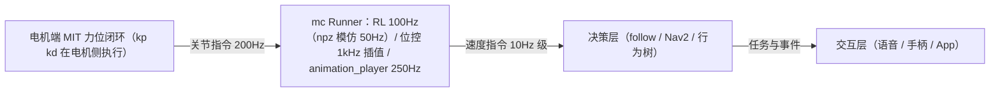

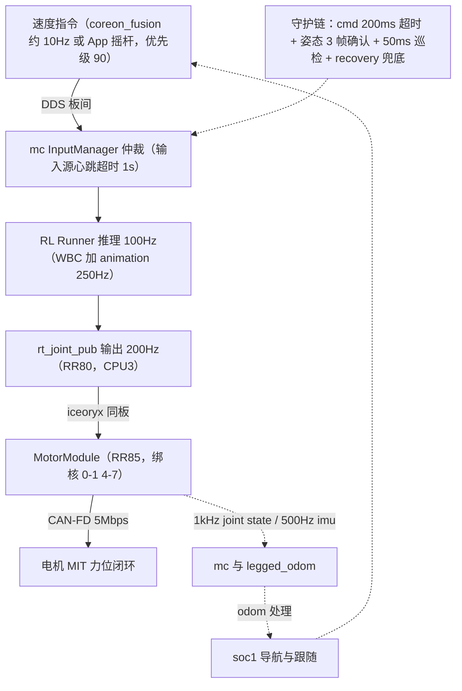

**频率设计表**（分层频率与"带宽递减、可靠递增"的漏斗一致）：

| 环节 | 设计频率 |
|---|---|
| 电机端力位闭环 | 电机 MCU（高带宽，闭环下沉） |
| 关节状态 | 1kHz |
| 躯干 IMU | 500Hz |
| 关节指令（rt_joint_pub） | 200Hz |
| RL 推理 | 100Hz（普通/CSV 模仿）、50Hz（npz 模仿） |
| animation_player | 250Hz（4ms） |
| mc 状态发布 | 50Hz |
| 里程计处理 | 40Hz 级（队列零积压设计） |
| 交互状态同步 | 5s 周期订阅 /aima/interaction/state |
| 安全巡检 | 20Hz（security_guard 50ms） |

反馈方向频率递增（odom ← joint 1kHz / imu 500Hz）——底层高频、上层低频，指令下行逐级降频、守护链全程伴随。

---

## 5. 开发视图（Development View）

> 说明：本视图基于部署产物快照（安装树、配置包组织与 CI 溯源文件）重建，无源码访问。

### 5.1 部署模块组织（两板 /robot/software）

```mermaid
flowchart TB
    subgraph RKSW["rk_robot software（soc0，37 个模块）"]
        direction TB
        RK1["启动与环境：entry / param"]
        RK2["统一接口：interface aimdk_msgs（737 msg + 238 srv，多语言绑定）"]
        RK3["系统管理：process_manager / sm / sys_guard / hds / housekeeper / ota / secret_store"]
        RK4["运动：mc（1.4G，最大）/ device_manager / legged_odom / rc"]
        RK5["交互：aimrt_agent / task_engine / scene_engine / lumina / display_ui / audio_manager / abox"]
        RK6["通信：conduit_router / mosquitto / cloud_proxy / app_proxy / connx / rtsp_server"]
        RK7["HAL：hal_camera（RK 侧 BMI08 头部 IMU）"]
        RK7B["HAL：hal_rgbd（soc0 侧曝光与 SPC 烧录）/ hal_sensor（腰部舵机）/ insta360"]
        RK8["数据与质量：drp / data_exporter / resource_manager / aimrt_pulsecore"]
    end

    subgraph ORSW["orin_robot software（soc1，21 个模块）"]
        direction TB
        OR1["algorithm（colcon 工作空间，纯 ROS2）"]
        OR1B["navigation（Nav2 定制栈）/ follow / path_follow_node"]
        OR1C["perception / target_follow_perception / explore / move_camera"]
        OR1D["models（共享 TensorRT 引擎）"]
        OR2["定位建图：aimrt_slam / aprilgrid_loc / map_manager"]
        OR3["融合：coreon_fusion"]
        OR4["HAL：hal_camera / hal_rgbd（采集）/ hal_sensor"]
        OR5["系统：process_manager / sys_guard / hds / ota / drp"]
    end

    SDK["t1-sdk（二开 SDK：aimdk_msgs 子集 + examples + 手册文档）"]

    RK2 -.->|消息同源| SDK
    OR1 -.->|消费 aimdk_msgs| RK2
```

**解释**：

- 两板各自维护 `/robot/software` 安装树，模块数 37（soc0）/ 21（soc1）；
- 运动相关模块全部在 soc0 侧 RK4 组（mc 为最大模块）；soc1 侧以 algorithm colcon 工作空间为主体；
- 接口消息 `aimdk_msgs` 统一定义（737 msg + 238 srv），二开 SDK 提供其子集 + Python/C++ 例程——PC/运控板/大脑板均可透明访问 `/aima/mc/*` 接口。

### 5.2 mc 机型参数包机制与动作资产（平台化核心）

```mermaid
flowchart LR
    BIN["mc_app_main 单一二进制"]
    ENV["em_run.sh 按 ROBOT_SERIES + 硬件版本映射 ROBOT_CFG 机型"]
    subgraph PACKS["cfg/robot/ 机型包（6 套）"]
        P1["q1_t0d0 / q1_t2d0（Q1 系列）"]
        P2["qd1_t0d0 / t0d5 / t1d5 / t2d0（T1 生效 qd1_t2d0）"]
    end
    subgraph ONE["每包内容"]
        C1["robot_model.yaml（限位 TN 曲线）"]
        C2["motion_list.yaml（动作表）"]
        C3["action_setting / action_ruler / action_state yaml"]
        C4["security_guard.yaml（分形态阈值）"]
        C5["trajectory_generator.yaml"]
        C6["rl/*.yaml（48 个）加 rl_models/（onnx）"]
        C7["res/（CSV npz 轨迹）加 urdf"]
    end
    BIN --> ENV
    ENV --> PACKS
    PACKS --> ONE
```

**解释**："一个 mc 二进制 + 机型参数包"的平台化设计——机型差异（运动学、限位、动作表、策略资产）全部收敛在 `cfg/robot/<机型>/`，同一二进制支持 Q1/T1/QD1 全系列，新产品线边际成本低。

**动作资产体系**（六套机型包合计 849M onnx（640 个）+ 128M CSV + 44M npz；生效包 qd1_t2d0 为 183 个 onnx / 210M）：

| 资产 | 位置 | 用途 |
|---|---|---|
| RL 策略 *.onnx | `cfg/robot/<机型>/rl_models/` | Runner 按动作加载 |
| 动作配置 rl/*.yaml（48 个） | 同上 | 观测构造、频率、关节映射；41 个含模型路径（均 `type: onnx, device: cpu`，保留 rknn 注释项）；bi_npz_mimic / bi_lingchuang_mimic 策略由 motion_list 运行时下发；cpg / test 无模型 |
| npz 参考轨迹（13 个/52M） | `res/biped_npz_mimic/` | npz 模仿动作参考 |
| 上肢动画 CSV（94 个） | `res/biped_upper_motion/` | animation_player 回放 |
| 四足模仿轨迹 CSV（21 个） | `res/quad_mimic_motion/` | QUADRUPED_MIMIC |
| 双足模仿轨迹 CSV（10 个） | `res/biped_mimic_motion/` | BIPED_MIMIC（8 舞蹈） |
| 变形重力记录（6 个）+ moonwalk（1 个） | `res/transition_gravity_record/` 等 | 变形过程重力参考（安全守护基准，非控制参考） |
| 机器人参数 | `robot_model.yaml` + `urdf/qd1.urdf` | 模型层约束 |
| 手柄映射 | `remote_controller_config/operation_config.yaml` | rc 输入 |

**模型家族**（qd1_t2d0）：

- quad 系（t2_quad×13、t15_quad×10 等）≈ 40+；
- 变形系（quad2bi / bi2quad / q2b / b2q 共 14+，统一小型 MLP actor，约 940KB，100Hz CPU 推理）；
- 双足系（bi_npz×13、bi_moonwalk×5、t1_bi_wbc×2 等）；
- 通用训练产物（actor_critic×7，含 flip2quad / flipstand 空翻系）。

### 5.3 soc1 模型与地图资产

**TensorRT 引擎 24 个**：

| 分组 | 引擎 |
|---|---|
| aimrt_slam（定位建图） | superpoint_v1/v2、eigenplaces_v1/v2、yolo26n-seg_v1/v2（arm + x86 双套） |
| algorithm/models（跟随/再识别） | clip_reid_vit_b16（b1/b3/b5）、swin_tiny_solider_msmt17（b3/b5/sim）、yolov8n（_seg_640x480） |
| perception（分割） | Segment_Qv0.2.1.0、Segment_v0.5.12.0 |

地图数据：`/robot/persist/log/mapData/`（位姿图栅格 + 虚拟墙）。GPU 推理为突发型负载，与 soc0 侧常载 CPU 推理形成互补的算力分工。

### 5.4 模块工程约定（AimRT 应用形态）

每个 AimRT 模块的标准产物：

| 产物 | 内容 |
|---|---|
| bin/ | 应用 或 aimrt_main + 模块 pkg so |
| bin/em_run.sh | process_manager 统一入口 |
| bin/cfg/*.yaml | 配置（含 dump 运行时转储） |
| bin/cfg/hds/ + cfg/event/ | 诊断事件标准库 |
| lib/ | AimRT 运行时、插件、typesupport |
| version.json / .version / pipeline.json | CI project_id、commit_sha、构建时间溯源 |

接口版本统一 `release-v1.2.1.patch1004`；Python 模块走 colcon 安装树。aimdk_msgs 在多个模块内各嵌一份副本（housekeeper/mc/scene_engine/lumina/rtsp_server 等）——部署侧免依赖的自包含打包策略，代价是接口升级需全量替换。

---

## 6. 物理视图（Physical View）

### 6.1 部署图

```mermaid
flowchart TB
    subgraph CLOUD["云端"]
        EMQX["OMP MQTT Broker（emqx.primebot.cn 8885 mTLS）"]
        S3["对象存储 S3 直传"]
    end

    subgraph RKB["soc0 RK3576 实时域（内核 6.1.141-rk3576，8核 2xA72 6xA53 8G，cpufreq performance）"]
        direction TB
        RKPMC["mc_main（CPU3 独占）/ device_manager（核 0-1 4-7）/ legged_odom"]
        RKPMC2["task_engine / agent / rc / sm / process_manager / sys_guard / ota"]
        RKPMC3["drp / app_proxy / flutter-pi / lumina / hal_camera（RK 侧）"]
        RKMOS["conduit_router / 本机 mosquitto"]
        RKNET["eth0 10.1.1.100（板间）/ wlan0 192.168.3.31"]
        RKNET2["p2p0 192.168.88.88（hotspot）/ ptp4l 常驻"]
        RKPMC --- RKPMC2
        RKPMC2 --- RKPMC3
        RKPMC3 --- RKMOS
        RKMOS --- RKNET
        RKNET --- RKNET2
    end

    subgraph ORB["soc1 Jetson Orin 智能域（内核 5.15.148-tegra，6xA78AE nvpmodel 25W，10.1.1.101，ptp4l 常驻）"]
        direction TB
        ORPROC["coreon_fusion / follow_node / trajectory_tracker"]
        ORPROC2["Nav2 栈 / percep / aimrt_person_track"]
        ORPROC3["hal_camera / hal_rgbd / hal_sensor"]
        GPU["TensorRT 引擎 24 个（detect segment stereo）"]
        ORPROC --- ORPROC2
        ORPROC2 --- ORPROC3
        ORPROC2 --- GPU
    end

    subgraph ACT["执行器 CAN-FD 总线域"]
        CAN0["can0（1Mbps 仲裁 / 5Mbps FD）：上肢 6 关节 MIT 模式，模块 0x34"]
        CAN1["can1（1Mbps / 5Mbps FD）：下肢 8 关节（含 2 个 FOOT 足端）"]
        SERVO["腰部舵机（Feetech 串行）"]
        SERVO2["头部升降舵机（GPIO120）"]
    end

    subgraph SEN["传感器"]
        TOF["5 路 OFilm ToF 深度相机（V4L2 video2 4-7 加 pwm_ts）"]
        TOF2["跨板曝光联动 inter_board_topic"]
        CAM["头部双目与鱼眼相机（GMSL MAX96724 帧同步 10Hz）"]
        IMU["躯干 IMU 500Hz 上报"]
        HBMI["BMI08 头部 IMU（hal_camera RK侧采集）"]
        TOUCH["触摸 input 事件"]
    end

    subgraph PERI["外设与交互"]
        AUD["音频（AD82128 功放 AW89xxx SmartPa 音频盒 abox ELink）"]
        DISP["屏幕（flutter-pi DRM 渲染）"]
        BT["蓝牙 WiFi（housekeeper AP 热点）"]
        MDM["4G modem"]
        UWB["UWB BLE 标签（connx）"]
        GAME["游戏手柄（SDL3）"]
        I360["Insta360 全景相机（BT WiFi 客户端）"]
        VR["VR 遥操作（teleop_bridge）"]
    end

    USRAPP["手机 App"]
    USR["用户"]

    RKB -->|板间 eth0 10.1.1.100 101 加 FastDDS 加 ptp4l 时间同步| ORB
    RKMOS -->|MQTT over TLS| EMQX
    RKB -->|AWS CRT| S3
    RKPMC -->|CAN-FD| CAN0
    RKPMC -->|CAN-FD| CAN1
    RKPMC -->|GPIO 加 ServoModule| SERVO
    ORB -->|V4L2| TOF
    ORB -->|GMSL Argus| CAM
    RKPMC ---|iceoryx 反馈| IMU
    RKPMC ---|采集| HBMI
    RKPMC ---|input 事件| TOUCH
    RKB --- AUD
    RKB --- DISP
    RKB --- BT
    RKB --- MDM
    RKB --- UWB
    RKB --- GAME
    RKB --- I360
    RKB --- VR
    USRAPP -.->|WiFi BT| BT
    USR --> GAME
    USR -.->|语音| AUD
```

**解释**：部署图的分层从上到下为"云端 → 双 SoC → 执行器总线域 → 传感器 → 外设"。要点：

- **执行器域**：14 个 MIT 关节电机分挂 can0（上肢 6）/ can1（下肢 8，含足端轮）；腰部舵机走独立的 Feetech 串行总线（第 15 自由度，不经 CAN 电机链路）；CAN-FD 双速率（仲裁段 1Mbps / 数据段 5Mbps）是 14 关节高频回读 + 指令下发挤进两条总线的关键；
- **传感器域按算力就近接入**：5 路 ToF 与头部相机挂 soc1（感知算力就近），躯干 IMU 与 BMI08 头部 IMU 由 soc0 侧采集（控制回路就近）；
- **板间只有一条 eth0 直连链路**（10.1.1.100/101），承载 FastDDS 话题 + HTTP EM + ptp4l 时间同步；
- 云端链路（MQTT over TLS / S3）只从 soc0 出——对外面世界，soc0 是唯一代理。

### 6.2 关键物理连接清单

| 连接 | 说明 |
|---|---|
| can0 = 上肢 6 关节（upper_node）、can1 = 下肢 8 关节（lower_node）、MIT 参数、模块 0x34 | device_manager `t1_v2d0_config.yaml` |
| 5 路 ToF 挂 soc1（V4L2 video2、4-7，pwm_ts），跨板曝光联动 | hal_rgbd `t1_v2d1_config.yaml`，inter_board_topic |
| 头部相机 GMSL、MAX96724 fsync 10Hz | hal_camera（soc1 侧） |
| 躯干 IMU 由 device_manager MotorModule 500Hz 发布 | 物理接入路径未证实（推测经 CAN 采集） |
| BMI08 头部 IMU 由 soc0 侧 hal_camera 采集 | 独立于躯干 IMU |
| 腰部舵机由 hal_sensor ServoModule 经 Feetech 串行总线驱动 | 0°（四足）↔ 703 / 90°（双足）↔ 303 |
| RL/RR_FOOT 行程 ±10 rad 连续旋转 → 足端驱动轮 | 行程范围 + 里程计轮足切换状态机佐证 |
| soc0 ↔ soc1 板间链路 eth0 10.1.1.100/101 | wlan0 192.168.3.31、p2p0 192.168.88.88（hotspot） |
| 双板时间同步 ptp4l 常驻 | 跨板日志时间戳秒级对齐，可直接按时间轴拼接 |

---

## 7. 运控核心接口清单

| 接口 | 类型/后端 | 频率 | 生产者 → 消费者 | 语义 |
|---|---|---|---|---|
| `/aima/hal/joint/command` | iceoryx，MIT 格式 JointCommandArray | **200Hz** | mc（rt_joint_pub）→ device_manager | 关节位置/速度/前馈力矩 + kp/kd |
| `/aima/hal/joint/state` | iceoryx | 1kHz | device_manager → mc / legged_odom / drp | 关节反馈 |
| `/aima/hal/imu/torso/state` | iceoryx | 500Hz | device_manager → mc / legged_odom / drp | 躯干 IMU |
| `/aima/mc/locomotion/velocity` | ros2，BEST_EFFORT | ~10-50Hz | coreon_fusion（pnc，优先级 80）/ app_proxy（App 摇杆，优先级 90）→ mc | 速度指令（vx/vy/wz），200ms 超时守护 |
| `/aima/mc/body_pose` | ros2 | 事件 | 上层 → mc | 机身姿态（高度/俯仰等） |
| `/aima/mc/custom/joint/command` | ros2 | — | 上层 → mc | 自定义关节指令（透传，二开上肢） |
| `/aima/mc/common/state` | ros2 | 50Hz | mc → 全系统 | 运动状态（hal_camera 订阅用于曝光适配） |
| `/aima/interaction/state` | ros2 | 5s 周期订阅 | soc0 交互层 → coreon_fusion（soc1） | 交互状态（action_id/form 字段），soc1 侧形态同步与避障布局切换依据 |
| `/odom` | ros2，best_effort | 40Hz 级 | legged_odom → soc1 | 里程计（导航栈定位基准） |
| `mc_set_action_service`（SetMcAction 模式级）/ SetMcMotion（表演级）/ mc_set_preset_motion_service 等 11 个 | ros2 RPC | — | task_engine / agent / rc / app → mc | 动作下发/查询/预设动作/运行模型切换/输入源切换（source 字段标识来源） |
| `ControlTask`（长任务控制） | ros2 RPC + HTTP | 事件 | agent（语音技能）/ app_proxy（App）/ rc 组合技脚本 → task_engine | 运镜/跟随/拍照等长任务触发与停止；task_type 枚举：11 ORBIT_SHOT 环绕运镜、12 HITCHCOCK 希区柯克、2 FOLLOW、6 PHOTO、13 GROUP_PHOTO |
| `ControlInsta360` | ros2 RPC | 事件 | task_engine PhotoSkill → insta360 模块 | Insta360 全景相机控制：云台回正、自动人像跟踪、录像启停、连续变焦 |
| `FollowTaskCtrl` | ros2 RPC + HTTP | 事件 | agent 技能（follow_start / recording_on/off）→ task_engine；task_engine → soc1 follow_node 经 SetFollowTaskBiped | 跟随拍摄控制族：type=3 跟随启停、type=8 录像启停（跟拍）、type=6/7 电梯进出场 |
| InteractWithId | task_engine 技能入口 | — | app_proxy / agent → task_engine | 技能触发（animation_id；source 标识来源） |
| BMS/PMU 状态 | 话题（drp 录制） | — | app_proxy / hal → 全系统 | 电量/充电/温度 |
| `/aima/teleop_bridge/vr_data` | ros2 | — | VR 桥 → mc | VR 遥操作 |

---

## 8. 安全设计（多层纵深）

| 层 | 机制 |
|---|---|
| 电机 | MIT kp/kd 限幅、位置限位、TN 堵转特性曲线 |
| 驱动 | 指令消费者最高优先级（RR85）、双 CAN 口 ioctl/轮询 RR80 |
| 控制 | cmd 200ms 超时、姿态守护（分形态阈值 + 动作白名单）、fall_protection、PASSIVE/DAMPING 两级急停、recovery action 兜底（双服务线程冗余下发） |
| 变形专项 | task_engine 准入（顶部 1.2m 空间 / 障碍 0.4m / 回转半径 0.3m / 电量 ≥5%）→ action_ruler 拓扑校验 → transform_fall_check 成功经验重力包络线（30°/40° 连续 2 帧判失败）→ WBC 退出门控（速度归零 + 步数下限） |
| 输入 | 7 源优先级仲裁 + 1s 心跳超时失权 |
| 决策 | coreon_fusion 行为树仲裁、避障/遮挡/边缘守卫、变形后避障传感器布局 dog/human 联动切换 |
| 手动 | rc 双键软急停/阻尼（LB+RB / LT+RT） |
| 系统 | SM EStop 态（仅 HAL+Diagnosis）、sys_guard 场景化资源、HDS 千条诊断码 + 降级预案 |
| 升级 | OTA 安装前电量 ≥50% + 趴下动作（ID 110）+ TTS 播报 + 倒计时 60s |

设计上值得注意的三点：① 姿态守护按形态（x 向上 / z 向上）分别配置阈值与监护动作白名单——**形态感知下沉到安全层**；② recovery action 冗余下发体现"宁可重复不可丢失"；③ transform_fall_check 用**录制成功样本做包络线**而非建模，是轻量而有效的工程手法。

---

## 9. 设计特点与权衡（供方案讨论）

1. **"一个 mc 二进制 + 机型参数包"平台化**：Q1/T1/QD1 三系列、六套机型包、双形态共用一套 Runner 体系，机型差异全部收敛在 `cfg/robot/<机型>/`——新产品线边际成本低；
2. **RL 优先的运控架构**：从行走到空翻到变形全部策略化（六套 640 个 onnx，生效包 183 个），经典控制退居安全与过渡角色；代价是策略资产体积（849M）与 CPU 推理开销，通过 SessionPool 限载与 onnxruntime CPU 推理（保留 rknn NPU 后备）控制；
3. **实时域单核收敛 + 优先级阶梯**：mc 全线程绑 CPU3、device_manager 绑 0-1/4-7（排除 CPU3）、85/80 两级 RR + AimRT 线程环境变量——在无 RT 补丁的 6.1 内核上用调度策略组合达成确定性；代价是单核余量有限，确定性实际依赖电机端 MIT 闭环兜底 + 指令通道余量维持；
4. **决策与控制解耦的板间接口**：soc1 只发速度（BEST_EFFORT + 200ms 超时兜底），感知/导航全故障时 soc0 侧运动控制完全自治（还能手柄救援）——降级路径清晰；
5. **安全是配置驱动且分形态的**：跌倒守护阈值、避障传感器布局、跟随控制参数全部 dog/human 双套——**形态切换是贯穿全栈的一等公民**；
6. **仿真-实机同构**：mc `*_sim.yaml` 配置 + device_manager mujoco 话题 + 训练侧 mjlab 对齐的观测定义——策略可先仿真再上车；
7. **工程痕迹浓厚**：avoidance/follow 配置注释里大量"真机实测→回退/放宽"的迭代记录（日期+数据），调参知识沉淀在配置注释中——对后续维护者是重要资产，也是二开时需谨慎对待的雷区；
8. **"动作=数据"的极致表驱动**：单 TID 换名复用（切换零线程创建开销）+ SessionPool 会话键复用（PRESET 常驻/DYNAMIC≤10）+ motion_list 运行时下发 policy/轨迹（同一模型+不同 CSV=不同舞蹈）——108 项表演动作、640 个模型装进 8G 内存且切换无抖动的关键机制。
