# T1 运控架构详解

> **对象**：PrimeBot T1 / T1 Pro（四足 · 双足轮足可变形态机器人）
> **硬件**：RK3576（运控板）+ NVIDIA Orin（感知板）双板
> **依据**：两个内部站点的全部页面 + 本地逆向分析 / SDK / 设备实测日志
> **写法**：**先解释，再给表**。每个名词第一次出现时都先说清"它是什么、为什么要有它"，后面才用它做推导。赶时间可以直接看每节末尾的「记住这一句」。

## 图表索引（Mermaid）

正文里嵌了 23 张 Mermaid 图，编号即正文出现顺序：

| 图 | 内容 | 位置 |
|---|---|---|
| 图 1 | 系统全景：双板、三机、两通道（mc 内含 onnxruntime 推理） | §0.1 |
| 图 2 | 两板启动阶段与延时 | §0.2 |
| 图 3 | 频率金字塔（1 kHz → 事件级） | §0.3 |
| 图 4 | 一条速度的旅程（跨板 + 闭环） | §0.4 |
| 图 5 | 系统模式机 9 种模式（EStop 只留 HAL + Diagnosis） | §0.5 |
| 图 6 | 一个动作内部两个执行组并行 | §2.2 |
| 图 7 | 双 runner：两条定时线程 + 两个关节子集 + ≈196 Hz 汇集点 | §2.2.1 |
| 图 8 | 推理发生在控制环线程里（拼观测 → onnxruntime → 关节目标） | §2.3.1 |
| 图 9 | 两条通道：换动作 vs 换速度源 | §3.3 |
| 图 10 | "跳个舞"的完整请求旅程 | §4.3 |
| 图 11 | 10 ms 控制环时序（推理 + ≈196 Hz 发布 + 1 kHz PD） | §6.6.3 |
| 图 12 | MIMIC：动作 → 动作库 → 模型 + 轨迹 | §6.8.1 |
| 图 13 | 四类 motion 的实质区别：CSV 逐列对照 + 谁控制腿/上肢/基座 | §6.8.8 |
| 图 14 | ANIMATION 与 BIPED_MIMIC：分工式 vs 全包式（机制平级、格式超集） | §6.8.9 |
| 图 15 | 策略输入从哪来（六类来源 → 拼装 → 堆帧 → 推理） | §6.9.4 |
| 图 16 | 运控算法链路：六段流水线 + 安全旁路（25 道处理） | §6.10.1 |
| 图 17 | 导航速度到 command 的八道预处理（Orin 缩放 + MC 整形 + 观测缩放） | §6.10.7 |
| 图 18 | 换乘图的两个枢纽（四足 121 / 双足 300） | §7.5 |
| 图 19 | 中转动作交接（103 → 121 → 102） | §7.10.3 |
| 图 20 | 速度仲裁判定流程 | §8.4.3 |
| 图 21 | 四份配置如何变成运行时策略 | §9.1 |
| 图 22 | 安全八层（从电机到系统） | §10.1 |
| 图 23 | 安全旁路：四条守卫 + 跌倒三通道 → 切阻尼 | §10.8.1 |

> 需要支持 Mermaid 的查看器（VS Code / Typora / GitLab / 语雀）才能渲染。
> 想看安全怎么兜底，看 **§10.1**（八层防线）与 **§10.8**（旁路四守卫 + 跌倒三通道）的插图。

**证据标注**（全文只用这四种）：

| 标注 | 意思 |
|---|---|
| 【配置】 | 配置文件、接口定义里写着的 |
| 【实测】 | 日志/录包里真实发生过的 |
| 【推断】 | 由多条证据连起来的解释 |
| 【未证实】 | 已知是空白，别当事实用 |

---

# 第 0 章 宏观架构总览

> 这一章是"先看森林"：不谈参数细节，只讲整机怎么分层、怎么连、谁管谁、为什么这么设计。细节从第 1 章开始。

## 0.1 一句话结构：双板、三机、两通道

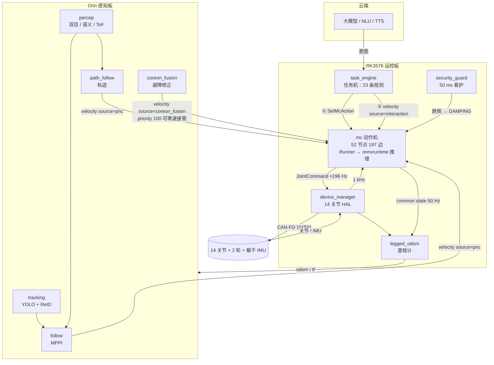


**三台状态机**：系统模式（整机生命周期）→ 任务（业务拆解）→ 动作（用哪套策略）。
**两条通道**：换动作（离散、走换乘图）、换速度源（连续、走优先级仲裁）——互不替代。

## 0.2 视角一：部署——东西都在哪

| 板 | 定义应用 | 启动阶段 | 阶段延时 | 实际启动 |
|---|---|---|---|---|
| **RK3576（运控板）** | **35** | 4 段（10 / 16 / 1 / 1） | 1500 / 5000 / 5000 / 8000 ms | **28**（7 个预留未启：`follow`/`tracking`/`yolov8`/`face`/`move_camera`/`nova_agent`/`poweroff`） |
| **Orin（感知板）** | **40** | 2 段（4 / 9） | 1500 / 8000 ms | **13**（其余是 SLAM/建图/充电等预留） |

- 两板共**定义 75 个应用、实际常驻 41 个**
- 真机进程表实测约 **320 行**（含内核线程）
- 运控只有一个进程 `mc`，但里面有 **36 个线程**（3 个实时 + 33 个普通）

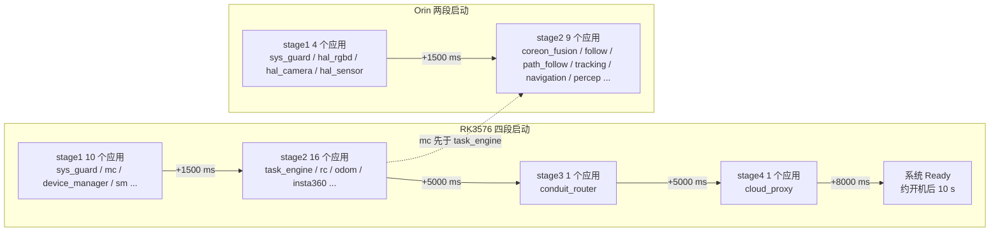

## 0.3 视角二：时间尺度——频率金字塔

| 层 | 周期/频率 | 谁 | 特性 |
|---|---|---|---|
| 场景/任务 | 事件级（秒~分钟） | task_engine | 可以拒、可以排 |
| 规划 | 10~30 Hz | Orin 的 follow / path_follow / navigation | 可以重算 |
| 状态广播 | 50 Hz | mc → `common/state` | 只观测 |
| 安全看护 | 50 ms | `security_guard` | 命中就换动作 |
| 策略推理 | **逻辑 100 Hz（10 ms）** | Runner | 实测单拍 ~10.5 ms，偶发超期（超期不追帧） |
| 关节命令 | **≈196 Hz（实测 5.1 ms）** | mc 的 `rt_joint_pub` | 不能积压 |
| 关节 PD / CAN | **1 kHz + CAN-FD 1M/5M** | device_manager | 最确定 |

**跨 6 个数量级，只有最后两级是硬实时。**这就是为什么要给运控单独隔离一个核——慢的可以随便慢，快的必须独占。

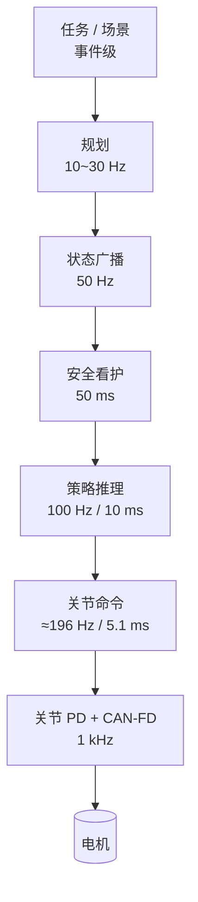

## 0.4 视角三：数据链路——一条速度的旅程

| 环节 | 典型耗时 | 说明 |
|---|---|---|
| Orin 规划出速度 | 33~100 ms（10~30 Hz） | 最慢的一层，但只在目标变化时有意义 |
| 跨板 DDS 传输 | **0.4~0.8 ms** | 内部以太网，带宽只有 ~2 Mbps |
| MC 速度仲裁 | ~0（消息到达即判） | 事件驱动，不进控制周期 |
| 策略推理 | ≤10 ms（一拍） | CPU3 上同步完成 |
| 关节命令发布 | 5.1 ms（≈196 Hz） | UPPER / LOWER / WHEEL 三条 tag |
| 设备层 → CAN → 电机 | ~1~2 ms | 1 kHz PD + CAN-FD |

**结论**：从"速度到达运控"到"关节命令发出"**≤10 ms**，到电机再 +1~2 ms。
而"语音到第一个动作"是 **62 秒**（云端大模型）、"变身"是 **4.8 秒**（物理过程）——
**瓶颈从来不在运控的计算上**。

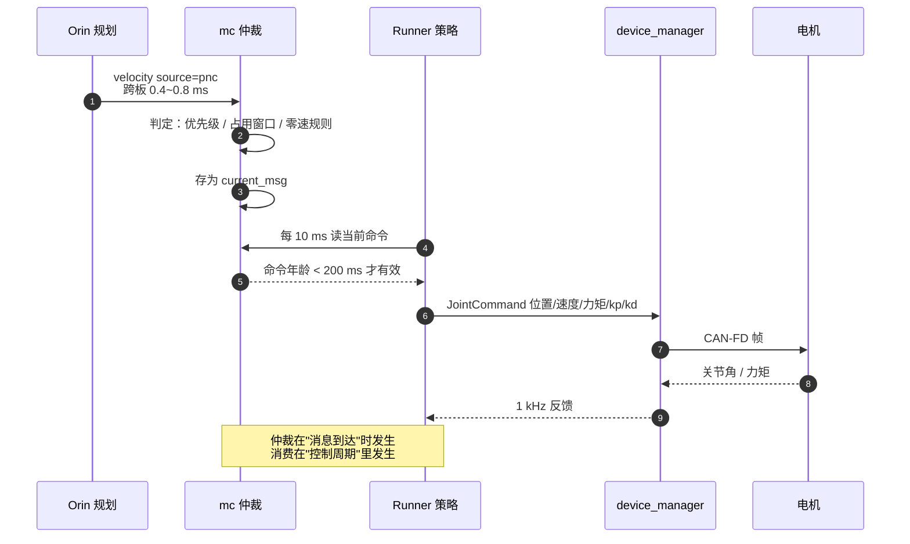

## 0.5 视角四：决策——三台状态机怎么分工

| 状态机 | 规模（真机配置） | 管什么 | 极端情况下能停谁 |
|---|---|---|---|
| **系统模式机 SM** | **9 种模式 × 10 个功能组** | 整机生命周期 | **能停 mc**：EStop 只保留 `HAL`+`Diagnosis` |
| **任务机 task_engine** | 23 条规则 + Worker/Skill | 业务拆解与仲裁 | 能拒请求、能停算法任务 |
| **动作机 mc** | 58 动作 / 6 组状态 / 52 节点 197 边 | 用哪套策略、听谁的速度 | 能换策略、能自行降级 |

**真机 EStop 的实际效果**（配置原文，不是推测）：

| 模式 | 激活的功能组 | 结果 |
|---|---|---|
| `Ready` / `Business` | `HAL, Business, Diagnosis, Motion, OTA`（Business 多一个 `Perception`） | mc 在跑 |
| **`EStop`** | **`HAL, Diagnosis`** | **`mc` 与 `task_engine` 同时被停** |
| `OTA` | `OTA` | 全部业务停 |
| `StandbyPowerSave` / `IdlePowerSave` | 同 Ready | **mc 仍在跑**，只停 ToF 数据流 |

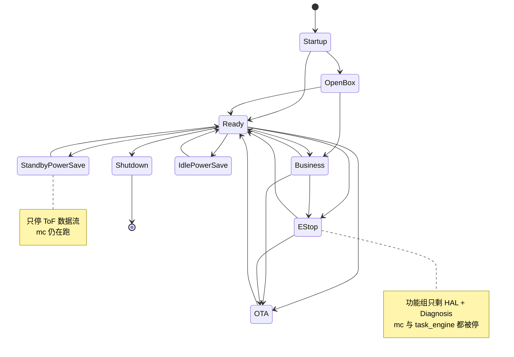

## 0.6 视角五：取舍——这套架构为什么长这样

| 设计选择 | 换来什么 | 付出什么 |
|---|---|---|
| **双板**（RK 实时 + Orin GPU） | 实时确定性与感知吞吐互不拖累 | 跨板只有 ~2 Mbps；两套部署/两套日志 |
| **隔离 2 个核 + SCHED_RR** 替代 PREEMPT_RT | 不用打实时补丁，业务核不受扰 | 运控只有单核吞吐上限（占用 42%~77%） |
| **配置即策略**（4 份 YAML） | 换模型/换路线不改代码 | 一致性风险：四处联动，漏一处运行时才炸 |
| **动作/速度两通道解耦** | 换手与换策略互不干扰 | 排障必须同时看两个状态 |
| **中转动作**（115 起立预备 / 121 踏步） | 物理过渡平滑，不摔 | 多一次交接、多一次状态迁移 |
| **CPU + fp32**（不用 NPU/int8） | 确定性、无量化误差 | 放弃加速（模型只有 23 万参数，本来不需要） |
| **统一 `common/state` 50 Hz** | 单点观测，上层不用猜 | 字段多（9 组），容易误读单个字段 |

## 0.7 全链路参数总表

| 环节 | 关键参数 | 值 | 证据 |
|---|---|---|---|
| 启动 | 首阶段延时 / 送达 Ready | 1500 ms / 约 10 s | 【配置+实测】 |
| 进程 | RK 定义/实启 · Orin 定义/实启 | 35/28 · 40/13 | 【配置】 |
| 实时 | 隔离核 / 运控线程 | CPU2+CPU3 / 36 个（3 实时） | 【配置+实测】 |
| 动作 | 动作数 / 换乘图 | 58 / 52 节点·197 边·skip 24 | 【配置】 |
| 执行 | 执行组 / Runner / 周期档位 | 62 / 62 / 1·2·4·10·20·50 ms | 【配置】 |
| 模型 | 现役 / 全部资产 / 参数 / 精度 | 34 份 / 640 份 / 208 M / 全 fp32 | 【实测解析】 |
| 速度 | 配置源 / 硬编码源 | 7 / 1（避障，priority 100） | 【配置】 |
| 仲裁 | 占用窗口 / 命令过期 | 1000 ms（避障 500）/ 200 ms | 【配置】 |
| 安全 | 看护周期 / 跌倒判据 | 50 ms / 60°·3 次、6 rad/s+48°·3 次 | 【配置】 |
| 反馈 | 关节 / IMU / 诊断 | 1 kHz / 500 Hz / 500 ms | 【配置】 |
| 时延 | 板间 RTT / 带宽 | 0.43~0.76 ms / ~2 Mbps | 【实测】 |
| 慢过程 | 变身 / 语音往返 | 4.8 s / 62 s | 【实测】 |
| 资源 | RK CPU / mc CPU / mc 内存 | 72% / 43~77% / 252 MB | 【实测】 |
| 接口 | 节点 / 话题 / 服务 | 69 / 198 / 480 | 【实测】 |

## 0.8 骨架数字：记住这几行就够了

- **2 块板**：RK3576 实时运控 + Orin 感知规划
- **3 台状态机**：系统模式 9 种 / 任务 23 条规则 / 动作 58 个
- **2 条通道**：换动作（52 节点 197 边）/ 换速度源（7+1 个源）
- **1 个运控进程、36 线程、14 关节、1 kHz 内环**
- **34 份现役权重、640 份资产、208M 参数、全 fp32**

# 第 1 章 运控到底在解决什么问题

## 1.1 让一台机器人动起来，需要回答三个问题

| 问题 | 谁回答 | 举例 |
|---|---|---|
| **去哪、干什么？** | 业务层（听懂人话、看 App 指令） | "去厨房"、"跳个舞"、"跟着我" |
| **怎么动？** | **运控（本文主角）** | 现在该用"四足行走"还是"双足平衡"？走多快？ |
| **每个关节转多少度？** | **运控（本文主角）** | 左前腿髋关节 32.1°、膝关节 -58.7°… |

所以**运控 = 把"意图"翻译成"14 个关节的角度序列"的那层软件**。

它**不负责**：

- 听懂你说什么（那是 Agent + 云端）
- 判断前面有没有障碍、该绕哪边走（那是 Orin 上的感知和规划）
- 拍照、变焦、录像（那是相机，自己一条链）

## 1.2 为什么要分这么多层

一台机器人里的软件如果混成一坨，会有三个具体问题：

| 问题 | 后果 | 分层的解法 |
|---|---|---|
| **响应速度要求差 1000 倍** | 关节要 1 毫秒级响应，语音理解要几百毫秒，混在一起会互相拖累 | 按时间尺度分层，实时的那层单独占一个 CPU 核 |
| **出错后果差很多** | 语音识别错了只是答错话，关节算错了会摔 | 每层有独立的拒绝机制 |
| **改动频率差很多** | 换一个模型很频繁，换硬件协议很少 | 上层用配置，下层用代码 |

这三条决定了 T1 的结构：**实时的那部分被"关"在一个独占的 CPU 核里，只跟它信任的少数几个接口打交道。**

## 1.3 所以运控长什么样（先看一眼全貌，后面逐层拆）

```
        业务：语音/App/手柄/SDK
                 │  "去厨房" / "跳个舞"
                 ▼
        ┌─────────────────────┐
        │ 任务层 task_engine   │  拆成几步、排先后、判断能不能做
        └──────────┬──────────┘
                   │ 两个出口：①换个动作  ②给个速度
                   ▼
        ┌─────────────────────┐
        │ 运控层 mc           │  ① 现在用哪套动作？ ② 听谁的速度？
        │ （独占一个 CPU 核）  │  ③ 算出 14 个关节目标
        └──────────┬──────────┘
                   │ 关节命令（位置/速度/力矩/刚度/阻尼）
                   ▼
        ┌─────────────────────┐
        │ 硬件层 device_manager│  变成 CAN 帧发给电机
        └─────────────────────┘
                   │ 关节角、IMU 反馈往回走
                   └──────▶ 运控层（闭环）
```

> **记住这一句**：运控只回答"怎么动"和"每个关节多少度"，别的都不归它。

---

# 第 2 章 先把五个词讲明白

后面全是这五个词在组合。**先看懂这一章，后面就顺了。**

## 2.1 动作（Action）：一套运动行为的编号

**它是什么**：T1 把所有"整体的运动方式"编了号，一共 61 个。比如：

| 编号 | 名字 | 你可以理解成 |
|---|---|---|
| 1 | `PASSIVE_DEFAULT` | 卸力（用手能推动它） |
| 2 | `DAMPING_DEFAULT` | 阻尼（像泡在糖浆里，摔了不硬撑） |
| 102 | `QUADRUPED_LOCOMOTION_DEFAULT` | 四足行走 |
| 110 | `QUADRUPED_GET_DOWN_DEFAULT` | 四足趴下 |
| 300 | `BIPED_LOCOMOTION_WBC` | 双足走路（全身平衡） |

**为什么要有编号**：因为"用哪套动作"这件事要在好几个进程之间传递（任务层 → 运控层 → 日志 → 回放），编号比字符串可靠，也能做合法性和可达性的检查。

**怎么用**：上层调 `SetMcAction(编号)`，运控收到后**不一定马上切**——它要先检查能不能切（第 7 章讲）。

**常见坑**：界面上显示的"交互 ID"和这个编号**不是一套**。比如界面的"坐下"是 3，而运控里真正的动作编号是 111。拿界面编号去调接口必然失败。

> **记住这一句**：**Action 是"整套动作的编号"，不是"一个关节的动作"。**

## 2.2 执行组与 Runner：一个动作怎么被"分给几路人马"

先看真实配置。下面是 `BIPED_LOCOMOTION_WBC`（双足走路 300）在 `action_setting.yaml` 里的原文【配置】：

```yaml
BIPED_LOCOMOTION_WBC:            # 双足走路（300）
  - runners:                     # ← 第 1 组
    - name: rl_bi_loco_wbc
      cfg_path: "./rl/bi_wbc_run.yaml"
    period_ms: 10                # 100 Hz
    priority: 80
    cpu_affinity: []
    # 非动画模式下不使用动画播放器
  - runners:                     # ← 第 2 组
    - name: animation_player
      cfg_path: "./classic/animation_player.yaml"
    period_ms: 4                 # 250 Hz
    priority: 80
    cpu_affinity: []
```

从这段 YAML 能读出**三层**结构，不多不少：

| 层 | 在配置里的样子 | 它到底是什么 |
|---|---|---|
| **Action** | 一个键名 `BIPED_LOCOMOTION_WBC` | 一套行为，下面挂一个**组列表** |
| **执行组** | 列表里的一项（两个 `- ` 项） | **一个调度单位**：一个周期 + 一个优先级 + 一个 CPU 亲和性 |
| **Runner** | 组里的 `runners:` 列表项（每组各 1 个） | **这个调度单位里要跑哪个控制器**（名字 + 配置文件） |
| **模型/控制律** | `cfg_path` 指向的文件内部 | 这个控制器怎么算：用什么模型、观测怎么排、输出怎么缩放 |

四个关键点，正好回答"每组是不是有好多个 runner"：

**① 组 = 一个实时线程。**
`period_ms` 是**组的属性**，不是 runner 的属性。一个线程只能有一个节拍，所以只有"要同一个周期"的东西才会被放进同一个组。

证据【实测】：运行日志里两个组的线程号不同（`t0/TID5050`、`t1/TID5051`）——**一个组对应一条实时线程**，这就是"组是调度单位"的直接证明。

**② `runners` 在结构上是个列表，但现在的配置里每组只有 1 个。**
也就是说：**格式允许"一个组里挂多个控制器"，但 T1 的实际配置每组都只挂了一个。** 所以双足走路是"**2 个组、2 个 runner**"，不是"2 个组、好多 runner"。（上一版的措辞在这里容易读错，特此更正。）

**③ Runner 实例按"名字 + 配置路径 + 周期"缓存。**
缓存键长这样【实测】：`rl_bi_loco_wbc|./rl/bi_wbc_run.yaml|10`。
所以同一个 runner 被别的 Action 用到时**直接复用实例**，不会重新加载模型——这就是为什么切动作有时很快、有时要"顿一下"（顿的是没缓存过的资源）。

**④ 一个 Action 可以混搭不同技术。**
注意动画播放器的配置在 `./classic/` 目录下——说明它是**经典控制类，不是神经网络**。所以同一个"双足走路"里，腿是神经网络（`./rl/`），上肢是动画播放器（`./classic/`），两者按各自的节拍并行。

**为什么非要拆成两个组**：因为上肢动画要 **4 毫秒**一次才顺滑，腿的平衡策略 **10 毫秒**一次就够。硬塞进一个组，要么腿被拖慢，要么上肢变卡。

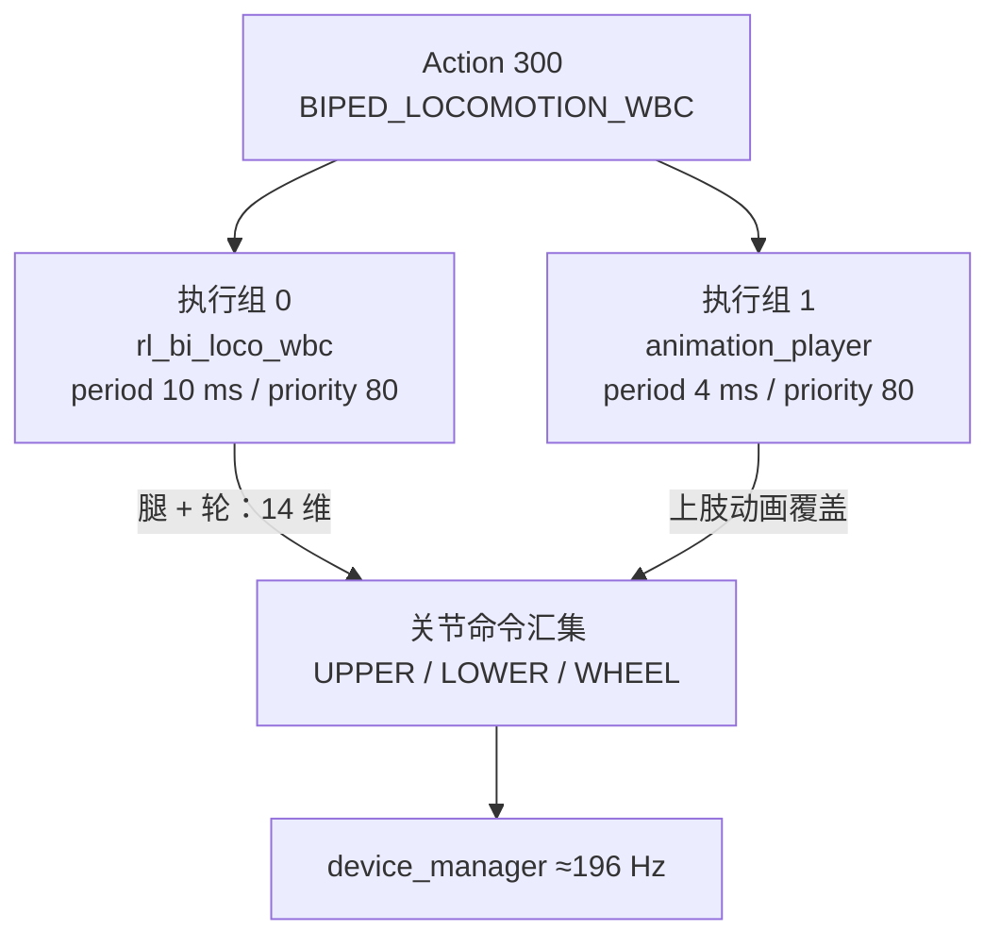

> **记住这一句**：**组是"节拍"（一个周期 = 一条线程），runner 是"人"（拿自己的配置干活），模型是"图纸"。一个节拍下可以站多个人，但 T1 现在每个节拍只站一个。**

### 2.2.1 双 runner 到底怎么跑：两个线程、两个节拍、一个关节汇集点

真机上有 **4 个动作**是"双执行组"的，全部是"RL 管下肢 + 经典控制管上肢"的组合：

| Action | 组 0（RL） | 组 1（经典） | 两个节拍 |
|---|---|---|---|
| **300 双足 WBC** | `rl_bi_loco_wbc` **10 ms** | `animation_player` **4 ms（250 Hz）** | 100 Hz + 250 Hz |
| **301 双足动画** | `rl_bi_loco_animation` 10 ms | `animation_player` **2 ms（500 Hz）** | 100 Hz + 500 Hz |
| **302 上肢录制** | `rl_bi_loco_wbc` 10 ms | `biped_record` 10 ms | 100 Hz + 100 Hz |
| **1014 二开上肢** | `rl_bi_loco_wbc` 10 ms | `custom_upper` 10 ms | 100 Hz + 100 Hz |

**核心机制：一个执行组 = 一条周期定时线程。**

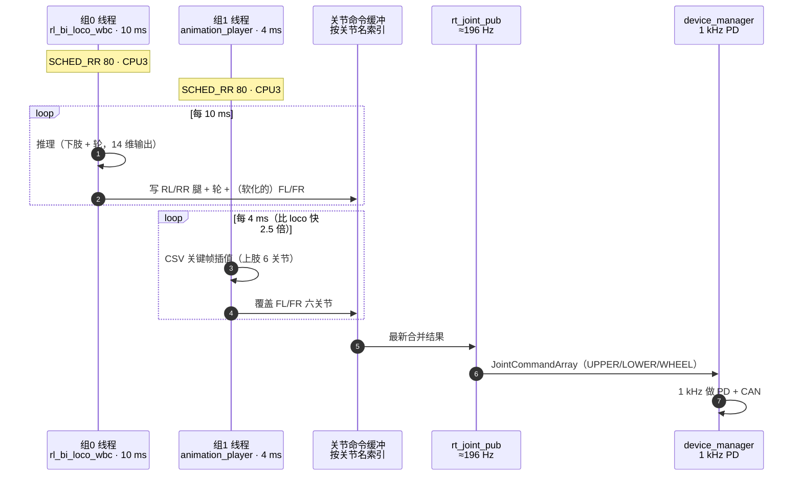

#### 关键点一：两个线程，但**不并行在两个核上**

`action_setting.yaml` 里两个组的 `cpu_affinity` 都是 `[]`（空）——**继承进程绑定**，也就是都在 CPU3 上。
实测证据：两个组的日志分别打 `t0/TID5050` 和 `t1/TID5051`，两条不同的线程。

所以准确说法是：**并发（concurrent）但不是多核并行（parallel）**。
两个 SCHED_RR 80 的线程在同一个核上按时间片轮转；因为 4 ms 的动画线程工作量很小（查表 + 插值），不会把 10 ms 的推理线程挤掉。

#### 关键点二：两组写**不同关节**，所以不打架

- `rl_bi_loco_wbc`：输出 14 维，覆盖全部关节（下肢是主力，前肢给的增益很软：`kps 1.0/0.5/0.5`）；
- `animation_player`：只写 **6 个上肢关节**（`FL_HIP_ROLL/PITCH/KNEE`、`FR_...`），自己的增益硬得多（`kp 4.0 / 2.0 / 4.0`，`kd 0.2`），还带 `gravity_scale 0.6`。

这就是为什么 WBC 的前肢增益那么软——**上肢的活儿交给动画组，RL 不需要硬撑**。

关节命令最后按**关节名**汇入同一个缓冲；上肢组以更高的频率写，效果上等于"覆盖"RL 对前肢的输出。
（覆盖的精确优先级属于 MC 内部实现，目前只有配置与线程证据，标【推断】。）

#### 关键点三：真正的"发布节拍"是第三个线程

关节命令不是两个 runner 直接发出去的，而是由 **`rt_joint_pub`** 以 **≈196 Hz**（实测 5.1 ms）统一发布：

| 节拍 | 谁 | 频率 |
|---|---|---|
| 组 0（RL 推理） | `rl_bi_loco_wbc` 线程 | **100 Hz**（10 ms，`dt: 0.01`） |
| 组 1（动画插值） | `animation_player` 线程 | **250 Hz**（4 ms）或 500 Hz（2 ms） |
| 关节命令发布 | `rt_joint_pub` | **≈196 Hz**（实测 5.1 ms） |
| 关节 PD / CAN | `device_manager` | **1 kHz** |

所以"机器人以一个频率在动"这个说法并不准确：**策略 100 Hz 出目标、发布 ≈196 Hz、PD 1000 Hz**，三层各自独立。

#### 关键点四：RL 推理到底是 50 还是 100 Hz

| 策略族 | 配置 | 推理频率 |
|---|---|---|
| 四足/双足行走、越野、变身、恢复、WBC（绝大多数） | `dt: 0.01` + 组周期 10 ms | **100 Hz** |
| `BIPED_NPZ_MIMIC`（NPZ 模仿） | `dt: 0.02` + 组周期 **20 ms** | **50 Hz** |
| `ANIMATION`（301）的动画组 | `action_period_ms: 2` | 500 Hz（纯插值，不是推理） |

**结论：部署运行的 RL 推理默认 100 Hz，只有 NPZ 模仿是 50 Hz。**

补充一个容易搞混的地方：某些配置（如 `bi_dance.yaml`）开头有注释写
`simulation_dt × control_decimation = 0.005 × 4 → 50Hz 策略`、`0.002 × 5 → 100Hz 策略`——
那是**训练侧**的采样频率（仿真步长 × 抽帧），不是部署频率。部署看的是 `dt` 与组周期是否一致。
不要被 ≈196 Hz 的关节发布频率误导——那是"把最新目标发出去"的频率，不是"模型算一次"的频率。

#### 关键点五：名义 100 Hz ≠ 实际频率（这里必须分清三个时间）

你的直觉是对的：**"配了 10 ms"不等于"每 10 ms 就完成一次"**。日志里其实把三件事分得很清楚。

| 时间概念 | 值 | 从哪来 | 是不是实测 |
|---|---|---|---|
| **逻辑步长 dt** | 10 ms | `dt: 0.01`；控制器内部 `step` 计数 | 逻辑时间（`elapsed = step × dt`） |
| **定时器周期 period** | 10 ms | `action_setting.yaml` 的 `period_ms` | 配置 |
| **每拍实际耗时 run** | 位控 ~1.13 ms、动画 ~4.87 ms、阻尼 ~2.28 ms、WBC **~10.5 ms** | 日志 `run X us >= period Y us` | **实测** |

**日志原文**（`task_base.cc`）：

```
[TASK] quad_stand_t0    run 1025 us >= period 1000 us, skip wait
[TASK] animation_p..t1  run 4731 us >= period 4000 us, skip wait
[TASK] rl_bi_loco_..t0  run 10511 us >= period 10000 us, skip wait
```

**`skip wait` 的含义**：这一拍干完时已经超过周期了，**不等待、也不追帧**，立刻开始下一拍。
所以一旦超期，真实节拍就被拉长成 `run`，而不是 `period`。

**超期统计（这份日志，2026-10-11 起）**：

| 任务 | 周期 | 超期次数 | 超期时的 run（中位/最大） | 含义 |
|---|---|---|---|---|
| `quad_get_down_t0` | 1000 µs | 13398 | 1119 / 7349 µs | 1 ms 位控**实际跑不到 1 kHz** |
| `quad_sit_down_t0` | 1000 µs | 3181 | 1129 / 4362 µs | 同上 |
| `quad_stand_t0` | 1000 µs | 2157 | 1135 / 3803 µs | 同上 |
| `animation_player_t1` | 4000 µs | 96 | 4872 / 8680 µs | 250 Hz 组超期约 22%，最坏 2.2 倍 |
| `damping_default_t0` | 2000 µs | 56 | 2284 / 3940 µs | 500 Hz 组略超 |
| **`rl_bi_loco_wbc_t0`** | 10000 µs | 3 | **10511 / 11466 µs** | **RL 一拍就要 ~10.5 ms，已经贴着周期** |

**所以准确的说法是**：

- **逻辑上**是 100 Hz（每步 10 ms，`step=91 → 0.91 s` 的对应关系在日志里多次出现，完全一致）；
- **物理上**，每拍耗时已经接近甚至偶发超过 10 ms，超期时按 `skip wait` 顺延；
- 因此**平均频率略低于 100 Hz，且存在抖动**；精确平均值无法从这份日志算出——因为**只有超期才会打印**，正常拍不记录，缺分母。

> **这也是我上一版该修正的地方**：不能把"配置 10 ms"直接说成"实测 100 Hz"。
> 准确表述是"**逻辑步长 10 ms（100 Hz），实测单拍耗时 ~10.5 ms，偶发超期**"。

**顺带一个真实抖动**：状态发布（50 Hz）也会偶发阻塞——

```
common_state_publisher.cc: publish common state too slow: 64451 us
```

一次发布花了 **64 ms**（名义 20 ms）。它不影响控制环（另一个线程），但会让上层观测到的时间戳出现明显抖动。

#### 关键点六：能不能是"50 Hz + 插值"？——可以排除

这是个很好的怀疑，因为 196 Hz 的发布频率确实会让人以为"中间有插值"。但日志里有一个能直接证伪的量：**控制器的 `step` 计数**。

控制器在退出检查时会打印 `step=N elapsed=…s`。如果 `step` 是按调用次数递增，那么把"Δstep"和"Δ墙钟"一除，就是**真实的每步耗时**：

| 日期 | 时间 | Δstep | Δ墙钟 | 每步实测 |
|---|---|---|---|---|
| 10-11 | 19:26:21.340 → .749 | 41 | 408.9 ms | **9.97 ms** |
| 10-11 | 19:28:25.345 → .756 | 41 | 410.3 ms | **10.01 ms** |
| 10-13 | 15:24:09.294 → .705 | 41 | 411.1 ms | **10.03 ms** |
| 10-13 | 17:16:47.799 → 48.209 | 41 | 409.8 ms | **10.00 ms** |
| 其他两处 | — | 41 | 411.0 / 409.8 ms | 10.02 / 9.99 ms |

**41 步 = 410 ms → 每步 10.0 ms**，六次独立样本全部一致。这说明：

- 控制器**真的每 10 ms 被调用一次**（不是 20 ms）；
- `elapsed` 确实是 `step × dt` 的逻辑时间，但**逻辑时间和墙钟在这台机器上是吻合的**（不是"逻辑 100 Hz、物理 50 Hz"）。

**再看配置注释**（三份主力配置的第一行就写着）：

```yaml
# quad_walk.yaml
dt: 0.01  # 100Hz
# quad_step.yaml
dt: 0.01  # 100Hz
# bi_wbc_run.yaml
dt: 0.01  # 100Hz
```

**再排除"插值"**：全量扫过 6 套配置的 100+ 个 yaml，**没有任何"动作插值/动作重复"参数**。存在的"平滑"只有三类，都不是"把 50 Hz 补成 100 Hz"：

| 机制 | 参数 | 作用范围 |
|---|---|---|
| 进入平滑 | `transition_duration 0.1~0.3 s` | 只在**切换动作**时，把起点姿态平滑过去 |
| NPZ 动作平滑 | `smooth_time 0.5`（每支舞单独配） | 只在 `BIPED_NPZ_MIMIC`（本来就是 50 Hz） |
| 上肢 CSV 插值 | `action_period_ms`、`fps 60` | 只影响动画播放（经典控制，非神经网络） |

而 196 Hz 的关节发布**不是插值**：它是"把最新的 10 ms 目标重复发 2 次"（零阶保持）。
发布频率高是为了**降低下发抖动**，不是为了提高策略频率。

**唯一一个真实的 50 Hz 例外**：`BIPED_NPZ_MIMIC`——`dt: 0.02` + 组周期 20 ms，配置自己就写着 50 Hz，不存在"伪装成 100 Hz"。

> **结论**：策略就是 100 Hz 在跑，不是 50 Hz 插值。
> 唯一要注意的是 `bi_dance.yaml` 开头那段注释（`t1: 0.005×4 → 50Hz 策略`）说的是**训练侧**采样率，
> 而它部署时写的是 `dt: 0.01`——这是"训练 50 Hz、部署 100 Hz"的配置差异，属于潜在的不匹配，但不是插值。

#### 关键点七：这些结论的证据强度（以及怎么自查）

| 结论 | 证据 | 强度 |
|---|---|---|
| WBC 有**两组**、每组 1 runner、周期分别 10/4 ms | 日志 `action_manager.cc:150`：`Create transition action BIPED_LOCOMOTION_WBC, has 1 runners, period ms: 10` 与 `… period ms: 4`，同一 Action 出现两条 | 【实测】 |
| 两组跑在**两条不同线程**上 | 同一场次日志里，`qd1_bi_wbc_rl_controller.cc` 只在 **TID 4881**，`animation_player_controller.cc` 只在 **TID 4882**；两条线程各自还都打 `joint_command_publisher` | 【实测】 |
| 推理 **100 Hz** | 38 个部署配置里 **37 个**满足 `dt = 组周期`：`dt=0.01` ↔ `10 ms`；唯一例外 `BIPED_NPZ_MIMIC` 是 `dt=0.02` ↔ `20 ms`（50 Hz）。逐份核对无一处矛盾 | 【配置，逐份一致】 |
| 关节发布 **≈196 Hz** | 日志 `joint_command_publisher.cc:176`：`period_us: 5100`（每次启动都是 5100） | 【实测】 |
| **每 10 ms 都真的推理一次** | 日志没有逐拍打印，无法直接数；只能由 `dt=0.01` 与 `exit_wait_stop_step × dt = 1 s` 的注释推断 | 【推断】 |

**自查方法**（有实机时）：

```bash
# 1) 看两组是否各有线程（WBC 运行中执行）
ps -eLo pid,tid,comm,cls,rtprio -p $(pidof mc_app_main) | grep -E "loco|animation|t0|t1"
# 2) 看发布周期
grep "period_us" /robot/persist/log/mc/mc.log | tail -1
# 3) 数实际推理拍数：用 perf 或 ORT 的 profiling 抓 Run 调用次数
```

## 2.3 模型 / 策略（ONNX）：神经网络的"权重文件"

**为什么四足走路要用神经网络**：四足平衡是典型的"很难手写公式"的问题——地面软硬、负载变化、被推一下，都要实时调整。用强化学习训练出来的策略，本质是一个函数：

```
输入（观测 obs）：关节角度/速度、躯干姿态、上一步动作、你要的速度
  ↓  神经网络（ONNX 文件）
输出（动作 action）：14 个关节的目标角
```

以双足走路策略为例【配置】：

- 观测 **49 维**、动作 **14 维**、每 **10 毫秒**算一次、把最近 **10 帧**堆起来一起喂
- 观测有固定顺序：IMU 角速度在第 0 位、欧拉角第 3 位、关节位置第 6 位……**顺序错了模型就疯**

**训练和部署的关系**：训练在外面做，机器人上只跑推理（用的是 RK3576 的 CPU，不是 GPU，也不是 NPU）。

### 2.3.1 推理到底在哪一步发生（这是最容易丢的一环）

前面说"模型每 10 毫秒跑一次"，但**它不是一个独立进程、也不是一个服务**。真实情况是：

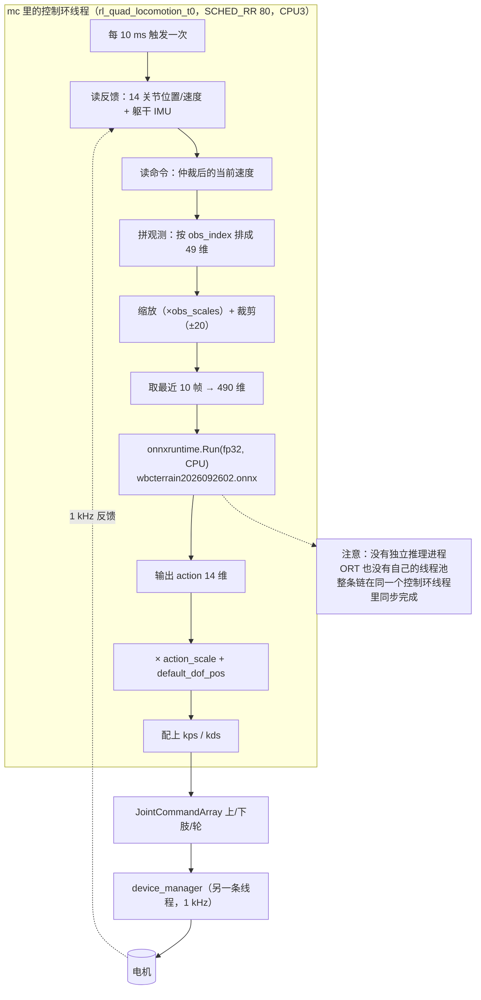

**三个要点**：

| 问题 | 答案 |
|---|---|
| 推理在哪个进程？ | **`mc` 进程内部**，不是单独的服务 |
| 推理在哪个线程？ | **控制环线程本身**（就是那个名字会变的 `rl_quad_locomotion_t0` / `passive_default_t0`） |
| 有独立的推理线程池吗？ | **没有**。实测 36 个线程里找不到 onnx/omp 线程，`onnxruntime.Run` 是在调用线程里同步跑完的 |

所以你抓线程栈时，看到的是"控制环线程正在做推理"，而不是"控制环在等另一个推理线程"。

> **记住这一句**：**"策略"= 一个 ONNX 文件 + 一份说明它怎么吃数据、怎么吐数据的配方。**

## 2.4 速度来源（`source`）：给"谁在指挥"打标签

**为什么需要标签**：能控制底盘的程序不止一个——导航算法、跟随算法、任务调度、手柄、手机 App，**它们都可能往同一条话题里发速度**。运控必须知道"这条速度是谁发的"，才能决定听谁的。

所以每条速度消息里都带一个字符串字段 `source`：

| `source` | 谁发的 | 典型场景 |
|---|---|---|
| `pnc` | Orin 的规划算法（导航/跟随/运镜轨迹） | 自主移动 |
| `interaction` | 任务层自己的移动技能 | 语音说"向右转 90 度" |
| `rc` | 物理手柄 | 现场调试 |
| `app_proxy` | 手机 App 摇杆 | 手动遥控 |
| `coreon_fusion` | Orin 避障修正 | 前面有人/墙 |

**注意**：`pnc` 只是**标签**，不是一个进程——跟随、导航、轨迹跟踪都可能标成 pnc。

> **记住这一句**：**`source` 不是"谁更强"，只是"这条指令是谁发的"。**

## 2.5 五个状态字段：为什么不能合成一个

你可能会想："直接告诉我现在什么状态不就行了？"——不行，因为一次切换有**五个不同的时刻**，每个时刻都可能被误读：

| 字段 | 它回答 | 举个例子 |
|---|---|---|
| `action_desc` | 现在用的是**哪套**动作 | `BIPED_LOCOMOTION_WBC` |
| `status` | 这套动作是运行中还是切换中 | `100` 运行 / `200` 切换中 |
| `switch_ready` | **现在能不能接新动作** | `false` = 忙着，别插 |
| `form` | 逻辑形态 | `1` 四足 / `2` 双足 |
| `fsm` | 分类标签 | `2` 稳定 / `3` 运动中 / `4` 安全 |

**一个真实例子说明为什么必须分开**：变身时，`form` 已经广播成"双足"了，但 `switch_ready` 还是 `false`——因为身体还在变。**如果只看 form，你会以为已经可以走路了。**

所以判断"能不能接管"，唯一可信的是 **`switch_ready`**。

> **记住这一句**：**五个字段各说一件事，别用一个字段推所有结论。**

---

# 第 3 章 T1 有几种"动"——先把功能分开

你说"导航是导航，拍照是拍照"，这个直觉非常对，而且是最关键的一刀。

## 3.1 用"动不动腿、动不动相机"来切

| 功能 | 动腿/轮 | 动上肢/云台 | 动相机 | 谁在指挥 |
|---|---|---|---|---|
| **导航**（去某个点） | ✅ | — | — | Orin 的 Nav2 |
| **跟随**（跟着人走） | ✅ | — | — | Orin 的 follow |
| **摇杆 / App** | ✅ | — | — | 手柄或手机，直发速度 |
| **移动任务**（"前进 2 米"） | ✅ | — | — | 任务层 |
| **动作**（站/趴/跳舞/空翻） | 可能 | 可能 | — | 任务层请求一个 Action |
| **拍照 / 录像** | ❌ | ❌ | ✅ | 任务层调相机 |
| **运镜**（环绕/希区柯克） | ✅ | — | ✅ | 任务层编排，**两条链并行** |
| **对话 / 表情** | ❌ | 可能 | — | Agent |

## 3.2 这张表解答三个疑问

**疑问一：拍照要经过运控吗？**
不经过。拍照是一条独立的链：任务层 → 相机模块 → 蓝牙 → 相机。相机自己在内部做追踪、变焦、稳像。**运控完全不知道它在拍**（知道的是任务层）。

**疑问二：运镜和导航有什么区别？**
在运控眼里**几乎没区别**，都是"有人发速度"。唯一的区别是运镜**同时还指挥相机**，而且它会在几个阶段之间来回切换"谁发速度"（转身用任务层，画圈用 Orin）。

**疑问三：导航、跟随、摇杆、移动任务，运控分得清吗？**
**分不清，也不需要分清。**它只认 `source` 标签。这四者在运控层是同一件事。

## 3.3 于是，运控层只有两个旋钮

运控层剥到最里面，只剩两个旋钮；而它们恰好对应两条**互相独立**的通道：

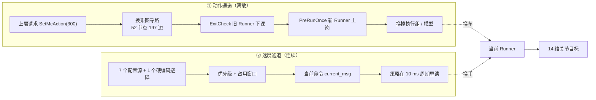


**这两个旋钮完全独立**，这一点后面会反复用到。用实测数据证明一下：

| 场景 | 换动作了吗 | 换方向盘了吗 | 说明 |
|---|---|---|---|
| 环绕运镜（6 段，7376 条状态） | ❌ 全程 300 | ✅ 来回 4 次 | 只换"谁踩油门" |
| 四足→双足准备链 | ✅ 换了 5 次 | ❌ 全程任务层 | 只换"挡位" |
| 跌倒保护 | ✅ 立刻换阻尼 | — | 安全逻辑直接换挡 |

> **记住这一句**：**换动作 ≠ 换速度源。看日志永远分两列看。**

---

# 第 4 章 一个请求的旅程——把前面的词串起来

概念单独看都懂，连起来才是架构。跟着三条真实请求走一遍。

## 4.1 场景 A：语音说"去厨房"

```
你说：去厨房
 │
 ▼ ① 听清、听懂                     （Agent + 云端，全篇最慢的一步）
 │    只产出"意图"，实测往返 ≈62 秒——慢在云端大模型，不是机器人本体
 │
 ▼ ② 变成任务                       （任务层 task_engine）
 │    "导航到厨房" → 建任务 → 先检查能不能做：
 │      电量够吗？正在跳舞吗？手被人牵着吗？前面有障碍吗？
 │    不能做就拒绝，并返回一个原因码（第 7.9 节有完整的码表）
 │
 ▼ ③ 变成速度                       （Orin 上的导航算法）
 │    算路径 → 按自己的频率吐出速度：(前进 0.6, 侧移 0, 转向 0.1)
 │    这条速度带标签 source = "pnc"          ← 用了 2.4 节的词
 │
 ▼ ④ 认领控制权                     （运控的速度仲裁）
 │    运控先问一句："pnc 现在有资格说话吗？"
 │    有资格 → 存下来当"当前命令"；没资格 → 丢弃
 │
 ▼ ⑤ 变成关节角                     （运控的执行组）
 │    当前动作是 102（四足行走）→ 用四足行走的策略
 │    策略每 10 毫秒跑一次：                           ← 用了 2.3 节的词
 │      输入 = 关节反馈 + 躯干 IMU + 刚收到的速度
 │      输出 = 14 个关节的目标角
 │
 ▼ ⑥ 变成 CAN 帧                    （硬件层 device_manager）
 │    角度 → 电机指令（位置/速度/力矩/刚度/阻尼）→ CAN-FD 总线
 │
 ▼ ⑦ 电机转，机器人走
 │
 └─ 反馈回路：关节角 + IMU → 里程计算法 → 回到 ③ 修正路径
```

**这条链上"换动作"发生了几次？零次。**纯导航只动"速度"这一个旋钮。

> 诚实说明：**导航这条路的实机证据最少**——配置和规则里都有，但现场验证主要集中在跟随和运镜。所以 ③④⑤ 是"机制上成立"，不是"每次都跑过"。【配置+推断】

## 4.2 场景 B：App 点"环绕我一圈"

前两步一样，第三步开始**分叉成两条链**：

```
② 任务层建任务："环绕" → 拆成几步：
      调整距离 → 相机准备 → 转身 → 画圈 → 转回 → 短跟随 → 收尾

   ┌────────────── 身体链 ──────────────┐   ┌────────── 相机链 ──────────┐
   │ ③a Orin 算轨迹 → 速度 source=pnc    │   │ ③b 任务层直接命令相机：     │
   │ ③a' 要转身时，任务层自己发速度       │   │    "回正 / 开追踪 / 开录像" │
   │      source=interaction             │   │    走蓝牙，不经运控          │
   │ ④ 运控仲裁：pnc 和 interaction 抢方向盘│  │                            │
   │ ⑤ 当前动作仍是 300（双足），不变     │   │ 相机自己转、自己变焦        │
   │ ⑥ 电机                              │   │                            │
   └────────────────────────────────────┘   └────────────────────────────┘

   两条链各自向任务层报告完成，互不通信
```

**这条链告诉我们三件事**：

1. **运镜不换策略**：全程动作都是 300，变的是"谁在发速度"（实测切了 4 次）。
2. **相机链完全不出现在运控日志里**：它是另一条独立通路。
3. **两条链会错配**：实测出现过"相机已经在缩小，身体还在以 −1.4 m/s 后退"，错配 2.89 秒。因为两边各有各的完成判据。

## 4.3 场景 C：语音说"请跳个舞"

这条链**才是真正换动作的**。实测时间线（2026-10-30 上午）：

| 时刻 | 动作 | 发生了什么 |
|---|---|---|
| 14:25 起 | 110 趴下 | 长期驻留（趴了 294 秒） |
| 14:30:38.433 | **115 起立预备** | 要跳舞得先站起来 |
| 14:30:38.828 | **101 四足站立** | 395 毫秒后 |
| 14:30:42.018 | **102 四足行走** | 3.2 秒后（"站起来"实际是 115→101→102 三步） |
| 14:30:42.726 | **121 踏步** | **自动插入的过渡，只活 59 毫秒** |
| 14:30:42.785 | **109 跳舞** | 神经网络策略，跳 18.08 秒 |
| 14:31:00.862 | **102 四足行走** | 跳完回行走 |
| 14:31:13.244 | **11 旋转变身** | 开始变双足，耗时 4.8 秒 |
| 14:31:18.050 | **300 双足 WBC** | 变身结束**自动**落到 300 |

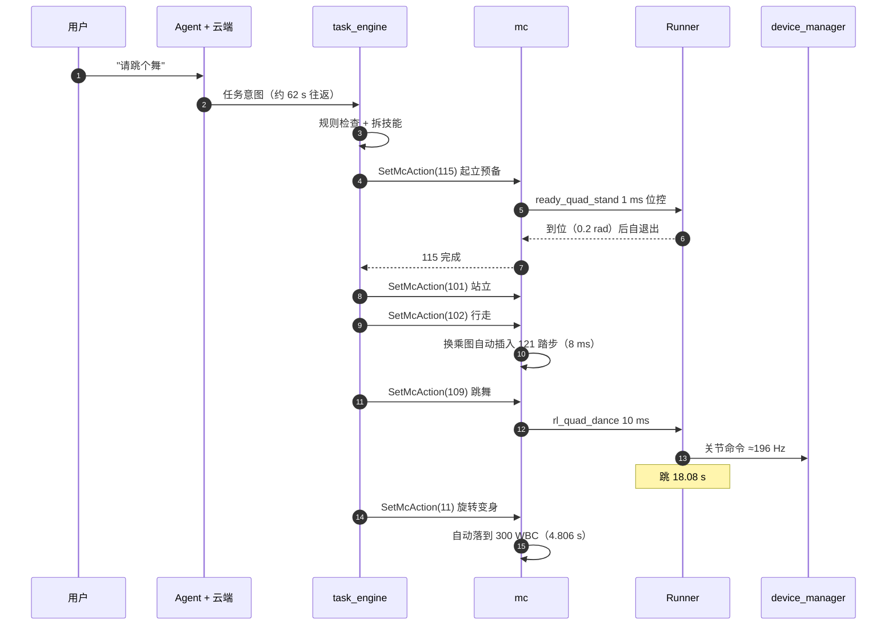

**四个关键观察**：

1. 一次"跳舞"，运控层换了 **6 次**动作。
2. `121` 是**运控自己插的**，上层根本没请求它（第 7.5 节解释原因）。
3. `115→101→102` 说明"站起来"不是一步，是三步，每一步都可能被人看到。
4. 最后停在 **300** 而不是 11——**变身完成会自动落位**（第 7.4 节解释）。

## 4.4 三条链的对照表

| | 场景 A 导航 | 场景 B 运镜 | 场景 C 跳舞 |
|---|---|---|---|
| 换动作 | 0 次 | 0 次 | **6 次** |
| 换速度源 | 0 次 | **4 次** | 0 次 |
| 动相机 | 否 | **是（独立链）** | 否 |
| 谁在编排 | 任务层 | 任务层 | 任务层 |
| 主要风险 | 速度源被抢 | 两条链错配 | 变身被打断 |

> **记住这一句**：**分叉在任务层（要不要动身体、要不要动相机），汇合在运控的速度仲裁（谁有资格踩油门）。**

---

# 第 5 章 五层楼：每层只回答一个问题

## 5.1 楼层图

```
┌──────────────────────────────────────────────────────────────┐
│ 5F 业务层    "你想让它干什么？"                                │
│    Agent（听懂人话）、App、手柄、SDK                             │
│    只产出意图，不关心怎么实现                                    │
├──────────────────────────────────────────────────────────────┤
│ 4F 任务层    "这件事分几步？谁先谁后？能不能插队？"  （task_engine）│
│    把"跳个舞"拆成：起身 → 站立 → 行走 → 跳舞 → 变身 → 收势      │
│    会拒绝：电量不够 / 正在跳舞 / 手被牵着 / 有障碍               │
├──────────────────────────────────────────────────────────────┤
│ 3F 运控层    "现在用哪套动作？听谁的速度？"          （mc）       │
│    产出：当前动作编号 + 当前速度命令 + 关节目标序列              │
│    会拒绝：切不过去 / 姿态不允许 / 请求太频繁                    │
├──────────────────────────────────────────────────────────────┤
│ 2F 执行层    "这一拍每个关节给多少角度？"            （Runner）   │
│    神经网络 / 经典控制 / 轨迹回放都在这一层                      │
├──────────────────────────────────────────────────────────────┤
│ 1F 硬件层    "把角度变成电信号"                  （device_manager）│
│    CAN-FD 帧 → 电机；读回关节角、IMU                            │
└──────────────────────────────────────────────────────────────┘
```

## 5.2 逐层问答（理解层与层的边界）

**5F 业务层**
问：它知道机器人怎么动吗？
答：不知道。它只会说"跳舞"，不会说"先起立再行走再跳"。所以**语音说了 != 已经开始动**。

**4F 任务层**
问：它知道每个关节怎么动吗？
答：不知道。它只负责"分几步、排先后、判断能不能做"。
**这就是"任务完成 ≠ 身体完成"的根源**：任务层认为自己的工作做完了（Worker completed），身体可能还在变身。实测差了 **3.91 秒**。

**3F 运控层**
问：它知道为什么要做这个动作吗？
答：不知道。它只收到"切到 300"和"听 pnc 的速度"两件事，**不问理由**。
**这带来一个重要特性**：安全逻辑可以直接从运控层换动作（跌倒 → 阻尼），不用等任务层同意。

**2F 执行层**
问：它知道动作什么时候该结束吗？
答：多半不知道。它只管"每 10 毫秒算一次"，结束条件由上层或动作自己判断。

**1F 硬件层**
问：它会做业务判断吗？
答：完全不会。它只做"角度 → 电流"的翻译，外加限位和温度保护。

## 5.3 每层的"不能越权"清单（排障时最有用）

| 层 | 能决定 | **不能**决定 | 于是你会看到 |
|---|---|---|---|
| 5F 业务 | 说什么 | 怎么做 | 语音说了"跳舞"，其实还在起立 |
| 4F 任务 | 分几步 | 关节角度 | 任务完成了，身体还在动 |
| 3F 运控 | 用哪套动作、听谁的速度 | 每个关节多少度 | 动作换了，不代表站稳了 |
| 2F 执行 | 关节角度 | 任务该不该继续 | 策略在跑，方向可能是错的 |
| 1F 硬件 | 电机出力 | 一切业务判断 | 电机在转，可能是被带动的 |

## 5.4 为什么"完成"有五种意思

因为每层都有自己的"完成"，而且时间不一样：

| 你看到的"完成" | 实际含义 | 不代表 |
|---|---|---|
| 接口返回成功（`code=0`） | 请求被接收了 | 已经开始切换 |
| `state.value=1` | 开始切换 | 已经切到位 |
| `status` 从 200 变 100 | 这套动作进入运行态 | 动作做完了 |
| 任务层 `Worker completed` | 任务层这一环结束了 | 身体到位（实测差 3.9 秒） |
| 关节反馈跟上了目标 | 才接近"身体真的到位" | 也不代表动作做完（可能还要保持） |

> **记住这一句**：**五层各管一件事，下一层不知道上一层为什么。排障必须一层一层往下走。**

---

# 第 6 章 策略清单：动作是怎么分类的（接口 61 / 真机 58）

这一章告诉你"到底有多少个策略"，以及为什么网上的说法对不上。

## 6.1 先讲分类的两个维度

T1 的动作可以按两件事切：

**维度一：这个动作会不会自己结束？**

- **持续型**：只要不换它就一直跑（走路、跑步、站立）——靠"速度指令"驱动
- **一次性**：做完就结束（变身、空翻、握手、跳舞）——靠"内部相位"驱动

**维度二：靠什么实现？**

- **神经网络**：靠模型实时推理（走路、变身、恢复、跳舞）
- **经典控制**：靠固定增益和轨迹（站立、趴下、卸力、阻尼）
- **轨迹回放**：靠预先录好的 CSV（部分模仿舞）

## 6.2 六族策略

| 族 | 干什么 | 靠什么 | 数量 | 代表 |
|---|---|---|---|---|
| **1 安全/被动** | 卸力、阻尼、躺下 | 经典控制，**无网络** | **3** | 1 / 2 / 3 |
| **2 形态转换** | 四足↔双足变身 | 神经网络，一次性 | **6** | 10 / 11 / 12 / 20 / 21 / 22 |
| **3 持续运动** | 走、跑、越野、踏步 | 神经网络，持续 | **10** | 102 / 103 / 112 / 121 / 202 / 203 / 204 / 207 / 300 |
| **4 跌倒恢复** | 倒了爬起来 | 神经网络，一次性闭环 | **2** | 100（四足）/ 200（双足，无实测） |
| **5 姿态/驻留** | 站、趴、坐、收储 | 经典控制 | **14** | 101 / 110 / 111 / 115 / 1001 / 1008… |
| **6 表演/动画/上肢** | 跳舞、挥手、空翻、上肢 | **混合**（网络 / CSV / 组合） | **26** | 109 / 119 / 301 / 1014 |
| | | | **61** | |

**这六族里，真正"跑神经网络"的约 20 个**（族 2、3、4 全部，加上族 6 的一部分）。其余是经典控制和轨迹回放。

## 6.3 这些数字是怎么来的：从 61 一步步数到 34

### 6.3.0 先说清 6.2 和 6.3 为什么不是一回事

- **6.2 数的是"接口菜单"**：`McAction.msg` 里一共 61 个枚举，按功能分成六族。这是"理论上能点哪些菜"。
- **6.3 数的是"这台机器实际配了什么"**：真机 `action_setting.yaml` / `rl/*.yaml` / `rl_models/` 里的真实条目。这是"后厨今天备了哪些料"。
- 两个数**不矛盾**，差值是确定的、可以逐条对账的。下面就是这张对账单。

### 6.3.1 第一刀：61 → 58

| 步骤 | 数量 | 说明 |
|---|---|---|
| 接口枚举 | **61** | `McAction.msg` |
| 减：本机没配的 | **−16** | 主要是 Q 系列和一代旧动作 |
| 加：真机有、枚举里没有的 | **+13** | 内核真实主键是**字符串名**，不是枚举值 |
| 真机动作数 | **58** | = 61 − 16 + 13 |

**减掉的 16 个**（本机没配，调了会返回"动作未定义"）：

```
QUADRUPED_LOCOMOTION_SIT   BIPED_WALK_RUN        MIMIC
MIMIC_LINKCRAFT            BIPED_WHOLE_BODY_CTRL MIMIC_OPENSOURCE
STAND_UP                   LYING_DEFAULT         LIE_FACE_DOWN
LIE_FACE_UP                BIPED_QUIET_WALK      BIPED_BLIND_TERRAIN
BIPED_SIT_DOWN             BIPED_RUN             BIPED_TAKE_SEAT
BIPED_LEAVE_SEAT
```

**加上的 13 个**（真机有、SDK 枚举里查不到）：

```
BIPED_LINGCHUANG_MIMIC          BIPED_LOCOMOTION_BACKBEND
BIPED_LOCOMOTION_DANCE          BIPED_LOCOMOTION_WBCDANCE
BIPED_SPLIT                     BIPED_YUZURU
QUADRUPED_BODY_ADJUST_DEFAULT   QUADRUPED_LOCOMOTION_REVERSE_DEFAULT
QUADRUPED_STAND_REVERSE_DEFAULT TEST_FOURIER
TEST_PLATFORM                   TRAJECTORY_GENERATOR
security_guard（常驻安全任务）
```

> 这 13 个是"文档里查不到、但机器上真有"的动作。它们印证了一件事：**换乘表和内核认的是字符串名，枚举只是投影**。
> 所以"SDK 枚举里有"不等于"这台机器能做"；反过来"机器能做"也不等于"SDK 能查到"。

### 6.3.2 第二刀：58 按"靠什么实现"分开

| 实现方式 | 数量 | 是谁 |
|---|---|---|
| **神经网络（RL）** | **42** | 走路、越野、踏步、变身、恢复、跳舞、模仿、太空步…… |
| **经典控制** | **11** | 卸力、阻尼、站立、趴下、坐下、收储、动画播放器等 |
| **内部/测试/常驻** | **5** | `TEST_FOURIER`、`TEST_PLATFORM`、`TRAJECTORY_GENERATOR`、`security_guard`、`QUAD_LIE_DOWN`（无独立配置） |
| 合计 | **58** | |

### 6.3.3 第三刀：42 个策略条目 → 34 份权重

| 步骤 | 数量 | 为什么变 |
|---|---|---|
| RL 条目 | **42** | 每个 RL 动作各 1 个 runner |
| 能读到具体权重文件的 | **40** | 2 条走 `model`/`resource` 组合，没有 `policy.path` |
| 去重后的权重份数 | **34** | 有 6 条是复用别人的权重 |

复用的 4 份（这就是 40 → 34 的原因）：

| 权重 | 被几个 runner 用 |
|---|---|
| `wbcterrain2026092602.onnx` | 3 |
| `t2_quad_twist_0803.onnx` | 3 |
| `t2_quad_twist_xy_v1.0_0708.onnx` | 2（跳舞 109 + 俯卧撑 118） |
| `t1_bi_wbc_pitch0522.onnx` | 2 |

### 6.3.4 第四刀：配置 48 份、文件 183 份

| 数字 | 含义 | 差额去哪了 |
|---|---|---|
| `rl/` 下 **48** 份配置 | 全部策略配置 | 40 份被动作引用，**8 份备用** |
| `rl_models/` 下 **183** 份 onnx | 本机所有权重文件 | 34 份现役，**149 份是历史版本/训练中间产物** |

8 份没人引用的配置（还在目录里，但没挂到任何动作）：

```
bi_dance_30kp.yaml        bi_walk_height_run.yaml   bi_walk_terrain_old.yaml
bi_yuzuru0121.yaml        bi_yuzuru1224.yaml        cpg.yaml
quad_handshake_run.yaml   test.yaml（语法不完整）
```

> **这就是"为什么目录里有 183 个模型，但只有 34 个在用"**。查"这个动作用哪个模型"永远看配置，不要按文件名猜。

### 6.3.5 六族的对账表（把 6.2 和 6.3 接上）

| 6.2 的族 | 6.2 说（61 里） | 真机实际（58 里） | 其中 RL / 经典 / 内置 | 差在哪 |
|---|---|---|---|---|
| **F1 安全/被动** | 3 | **3** | 0 / 2 / 1 | 一致 |
| **F2 形态转换** | 6 | **6** | 6 / 0 / 0 | 一致 |
| **F3 持续运动** | 10 | **13** | 13 / 0 / 0 | 真机多了 3 个：四足反向行走、四足反向站立、双足后弯 |
| **F4 跌倒恢复** | 2 | **2** | 2 / 0 / 0 | 一致 |
| **F5 姿态/驻留** | 14 | **8** | 0 / 8 / 0 | 枚举里 7 个躺姿/入座类没配，真机另有蜷缩/收储 |
| **F6 表演/上肢** | 26 | **22** | 21 / 1 / 0 | 枚举里 4 个 MIMIC 系列没配，真机多了 YUZURU/SPLIT/WBCDANCE 等 |
| 内部/测试 | 0 | **4** | 0 / 0 / 4 | 只在真机有 |
| **合计** | **61** | **58** | **42 / 11 / 5** | |

> 归类是按名字规则做的（含 DANCE/MIMIC/FLIP → 表演；含 LOCOMOTION → 持续），个别动作（如 `QUADRUPED_STAND_REVERSE_DEFAULT`）归到哪一族有讨论空间，**但总数 58 和 RL=42 是硬数字**。

### 6.3.6 拿三个动作走完整条链（对照着看就明白了）

| | 300 双足走路 | 102 四足行走 | 109 四足跳舞 |
|---|---|---|---|
| 在 61 枚举里？ | 是 | 是 | 是 |
| 在 58 真机配置里？ | 是 | 是 | 是 |
| 6.2 的族 | F3 持续运动 | F3 持续运动 | F6 表演 |
| 靠什么实现 | RL | RL | RL |
| runner | `rl_bi_loco_wbc` | `rl_quad_loco` | `rl_quad_dance` |
| 配置 | `./rl/bi_wbc_run.yaml` | `./rl/quad_walk.yaml` | `./rl/quad_walk_dance.yaml` |
| 权重 | `wbcterrain2026092602.onnx` | `t2_quad_walk_0902.onnx` | `t2_quad_twist_xy_v1.0_0708.onnx` |
| obs / action | 49 / 14 | 57 / 14 | 52 / 14 |
| 周期 | 10 ms（另有动画组 4 ms） | 10 ms | 10 ms |
| 备注 | 权重被 3 个 runner 共用 | | 与 118 俯卧撑共用权重 |

### 6.3.7 这组数字对你的实际用处

| 你要判断的事 | 看哪个数字 |
|---|---|
| 这个动作有没有神经网络 | 6.3.2 的"实现方式"（42 / 11 / 5） |
| 这个动作能不能换模型 | 只有 42 个 RL 条目能改 `policy.path`；经典控制没有模型可换 |
| 日志里的动作名为什么和 SDK 对不上 | 6.3.1 的 +13（真机有、枚举没有） |
| 为什么目录里 183 个模型只用 34 个 | 6.3.4（149 个是历史/未引用） |
| 为什么同一个权重出现在多个动作里 | 6.3.3 的复用表 |

> **记住这一句**：**接口 61 → 真机 58（−16 +13）→ 42 个神经网络 + 11 个经典 + 5 个内部 → 34 份现役权重（183 个文件里）。**

## 6.4 三个命名陷阱（文档最容易带偏人的地方）

**陷阱一："跳舞"有三种完全不同的实现**

| 说法 | 动作编号 | 真实技术 |
|---|---|---|
| 四足跳舞 | 109 | **神经网络**实时推理 |
| 双足模仿舞 | `BIPED_MIMIC_DANCE_*` | **CSV 轨迹回放**，没有网络 |
| 四足 MIMIC 舞 | 119 + 动作名 | 模型 + 资源组合，走"播放"通道 |

所以"跳舞是 RL 还是预编排"**没有统一答案**，得看编号。

**陷阱二：这里的 WBC 不是你以为的 WBC**

`BIPED_LOCOMOTION_WBC(300)` 名字里有 WBC，但它是**一个强化学习策略的名字**，不是学术界那套"QP 加权全身控制"。

证据【配置】：它的配置里写的是 `obs49 / action14 / dt0.01` 和一个 ONNX 文件；**没有任何 QP 求解器、约束集、任务优先级矩阵**。所以在这台机器上找"WBC 求解器"是找不到的。

**陷阱三：MPPI 不在运控里**

MPPI 是 Orin 上"跟随"算法的一部分，负责"往哪走"，输出速度交给运控。运控只负责"怎么迈腿"。
把规划层的东西当成运控层的东西，是很多分析的常见错误。

## 6.5 实操：真正常用的只有这 15 个

| 编号 | 名字 | 什么时候用 |
|---|---|---|
| 1 | 卸力 | 要人手摆姿势、要安全兜底 |
| 2 | 阻尼 | 跌倒保护、要它"软"下来 |
| 101 | 四足站立 | 停住但保持支撑 |
| 102 | 四足行走 | 默认四足运动 |
| 103 | 四足越野 | 台阶/不平地面 |
| 110 | 四足趴下 | 收工/低功耗驻留 |
| 111 | 四足坐下 | 交互展示 |
| 115 | 起立预备 | 趴→站的中间步 |
| 121 | 四足踏步 | 系统自己插的过渡，一般人不用主动调 |
| 109 | 四足跳舞 | 表演 |
| 11 | 旋转变身（四→双） | 进入双足形态 |
| 21 | 旋转变身（双→四） | 回到四足 |
| **300** | **双足 WBC** | 双足站立/行走/被牵着走，最常用 |
| 301 | 双足动画 | 播放整段上肢/全身动画 |
| 1014 | 二开上肢 | 外部程序控上肢 6 关节 |

> **记住这一句**：**61 是菜单，35 是能力，16 是现役模型；常用的就那 15 个。**

---

## 6.6 再往下一层：一份策略到底长什么样

前面说"策略 = ONNX + 配方"。现在把配方拆开看——**双足走路（300）的真实配置文件**，去掉无关行后是这样【配置】：

```yaml
BaseConfig:                     # ① 用哪个模型、要几个数
  model_type: "Walk"
  dt: 0.01                      # 100 Hz
  policy:
    type: "onnx"                # 也可以 rknn（注释里留着 NPU 试验痕迹）
    device: "cpu"               # 实际跑在 CPU（运控独占核）
    path: "./rl_models/wbcterrain2026092602.onnx"
  obs_nums: 49                  # 观测 49 维
  q_nums: 14                    # 14 个关节
  action_nums: 14               # 输出 14 维
  joints_name: [FL_HIP_ROLL, FL_HIP_PITCH, FL_KNEE,
                FR_HIP_ROLL, FR_HIP_PITCH, FR_KNEE,
                RL_HIP_ROLL, RL_HIP_PITCH, RL_KNEE, RL_FOOT,
                RR_HIP_ROLL, RR_HIP_PITCH, RR_KNEE, RR_FOOT]
  action_scale: [0.1, 0.1, 0.1,
                 0.1, 0.1, 0.1,
                 0.1, 0.2, 0.2, 2.0,      # 后腿 + 轮（轮 2.0）
                 0.1, 0.2, 0.2, 2.0]

ACConfig:                       # ② 怎么做前后处理、用什么刚度
  infer:   { frame_stack: 10 }  # 最近 10 帧一起喂
  clips:   { obs_clip: 20.0, action_clip: 20.0 }
  reduction: { wheel_reduction: 1.0, hip_reduction: 0.0 }
  robot:
    kps: [1.0, 0.5, 0.5,   1.0, 0.5, 0.5,      # 前肢＝手臂，软
          180.0, 30.0, 30.0, 0.0,             # 后肢＝腿，硬
          180.0, 30.0, 30.0, 0.0]
    kds: [0.2, 0.2, 0.2,   0.2, 0.2, 0.2,
          1.5, 1.0, 1.0, 0.5,
          1.5, 1.0, 1.0, 0.5]
    default_dof_pos: [0.0, 1.5708, 0.6302,   0.0, 1.5708, 0.6302,
                      0.0, 1.91986, -0.6579, 0.0,
                      0.0, 1.91986, -0.6579, 0.0]

WalkConfig:                     # ③ 观测怎么拼、指令怎么限、里程计怎么补偿
  obs_index: { imu_omega: 0, imu_euler: 3, pos: 6,
               vel: 18, action: 32, command: 46 }
  obs_scales: { dof_pos: 1.0, dof_vel: 0.05, lin_vel: 2.0, ang_vel: 0.25 }
  command_scales:
    cmd_x_min: -1.4,  cmd_x_max: 1.4
    cmd_yaw_min: -3.0, cmd_yaw_max: 3.0
    xlim_with_yaw: 0.3, x_acc_clip_scale: 0.5
  filter: { imu_vel_cutoff_freq: 100, q_vel_cutoff_freq: 100（轮 50） }
  limits: { lower_limit: [-0.436, -1.187, -2.583 …],
            upper_limit: [ 0.436,  4.328,  2.583 …] }
  odom:
    wheel_radius: 0.07
    odom_enable_x: 0.3,  odom_kp_x: 0.05,  max_vel_x: 0.005
    odom_enable_yaw: 0.2, odom_kp_yaw: 0.05, max_delta_yaw: 2.0
    odom_disable_after_switch_s: 1   # 刚切过来 1 秒内不做补偿
```

### 6.6.1 三段配置各管什么

| 段 | 管什么 | 换个说法 |
|---|---|---|
| `BaseConfig` | 用哪个模型、观测/动作多少维、关节顺序 | **型号和接口** |
| `ACConfig` | 前后处理（堆帧、裁剪）、刚度、默认姿态 | **调音台** |
| `WalkConfig` | 观测怎么排、怎么缩放、指令限幅、滤波、限位、里程计补偿 | **标定表** |

### 6.6.2 49 维观测是怎么排的（这是最容易搞错的地方）

配置里给了六个**起始下标**，按算术就能推出每段长度：

| 段 | 起始 | 长度 | 内容 | 怎么算出长度 |
|---|---|---|---|---|
| `imu_omega` | 0 | 3 | 躯干角速度 | 到下一个下标 3 |
| `imu_euler` | 3 | 3 | 躯干欧拉角 | 6 − 3 |
| `pos` | 6 | **12** | 关节位置 | 18 − 6（只有 12 个，因为两个轮子是连续旋转，没有"位置"概念）【推断】 |
| `vel` | 18 | **14** | 关节速度 | 32 − 18（含两个轮子） |
| `action` | 32 | 14 | 上一步的输出 | 46 − 32 |
| `command` | 46 | **3** | 速度指令 | 49 − 46 |
| | | **49** | | |

> **为什么这件事要命**：模型是"按位置认数"的。把 14 个关节位置当成 14 维塞进去，后面全部错位，模型会输出看起来"能动但很怪"的关节角。**顺序和长度必须和训练时一模一样。**

### 6.6.3 从"速度指令"到"关节角"的完整七步

```
① 取当前速度命令（第 8 章仲裁出来的那条）
      forward / lateral / angular → 3 维 command（46 位置）
② 读反馈：14 个关节位置/速度 + 躯干 IMU（角速度、欧拉角）
③ 按 obs_index 拼成 49 维向量
④ 乘 obs_scales（关节速度 ×0.05、线速度 ×2.0…），再 clip 到 ±20
⑤ 把最近 10 帧叠起来（配置 frame_stack=10）
⑥ ONNX 推理 → 14 维 action
⑦ 关节目标 = action × action_scale + default_dof_pos
     然后连同 kps/kds 发给电机（低层做 PD 力矩）
```

把上面七步放进 10 ms 的节拍里，就是这样一个循环：

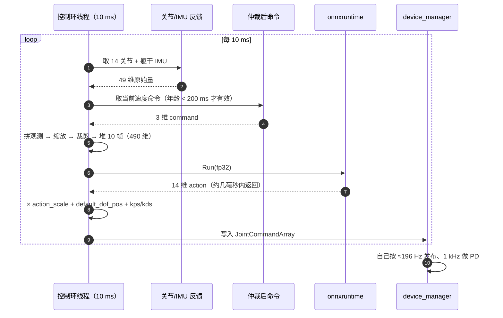

**关键**：`device_manager` 是**另一条线程/进程**，它以 ≈196 Hz（5.1 ms）取走最新的关节目标、以 1 kHz 做 PD 与 CAN 收发。
所以"策略 10 ms 一拍"和"关节 1 ms 一次"是**两个不同节拍**，中间靠共享内存（iceoryx）衔接。

### 6.6.4 几个看着奇怪、其实很关键的数字

| 参数 | 值 | 为什么是这样 |
|---|---|---|
| 轮子的 `action_scale` | **2.0** | 轮子是连续转的，同样的输出要放大很多才能产生速度 |
| 轮子的 `kp` | **0** | 轮子不做位置控制，只做速度/阻尼控制（`kd=0.5`） |
| 前肢 `kps`（双足时） | **1.0 / 0.5 / 0.5** | 双足时前肢是**手臂**，软一点更安全、也便于动画组去摆 |
| 后肢 `kps` | **180 / 30 / 30** | 后肢是**腿**，要硬才能承重 |
| `action_clip` | ±20 | 限幅，防止单步输出爆炸 |
| `xlim_with_yaw` | 0.3 | 转向大的时候，限制前进速度（防侧翻） |
| `odom_disable_after_switch_s` | 1 | 刚切过来 1 秒内里程计不可信，先不做补偿 |
| `bias_vx / bias_dyaw` | −0.02 / −0.018 | 补偿"发 0 但实际在慢慢漂"的系统偏差 |

> 这些参数怎么串成一条流水线（含滤波、限幅、超时），见 **§6.10 运控算法链路**。

## 6.7 两个策略对比：同一台机器，参数差得离谱

把"双足走路"和"四足行走"的配方放一起，差异一眼就看出来了【配置】：

| 项 | 双足走路（300） | 四足行走（102） | 说明 |
|---|---|---|---|
| 观测维数 | **49** | **57** | 不同策略族的观测构造不同，不能混用 |
| 帧堆叠 | 10 | 10 | 一样 |
| obs/action 裁剪 | ±20 | **±50** | 四足动作幅度更大 |
| 前肢 action_scale | 0.1 / 0.1 / 0.1 | 0.1 / **0.25** / **0.25** | 四足时前腿是腿，动作幅度大 |
| 轮 action_scale | **2.0** | **0.0** | 双足驱动轮；四足模式下轮不参与 |
| 前肢 kp | **1.0 / 0.5 / 0.5**（手臂） | **30 / 30 / 30**（腿） | 同一个关节，两种角色 |
| 后肢 kp | **180 / 30 / 30**（腿） | 30 / 30 / 30（腿） | 双足后腿承重更集中 |
| 轮 kp / kd | 0 / 0.5 | 0 / 1.0 | 都不做位置控制 |
| 轮 activation | 全 1（受控） | **0（不受控）** | 四足配置里直接把轮关掉 |
| 默认姿态 | 前肢 1.5708/0.6302；后肢 1.91986/−0.6579 | 前肢 0.6781/−1.3533；后肢 1.0624/−1.8321 | 完全不同的站姿 |

**三句话解读**：

1. **同一台机器，14 个关节在不同形态下"身份"不同**：双足时前肢是手臂（软），四足时前肢是腿（硬）。所以"换个策略"实质是**换一整套关节的角色分配**。
2. **四足不开轮**（activation=0、scale=0），双足才开轮（scale=2.0、kp=0 速度控制）。
3. **观测维数不一样（49 vs 57）**，意味着**两套模型不可互换**——想换模型，必须连观测构造一起换。

### 6.7.1 网络到底多大（640 个 onnx 实测）

把本地 640 个权重全部解析了一遍（`onnx.load`），结论很一致：

| 项 | 典型值 | 说明 |
|---|---|---|
| 参数量 | **22.6 万 ~ 24 万** | 走路/越野/变身/恢复/WBC 都在这个区间 |
| 文件体积 | **0.86 ~ 0.92 MB** | fp32，4 字节/参数 |
| 计算节点 | 16 ~ 29 个 | 只有 Gemm + ELU + Concat + Sigmoid |
| 输入 | `observations[1,49]` + `observation_history[1,490]` | 单帧 + 最近 10 帧 |
| 输出 | `action[1,14]` | 14 个关节 |
| 精度 | **全部 fp32**（4 字节/参数） | 无 fp16、无 int8 量化；640 个模型零量化算子 |

内部是**两段式**：

```
历史编码器：490 → 128 → 64 → 19      （把 10 帧压成 19 维隐状态）
策略头：   (49+19)=68 → 256 → 256 → 14
```

四足行走的策略头输入是 **80**（57 + 19 + 4），多出的 4 维来自模型自己的第二个输出（cpg 相位，过 Sigmoid）。

灵创 MIMIC 是异类：**0.93~3.3M 参数**、四层 1024-512-256，而且输出 12 组（含 `body_pos_w`、`motion_phase`）——
**它把参考轨迹烘焙进了网络**，所以不需要外部 CSV。

> 640 个权重加起来 **208M 参数 / 847.6 MB**，全部跑在 CPU 上、以 **fp32** 推理。
> 配置里每个 `rl/*.yaml` 都留了一段被注释掉的 `rknn` 配置——说明**试过 NPU/int8，但现役仍是 onnx/fp32**。
> 一次前向约 0.45 MFLOP，10 ms 周期绰绰有余——这也解释了为什么不用 NPU。
> 完整逐模型清单见 `运控模型库/清单/模型网络统计.md`。

## 6.8 MIMIC 与 ANIMATION：一个模型怎么跟着一堆轨迹走

前面把 MIMIC 归到 F6（表演/动画/模仿/上肢），但没讲它到底怎么跑。这一节用真机 `motion_list.yaml`（1389 行、**108 条动作资源**）说清楚。

### 6.8.1 先给结论：既不是"一个策略管所有动作"，也不是"纯放 CSV"

MIMIC 是**三段式**：

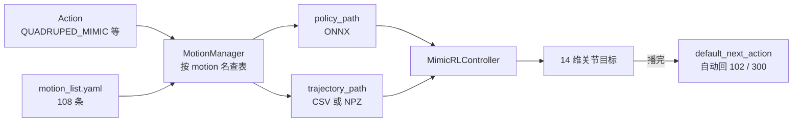


所以准确的回答是：**一个动作（Action）下面挂一个动作库；库里每条动作 = 一个模型 + 一条参考轨迹。而"多条动作共用同一个模型"是常态。**

### 6.8.2 真机数量：四种实现，共用模型的情况一目了然

| motion 类型 | 条数 | 不同模型数 | 轨迹数 | 实现方式 |
|---|---|---|---|---|
| `QUADRUPED_MIMIC`（四足模仿） | **19** | **1**（`t15_quad_twist_xy_v1.0.onnx`） | 19 条 CSV | **一个模型跟 19 条轨迹** |
| `BIPED_MIMIC`（双足模仿） | **8** | **1**（`t1_bi_wbc_pitch0522.onnx`） | 8 条 CSV | **一个模型跟 8 条轨迹** |
| `BIPED_NPZ_MIMIC`（NPZ 模仿） | **3** | **3** | 3 条 NPZ | 一条动作一个模型 |
| `ANIMATION`（上肢动画） | **78** | **0** | 77 条 CSV | **纯轨迹回放，没有模型** |

举例（四足 19 条里的一部分）：

| motion 名 | 模型 | 参考轨迹 |
|---|---|---|
| `QUADRUPED_MIMIC_PRIDE` | `t15_quad_twist_xy_v1.0.onnx` | `./res/quad_mimic_motion/qd1_quad_pride.csv` |
| `QUADRUPED_MIMIC_PONDER` | 同上 | `qd1_quad_ponder.csv` |
| `QUADRUPED_MIMIC_HEED` | 同上 | `qd1_quad_heed.csv` |
| …共 19 条 | 全是同一个 | 各一条 CSV |

**这就是你问的"一个策略管多个动作"到底成不成立**：对 `QUADRUPED_MIMIC` 和 `BIPED_MIMIC` 来说，**成立**——
19 支/8 支动作共用同一份权重，靠换 CSV 区分；对 `NPZ_MIMIC` 来说**不成立**，一条动作一个模型。

### 6.8.3 为什么一个模型能跟不同的轨迹走

看两份配置的观测定义就明白了【配置】：

| 配置 | 观测维数 | 组成（注释原文） |
|---|---|---|
| `bi_mimic.yaml`（双足） | **51** | 帧堆叠 10，模型 `t1_bi_wbc_pitch0522.onnx` |
| `quad_mimic.yaml`（四足） | **52** | 帧堆叠 10，`csv_path` 有默认值，`default_next_action: QUADRUPED_LOCOMOTION_DEFAULT` |
| `bi_npz_mimic.yaml` | **83** | `command(31) + motion_anchor_ori_b(6) + projected_gravity(3)`，帧堆叠 1，dt 0.02 |
| `bi_lingchuang_mimic.yaml` | **264** | `command(28) + motion_anchor_ori_b(6) + (pg3+ang3+joint_pos12+limb_vel12+wheel_vel2+actions14)*5`，帧堆叠 1 |

关键在 **`motion_anchor_ori_b`**（6 维相对旋转）和 **`command`**（28/31 维，来自参考轨迹）：

- 轨迹里存的是"**每一帧机器人该在哪、朝哪、各关节大概什么姿态**"
- 模型每一拍读"我现在偏离参考轨迹多少"（锚点误差 + 相位），然后输出关节目标去追
- 所以模型学的是 **"跟踪任意参考轨迹"这个能力**，不是记住某一支舞

**推论（对二次开发重要）**：想加一支新的模仿舞，**不一定要训新模型**——做一条符合格式的 CSV，在 `motion_list.yaml` 里加一条（指向已有模型 + 新 CSV）就可能跑通。这也是它能共用模型的原因。

### 6.8.4 ANIMATION 是另一种东西：没有模型，只放上肢

| 项 | MIMIC 系列 | ANIMATION |
|---|---|---|
| `motion_types` 里的 `body` | `whole`（全身） | **`upper`（上肢）** |
| 挂到哪个 Action | 自己的 Action（119/208/304/灵创） | **`BIPED_LOCOMOTION_WBC`（300）** |
| 有模型吗 | 有（30 条有 `policy_path`） | **没有**（78 条全空） |
| 靠什么动 | 模型 + 参考轨迹 | **CSV 帧回放**：`fps`（60）+ `animation_type` |
| 换 Action 吗 | 换 | **不换**，在 WBC 里叠加上肢动画 |

而且 ANIMATION 的 `name` 是**数字**（1001、1002、1003…），正好对应 `McPresetMotion` 的枚举
（`RIGHT_ARM_WAVE=1001`、`RIGHT_ARM_HANDSHAKE=1002`…）。

**所以"预设动作"到底是什么**：它就是 `motion_list.yaml` 里那 78 条 `ANIMATION` 记录，
用数字名索引、`fps` 控制速度、`animation_type` 决定柔性/刚性/保持末帧。**不是另一套系统。**

### 6.8.5 运行时怎么选一条动作

```
上层调：SetMcMotion(type, motion=名字, interrupt=?, operation=PRELOAD|EXECUTION)
   │
   ├─ MotionManager 按 name 查 motion_list.yaml
   ├─ 取 policy_path + trajectory_path（+ start_count/end_count/fps/interrupt_type）
   ├─ PRELOAD：先把模型 session 建好、轨迹读进来（SessionPool 最多缓存 10 个动态 session）
   └─ EXECUTION：真正开始播，runner 每拍读参考轨迹锚点 → 输出 14 维
```

几个配套字段的含义：

| 字段 | 作用 |
|---|---|
| `interrupt_type` | 0/1，决定这条动作能不能被别的动作打断 |
| `custom.start_count` / `end_count` | 从轨迹的第几帧开始、第几帧结束（截取一段用） |
| `custom.fps` | ANIMATION 的帧率（60） |
| `custom.animation_type` | 柔性/刚性/保持末帧——T 项目靠它区分动作收尾方式 |
| `default_next_action` | 播完之后自动落到哪个动作（例：双足模仿 → WBC，四足模仿 → 102 行走） |

> `default_next_action` 很关键：**MIMIC 播完不是停在原地**，而是自动切回行走/WBC。这就是第 7.3 节"自动落位"在 MIMIC 上的体现。

### 6.8.6 三个容易踩的坑

| 坑 | 说明 |
|---|---|
| **`policy.path` 常常是空的** | 四份 MIMIC 配置里，`bi_npz_mimic`、`bi_lingchuang_mimic` 的 `policy.path` 是 **空字符串**，注释写明"由 motion_list 下发"。只读 runner 配置会以为它没模型 |
| **SDK 的 type 枚举对不上** | `SetMcMotion.srv` 只定义了 `MIMIC_QY=1` / `MIMIC_LC=2`，而 `motion_list` 里有 **5 种** type。真正生效的是 **motion 名字**，type 字段的映射关系【未证实】 |
| **同名不同源** | `QUADRUPED_MIMIC(119)` 是 Action，`QUADRUPED_MIMIC_PRIDE` 是 motion 名。**Action 决定用哪套 controller，motion 名决定播哪条**，两者都要对 |

> **记住这一句**：**MIMIC = 动作（Action）+ 动作库（108 条）+ 每条自带（模型 + 参考轨迹）。
> 四足 19 支舞共用一个模型、双足 8 支共用一个，靠换 CSV 区分；ANIMATION 78 条干脆没有模型，只回放上肢 CSV。**

### 6.8.7 灵创 MIMIC 与 NPZ MIMIC：长得像，其实是两条路

两者都叫 "mimic"、都走 MotionManager + 参考动作跟踪，但**参考轨迹放的位置正好相反**：

| | **灵创** `BIPED_LINGCHUANG_MIMIC` | **NPZ** `BIPED_NPZ_MIMIC` |
|---|---|---|
| 观测 | `[1, 264]` + `time_step[1,1]` | `[1, 83]`（单帧，无 time_step 输入） |
| 观测构成 | command(28) + anchor 6D + (pg3+ang3+joint12+limb_vel12+wheel2+act14)**×5 帧** | command(31) + anchor 6D + gravity3 + ang_vel3 + joint12 + jointvel14 + act14 |
| 控制周期 | **100 Hz**（dt 0.01） | **50 Hz**（dt 0.02） |
| 历史帧 | **内嵌在观测里**（5 帧 → 264 维） | 单帧，控制器内部再处理 |
| **参考轨迹在哪** | **烘焙在 ONNX 里** | **外部 .npz 文件** |
| 模型输出 | 12 组：`actions` / `joint_pos` / **`body_pos_w[1,11,3]` / `body_quat_w` / `motion_phase`** … | 只有 `action[1,14]` |
| 参数量 | **932k ~ 3.3M**（4~13 MB） | **209k**（0.8 MB） |
| `motion_list` 条目 | 只有 `policy_path`，**`trajectory_path` 为空** | `policy_path` + `trajectory_path`（.npz）都要 |
| 本机（qd1_t2d0）启用？ | ❌ **全部注释掉（0 条 active）** | ✅ 3 条 active |
| 哪台机器启用 | **qd1_t1d5**（6 条 active） | qd1_t2d0 / qd1_t1d5 |

**怎么一眼分辨**：看模型输入。

- 输入是 `[1,264]` + `[1,1]`、体积 4~13 MB、输出里带 `body_pos_w` → **灵创**（轨迹在模型里）
- 输入是 `[1,83]`、体积 0.8 MB、输出只有 `action` → **NPZ**（轨迹在 .npz 里）

**灵创为什么把轨迹塞进模型**：它的训练方式是"动作即权重"——把整段动作的刚体位姿序列（11 个刚体 × 位置/四元数/线速度/角速度）作为网络的另一组输出一起训。
所以一个模型就是一支舞，`motion_list` 里只登记"模型路径"，没有轨迹文件。

**NPZ 为什么用外部文件**：模型只有一个 83 维输入 + 14 维输出，参考动作（关节角/关节速度/锚点速度/高度）由 `.npz` 按时间轴喂进来。
好处是**换舞只换 npz**（0.8 MB 模型不动），坏处是多一个文件要同步。

**⚠️ 本机的真实状态**：`qd1_t2d0`（当前激活机型）的 `motion_list.yaml` 里，灵创那 6 条**全部被注释**
（14 行注释 + 两行说明："需 action + runner `policy.path` 为空，策略由本表下发"），
但 `rl_models/` 里仍留着 6 个灵创模型（cluo / 流星舞 / 海草 / 梅西 / 球迷）。

也就是说：**灵创这条路在本机是"预研/停用"状态，真正启用的是 qd1_t1d5**。
如果你在本机上试 `BIPED_LINGCHUANG_MIMIC`，会因为没有 motion 条目而拿不到模型。

**NPZ 的额外细节**（`bi_npz_mimic.yaml` 独有）：它带**两套增益和两套 action_scale**，按 motion 名选用：

```yaml
motion_params:
  BIPED_NPZ_MIMIC_JOYOUS:         { smooth_time: 0.5, kp_kd_set: 1, action_scale_set: 1 }
  BIPED_NPZ_MIMIC_JOYOUS2:        { smooth_time: 0.5, kp_kd_set: 0, action_scale_set: 0 }
  BIPED_NPZ_MIMIC_FIGURE_SKATING: { smooth_time: 0.5, kp_kd_set: 0, action_scale_set: 0 }
  ...
```

注释写明这是"取代 motion_list.yaml 中 custom 方式"——**同一支舞的不同版本要配不同的刚度**，
所以 NPZ 这条路把参数表挪进了 runner 配置里。

### 6.8.8 四类 motion 的实质区别：逐列看配套的 CSV / NPZ

别看名字，看**配套轨迹文件里到底有什么列**，四类的差别一下就清楚了。

#### 先看文件本身（真机 `res/` 目录实测）

| 类型 | 轨迹文件 | 列结构（逐列） | 源采样 | 含腿/轮？ | 含基座位姿？ |
|---|---|---|---|---|---|
| **ANIMATION** | `biped_upper_motion/*.csv`（94 个） | `timeCNT` + **6 个上肢关节角** | 10 ms/帧（100 Hz） | ❌ **没有** | ❌ 没有 |
| **BIPED_MIMIC** | `biped_mimic_motion/*.csv`（10 个） | `timeCNT` + **6 上肢关节** + `base_roll/pitch/yaw/pos_world_z` | 10 ms/帧 | ❌ **没有** | ✅ 只有姿态 + 高度 |
| **QUADRUPED_MIMIC** | `quad_mimic_motion/*.csv`（21 个） | `timeCNT` + **12 腿关节** + `base_pos_world(xyz)` + `base_pos_body(xyz)` + `rpy` + `base_vel_world` + `base_angvel_body` | 10 ms/帧 | ✅ 全部四腿 | ✅ 完整（位置+速度） |
| **BIPED_NPZ_MIMIC** | `biped_npz_mimic/*.npz`（13 个） | `joint_pos[788,14]` `joint_vel[788,14]` `body_pos_w[788,17,3]` `body_quat_w[788,17,4]` `body_lin_vel_w` `body_ang_vel_w`，`fps=50` | **50 Hz** | ✅ 14 关节 | ✅ **17 个刚体完整位姿** |
| **LINGCHUANG** | **没有轨迹文件** | 轨迹烘在 ONNX 的输出里（`body_pos_w`/`body_quat_w`/`motion_phase`） | 100 Hz | ✅ | ✅ |

一眼可见的分界：

- **ANIMATION 的文件里只有 6 个上肢关节**——它压根管不到腿；
- **BIPED_MIMIC 的文件里有上肢 + 基座姿态，但没有腿**——腿仍在策略手里；
- **NPZ 的文件里才有完整全身参考**（14 关节 + 17 刚体）；
- **QUADRUPED_MIMIC 的文件里虽然有 12 关节列，但配置只映射了 6 列基座位姿**——关节列没被用上。

#### 再看谁在控制什么

| 类型 | 腿 / 轮 | 上肢 6 关节 | 基座姿态/高度 | 有没有神经网络 |
|---|---|---|---|---|
| **ANIMATION**（301） | RL（`rl_bi_loco_animation`，10 ms） | **CSV 回放**（`animation_player`，4/2 ms 插值） | 由 RL 自己维持 | 腿有，上肢没有 |
| **BIPED_MIMIC**（208） | RL（`t1_bi_wbc_pitch0522`，10 ms） | **CSV 代入**，由同一控制器的软 PD 执行（kp 4/2，带重力补偿） | **CSV 的 Z/RPY 每拍写进 obs** 当参考 | 有（一个策略） |
| **QUADRUPED_MIMIC**（119） | **RL 输出全部 14 维**（无覆盖） | 前腿即腿 | **只取 6 列基座位姿（xyz+rpy）当 command** | 有（一个策略） |
| **BIPED_NPZ_MIMIC**（304） | RL 跟踪 NPZ 的全身参考 | 同左（全身） | NPZ 提供 17 刚体位姿 | 有（一个策略，50 Hz） |
| **LINGCHUANG** | RL，参考由模型自己输出 | 同左 | 模型输出 | 有（一个策略，100 Hz） |

#### 四足 MIMIC 的 CSV 是"只取 6 列"的（和双足正好相反）

`quad_mimic.yaml` 里写得很明确：

```yaml
WalkConfig:
  csv_path: './res/qd1_quad_test_100fps_10s.csv'
  max_cycle_time: 0.9

  mimic_csv_cols:            # 真正被读取的列号
    time: 0                  # timeCNT
    body_x: 16               # base_pos_body_x
    body_y: 17               # base_pos_body_y
    body_z: 18               # base_pos_body_z
    roll: 19                 # base_roll
    pitch: 20                # base_pitch
    yaw: 21                  # base_yaw
```

- 文件里共有 **28 列**（12 个关节 + 世界/机体系位置 + rpy + 速度/角速度）；
- 日志也证实**整表被解析**：`[ParseCsvTrajectory] Loading CSV trajectory: 602 rows, 28 cols`；
- 但**映射表只取了 6 列基座位姿**，第 1~15 列的 12 个关节角**没有进入任何计算**。

这 6 个值去哪了？→ 变成观测里的 **`command`（第 46 位起，共 6 维）**，也就是"**让机身摆到这个位姿**"的目标，而不是"腿摆成这个角度"。

所以四足与双足是**相反的两条路**：

| | 双足 MIMIC（208） | 四足 MIMIC（119） |
|---|---|---|
| CSV 里的关节列 | **上肢 6 列 → 直接当目标（覆盖 RL）** | **12 列 → 不映射、不使用** |
| CSV 里的基座列 | z + rpy → 写进 obs | xyz + rpy → 变成 command（6 维） |
| 关节由谁算 | 腿 RL、手臂 PD 跟踪 | **全部 14 维由 RL 输出** |
| 有没有"覆盖" | **有**（组内 `arm_joints`） | **没有** |

**为什么四足不能像双足那样"直接放关节"**：四足要靠四条腿随时调整支撑来保持平衡，
如果硬把 12 个关节角按轨迹下发，等于放弃平衡控制——所以四足只给"机身该怎么动"，腿怎么摆交给策略。
（这条是设计逻辑的推断【推断】，配置层面只看到"只映射 6 列"这个事实。）

#### 谁在控制上肢：看增益就能判定

一个很实用的判据：**前肢的增益是"软"还是"硬"、有没有 `arm_joints` 覆盖**，直接决定上肢是"轨迹跟踪"还是"RL 输出"。

| 配置 | 前肢 kps（策略侧） | 覆盖方式 | 上肢实际由谁控制 |
|---|---|---|---|
| **BIPED_MIMIC（208）** | 30 | **组内覆盖**：同一控制器用 `arm_joints`（kp 4.0/2.0/4.0 + 重力补偿）直接算前肢 | **CSV 轨迹跟踪（不是 RL）** |
| **WBC（300）/ ANIMATION（301）** | 30 | **跨 runner 覆盖**：`animation_player` 是**另一个执行组/线程**（4 ms / 2 ms），按关节名写同一批前肢关节 | CSV 回放 + 独立 PD |
| **NPZ_MIMIC（304）** | 50 / 30 / 30 | 无覆盖 | **RL 输出**（策略直接给 14 维） |
| **灵创** | 30（全 14 个） | 无覆盖 | **RL 输出**（模型还自己输出 kp/kd） |

**"覆盖"有两种，别混**：

- **跨 runner（300/301）**：两个组写同名关节，靠"谁写得更晚/更快"生效——`animation_player` 4 ms 一次，RL 10 ms 一次，**前者频率高 2.5 倍，实际总是它最后写**；
- **组内（208）**：只有一个 runner，控制器内部对前 6 维做替换，不存在线程竞争。

`bi_mimic.yaml` 的原文注释写得很明确（第 184 行）：

```yaml
# 前肢轨迹跟踪 PD（与 animation_player animation 段一致；低刚度需重力补偿）
arm_default_kp: 4.0
arm_default_kd: 0.2
arm_joints:
  - name: "FL_HIP_ROLL_Joint"
    kp: 4.0
    kd: 0.2
    gravity_scale: 1.0
```

也就是说：**208 的策略虽然输出 14 维，但前 6 维（前肢）会被这条轨迹跟踪路径覆盖**；
而 NPZ 与灵创没有 `arm_joints`，上肢就是策略自己输出的。

> **一句话**：**"MIMIC 的上肢是 RL 输出"只对 NPZ / 灵创成立；
> 208（BIPED_MIMIC）、300、301 的上肢都是参考轨迹 + 独立 PD，RL 只管腿和轮。**

#### 那 208 的前肢 kp 为什么只有 2.0~4.0？

因为 `arm_joints` 抄的是 `animation_player` 的**"柔性播放"档**，而不是"保持/刚性"档。`animation_player.yaml` 一共四套前肢档位：

| 档位 | kp（roll / pitch / knee） | kd | gravity_scale | 用途 |
|---|---|---|---|---|
| `planner`（归位） | 4.0 / 2.0 / 4.0 | 0.2 | 0.6 | enter / preplaying / putdown / switch / exit |
| **`animation`（柔性播放）** | **4.0 / 2.0 / 4.0** | 0.5 | 0.9 / 0.9 / 0.7 | 正常播放动画 ← **208 参照的是这一档** |
| `rigid`（刚性播放） | 15 | 1.0 | 1.0 | 需要"端得稳"的动画 |
| `hold`（保持末帧） | **30** | 1.0 | 1.0 | 播完停在末帧 |
| `idle`（静止下垂） | 4.0 / 2.0 | 0.2 | 0.6~0.75 | 没动画时的自然下垂 |

所以 kp 低不是"没调好"，而是**主动选的柔性档**，背后有三个理由：

1. **有重力前馈**：`gravity_scale 0.9` 把重力矩基本抵消，PD 只修残差，不需要大刚度去"硬撑"；
2. **要跟轨迹**：轨迹本身平滑，kp 太大会与参考打架、引起抖动/过冲（配置注释也写了"低刚度需重力补偿"）；
3. **安全**：手臂要碰人/碰物，低刚度降低冲击伤害；真要"较劲"再切 `rigid`（15）或 `hold`（30）。

**为什么是 2.0 而不是 4.0**：只有 pitch 轴给 2.0。这一轴承重力矩最大，主要靠 `gravity_scale 0.9` 前馈扛；PD 给低一点换取顺滑。配置里没写理由，属调参经验【推断】。

对比一下量级：腿的 kp 是 30~100（要撑体重、抗扰动），前肢柔性播放是 2~4——**差一个数量级，正好对应"承重"与"轻负载"的区别**。

#### 回答你的两个问题

**① "ANIMATION 肯定也运行了一个策略吧？"**

**对，但策略只管腿。** Action 301 挂两个执行组：

```yaml
BIPED_LOCOMOTION_ANIMATION:
  - rl_bi_loco_animation   # 10 ms，RL 管腿和轮
  - animation_player       # 2 ms，纯 CSV 插值管上肢
```

也就是说：**"边走边挥手"= 腿跑神经网络 + 上肢放 CSV**。上肢那 6 个关节**没有网络**参与，`animation_player` 是经典控制（查表 + 插值 + 自己的 kp/kd/重力补偿）。

另外注意 ANIMATION 的 CSV 是 **100 Hz 采样**（`timeCNT` 每帧 +10），但 `motion_list` 里每条动画还有一个 **`fps`（60~150）**——那是**播放速度**，不是采样率。`animation_player` 用 4 ms（或 2 ms）的节拍按这个 fps 推进帧，所以输出是 250/500 Hz 的平滑插值。

**② "双足模仿是直接全身控制吗？"**

**不是"直接播放全身轨迹"，也不是"全身一个网络闭环"。** 它是三段拼起来的：

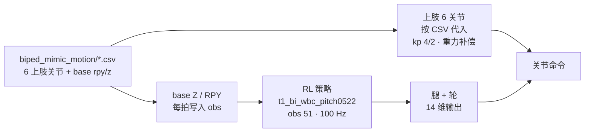

配置注释原话：

> `# 手臂 smoothstep 回 default_dof_pos；Z/RPY 每拍写入 obs 供 RL 腿继续跑`

所以准确说法是：**上肢按 CSV 走（软 PD + 重力补偿），基座的高度和姿态作为参考喂给策略，腿由 RL 闭环控制。**
退出时（`ExitCheck`）手臂按 `homing` 的 smoothstep 回 `default_dof_pos`，时长 0.4~3.0 s 按 |Δz| 插值，而 **Z/RPY 仍然每拍写 obs**，保证腿继续平衡。

#### 一句话对照

| 你想要的效果 | 该用哪类 | 原因 |
|---|---|---|
| 走路时加个挥手/比心 | **ANIMATION** | 只改上肢，腿不受影响，最安全 |
| 做一段带重心起伏的全身动作（滑冰/表演） | **BIPED_MIMIC** | 上肢 + 基座参考，腿仍闭环 |
| 四足做完整动作（呼吸/点头/鞠躬） | **QUADRUPED_MIMIC** | CSV 提供基座位姿参考，脚由 RL 自己放 |
| 复杂全身动作、要求精确到 17 刚体位姿 | **NPZ_MIMIC** | 完整参考，但只有 50 Hz |
| 一支舞自带轨迹、不想管外部文件 | **LINGCHUANG** | 轨迹在模型里 |

> **记住这一句**：**ANIMATION 是"上肢 CSV + 腿部 RL"，BIPED_MIMIC 是"上肢 CSV + 基座参考 + 腿部 RL"，
> 只有 NPZ_MIMIC 提供"全身参考轨迹"，QUADRUPED_MIMIC 只提供"基座位姿参考"。**

### 6.8.9 ANIMATION 与 BIPED_MIMIC 是什么关系：机制平级，格式像超集

先把结论摆出来，再解释：

| 说法 | 对不对 | 说明 |
|---|---|---|
| ANIMATION **包含** BIPED_MIMIC（或反过来） | ❌ **不对** | 是两个不同的 Action（301 / 208），互不调用 |
| BIPED_MIMIC 的 CSV **格式**是 ANIMATION 的超集 | ✅ **对** | 同样是 6 个上肢关节列，再多 4 列基座姿态 |
| 两者最终都驱动同一批关节 | ✅ 对 | 都落到那 6 个上肢关节 + 全身 14 维命令 |

#### 配置原文（`action_setting.yaml`）

```yaml
BIPED_LOCOMOTION_ANIMATION: # 双足动画模式
    - runners: [rl_bi_loco_animation]   # period 10 ms，RL 管腿
    - runners: [animation_player]       # period 2 ms，CSV 管上肢

BIPED_MIMIC: # 双足模仿（上肢+下肢由 rl_bi_mimic 统一控制）
    - runners: [rl_bi_mimic]            # period 10 ms，一个 runner 全包

BIPED_LOCOMOTION_WBC: # 双足全身控制模式
    - runners: [rl_bi_loco_wbc]         # 10 ms
    - runners: [animation_player]       # 4 ms，注释：非动画模式下不使用动画播放器
```

一眼就能看出结构差别：**ANIMATION 是"两个 runner 分工"，MIMIC 是"一个 runner 全包"。**

#### 一张图看清

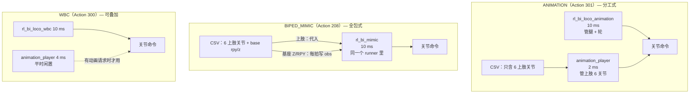

#### 三个具体差别

| 维度 | ANIMATION | BIPED_MIMIC |
|---|---|---|
| Action | **301**（另可挂在 300 上） | **208** |
| runner 数 | 2（RL + 播放器） | **1**（全包） |
| CSV 列数 | 7（`timeCNT` + 6 关节） | **11**（多了 `base_roll/pitch/yaw/pos_z`） |
| 腿的行为 | 由 `rl_bi_loco_animation` 独立维持步态，**不受动画影响** | 由策略参考 CSV 的基座姿态，**重心会跟着动作变** |
| 上肢的行为 | CSV 插值直接下发 | 同一个控制器按 CSV 代入，软 PD（kp 4/2）+ 重力补偿 |
| 播放引擎 | `animation_player`（经典控制，4/2 ms） | 控制器内部（`rl_bi_mimic` 的 10 ms 节拍） |
| 典型用途 | 挥手、比心、鼓掌（**上身动作**） | 滑冰、舞蹈这类**整体带重心**的表演 |
| 数量 | 78 个 preset（1001~1078） | 8 条 motion |

#### 为什么会觉得"像包含"

因为两者的 CSV **第一段完全一样**：都是 `command_pos::FL_HIP_ROLL_Joint … FR_KNEE_Joint` 这 6 列。
区别只在 MIMIC 的 CSV 尾部多了 4 列基座：

```
ANIMATION :  timeCNT, 6×上肢关节
BIPED_MIMIC: timeCNT, 6×上肢关节, base_roll, base_pitch, base_yaw, base_pos_world_z
```

可以把它理解成：**MIMIC 的 CSV 是"ANIMATION 的 CSV + 基座轨迹"**——格式上是超集。
但在**机制上**它们不共用代码路径：`animation_player` 只认前 6 列，`rl_bi_mimic` 才认那 4 列基座。

#### 那"边走边挥手"到底用哪个

- 想**走路的同时**做上身动作 → **在 300（WBC）上挂动画**：`rl_bi_loco_wbc` 继续走，`animation_player` 播上肢。
  300 的配置里就写着 `# 非动画模式下不使用动画播放器`——说明这个组是为"叠加动画"准备的。
- 想**原地表演**一段纯上身动作 → 切到 301（ANIMATION）。
- 想**整段动作带重心变化**（会蹲、会倾斜） → 用 208（BIPED_MIMIC）。

> **记住这一句**：**ANIMATION 是"给上肢贴一段动画"，腿照旧走；BIPED_MIMIC 是"整段动作带基座参考"，腿要配合。
> 两者平级、不互相调用，只是 CSV 长得像超集。**

### 6.8.10 白话解释：NPZ 是什么、灵创是什么

两个名字都只是**代号**，抓住一句话就不会混：

> **NPZ：参考轨迹存在一个文件里，模型负责"跟着走"。**
> **灵创：参考轨迹没有文件，模型自己"长出来"。**

#### NPZ：一个 NumPy 压缩包，装着"整段全身参考"

`.npz` 是 NumPy 的打包格式（可以理解为"一个装了多个数组的 zip"）。打开来看：

```
fps           = 50
joint_pos     = [788, 14]       # 788 帧 × 14 个关节角
joint_vel     = [788, 14]
body_pos_w    = [788, 17, 3]    # 788 帧 × 17 个刚体 × 世界坐标 xyz
body_quat_w   = [788, 17, 4]    # 同上，四元数
body_lin_vel_w= [788, 17, 3]
body_ang_vel_w= [788, 17, 3]
```

也就是说：**这段动作的"标准答案"被完整录了下来**——每一帧每个关节该多少度、每个刚体在世界哪里、朝哪、多快，全都有。

模型（`bi_npz_mimic_joyous2_*.onnx`）只做一件事：**看着这份答案，把自己摆成那个样子**。
它的输入是 `obs[1,83]`（把当前帧的参考位姿 + 自身状态拼起来），输出 `actions[1,14]`。

本机启用了 **3 条**：`JOYOUS / JOYOUS2 / JOYOUS3`（各配一个模型 + 一个 npz）。
频率是 **50 Hz**（`dt: 0.02` + 组周期 20 ms）——全机唯一一个 50 Hz 的策略。

#### 灵创：轨迹被"烘"进模型里

灵创（`BIPED_LINGCHUANG_MIMIC`）的模型长这样：

```
输入：obs[1, 264]  +  time_step[1, 1]
输出：actions[1,14]
      joint_pos / joint_vel              # 当前参考关节
      body_pos_w[1,11,3] / body_quat_w   # 当前参考位姿（11 个刚体）
      body_lin_vel_w / body_ang_vel_w
      motion_phase[1,2]                  # 动作相位
      default_joint_pos[1,14]            # 默认关节位
      action_scale[1,12]                 # 动作缩放
      joint_stiffness[1,14] / joint_damping[1,14]   # 增益！
```

对比一下就很清楚：

| | NPZ | 灵创 |
|---|---|---|
| 输入 | `obs[1,83]`（含参考，单帧） | `obs[1,264]` + **`time_step[1,1]`** |
| 输出 | 只有 `actions[1,14]` | actions **+ 参考位姿 + 相位 + 增益**（共 12 个） |
| 参考轨迹在哪 | **外部 `.npz` 文件** | **模型内部**（由 `time_step` 驱动生成） |
| 模型大小 | 0.84 MB / 9 节点 | 4.55 MB / 35 节点 |
| 需要哪些文件 | 一个 onnx + 一个 npz | **只要一个 onnx** |
| 频率 | 50 Hz | 100 Hz |
| 本机启用 | **3 条** | **0 条**（`motion_list` 里全被注释） |
| 哪台机器有 | qd1_t2d0 | qd1_t1d5（6 条：流星舞、海草舞、梅西、C罗…） |

**为什么"只要一个 onnx"是个大差别**：普通策略的增益（kp/kd）、动作缩放、默认关节位都写在 `rl/*.yaml` 里；灵创把这些**也从模型输出**，等于"连怎么用力都自己说了算"。配置注释也印证了：`双足灵创模仿（轨迹内嵌 onnx，由 rl_bi_lingchuang_mimic 统一控制）`。

#### 三者放一起

| | BIPED_MIMIC | NPZ_MIMIC | 灵创 |
|---|---|---|---|
| 参考来源 | CSV（上肢 + 基座） | **外部 npz**（全身 17 刚体） | **模型内部生成**（11 刚体） |
| 输入维度 | 51 | 83 | 264 + time_step |
| 频率 | 100 Hz | 50 Hz | 100 Hz |
| 文件依赖 | onnx + csv | onnx + npz | **只有 onnx** |
| 一句话 | 上肢带节奏，腿保平衡 | 照着录像学 | 模型自己会"演" |

> **记住这一句**：**NPZ 是"答案在文件里"；灵创是"答案在模型里"。
> 前者换动作只要换 npz，后者换动作要换模型——所以灵创的模型都很大（4.5 MB 起）。**

## 6.9 策略输入专题：46 份配置的输入全表

把 `rl/` 下 46 份有效配置（排除 `test.yaml`、`cpg.yaml`）的 `obs_index` 全拆开，
得到一个非常稳定的结论：**所有策略的输入 = 5 个固定段 + 若干扩展段，而且里面没有机身线速度。**

### 6.9.1 五个固定段（42 份配置完全一致）

| 段名 | 长度 | 内容 | 从哪来 | 频率 |
|---|---|---|---|---|
| `imu_omega` | 3 | 躯干角速度 | 躯干 IMU | 500 Hz |
| `imu_euler` | 3 | 躯干欧拉角（roll/pitch/yaw） | 躯干 IMU | 500 Hz |
| `pos` | **12** | 14 个关节的位置 **去掉 2 个轮** | 关节反馈 | 1 kHz |
| `vel` | 14 | 14 个关节的速度（含轮） | 关节反馈 | 1 kHz |
| `action` | 14 | **上一拍的输出**（策略自己的历史动作） | MC 内部 | 100 Hz |

> `pos` 是 12 而不是 14：两个主动轮是连续旋转的，没有"绝对位置"这个概念，所以只给速度。

**这五段加起来 46 维**，是四足/双足行走、越野、变身、恢复、跳舞几乎所有策略的共同底座。

### 6.9.2 扩展段（决定"这个策略是干嘛的"）

| 段名 | 长度取值 | 含义 | 出现份数 |
|---|---|---|---|
| `command` | 1 / 3 / 4 / 6 / 31 | **期望**速度指令（不是实际速度） | 31 |
| `phase` | 1 / 6 | 动作相位（一次性动作的进度） | 18 |
| `cpg` | 8 | 中枢模式发生器状态（四足步态相位） | 5 |
| `q_ref` | 4 / 6 | 参考关节角（变身/跳舞的目标姿态） | 8 |
| `contact` | 2 | 左右足触地标志 | 3 |
| `imu_yaw_diff` | 2 | 偏航差（用于旋转变身） | 2 |
| `z` / `yaw` / `roll` / `pitch` | 各 1 | 高度与姿态残差（动画/模仿用） | 2 |
| `ref_qj` / `ref_dqj` / `anchor_rot6d` | 14 / 14 / 6 | 参考轨迹的关节角、关节速度、锚点朝向 | 3 |
| `gravity` / `omega` / `qj_err_no_wheels` / `last_action` | 3 / 3 / 12 / 14 | 参考式模仿族的观测块 | 2 |
| `motion_anchor_ori_b` / `projected_gravity` / `base_ang_vel` | 6 / 3 / 3 | NPZ 模仿的锚点与重力投影 | 1 |
| `hist5x46` | 230 | 5 帧 × 46 维的历史块（灵创） | 1 |

### 6.9.3 三类骨架

| 骨架 | 特征 | 份数 | 代表 |
|---|---|---|---|
| **甲：基础 + 扩展**（最常见） | 46 维固定段 + `command`/`phase`/`cpg` 等，外面再堆 10 帧 | **42** | `bi_wbc_run`(49)、`quad_walk`(57)、`quad_step`(57)、`bi_recovery`(47) |
| **乙：参考轨迹式** | 直接吃 `ref_qj`/`ref_dqj`/`anchor_rot6d`，单帧 | **4** | `bi_dance`(80)、`bi_mimic`(51)、`bi_rotate_local`(57) |
| **丙：灵创** | 14+14+6 的头 + 230 维历史块 | **1** | `bi_lingchuang_mimic`(264) |

**18 种具体结构**（按份数排序，完整清单见 `运控模型库/清单/策略输入-obs布局.csv`）：

| # | 份数 | obs | 输入构成 |
|---|---|---|---|
| 1 | 6 | 49 | omega3 + euler3 + pos12 + vel14 + action14 + command3 |
| 2 | 5 | 47 | omega3 + euler3 + pos12 + vel14 + action14 + phase1 |
| 3 | 5 | 52 | omega3 + euler3 + pos12 + vel14 + action14 + command6 |
| 4 | 5 | 57 | omega3 + euler3 + pos12 + vel14 + action14 + command3 + cpg8 |
| 5 | 3 | 52 | omega3 + euler3 + pos12 + vel14 + action14 + phase6 |
| 6 | 3 | 56 | omega3 + euler3 + pos12 + vel14 + action14 + command3 + phase1 + q_ref6 |
| 7 | 3 | 50 | omega3 + euler3 + pos12 + vel14 + action14 + command4 |
| 8 | 2 | 50 | omega3 + euler3 + pos12 + vel14 + action14 + command3 + phase1 |
| 9 | 2 | 80 | ref_qj14 + ref_dqj14 + anchor6 + gravity3 + omega3 + qj_err12 + dqj14 + last_action14 |
| 10 | 2 | 51 | omega3 + euler3 + pos12 + vel14 + action14 + command1 + z1 + yaw1 + roll1 + pitch1 |
| 11 | 2 | 54 | omega3 + euler3 + pos12 + vel14 + action14 + imu_yaw_diff2 + phase1 + rotate_phase1 + q_ref4 |
| 12 | 2 | 51 | omega3 + euler3 + pos12 + vel14 + action14 + phase1 + q_ref4 |
| 13 | 1 | 264 | ref_qj14 + ref_dqj14 + anchor6 + hist5x46(230) |
| 14 | 1 | 51 | omega3 + euler3 + pos12 + vel14 + action14 + command4 + phase1 |
| 15 | 1 | 83 | command31 + anchor6 + gravity3 + base_ang_vel3 + joint_pos12 + joint_vel14 + actions14 |
| 16 | 1 | 57 | omega3 + euler3 + pos12 + vel14 + action14 + command3 + contact2 + q_ref6 |
| 17 | 1 | 52 | omega3 + euler3 + pos12 + vel14 + action14 + contact2 + command4 |
| 18 | 1 | 51 | omega3 + euler3 + command3 + pos12 + vel14 + action14 + contact2 |

### 6.9.4 输入从哪来（这张图解释"谁喂给谁"）

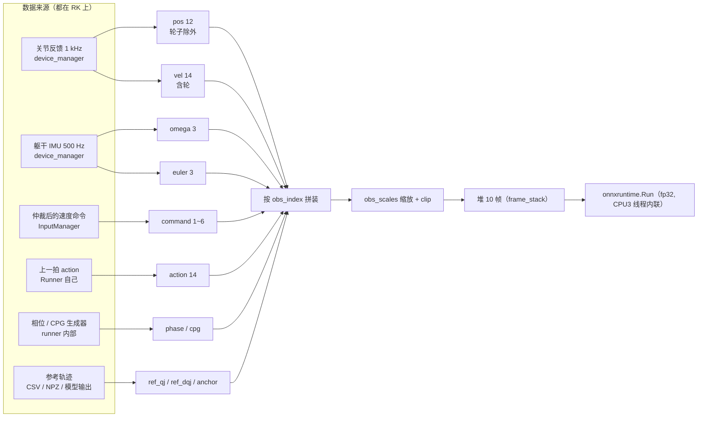

### 6.9.5 关于"机身线速度"：策略不用它

你问得对：**线速度确实是估计出来的，但策略根本不看它。**

| 事实 | 证据 |
|---|---|
| 46 份配置里，**没有一份**的 `obs_index` 含 `lin_vel` / `base_lin_vel` | 逐份扫描，0 命中 |
| 有 43 份配置写了 `obs_scales.lin_vel: 2.0` | 但这个 scale 作用在 `command` 的线速度分量上，不是"实测线速度" |
| 策略看到的 `command` 是**期望速度**（上层让它走多快），不是"它实际走多快" | `command` 来自仲裁后的指令 |
| 真实线速度由 **`legged_odom`（腿式 EKF）** 估计，输出 `/odom.twist.linear` | 见下 |

**所以"策略需不需要线速度估计"的答案是：不需要。** 它靠三样东西隐式知道自己在怎么动：

1. **关节速度**（14 维，含轮）——轮速直接就是前进速度的代理；
2. **上一拍 action + 10 帧历史**——网络自己从历史里推断运动趋势；
3. **指令 command**——它被训练成"跟踪这个指令"。

### 6.9.6 那谁在估计线速度：`legged_odom`（腿式 EKF）

| 项 | 真机配置 |
|---|---|
| 进程 | `legged_odom`（RK，独立进程） |
| 输入 | 关节状态（250 Hz 入缓存）、躯干 IMU（100 Hz 入缓存）、**MC 动作状态（`use_mc_state: False`，实际不用）** |
| 同步 | IMU 与关节时间戳配对阈值 **0.05 s** |
| 观测 | 足端位置/速度（接触时噪声 0.01 / 0.05）、足端高度约束（0.001）、IMU 姿态 |
| 接触检测 | 置信度滞回：进入 0.65 / 退出 0.35 / 平滑 0.35 / 最少保持 2 帧；未接触时观测噪声放大 **1000/200/100000 倍** |
| 零偏 | 启动标定陀螺/加计各 **300 帧**（约 3 s）；静止 3 s 可重标定，最小间隔 **600 s** |
| 平面假设 | **开启**（但配置注释提醒：不代表 z/roll/pitch 严格为零） |
| 输出 | `/odom`（约 50 Hz，`decimation: 2`）、`/odom_torso`、`/odom/status`、`/torso_imu_orientation` |
| 动作门控 | 腿式生效动作 `[101,102,112,103,121]`；轮式 `[300,201,202,203,207,303]`；形态转换 `[10,11,12,20,21,22]`；跌倒 `[1,2,3]` |

**谁消费这个线速度**：Orin 的导航/跟随（Nav2 controller、follow 的 MPPI）与里程统计——
**不是 MC**。MC 的动作循环里没有 odom 输入。

### 6.9.7 关节速度从哪来：电机上报，不是软件微分

你问的这条链，答案是"直接来的，但中间被滤过一道"：

| 环节 | 发生了什么 | 证据 |
|---|---|---|
| **电机（MIT 模式）** | 驱动器按 MIT 协议上报 **位置 / 速度 / 力矩**；速度量程 ±60 rad/s | 【配置】`mit_params` 的 `vMin/vMax` |
| **device_manager** | 1 kHz 打包成 `JointStateArray`：`name / position / velocity / effort / 线圈温度 / 电机温度 / 电压` | 【配置+实测】 |
| **MC** | 订阅后先 `wait_ready`；进策略前做 **低通滤波**（腿 100 Hz、轮 50 Hz）+ **缩放 0.05** | 【配置】`filter.q_vel_cutoff_freq`、`obs_scales.dof_vel: 0.05` |
| **legged_odom** | 关节入缓存降到 250 Hz，滑动平均窗口 **1**（等于不平滑），用于足端相对运动 | 【配置】 |
| **应用层** | **没有任何数值微分**（全库没有"微分/差分/derivative"的实现痕迹） | 【配置+静态】 |

所以要分清两种"直接"：

- **不是应用层算出来的**：MC 没有 `q[t] − q[t−1]` 这种差分，速度就是电机给的；
- **也不是原样进网络**：进策略前被低通滤过（截止 100/50 Hz）、再乘 0.05 缩放——这两步在策略配置里，改它等于改输入分布。

**边界（诚实说明）**：电机内部是怎么得到速度的（编码器差分、还是内部观测器/滤波），属于驱动器固件，没有取证。
从系统层面只能说：**应用层没有微分，只有再滤波。**

> 顺带解释一个之前提过的不对称：`vel` 是 14 维（含两个轮），`pos` 只有 12 维（不含轮）。
> 轮子是速度控制（`kp=0`、靠 `kd`），所以它有"速度"但没有"绝对位置"。

### 6.9.8 对你二次开发的对齐清单

| 你要做的事 | 必须对齐的东西 |
|---|---|
| 训练自己的策略 | 输入顺序、段长度、缩放系数（`obs_scales`）、裁剪值（`obs_clip`）、历史帧数（`frame_stack`）必须与配置一致 |
| 换模型 | `obs_nums` 必须完全相同；49 的模型不能塞 57 的输入 |
| 复用现有模型 | 只需要按 `obs_index` 把对应段填对，扩展段（command/phase）按配置语义给 |
| 提速度 | 给的是**期望速度**（command），不是"实际速度"；想要闭环速度控制得自己读 `/odom` |
| 判断"它走多快" | 别读 command，读 `/odom.twist.linear`（估计值）或关节轮速（原始量） |

> **记住这一句**：**策略吃的是"期望速度 + 关节反馈 + 自己的历史动作"，不是"实测线速度"；
> 实测线速度由 legged_odom 用腿式 EKF 估出来，喂给规划层，不喂给策略。**

## 6.10 运控算法链路：一条指令要过几道处理

前面分开讲了观测、推理、动作，但**中间那些"看不见的处理"一直没系统列过**——滤波、缩放、裁剪、限幅、整形、超时。
这一节把它们按流水线顺序全部列出来。**这些处理全部在配置里，改任何一道都会改变行为。**

### 6.10.1 全景：六段流水线 + 一条安全旁路

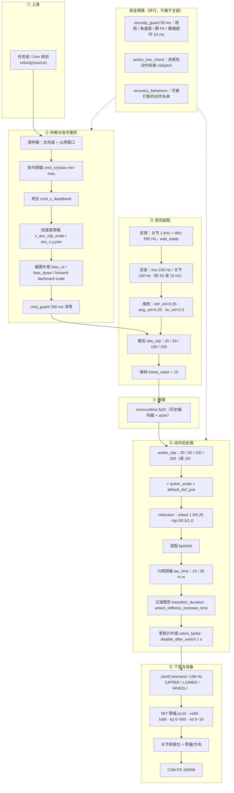

### 6.10.2 逐道处理清单（按流水线顺序）

| # | 阶段 | 做什么 | 典型参数（真机值） | 在哪配置 | 不加会怎样 |
|---|---|---|---|---|---|
| 1 | ② | 速度源仲裁 | 7 源 + 1 硬编码；priority 70~100；窗口 1000 ms | `mc_T1.yaml` | 多个程序同时控底盘，电机抽 |
| 2 | ② | 指令限幅 | `cmd_x ±0.5~±2.6`、`cmd_yaw ±0.5~±3.0` | `rl/*.yaml` 的 `command_scales` | 超速/自伤，超出步态能力 |
| 3 | ② | 死区 | `cmd_x_deadband: 0.1` | 同上 | 摇杆轻微漂移被当成指令 |
| 4 | ② | 加速度限幅 | `x_acc_clip_scale 0.4~0.5`；`acc_x 0.5~1.0`、`acc_y 2.0`、`acc_yaw 2.0` | `command_scales` + `WalkConfig.acc_*` | 速度阶跃 → 策略来不及跟 → 踉跄 |
| 5 | ② | 偏置补偿 | `bias_vx −0.02`、`bias_dyaw −0.018`；`cmd_x_forward_bias_scale 1.0~1.15` | `WalkConfig` | 发 0 却慢慢漂 |
| 6 | ② | 拖拽限幅 | `drag_x ±1.0~±1.4`、`drag_yaw ±1.5~±3.0` | `command_scales` | 被人硬拖时指令失配 |
| 7 | ② | **命令过期清零** | `cmd_guard.expiration_time_ms: 200` | `security_guard.yaml` | 发令程序崩了还在走 |
| 8 | ③ | 反馈就绪检查 | `wait_ready: true`（关节/IMU） | `mc_T1.yaml` | 首帧脏数据直接进网络 |
| 9 | ③ | **IMU 角速度低通** | `imu_vel_cutoff_freq: 100`（46/46 份都是 100） | `rl/*.yaml` `filter` | 高频振动被策略放大成抖动 |
| 10 | ③ | **关节速度低通** | `q_vel_cutoff_freq: 100`（轮 50 或 10） | 同上 | 同上，轮子尤其明显 |
| 11 | ③ | 观测缩放 | `dof_pos 1.0`、`dof_vel 0.05`、`ang_vel 0.25`、`lin_vel 2.0` | `obs_scales` | 输入量级差 20 倍，网络直接饱和 |
| 12 | ③ | 观测裁剪 | `obs_clip: 20 / 50 / 100 / 200` | `clips` | 异常值（如碰撞瞬间）炸掉输出 |
| 13 | ③ | 堆帧 | `frame_stack: 10`（42 份）/ 1（4 份） | `ACConfig.infer` | 丢失速度/趋势信息 |
| 14 | ④ | 推理 | onnxruntime **fp32**，控制环线程内联 | `policy` | — |
| 15 | ⑤ | 动作裁剪 | `action_clip: 20 / 50 / 100 / 200`（另有 `custom.action_clip: 16`） | `clips` / `custom` | 单拍输出爆掉 |
| 16 | ⑤ | 动作还原 | `action × action_scale + default_dof_pos` | `BaseConfig` / `ACConfig` | 关节目标尺度错 |
| 17 | ⑤ | 输出缩减 | `wheel_reduction 1.0 / 0.25`、`hip_reduction 0 / 0.5 / 1.0` | `ACConfig.reduction` | 某些关节幅度过大 |
| 18 | ⑤ | 增益装配 | `kps 30~250`、`kds 0.5~1.5`；`default_kp 30 / kd 1.0` | `ACConfig.robot` | 太软站不住、太硬振荡 |
| 19 | ⑤ | 力矩限幅 | `tau_limit: [15, 30, 30, …]` N·m | `WalkConfig` | 堵转/冲击伤机构 |
| 20 | ⑤ | 过渡整形 | `transition_duration 0.1~0.3 s`、`wheel_stiffness_increase_time 3~5 s`、`exit_wait_stop_step 100` | `custom` / `WalkConfig` | 切换瞬间冲击 |
| 21 | ⑤ | 里程计补偿 | `odom_kp_x 0.05`、`max_delta_x 10`、`coef 0.5`、`disable_after_switch_s 1` | `WalkConfig.odom` | 长距离走偏 |
| 22 | ⑥ | 下发 | `JointCommandArray` **≈196 Hz**，UPPER/LOWER/WHEEL 三 tag | `mc_T1.yaml` | — |
| 23 | ⑥ | MIT 限幅 | `p ±10`、`v ±60`、`t ±60`、`kp 0~500`、`kd 0~10` | `device_manager` `mit_params` | 驱动器拒收或饱和 |
| 24 | ⑥ | 关节软限位 | 前肢 `±0.47 / −1.22~4.36 / ±2.62` rad 等 | `device_manager` `min/max_limits` | 机械撞限位 |
| 25 | ⑥ | 总线 | CAN-FD 1M/5M，14 关节分 can0/can1 | `device_manager` | — |

### 6.10.3 三道滤波（这是最容易忽略的）

| 滤波 | 位置 | 参数 | 作用 |
|---|---|---|---|
| IMU 角速度低通 | 策略输入前 | `imu_vel_cutoff_freq: 100 Hz` | 抑制机身高频振动，避免策略把振动当"角速度指令" |
| 关节速度低通 | 策略输入前 | `q_vel_cutoff_freq: 100 Hz`，**轮子 50 或 10 Hz** | 轮速噪声大，单独降截止 |
| 里程计侧平滑 | `legged_odom` | IMU 滑动平均窗口 **2**；关节窗口 **1**（等于不平滑） | 给 EKF 更稳的输入 |

**为什么轮子的截止频率更低**：轮子是连续旋转，编码器量化噪声在低速时占比大；50/10 Hz 能有效压噪，但代价是"轮速变化被延迟"——这也是原地转向偶尔发钝的原因之一。

### 6.10.4 七道限幅（每一道都有它防的事）

| 限幅 | 参数 | 防什么 |
|---|---|---|
| 指令限幅 | `cmd_x/y/yaw min-max` | 超出步态能力的指令 |
| 加速度限幅 | `x_acc_clip_scale`、`acc_x/y/yaw` | 速度阶跃导致踉跄 |
| 死区 | `cmd_x_deadband` | 摇杆漂移 |
| 观测裁剪 | `obs_clip` | 异常值炸输入 |
| 动作裁剪 | `action_clip` | 单拍输出爆炸 |
| 力矩限幅 | `tau_limit` | 堵转/冲击伤机构 |
| MIT 量程 | `p/v/t/kp/kd` 上下限 | 驱动器拒收 |

### 6.10.5 两处 200 ms、一处 10 ms

| 机制 | 值 | 管什么 |
|---|---|---|
| `cmd_guard` | **200 ms** | 速度命令过期 → 清零 |
| `custom_upper.command_timeout_ms` | **200 ms** | 上肢指令断流 → 本周期不写 |
| 关节/IMU 数据超时 | **10 ms** | 反馈不新鲜 → 告警（`hds_report_interval_ms: 1000`） |

这三个数字经常被混成"200 ms 超时"，但它们的**计时对象完全不同**：一个是速度命令、一个是上肢命令、一个是反馈数据。

### 6.10.6 改哪一道，会看到什么

| 你改的 | 立刻能看到的变化 | 风险 |
|---|---|---|
| `q_vel_cutoff_freq` 调低 | 关节动作更"绵"，但响应变慢 | 太高→抖；太低→迟钝、可能失稳 |
| `obs_clip` 调小 | 异常情况更安全 | 正常大幅度动作被削平 |
| `obs_scales.dof_vel` 改 | 相当于改了网络输入分布 | 模型行为立刻异常（它没见过这个尺度） |
| `action_scale` 改 | 步幅/幅度变化 | 与训练分布不符 → 步态崩 |
| `kps/kds` 改 | 刚度/阻尼手感 | 太硬振荡、太软塌 |
| `tau_limit` 改 | 最大出力 | 太小举不起来、太大伤机构 |
| `transition_duration` 改 | 切换瞬间的平滑度 | 太短冲击、太长"发飘" |

> **记住这一句**：**从一条速度到电机力矩，中间至少有 3 道滤波、7 道限幅、2 处 200 ms 超时；
> 这些不是"实现细节"，而是策略行为的一部分——改它们等于改模型。**

### 6.10.7 专项：导航速度进入观测前，过了几道预处理

你问的这条链，答案是：**过了，而且至少八道，两侧各一半。**
导航（Orin）发出来的速度**不是直接**变成网络输入 `command` 的。

```mermaid
flowchart LR
    subgraph ORIN["Orin 侧（发布前）"]
        O1["规划/控制算速度<br/>MPPI · Stanley · PID"]
        O2["限速<br/>max 1.2 m/s · 1.5 rad/s"]
        O3["缩放<br/>mc_forward_scale 1.0<br/>mc_angular_scale 1.5"]
        O4["打标签 source=pnc 发布"]
        O1 --> O2 --> O3 --> O4
    end
    subgraph CO["避障旁路（Orin）"]
        C1["coreon_fusion<br/>可改速度 / 可清零"]
    end
    subgraph MC["MC 侧（仲裁后、进网络前）"]
        M1["① 源仲裁<br/>优先级 + 占用窗口"]
        M2["② 指令限幅<br/>cmd_x / cmd_y / cmd_yaw"]
        M3["③ 死区<br/>cmd_x_deadband 0.1"]
        M4["④ 加速度限幅<br/>x_acc_clip_scale · acc_x/y/yaw"]
        M5["⑤ 转角-速度耦合<br/>xlim_with_yaw"]
        M6["⑥ 偏置补偿<br/>bias_vx −0.02 · bias_dyaw −0.018 · forward/backward scale"]
        M7["⑦ 拖拽限幅<br/>drag_x / drag_yaw"]
        M1 --> M2 --> M3 --> M4 --> M5 --> M6 --> M7
    end
    subgraph OBS["观测装配"]
        B1["⑧ × obs_scales.lin_vel 2.0"]
        B2["clip obs_clip"]
        B3["堆 10 帧"]
        B1 --> B2 --> B3
    end
    O4 --> M1
    C1 -.->|"覆写或清零"| M1
    M7 --> B1
    B3 --> NET["onnxruntime 推理"]
```

#### 每一道在做什么

| # | 侧 | 处理 | 真机参数 | 为什么要有 |
|---|---|---|---|---|
| 1 | Orin | 规划/控制生成速度 | MPPI 512 样本、Stanley 增益 0.7、周期 0.05 m | 决定"想走多快" |
| 2 | Orin | **限速** | 跟随 `max 1.2 m/s / 1.5 rad/s` | 不超出步态能力 |
| 3 | Orin | **缩放** | `mc_forward_scale: 1.0`、`mc_angular_scale: **1.5**` | 角速度放大 1.5 倍再下发（补偿执行侧转向不足） |
| 4 | Orin | 打 `source=pnc` 发布 | `publish_mc_velocity: True` | 让 MC 知道"这是规划发的" |
| 5 | Orin 旁路 | 避障修正 | `coreon_fusion` priority 100、可零速 | 前方有障碍时覆写/清零 |
| 6 | MC | **仲裁** | 7 源 + 1 硬编码；窗口 1000 ms | 谁的命令算数（见第 8 章） |
| 7 | MC | **指令限幅** | `cmd_x ±0.5~±2.6`、`cmd_y ±0.3~±0.4`、`cmd_yaw ±0.5~±3.0` | 削掉超范围指令 |
| 8 | MC | **死区** | `cmd_x_deadband: 0.1` | 摇杆/规划的小抖动不进网络 |
| 9 | MC | **加速度限幅** | `x_acc_clip_scale 0.4~0.5`、`acc_x 0.5~1.0`、`acc_y 2.0`、`acc_yaw 2.0` | 速度阶跃会让策略踉跄，先做斜坡 |
| 10 | MC | **转角-速度耦合** | `xlim_with_yaw 0.3~1.0` | 大转向时限制前进速度，防侧翻 |
| 11 | MC | **偏置补偿** | `bias_vx −0.02`、`bias_dyaw −0.018`、`cmd_x_forward_bias_scale 1.0~1.15` | 补偿"发 0 却漂"的系统偏差 |
| 12 | MC | **拖拽限幅** | `drag_x ±1.0~±1.4`、`drag_yaw ±1.5~±3.0` | 被人硬拖时指令不失配 |
| 13 | MC | 自定义缩放/初值 | `custom.cmd_scale: [2.0, 2.0, 0.25]`、`cmd_init` | 某些策略要不同的指令尺度 |
| 14 | MC | **命令过期清零** | `cmd_guard: 200 ms` | 断流后网络看到 0，立刻减速站立 |
| 15 | 观测 | **× obs_scales.lin_vel** | **2.0**（42 份配置都是 2.0） | 把"米/秒"放大到网络习惯的量级 |
| 16 | 观测 | 裁剪 + 堆帧 | `obs_clip`、`frame_stack 10` | 防异常值；命令随历史一起进网络 |

#### 三个容易忽略的点

**① 角速度被放大过 1.5 倍（在 Orin 侧）**

`mc_angular_scale: 1.5` 意味着：规划算出 `1.0 rad/s`，实际发给 MC、最后写进观测的是 **1.5 rad/s**。
如果只读规划日志、不看这个 scale，会误判"机器人转得比规划快"。

**② command 在观测里还被乘了 2.0**

`obs_scales.lin_vel: 2.0` 是**观测侧**的缩放，不是指令侧。
所以"`cmd_x = 0.6 m/s`"进网络时对应的是 `1.2`——**网络看到的是缩放后的值，不是物理单位**。

**③ 指令是"期望值"，不是"实测值"**

这条链上没有任何一步把"实际速度"回灌进 command。
观测里也没有 `lin_vel` 段（见 §6.9.5），所以**网络永远不知道"指令有没有被执行到位"**——
它只能从关节速度、姿态和历史里推断。

#### 改哪一层会看到什么

| 改的位置 | 现象 |
|---|---|
| Orin 的 `mc_angular_scale` | 转向灵敏度整体变化（1.0→1.5 是"转得更狠"） |
| MC 的 `cmd_x_max` | 快走到上限就被削平，走不快 |
| `x_acc_clip_scale` 调大 | 起步/刹车更冲 |
| `xlim_with_yaw` 调大 | 大转向时仍允许高速前进（侧翻风险↑） |
| `bias_vx` | 直行会有一个恒定偏置 |
| `obs_scales.lin_vel` | **千万不要随手改**——等于改网络输入分布 |

> **记住这一句**：**导航发的是"原始期望速度"，到网络手里要过 Orin 的限速+缩放、MC 的限幅+死区+加速度+耦合+偏置、观测的再缩放——
> 至少八道，缺一道行为就变。**

# 第 7 章 切换：为什么不能"想切就切"

## 7.1 先讲清楚：为什么需要一张"换乘表"

你可能会想，既然有 61 个动作，直接"从 A 切到 B"不就行了？不行，有两个硬约束：

**物理约束**：机器人的构型是有限的。趴着的四足不能直接进入双足行走——重心、支撑面、关节角度都不对，硬切就是摔。

**安全约束**：某些动作在特定姿态下是危险的。比如四足趴着的时候做"后空翻"，或者双足站立时突然切"被动卸力"。

所以 T1 的做法是：**维护一张"允许从哪到哪"的表**，上层只能"报目的地"，路线由运控自己算。

> 这就好比地铁：你只能报"我要去 300 号站"，不能要求"从这节车厢瞬移到那节"。换乘路径由系统规划。

## 7.2 基本规则：你报站，它规划

- 你调 `SetMcAction(300)`
- 运控看当前在哪一站，查表找一条合法路线
- **如果没有直达线，它会自动加一个中转站**

真实例子：上层说"从 103（越野）去 102（行走）"，这两站**没有直达线**，运控自己插了一站：

```
103 越野 ──▶ 121 踏步 ──▶ 102 行走
              只停 8 毫秒
```

**所以日志里看到"我没请求 121 怎么出现了 121"是正常的**，不是 bug，也不是别人发的。

整张表有多大（真机 `action_ruler.yaml`）：**52 个站点、197 条允许的线路、3 个总站、24 个不许换乘**。

### 7.2.1 "52 个节点、197 条边"到底在说什么

把换乘表想成一张有向图，只数两样东西：

| 词 | 在这台机器上指什么 | 举例 |
|---|---|---|
| **节点**（52 个） | **一个可以"停下来"的状态**，基本等于一个 Action | `102 四足行走`、`300 双足WBC`、`110 趴下` |
| **边**（197 条） | **一次允许的"直接切换"**：从 A 不经过任何中间站就能到 B | `102 → 121`（允许）、`102 → 11`（允许） |

**为什么这两个数字值得记**：

```
52 个节点，两两有序组合          = 52 × 51 = 2652 种"从哪到哪"
配置里写出来的 next_actions 边    = 197 条
再加上 3 个全局出口（任何节点都能直达）= 52 × 3 = 156 条等效直连
实际可直连                      ≈ 197 + 156 = 353 / 2652 ≈ 13%
```

也就是说：**即使算上"任何状态都能卸力/阻尼/躺下"这些兜底，仍有约 87% 的切换组合是被禁止的**。
所以"请求切过去"经常失败，不是 bug，是设计。

**举三个具体例子**（都能在真机配置里查到）：

| 你想切 | 有直达边吗 | 实际怎么走 |
|---|---|---|
| `102 四足行走 → 103 越野` | ❌ 没有 | 必须先到 `121 踏步`，再到 103 |
| `102 四足行走 → 11 变身` | ✅ 有 | 一步直达（然后自动落到 300） |
| `110 趴下 → 109 跳舞` | ❌ 没有 | `110 → 115 起立预备 → 101 站立 → 121 踏步 → 109`，4 跳 |

**197 条边里包含哪几类**：

| 类别 | 数量 | 是否算进 197 |
|---|---|---|
| 普通转移 | 大部分 | ✅ 是（配置里逐条写出的 `next_actions`） |
| 跨形态的 6 个门 | 6 | ✅ 是（10 / 11 / 12 / 20 / 21 / 22 是具体的边） |
| **全局出口** | 3 条规则 | ❌ **不在 197 里**——它写在 `common_rules.allow_all_switch_to`，生效时相当于每个节点都多一条出边 |

> 一句话：**节点 = 你能停在哪些站；边 = 站之间允许的直连线。52 个站只有 197 条线，所以绝大多数"直达"是想当然。**


## 7.3 三种"特权站"

### ① 总站：任何站都能直达（3 个）

| 站 | 作用 | 注意 |
|---|---|---|
| `PASSIVE`(1) 卸力 | 电机不使劲，可以手推 | 出度 8，是"重新出发"的起点 |
| `DAMPING`(2) 阻尼 | 电机变"粘"，摔了不硬撑 | **只能回 PASSIVE**（出度 1） |
| `QUAD_LIE_DOWN`(3) 躺下 | 四足躺平 | **只能回 PASSIVE**（出度 1） |

这是安全兜底：**任何时刻都能"卸力/阻尼/躺下"**。代价是：从阻尼回到能走要 **3 步**（先卸力，再经双足侧绕回四足）。

### ② 自动落位：报 A 站，车停 B 站（6 组）

| 你报的站 | 实际停在 |
|---|---|
| 201 双足站立 | **300 双足 WBC** |
| 10 / 11 变双足 | **300 双足 WBC** |
| 20 / 21 变四足 | **102 四足行走** |
| 106 后空翻 | **102 四足行走** |

**这是最容易踩的坑**：你请求变身 11，然后一直等"11 出现"——**永远等不到**，因为变身结束它自动滑到 300。

正确写法：**等 300，或者等 `switch_ready` 变 true。**

### ③ 桥接站：跨线必过的中转（2 个）

`102`（四足行走）和 `300`（双足 WBC）被特殊对待，作为"跨线中转站"。

## 7.4 一个限制：24 个站"不许换乘"

真机配置里有 **24 个**站被标记为"不要在这里中转"。原因很简单：它们是**过路站或终点站**，停在那儿换车容易出问题。

其中既包括四足的三个持续运动态（`QUADRUPED_LOCOMOTION_DEFAULT/TERRAIN/RUN`），也包括双足的一堆播放态
（`BIPED_MIMIC`、`BIPED_LINGCHUANG_MIMIC`、`BIPED_GIMBAL`、`BIPED_NPZ_MIMIC`、`BIPED_LOCOMOTION_ANIMATION`）。

**但"不能中转"不等于"不能去"**：如果它本来就是目的地，照样能到。

有意思的是 **`QUADRUPED_LOCOMOTION_STEP(121)` 不在这个名单里**——它是四足侧唯一被允许当中转的站（见 7.5）。

## 7.5 网长什么样：两个枢纽，四足靠 121，双足靠 300

这是理解整套切换最快的办法（数字全部来自真机配置的出度/入度）：

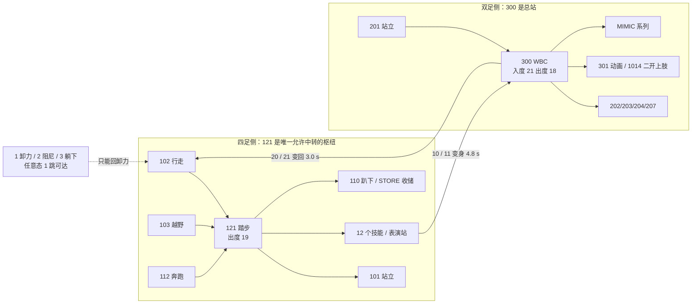


**实践含义**：

- **四足侧**：102/103/112 之间**没有直达边**，换步态一律 `A → 121 → B`。这就是为什么日志里老出现 121。
- **双足侧**：所有支线都要先回 300 才能去别处（只有 `207 双足跑` 能直接变回四足）。
- **跨形态**：只有 6 个门（10 / 11 / 12 / 20 / 21 / 22），没有旁路。

> 旧版画的"四足三节点全互通"是错的（那是 SDK helper 的子集）。真机图里三态互不直达，**121 才是四足枢纽**。

## 7.6 最该记住的三个跳数

| 从 → 到 | 要几步 | 为什么 |
|---|---|---|
| 刚上电(1 卸力) → 双足行走 | **1 步** | 发 `BIPED_STAND_DEFAULT`，它自动落到 WBC（自动后继） |
| 跌倒(2 阻尼) → 能走 | **3 步** | 先卸力，再经双足侧绕回四足 |
| 四足行走(102) → 双足 WBC(300) | **1 步** | 直接报 10 或 11，但要付 4.8 秒变身时间 |

## 7.7 两道门：图上能到 ≠ 现在能切

这是切换真正容易被忽略的地方。**即使表上有一条线，也不一定能立刻走**：

```
你的请求
   │
   ▼ 第一道门：有没有合法路线？
   │    没有 → 直接拒绝（错误码 -1001）
   ▼ 第二道门：当前这套动作愿不愿意"下课"？
   │    不愿意 → 拒绝 / 等待 / 保持原状
   ▼
开始交接：旧的下课、新的上岗（新的一组从第一个周期开始跑）
```

**第二道门为什么要存在**：有些动作不能被打断在任意时刻。比如"坐下"过程中途被打断，机器人会卡在半蹲。所以每个动作可以声明"我什么时候可以被换掉"。

实测过两种极端：

- `121 踏步`：**8 毫秒**就愿意下课（它就是为过渡而生的）
- 历史上的 `quad_sit_down`：**直接挡住**"去行走"的请求，拒绝交接

第一道门的检查结果就是 `switch_ready` 字段。**这是唯一可信的"能不能接管"信号**——但官方 SDK 示例全都没有用它（都用轮询动作名代替），这是个已知的契约缺口。

## 7.8 变身为什么慢（4.8 秒）

因为**它不是"切个开关"，而是一次完整的全身动作**。

神经网络要根据当前姿态、重心、地面反作用力，实时算出一条从四足到双足的过渡轨迹。中途必须保证不摔，所以：

- 变身期间 `switch_ready = false`，不许插新动作
- 变身期间 `form` 可能已经广播成"双足"了（形先变，状态后到）
- 中途打断 = 摔

实测：四足→双足旋转 **4.806 秒**，双足→四足旋转 **3.00 秒**。这是物理过程，不是软件延迟。

## 7.9 切换失败了，看哪个码

错误码分三层，**先分清是谁拒的**，否则会查错方向：

| 你看到的 | 谁拒的 | 意思 | 怎么办 |
|---|---|---|---|
| `-1001` | 运控 | 这两站之间**没有路线** | 换一条路，或先切到中转站 |
| `-1002 / -1003` | 运控 | 当前/目标动作**编号不存在** | 可能是别的机型的动作 |
| `-1004` | 运控 | 当前**姿态**不允许 | 先站起来/换个姿态 |
| `-1005 / -1006` | 运控 | 行为不兼容 | 需要中转 |
| `-1008` | 运控 | 运控**还没启动** | 等它就绪 |
| `-10001` | 运控 | 请求**太快** | 间隔 ≥500 毫秒 |
| `-10002` | 运控 | `source` 是空的 | 填来源 |
| `reason=7` | 任务层 | 不在允许清单 | 换个入口或条件 |
| `reason=21` | 任务层 | 前一个动作在禁止清单里 | 先换掉前一个动作 |
| `reason=28` | 任务层 | 动画进行中，不许打断 | 等动画结束 |

> **记住这一句**：**你只能报站名，路线它规划；报 11 会停在 300；变身是动作不是开关。**

---

## 7.10 中转动作不是"空转"：115 和 121 到底在干什么

你的疑问成立：**它们确实就是"在策略之间插了一个策略"**。而且这是设计，不是补丁。

先分清三种"插入"，来源完全不同：

| 插入者 | 例子 | 谁决定的 | 什么时候发生 |
|---|---|---|---|
| **任务层技能序列** | 115 → 101 → 102（站起来） | task_engine 的技能定义 | 业务上"站起来"被拆成三步 |
| **运控层换乘插入** | 103 → **121** → 102 | MC 的换乘图寻路 | 图上没有直达边 |
| **动作自退出** | 121 自己结束、115 自己结束 | 动作自己的退出判据 | 动作内部条件满足 |

也就是说：**有的中转是"被安排的"，有的是"自己走完就退场"的**。下面这两个例子正好各占一种。

### 7.10.1 起立预备 115：一个"中间姿势"的位控动作（经典控制）

配置原文（`classic/ready_stand_default.yaml`）关键字段：

| 字段 | 值 | 含义 |
|---|---|---|
| `step_time` | 0.001 s | 1 ms 控制周期 |
| `phase_duration_time` | 1 s | 这一段的时长 |
| `exit_timeout` | 1.2 s | 超时就退出 |
| `exit_position_threshold` | 0.2 rad | 到位误差小于它就退出 |
| 14 个关节 | 各给 `kp`/`kd`/`position` | 一套**固定目标角**（前髋 1.1653、膝 −2.330 等） |

**它不是神经网络**，就是一个"把关节推到某个中间姿势"的位控动作。

**为什么需要它**：趴着的时候关节角和站立姿态差得很远——

| 关节 | 起立预备（115） | 站立（101） |
|---|---|---|
| 前髋俯仰 | 1.1653 | 0.6719 |
| 膝 | −2.330 | −1.3579 |
| 后髋俯仰 | 1.8151 | 1.0624 |
| 后膝 | −2.5031 | −1.8321 |

（站立值来自 `classic/quad_stand_default.yaml`；RL 侧的 `default_dof_pos` 是 0.6781 / −1.3533，非常接近但不完全相同。
101 自己的参数是 `phase_duration_time 2.0 s`、`exit_timeout 2.0 s`、`exit_position_threshold 0.2 rad`。）

一步跨这么大，腿会顶地、打滑。所以先花 1 秒把身体"撑到中间高度"，再交给站立。

**它的出入口也很专一**：

```
入边：PASSIVE（卸力）/ CROUCH（蜷缩）/ GET_DOWN（趴下）   ← 都是低姿态
出边：只有 QUADRUPED_STAND_DEFAULT(101)                  ← 只通向站立
```

### 7.10.2 四足踏步 121：一个"真策略"，但被配成了闸门

它和 115 完全不是一类。`rl/quad_step.yaml` 里写得很清楚：

```yaml
policy:
  type: "onnx"
  path: "./rl_models/t2_quad_walk_lite_0713.onnx"   # 和行走同族的 RL 策略
obs_nums: 57        # 和四足行走一样，含 cpg 相位（第 49 位起）
dt: 0.01            # 100 Hz
```

**它是一个货真价实的行走策略**。但在配置里被加了三样"闸门"参数：

| 参数 | 值 | 作用 |
|---|---|---|
| `stand_actions` | `[QUADRUPED_STAND_DEFAULT, QUADRUPED_LOCOMOTION_STEP]` | 注释原文：**"STEP 本身也加入 stand_actions：作为闸门时强制原地踏步、忽略速度指令"** |
| `step_gate.front/back_diff_thr` | 0.05 m | 左前/右前、左后/右后**足端高度差**要够小 |
| `step_gate.pos_diff_thr` | 0.05 m | 足端相对默认足位的水平偏差（不含 z，避免坡面误判） |
| `step_gate.pos_diff_thr_quad_stand` | 0.08 m | 四足站立的特例，注释："避免开箱踏步" |
| `step_gate.omega_thr` | 0.3 | 角速度要够小 |
| `step_gate.min_stable_hold` | 0.1 s | 条件要**保持** 0.1 秒才算数 |
| `step_gate.min_step_time` | **0.9 s** | 最少踏步时间，注释："= 一个 TROT 周期，防止踏步不足一个步态周期就退出" |
| `step_gate.settle_timeout` | 5 s | 兜底超时 |
| `custom.transition_duration` | 0.3 s | 进入时起点姿态平滑 |

**它解决什么问题**：从"站立"或"某个动作刚结束（跳、空翻、恢复、转身）"进入持续行走时，
四条腿的**相位和足端落点都是乱的**（可能一条腿在前、一条在后，落在别处）。
直接切行走策略，步态会错乱甚至绊一下。所以先跑一段 `walk_lite` **原地踏步**，
把相位对齐、足端收拢到默认位置，条件满足后再切目标步态。

**它的出入口很宽**：

```
入边：101 站立 / 102 行走 / 112 奔跑 / 103 越野 / 114 愉快 / 100 恢复
出边：19 个（几乎任何四足动作都能从它出发）
```

这就解释了为什么日志里"请求 102 却先看到 121"——**它不是被跳过，而是被需要**。

### 7.10.3 为什么"插一个策略"在工程上说得通

因为在这里，**一个 Action 就是一个独立的控制组件**，不是函数调用：

| 差异 | 115 起立预备 | 121 四足踏步 |
|---|---|---|
| 实现 | 经典位控（无网络） | 神经网络策略 |
| 周期 | **1 ms** | **10 ms** |
| 退出方式 | 到位（0.2 rad）或超时（1.2 s） | 闸门条件满足 + 最少 0.9 s |
| 增益 | kp 200~250（很硬） | kp 30（柔） |

交接时走的是同一套动作通道：**旧 runner 允许退出（ExitCheck）→ 新 runner 初始化（PreRunOnce）→ 按自己的周期跑**。

代价也很明确：**多一次交接就多一次状态迁移**。实测 STEP 只活 8~59 毫秒（条件很快就满足），
而 115 活约 395 毫秒到 3 秒（取决于到位快慢）。
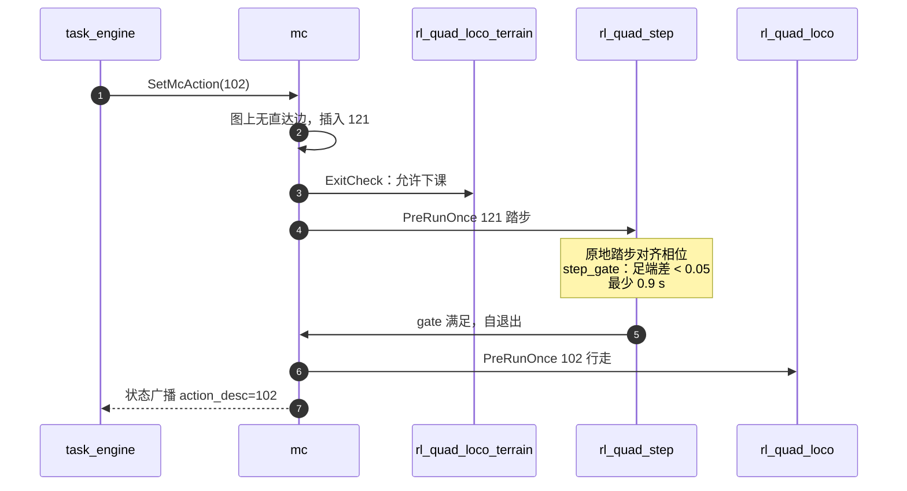


### 7.10.4 它们在状态机里属于哪一类（真机是 6 组，不是 3 组）

`action_state.yaml` 实际分了 **6 组**（旧版报告说 3 组，是错的）：

| 组 | 成员举例 | 含义 |
|---|---|---|
| `STARTING` | JOINT_DEFAULT、CROUCH_DOWN、SIT_UP、SIT_DOWN | 启动/初始姿态 |
| `STABLE` | STAND_DEFAULT、**QUADRUPED_LOCOMOTION_STEP**、QUADRUPED_LOCOMOTION_DEFAULT、WBC、动画、跳舞… | 稳态（可以长期停在这里） |
| `MOVING` | **QUADRUPED_READY_STAND_DEFAULT**、各种变身/空翻/跳跃/MIMIC… | 过渡态（做完就该走） |
| `SAFE` | PASSIVE、DAMPING、RECOVERY、STAND、GET_DOWN、STORE、SIT_DOWN… | 安全/低姿态 |
| `SPECIAL` | MANIPULATE、VR_REMOTE、GROUNDUP | 特殊用途 |
| `TEST` | TEST_PLATFORM、TRAJECTORY_GENERATOR、TEST_FOURIER | 测试 |

**注意这个分类很关键**：115 在 `MOVING`（过渡态，所以它天然"做完就走"），
121 在 `STABLE`（稳态，所以你可以在踏步状态下停留）。

同一份文件里还有三个容易被忽略的配置：

| 配置 | 内容 | 作用 |
|---|---|---|
| `default_action` | `stable: STAND_DEFAULT`、`moving: LOCOMOTION_DEFAULT` | 各类的"默认落点"（注意：这两个名字是旧命名，不在当前 `action_setting` 里） |
| `estimator` | `check_fall: true`、`check_soar: true`、`secure_action: DAMPING_DEFAULT` | 跌倒/腾空判定与安全动作 |
| `recovery_behaviors` | `recovery_action: QUADRUPED_RECOVERY` + 9 个可恢复动作 | 哪些动作跌倒后允许被恢复打断 |
| `action_imu_check` | `QUADRUPED_LOCOMOTION_BIONIC`：roll/pitch ±0.12 rad（≈7°） | **切这个动作前先查 IMU 姿态** |
| `elapse_time` | 2000 ms | 语义未确证（疑似切换后的稳定判定窗口）【未证实】 |

> **注意一份文件的不一致**：`action_state.yaml` 里混着 `LOCOMOTION_DEFAULT`、`STAND_DEFAULT`、
> `SIT_UP_DEFAULT`、`SQUAT_DEFAULT` 这类**在 `action_setting.yaml` 里根本不存在**的名字。
> 说明这份状态分组带历史残留（Q1/旧命名），**不能当唯一权威**，但它对 115/121 的分类和当前配置是一致的。

### 7.10.5 除了"可达"，还有三道隐形的门

以前只讲了"可达性"和"允许退出"两道门，真机配置里其实还有三道更细的门：

| 门 | 配置位置 | 效果 |
|---|---|---|
| IMU 姿态门 | `action_imu_check` | 切某些动作前查 roll/pitch（例：仿生步态 ±7°） |
| 稳定分类门 | `state_actions` | 动作属于哪一组，决定它算"稳态"还是"过渡态" |
| 恢复门 | `recovery_behaviors` | 只有名单里的动作，跌倒后才允许插入恢复动作 |

> **记住这一句**：**中转动作不是空转。115 是"把身体撑到中间姿势"的位控（1 ms、到位即退），
> 121 是"原地踏步对齐相位"的真策略（10 ms、闸门满足即退）。它们的差别不是代码技巧，而是物理需要。**

# 第 8 章 谁在踩油门：速度控制权

## 8.1 为什么需要仲裁

能控制底盘的程序不止一个：导航算法、跟随算法、任务层、手柄、手机 App。如果大家同时喊，电机就会抽。

所以运控维护一个"当前谁说了算"的状态，并用**优先级**来决策。

## 8.2 八个司机抢一个方向盘（配置里 7 个 + 代码里 1 个）

| 司机（`source`） | 优先级 | 在配置表里？ | 谁 | 典型场景 |
|---|---|---|---|---|
| `vr` | 70 | ✅ | VR 遥操作 | 少见 |
| `rc` | 80 | ✅ | 物理手柄 | 现场调试 |
| `interaction` | 80 | ✅ | 任务层自己的移动技能 | 语音"向右转 90 度" |
| `pnc` | 80 | ✅ | Orin 的规划算法 | 导航、跟随、运镜轨迹 |
| `app_proxy` | 90 | ✅ | 手机 App 摇杆 | 手动遥控 |
| `app_proxy_t_mode` | 90 | ✅ | App 的 T-mode 专用通道 | App 遥控的另一种模式 |
| `insta360` | 90 | ✅ | 相机云台桥 | **只在云台模式（303）下才产生有效速度** |
| **`coreon_fusion`** | **100** | ❌ **硬编码** | Orin 的避障修正 | 前面有东西 → 限速/刹停 |

**优先级数字越大越有话语权**，但有三条反直觉规则。

## 8.3 三条反直觉规则

**① 零速抢不走方向盘。**
正在走的时候，另一个司机发"停"（速度 0），是抢不走的——**必须发非零速度才能接管**。

唯一例外是 `coreon_fusion`（避障），它的零速**有效**。所以"避障一介入就停"，不是因为优先级高，而是因为**只有它能用零速抢**。

**② 同档位要等对方"下班"。**
`pnc` 和 `interaction` 都是 80 档，互相接管时，必须等对方**1 秒内没再发非零指令**才能抢。这就是运镜切源会有约 1 秒滞后的原因。

**③ 1 秒超时 ≠ 1 秒停车。**
`timeout=1000ms` 只是"抢方向盘的等待窗口"，**不是停车计时器**。
真正让车停的是另一个机制 `cmd_guard`：内部速度命令**超过 200 毫秒没更新就清零**。

## 8.4 一条速度消息进来之后，到底发生了什么

前面讲的是"规则"，这一节讲"实现"：一条消息到达运控后，经过哪几步、改了哪些内部状态。

### 8.4.1 消息长什么样

```text
Topic:  /aima/mc/locomotion/velocity
Type:   McLocomotionVelocity
  header              # 时间戳、序号
  source              # 谁发的（字符串）
  forward_velocity    # 前进 m/s（+前 −后）
  lateral_velocity    # 侧移 m/s（+左 −右）
  angular_velocity    # 转向 rad/s（+左）
  pitch_velocity      # 弯腰角速度（预留字段，当前不生效）
  level               # 档位/高度（语义在文档之间不一致）
```

### 8.4.2 运控先要知道"有哪些司机、谁排第几"

这些不是写死的，是配置里的一个列表【配置】：

```yaml
InputManager:
  input_sources:
    - { name: rc,               priority: 80,  timeout: 1000 }
    - { name: vr,               priority: 70,  timeout: 1000 }
    - { name: app_proxy,        priority: 90,  timeout: 1000 }
    - { name: interaction,      priority: 80,  timeout: 1000 }
    - { name: pnc,              priority: 80,  timeout: 1000 }
    - { name: app_proxy_t_mode, priority: 90,  timeout: 1000 }
    - { name: insta360,         priority: 90,  timeout: 1000 }
```

注意两件事：

- 这里有 **7 个源**，但**没有 `coreon_fusion`**——避障那个源是**代码里硬编码的特例**，不在配置表里。
- 表里没有"task_engine"，但任务层确实能发速度——它发的时候用的是 `interaction` 这个标签。

### 8.4.3 判定逻辑（按证据还原的伪代码）

运控内部维护三个状态：

```
registry        : 每个源的名字 / 优先级 / 超时 / 是否使能
current_source  : 当前"发言人"是谁
current_msg     : 当前生效的那条速度命令
last_nonzero    : 当前发言人最后一次发"非零速度"的时刻
```

每收到一条消息，做如下判断【配置+静态分析】：

```python
def on_velocity(msg):
    src = msg.source

    # ① 避障特例：绕过一切普通规则，零速也接受
    if src == "coreon_fusion":
        current = msg; last_nonzero = now()
        return ACCEPT

    # ② 没登记 / 被禁用 → 丢
    if src not in registry or registry[src].disabled:
        return REJECT

    # ③ 就是当前发言人在说话
    if src == current_source:
        current = msg
        if max(abs(v) for v in msg.components) >= 1e-4:   # 只有非零才刷新占用
            last_nonzero = now()
        return ACCEPT

    # ④ 别人想说话，但发的是零速 → 不许抢
    if max(abs(v) for v in msg.components) < 1e-4:
        return REJECT

    # ⑤ 优先级更高 → 立刻接管
    if registry[src].priority > registry[current_source].priority:
        current_source = src; current = msg; last_nonzero = now()
        return ACCEPT

    # ⑥ 优先级不更高 → 等对方"占用窗口"到期
    if now() - last_nonzero >= registry[current_source].timeout:
        current_source = src; current = msg; last_nonzero = now()
        return ACCEPT
    return REJECT
```

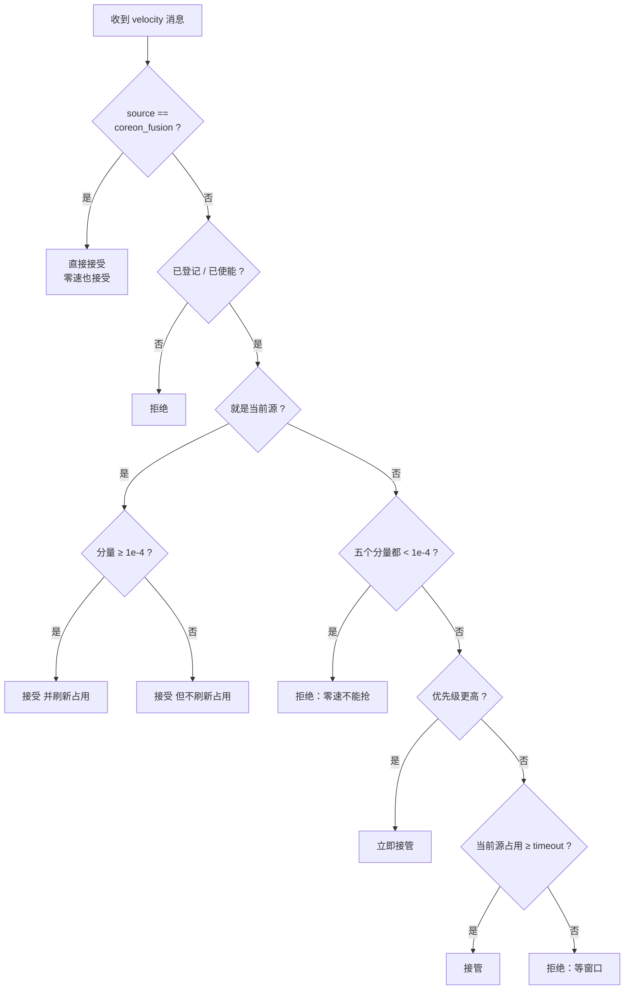

### 8.4.4 这张伪代码能解释所有"奇怪"现象

| 现象 | 对应哪一行 |
|---|---|
| 避障一介入就能刹停，别的不行 | ①（零速也接受） |
| 手柄发零速停不住正在走的 pnc | ④（零速不能抢） |
| 运镜切源有约 1 秒滞后 | ⑥（等窗口到期） |
| 高优先级源可以"插队" | ⑤（立刻接管） |
| 发速度的程序崩了，车还在走 | 都不匹配 → 没人抢，`current` 不变 |
| 停下靠的是另一个机制 | 见 8.3 的 `cmd_guard` 200 毫秒，不在这个函数里 |

### 8.4.5 仲裁完了，谁来用这条命令

仲裁只决定"当前命令是什么"，**消费发生在控制周期里**：

```
每个控制周期（10 毫秒）
   │
   ├─ 读 current（仲裁产物）
   ├─ 检查命令年龄：now − 内部接收时刻 > 200 ms ？
   │     是 → 把命令清零          ← cmd_guard，真正防跑飞的那道
   │     否 → 照用
   ├─ 把速度映射成策略要的 3 维 command（观测第 46 位起）
   └─ 跑策略 → 关节目标
```

**两个时间点必须分清**：

- **仲裁**发生在"消息到达时"（事件驱动，没有延迟）
- **消费**发生在"控制周期里"（周期驱动，最多晚 10 毫秒）

### 8.4.6 查询和修改：两个接口

| 接口 | 作用 |
|---|---|
| `GetCurrentInputSource` | 问"现在是谁在说话"（返回名字/优先级/超时/是否使能） |
| `SetMcInputSource` | 改：`ADD 1001` / `MODIFY 1002` / `DELETE 1003` / `ENABLE 2001` / `DISABLE 2002` |

三个注意点：

1. 配置只改**内存**，重启即失效
2. `ADD` 时名字不能和系统保留名冲突
3. 你也可以用 `DISABLE` 把某个内置源临时关掉——但这属于"动系统配置"，**没有恢复机制**

### 8.4.7 怎么确认"我的速度真的被采纳了"

看状态广播里的 `input_source` 字段：

```
input_source.name       = "pnc"        ← 现在是 pnc 在说话
input_source.priority   = 80
input_source.timeout    = 1000
```

如果你发了速度但这里不是你的名字，说明你没抢到——按 8.4.3 的六条规则逐条对：是不是零速？是不是优先级不够？是不是窗口没到？

## 8.5 四种"超时"别搞混

| 名字 | 时间 | 它到底管什么 | 别误解成 |
|---|---|---|---|
| 速度源占用超时 | 1000 ms | 谁能抢方向盘 | 停发就停车 |
| **命令过期** | **200 ms** | 命令老了就清零（真正防跑飞） | 物理已经静止 |
| 上肢命令时效 | 200 ms | 上肢不更新就不动 | 会自动交回全身控制 |
| 关节/IMU 超时 | 10 ms | 数据不新鲜就报警 | 保证 10 毫秒内停机 |

## 8.6 实测：运镜时方向盘换了 4 次

环绕运镜（全程动作都是 300）：

| 时刻 | 谁在开车 | 在干什么 |
|---|---|---|
| 10:26:26 起 | `pnc` | Orin 在调距离 |
| 10:26:35.383 | `pnc → interaction` | 任务层要转身 |
| 10:26:38.284 | `interaction → pnc` | Orin 开始画圈 |
| 10:27:02.386 | `pnc → interaction` | 反向转身 |
| 10:27:05.384 | `interaction → pnc` | 短时跟随 |

**动作一次没换。**这就是"两个旋钮独立"的最好证据。

## 8.7 二次开发要自己当司机时

流程【配置】：

```
1. 注册一个新来源：SetMcInputSource(ADD, {name:"自己起的名", priority:30, timeout:1000})
2. 持续往 /aima/mc/locomotion/velocity 发速度，source 填你注册的名
3. 查 common/state 的 input_source，确认真的被采纳
```

两个坑：

- **优先级别给 80**。官方推荐的二开档位是 39~20，但所有示例都写了 80，和 pnc/rc 同级，会互相抢。
- **配置只存内存，重启就没了**，程序要自己重新注册。

> **记住这一句**：**优先级决定谁说话；零速抢不走（避障除外）；停车靠 200 毫秒清零，不是 1 秒超时。**

---

# 第 9 章 策略是怎么被"管理"的

前面讲的是"策略是什么、怎么换"。这一章讲"谁在维护这些策略"。

## 9.1 配置即策略：四份文件各回答一个问题

T1 没有"策略管理中心"，**策略的管理就是这四份 YAML 的一致性**：

| 文件 | 它回答的问题 | 改了会怎样 |
|---|---|---|
| `action_ruler.yaml` | **谁能变成谁**（换乘表） | 改完可切换的路线就变了，可能导致 -1001 |
| `action_state.yaml` | 动作属于哪一类（真机是 6 组：启动/稳定/运动中/安全/特殊/测试），以及出问题往哪退 | 影响保护和恢复行为 |
| `action_setting.yaml` | **一个动作挂哪几组（每组什么周期、优先级、跑哪些 runner）** | 影响性能与手感 |
| `rl/*.yaml`（48 份） | **每一组控制器用什么模型、怎么缩放输出** | 影响"性格"和稳定性 |

```mermaid
flowchart LR
    RUL["action_ruler.yaml<br/>52 节点 197 边"] --> RT["运行时的换乘判断"]
    SET["action_setting.yaml<br/>58 动作 / 62 执行组"] --> RT
    SET --> GRP["执行组 → Runner → 周期"]
    RL["rl/*.yaml<br/>48 份"] --> GRP
    RL --> POL["policy.path → ONNX"]
    ST["action_state.yaml<br/>6 组状态 · 恢复名单"] --> RT
    RT --> MC["mc 当前动作"]
    GRP --> MC
```

**为什么这么设计**：换模型、调参数是高频操作，不应该改代码；而改代码意味着重新编译、重新过认证。**用配置表达策略，等于把"改策略"变成"改参数"。**

## 9.2 想加一个新动作，要动哪些地方

按顺序，四处都要改，缺一处就会在运行时暴露：

```
1. 接口枚举：在 McAction 里加编号（否则上层传不进来）
2. 换乘表：在 action_ruler 里加"从哪能到它、它能到哪"（否则 -1001）
3. 执行组：在 action_setting 里给它挂控制器（否则动作没有执行力）
4. 配方：在 rl/ 下加一份 runner 配置和模型（否则没有控制律）
```

**这就是为什么"想热插一个新策略"不现实**——它不是加一个文件，而是四处联动。

## 9.3 加载与缓存：为什么第一次切过去会"顿一下"

| 现象 | 机制 | 数据 |
|---|---|---|
| 进程启动时就建好组件 | 预建 + 缓存，按"名字+配置路径+周期"做键 | 启动后 3 秒就建好了走路组件 |
| 同键复用，不重复初始化 | 再次进入同一套动作时跳过重加载 | 日志可见"复用" |
| 模型池预热 | 预载 5 个常用会话 | 【实测】 |
| 动画资源预载 | 78 个动画 CSV 一次性读入 | 耗时 **1.729 秒** |

**工程含义**：**冷启动有代价**。如果你的流程是"上电 → 立刻跳舞"，那 1.7 秒的资源加载会算进"多久能动"里。

## 9.4 怎么知道现在跑的是哪个策略

### ① 唯一权威来源：一个 50 Hz 的状态广播

运控每 20 毫秒广播一次自己的全部状态，其中这几项最关键：

| 字段 | 回答什么 | 怎么用 |
|---|---|---|
| `current_action` | 用哪套动作 | 判断"是不是我要的" |
| `source` | 谁请求的 | 判断"是不是我请求的" |
| `status` | 100 运行 / 200 切换中 | 判断"稳没稳" |
| `switch_ready` | 能不能接新动作 | **判断"能不能接管"** |
| `input_source` | 现在听谁的速度 | 判断"我的速度被采纳了吗" |
| `form` | 四足/双足 | 判断形态 |
| `fsm` | 稳定/运动中/安全（真机配置里实际分了 6 组） | 粗分类 |
| `is_moving` / `is_fallen` | 在动吗 / 摔了吗 | 快速判断 |
| `held_state` | 有没有被牵着 | 影响能不能做某些任务 |

### ② 一个免费的观测技巧：看线程名

运控进程里那个"控制环"线程，**名字会随动作变化**【实测】：

| 什么时候 | 线程名 |
|---|---|
| 静止/卸力 | `passive_default_t0` |
| 四足站立/行走 | `rl_quad_locomotion_t0` |

所以在板子上执行 `ps -L -o comm -p <运控进程号>`，就能**直接看出现在跑的是经典控制环还是神经网络环**，不用查日志。

### ③ 四个层次的"证据"要分开看

```
action_desc = 300     只证明"目标是 300"
status     = 100      只证明"不是空闲"
switch_ready = true   只证明"允许被替换"
关节反馈跟上目标       才算"真的在执行"
```

## 9.5 谁能让运控停下

这是"系统模式"（SM）在管的事，和"换个动作"是两回事：

| 系统模式 | 对运控的处理 | 含义 |
|---|---|---|
| 启动 / 就绪 / 业务 | 保持运行 | 正常 |
| **急停 EStop** | **把运控进程和任务层都停掉** | 这是"杀进程"级，不是"换动作"级 |
| 关机 | 先停运控和诊断 | 停机流程 |
| 升级 OTA | 把运控停掉 | 升级前必须停 |
| 低功耗 | **只停传感器数据流，运控还在跑** | 低功耗 ≠ 停运控 |

**最容易混的一点**：

- **跌倒保护**是"运控层换个动作"（换阻尼），系统模式还在"就绪"
- **急停**是"系统层把运控杀了"

两者完全不同级别，不能互相替代。

## 9.6 监督与资源：为什么运控能"独占一个核"

T1 没有用实时内核补丁（PREEMPT_RT），而是用了更便宜的办法：**把两个 CPU 核隔离出来专用**。

| 核 | 谁在用 | 干什么 |
|---|---|---|
| CPU2 | CAN 中断 + 设备层 6 个实时线程 | 收发电机总线 |
| CPU3 | **运控进程的全部 36 个线程** | 跑策略、算关节 |
| 其余 6 核 | 业务进程 | 语音、App、相机、UI |

配套的保障：

| 机制 | 作用 |
|---|---|
| 实时调度（RR 80/85） | 让关键线程优先拿到 CPU |
| cgroup 权重（运控组 10000，内存保底 500MB） | 别的进程抢不走资源 |
| 内存保护（`oom_score_adj=-1000`） | 内存紧张时不杀运控 |
| 看护线程（50 毫秒一次） | 检查跌倒/被抱起 |
| 健康诊断（14 个模块，500 毫秒上报） | 汇总故障 |

**实测占用**【实测】：

| 进程 | CPU（1 核=100%） | 内存 |
|---|---|---|
| 运控 | 43% → 运动中 74~77% | 252 MB |
| 设备层 | 47% → 61% | 44 MB |
| 运控独占核 | 静止态 42% | — |

> **记住这一句**：**策略靠配置管理，状态靠一个 50 Hz 广播观测，隔离靠"两个核 + cgroup"而不是实时内核。**

---

# 第 10 章 安全与降级：为什么必须是三层

> **本章是速览版。** 完整的安全设计（八层逐层算法、六条异常路径时序、超时族谱、验收测试矩阵、症状速查）
> 见独立文档 **`T1运控安全设计详解.md`**。

## 10.1 安全层全景：从电机到系统，一共八层

安全不是一个开关，是**八层叠加**。每层回答的问题不同，响应时间差 1000 倍，而且**互不替代**。

| 层 | 名字 | 管什么 | 典型机制 | 时间尺度 | 证据 |
|---|---|---|---|---|---|
| **L0** | 电机/驱动层 | 单个关节别把自己拧坏 | 关节限位、MIT 指令范围、零偏/方向标定、关节上下电 | 微秒~毫秒 | 【配置】 |
| **L1** | 命令层 | 指令断了别继续跑 | 命令过期清零（`cmd_guard`）、上肢命令时效、反馈超时检查 | 200 ms / 10 ms | 【配置+静态】 |
| **L2** | 动作准入层 | 这个动作现在能不能切 | 可达性、姿态检查、行为兼容、频率限制、业务白/黑名单 | 一次请求 | 【配置+实测】 |
| **L3** | 姿态看护层 | 身体姿态是否已经不正常 | 角度突变、角速度、脚的几何、被抱起 | 50 ms 检查 | 【配置+实测】 |
| **L4** | 动作兜底层 | 出事后用什么姿势兜住 | 3 个全局出口、阻尼、跌倒恢复族 | 一次动作（秒级） | 【配置+实测】 |
| **L5** | 感知安全层 | 别撞上去 | 避障修正、空间检查、避障开关 | 10~30 Hz | 【配置+实测】 |
| **L6** | 系统模式层 | 整机必须停 | 急停（停进程）、关机、升级前停运控 | 事件级 | 【配置】 |
| **L7** | 资源/进程层 | 别被别的进程拖死 | 隔离核、cgroup 权重与内存保底、OOM 保护、进程重启、健康诊断 | 秒级 | 【实测】 |
| **L8** | 电源/硬件层 | 电不够别硬撑 | 电量门槛、低电切四足、下电/重启接口、电源去抖 | 秒级 | 【配置】 |

```mermaid
flowchart TB
    L0["L0 电机 / 驱动<br/>关节限位 · MIT 范围 · 上下电"]
    L1["L1 命令层<br/>cmd_guard 200 ms · 反馈 10 ms"]
    L2["L2 动作准入<br/>可达 -1001 · 姿态 -1004 · 频率 -10001"]
    L3["L3 姿态看护<br/>60° 3 次 · 6 rad/s 48° 3 次 · 脚 FK 20 次"]
    L4["L4 动作兜底<br/>3 个全局出口 · 阻尼 · 恢复族"]
    L5["L5 感知安全<br/>避障 priority 100 · 零速有效"]
    L6["L6 系统模式<br/>EStop 只留 HAL + Diagnosis"]
    L7["L7 资源 / 进程<br/>隔离核 · cgroup · OOM 免杀 · 重启上限"]
    L8["L8 电源<br/>电量门槛 · 低电切四足 · 下电接口"]
    MOT[("电机 / 机构")]

    L0 --> MOT
    L1 --> L0
    L2 --> L1
    L3 --> L2
    L4 --> L3
    L5 --> L4
    L6 --> L5
    L7 --> L6
    L8 --> L7
```

### 10.1.1 逐层展开

**L0 电机/驱动层**——最底层，也最"物理"。

- 每个关节有**软件限位**（来自 URDF，例如双足前肢三关节：−0.436~0.436 / −1.187~4.328 / −2.583~2.583 rad）
- 设备层还维护每个关节的**零偏、方向、限位、MIT 编码范围**（角度 → 电机码值）
- 关节可以单独**上电/断电**（`SetJointPower`：1 上电 / 2 断电），并有状态查询
- 边界：这一层只管"单个关节别越界"，**不知道机器人整体在干什么**

**L1 命令层**——防"指令流断了还在跑"。

| 机制 | 阈值 | 作用 |
|---|---|---|
| `cmd_guard` 命令过期 | **200 ms** | 内部速度命令超龄就清零 |
| 上肢命令时效 | 200 ms | 超时本周期不写上肢输出 |
| 关节/IMU 反馈超时 | 10 ms | 数据不新鲜就报警 |

> 这三道属于"命令层处理"，在 §6.10 的流水线图里是第 7、23、24 道；完整的滤波/限幅清单也见 §6.10。

这一层的价值在"**最后一道自动刹车**"：发速度的程序崩了、网络断了，200 毫秒后速度自己归零。

**L2 动作准入层**——防"切到不该切的状态"。

| 检查 | 失败码 | 含义 |
|---|---|---|
| 有没有合法路线 | `-1001` | 换乘表上没有路 |
| 动作编号是否存在 | `-1002/-1003` | 本机型没有这个动作 |
| 当前姿态允许吗 | `-1004` | 趴着不能直接走 |
| 行为能交接吗 | `-1005/-1006` | 两套动作不兼容 |
| 请求频率 | `-10001` | 间隔必须 ≥500 ms |
| 业务白名单/黑名单 | `reason=7/21` | 当前业务不允许 |

**L3 姿态看护层**——防"摔了还在走"（详见 10.3）。

- 50 ms 检查一次，三条判据都要求**连续多次命中**
- 触发后**就地换动作**（→ 阻尼），不需要等系统层

**L4 动作兜底层**——出事后怎么"体面地"停住。

| 机制 | 内容 |
|---|---|
| 3 个全局出口 | 卸力 / 阻尼 / 躺下，**任意状态 1 步可达** |
| 阻尼的含义 | 刚度 0、阻尼非零——不硬撑、能被人扶住 |
| 恢复族 | 四足恢复 100（RL 闭环）、双足恢复 200（仅配置） |
| 恢复判据 | 姿态误差达标并**稳定 1 秒**才退出 |
| 极限动作配额 | 空翻类有 `permission_level` 与 30 天/终身次数限制（**业务配额，不是实时保护**） |

**L5 感知安全层**——防撞（详见 10.6）。

- 避障修正源优先级最高（100），**且能零速接管**
- 另有独立的"空间检查"接口：可按方向检查（前/后/左/右/上）和形态（四足/双足）
- 避障可以显式关闭（关掉会停止输出线程）
- 已知问题：滞回只有 1 个点、部分场景漏检、与相机节奏错配

**L6 系统模式层**——最后手段。

| 模式 | 对运控做什么 |
|---|---|
| **急停 EStop** | 功能组收缩为"音频+诊断"，**运控和任务层被停掉** |
| 关机 | 先停运控与诊断，再下电 |
| 升级 OTA | 停运控 |
| 低功耗 | **只停传感器流，运控继续跑**（所以它不算安全层） |

**L7 资源/进程层**——保证运控"活得好"。

- 两个 CPU 核隔离专用（一个收 CAN 中断，一个跑运控）
- cgroup 权重最高 + 内存保底 500 MB
- OOM 保护：运控和设备层**永不被杀**
- 进程重启：状态机最多 5 次，交互类最多 500 次
- 健康诊断：14 个模块，500 ms 上报一次

**L8 电源/硬件层**——电的边界。

| 机制 | 数值 |
|---|---|
| 任务电量门槛 | 移动 1%、跟随 6%、运镜 15%、建图 25%、体感 30% |
| 低电策略 | 自动切四足（官方口径） |
| 下电接口 | 1 下电 / 2 取消 / 3 软关机 / 4 电量重启 / 5 关机重启 |
| 电源请求去抖 | 5000 ms |

### 10.1.2 失效场景 × 谁兜底

| 失效场景 | 兜底层 | 结果 |
|---|---|---|
| 发速度的程序崩了 | L1 `cmd_guard` | 200 ms 后速度归零 |
| 时刻戳乱序/过期 | L1 | 命令被丢弃 |
| 摔倒了 | L3 姿态看护 | 就地切阻尼（实测 5~11 ms 日志差） |
| 前面有人/墙 | L5 避障 | 限速或刹停 |
| 请求切到不允许的动作 | L2 准入 | 直接拒绝（带错误码） |
| 姿态不允许 | L2 准入 | `-1004` 拒绝 |
| 任务互相冲突 | L2 业务层 | `reason=15/21` 拒绝 |
| 整机必须停 | L6 急停 | 停进程 |
| 内存紧张 | L7 OOM/cgroup | 优先保运控 |
| 电量不足 | L8 门槛 | 拒绝任务 |
| 恢复失败 | L4 全局出口 | 卸力/阻尼/躺平 |

### 10.1.3 为什么必须分这么多层

三个原因，缺一不可：

1. **响应尺度差 1000 倍**：命令过期是 200 ms，避障是几十毫秒，急停是事件级。混在一起就会"该快的慢、该慢的乱"。
2. **失败后果不同**：解不过去只是"没动"，摔了要换动作，急停要停进程。**越往下越重，不能随便升级**。
3. **责任边界不同**：L2 是"业务允不允许"，L3 是"身体行不行"，L6 是"整机还要不要继续"。三者不能互相代替。

### 10.1.4 最容易搞混的"五个独立事件"

现场经常有人用一句话概括，但它们是五件事，**必须分别确认**：

| 事件 | 由谁产生 | 怎么确认 |
|---|---|---|
| 系统急停 | 系统模式 | 功能组变化 / 进程状态 |
| 运控阻尼 | 姿态看护 | `action_desc = DAMPING` |
| 速度归零 | 命令过期 | `input_source` 与速度值 |
| 任务停止 | 任务层 | Worker 状态 |
| 相机停录 | 相机模块 | 停录应答 |

> **记住这一句**：**八层各管一段，越往下越重；"停了"这五个字，至少对应五件不同的事。**

## 10.2 三种失效模式，对应三层防线

| 失效模式 | 例子 | 对应防线 | 时间尺度 |
|---|---|---|---|
| **指令流断了** | 发速度的程序崩了，最后一条"前进"还在生效 | 命令过期清零（`cmd_guard`） | **200 毫秒** |
| **机器人摔了/被抱起** | 地面打滑、被人推倒 | 姿态看护 → 切阻尼 | 50 毫秒检查一次 |
| **整机必须停** | 严重故障、人按了急停 | 系统急停（停进程） | 事件级 |

**为什么必须三层**：它们的**触发条件不同、后果不同、恢复方式不同**。

- 命令过期只清速度，不动动作
- 姿态看护只换动作，不停进程
- 系统急停停进程，但恢复要重启

**五件事必须分别确认**：系统急停、运控阻尼、速度归零、任务停止、相机停录——**不能用其中一个词代替其余四个**。

## 10.3 跌倒是怎么判出来的

看护线程每 50 毫秒检查一次【配置】：

| 判据 | 阈值 |
|---|---|
| 姿态基准 | 双足以 X 轴为上，四足以 Z 轴为上 |
| 通道 1（角度突变） | 角差 > **60°**，连续 3 次 |
| 通道 2（角速度） | 角速度 > **6.0 rad/s** 且角差 > **48°**，连续 3 次 |
| 脚相对躯干位置 | 双足：脚相对躯干的 z 分量 > 0.8 m，或 x 分量 < 0.4 m，连续 20 次 |
| 触发后做什么 | 切到"阻尼"动作 |

### 10.3.1 输入：它靠什么判断"摔了"

跌倒检测只看三类信号，都在躯干上：

| 信号 | 从哪来 | 频率 | 用来算什么 |
|---|---|---|---|
| 躯干姿态（欧拉角/四元数） | 躯干 IMU | 500 Hz（2 毫秒一帧） | 身体"上方向"偏离了多少 |
| 躯干角速度 | 同上 | 500 Hz | 翻倒有多猛 |
| 14 个关节角 | 关节反馈 | 1 kHz | 脚相对躯干的位置（正运动学） |

**为什么不用单一的"加速度大"来判断**：正常跳跃、急停、被猛推一下都会产生大加速度，误报率会高得没法用。所以 T1 用的是"**姿态偏离 + 角速度 + 脚的几何**"三重判据，并且都要**连续多次命中**才算。

### 10.3.2 判据一：姿态突变（ch1）

先定义"什么算上"——这一步和形态有关【配置】：

| 形态 | 上方向 | 为什么 |
|---|---|---|
| 四足 | **z 轴** | 四足站立时躯干"竖着"，z 朝上 |
| 双足 | **x 轴** | 双足站立时躯干"横着"（腿在下、头在上），长轴是 x |

然后算躯干上方向与重力方向的夹角 `delta`：

```
条件：delta > 60°  且  连续命中 3 次
```

实测两次真实跌倒：`delta = 95.29°`、`delta = 90.54°`——都远超 60°。

### 10.3.3 判据二：角速度（ch2）

```
条件：|ω| > 6.0 rad/s  且  delta > 48°  且  连续命中 3 次
```

**为什么两个条件都要**：

- 只有角速度大 → 可能是被猛推一下但站住了（不判）
- 只有角度大 → 可能是缓慢倾倒（这时靠 ch1 的 60° 慢慢满足）

两条通道是**或**的关系：任一条连续命中就报。

### 10.3.4 判据三：脚的几何（第二重保险，只配了双足）

真机 `security_guard.yaml` 的 `foot_relative_guard` 段只给了**双足**的脚链接，
四足没有配置这一项——也就是说这条判据是**双足专属**的。

```
配置原文（节选）：
  urdf_file_name: qd1.urdf
  torso_link: BASELINK
  biped_left_foot_link:  RL_FOOT_Link
  biped_right_foot_link: RR_FOOT_Link
  biped_horizontal_abs_max: 0.8   # 前后方向阈值
  biped_vertical_abs_min:   0.4   # 竖直方向阈值
  count_threshold: 20
```

判定语义（按配置注释）：

```
在 BASELINK 坐标系下：x 是"上"方向（脚正常约 −0.62 m），z 是"前后"方向（脚正常约 0）
命中条件：任一脚 |z| > 0.8 m  （前后摔出去了）
      或 任一脚 |x| < 0.4 m  （竖直方向塌缩了）
      且连续命中 20 次
```

**为什么这条判据存在**：角度和角速度都是"瞬时量"，而脚的几何是"构型量"。脚跑到身体上方，是"已经倒了"的确凿证据。

**为什么是 20 次而不是 3 次**：几何判据变化慢、噪声大，需要更长确认。

**边界**：这是**相对躯干的几何**，不是外部定位真值；四足没有这条判据，只靠姿态 + 角速度。

### 10.3.5 触发之后，按这个顺序发生

```
① security_guard 记录并置 is_fallen = true
② 请求切换到 DAMPING（走"换动作"通道，不是 EStop）
③ ActionManager 执行交接（这一步可能被旧动作的"下课条件"拖住）
④ 状态广播 action_desc = DAMPING
⑤ 业务侧发现自己的移动技能被打断
```

实测（2026-10-28 15:26）【实测】：

| 时间 | 事件 |
|---|---|
| 15:26:15.664554 | 看护线程报告跌倒（delta 95.29°、ω 4.202 rad/s） |
| 15:26:15.675410 | 动作切换完成（越野 → 阻尼），间隔 **11 毫秒** |
| 15:26:15.680 | 状态广播已变成阻尼 |
| 15:26:15.684 | 业务侧移动技能被打断（`is_running=false`） |

**注意这个顺序**：先检测 → 再换动作 → 再广播 → 业务最后才知道。所以"业务日志里看到被打断"永远晚于"看护日志里看到跌倒"。

### 10.3.6 时延、误报、漏报

| 问题 | 答案 |
|---|---|
| 最小确认时间 | 检查周期 50 毫秒 × 连续 3 次 ≈ **100~150 毫秒**（不含传感器与调度） |
| 那为什么日志只差 5~11 毫秒 | 日志打的是"**已确认之后**"的两个点，不是"物理跌倒 → 电机响应" |
| 漏报来源 1 | 动作监控表里**没启用的动作不做检查**（配置按动作启用） |
| 漏报来源 2 | 缓慢倾倒：delta 增长慢、ω 小，可能两条通道都不满足 |
| 误报来源 | 被外力猛推、急停、被抱起（被抱起有独立的"提起"判断） |
| 恢复是否自动 | 不是"取消跌倒标记"，而是走恢复动作族（见 10.5） |

### 10.3.7 怎么读那条跌倒日志

```
security_guard_t1.cc:157 检测到T1机器人已经摔倒
    form: 1                            ← 当时是四足形态
    action: QUADRUPED_LOCOMOTION_DEFAULT  ← 当时用哪套动作
    trigger=ch1_delta                  ← 哪条通道先命中
    delta=95.29deg                     ← 实测角度偏差
    omega_norm=4.202rad/s              ← 实测角速度
    (ch1:delta>60.0, ch2:|w|>6.00且delta>48.0)   ← 判据回显
```

最后那行括号是**判据回显**，等于把"当时的阈值"也打出来——这对现场判断"是正常触发还是阈值被改过"很有用。
## 10.4 实测：从"发现摔倒"到"切完阻尼"

样本 A（2026-10-28 15:26）【实测】：

| 时间 | 事件 | 数值 |
|---|---|---|
| 15:26:15.664554 | 看护线程报告跌倒 | 角差 **95.29°**、角速度 **4.202 rad/s** |
| 15:26:15.675410 | 动作切换完成（越野→阻尼） | **11 毫秒后** |
| +5 毫秒 | 状态广播已变成阻尼 | |
| +20 毫秒 | 任务层的移动技能被打断 | `is_running=false` |

样本 B：角差 90.54°，检测到切换完成 **5.1 毫秒**。

> **重要边界**：这两个数字是**日志之间的差**，不是"物理跌倒时刻 → 电机响应"的时延。完整链路还要加上：实际发生 → 采样 → 传输 → 下发 → 电机响应。

## 10.5 摔倒之后怎么爬起来

恢复不是"重置"，而是**一整套自动编排的动作**（实测 26 段）【实测】：

```
卸力(1) → 四足恢复(100) → 踏步(121) → 站立(101) → 行走(102)
              ↑ 神经网络闭环起身        ↑ 只停 9 毫秒
```

- 起身是**神经网络闭环**（模型 `t1_quad_recovery_v2.0_0814`），根据实际姿态实时算，不是固定轨迹
- 退出条件：姿态误差达到阈值并**稳定 1 秒**
- **双足恢复（200）只有配置和接口，没有实机进入记录**【未证实】

## 10.6 避障为什么能"强行刹停"

`coreon_fusion` 是 Orin 上的避障修正节点，它的特殊之处【配置+实测】：

- 优先级 **100**（最高），而且**硬编码**，不在普通配置表里
- **接受零速**，能绕过"零速不能抢"的规则
- 所以它能压停正在前进的任务

**实测行为**：

| 现象 | 数据 |
|---|---|
| 触发 | 点云 13 个点（1.373 m）触发 |
| 保持 | 12 帧 |
| 清除 | 9 个点（5 次中 1 次）|
| 恢复 | 6 个点（5 次中 5 次）|
| 问题 | 滞回只有 1 个点，边界抖动敏感 |

**两个已发现的问题**：

- 有场景**全程没触发**停障（积木障碍），因为高度窗算的是相机原点，不是离地高度
- 相机与身体会**错配**（相机先停，身体还在走 2.89 秒）

## 10.7 安全边界：这些"不保证"

| 不保证 | 为什么 |
|---|---|
| 配置周期 = 最快响应 | 实测有过超期（4 毫秒的组跑成 8.5 毫秒） |
| 1 秒超时 = 1 秒停车 | 见 8.3 |
| 日志时间差 = 物理时延 | 见 10.4 |
| 急停 = 身体立刻静止 | 急停是停进程，电机断电另有路径 |
| 系统就绪 = 所有能力可用 | 实测就绪后感知接口仍然调用失败 |

> **记住这一句**：**三层防线各管一种失效；跌倒只换动作，急停才停进程。**

---

## 10.8 安全旁路的算法拆解

"旁路"的意思是：**这些判断不在 10 ms 控制环里**，而是由独立的看护线程、事件回调、或每周期的一次超龄检查来做。
它们和主链（速度→策略→关节）并行，命中就抢方向盘或换动作。

### 10.8.1 四个守卫，四种触发方式

| 守卫 | 周期/时机 | 管什么 | 命中后做什么 | 落点 |
|---|---|---|---|---|
| `security_guard` 身体看护 | **50 ms 定时** | 跌倒 / 被提起 / 姿态异常 | 请求切 `DAMPING` | MC 内，独立线程 |
| `cmd_guard` 命令过期 | **每周期检查年龄** | 速度命令是不是老了（>200 ms） | 把命令清零 | MC 内，控制环里 |
| `custom_upper` 上肢时效 | **每周期检查年龄** | 上肢指令断流（>200 ms） | 本周期不写上肢输出 | MC 内 |
| `data_timeout_guard` 数据超时 | **每周期检查年龄** | IMU/关节数据新鲜度（>10 ms） | 告警 + HDS 周期上报（1 s） | MC 内 |

```mermaid
flowchart TB
    subgraph CH["跌倒判定：三条通道（每 50 ms）"]
        A1["通道 1 角度<br/>delta > 60°，连续 3 次"]
        A2["通道 2 角速度<br/>ω > 6 rad/s 且 delta > 48°，连续 3 次"]
        A3["通道 3 脚相对躯干（仅双足）<br/>水平 > 0.8 m 或竖直 < 0.4 m，连续 20 次"]
    end
    subgraph OTHER["其他旁路"]
        B1["cmd_guard<br/>命令年龄 > 200 ms"]
        B2["custom_upper<br/>上肢命令 > 200 ms"]
        B3["data_timeout<br/>IMU/关节 > 10 ms"]
        B4["action_imu_check<br/>进某些动作前查 roll/pitch ±0.12 rad"]
    end
    A1 --> T{"命中？"}
    A2 --> T
    A3 --> T
    T -->|"是"| D["置 is_fallen<br/>请求 action = DAMPING_DEFAULT"]
    D --> E["ActionManager 交接<br/>（ExitCheck → PreRunOnce）"]
    E --> F["common state 广播<br/>action_desc = DAMPING"]
    F --> G["业务层发现被打断"]
    B1 --> H["速度清零"]
    B2 --> I["本周期不写上肢"]
    B3 --> J["告警 + HDS 上报"]
    B4 --> K["拒绝该动作切换（-1004 类）"]
```

### 10.8.2 跌倒判定：三条通道的具体算法

看护线程每 50 ms 跑一次，**先看当前动作在不在监控名单里**（双足 14 个、四足 19 个），不在就直接跳过。

```
每 50 ms:
  if current_action ∉ monitored_actions[form]:   跳过
  up      = 机体姿态 × 基准轴      # 双足取 x 轴、四足取 z 轴（配置注释明确）
  delta   = angle(up, up_stand)   # 与"站立上方向"的夹角，单位度
  ω       = 躯干角速度模长

  通道1  ch1 = delta > 60.0
  通道2  ch2 = |ω| > 6.0 且 delta > 48.0
  通道3  ch3 = 仅双足：|脚相对躯干 z| > 0.8 或 |x| < 0.4

  计数：命中 → count++；回落 → 用 stand_arm_delta(45°) 复位
  触发：ch1 连续 3 次 或 ch2 连续 3 次 或 ch3 连续 20 次
```

| 参数 | 值 | 含义 |
|---|---|---|
| `fall_delta_threshold` | **60.0°** | 通道 1 的夹角阈值 |
| `stand_arm_delta` | **45.0°** | **回落/复位阈值**（迟滞带 60→45，避免临界抖动反复触发）【推断】 |
| `fall_count_threshold` | **3** | 通道 1 连续命中次数 |
| `gyro_norm_threshold_rad_s` | **6.0 rad/s** | 通道 2 的角速度阈值 |
| `fall_delta_soft_threshold` | **48.0°** | 通道 2 的"软"角度阈值（比通道 1 松，因为翻倒时角度还没到 60°） |
| `gyro_fall_count_threshold` | **3** | 通道 2 连续命中次数 |
| `biped_horizontal_abs_max` | **0.8 m** | 通道 3：脚相对躯干"前后"方向超限 |
| `biped_vertical_abs_min` | **0.4 m** | 通道 3：脚相对躯干"竖直"方向塌缩 |
| `count_threshold`（脚） | **20** | 通道 3 连续命中次数（几何量变化慢，所以要求更长确认） |

**为什么通道 2 的角度阈值更低（48° 而不是 60°）**：被猛烈推倒时，角速度先冲起来，角度还没来得及到 60°。
用"角速度大 + 角度中等"能提前一两个周期发现。

**为什么通道 3 只配了双足**：`foot_relative_guard` 里只填了 `biped_left_foot_link: RL_FOOT_Link` 和 `biped_right_foot_link: RR_FOOT_Link`，
**没有给四足配脚链接**。所以四足只靠前两条通道（角度 + 角速度）。

### 10.8.3 触发之后：五个事件按顺序发生

| 顺序 | 事件 | 证据 |
|---|---|---|
| 1 | 看护线程判定命中，置 `is_fallen` | 日志 `security_guard_t1.cc` |
| 2 | 请求切到 `DAMPING_DEFAULT`（走**动作通道**，不是 EStop） | 日志 `action_manager.cc` |
| 3 | ActionManager 交接：旧 Runner 下课、damping Runner 上岗 | 同上 |
| 4 | `common/state` 广播 `action_desc = DAMPING` | 状态样本 |
| 5 | 业务层（MoveSkill 等）发现被打断，`is_running=false` | 任务日志 |

实测（2026-10-28 15:26）：15:26:15.664554 判定 → .675410 切换完成（**11 ms**）→ .680 状态广播 → .684 业务被打断。

> 注意顺序：**先换动作，业务最后才知道**。所以"业务日志里看到被打断"必然晚于"看护日志里看到跌倒"。

### 10.8.4 恢复：谁允许被恢复、什么时候算恢复好

| 配置 | 值 | 作用 |
|---|---|---|
| `estimator.secure_action` | `DAMPING_DEFAULT` | 安全动作（跌倒后往哪退） |
| `estimator.check_fall` / `check_soar` | `true` / `true` | 跌倒检测 / 腾空（被提起）检测 |
| `recovery_behaviors.recovery_action` | `QUADRUPED_RECOVERY` | 恢复动作 |
| `recovery_behaviors.actions` | 9 个动作（READY_STAND、SIT_DOWN、GET_DOWN、STORE、CROUCH、STAND、LOCOMOTION_DEFAULT/TERRAIN/RUN） | **只有名单里的动作**，跌倒后才允许插入恢复 |

**恢复完成的判据**（实测侧）：恢复 runner 的姿态误差达到阈值并**稳定 1 秒**，才允许流出恢复态（Repeated→STEP→Stand 链）。

### 10.8.5 命令层与数据层的旁路

| 守卫 | 阈值 | 计时对象 | 命中后果 | 别误解成 |
|---|---|---|---|---|
| `cmd_guard` | **200 ms** | 内部速度命令的接收时刻 | 清零内部速度命令 | 机器人已物理静止 |
| `custom_upper` | **200 ms** | 上肢命令接收时刻 | 本周期不写上肢输出 | 松手 / 自动交回 WBC |
| `data_timeout_guard` | **10 ms** | IMU / 关节反馈的接收年龄 | 告警，HDS 每 **1000 ms** 上报一次 | 保证 10 ms 内停机 |
| `action_imu_check` | roll/pitch **±0.12 rad（≈7°）** | 切某些动作前的姿态 | 拒绝该切换 | 通用姿态门（只对列出的动作生效，例：仿生步态） |

### 10.8.6 更上层还有一层：HDS 的故障兜底计划

MC 的看护只管"身体姿态"，**设备/系统级故障**由 HDS 按"故障 → 兜底计划"查表处理（`hds/fallback_info.yaml`，按 H1~H5 分级）：

| 级别 | 例子 | 兜底动作 |
|---|---|---|
| **H1-Fatal** | 严重故障方案 A | **倒计时 30 s 关机** + 声光提示 |
| **H1-Fatal** | 人型方案 F/G/D | 安全停止 → **力控站立** → 任务暂停/结束；**站不住则允许（阻尼）摔倒** + 声光表情提示 |
| **H2-Critical** | 人型方案 C | 自动运行禁止、遥控允许；运行中安全停止 + 力控站立 + 任务暂停 |

> 这解释了一个容易困惑的现象：**同样是"故障"，有的场景是"力控站立别倒"，有的是"允许倒下但要阻尼"**。
> 这是 HDS 的兜底计划在决定，不是 MC 的看护逻辑。

### 10.8.7 三条通道各自的盲区（诚实边界）

| 通道 | 会漏什么 | 会误报什么 |
|---|---|---|
| 角度（ch1） | 缓慢倾倒（delta 爬升慢，3 次内到不了 60°） | 大幅度刻意动作（如空翻、躺下）——所以有监控名单 |
| 角速度（ch2） | 低速滑倒（ω 上不去） | 被猛推但站住了 |
| 脚部几何（ch3） | **四足没有这条** | 特殊构型（如深蹲、跳跃腾空） |
| 监控名单 | **不在名单里的动作完全不检查** | — |

> **记住这一句**：**三条通道各自独立计数、任一条连续命中就触发；触发后只在 L2 换动作（阻尼），不是急停。
> 上面还有一层 HDS 兜底计划决定"该站住还是该倒下"。**

# 第 11 章 两条补充时间线

## 11.1 一次完整会话（从状态流还原）

下面是设备端一条状态流（19246 条样本）里完整的一段【实测】：

| 时刻 | 动作 | 状态 | 停留 | 说明 |
|---|---|---|---|---|
| 14:25:13.620 | 102 四足行走 | 100 | — | 在走 |
| 14:25:44.489 | 102 | **200** | 46 ms | 开始迁移 |
| 14:25:44.535 | 110 趴下 | 100 | **293.9 s** | 趴了近 5 分钟 |
| 14:30:38.433 | 115 起立预备 | 200 | 395 ms | 被叫起来 |
| 14:30:38.828 | 101 站立 | 200 | 3.19 s | 仍是过渡态 |
| 14:30:42.018 | 102 行走 | 100 | 708 ms | 就绪 |
| 14:30:42.726 | **121 踏步** | **300** | **59 ms** | 系统自动插的过渡 |
| 14:30:42.785 | 109 跳舞 | 100 | 18.08 s | 神经网络策略 |
| 14:31:00.862 | 102 行走 | 100 | 12.38 s | 跳完回行走 |
| 14:31:13.244 | **11 变身** | 100 | **4.806 s** | 变双足 |
| 14:31:18.050 | **300 WBC** | 100 | 102.3 s | 自动落位 |
| 14:33:00.331 | 300 | **200** | 1.25 s | 开始变回去 |
| 14:33:01.585 | **21 变身** | 100 | 3.00 s | 变四足 |
| 14:33:04.587 | 102 行走 | 100 | 1.93 s | |
| 14:33:06.512 | 110 趴下 | 100 | 101.4 s | 又趴下 |

**这段数据能证明四件事**：

1. `121` 是**自动插入**的（上层没请求），只活 59 毫秒，状态值是未定义的 300
2. 全程 `source` 都是任务层——**速度源没变，动作换了 8 次**
3. 变身耗时：四→双 **4.806 秒**，双→四 **3.00 秒**
4. 趴下可以驻留近 5 分钟，是**稳定状态**不是过渡

## 11.2 视觉失效但任务成功：牵手跟随

有一次跟随任务，**视觉全程没锁定目标**【实测】：

- Orin 侧报告"未发现目标"，跟随状态一直是 1
- 但机器人最后还是跟着人走了

原因：**身体侧检测到"被人牵着"**（握手力），于是切换到"力导引"模式——由人带着走，视觉完全不参与。

这说明 T1 的跟随有**两条通路**：视觉跟随、力导引。**一条坏了不代表任务失败。**

同时也说明 `held_state`（是否被牵着）这个状态很重要：它**既是控制输入，也是任务约束**（牵手时会拒绝 8 类任务）。

> **记住这一句**：**任务的成败不等于某一条链路的成败，得多条链一起看。**

---

# 第 12 章 上手开发：从哪开始，别碰什么

## 12.1 你能用的四个入口

| 入口 | 接口 | 能做到什么 | 前提 |
|---|---|---|---|
| **动作** | `SetMcAction` | 切到任一"有路线"的动作 | 运控在运行 |
| **速度** | `locomotion/velocity` + 注册来源 | 连续控制底盘 | 注册 source，建议优先级 ≤40 |
| **上肢/局部** | `SetMcPresetMotion`（37 个）、`custom/joint/command`（6 关节） | 上肢动作、二开夹爪/相机姿态 | 后者要先进 1014 |
| **播放** | `SetMcMotion` | 播放已部署的动作资源 | **不支持外部模型路径** |

**做不到的三件事**：

1. 任意两个模型之间热切换（`model` 字段当前不生效）
2. 直接控 14 个关节（要开发者模式 + 关掉运控，**且失去维保**）
3. 跨板订阅实时数据（板内是共享内存，跨板订阅会**静默收不到**）

## 12.2 三步走（从最安全开始）

**第一步：只发速度**（不碰动作，随时能被接管）
注册来源（优先级 30~40）→ 持续发速度 → 看 `input_source` 确认被采纳。

**第二步：只切 5 个安全动作**

```
1 卸力 / 2 阻尼 / 101 站立 / 102 四足行走 / 110 趴下
```

规则：间隔 ≥500 毫秒；看 `switch_ready` 和 `status`，不要只看动作名。

**第三步：才碰上肢和播放**

预设动作（37 个）不动腿，安全；`custom/joint` 只控 6 个上肢关节，需要先进 1014 模式。

## 12.3 十二条踩坑清单

| # | 坑 | 后果 | 怎么避 |
|---|---|---|---|
| 1 | 请求 11 后等 11 出现 | 永远超时 | 等 300 或 `switch_ready` |
| 2 | 以为 `-1001` 是"动作不存在" | 查错方向 | 那是"没有路线"，不存在是 -1002/-1003 |
| 3 | 连续快发动作请求 | -10001 被拒 | 间隔 ≥500 毫秒 |
| 4 | 以为 1 秒超时会停车 | 以为停了其实还在走 | 靠 200 毫秒清零，或主动发零速 |
| 5 | 同档位想立刻接管 | 抢不到 | 等对方 1 秒不发非零 |
| 6 | 自定义源用 80 档 | 和 pnc/rc 互抢 | 用 30~40 |
| 7 | `source` 传空 | -10002 | 填来源 |
| 8 | 关节名拼错 | **静默失败** | 严格按接口定义 |
| 9 | 时间戳乱序/重复 | **静默失败** | 单调递增 |
| 10 | `interrupt=false` 被拦 | 只有 `header.code=1` 能看出 | 检查返回码 |
| 11 | 把任务完成当身体到位 | 逻辑错 3.9 秒 | 看关节反馈/`switch_ready` |
| 12 | 退出时直接断指令流 | 关节突然失控 | 发一帧"软化"（刚度为 0、阻尼非 0） |

## 12.4 值得抄的 10 个设计 + 不该抄的 3 个

**值得抄**：

1. 用"编号 + 换乘表 + 配置映射"表达策略，而不是代码里的 if-else
2. 动作通道与速度通道彻底分离
3. 三个全局安全出口（任意态可达）
4. 自动落位（上层不必知道"变身完停在哪"）
5. "不许中转"与"禁止清单"分开——语义不同
6. 状态多字段分离（动作/运行态/就绪/形态/分类）
7. 单点状态广播（50 Hz，全部状态一个话题）
8. 安全三层分级（命令/姿态/系统）
9. 隔离核 + 实时调度替代实时内核（工程上便宜得多）
10. 组件预建 + 缓存 + 模型池（冷启动代价可控）

**不该抄**：

1. **三套错误码并存**（-1001 系列 / reason 0~66 / 两套都叫 100 但含义相反）
2. **出现了未定义的枚举值**（踏步的状态值是 300，而接口只定义了 0/100/200）
3. **WBC 这个名字**（和学术界的 QP-WBC 撞名，长期造成理解成本）

## 12.5 还没搞清楚的 15 件事

| # | 问题 |
|---|---|
| 1 | 各族观测维数已知（11 种），但**每一维的语义只对双足 WBC 逐项确认**，四足/动画族未逐维核实 |
| 2 | 换乘表已取得真机版（52/197）；仍未闭合的是 MC 内部寻路的**优先顺序与最短路径实现** |
| 3 | "当前动作愿不愿意下课"的具体判据 |
| 4 | 寻路时各条规则的优先顺序 |
| 5 | 11→300 到底是谁触发的（任务层再发，还是运控内部） |
| 6 | 双足是否复用同一个控制环线程 |
| 7 | 运行时加载的到底是哪个权重文件（只有部署映射） |
| 8 | 双足恢复（200）的真实行为（无实机记录） |
| 9 | "上楼梯自动切越野"是否存在 |
| 10 | 播放动作与模型的资源解析细节 |
| 11 | 物理急停的端到端时延上界 |
| 12 | 恢复后业务会不会自动续跑/续拍 |
| 13 | NPU 推理路线是否曾经启用（只有配置注释） |
| 14 | 外参/时间同步的完整标定 |
| 15 | 部分录包未封口导致的数据缺口 |

---

# 附录 A 术语人话对照

| 原词 | 人话 |
|---|---|
| Action / McAction | "现在用哪套动作"的编号（共 61 个） |
| 执行组 / task | 一个调度单位：一个周期 + 一个优先级 + 一条实时线程（一个动作挂好几组） |
| Runner | 组里的一个控制器（名字 + 配置文件）；现配每组只有 1 个，结构上可多个 |
| ONNX / 策略 / 模型 | 训练好的神经网络文件：喂状态、吐关节角 |
| obs / action | 网络的输入维数 / 输出维数（双足走路是 49 进 14 出） |
| source | 这条速度是谁发的 |
| pnc | Orin 规划算出来的速度的统一标签 |
| coreon_fusion | Orin 避障修正，优先级最高，能用零速刹停 |
| switch_ready | "现在能不能换动作"的唯一可信信号 |
| status | 100 运行中 / 200 切换中（还见过未定义的 300） |
| form | 四足(1) / 双足(2) |
| fsm | 稳定(2) / 运动中(3) / 安全(4)，只是分类 |
| 桥接动作 | 跨线必过的中转站（102 和 300） |
| 自动后继 / 自动落位 | 报 A 站却停在 B 站的那 6 组规则 |
| skip 集合 | 13 个"不要在这里中转"的站 |
| 全局出口 | 任何状态都能一步到的 3 个安全动作 |
| held_state | 有没有被人牵着（既是输入也是约束） |
| lift_state | 是不是被抱起来了 |
| legged_odom | 算里程计的独立进程（我在哪、朝哪） |
| task_engine | 任务调度器：拆步骤、判能不能做、编排 |
| PM / SM | 进程管理器 / 系统模式机（开机、休眠、急停、升级） |
| EStop | 系统级急停（停进程），不是运控的阻尼 |

# 附录 B 关键数字（真机核对）

| 类别 | 数字 | 来源 |
|---|---|---|
| 接口可请求动作 | **61** | `McAction.msg` |
| 真机定义的动作 | **58**（57 可切换 + 1 常驻） | `action_setting.yaml` |
| 换乘图节点 | **52** | `action_ruler.yaml` |
| 换乘图有向边 | **197** | 同上 |
| 全局安全出口 | **3** | 同上 |
| 不许中转的站 | **24** | 同上 |
| 自动落位规则 | 6 | 客户端 helper 与实测 |
| 执行组 / runner 条目 | **62 / 62**（每组恒 1 个） | `action_setting.yaml` |
| 神经网络策略条目 | **42** | 同上 + `rl/*.yaml` |
| 经典控制条目 | **15** | 同上 |
| 现役不同权重 | **34 份** | 42 条引用去重 |
| 本机权重文件 | **183**（209.7 MB） | `rl_models/` |
| 全机型权重文件 | **640** | 6 套机型目录 |
| runner 配置文件 | **48** | `rl/*.yaml` |
| 观测维数种类 | **11 种**（47/49/50/51/52/54/56/57/80/83/264） | `rl/*.yaml` |
| 双足 WBC 观测/动作 | **49 进 / 14 出** | `bi_wbc_run.yaml` |
| 四足行走观测/动作 | **57 进 / 14 出** | `quad_walk_run.yaml` |
| 预设上肢动作 | 37 | `McPresetMotion.msg` |
| 动作轨迹资源（本机） | **132 CSV + 13 NPZ** | `res/` |
| 速度来源 | **7 + 1**（配置 7 个 + 硬编码避障） | `mc_T1.yaml` + 静态分析 |
| 关节数 | 14（前肢 6 + 后肢 6 + 2 个主动轮） | URDF |
| 控制周期 | 走路 10 ms / 动画 4 ms / 站姿 1 ms / 阻尼 2 ms / 安全看护 50 ms | `action_setting.yaml` |
| 关节指令频率 | **≈196 Hz**（5.1 ms；配置写 200） | `mc_T1.yaml` |
| 状态广播 | 50 Hz | `mc_T1.yaml` |
| 变身耗时 | 四→双 4.806 s，双→四 3.00 s | 实测 |
| 跌倒→阻尼（日志差） | 5~11 ms | 实测 |
| 任务完成 vs 身体到位 | 差 3.91 s | 实测 |
| 命令过期 | 200 ms | `security_guard.yaml` |
| 速度源占用窗口 | 1000 ms（避障 500 ms） | 配置 + 静态分析 |
| 跌倒判据 | 角度差 60°/3 次；角速度 6 rad/s 且 48°/3 次 | `security_guard.yaml` |
| 脚部几何判据（仅双足） | 水平 0.8 m / 竖直 0.4 m / 连续 20 次 | 同上 |

# 附录 C 61 个动作全表（接口枚举，按编号段）

> 说明：这张表是"查表用"的，不需要通读。"实现"一列里标【未证实】的，表示只有接口定义、没有找到对应的模型或配置。

**安全 / 被动（任意状态可直达）**

| 编号 | 名字 | 实现 |
|---|---|---|
| 1 | 卸力 PASSIVE | 经典控制（无网络） |
| 2 | 阻尼 DAMPING | 经典控制（刚度为 0，阻尼非 0） |
| 3 | 四足躺下 QUAD_LIE_DOWN | 经典控制 |

**形态转换（四足 ↔ 双足）**

| 编号 | 名字 | 实现 |
|---|---|---|
| 10 | 变双足·常规 | 网络【未证实】 |
| 11 | 变双足·旋转 | 网络 `t2_quad2bi_yaw_6837` |
| 12 | 变双足·前空翻 | 网络【未证实】 |
| 20 | 变四足·常规 | 网络【未证实】 |
| 21 | 变四足·旋转 | 网络 `t15_bi2quad_rotate_v1.1_terrain` |
| 22 | 变四足·前空翻 | 网络【未证实】 |

**四足（100~121）**

| 编号 | 名字 | 实现 |
|---|---|---|
| 100 | 跌倒恢复 | 网络 `t1_quad_recovery_v2.0_0814` |
| 101 | 四足站立 | 经典位控（1 毫秒组） |
| 102 | 四足行走 | 网络 `t2_quad_walk_0902` |
| 103 | 四足越野 | 网络 `t2_quad_terrain_push_0926` |
| 104 | 四足仿生 | 网络【未证实】 |
| 105 | 四足前空翻 | 网络【未证实】 |
| 106 | 四足后空翻 | 网络【未证实】 |
| 107 | 四足握手 | 网络【未证实】 |
| 108 | 四足坐下 | 【未证实】（与 111 语义重叠） |
| 109 | 四足跳舞 | 网络 `t2_quad_twist_xy_v1.0_0708` |
| 110 | 四足趴下 | 经典位控 |
| 111 | 四足坐下（正式） | 经典位控 |
| 112 | 四足奔跑 | 网络【未证实】 |
| 113 | 骄傲 | 网络【未证实】 |
| 114 | 愉快 | 网络【未证实】 |
| 115 | 起立预备 | 经典位控 |
| 116 | 跳跃 | 网络【未证实】 |
| 117 | 伸展 | 网络 `t2_quad_stretch_fix_hip_0911` |
| 118 | 俯卧撑 | 网络（与 109 共用一份） |
| 119 | 四足模仿 | 网络 `t2_quad_twist_xy_0725` + 动作资源 |
| 120 | 蜷缩 | 【未证实】 |
| 121 | 四足踏步 | 网络 `t2_quad_walk_lite_0713`（过渡用） |

**双足（200~304）**

| 编号 | 名字 | 实现 |
|---|---|---|
| 200 | 双足恢复 | 网络 `t15_bi_recovery_v1.2_0402`（**无实机记录**） |
| 201 | 双足站立 | 经典位控（无入口，只能作起点） |
| 202 | 双足默认 | 网络 `lift0514_swing` |
| 203 | 双足越野 | 网络 `terrain0313` |
| 204 | 双足原地旋转 | 【未证实】 |
| 206 | 双足太空步 | 网络 `t1_bi_moonwalk_v2_0807` |
| 207 | 双足奔跑 | 网络 `t2_bifast_0730` |
| 208 | 双足模仿 | 网络 + 动作资源 |
| 300 | **双足全身控制 WBC** | 网络 `wbcterrain2026092602`（最常用） |
| 301 | 双足动画 | CSV 关键帧回放（4 毫秒组） |
| 302 | 上肢录制 | 【未证实】 |
| 303 | 云台轨迹 | 网络 `wbc2026071201` |
| 304 | NPZ 模仿 | NPZ 轨迹（观测 83 维、周期 20 毫秒） |

**Q 系列（1001~1017，多为另一代机型准备，本机不一定可用）**

| 编号 | 名字 | 说明 |
|---|---|---|
| 1001 | 折叠收储 | 常出现在"禁止清单"里 |
| 1002 | 走跑 | 【未证实】 |
| 1003 | 通用模仿 | 网络 + 资源 |
| 1004 | 灵创模仿 | 走"播放"通道的外部模型 |
| 1005 | 全身动作控制 | 【未证实】（注意：≠ 300） |
| 1006 | 开源模仿 | 外部模型 |
| 1007 | 站起 | 【未证实】 |
| 1008 | 躺姿 | 经典位控 |
| 1009 | 俯卧 | 经典位控 |
| 1010 | 仰躺 | 经典位控 |
| 1011 | 轻柔步态 | 【未证实】 |
| 1012 | 越障（室外） | 【未证实】 |
| 1013 | 双足坐下 | 经典位控 |
| 1014 | **二开上肢** | 唯一能吃外部关节指令的模式 |
| 1015 | 跑步 | 【未证实】 |
| 1016 | 入座 | 【未证实】 |
| 1017 | 离座 | 【未证实】 |

# 附录 D 跳数矩阵（真机配置重算）

行 = 当前状态，列 = 目标状态；数字 = 需要下发几次指令；"不可达" = 图上没有路径。

| 从 ↓ / 到 → | 卸力 | 四足站 | 四足趴 | 四足走 | 四足越野 | 四足恢复 | 双足站 | **双足WBC** | 双足跑 |
|---|---|---|---|---|---|---|---|---|---|
| 卸力 | — | 2 | 1 | 2 | 3 | 1 | 1 | **1** | 2 |
| 四足站立 | 1 | — | 1 | 1 | 1 | 不可达 | 不可达 | **2** | 3 |
| 四足趴下 | 1 | 2 | — | 3 | 3 | 不可达 | 不可达 | **4** | 5 |
| 四足行走 | 1 | 2 | 1 | — | 2 | 不可达 | 不可达 | **1** | 2 |
| 四足越野 | 1 | 2 | 1 | 2 | — | 不可达 | 不可达 | **1** | 2 |
| 四足恢复 | 1 | 2 | 3 | 2 | 2 | — | 不可达 | 3 | 4 |
| 双足站立 | 1 | 4 | 3 | 2 | 4 | 不可达 | — | **1** | 2 |
| 双足WBC | 1 | 3 | 2 | 1 | 3 | 不可达 | 不可达 | — | 1 |
| 双足跑 | 1 | 3 | 2 | 1 | 3 | 不可达 | 1 | 1 | — |

计算口径：真机 `action_ruler` 的 197 条边 + 3 个全局出口 + 24 个 skip + 6 组自动后继。
脚本：`tools/hops_real.py`。

# 附录 E 速度源与超时

| 来源 | 优先级 | 占用窗口 | 特殊规则 |
|---|---|---|---|
| `vr` | 70 | 1000 ms | — |
| `rc` | 80 | 1000 ms | — |
| `interaction` | 80 | 1000 ms | 和 pnc 同级，互相要等窗口 |
| `pnc` | 80 | 1000 ms | 跟随/导航/运镜都打这个标签 |
| `app_proxy` / `app_proxy_t_mode` | 90 | 1000 ms | — |
| `insta360` | 90 | 1000 ms | 只在 303（云台模式）下才产生有效速度 |
| **`coreon_fusion`** | **100（硬编码）** | **500 ms** | **接受零速**，绕过普通过滤 |
| 自定义（二开） | 自定，建议 ≤40 | 自定 | 配置只在内存，重启丢失 |

| 超时 | 时间 | 管什么 |
|---|---|---|
| 速度源占用 | 1000 ms | 谁能抢方向盘 |
| 命令过期 | 200 ms | 命令老了清零 |
| 上肢命令时效 | 200 ms | 上肢不更新就不动 |
| 关节/IMU 数据 | 10 ms | 数据新鲜度检查 |
| 看护线程周期 | 50 ms | 跌倒/提起检查频率 |

---

# 附录 F 来源与复算

**站点一**（`192.168.10.35:8081`，T1 Pro 实机实验报告，87 段视频 / 57 分 29 秒）：
其中实验二的**「模型列表」**章节列出了 11 个运动策略（视频证据口径，逐个给出 cfg 行号与关联视频段）、5 项感知功能、7 个 TensorRT 引擎；

实验一总览、实验三运控架构、实验二语音运动、避障分析、拍摄分析、日志对齐、单段视频详解。

**站点二**（`192.168.10.200:8211`，七份图表报告）：
运行机制全景（25 图 78 表 253 证据）、task_engine 专题、IMU 与里程计、ToF 点云、运镜与跟随、SDK 深入、右臂与云台 IK。

**本地一手材料**：
61 项动作枚举（`McAction.msg`）、37 项预设（`McPresetMotion.msg`）、速度/来源定义、**真机 `action_ruler`（52 节点 / 197 边）**、真机 `action_setting`（58 动作 / 62 组）、真机 `security_guard`、设备状态流 19246 条、进程与线程实测。

**模型库**：`运控模型库/`（同目录）——真机全量登记（58 动作 / 62 执行组 / 42 个 RL 条目 / 34 份现役权重）、
`真机/qd1_t2d0/` 下是 183 份权重本体与全部配置、`真机/其他机型/` 是另 5 套配置与 457 份未复制权重的清单。
查"某动作用什么模型"直接去那里，不用翻本文。

**真机资料**：`真机资料/`（同目录）——从 `Z:\primebot-t1` 搬来的配置原件：任务规则 23 条（`task_engine/cfg/rule/t1/`）、
系统模式（`sm/cfg/`）、进程表（`process_manager/cfg/`）、设备映射（`device_manager/cfg/`）、启动入口（`entry/`）、接口定义（`interface/`）。

**可复算**：

```powershell
python tools\action_graph2.py   # 复算跳数矩阵与关键路径
python tools\parse_c2b.py       # 从状态流重构策略序列
python tools\html2text.py       # 重新抓取站点并转文本
```

---

---

## 三句话总结
1. **运控只有两个旋钮**：换动作、换速度来源。导航和跟随只动第二个，运镜两个都动，拍照一个都不动。
2. **换动作像坐地铁**：只报目的地，路线系统规划；3 个总站、6 组"报 A 到 B"、13 个不许中转；变身是动作不是开关，所以要 4.8 秒。
3. **排障先问"谁拒的、谁在发"**：分层往下查，别跨层猜。
