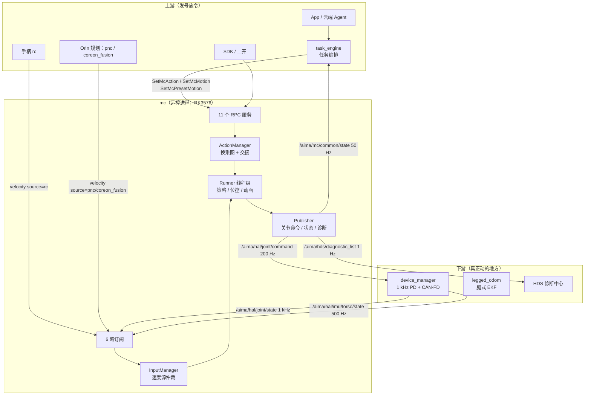
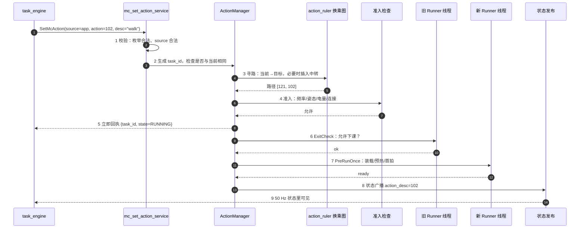
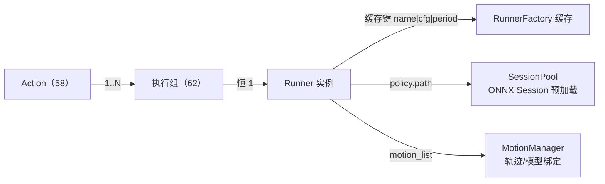
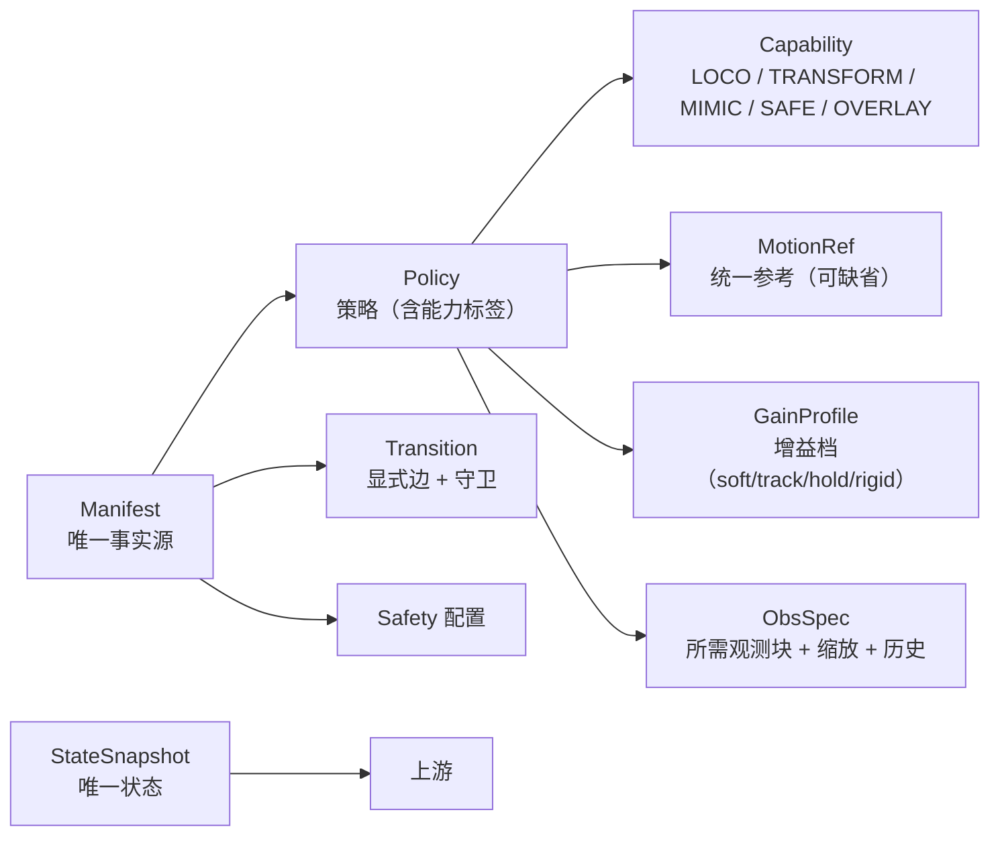
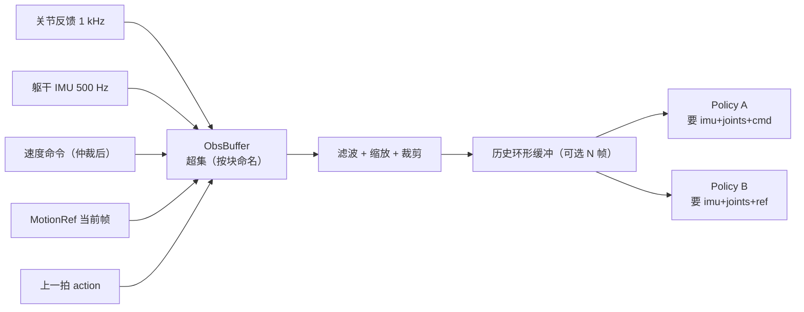
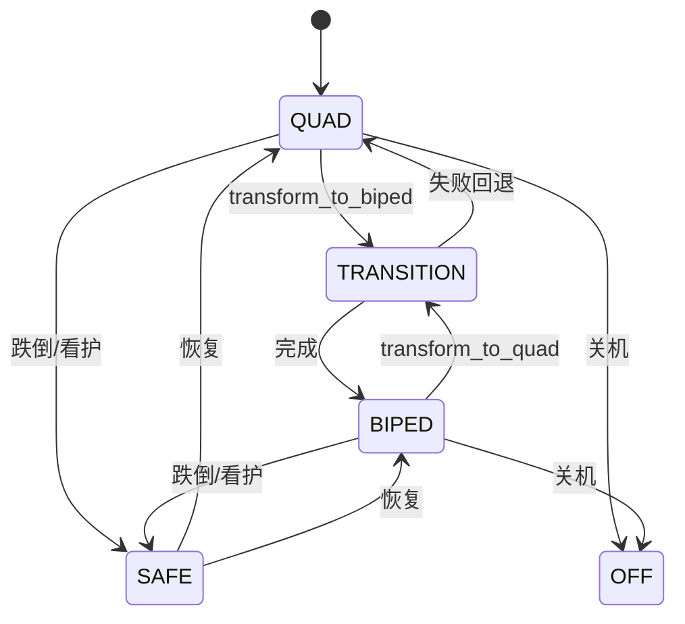
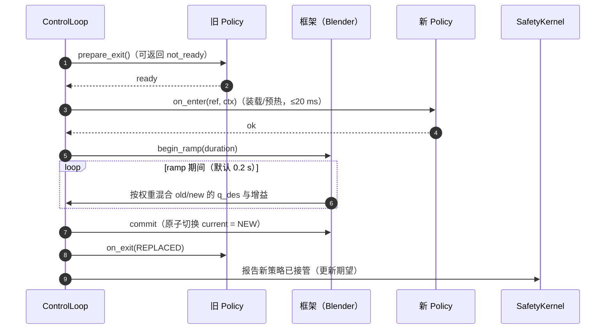
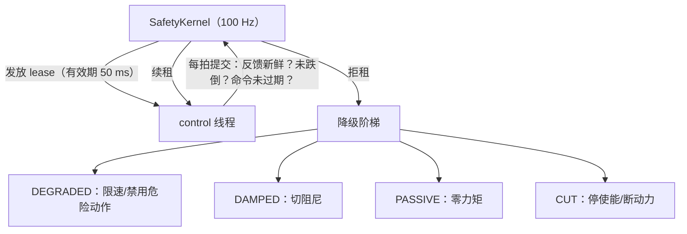

# T1 运控 MC 深度拆解 与 自主运控软件重建设计

> 版本 2026-11-12　｜　上游依据：真机配置 `mc_T1.yaml` / `action_*.yaml` / `security_guard.yaml`、真机日志 `mc.log`、接口定义 `aimdk_msgs`、`Design_T1Pro运控软件系统4+1架构设计简版.md`
> 本文分两部分：**Part I 把 T1 的 MC 拆到底**（接口、调用、切换、安全）；**Part II 给出一套我们自己的设计**（统一行走/变形/模仿，去复杂化）。

---

# Part I　T1 的 MC 是怎么搭的

## 1. MC 在系统中的位置



一句话：**MC 只有两种输入——"换动作"（RPC，离散）和"给速度"（话题，连续）；只有一种输出——关节命令。**

### 1.1 MC 的线程与执行器清单（谁在跑）

| 执行器/线程 | 数量 | 调度 | 绑定核 | 干什么 |
|---|---|---|---|---|
| `rt_joint_pub` | 1 | **SCHED_RR:80** | CPU3 | 关节命令发布（5 ms） |
| `rt_joint_sub` / `rt_imu_sub` | 各 1 | 普通 | CPU3 | 关节/IMU 反馈接收 |
| `rt_iceoryx_sub`（listener） | 1 | **SCHED_RR:80** | CPU3 | 共享内存零拷贝订阅 |
| `common_server` | **2** | 普通 | CPU3 | 11 个 RPC 服务 |
| `mc_sm_thread` | 1 | SCHED_OTHER | CPU3 | SM 模式订阅 |
| `com_data_pub` | 1 | 普通 | CPU3 | 状态发布（50 Hz） |
| `event_trace_pub` / `hds_pub` | 各 1 | 普通 | CPU3 | 事件/诊断（1 Hz） |
| `main_executor` | 1 | 普通 | CPU3 | 主逻辑 |
| `hds_executor` / `event_executor` | 各 1 | 普通 | — | 诊断/事件处理 |
| ROS2 plugin executor | **2** | MultiThreaded | CPU3 | RPC 与话题的 ROS2 后端 |
| **策略 Runner 线程** | 每执行组 1 | 按组 `priority`（多为 RR80） | 按组 `cpu_affinity`（空=继承） | 策略推理/位控/动画 |

实测该进程共 **36 个线程**，其中 3 条实时（RR）。
**注意**：Runner 线程名会随当前执行组变化（如 `passive_default_t0`、`rl_quad_locomotion_t0`、`animation_player_t1`），
所以"线程数"是稳定的，"线程名"不是。

## 2. 接口全清单

### 2.1 RPC 服务（11 个，`common_server` 执行器，ROS2 RPC 后端）

| # | 服务名 | 请求关键字段 | 响应 | 谁调用 | 语义 |
|---|---|---|---|---|---|
| 1 | `mc_set_action_service` | `source`, `McActionCommand{action, action_desc}` | `task_id`, `state` | task_engine / SDK / App | **换动作**（走换乘图） |
| 2 | `mc_get_action_service` | — | `McActionInfo` | 上层查询 | 当前动作与任务号 |
| 3 | `mc_set_motion_service` | `source`, `type`(MIMIC_QY=1/MIMIC_LC=2), `motion`, `model`, `resource`, `interrupt` | 同上 | task_engine | **播放全身动作**（模型 + 轨迹） |
| 4 | `mc_get_motion_service` | — | 动作状态 | 上层查询 | 当前 motion |
| 5 | `mc_set_preset_motion_service` | `source`, `area`, `preset`, `interrupt`, `ani_path` | 同上 | task_engine / App | **预设动作**（上肢动画） |
| 6 | `mc_get_preset_motion_state_service` | — | 预设动作状态 | 上层查询 | 播到哪了 |
| 7 | `mc_set_input_source_service` | 源名 | — | 上层 | 显式指定速度源 |
| 8 | `mc_get_current_input_source_service` | — | `McInputSource` | 上层 | 当前谁在控 |
| 9 | `mc_set_robot_runtime_model_service` | 模型/手/腰状态 | — | 上层 | 运行模型（手、腰） |
| 10 | `mc_get_robot_runtime_model_service` | — | `McRuntimeModel` | 上层 | 同上 |
| 11 | `mc_motion_record_service` | 录制参数 | — | 上层 | 动作录制 |

**响应统一结构**：`CommonTaskResponse{ header, uint64 task_id, CommonState state }`
——注意 `task_id` 是**异步任务号**，不是"执行完成"。

### 2.2 发布（5 个）

| 话题 | 类型 | 频率 | 执行器 | 用途 |
|---|---|---|---|---|
| `/aima/hal/joint/command` | `JointCommandArray` | **200（实测 5.1 ms）** | `rt_joint_pub` | 关节目标（position/velocity/effort/stiffness/damping） |
| `/aima/mc/common/state` | `McCommonState` | 50 Hz | `com_data_pub` | **唯一状态出口**（9 组字段） |
| `/robot/trace/events` | trace | 1 Hz | `event_trace_pub` | 事件追踪 |
| `/aima/hds/diagnostic_list` | 诊断 | 1 Hz | `hds_pub` | 健康上报 |
| `/aima/mc/action/info` | `McActionInfo` | 5 Hz（**已注释**） | `com_data_pub` | 当前动作（已并入 state） |

### 2.3 订阅（6 个）

| 话题 | 类型 | 频率 | `wait_ready` | 用途 |
|---|---|---|---|---|
| `/aima/hal/joint/state` | `JointStateArray` | 1 kHz | **true** | 14 关节反馈（pos/vel/effort/温度/电压） |
| `/aima/hal/imu/torso/state` | IMU | 500 Hz | **true** | 躯干姿态与角速度 |
| `/aima/mc/locomotion/velocity` | `McLocomotionVelocity` | 事件 | false | **速度指令**（7 个源 + 避障） |
| `/aima/mc/custom/joint/command` | `McCustomJointCommand` | 事件 | false | 上肢关节直接下发（按 name 匹配） |
| `/aima/mc/body_pose` | — | 事件 | false | 机身位姿（**已注释**） |
| `/aima/teleop_bridge/vr_data` | — | 事件 | false | VR 遥操作（**已注释**） |

订阅侧还有**三道时间校验**（每个反馈都配）：`pub_inter_frame_interval_ns`、`recv_inter_frame_interval_ns`、`pub_to_recv_delay_ns`，均 **10 ms**。

### 2.4 速度源（7 个配置 + 1 个硬编码）

| 源 | 优先级 | 超时 |
|---|---|---|
| `rc` | 80 | 1000 ms |
| `vr` | 70 | 1000 ms |
| `app_proxy` | **90** | 1000 ms |
| `interaction` | 80 | 1000 ms |
| `pnc` | 80 | 1000 ms |
| `app_proxy_t_mode` | **90** | 1000 ms |
| `insta360` | **90** | 1000 ms |
| `coreon_fusion`（代码内） | **100** | 500 ms |

### 2.5 关键消息结构（设计自有接口时直接对标）

```text
McLocomotionVelocity: header, source,
                      forward_velocity, lateral_velocity, angular_velocity,
                      pitch_velocity, level
McCommonState:        input_source, action_info, runtime_model, motion_status,
                      fsm_state, form_state, posture, is_moving
JointCommand:         name, position, velocity, effort, stiffness, damping
McCustomJointCommand: header, JointCommand[] joints   # 按 name 匹配
McActionStatus:       IDLE=0 / RUNNING=100 / TRANSITION=200
```

### 2.6 谁能干什么（权限矩阵）

| 能力 | task_engine | SDK/二开 | App（经 task_engine） | 手柄 rc | Orin 规划 | 说明 |
|---|---|---|---|---|---|---|
| 换动作 `SetMcAction` | ✅ | ✅ | ✅（间接） | ❌ | ❌ | 离散，受拓扑约束 |
| 播放全身动作 `SetMcMotion` | ✅ | ✅ | ✅（间接） | ❌ | ❌ | 模型 + 轨迹 |
| 预设动作 `SetMcPresetMotion` | ✅ | ✅ | ✅ | ❌ | ❌ | 上肢动画 |
| 给速度 | ✅ | ✅ | ✅ | ✅ | ✅ | 连续，受优先级约束 |
| 指定速度源 | ✅ | ✅ | ✅ | ❌ | ❌ | 强制切换输入源 |
| 运行模型（手/腰） | ✅ | ✅ | ✅ | ❌ | ❌ | 硬件形态相关 |
| 动作录制 | ✅ | ✅ | ❌ | ❌ | ❌ | 高级功能 |
| 查询状态 | ✅ | ✅ | ✅ | — | ✅ | 只读 |

**两条隐含规则**（T1 没写文档但代码如此）：

1. **速度可以多源并发**，靠优先级 + 占用窗口解决；**动作只有一个**，后到者排队或拒绝；
2. **rc 只能给速度，不能换动作**——所以"手柄切模式"实际是 App/任务层在转译。

## 3. 一次 `SetMcAction` 的完整链路（9 步）



**失败点与码**（这套码是 T1 的，记住它们的"域"）：

| 阶段 | 失败 | 返回 |
|---|---|---|
| 校验 | 非法枚举 | `state.value` 负码 |
| 寻路 | 无路径 | **-1001** |
| 准入 | 姿态不符 | **-1004** |
| 准入 | 频率过高 | **-10001** |
| 交接 | 旧 Runner 拒绝退出 | 保持原动作 + 负码 |

**关键设计事实**：RPC 在第 5 步就返回成功，**真正的切换在返回之后完成**（第 6~7 步）。
所以"接口返回 OK" ≠ "已经动起来了"，要看 `common/state` 的 `action_desc` 或 `McActionStatus`。

## 4. 模型 / 策略切换的机制拆解

### 4.1 四份配置各管一件事

| 文件 | 回答的问题 | 规模（真机） |
|---|---|---|
| `action_ruler.yaml` | 从 A 能不能到 B、要不要中转 | 52 节点 / 197 边 / 3 全局出口 / 24 禁跳 |
| `action_setting.yaml` | 这个动作挂几个执行组、周期多少 | 58 动作 / 62 执行组 |
| `action_state.yaml` | 状态分组、安全动作、恢复名单 | 6 组状态 / 9 个恢复动作 |
| `rl/*.yaml` + `motion_list.yaml` | 每组用哪个模型、哪条轨迹 | 48 配置 / 108 条 motion |

### 4.2 运行时的三层对象



**缓存键**：`name|cfg_path|period`。同一个 runner 名配不同周期会创建**两个实例**（例如 `animation_player|...|4` 与 `...|2`）。

**SessionPool 预加载**：启动时把常用模型预加载成 ORT Session（日志 `[SessionPool] Preloaded PRESET session`），换动作时直接换 session 指针，避免首次推理卡顿。

### 4.3 交接协议（T1 是"每个控制器自己实现"）

| 阶段 | 谁做 | 做什么 |
|---|---|---|
| `ExitCheck` | 旧 Runner | 判断"现在下课安不安全"（速度归零、脚落地、步数下限…） |
| `PreRunOnce` | 新 Runner | 首拍初始化：装载参数、置默认位、**可阻塞** |
| 周期运行 | 新 Runner | 按 `period_ms` 出关节目标 |
| 结束 | 新 Runner | `auto_next_actions` 决定是否自动切下一个 |

**问题**：`ExitCheck` 的判据分散在各控制器里（`exit_wait_stop_step`、`settle_timeout`、`step_gate`…），没有统一契约。

### 4.4 换乘图的三个"坑"

| 坑 | 现象 | 根因 |
|---|---|---|
| 不可达 | 返回 -1001 | 197 边只覆盖 13% 的组合 |
| 隐式中转 | 日志里突然出现 121/115 | 图寻路自动插站 |
| 禁跳 | 24 个动作被 skip 列表排除 | 某些动作只能"被离开"，不能"被直连" |

### 4.5 模型加载的实际行为（三个容易误解的点）

| 行为 | 真实情况 | 证据 |
|---|---|---|
| **会话池预加载** | 启动时把常用模型预加载为 ORT Session，日志 `[SessionPool] Preloaded PRESET session (new): t1_bi_wbc_pitch0522` | 【日志】 |
| **session 复用** | 同一个 onnx 被多个动作引用时，按 `模型名:onnx:cpu:PRESET:哈希` 复用同一个 session，不重复占内存 | 【日志】`SessionPool` 键 |
| **首次推理延迟** | 换到"没预加载"的模型时，第一次 `Run` 会包含图初始化开销（几十 ms 级）；这就是为什么要预加载 | 【推断】 |

**Runner 缓存键**是 `name|cfg_path|period` 三元组：同一个 `animation_player` 在 300 里是 `period=4`、在 301 里是 `period=2`，
因此会创建**两个 Runner 实例**——不是复用。这一点配置上容易看漏。

### 4.6 切换为什么慢：以四足→双足为例（4.8 s 的分解）

| 阶段 | 耗时 | 是不是计算 |
|---|---|---|
| RPC 校验 + 寻路 | ~1 ms | 计算（可忽略） |
| ExitCheck（旧策略等速度归零/脚落地） | 0.2~1.0 s | **物理等待** |
| PreRunOnce（装载、置位） | 10~50 ms | 计算 |
| 过渡动作 121/115（若有） | 0.4~1.0 s | **物理过程** |
| **变形策略本体** | **4.806 s（实测）** | **物理过程**（重心转移、关节大范围运动） |
| 落位到 WBC | ~10 ms | 计算 |

结论：**切换的"慢"99% 来自物理约束，不是软件**。所以优化软件（更快的寻路/更快的 RPC）几乎没有意义，
真正要优化的是"减少不必要的物理过渡"——这正是我们设计里用**显式 via + 更少中转**的动机。

## 5. 安全设计的拆解

### 5.1 八层 + 一条旁路

| 层 | 机制 | 周期 | 关键参数 |
|---|---|---|---|
| L0 | 电机/机构 | — | MIT p±10 / v±60 / t±60 / kp 0~500 / kd 0~10 |
| L1 | 命令与数据 | 每周期 | `cmd_guard 200 ms`、`custom_upper 200 ms`、数据超时 10 ms |
| L2 | 动作准入 | 事件 | 拓扑、姿态 ±0.12 rad、频率 |
| L3 | 姿态看护 | **50 ms** | 60°/3、6 rad/s+48°/3、脚 0.8/0.4/20 |
| L4 | 动作兜底 | 事件 | `PASSIVE`/`DAMPING` + 3 全局出口 + 恢复链 |
| L5 | 感知安全 | 10~30 Hz | 避障 priority 100 零速可抢 |
| L6 | 系统状态 | 事件 | SM 9 模式 × 10 功能组，EStop 只留 HAL+Diagnosis |
| L7 | 资源/进程 | — | 隔离核、cgroup、OOM 保护、重启上限 |
| L8 | 电源 | 事件 | 30/15/10% 提示，5% 趴下 |

### 5.2 旁路的四个守卫

| 守卫 | 触发 | 后果 |
|---|---|---|
| `security_guard` | 跌倒三通道 | 切 `DAMPING` |
| `cmd_guard` | 命令 >200 ms | 速度清零 |
| `custom_upper` | 上肢命令 >200 ms | 本周期不写 |
| `data_timeout` | 反馈 >10 ms | 告警 + HDS 上报 |

### 5.3 实测时延

| 事件 | 时延 |
|---|---|
| 跌倒判定 → 切换完成 | **11 ms** |
| 命令断流 → 清零 | ≤200 ms |
| 状态广播 → 上层可见 | ≤20 ms |
| 关节命令 → 电机 | ~1~2 ms |

## 6. T1 复杂度的十个来源（这是我们要去掉的东西）

| # | 来源 | 数字 |
|---|---|---|
| 1 | 动作枚举 | 61 个，实际配置 58 个 |
| 2 | 执行组 | 62 个，每个 1 个 runner |
| 3 | 轨迹载体 | 4 种（CSV 上肢 / CSV 全身 / NPZ / ONNX 内嵌） |
| 4 | 速度源 | 7 + 1 |
| 5 | 状态字段 | 5 个独立字段描述"现在在干嘛" |
| 6 | 错误码域 | 3 套（MC `state.value` / 任务 `reason` / `header.code`） |
| 7 | 超时 | 6 种（200/200/10/1000/1000/1000 ms） |
| 8 | 周期档 | 1/2/4/10/20/50 ms 六档 |
| 9 | 配置联动 | 4 份 YAML + motion_list，漏一处运行时才炸 |
| 10 | 交接逻辑 | 每个控制器自己实现 ExitCheck/PreRunOnce |


---

> **注（版本更新）**：Part II 里最初的"五种能力（LOCO/TRANSFORM/MIMIC/OVERLAY/SAFE）"模型，
> 已在《运控软件架构设计说明书（4+1 视图）》中**简化为"2 种模式 × 3 个作用域"**（CONTINUOUS/ONE_SHOT × ALL/LEGS/UPPER）。
> 对外交底与开发请以该文档为准；本文 Part II 保留作为**设计推演过程**的记录。

# Part II　我们自己的设计：一套统一的运控软件

## 7. 设计目标（先定约束，再谈架构）

| # | 目标 | 可度量指标 |
|---|---|---|
| G1 | **策略统一**：行走/变形/模仿共用一套接口、一套参考格式、一套增益 | 策略种类从 4 类载体收敛到 **1 种 manifest 描述** |
| G2 | **切换可解释**：任何一次切换都能在执行前拿到完整路径 | 100% 切换在响应里返回 `plan[]` |
| G3 | **无隐式中转**：不允许"自动插站" | 中转必须显式声明 `hub` 或 `via` |
| G4 | **安全单一权威**：只有一个模块能决定"进入安全态" | 安全态转移只有 1 个写者 |
| G5 | **失败可诊断**：一次拒绝给出唯一原因码 | 错误码 < 40 个，一对一映射 |
| G6 | **配置即契约**：启动即校验，错配不允许启动 | schema 校验 + 图连通性校验 |
| G7 | **实时可控**：控制环 100 Hz、单拍预算 ≤6 ms | p99 单拍 < 8 ms |
| G8 | **可演进**：加一个新动作 = 加一条 manifest，不改代码 | 新动作接入 ≤ 0.5 人日 |

**不做什么**（明确排除，避免又长成 T1）：

- 不做"每个执行组一条线程"（统一一条控制环）
- 不做"61 个动作枚举硬编码"（动作是数据，不是枚举）
- 不做"多种轨迹格式并存"（构建期统一编译）
- 不做"每个控制器自己实现退出判据"（框架统一交接协议）
- 不做"多套错误码域"（一套码表）

## 8. 领域模型：五个一等公民



**单一事实源原则**：所有"有哪些策略、怎么连、用哪个增益、要哪些观测"都写在**一份 `robot_manifest.yaml`** 里；
代码里不存在第二个真值（不像 T1 那样散在 4 份 YAML + 枚举 + 代码常量）。

### 8.1 与 T1 的映射（我们并不是从零发明）

| T1 概念 | 我们的对应 | 变化 |
|---|---|---|
| `Action`（61 枚举） | `Policy` + `capability` | 动作变成数据，不再占用枚举 |
| `执行组`（62） | **消失**：一条控制环 + `owns` 掩码 | 不再有"两组抢关节" |
| `Runner` | `Policy` 实现（.so / onnx / 内置） | 统一接口 |
| `motion_list` + CSV/NPZ | `MotionRef`（构建期编译产物） | 一种格式 |
| `action_ruler` 图 | `transitions[]`（显式边） | 不再自动插站 |
| `action_setting` 周期 | manifest 里 `rate_hz`（通常统一 100） | 周期不再自由 |
| `action_state` 分组 | `Mode` 枚举（QUAD/BIPED/TRANSITION/SAFE/OFF） | 收敛到 5 个 |
| `rl/*.yaml` 的 kp/kd | `GainProfile` 引用 | 不再逐配置抄 |

## 9. 统一策略接口

### 9.1 一个接口，五种能力

```cpp
// policy_api.h（我们的契约，稳定 ABI）
struct ObsBlock { const char* name; const float* data; size_t len; };

struct ObsView {                       // 框架提供的"观测只读视图"
  const ObsBlock* blocks; size_t n;    // 按名字取：imu/joints/prev_action/command/ref/contact/form
  uint64_t stamp_ns;
  bool fresh;                          // 反馈是否新鲜（由安全内核判定）
};

struct ActOut {                        // 策略输出（统一 4 段）
  float q_des[14];                     // 关节目标（位置）
  float dq_des[14];                    // 目标速度（轮子用）
  float tau_ff[14];                    // 前馈力矩（可选，重力补偿）
  float kp[14], kd[14];                // 增益（可选：缺省用 GainProfile）
  uint32_t owns;                       // 位掩码：本策略写哪些关节（解决"谁覆盖谁"）
  uint32_t flags;                      // 例如 DONE / FAULT / NEED_REF
};

class Policy {
public:
  virtual ~Policy() = default;
  virtual bool on_load(const PolicyDesc&, const RobotModel&) = 0;   // 启动期：校验 obs/action 契约
  virtual bool on_enter(const EnterCtx&) = 0;                       // 接管前：装载参考/预热
  virtual bool step(const ObsView&, ActOut&) = 0;                   // 每拍：必须 ≤ budget_ms
  virtual void on_exit(ExitReason) = 0;                             // 交出控制
  virtual PolicyStatus status() const = 0;                          // 进度/相位/剩余时间
};
```

**关键变化**：

| T1 | 我们 | 收益 |
|---|---|---|
| 每个控制器自己的 `ExitCheck`/`PreRunOnce` | 框架的 `prepare/ramp/commit/cleanup` | 退出判据统一，不再各自实现 |
| 多个 runner 写同名关节，靠"谁后写" | `owns` 掩码显式声明归属，冲突启动期报错 | 没有隐式覆盖 |
| 增益写在各 rl yaml | `GainProfile` 引用 | 改一次全局生效 |
| obs_index 逐配置手写 | `ObsSpec` 声明所需块，框架拼装 | 不会出现"维度对不上" |

### 9.2 观测：一份超集缓冲 + 声明式取用



好处：**策略只声明"我要哪些块、缩放多少、要几帧历史"**，拼装逻辑只有一份，不存在 T1 那种 46 份 `obs_index` 手工维护。

### 9.3 输出：统一四段 + 关节归属

```yaml
# manifest 片段：策略声明
- id: walk_v3
  capability: LOCOMOTION
  impl: { kind: onnx, path: models/walk_v3.onnx }
  rate_hz: 100
  obs: { blocks: [imu, joints, prev_action, command], history: 10,
         scales: { dof_vel: 0.05, ang_vel: 0.25, cmd: 2.0 }, clip: 20 }
  gains: track            # 引用 GainProfile
  owns: legs+wheels       # 位掩码：0b0000_0011_1111_1111
  limits: { tau: 30, dq: 20 }

- id: upper_anim
  capability: OVERLAY
  impl: { kind: keyframe, source: motions/upper/*.mref }
  rate_hz: 250
  owns: arms              # 只写 6 个上肢关节
  gains: soft
```

## 10. 统一参考格式：`MotionRef`

**问题**：T1 有四种载体（上肢 CSV、全身 CSV、NPZ、ONNX 内嵌），每种列的语义都不同，还各有各的 fps。
**方案**：定义一种运行时格式 `*.mref`，构建期把 CSV/NPZ/模型内嵌轨迹统一编译过来。

```yaml
# motions/dance_joyous.mref.yaml（可读版；构建时压成二进制）
id: dance_joyous
fps: 50
duration_s: 15.76
channels:
  joints:                       # 可选：关节参考
    names: [FL_HIP_ROLL, ..., RR_KNEE]
    pos: [[...], [...]]         # N × J
    vel: [[...], [...]]         # 可选
  base:                         # 可选：机身参考
    xyz: [[...]]                # N × 3
    rpy: [[...]]                # N × 3
    twist: [[...]]              # 可选 N × 6
  phase: [0.0 ... 1.0]          # 可选：相位
loop: false
events:                         # 可选：动作内事件（音效/灯光由上层订阅）
  - { t: 0.2, name: "beat" }
```

**三种来源如何编译**：

| 来源 | 编译规则 |
|---|---|
| 上肢 CSV（7 列） | 只填 `channels.joints`（6 个上肢关节），`base` 缺省 |
| 全身 CSV（28 列） | 填 `joints` + `base`，**由 manifest 声明"用哪些通道"** |
| NPZ（50 fps，17 刚体） | 填 `joints` + `base`（取根刚体）+ 可选 `bodies` |
| ONNX 内嵌轨迹 | **不编译**：策略自己生成参考，manifest 标 `ref: internal` |

**关键规则**：**"文件里有"不等于"会被用"**——manifest 显式声明 `use: [joints, base]`，未声明的通道在编译期丢弃并打印警告。
（T1 的四足 MIMIC 就是典型反例：CSV 里 12 个关节列，实际只用了 6 列基座位姿，没人知道。）

## 11. 状态机与切换

### 11.1 两级状态机



- **L1 `Mode`**：只有 5 个（QUAD / BIPED / TRANSITION / SAFE / OFF），由**安全内核与变换策略共同维护**；
- **L2 `PolicyState`**：`IDLE → PREPARING → RUNNING → DRAINING → DONE`，由框架维护。

### 11.2 转换是显式边，不是自动寻路

```yaml
transitions:
  - from: walk_v3
    to: dance_joyous
    via: [stand_hub]          # 必须显式声明中转
    guards: [velocity_zero, feet_down, mode_matches]
    blend: { ramp_s: 0.2, gain_crossfade: true }
    cost_ms: 400

  - from: "*"
    to: damp
    priority: emergency        # 任何状态都可直达（安全出口）
```

规则：

1. **没有 `via` 的两点之间不可直达**——请求会被拒（错误码 `POLICY-4091 NO_PATH`），而不是偷偷插站；
2. **响应必须返回完整 `plan[]`**（例如 `[walk_v3 → stand_hub → dance_joyous]`），调用方在执行前就知道要经过什么；
3. **`hub: true` 的策略**是唯一允许被自动插入的（如 `stand_hub`），数量控制在 1~2 个；
4. 安全出口用通配 `from: "*"`，优先级 `emergency`，不进普通规划。

### 11.3 统一交接协议（四步）



**与 T1 的差别**：T1 的 `ExitCheck` 是"旧控制器说能不能走"，我们把它标准化为 `prepare_exit()` 的三态返回（`ready / wait / refuse`），
并且**混合由框架做**，控制器不再需要自己写过渡逻辑。

## 12. 对外接口（我们的 IDL）

### 12.1 只有 5 个入口

```text
# 1) 连续控制（速度）
SetVelocity(source, vx, vy, wz, ttl_ms) -> { accepted, epoch }

# 2) 离散控制（换策略/换动作）
SetPolicy(req{capability, policy_id, motion_ref?, params?},
          opts{interrupt, via[], timeout_ms}) -> { task_id, plan[], state }

# 3) 查询
GetState() -> StateSnapshot
GetPlan(task_id) -> { phase, progress, remaining_ms }

# 4) 事件流
StreamState(topic, 50 Hz)   # 与 GetState 同结构
StreamEvents(topic)         # 切换/完成/故障/安全事件

# 5) 运维
SetSafety(command)          # 只有内核能执行；外部只能 request
```

### 12.2 `StateSnapshot`：一个结构说清"现在在干嘛"

```yaml
StateSnapshot:
  stamp_ns, seq
  mode: QUAD | BIPED | TRANSITION | SAFE | OFF
  policy: { id, capability, state, progress, remaining_ms }
  motion: { id, phase, loop }
  velocity: { vx, vy, wz, source, age_ms, epoch }
  safety: { level: NORMAL|DEGRADED|DAMPED|PASSIVE|CUT, reason, since_ns }
  health: { feedback_age_ms, cpu_pct, overrun_count }
```

**替代 T1 的 5 个字段**（action/input_source/motion_status/fsm_state/form_state）——一个结构、一次读取、不会不一致。

### 12.3 一套错误码（目标 < 40 个）

```text
MC-<DOMAIN>-<NNNN>
DOMAIN: REQ / POLICY / MOTION / SAFETY / IO
例：
  MC-REQ-4001    参数非法
  MC-POLICY-4041  策略不存在
  MC-POLICY-4091  无可达路径（附 plan 为空的原因）
  MC-POLICY-4092  守卫不满足（附具体哪个 guard）
  MC-POLICY-4093  忙（正在切换中）
  MC-MOTION-4221  参考轨迹版本不匹配
  MC-SAFETY-5001  当前处于安全态，拒绝普通请求
  MC-IO-6001      反馈超时
```

## 13. 线程与实时模型（比 T1 少一半线程）

| 线程 | 频率 | 优先级 | 核 | 职责 |
|---|---|---|---|---|
| `control` | **100 Hz** | RR80 | CPU3 | 观测拼装 → 策略 step → 混合 → 写命令 |
| `safety` | **100 Hz** | **RR85** | CPU3 | 看护、租约、故障判定 |
| `publish` | **200 Hz** | RR80 | CPU3 | 关节命令发布（5 ms） |
| `io` | 事件 | 普通 | CPU2 | 订阅反馈/速度、RPC 服务 |
| `log` | 10 Hz | 普通 | CPU2 | 状态/诊断/事件 |

**关键**：
- **没有 per-policy 线程**——所有策略在 `control` 里顺序执行（同一拍内），叠加用 `owns` 掩码；
- **safety 优先级高于 control**（T1 是同级），保证看护不被推理挤掉；
- 单拍预算：`obs 1 ms + policy ≤5 ms + blend 0.5 ms + publish 0.2 ms`。

## 14. 安全内核（SafetyKernel）

### 14.1 核心机制：许可租约（lease）



**规则**：`control` 每拍必须持有**未过期 lease** 才能写关节命令；没有 lease 就写"安全默认值"（阻尼）。
这样把 T1 里分散的"超时/跌倒/命令过期"统一成一个机制：**它们都表现为"租约不续"**。

### 14.2 四级阶梯与触发条件

| 级别 | 触发 | 行为 | 恢复 |
|---|---|---|---|
| NORMAL | — | 正常 | — |
| DEGRADED | 反馈延迟 >10 ms、CPU 过载、单拍超期 3 次 | 限速 50%、禁用高冲击策略 | 自动（连续 1 s 正常） |
| DAMPED | 跌倒三通道命中、命令断流 >200 ms、租约丢失 | 切阻尼策略 | 需显式恢复 |
| PASSIVE | 人工急停、严重故障 | 零力矩 | 人工 |
| CUT | EStop / 硬件故障 | 停使能（若硬件支持） | 人工 + 重启 |

**单一写者**：只有 `safety` 线程能推进阶梯；`control` 只能"请求"（例如策略自检失败可 request DAMPED）。

### 14.3 与 T1 的对照

| 能力 | T1 | 我们 |
|---|---|---|
| 跌倒判定 | 50 ms 三通道 | **同算法**，但由 safety 线程统一持有 |
| 命令过期 | `cmd_guard 200 ms` 清零 | 表现为 lease 不续 → DAMPED |
| 上肢超时 | `custom_upper 200 ms` | overlay 策略无新帧即"不写"，由 `owns` 掩码自动回落 |
| 数据超时 | 10 ms 告警 | 10 ms 不进 lease → DEGRADED |
| 安全动作 | `PASSIVE`/`DAMPING` | 阶梯的 DAMPED/PASSIVE 两级（同一套实现） |
| 恢复 | `recovery_behaviors` 名单 | `SAFE` 模式下允许的 `transitions` 白名单 |

## 15. 配置与部署：一份 manifest + schema

```yaml
# robot_manifest.yaml（节选）
robot: { model: T1Pro, dof: 14, wheels: [9, 13] }
io:
  control_rate_hz: 100
  publish_rate_hz: 200
  feedback_timeout_ms: 10
safety:
  fall: { delta_deg: 60, count: 3, gyro_rps: 6.0, gyro_delta_deg: 48, gyro_count: 3 }
  cmd_ttl_ms: 200
  ladder: { degraded_hold_s: 1, damp_on_lease_miss: true }
gains:
  soft:  { kp: [4,2,4,4,2,4], kd: 0.2, gravity: 0.9 }
  track: { kp: [30,...,100], kd: [1.0,...,1.5] }
  hold:  { kp: 30, kd: 1.0, gravity: 1.0 }
policies:
  - id: passive
    capability: SAFE
    impl: { kind: builtin }
    owns: all
  - id: damp
    capability: SAFE
    impl: { kind: builtin, kd_scale: 1.0 }
    owns: all
  - id: stand_hub
    capability: TRANSFORM
    impl: { kind: onnx, path: models/stand_hub.onnx }
    hub: true
    gains: track
  - id: walk_v3
    capability: LOCOMOTION
    impl: { kind: onnx, path: models/walk_v3.onnx }
    obs: { blocks: [imu, joints, prev_action, command], history: 10 }
    gains: track
  - id: transform_q2b
    capability: TRANSFORM
    impl: { kind: onnx, path: models/q2b.onnx }
    phase: { duration_s: 4.8, check: gravity_envelope }
  - id: dance_joyous
    capability: MIMIC
    impl: { kind: onnx, path: models/mimic_generic.onnx }
    ref: { kind: mref, path: motions/dance_joyous.mref, use: [joints, base] }
  - id: upper_anim
    capability: OVERLAY
    impl: { kind: keyframe, path: motions/upper/wave.mref }
    owns: arms
    gains: soft
```

### 15.1 启动自检（fail-fast，不允许"带病启动"）

```text
1. schema 校验（字段/类型/必填）
2. 引用完整性：policies ↔ gains ↔ motions ↔ transitions
3. 图校验：每个 policy 可达 passive/damp（安全出口）；无孤立节点
4. 观测契约校验：obs 块存在、维度匹配、history ≤ 缓冲
5. 动作契约校验：owns 掩码不重叠（除声明的 overlay）
6. 参考校验：mref 的 fps/长度/关节名匹配
7. 资源校验：onnx 存在、opset 支持、输入输出形状匹配
任一项失败 → 拒绝启动并打印"哪一条 + 如何修"
```

## 16. 与 T1 的取舍对照

| 维度 | T1 | 我们 | 为什么改 |
|---|---|---|---|
| 动作表达 | 61 个枚举 + motion 名 + preset | **manifest 里的 policy 条目** | 加动作不改代码 |
| 执行组 | 62 组 / 每组一线程 | **1 条控制环 + owns 掩码** | 消除"谁覆盖谁" |
| 周期 | 1/2/4/10/20/50 六档 | **统一 100 Hz**（overlay 可 250） | 调度与验证简单 |
| 轨迹 | CSV/NPZ/ONNX 内嵌 | **mref 单一格式** | 列语义不再靠猜 |
| 切换 | 自动寻路 + 隐式中转 | **显式 via + 返回 plan** | 可预测、可审计 |
| 交接 | 各控制器自定义 | **prepare/ramp/commit/cleanup** | 行为一致 |
| 增益 | 散在 46 份 yaml | **GainProfile 引用** | 改一处生效 |
| 状态 | 5 个字段 | **1 个 StateSnapshot** | 不会不一致 |
| 安全 | 分散 8 层 + 4 守卫 | **SafetyKernel + lease + 阶梯** | 单一权威 |
| 错误码 | 3 套域 | **1 套 5 段码** | 一眼定位 |
| 速度源 | 7 + 1，优先级 70~100 | **保留优先级模型，源收敛到 4 个**（rc / app / auto / safety） | 少而清晰 |

**保留 T1 的好东西**（不要为了"统一"丢掉）：

1. 速度通道与动作通道解耦（这是核心洞察）；
2. 换乘图思想（收窄为显式边）；
3. 跌倒三通道算法（直接用）；
4. 避障优先级 100 + 零速可抢；
5. 隔离核 + SCHED_RR（硬件层不变）；
6. 统一的 50 Hz 状态出口（我们做成 snapshot）。

## 17. 迁移与验收

### 17.1 三阶段

| 阶段 | 目标 | 交付 |
|---|---|---|
| **P1 适配** | 用新接口包住 T1 现有策略 | `policy_api` + 3 个适配器（onnx / keyframe / builtin）；不改算法 |
| **P2 统一** | 轨迹统一为 mref，增益统一为 profile | 编译工具 `mrefc`；46 份 yaml → 1 份 manifest |
| **P3 收敛** | 换掉自动寻路与 per-group 线程 | 新状态机 + SafetyKernel 接管 |

### 17.2 验收指标

| 指标 | 目标 |
|---|---|
| 切换时延（请求→新策略首拍） | p99 ≤ 150 ms（不需预热）/ ≤ 600 ms（需预热） |
| 跌倒判定→阻尼 | ≤ 50 ms |
| 单拍耗时 | p99 ≤ 8 ms |
| lease 丢失率 | < 1e-6 |
| 配置错配导致的现场故障 | **0**（启动期拦截） |
| 新增一个模仿动作 | ≤ 0.5 人日（加 manifest + mref） |

### 17.3 测试矩阵

| 层 | 测试 | 通过标准 |
|---|---|---|
| 配置 | schema + 图 + 契约 | 全部非法配置被拒，且报错可读 |
| 单元 | 每个 policy 的 obs/act 契约 | 形状/量纲/掩码正确 |
| 回放 | 用 T1 日志回放 | 轨迹误差 < 阈值 |
| 故障注入 | 杀 cmd / 冻结反馈 / 拔网 / 推倒 | 阶梯按预期升级，无越级/无卡死 |
| 长跑 | 8 h | 无内存增长、无 lease 漂移 |

## 18. 风险与开放问题

| 风险 | 说明 | 缓解 |
|---|---|---|
| 统一 100 Hz 不够 | 某些高速动作可能需要 200 Hz | 预留 `rate_hz` 覆盖，但默认统一 |
| overlay 与主策略耦合 | 上肢 250 Hz、下肢 100 Hz 不同步 | 插值在框架做，`owns` 保证不冲突 |
| 显式 via 不够灵活 | 用户可能想要"随便切" | 提供 `plan` 预演接口，上层决定是否接受 |
| 迁移期双栈 | 旧 T1 策略与新框架并存 | P1 适配器隔离，接口不变 |
| 安全内核性能 | 100 Hz + 三通道 | 与 T1 同量级（实测 11 ms 内完成切换） |
| 团队习惯 | 习惯了"加个枚举就能加动作" | manifest + 代码生成，体验更好 |

---

## 19. 参考实现骨架（目录与模块）

```text
mc2/                              # 我们的运控进程
├── api/                          # 稳定 ABI（policy_api.h / state_snapshot.h）
├── core/
│   ├── manifest.{h,cc}           # 解析 + schema 校验 + 图校验
│   ├── obs_buffer.{h,cc}         # 超集观测 + 滤波/缩放/历史
│   ├── control_loop.{h,cc}       # 100 Hz：拼观测→step→混合→写命令
│   ├── blender.{h,cc}            # 交接混合（q_des / 增益交叉淡化）
│   ├── fsm.{h,cc}                # L1 Mode + L2 PolicyState
│   └── registry.{h,cc}           # policy 加载（onnx / keyframe / builtin）
├── safety/
│   ├── kernel.{h,cc}             # 100 Hz 看护 + lease + 阶梯
│   └── guards.{h,cc}             # 跌倒/超时/过温/命令年龄
├── io/
│   ├── sub_{joint,imu,velocity}.cc
│   ├── pub_joint_command.cc      # 200 Hz
│   ├── pub_state.cc              # 50 Hz
│   └── rpc_service.cc            # SetVelocity / SetPolicy / GetState
├── tools/
│   ├── mrefc                     # CSV/NPZ → .mref 编译器
│   └── mcctl                     # validate / plan / replay / bench
└── manifest/
    ├── robot_manifest.yaml
    └── schema/robot_manifest.schema.json
```

**关键工程约定**：

1. `api/` 只依赖标准库，保证策略实现与框架解耦；
2. `core/` 不含任何 IO，纯逻辑，可单测；
3. `safety/` 不允许依赖 `core/`（避免"安全逻辑被业务带偏"）——只通过 `StateSnapshot` 读取；
4. `tools/mcctl validate` 进 CI，**配置不合法直接失败**；
5. 所有周期常量集中在 manifest，代码里不允许出现魔法数字。

## 20. 90 天落地计划

| 周 | 目标 | 产出 | 验收 |
|---|---|---|---|
| 1~2 | 冻结接口 | `policy_api.h` + `StateSnapshot` + 错误码表 | 评审通过，签字 |
| 3~4 | manifest + 校验 | schema、`mcctl validate`、图校验 | 用 T1 现有配置反推一份 manifest，校验通过 |
| 5~6 | 控制环骨架 | obs_buffer + control_loop + 发布 | 空策略跑通 100/200 Hz，抖动 < 1 ms |
| 7~8 | 适配 T1 策略 | onnx 适配器 + 2 个动作（walk/damp） | 回放误差 < 阈值 |
| 9~10 | 交接与混合 | prepare/ramp/commit + blender | 切换无跳变（力矩尖峰 < 1.5×） |
| 11 | 安全内核 | lease + 阶梯 + 三通道跌倒 | 故障注入全部按预期降级 |
| 12 | 轨迹统一 | `mrefc` + 3 个 mimic 动作 | 与 T1 同动作目视一致 |
| 13 | 压测与文档 | 8 h 长跑 + 运维手册 | lease 丢失 0、无内存增长 |

## 附录 A　T1 接口速查（移植时对照）

| 方向 | 名称 | 类型 |
|---|---|---|
| RPC | `mc_set_action_service` | SetMcAction |
| RPC | `mc_get_action_service` | GetMcAction |
| RPC | `mc_set_motion_service` | SetMcMotion |
| RPC | `mc_get_motion_service` | GetMcMotion |
| RPC | `mc_set_preset_motion_service` | SetMcPresetMotion |
| RPC | `mc_get_preset_motion_state_service` | GetMcPresetMotionState |
| RPC | `mc_set_input_source_service` | SetInputSource |
| RPC | `mc_get_current_input_source_service` | GetCurrentInputSource |
| RPC | `mc_set_robot_runtime_model_service` | SetRobotRuntimeModel |
| RPC | `mc_get_robot_runtime_model_service` | GetRobotRuntimeModel |
| RPC | `mc_motion_record_service` | MotionRecord |
| pub | `/aima/hal/joint/command` | JointCommandArray @200 Hz |
| pub | `/aima/mc/common/state` | McCommonState @50 Hz |
| pub | `/aima/hds/diagnostic_list` | 诊断 @1 Hz |
| pub | `/robot/trace/events` | trace @1 Hz |
| sub | `/aima/hal/joint/state` | JointStateArray @1 kHz |
| sub | `/aima/hal/imu/torso/state` | IMU @500 Hz |
| sub | `/aima/mc/locomotion/velocity` | McLocomotionVelocity |
| sub | `/aima/mc/custom/joint/command` | McCustomJointCommand |

## 附录 B　我们的接口速查（实现时对照）

| 方向 | 名称 | 说明 |
|---|---|---|
| RPC | `SetVelocity` | 连续控制，带 ttl 与 epoch |
| RPC | `SetPolicy` | 离散控制，返回 plan[] |
| RPC | `GetState` / `GetPlan` | 查询 |
| RPC | `SetSafety` | 仅内核执行，外部只能 request |
| pub | `StateSnapshot` @50 Hz | 唯一状态 |
| pub | `Events` | 切换/完成/故障/安全 |
| pub | `JointCommand` @200 Hz | 与 T1 同构，便于复用 device_manager |
| sub | `JointState` / `ImuState` | 反馈 |
| sub | `MotionRefStream` | 可选：外部实时推参考 |
