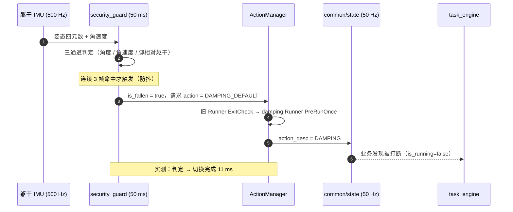
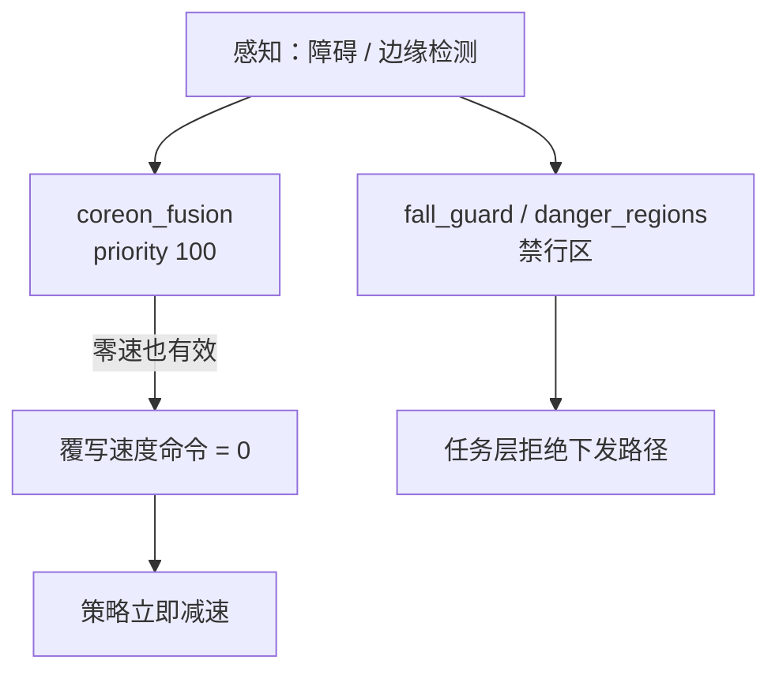
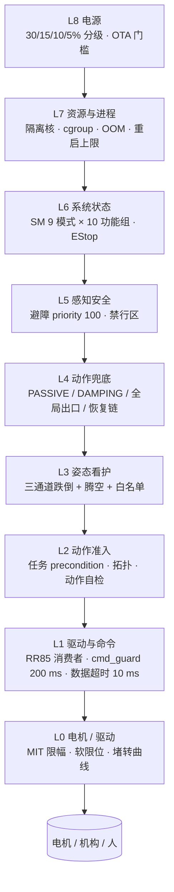
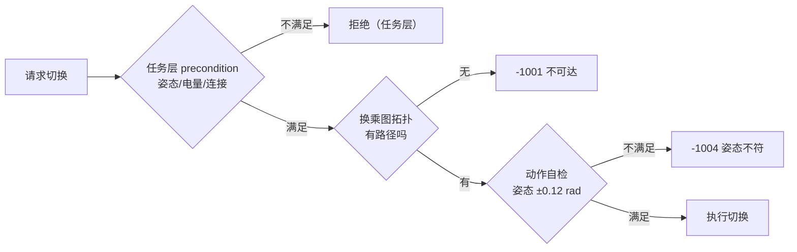
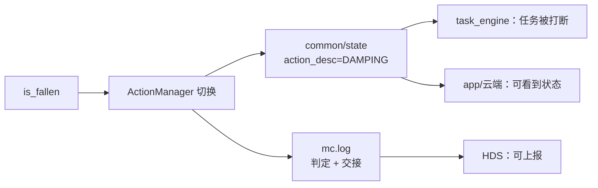

# T1 Pro 运控安全设计详解（4+1 视图）

> 版本：2026-11-11　｜　依据：真机配置 + 真机日志实测 + `Design_T1Pro运控软件系统4+1架构设计简版.md`
> 定位：**这份文档只讲安全**，把散落在 mc / task_engine / SM / HDS / sys_guard / Orin 各处的保护串成一条链。

## 0. 怎么读这份文档

### 0.1 一句话

T1 的安全不是"一个急停按钮"，而是**八层纵深 + 四条独立触发路径 + 一张故障兜底表**：
任何一层失守，下一层仍在；任何一条路径命中，都能在"不依赖正常业务链"的情况下把机器带回受控状态。

### 0.2 与其它文档的关系

| 文档 | 回答什么 | 证据性质 |
|---|---|---|
| `Design_T1Pro运控软件系统4+1架构设计简版.md` | **设计意图**：为什么这么分层、模块怎么交互 | 官方设计文档 |
| **本文** | **落地还原**：配置里到底怎么写的、日志里到底怎么跑的 | 配置 + 日志 + 实测 |
| `T1运控架构详解.md` | 全栈架构（安全只是其中第 10 章） | 综合 |

两者不一致时，**以本文的配置/日志为准**，并会标注设计文档的说法。

### 0.3 证据分级（全文统一）

| 标记 | 含义 |
|---|---|
| 【配置】 | 直接来自板端 YAML（`security_guard.yaml`、`action_state.yaml`、`task_rules.yaml`、SM 配置等） |
| 【日志】 | 来自 `mc.log` 等真机日志原文 |
| 【实测】 | 由日志时间戳算出的时延/周期 |
| 【设计】 | 来自 4+1 设计文档，未在配置中直接找到 |
| 【推断】 | 由多条证据推出的解释，未直接验证 |

---

## 1. 安全目标与失效模型

### 1.1 五类危险后果

| 编号 | 危险 | 典型场景 | 最坏后果 |
|---|---|---|---|
| H1 | **跌倒** | 被推、打滑、台阶、步态失稳 | 摔机、砸人、关节撞地 |
| H2 | **失控运动** | 指令断流后继续走、速度源抢占、遥控丢包 | 冲撞、坠楼 |
| H3 | **过力/过速** | 堵转、撞障碍、参数被误改 | 烧电机、断结构件、伤关节 |
| H4 | **夹伤/碰撞** | 变形时有人靠近、手臂挥动 | 人员受伤 |
| H5 | **卡死/失联** | 进程崩溃、内存耗尽、CPU 被抢 | 机器人"僵住"或"乱动" |

### 1.2 失效 → 防线 对应表

| 失效 | 谁先发现 | 第一道防线 | 兜底 |
|---|---|---|---|
| 姿态失稳 | `security_guard`（50 ms） | 三通道跌倒判定 → 切 `DAMPING` | `recovery_behaviors` 恢复链 |
| 指令断流 | `cmd_guard` / `custom_upper` | 200 ms 超时清零 | 策略看到 0 指令 → 自动减速站立 |
| 人工急停 | rc 双键 / App / SM | `PASSIVE`（零力矩）或 `DAMPING` | SM `EStop` 模式停掉 `mc` |
| 前方障碍 | `coreon_fusion`（priority 100） | 零速覆写（可越过所有人） | 上层重规划 |
| 边缘/跌落风险 | `fall_guard`（感知侧） | `danger_regions` 禁行 | 任务层拒绝路径 |
| 堵转/过力 | 驱动器 + `tau_limit` | MIT 力矩上限、PD 力矩裁剪 | 关节软限位 |
| 变形中失稳 | `transform_fall_check` | 重力包络超限（30°/40°，2 帧）判失败 | 回退姿态 |
| 进程卡死 | `sys_guard` / `pm` | cgroup 权重、重启上限、OOM 保护 | SM 降级 / 重启 |
| 电量耗尽 | 任务层 + 语音 | 30/15/10% 分级提示，5% 趴下 | 低电禁任务 |

### 1.3 五条设计原则

1. **纵深**：每层独立可失效，不依赖上一层"一定对"。
2. **旁路**：安全判断不在 10 ms 控制环里，避免被业务拖慢。
3. **失效安全（fail-safe）**：默认态是"卸力/阻尼"，不是"保持上次指令"。
4. **可观测**：每次干预都留痕（`common/state`、HDS 上报、日志）。
5. **宁可重复不可丢失**：同一保护可被多条路径触发（例如恢复动作冗余下发）。

---

## 2. 场景视图：六条异常路径

### 2.1 场景 A：跌倒



**实测时间线**（2026-10-28 15:26）：

| 时刻 | 事件 |
|---|---|
| 15:26:15.664554 | 看护判定命中 |
| 15:26:15.675410 | 切换到 damping 完成（**+11 ms**） |
| 15:26:15.680 | `common/state` 广播 |
| 15:26:15.684 | 业务侧发现被打断 |

**注意顺序**：先换动作，业务最后才知道。所以"业务日志里看到被打断"必然晚于"看护日志里看到跌倒"。

### 2.2 场景 B：指令断流


关键点：**网络看到的是 0 指令，不是"没有指令"**。所以行为是"平稳停下"，而不是"保持最后速度"。

### 2.3 场景 C：人工急停（三种入口）

| 入口 | 操作 | 效果 | 证据 |
|---|---|---|---|
| **手柄双键** | `LB+RB` | `PASSIVE_DEFAULT`（零力矩，瘫软） | 【设计】 |
| **手柄双键** | `LT+RT` | `DAMPING_DEFAULT`（阻尼，缓慢倒下） | 【设计】 |
| **系统模式** | 切 `EStop` 模式 | **停掉 `mc` 与 `task_engine`**，只留 `HAL`+`Diagnosis` | 【配置】SM |
| **软件接口** | `SetMcAction` 到安全动作 | 走正常动作通道（受拓扑约束） | 【配置】 |

`EStop` 模式的功能组配置原文：

```yaml
EStop:
  next_mode_list: [Ready, OTA]
  active_FG_list: [HAL, Diagnosis]
```

也就是说：**进入 EStop 后，运控进程本身被停**，此时电机侧靠驱动器/断电行为兜底——这是"最狠"的一级，也是为什么它只保留诊断。

### 2.4 场景 D：障碍与边缘



两个要点：

- **零速可抢占**：其他所有速度源"零速不能抢方向盘"，唯独 `coreon_fusion` 可以——这是为避障留的特权；
- **两套机制**：`coreon_fusion` 管"眼前"，`danger_regions` 管"规划层别往那走"。

### 2.5 场景 E：变形中失稳

变形（四足⇄双足）是全程最脆弱的窗口：接触点变化、重心抬升、舵机动作。

| 保护 | 参数 | 证据 |
|---|---|---|
| 任务准入 | 顶部 1.2 m 空间、障碍 0.4 m、回转半径 0.3 m、电量 ≥5% | 【设计】 |
| 拓扑校验 | 只允许从"行走档位"发起 | 【配置】 |
| 重力包络守护 | 偏离参考 30°/40°，连续 2 帧判失败 | 【设计】 |
| 落位门控 | WBC 退出需速度归零 + 步数下限 | 【配置】`exit_wait_stop_step` |

### 2.6 场景 F：极限动作与超速（容易被忽略的一层）

这一层不防"跌倒"，防的是"**人把机器用到超出寿命/能力**"：

| 机制 | 参数 | 说明 |
|---|---|---|
| 极限动作次数配额 | 30 天内 **30 次**；全生命周期 **720 次**，**648 次**预警 | 空翻/跳跃这类高冲击动作 |
| 高速解锁（双足） | 里程 0 / 3000 / 6000 / 9000 m → 限速 **1.6 → 1.9 → 2.2 → 2.5 m/s** | 新手不给全速 |
| 高速解锁（四足） | 同上 → **1.6 → 2.0 → 2.5 → 3.0 m/s** | 同上 |
| 状态持久化 | `/robot/persist/config/high_speed_unlock_state.json` | 重启不丢 |

【配置】`task_engine/cfg/extreme_action_progress.yaml`

> 这是很"产品化"的设计：**安全不只是防摔，还包括限制使用强度**。

---

## 3. 逻辑视图：八层防线

### 3.1 全景



### 3.2 L0：电机与机构

| 项 | 值 | 证据 |
|---|---|---|
| MIT 量程 | 位置 ±10 rad、速度 ±60 rad/s、力矩 ±60 N·m、kp 0~500、kd 0~10 | 【配置】`mit_params` |
| 关节软限位 | 例：髋 roll ±0.4712、pitch −1.2217~4.3633、膝 ±2.618 rad | 【配置】`min/max_limits` |
| PD 力矩裁剪 | `clip_tau` 只约束 PD 纠偏力矩，重力前馈不受限（如 1.0/1.0/0.5 N·m） | 【配置】 |
| 堵转特性 | 驱动器 TN 曲线 | 【设计】 |
| 腰部舵机 | 运动 40% 力矩、到位 25% 保持（防冲击/防堵转发热） | 【设计】 |

### 3.3 L1：驱动与命令

| 保护 | 参数 | 作用 |
|---|---|---|
| 指令消费者最高优先级 | `rt_joint_pub` RR80、iceoryx 订阅 RR85 | 保证电机指令不被业务饿死 |
| 命令过期 | `cmd_guard 200 ms` | 速度命令断流 → 清零 |
| 上肢命令过期 | `custom_upper 200 ms` | 上肢指令断流 → 本周期不写 |
| 数据超时 | IMU/关节 **10 ms** | 反馈不新鲜 → 告警 |
| 诊断上报 | HDS 每 **1000 ms** | 上报节奏 |

### 3.4 L2：动作准入（三道门）



任务层 precondition 的真实字段（【配置】`task_rules.yaml`）：

```yaml
precondition:
  allow_posture: []
  block_posture: [DAMPING_DEFAULT]
  battery_min_percent: 30
  allow_charging_state: false
  check_app_conn: true
  check_network: true
```

### 3.5 L3：姿态看护（安全层里唯一的"在线算法"）

**周期**：50 ms（`security_guard` 组）。**先看白名单**：当前动作不在监护名单里就直接跳过（双足 14 个、四足 19 个）。

```text
每 50 ms:
  if current_action ∉ monitored_actions[form]: 跳过
  up    = 姿态 × 基准轴          # 双足取 x、四足取 z
  delta = angle(up, up_stand)     # 度
  ω     = 躯干角速度模长

  ch1 = delta > 60.0                      连续 3 次
  ch2 = |ω| > 6.0 且 delta > 48.0          连续 3 次
  ch3 = 仅双足：|脚-躯干 z| > 0.8 或 |x| < 0.4   连续 20 次

  复位：用 stand_arm_delta(45°) 迟滞回位【推断】
  触发：任一通道达标 → is_fallen → 切 DAMPING
```

| 参数 | 值 | 含义 |
|---|---|---|
| `fall_delta_threshold` | 60° | 角度通道阈值 |
| `fall_count_threshold` | 3 | 连续命中次数 |
| `gyro_norm_threshold_rad_s` | 6.0 rad/s | 角速度阈值 |
| `fall_delta_soft_threshold` | 48° | 角速度通道的软角度阈值 |
| `gyro_fall_count_threshold` | 3 | 角速度通道次数 |
| `biped_horizontal_abs_max` | 0.8 m | 脚-躯干水平超限 |
| `biped_vertical_abs_min` | 0.4 m | 脚-躯干竖直塌缩 |
| `count_threshold`（脚） | 20 | 脚部通道次数 |
| `stand_arm_delta` | 45° | 复位迟滞 |

**为什么通道 2 的角度阈值更低**：猛推时角速度先冲起来，角度还没到 60°，用"角速度大 + 角度中等"能提前 1~2 个周期发现。

**为什么通道 3 只有双足**：配置里只填了 `RL_FOOT_Link`/`RR_FOOT_Link`，四足没配脚链接。

### 3.6 L4：动作兜底

| 机制 | 内容 |
|---|---|
| 两个安全动作 | `PASSIVE_DEFAULT`（零力矩）、`DAMPING_DEFAULT`（阻尼） |
| 三个全局出口 | `PASSIVE` / `DAMPING` / `QUAD_LIE_DOWN`，任何状态 1 跳可达 |
| 安全动作配置 | `estimator.secure_action = DAMPING_DEFAULT` |
| 恢复链 | `DAMPING → PASSIVE → QUADRUPED_RECOVERY → STEP → STAND` |
| 恢复白名单 | `recovery_behaviors.actions` 9 个动作 |
| 恢复判据 | 姿态误差达标且**稳定 1 s** |

### 3.7 L5：感知安全

| 机制 | 参数 |
|---|---|
| 避障覆写 | `coreon_fusion` priority **100**，零速也接受，占用窗口 500 ms |
| 速度源心跳 | 各源 1000 ms 超时失权 |
| 边缘守卫 | `fall_guard/danger_regions`（感知侧） |
| 变形后布局切换 | 避障布局 dog↔human 随形态切换 |

### 3.8 L6：系统状态

| 模式 | 激活功能组 | 含义 |
|---|---|---|
| Startup / OpenBox / Ready | HAL, Business, Diagnosis, Motion, OTA | 正常 |
| Business | 上述 + Perception | 业务运行 |
| **EStop** | **HAL, Diagnosis** | 运控与任务都停 |
| OTA | OTA | 只留升级 |
| Shutdown | HAL, Business, Poweroff | 关机流程 |
| Standby/IdlePowerSave | 同 Ready | mc 仍在跑，只停 ToF 流 |

### 3.9 L7：资源与进程

| 机制 | 参数 | 作用 |
|---|---|---|
| 核隔离 | `isolcpus=2,3` | 运控独占，业务挤不进来 |
| 线程优先级 | RR85（订阅）> RR80（发布/控制）> 普通 | 保证实时链 |
| cgroup | `robot.slice` 分域（realtime/perception/system/auxiliary） | 防一个域吃满 |
| OOM 保护 | 运控进程免杀 | 内存紧张时先杀业务 |
| 重启上限 | `max_retries` 500 / 5 | 防无限重启风暴 |
| 场景化策略 | `sys_guard/cfg/t1_soc0/scene_*.yaml`，当前 **`enabled: false`** | 预留但未启用【配置】 |

### 3.11 L6.5：HDS 故障兜底（设备/系统级故障）

MC 的看护只管"身体姿态"；**设备与系统级故障**由 HDS 按"故障码 → 兜底计划"查表（`task_engine/cfg/hds/fallback_info.yaml`，H1~H5 分级）：

| 级别 | 示例计划 | 兜底动作 |
|---|---|---|
| **H1-Fatal** | 方案 A | **倒计时 30 s 关机** + 声光提示 |
| **H1-Fatal** | 人型方案 F / G / D | 安全停止 → **力控站立** → 任务暂停/结束；**站不住则允许（阻尼）摔倒** + 声光表情提示 |
| **H2-Critical** | 人型方案 C | 自动运行禁止、遥控允许；运行中安全停止 + 力控站立 + 任务暂停 |
| 5 | 值无效（HDS 自身异常） | 不告警中心提示，仅本地记录 |

> 这解释了现场常见困惑：**同样报"故障"，为什么有时要求"力控站立别倒"，有时又"允许倒下但要阻尼"**——
> 是 HDS 的兜底计划在决定，不是 MC 的跌倒看护。诊断码规模约 **335 KB 的 `diag_info.yaml`**。

### 3.10 L8：电源

| 电量 | 行为 | 证据 |
|---|---|---|
| >30% | 正常；低于 30% 拒绝多数任务（`battery_min_percent: 30`） | 【配置】 |
| 30% | 语音提示 | 【配置】`low_battery_voice` |
| 15% / 10% | 分级语音提示 | 【配置】 |
| 5% | 触发**趴下**（`battery_below_5_prone`） | 【配置】 |
| OTA | 需 ≥50% 电量、先趴下、倒计时 60 s | 【设计】 |
| 变形 | 需 ≥5% 电量 | 【设计】 |

---

## 4. 过程视图：谁在什么时候检查什么

### 4.1 周期表

| 检查 | 周期 | 执行者 |
|---|---|---|
| 关节 PD | 1 ms | `device_manager` |
| 关节命令发布 | ≈5.1 ms | `rt_joint_pub` |
| 命令过期检查 | 每周期 | 控制环 |
| **姿态看护** | **50 ms** | `security_guard` 线程 |
| 数据超时检查 | 每周期（阈值 10 ms） | 控制环 |
| 状态广播 | 20 ms | `common_state_publisher` |
| HDS 上报 | 1000 ms | 诊断模块 |

### 4.2 优先级阶梯与抢占

```
RR85  iceoryx 订阅线程   ← 关节/IMU 反馈，最高
RR80  rt_joint_pub       ← 关节命令发布
RR80  控制环线程          ← 策略推理（超期时 skip wait，不追帧）
RR80  security_guard     ← 50 ms 看护
普通   业务/日志/状态广播
```

**看护不是"插队"，而是"并行"**：它不参与控制环的时间片竞争，只在命中时通过动作通道把控制环"换人"。

### 4.3 超时族谱（最容易混的一组）

| 超时 | 阈值 | 计时对象 | 越过之后 |
|---|---|---|---|
| `cmd_guard` | 200 ms | 速度命令 | 清零 |
| `custom_upper` | 200 ms | 上肢命令 | 本周期不写 |
| 数据超时 | 10 ms | 关节/IMU 反馈 | 告警 |
| 速度源心跳 | 1000 ms | 某个 `source` | 失权（可被抢） |
| 动作切换 RPC | 1000 ms | `SetMcAction` | 超时返回 |
| HDS 上报 | 1000 ms | 诊断 | 周期上报 |

### 4.4 状态传播与可观测性



**排障口诀**：`mc.log` 找"判定/交接"，`common/state` 找"结果"，`task_engine` 找"业务侧感受"，三者时间差就是传播延迟。

---

## 5. 开发视图：配置在哪、怎么改、怎么验

### 5.1 配置地图

| 文件 | 管什么 | 改了会怎样 |
|---|---|---|
| `security_guard.yaml` | 看护周期、跌倒阈值、白名单、超时 | 直接决定"会不会判跌倒" |
| `action_state.yaml` | 状态分组、`secure_action`、恢复名单、IMU 姿态门 | 决定"跌倒后往哪退、能不能恢复" |
| `action_ruler.yaml` | 换乘边、全局出口、skip 列表 | 决定"哪些切换被允许" |
| `action_setting.yaml` | 动作→执行组→周期 | 看护动作本身也在里面 |
| `mc_T1.yaml` | 反馈频率、`wait_ready`、执行器 | 影响数据新鲜度 |
| `rl/*.yaml` | `cmd_guard` 之外的策略侧保护（clip/tau/exit） | 影响策略层行为 |
| `task_rules.yaml` | 任务 precondition（电量/姿态/连接） | 决定"业务能不能发起" |
| `hds/fallback_info.yaml` | 故障 → 兜底计划（H1~H5） | 决定"该站住还是允许倒下" |
| `sys_guard/cfg/*/scene_*.yaml` | 场景化 cgroup（当前未启用） | 启用后改变资源分配 |
| `device_manager/*.yaml` | MIT 量程、软限位、CAN | 物理极限 |

### 5.2 参数总表（速查）

| 类别 | 参数 | 值 |
|---|---|---|
| 看护 | 周期 / 角度 / 次数 | 50 ms / 60° / 3 |
| 看护 | 角速度 / 软角度 / 次数 | 6.0 rad/s / 48° / 3 |
| 看护 | 脚水平 / 脚竖直 / 次数 | 0.8 m / 0.4 m / 20 |
| 看护 | 监护名单 | 双足 14 / 四足 19 |
| 命令 | cmd_guard / 上肢 | 200 ms / 200 ms |
| 数据 | 反馈超时 | 10 ms |
| 电机 | p / v / t | ±10 rad / ±60 rad/s / ±60 N·m |
| 电机 | kp / kd | 0~500 / 0~10 |
| 策略 | `clip_tau` | 0.5~1.0 N·m（PD 项） |
| 准入 | IMU 姿态门 | ±0.12 rad（≈7°） |
| 电源 | 提示 / 趴下 | 30/15/10% / 5% |
| 极限 | 次数 / 预警 | 30 次/30 天、720/648 次 |
| 解锁 | 双足限速阶梯 | 1.6→1.9→2.2→2.5 m/s |

### 5.3 二次开发红线

| 不要做 | 原因 |
|---|---|
| 改 `fall_delta_threshold` / 次数 | 直接影响误判/漏判，必须整车验证 |
| 从监护名单里删动作 | 该动作将完全不受跌倒保护 |
| 改 `cmd_guard` 到很大 | 断流后机器人会带着旧速度继续走 |
| 关 `wait_ready` | 首帧脏数据可能直接进网络 |
| 改 MIT 量程 | 驱动器可能拒收或饱和，属硬件参数 |
| 用 `SetMcAction` 绕过任务 precondition | 电量/姿态/连接检查被跳过 |

### 5.4 验收测试矩阵

| 层 | 怎么测 | 期望现象 |
|---|---|---|
| L3 跌倒 | 站立时用手推躯干超过 60° | 3 帧内判定，11 ms 内切阻尼 |
| L3 角速度 | 快速侧向推 | 6 rad/s + 48° 通道提前触发 |
| L1 断流 | 杀掉 App/规划进程 | 200 ms 后速度归零，机器人减速站立 |
| L2 准入 | 低电量（<30%）下发任务 | 任务层拒绝 |
| L4 恢复 | 跌倒后下发恢复 | 走 recovery 链，稳定 1 s 后退出 |
| L5 避障 | 前方放障碍 | `coreon_fusion` 零速覆写 |
| L6 EStop | 切 EStop 模式 | mc 与 task_engine 被停 |
| L7 资源 | 制造内存压力 | 运控进程不被 OOM 杀 |
| L8 电源 | 放电到 5% | 触发趴下 |

---

### 5.5 症状 → 哪一层 → 看哪里

| 现象 | 先怀疑 | 看什么 |
|---|---|---|
| 走着走着突然瘫软 | L4 `PASSIVE` | `mc.log` 是否有 `PASSIVE_DEFAULT` 切换、是否 EStop |
| 走着走着变"软脚虾"慢慢倒 | L4 `DAMPING` | 看护日志是否有 `is_fallen` |
| 断网后还在走 | L1 `cmd_guard` | 命令年龄是否真被清零（看 `common/state` 的 command） |
| 上肢突然不动 | L1 `custom_upper` | 200 ms 超时是否触发 |
| 想切的动作切不过去 | L2 准入 | 返回码：-1001 不可达 / -1004 姿态 / -10001 频率 |
| 靠近障碍不停 | L5 避障 | `coreon_fusion` 是否使能、优先级是否 100 |
| 变形到一半失败 | L2/L5 | `transform_fall_check` 是否判失败、电量/空间是否满足 |
| 机器人整体"僵住" | L6/L7 | SM 当前模式、进程是否被停/重启、cgroup 是否被限 |
| 电量很低还不趴下 | L8 | 电量阈值、`low_battery_voice` / `prone` 是否触发 |
| 极限动作被拒 | 极限配额 | 30 天 30 次 / 生命周期 720 次是否用尽 |

## 6. 物理视图：硬件与机电

| 项 | 内容 |
|---|---|
| 总线 | CAN-FD 1 M/5 M，14 关节分 can0/can1，双路冗余 |
| 驱动 | MIT 模式，位置/速度/力矩闭环由驱动器完成 |
| 急停回路 | 手柄双键（软急停）+ 系统 EStop 模式；**是否有硬件断电回路未取证** |
| 机械限位 | URDF + `min/max_limits` 双保险 |
| 腰部舵机 | Feetech 串行总线，运动/保持力矩分级 |
| 电源 | 电池管理上报电量，任务层按阈值拒绝任务 |

> **边界**：本文没有拿到电气原理图，**"急停是否切断电机动力电"无法确认**。从软件侧只能确认"零力矩/阻尼/停进程"三类行为。

---

## 7. 已知边界与不保证

1. **不保证物理不摔**：跌倒检测是"事后 50 ms 级"，不是预测控制。
2. **不保证零误报**：大幅刻意动作（空翻、躺下）在监护名单内仍可能误判，靠名单规避。
3. **四足没有脚部几何通道**：只有角度 + 角速度两条。
4. **监护名单之外的动作完全不受保护**。
5. **`sys_guard` 场景化资源策略当前未启用**（`enabled: false`）。
6. **数据超时只告警不停机**：10 ms 超时不会自动切安全动作（由看护的动作超时另算）。
7. **EStop 之后的行为依赖驱动器/断电**：软件侧已停，电机侧行为未取证。
8. **设计文档与实现存在差异**：如变形时长设计文档写 ≈4.4 s，实测 4.806 s。

---

## 8. 证据索引

| 结论 | 来源 |
|---|---|
| 看护参数（60°/3、6 rad/s/48°/3、0.8/0.4/20、名单 14/19） | `cfg/security_guard.yaml` |
| cmd_guard 200 ms / 数据超时 10 ms | 同上 `cmd_guard` / `data_timeout_guard` |
| 安全动作 = DAMPING、恢复名单 9 个 | `cfg/action_state.yaml` |
| IMU 姿态门 ±0.12 rad | 同上 `action_imu_check` |
| 3 个全局出口 | `cfg/action_ruler.yaml` |
| EStop 功能组 = HAL+Diagnosis | `sm/cfg/qy3576_t1_v2d1_2X.yaml.dump` |
| 电量 30/15/10/5% | `task_engine/cfg/low_battery_voice.yaml`、`task_rules.yaml` |
| 极限动作 30/720/648、限速阶梯 | `task_engine/cfg/extreme_action_progress.yaml` |
| 跌倒判定→切换 11 ms | `mc.log` 2026-10-28 15:26:15 |
| MIT 量程、关节软限位 | `device_manager/cfg/t1_v2d0_config.yaml` |
| 手柄双键 LB+RB / LT+RT | 设计文档 §2.4 |
| 变形准入 1.2/0.4/0.3 m、重力包络 30°/40° | 设计文档 §8 |
| OTA ≥50% + 趴下 + 60 s | 设计文档 §8 |
| sys_guard 场景未启用 | `sys_guard/cfg/t1_soc0/scene_*.yaml` 的 `_meta.enabled: false` |
