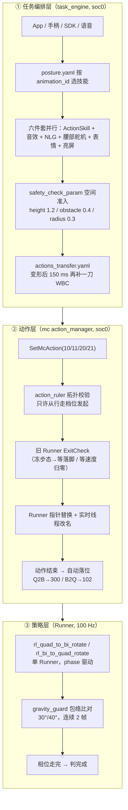
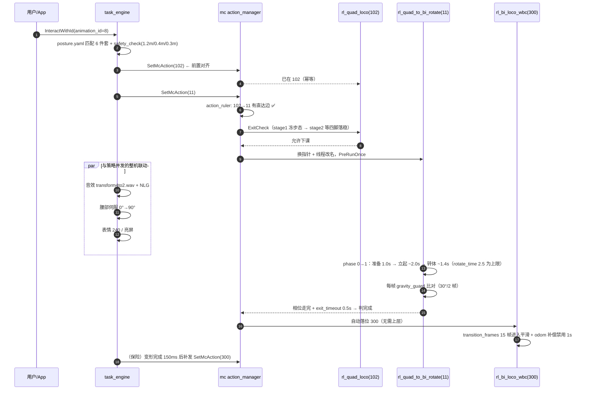
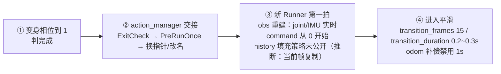

# T1 变身（四足⇄双足）全流程与策略切换详解

**版本**：V1.0　**状态**：评审稿　**日期**：2026-11-25
**读者**：运控/Runner 框架设计者、策略集成工程师、安全与验收评审。
**目的**：把 T1 Pro「四足⇄双足」变身的**前后状态、策略配置、过渡过程、切换机制**一次讲透，并回答一个关键问题：**变身策略和变身后的正常行走策略是不是同一个策略？**
**范围**：仅 `qd1_t2d0`（T1 Pro）真机部署配置与可核实的实测记录；不涉及 Collie 目标本体的数值。
**证据级别**：【配置】=真机 YAML/IDL 可直接核对；【实测】=真机日志/MCAP/录制曲线；【文档】=厂商 SDK 说明；【推断】=由上述推理；【待定】=材料缺口。
**与现有文档的关系**：本文是 [T1运控架构详解](../01_总体架构/T1运控架构详解.md) 第 7 章（换乘图）、[运控三链路设计分析](运控三链路设计分析-安全切换整形.md) 附录 E2.3（重力包络守护）的**专题展开与校正**；结论冲突时以本文引用的原始配置/日志为准。

---

## 0. 一句话结论

**变身不是"两份行走模型之间做插值"，而是「换一个专门的过渡策略跑完一个固定相位动作 → 动作自然结束 → 运控自动落位到目标形态的基础态」；变身策略与落位后的行走策略是两个不同的 ONNX、不同的观测布局、不同的 PD 增益，二者靠"动作级硬切换 + 目标侧进入平滑"衔接，靠"变身末态姿态 = 行走策略默认姿态"保证不跳变。**

---

## 1. 结论速览（先看这 8 条）

| # | 结论 | 证据 |
|---|---|---|
| 1 | 变身是**独立的一次性 RL 过渡策略**（6 条路径：2 方向 × 普通/旋转/前空翻），不是经典插值 | 【配置】`action_setting.yaml` L323-345、L380-418 |
| 2 | 变身期间**只有一个 Runner 在跑**（10 ms / 100 Hz），没有任何"双模型混合"开关 | 【配置】同上；[T1详解 L2606](../01_总体架构/T1运控架构详解.md) |
| 3 | 过渡过程 = **相位时间表驱动的三段式**（准备保持 → 立起翻转 → 旋转/收尾），相位由 `start_time/flip_time/rotate_time` 定义 | 【配置】`custom.*`；【实测】重力包络曲线（§4.4） |
| 4 | 变身带**专用安全守护** `gravity_guard`：拿"成功变身的重力方向录制曲线"逐帧比对，偏 30°（前空翻 40°）连续 2 帧判失败 | 【配置】`WalkConfig.gravity_guard`；【实测】日志 `Loaded gravity guard: rows=300` |
| 5 | 变身有**两种结束机制**：主路径 10/11/20/21 靠"相位走完自然结束"；前空翻 12/22 与恢复/模仿类靠 `auto_switch_timeout` **硬超时** | 【配置】`quad_to_bi_frontflip_run.yaml` L188-191 |
| 6 | 变身结束时**运控自动落位**：四→双落到 `BIPED_LOCOMOTION_WBC(300)`，双→四落到 `QUADRUPED_LOCOMOTION_DEFAULT(102)` | 【文档】SDK 接口说明 L459 + 虚线图 L407-411；【实测】状态流（§5.3） |
| 7 | 落位**不是同一个策略**：`t2_quad2bi_yaw_6837` → `wbcterrain2026092602`，obs 54→49，前腿 kp 50→1 | 【配置】两份 yaml |
| 8 | 落位瞬间的**过渡手段只有三个**：末态姿态对齐（Q2B 完全一致）、目标侧进入平滑（0.2~0.3 s / 15 帧）、里程计补偿禁用 1 s；**PD 增益是硬跳变** | 【配置】§6.3 |

---

## 2. 三层结构：一次变身到底经过谁的手



**要点**：变身在 MC 里就是**一个普通 transition action**（`action_state.yaml` 把它归在 `MOVING` 态），所以它免费复用了：拓扑校验、Runner 复用、线程复用、状态广播、安全体系。**没有"变形管理器"这种东西。**

---

## 3. 变身前后：谁允许发起、谁负责放行

### 3.1 四足 → 双足（10 / 11 / 12）

**MC 侧入口**（`action_ruler.yaml`）：只有三个"行走档位"能发起变形。

| 当前动作 | 可去的变形 | 配置位置 |
|---|---|---|
| `QUADRUPED_LOCOMOTION_DEFAULT`(102) | `QUADRUPED_TO_BIPED`、`QUADRUPED_TO_BIPED_ROTATE` | L108-115 |
| `QUADRUPED_LOCOMOTION_RUN`(112) | 同上 | L148-155 |
| `QUADRUPED_LOCOMOTION_TERRAIN`(103) | 同上 | L158-165 |
| `QUADRUPED_LOCOMOTION_STEP`(121) | **出口被注释**（踏步只做表演闸门，不兼做变形入口） | L129-131 |
| `QUADRUPED_STAND_DEFAULT`(101) | **不允许**（必须先经 102） | L85-93 |

> 这解释了真机开箱流程为什么先发一次 `102` 再发 `11`【配置】`openbox_t1.yaml` L699-705（注释原文："先串行切 102，11 变形的前置状态"）。

**任务层侧门**（`posture.yaml` L336-401，`animation_id: 8` 旋转变形）：

| 项 | 值 | 含义 |
|---|---|---|
| `lowest_battery` | 5（普通变形同样 5） | 电量低于 5% 不允许变形 |
| `obstacle_check` | true | 变形前做环境检查 |
| `safety_check_param.height` | 1.2 m | 顶部净空 |
| `safety_check_param.obstacle_range` | 0.4 m | 障碍距离 |
| `safety_check_param.radius` | 0.3 m | 回转半径 |
| `quad_directions` / `biped_direction` | [15, 30] / 15 | 检查扇区（度） |
| `timeout_ms` | 1000 | 检查超时 |
| `quad_servo_angle` | [0, 90] | 检查时腰部伺服姿态 |
| `t1_transform` / `t1_rotate_transform` 黑名单 | 见 `posture.yaml` L36-56 | 从失稳/躺倒/收纳/变形中间态不许触发 |

**额外抑制项**（`t1_cfg.yaml` L206-209）：`enable_pmu_huoer_block: true` → PMU 的 `huoer=1` 信号会阻止**双足→四足**方向；`enable_stand_up_obstacle_check: true`（L171-174）→ 四足站立态发起变形前还要再过一次空间检查。

### 3.2 双足 → 四足（20 / 21 / 22）

**MC 侧入口**：

| 当前动作 | 可去的变形 | 配置位置 |
|---|---|---|
| `BIPED_LOCOMOTION_WBC`(300) | `BIPED_TO_QUADRUPED`、`_ROTATE` | L247-269 |
| `BIPED_MIMIC` / `BIPED_LINGCHUANG_MIMIC` / `BIPED_GIMBAL` / `BIPED_NPZ_MIMIC` / `BIPED_LOCOMOTION_ANIMATION` | `_ROTATE`（普通变形的出口未开放） | L282-347 |
| `BIPED_LOCOMOTION_RUN`(207) | `BIPED_TO_QUADRUPED_ROTATE`（跨形态直连，唯一例外） | L367-372 |
| `BIPED_LOCOMOTION_DEFAULT` / `_TERRAIN` | **不允许**（须先回 300） | L375-379 / L394-398 |
| `BIPED_STAND_DEFAULT`(201) | `BIPED_TO_QUADRUPED` 出口被注释，只能去 300 | L232-237 |

**关键差异：双足侧多一道"站定门控"**。WBC 的 `ExitCheck` 不满足就不放行，机制在 `bi_wbc_run.yaml`：

```yaml
exit_wait_step: 20            # 基础等待步数
exit_wait_stop_step_min: 20   # 站立/低速最短退出等待（×0.01 s → 0.2 s）
exit_wait_stop_step: 100      # 满速最长等待（×0.01 s → 1.0 s），按 |vx|/|yaw| 相对上限插值
```

【实测】同族日志：`QD1_BI_WBCRLController exit wait target steps=20 (vx=0.000, yaw=0.000, min=20, max=100)`，即**速度归零后还要再等 0.2~1.0 s** 才允许交接。这就是为什么上层发 `SetMcAction(21)` 有时要先"撞几次门"才成功。

**双足侧还有第二个过渡件**：WBC 若挂着上肢动画（`animation_player` 第二执行组），退出前要先做 `arm_exit_homing`（smoothstep 把手回 `default_dof_pos`），见 [Design 文档 §3.2.4](../01_总体架构/Design_T1Pro运控软件系统4+1架构设计简版.md) L778-783。

---

## 4. 变身动作本体：策略详细配置

### 4.1 六条路径总表

| 动作 | ID | Runner | 配置文件 | 权重（rl_models/） | obs | history | 参数量 | 输出 | 周期 | 启用 |
|---|---|---|---|---|---|---|---|---|---|---|
| QUADRUPED_TO_BIPED | 10 | `rl_quad_to_bi` | `quad_to_bi_run.yaml` | `t2.2_quad2bi_norm_0708.onnx` | 51 | 510 | 228,637 | 14 | 10 ms | ✅ |
| QUADRUPED_TO_BIPED_ROTATE | 11 | `rl_quad_to_bi_rotate` | `quad_to_bi_rotate_run.yaml` | `t2_quad2bi_yaw_6837.onnx` | 54 | 540 | 233,245 | 14 | 10 ms | ✅（App 默认） |
| QUADRUPED_TO_BIPED_FRONTFLIP | 12 | `rl_quad_to_bi_frontflip` | `quad_to_bi_frontflip_run.yaml` | `t2_q2b_flip_0720.onnx` | 47 | 470 | 228,209 | 14 | 10 ms | ❌ 拓扑注释掉 |
| BIPED_TO_QUADRUPED | 20 | `rl_bi_to_quad` | `bi_to_quad_run.yaml` | `t2_b2q_norm_v1.0_0601.onnx` | 51 | 510 | 228,637 | 14 | 10 ms | ✅ |
| BIPED_TO_QUADRUPED_ROTATE | 21 | `rl_bi_to_quad_rotate` | `bi_to_quad_rotate_run.yaml` | `t15_bi2quad_rotate_v1.1_terrain.onnx` | 54 | 540 | 234,387 | 14+4 | 10 ms | ✅ |
| BIPED_TO_QUADRUPED_FRONTFLIP | 22 | `rl_bi_to_quad_frontflip` | `bi_to_quad_frontflip_run.yaml` | `t1_flip2quad_v1.0_0307_40k.onnx` | 52 | 520 | 230,173 | 14 | 10 ms | ❌ 拓扑注释掉 |

> 观测维数、history 维数与参数量均来自 `清单/模型网络统计.csv` 逐模型核对【配置/实证】；输入名统一为 `observations[1,N]` + `observation_history[1,10N]`（**frame_stack = 10**），输出 `action[1,14]`（21 号模型额外带一路 `[1,4]` 副输出，主输出仍是 14 维）。

### 4.2 观测构成（这就是"变身策略"和"行走策略"最本质的区别）

| 策略 | obs | 逐段构成 |
|---|---|---|
| `quad_to_bi_run`（10） | 51 | omega(3) + euler(3) + pos(12) + vel(14) + action(14) + **phase(1)** + **q_ref(4)** |
| `quad_to_bi_rotate_run`（11） | 54 | 前 46 维同上 + **imu_yaw_diff(2)** + **phase(1)** + **rotate_phase(1)** + **q_ref(4)** |
| `bi_to_quad_run`（20） | 51 | 同 10 号 |
| `bi_to_quad_rotate_run`（21） | 54 | 同 11 号 |
| `quad_to_bi_frontflip`（12） | 47 | 前 46 维 + **phase(1)**（无 q_ref） |
| `bi_to_quad_frontflip`（22） | 52 | 前 46 维 + **phase(6)**（6 段相位） |
| `BIPED_LOCOMOTION_WBC`（300） | 49 | 前 46 维 + **command(3)** |
| `QUADRUPED_LOCOMOTION_DEFAULT`（102） | 57 | 前 46 维 + **command(3)** + **cpg(8)** |

**读法**：
- 行走策略喂的是**速度指令 `command`**（或 CPG 参数），所以能"边走边转向"；
- 变身策略**完全没有 `command`**，喂的是**相位 `phase` + 参考姿态 `q_ref`**，所以它**天生不响应速度**——这正是"变身期间不许插速度/插动作"在策略层的物理原因。
- 旋转变形多出的 `imu_yaw_diff(2)` 是偏航差的 sin/cos 形式，`rotate_phase` 是**独立于 `phase` 的第二条相位时钟**（转体用），二者不是同一条时间轴【推断，配置未写明】。
- `q_ref` 4 维的物理含义**配置未展开**，与 [Runner 接口文档](../../02_架构设计/02_Runner与策略/运控Runner接口与数据链路设计.md) L264 标注的待定项一致【待定】。

### 4.3 输出到关节：变身动作的增益/限幅配置

| 项 | Q2B(10) | Q2B_ROT(11) | B2Q(20) | B2Q_ROT(21) | 对照：quad_walk(102) | 对照：WBC(300) |
|---|---|---|---|---|---|---|
| `action_scale` 前腿 | 0.05/0.05/0.05 | **0.0**/0.05/0.05 | 0.05 | 0.05 | 0.1/0.25/0.25 | 0.1/0.1/0.1 |
| `action_scale` 后腿 | 0.1/0.25/0.25/2.0 | 0.1/0.25/0.25/2.0 | 0.1/0.2/0.2/2.0 | 0.1/0.2/0.2/2.0 | 0.1/0.25/0.25/**0.0** | 0.1/0.2/0.2/2.0 |
| `kps` 前腿 | 30/30/30 | 50/30/30 | 30/30/30 | 30/30/30 | 30/30/30 | **1/0.5/0.5** |
| `kps` 后腿 | 30/30/30/0 | **100**/30/30/0 | 30/30/30/0 | **80**/30/30/0 | 30/30/30/0 | **180**/30/30/0 |
| `kds` 前腿 | 1.0 | 1.0 | 1.0 | 1.0 | 0.5 | 0.2 |
| `kds` 后腿 | 1.0/1.0/1.0/1.0 | 1.5/1.0/1.0/1.0 | 1.0 | 1.5/1.0/1.0/1.0 | 0.5/0.5/0.5/**1.0** | 1.5/1.0/1.0/**0.5** |
| `obs_clip` / `action_clip` | 50/50 | 50/50 | 50/50 | **200/200** | 50/50 | 20/20 |
| `wheel_reduction` | 4.0 | **10.0** | 4.0 | 4.0 | 0.25 | 1.0 |
| `activation`（前髋 roll） | 0（锁死） | 0（并用 scale 0 双保险） | 0 | 0 | 1 | 1 |
| `tau_limit` | 未配 | 未配 | 未配 | 未配 | `[15,30,30]×2…` | 静摩擦补偿表 |

**三个值得记住的设计差异**：
1. **旋转变形把前腿髋 roll 彻底锁死**（`action_scale=0` + `activation=0`），同时把承重后腿 kp 抬到 100（Q2B）/ 80（B2Q）——立起瞬间后腿是唯一支撑，刚度必须顶住；
2. **Q2B_ROTATE 把轮子动作压到极小**（`wheel_reduction=10`）——转身时轮子只能微动，避免"边转边滑"；
3. **B2Q_ROTATE 把限幅放宽到 200**（其他都是 50/20）——倒伏过程中姿态误差天然很大，夹太死会打架。

### 4.4 相位时间表与姿态锚点（过渡过程的"剧本"）

| 参数 | Q2B(10) | Q2B_ROT(11) | B2Q(20) | B2Q_ROT(21) | 说明 |
|---|---|---|---|---|---|
| `custom.start_time` | 0.5 | 1.0 | 0.5 | 0.0 | 起翻前的准备保持段 |
| `custom.flip_time` | 1.5 | 2.0 | 2.0 | 2.5 | 立起/倒伏（重力方向 90° 翻转）段 |
| `custom.rotate_time` | —（注释掉） | 2.5 | — | 2.5 | 原地转体段 |
| `custom.exit_timeout` | 0.2 | 0.5 | 0.5 | 0.5 | 收尾超时 |
| `WalkConfig.exit_timeout` | 0.2 | 0.5 | 0.5 | 0.5 | 动作级退出超时 |
| `auto_switch_timeout` | — | — | — | — | 仅前空翻/恢复/模仿类有 |
| `custom.transition_duration` | — | — | — | **0.3 s**（注释：RL 接管平滑时长） | 进入时的起点姿态平滑 |
| `custom.phase_offset` | — | — | — | **1.2** | 相位偏置（对齐全周期） |
| `custom.turn_ratio` | — | — | 0.5 | — | 转向占比 |
| `custom.stand_dof_pos` | 双足站姿 | 双足站姿 | 四足站姿 | 四足站姿 | **末态锚点姿态** |
| `stance_width_r` / `foot_rad_r` | 0.278 / 0.07 | 0.2634 / 0.07 | — / — | 0.278 / 0.07 | 支撑宽/轮半径 |
| `max_cycle_time` | 0.9 | 0.9 | 0.9 | 0.9 | 与行走策略同族参数（变形时不用于行走） |

**姿态锚点对齐情况**（这是"切换不跳变"的物理基础）：

| 变身 | 末态 `stand_dof_pos`（前腿 / 后腿） | 落位策略 `default_dof_pos` | 差异 |
|---|---|---|---|
| Q2B（10/11） | `0, 1.5708, 0.6302` / `0, 1.91986, -0.6579, 0` | `bi_wbc_run.yaml`：`0, 1.5708, 0.6302` / `0, 1.91986, -0.6579, 0` | **完全一致（逐位相同）** |
| B2Q（20/21） | `0, 0.7055, -1.3825` / `0, 1.1554, -1.8314, 0` | `quad_walk.yaml`：`0, 0.6781, -1.3533` / `0, 1.0624, -1.8321, 0` | 前髋 pitch **+0.027 rad（1.6°）**、后髋 pitch **+0.093 rad（5.3°）** |

> 结论：**四→双是"零差落位"，双→四是"带 1.6°~5.3° 残差的落位"**，残差靠 `quad_walk.yaml` 的 `transition_duration: 0.2` 在 200 ms 内吃掉。这是一个容易被忽略的工程细节（也让"变身后第一步为什么有点软/有点沉"有了解释）。

### 4.5 重力包络守护（变身专用安全）

```yaml
WalkConfig:
  gravity_guard:
    enable: true
    path: "./res/transition_gravity_record/qd1_t2d0_QUADRUPED_TO_BIPED_ROTATE_20260910_212646.csv"
    threshold_deg: 30.0      # 前空翻版是 40.0
    count_threshold: 2       # 连续 2 帧判失败
  gravity_record:
    enable: false
    output_dir: "./transition_gravity_record"
```

【实测】同族日志（[三链路文档 E2.3](../03_安全与切换/运控三链路设计分析-安全切换整形.md) L830-846）：

```text
Loaded gravity guard: rows=300, cols=3
Gravity guard config loaded: threshold_deg=30.00, count_threshold=2
[BIPED_TO_QUADRUPED] transform fall check enabled: path=.../cfg/robot/qd1_t2d0/...
```

**机制**：录制一次成功变身全过程（100 Hz）的机体系重力方向单位向量作为参考表；运行时逐帧比对当前重力方向与参考的夹角，超阈值连续 2 帧即判失败。**它查的是"姿态轨迹偏离了多少"，不是"摔没摔"**——所以能在真正摔倒前就介入。

**注意**：变身动作**不在** `security_guard.yaml` 的 `monitored_actions_biped/quadruped` 名单里（L14-54）【配置】。也就是说变身期间**常规跌倒检测是关掉的**，由这个专用包络守护接管。这是刻意的：正常立起时"向上轴"本来就要转 90°，通用阈值（60°/3 帧）**必然**把它判成摔倒。

### 4.6 包络录制数据实测：过渡过程的真实时间结构

用 `probe_transform_gravity.py` 逐帧扫描 6 份录制曲线（100 Hz），得到变身的**真实三段结构**（以旋转变形为例）：

**四足→双足（旋转变形，440 帧 / 4.40 s）**

| 时间段 | 重力方向 | ∠相对 -z | 阶段判读 |
|---|---|---|---|
| 0.00–1.00 s | (0.12, 0.01, -0.99) | 6.5°~7.5° | **准备段**：仍四足着地，机身略后仰蓄力（`start_time=1.0`） |
| 1.00–2.80 s | -z → -x 连续翻转 | 7.5° → 90° | **立起翻转段**：重力方向在机体系里从"脚下"转到"身后"（`flip_time=2.0`） |
| 2.80–4.40 s | (-1.00, 0.00, 0.00) 附近 | 89°~90.5° | **转体/收尾段**：已立稳，重力沿 -x（双足 x 向上），残余 ±1° 摆动（`rotate_time=2.5`，转体绕竖轴，**重力数据看不到**） |

**双足→四足（旋转变形，350 帧 / 3.50 s）**

| 时间段 | 重力方向 | 阶段判读 |
|---|---|---|
| 0.00–1.20 s | (-0.99, 0.00, -0.03) | **准备段**：双足直立。配置 `start_time=0.0`（不等待），但重力到 ~1.2 s 才真正开始转 → 翻向前段是策略自身的缓慢缓起，不是配置留白 |
| 1.20–2.80 s | -x → -z 连续翻转 | **倒伏段**（`flip_time=2.5`） |
| 2.80–3.50 s | (-0.03, 0.02, -1.00) | **收尾段**：四足着地，准备落位 |

**六个变体的包络长度对照**：

| 变体 | 帧数 | 名义时长 | 与相位表对照 |
|---|---|---|---|
| Q2B(10) | 220 | 2.20 s | `0.5+1.5+0.2 = 2.20` **完全吻合** |
| Q2B_ROTATE(11) | 440 | 4.40 s | `flip 2.0 + rotate 2.5 = 4.5`（≈，差 0.1） |
| Q2B_FRONTFLIP(12) | 300 | 3.00 s | `auto_switch_timeout = 3.0` **完全吻合** |
| B2Q(20) | 300 | 3.00 s | `0.5+2.0+0.5 = 3.00` **完全吻合** |
| B2Q_ROTATE(21) | 350 | 3.50 s | `flip 2.5 + rotate 2.5 = 5.0`（记录更短 → 转体段按偏航误差提前结束【推断】） |
| B2Q_FRONTFLIP(22) | 300 | 3.00 s | `auto_switch_timeout = 3.0` **完全吻合** |

> 这张表的价值：**"变身时长"是可以由配置算出来的确定性常数**（相位表 + 收尾超时），不是"看运气"。所以音效、腰部舵机、表情这些上层编排可以按常数做时间对齐。

---

## 5. 过渡过程逐段拆解（含详细配置）

### 5.1 四足 → 双足（App 默认路径：旋转变形 11）



#### 分段说明

**T-1｜前置对齐（必须）**
- MC 只允许从 102/112/103 变形；`QUADRUPED_STAND_DEFAULT` 不行。所以编排上先 `SetMcAction(102)`。
- 配置：`openbox_t1.yaml` L699-705；`action_ruler.yaml` L85-93、L108-115。

**T0｜准入检查（任务层，约 1 s 预算）**
- 空间：顶部 1.2 m、障碍 0.4 m、回转 0.3 m、扇区 15°/30°、超时 1000 ms、电量 ≥5%。见 `posture.yaml` L393-401。
- 黑名单：`t1_rotate_transform_black_list`（不含躺倒类）比 `t1_transform_black_list`（含 `QUADRUPED_GET_DOWN_DEFAULT`/`SIT_DOWN`）更宽松——**旋转变形允许从趴下/坐下发起，由 transfer graph 先恢复姿态**（`common.yaml` L73-74 注释原文）。

**T1｜旧策略退出门控（MC 层，毫秒~秒级）**
- `rl_quad_loco`（102）的两阶段退出：stage1 冻结 CPG 到站姿、等四脚落下；stage2 四脚落稳才释放（[Design §3.2.6](../01_总体架构/Design_T1Pro运控软件系统4+1架构设计简版.md) L741-752）。
- 这是"变身前的过渡"，作用是**保证起飞瞬间四脚着地、没有腾空残余速度**。
- 实测同类切换的交接耗时约 **9~14 ms**（RECOVERY→STEP→STAND 两级跳只花 9 ms）；即只要 ExitCheck 放行，交接本身极快。

**T2｜任务层并发联动（与 RL 开环并发）**

| 件 | 动作 | 时序 |
|---|---|---|
| 音效 | `transform4to2.wav`（双足→四足用 `transform2to4.wav`） | 与变形动作同时 |
| NLG | `app_transfer` / `stand_up_before_zero_torque` | 变形前或后 |
| 腰部伺服 | 0°→90°，`pre_motor: biped`（部分技能分支写 `post_motor`，即变形后再伸） | 开箱流程是**变形前**：先等 500 ms（`TransformAudioDelay`）再伸，见 `openbox_t1.yaml` L732-737 |
| 表情 | `post_emoticon: 240`，3 s 保护期 | 变形后 |
| 亮屏 | `brightness_enable: true` | 变形中 |

> 注意：腰部伺服与 RL 策略是**开环并发、无闭环耦合**，时间对齐完全靠相位时钟与编排顺序【推断，配置无握手字段】。

**T3｜策略本体：三段相位（核心）**

| 段 | 时间（11 号） | 策略在做什么 | 观测里对应的量 | 安全守护 |
|---|---|---|---|---|
| ① 准备 | 0–1.0 s | 保持四足站姿、重心后移蓄力 | `phase` 前段；`q_ref` 指向四足站姿 | 重力偏离 <10° 属正常 |
| ② 立起 | 1.0–3.0 s | 前腿抬起变手臂、机身绕横轴后仰 90°，后腿+轮承重 | `phase` 主段；`q_ref` 从四足站姿插值到双足站姿 | 与包络比对角 >30° 连续 2 帧 → 判失败 |
| ③ 转体 | 3.0–4.4 s | 绕竖轴转体到位（`rotate_phase` 独立时钟） | `rotate_phase` + `imu_yaw_diff(2)` | 重力基本不变（转体不改重力方向），靠姿态误差判 |

- 观测：54 维（含 `imu_yaw_diff`、`phase`、`rotate_phase`、`q_ref`），frame_stack 10 → 模型真正吃的是 **540 维历史**。
- 动作：14 维 × `action_scale`，前腿髋 roll 被锁死（scale 0），后腿 kp 100 承重。
- 推理：100 Hz，`obs_clip/action_clip = 50/50`。

**T4｜收尾与判完成**
- `exit_timeout: 0.5`：相位走完后再等最多 0.5 s 收尾，然后判完成【推断：配置只暴露"相位表 + `exit_timeout`"，未见接触/姿态类的完成判据；实测总时长与"相位表 + 收尾"吻合，支持这一读法】。
- 这也解释了为什么实测 4.806 s 略大于相位表 `flip+rotate=4.5 s`。
- 前空翻（12/22）不用相位表，用 `auto_switch_timeout: 3.0` **硬超时**兜底（空翻有腾空段，相位不可靠）→ 见 `quad_to_bi_frontflip_run.yaml` L188-191。

**T5｜自动落位 + 目标侧进入平滑**
- 落位：运控自动切到 `BIPED_LOCOMOTION_WBC(300)`【文档】SDK 接口说明 L459、虚线图 L410。
- 目标侧进入平滑（`bi_wbc_run.yaml`）：
  - `transition_frames: 15`（15×0.01 s = 0.15 s，注释写"1s"但计算是 0.15 s，**注释与数值不一致**）；
  - `odom_disable_after_switch_s: 1`（切换后 1 s 内不做里程计补偿，避免用错误初值积分）；
  - `animation_player`（4 ms）作为第二执行组接管上肢，做 `arm_exit_homing`。
- TE 侧的保险：`actions_transfer.yaml` L44-54 定义 `QUADRUPED_TO_BIPED(_ROTATE) → BIPED_LOCOMOTION_WBC`，`delay_ms: 150`，注释"变形到双足后尚未稳定，需先切换到 WBC"。

### 5.2 双足 → 四足（21）：同样的七段，四处差异

| 环节 | 四→双 | 双→四 |
|---|---|---|
| 入口 | 只能从 102/112/103 | WBC 及双足表演态（RUN 可直连 `_ROTATE`） |
| 前置门控 | 无（四足侧无速度门控） | **WBC 站定门控**：速度归零 + 20~100 步等待（0.2~1.0 s） |
| 起始相位 | `start_time 1.0`（长准备） | `start_time 0.0`（几乎不等待） |
| 翻转时长 | `flip 2.0` | `flip 2.5`（更慢，倒伏比立起难） |
| 承重刚度 | 后腿 kp **100** | 后腿 kp **80** |
| 限幅 | clip 50/50 | clip **200/200** |
| 腰部伺服 | 0°→90° | 90°→0° |
| 落位 | 300（WBC） | **102（四足行走）**，不是 101 站立 |
| 末态残差 | 0（完全对齐） | 1.6°/5.3°（靠 0.2 s 平滑） |
| 额外抑制 | — | `enable_pmu_huoer_block`（PMU 信号可阻止） |

### 5.3 实测时间线（真机状态流，19246 样本）

| 时刻 | 动作 | status | 停留 | 说明 |
|---|---|---|---|---|
| 14:31:13.244 | **11 变身** | 100 | **4.806 s** | 四→双 |
| 14:31:18.050 | **300 WBC** | 100 | 102.3 s | 自动落位 |
| 14:33:00.331 | 300 | **200** | 1.25 s | 开始变回去（站定门控/准备） |
| 14:33:01.585 | **21 变身** | 100 | **3.00 s** | 双→四 |
| 14:33:04.587 | **102 行走** | 100 | 1.93 s | 自动落位（不是 101 站立） |

> 读数要点：**status=200 是"切换中"**（`McActionStatus`: IDLE=0 / RUNNING=100 / TRANSITION=200）。注意不对称：**双→四**方向的旧动作 300 先有 **1.25 s 的 200 段**（= WBC 站定门控 + 准备），随后 21 才进 100；**四→双**方向的 102 没有出现 200 段，直接跳到 11 的 100——四足侧退出门控几乎瞬时放行，或短于该状态流的采样间隔【实测+推断】。

---

## 6. 变身策略 vs 变身后行走策略：是不是同一个？

### 6.1 结论

**不是同一个策略。但它们跑在同一个 Runner 框架里、同一份代码、同一个 100 Hz 节拍上。**

| 维度 | 变身策略（以 11 号为例） | 落位后的行走策略（300 WBC） | 是否相同 |
|---|---|---|---|
| Runner 实现 | `Walk` 模型族（`model_type: Walk`，同族字段：dt/frame_stack/obs_index/obs_scales/filter/walk） | 同族 | **相同** |
| ONNX 权重 | `t2_quad2bi_yaw_6837.onnx`（0.893 MB / 233,245 参数） | `wbcterrain2026092602.onnx`（0.864 MB / 225,565 参数） | **不同** |
| 观测维数 | 54（含 yaw_diff/phase/rotate_phase/q_ref） | 49（含 command） | **不同** |
| 条件输入 | 相位 + 参考姿态（不接速度） | 速度指令（vx/yaw）+ 站立/拖拽 | **不同** |
| 前腿增益 | kp 50/30/30，kd 1.0（承重/摆臂） | kp **1/0.5/0.5**，kd 0.2（柔顺减振） | **差异最大** |
| 后腿增益 | kp 100/30/30，kd 1.5/1/1 | kp **180**/30/30，kd 1.5/1/1 | **不同** |
| 限幅 | clip 50 | clip 20 | **不同** |
| 执行组 | 单 Runner，10 ms | 双执行组：`rl_bi_loco_wbc` 10 ms + `animation_player` 4 ms | **不同** |
| 退出判据 | 相位走完 + exit_timeout | 速度归零 + 20~100 步等待 | **不同** |
| 落位目标 | — | 300 → 变回时从 300 出 | — |

### 6.2 切换是怎么发生的（四个动作，按顺序）



1. **判完成**：相位到 1 + 收尾窗口（或 `auto_switch_timeout`）。
2. **交接**：`action_manager` 记录 `Transition action from [11] to [300] finished`（`action_manager.cc:536` 同族日志格式），Runner 指针替换 + 实时线程改名（SCHED_RR 80 重设），**模型不会重新加载**（RunnerFactory 启动时预创建）。
3. **观测重建**：新策略的 `command` 从 0 起，`last_action` 归零，10 帧历史用当前帧填充（100 ms 内历史是"常数历史"）【推断，配置未暴露历史填充策略】。
4. **进入平滑**：目标侧自己的 `transition_frames` / `transition_duration`，加上里程计补偿禁用 1 s。

### 6.3 落位瞬间会发生什么（风险清单）

| 量 | 变化 | 后果 | 现网处理 |
|---|---|---|---|
| 目标姿态 | Q2B：0（完全对齐）；B2Q：1.6°/5.3° | B2Q 落位后有个小台阶 | `quad_walk.transition_duration 0.2` 平滑 |
| 前腿 kp | 50 → 1（**50 倍降**） | 手臂从"承重"变"柔顺"，若掉落会软 | `transition_frames 15`（0.15 s） |
| 后腿 kp | 100 → 180 | 支撑腿突然变硬，冲击 | 同上 |
| 观测 | phase/q_ref → command | 前 10 帧历史是常数填充 | 未被配置覆盖，**潜在风险** |
| 里程计 | 运动学模型切换（四足足式→双足轮式） | `/odom` 短暂 UNTRUSTED | `odom_disable_after_switch_s: 1` |
| `switch_ready` | 变身全程 false | 上层若只看动作名会误判"已可走" | 唯一可信信号是 `switch_ready` |

> **一句话**：变身→行走的"过渡"不是模型插值，而是**姿态对齐 + 目标侧 0.15~0.2 s 的输出/增益过渡 + 1 s 里程计静默期**；这三件事任何一件缺失，落位瞬间就会出现冲击或打滑。

---

## 7. 给 Collie 的复用建议（简短）

1. **变身必须是独立 Runner/Manifest**：`obs` 用 phase+q_ref，不接速度；`exit` 用相位完成 + 收尾超时；不要试图"在 walk_v3 与 biped_wbc 之间插值"。
2. **末态姿态与目标策略 `default_dof_pos` 必须逐位对齐**——T1 的 Q2B 做到了，B2Q 留了 5.3° 残差，是可改进点。
3. **落位的"进入平滑"要显式建模**：目标侧 `ramp_ms`、里程计静默期、观测历史填充策略三者都要进 Manifest，而不是散落在各 runner 的 `transition_*` 字段里。
4. **变身期间常规跌倒检测要切到专用判据**（T1 用成功经验包络线），不能用 60°/3 帧的通用阈值。
5. **"变身完成"要给独立事件**：`completed ≠ stable ≠ switch_ready`，上层编排（音效/舵机/表情）需要的是"时长可预测"和"完成边沿"，不是轮询动作名。

---

## 8. 未证实 / 待定

| # | 问题 | 现状 |
|---|---|---|
| 1 | `q_ref` 4 维具体对应哪些关节/分量 | 配置未展开，模型 tensor 未逆向 |
| 2 | `phase` 是全局 0→1 还是分段递增；`rotate_phase` 与 `phase` 的确切关系 | 只能从重力曲线推断分段结构 |
| 3 | 旋转变形的目标偏航角（转多少度） | 配置无字段，`imu_yaw_diff` 只给差 |
| 4 | `gravity_guard` 判失败后的回退动作 | 日志未见；推测为安全动作回退【待定】 |
| 5 | 10/11/20/21 的"自动落位"是 MC 内部默认后继，还是 TE 补发 | 两套机制都存在（SDK 文档说自动落位；TE 有 150 ms 补发规则），单凭现有证据无法唯一归因 |
| 6 | 落位瞬间 10 帧观测历史的填充策略 | 配置未暴露 |
| 7 | `BIPEDAL_STAND_DEFAULT`（多一个 AL）与真实动作名 `BIPED_STAND_DEFAULT` 不一致 | 疑为遗留命名；若按字面比较，双足侧 `stand_actions` 分支永不命中【推断】 |
| 8 | `transition_frames: 15` 注释写"1s"但实际 0.15 s | 注释错误，按 0.15 s 理解 |
| 9 | 包络录制时长（4.40/3.50 s）与实测动作驻留（4.806/3.00 s）不完全一致 | 录制批次/版本差异 + 转体段可能按偏航误差提前结束 |

---

## 9. 证据索引

| 证据 | 位置 |
|---|---|
| 换乘图（52 节点/197 边/24 skip） | [`action_ruler.yaml`](../../04_真机与模型数据/运控模型库/真机/qd1_t2d0/配置/action_ruler.yaml) |
| 动作→执行组→runner 映射 | [`action_setting.yaml`](../../04_真机与模型数据/运控模型库/真机/qd1_t2d0/配置/action_setting.yaml) L323-345、L380-418 |
| 动作状态分类（MOVING/STABLE/SAFE） | [`action_state.yaml`](../../04_真机与模型数据/运控模型库/真机/qd1_t2d0/配置/action_state.yaml) |
| 变身形策略配置 | [`quad_to_bi_run.yaml`](../../04_真机与模型数据/运控模型库/真机/qd1_t2d0/配置/rl/quad_to_bi_run.yaml)、[`quad_to_bi_rotate_run.yaml`](../../04_真机与模型数据/运控模型库/真机/qd1_t2d0/配置/rl/quad_to_bi_rotate_run.yaml)、[`bi_to_quad_run.yaml`](../../04_真机与模型数据/运控模型库/真机/qd1_t2d0/配置/rl/bi_to_quad_run.yaml)、[`bi_to_quad_rotate_run.yaml`](../../04_真机与模型数据/运控模型库/真机/qd1_t2d0/配置/rl/bi_to_quad_rotate_run.yaml)、[`quad_to_bi_frontflip_run.yaml`](../../04_真机与模型数据/运控模型库/真机/qd1_t2d0/配置/rl/quad_to_bi_frontflip_run.yaml) |
| 落位策略配置 | [`bi_wbc_run.yaml`](../../04_真机与模型数据/运控模型库/真机/qd1_t2d0/配置/rl/bi_wbc_run.yaml)、[`quad_walk.yaml`](../../04_真机与模型数据/运控模型库/真机/qd1_t2d0/配置/rl/quad_walk.yaml) |
| 重力包络录制曲线 | [`res/transition_gravity_record/`](../../04_真机与模型数据/运控模型库/真机/qd1_t2d0/配置/res/transition_gravity_record) |
| 模型 I/O 与参数 | `清单/模型网络统计.csv`、`清单/策略输入-obs布局.csv`、`清单/动作-执行组-runner.csv` |
| 任务层变形技能 | [`posture.yaml`](../../04_真机与模型数据/真机资料/task_engine/cfg/motions/t1/posture.yaml) L336-446 |
| 任务层变形后补切规则 | [`actions_transfer.yaml`](../../04_真机与模型数据/真机资料/task_engine/cfg/t1/actions_transfer.yaml) L44-54、L101-118、L274-278 |
| 开箱实演编排（S07/S08） | [`openbox_t1.yaml`](../../04_真机与模型数据/真机资料/task_engine/cfg/orchestrator/openbox_t1.yaml) L690-774 |
| 变身障碍检查开关 | [`t1_cfg.yaml`](../../04_真机与模型数据/真机资料/task_engine/cfg/t1/t1_cfg.yaml) L146-186、L206-209 |
| 自动落位（厂商口径） | [`接口说明.md`](../../03_参考库/qiliang_T1Pro报告库/docs/primebot/sdk_t1-v1.0.0.0/接口说明.md) L407-411、L459 |
| 重力守护日志 | [`运控三链路设计分析`](运控三链路设计分析-安全切换整形.md) L830-846 |
| 实测状态流 | [`T1运控架构详解`](../01_总体架构/T1运控架构详解.md) §11.1 |
| 包络分析脚本 | [`06_工具脚本/out/probe_transform_gravity.py`](../../06_工具脚本/out/probe_transform_gravity.py) |

---

*整理：2026-11-25。证据分级与引用行号均可回溯；推断项已显式标注。*
