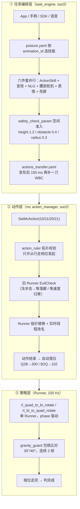
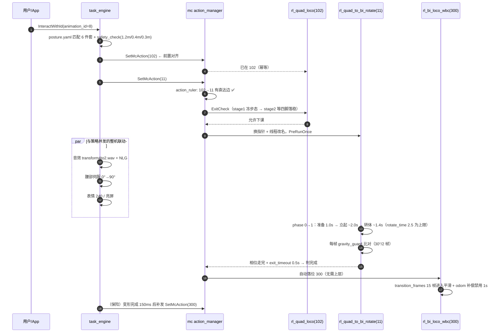
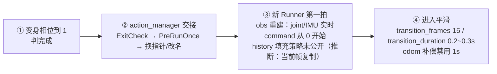

# 03_T1_SWITCHING_EVIDENCE · T1 变身/切换/过渡证据

> 自动生成的阅读包：把多个原始文件按主题拼接，便于一次读多份。
> 引用行号/上下文时请回到 `raw/` 下的同名文件；`FILE:` 行给出原始路径。
> 文件数：16

---

## FILE: raw/docs/t1_morphing_and_switch.md

- bytes: 35611

````markdown
# T1 变身（四足⇄双足）全流程与策略切换详解

**版本**：V1.0　**状态**：评审稿　**日期**：2026-11-25
**读者**：运控/Runner 框架设计者、策略集成工程师、安全与验收评审。
**目的**：把 T1 Pro「四足⇄双足」变身的**前后状态、策略配置、过渡过程、切换机制**一次讲透，并回答一个关键问题：**变身策略和变身后的正常行走策略是不是同一个策略？**
**范围**：仅 `qd1_t2d0`（T1 Pro）真机部署配置与可核实的实测记录；不涉及 Collie 目标本体的数值。
**证据级别**：【配置】=真机 YAML/IDL 可直接核对；【实测】=真机日志/MCAP/录制曲线；【文档】=厂商 SDK 说明；【推断】=由上述推理；【待定】=材料缺口。
**与现有文档的关系**：本文是 [T1运控架构详解](../01_总体架构/T1运控架构详解.md) 第 7 章（换乘图）、[运控三链路设计分析](运控三链路设计分析-安全切换整形.md) 附录 E2.3（重力包络守护）的**专题展开与校正**；结论冲突时以本文引用的原始配置/日志为准。

---

## 0. 一句话结论

**变身不是"两份行走模型之间做插值"，而是「换一个专门的过渡策略跑完一个固定相位动作 → 动作自然结束 → 运控自动落位到目标形态的基础态」；变身策略与落位后的行走策略是两个不同的 ONNX、不同的观测布局、不同的 PD 增益，二者靠"动作级硬切换 + 目标侧进入平滑"衔接，靠"变身末态姿态 = 行走策略默认姿态"保证不跳变。**

---

## 1. 结论速览（先看这 8 条）

| # | 结论 | 证据 |
|---|---|---|
| 1 | 变身是**独立的一次性 RL 过渡策略**（6 条路径：2 方向 × 普通/旋转/前空翻），不是经典插值 | 【配置】`action_setting.yaml` L323-345、L380-418 |
| 2 | 变身期间**只有一个 Runner 在跑**（10 ms / 100 Hz），没有任何"双模型混合"开关 | 【配置】同上；[T1详解 L2606](../01_总体架构/T1运控架构详解.md) |
| 3 | 过渡过程 = **相位时间表驱动的三段式**（准备保持 → 立起翻转 → 旋转/收尾），相位由 `start_time/flip_time/rotate_time` 定义 | 【配置】`custom.*`；【实测】重力包络曲线（§4.4） |
| 4 | 变身带**专用安全守护** `gravity_guard`：拿"成功变身的重力方向录制曲线"逐帧比对，偏 30°（前空翻 40°）连续 2 帧判失败 | 【配置】`WalkConfig.gravity_guard`；【实测】日志 `Loaded gravity guard: rows=300` |
| 5 | 变身有**两种结束机制**：主路径 10/11/20/21 靠"相位走完自然结束"；前空翻 12/22 与恢复/模仿类靠 `auto_switch_timeout` **硬超时** | 【配置】`quad_to_bi_frontflip_run.yaml` L188-191 |
| 6 | 变身结束时**运控自动落位**：四→双落到 `BIPED_LOCOMOTION_WBC(300)`，双→四落到 `QUADRUPED_LOCOMOTION_DEFAULT(102)` | 【文档】SDK 接口说明 L459 + 虚线图 L407-411；【实测】状态流（§5.3） |
| 7 | 落位**不是同一个策略**：`t2_quad2bi_yaw_6837` → `wbcterrain2026092602`，obs 54→49，前腿 kp 50→1 | 【配置】两份 yaml |
| 8 | 落位瞬间的**过渡手段只有三个**：末态姿态对齐（Q2B 完全一致）、目标侧进入平滑（0.2~0.3 s / 15 帧）、里程计补偿禁用 1 s；**PD 增益是硬跳变** | 【配置】§6.3 |

---

## 2. 三层结构：一次变身到底经过谁的手



**要点**：变身在 MC 里就是**一个普通 transition action**（`action_state.yaml` 把它归在 `MOVING` 态），所以它免费复用了：拓扑校验、Runner 复用、线程复用、状态广播、安全体系。**没有"变形管理器"这种东西。**

---

## 3. 变身前后：谁允许发起、谁负责放行

### 3.1 四足 → 双足（10 / 11 / 12）

**MC 侧入口**（`action_ruler.yaml`）：只有三个"行走档位"能发起变形。

| 当前动作 | 可去的变形 | 配置位置 |
|---|---|---|
| `QUADRUPED_LOCOMOTION_DEFAULT`(102) | `QUADRUPED_TO_BIPED`、`QUADRUPED_TO_BIPED_ROTATE` | L108-115 |
| `QUADRUPED_LOCOMOTION_RUN`(112) | 同上 | L148-155 |
| `QUADRUPED_LOCOMOTION_TERRAIN`(103) | 同上 | L158-165 |
| `QUADRUPED_LOCOMOTION_STEP`(121) | **出口被注释**（踏步只做表演闸门，不兼做变形入口） | L129-131 |
| `QUADRUPED_STAND_DEFAULT`(101) | **不允许**（必须先经 102） | L85-93 |

> 这解释了真机开箱流程为什么先发一次 `102` 再发 `11`【配置】`openbox_t1.yaml` L699-705（注释原文："先串行切 102，11 变形的前置状态"）。

**任务层侧门**（`posture.yaml` L336-401，`animation_id: 8` 旋转变形）：

| 项 | 值 | 含义 |
|---|---|---|
| `lowest_battery` | 5（普通变形同样 5） | 电量低于 5% 不允许变形 |
| `obstacle_check` | true | 变形前做环境检查 |
| `safety_check_param.height` | 1.2 m | 顶部净空 |
| `safety_check_param.obstacle_range` | 0.4 m | 障碍距离 |
| `safety_check_param.radius` | 0.3 m | 回转半径 |
| `quad_directions` / `biped_direction` | [15, 30] / 15 | 检查扇区（度） |
| `timeout_ms` | 1000 | 检查超时 |
| `quad_servo_angle` | [0, 90] | 检查时腰部伺服姿态 |
| `t1_transform` / `t1_rotate_transform` 黑名单 | 见 `posture.yaml` L36-56 | 从失稳/躺倒/收纳/变形中间态不许触发 |

**额外抑制项**（`t1_cfg.yaml` L206-209）：`enable_pmu_huoer_block: true` → PMU 的 `huoer=1` 信号会阻止**双足→四足**方向；`enable_stand_up_obstacle_check: true`（L171-174）→ 四足站立态发起变形前还要再过一次空间检查。

### 3.2 双足 → 四足（20 / 21 / 22）

**MC 侧入口**：

| 当前动作 | 可去的变形 | 配置位置 |
|---|---|---|
| `BIPED_LOCOMOTION_WBC`(300) | `BIPED_TO_QUADRUPED`、`_ROTATE` | L247-269 |
| `BIPED_MIMIC` / `BIPED_LINGCHUANG_MIMIC` / `BIPED_GIMBAL` / `BIPED_NPZ_MIMIC` / `BIPED_LOCOMOTION_ANIMATION` | `_ROTATE`（普通变形的出口未开放） | L282-347 |
| `BIPED_LOCOMOTION_RUN`(207) | `BIPED_TO_QUADRUPED_ROTATE`（跨形态直连，唯一例外） | L367-372 |
| `BIPED_LOCOMOTION_DEFAULT` / `_TERRAIN` | **不允许**（须先回 300） | L375-379 / L394-398 |
| `BIPED_STAND_DEFAULT`(201) | `BIPED_TO_QUADRUPED` 出口被注释，只能去 300 | L232-237 |

**关键差异：双足侧多一道"站定门控"**。WBC 的 `ExitCheck` 不满足就不放行，机制在 `bi_wbc_run.yaml`：

```yaml
exit_wait_step: 20            # 基础等待步数
exit_wait_stop_step_min: 20   # 站立/低速最短退出等待（×0.01 s → 0.2 s）
exit_wait_stop_step: 100      # 满速最长等待（×0.01 s → 1.0 s），按 |vx|/|yaw| 相对上限插值
```

【实测】同族日志：`QD1_BI_WBCRLController exit wait target steps=20 (vx=0.000, yaw=0.000, min=20, max=100)`，即**速度归零后还要再等 0.2~1.0 s** 才允许交接。这就是为什么上层发 `SetMcAction(21)` 有时要先"撞几次门"才成功。

**双足侧还有第二个过渡件**：WBC 若挂着上肢动画（`animation_player` 第二执行组），退出前要先做 `arm_exit_homing`（smoothstep 把手回 `default_dof_pos`），见 [Design 文档 §3.2.4](../01_总体架构/Design_T1Pro运控软件系统4+1架构设计简版.md) L778-783。

---

## 4. 变身动作本体：策略详细配置

### 4.1 六条路径总表

| 动作 | ID | Runner | 配置文件 | 权重（rl_models/） | obs | history | 参数量 | 输出 | 周期 | 启用 |
|---|---|---|---|---|---|---|---|---|---|---|
| QUADRUPED_TO_BIPED | 10 | `rl_quad_to_bi` | `quad_to_bi_run.yaml` | `t2.2_quad2bi_norm_0708.onnx` | 51 | 510 | 228,637 | 14 | 10 ms | ✅ |
| QUADRUPED_TO_BIPED_ROTATE | 11 | `rl_quad_to_bi_rotate` | `quad_to_bi_rotate_run.yaml` | `t2_quad2bi_yaw_6837.onnx` | 54 | 540 | 233,245 | 14 | 10 ms | ✅（App 默认） |
| QUADRUPED_TO_BIPED_FRONTFLIP | 12 | `rl_quad_to_bi_frontflip` | `quad_to_bi_frontflip_run.yaml` | `t2_q2b_flip_0720.onnx` | 47 | 470 | 228,209 | 14 | 10 ms | ❌ 拓扑注释掉 |
| BIPED_TO_QUADRUPED | 20 | `rl_bi_to_quad` | `bi_to_quad_run.yaml` | `t2_b2q_norm_v1.0_0601.onnx` | 51 | 510 | 228,637 | 14 | 10 ms | ✅ |
| BIPED_TO_QUADRUPED_ROTATE | 21 | `rl_bi_to_quad_rotate` | `bi_to_quad_rotate_run.yaml` | `t15_bi2quad_rotate_v1.1_terrain.onnx` | 54 | 540 | 234,387 | 14+4 | 10 ms | ✅ |
| BIPED_TO_QUADRUPED_FRONTFLIP | 22 | `rl_bi_to_quad_frontflip` | `bi_to_quad_frontflip_run.yaml` | `t1_flip2quad_v1.0_0307_40k.onnx` | 52 | 520 | 230,173 | 14 | 10 ms | ❌ 拓扑注释掉 |

> 观测维数、history 维数与参数量均来自 `清单/模型网络统计.csv` 逐模型核对【配置/实证】；输入名统一为 `observations[1,N]` + `observation_history[1,10N]`（**frame_stack = 10**），输出 `action[1,14]`（21 号模型额外带一路 `[1,4]` 副输出，主输出仍是 14 维）。

### 4.2 观测构成（这就是"变身策略"和"行走策略"最本质的区别）

| 策略 | obs | 逐段构成 |
|---|---|---|
| `quad_to_bi_run`（10） | 51 | omega(3) + euler(3) + pos(12) + vel(14) + action(14) + **phase(1)** + **q_ref(4)** |
| `quad_to_bi_rotate_run`（11） | 54 | 前 46 维同上 + **imu_yaw_diff(2)** + **phase(1)** + **rotate_phase(1)** + **q_ref(4)** |
| `bi_to_quad_run`（20） | 51 | 同 10 号 |
| `bi_to_quad_rotate_run`（21） | 54 | 同 11 号 |
| `quad_to_bi_frontflip`（12） | 47 | 前 46 维 + **phase(1)**（无 q_ref） |
| `bi_to_quad_frontflip`（22） | 52 | 前 46 维 + **phase(6)**（6 段相位） |
| `BIPED_LOCOMOTION_WBC`（300） | 49 | 前 46 维 + **command(3)** |
| `QUADRUPED_LOCOMOTION_DEFAULT`（102） | 57 | 前 46 维 + **command(3)** + **cpg(8)** |

**读法**：
- 行走策略喂的是**速度指令 `command`**（或 CPG 参数），所以能"边走边转向"；
- 变身策略**完全没有 `command`**，喂的是**相位 `phase` + 参考姿态 `q_ref`**，所以它**天生不响应速度**——这正是"变身期间不许插速度/插动作"在策略层的物理原因。
- 旋转变形多出的 `imu_yaw_diff(2)` 是偏航差的 sin/cos 形式，`rotate_phase` 是**独立于 `phase` 的第二条相位时钟**（转体用），二者不是同一条时间轴【推断，配置未写明】。
- `q_ref` 4 维的物理含义**配置未展开**，与 [Runner 接口文档](../../02_架构设计/02_Runner与策略/运控Runner接口与数据链路设计.md) L264 标注的待定项一致【待定】。

### 4.3 输出到关节：变身动作的增益/限幅配置

| 项 | Q2B(10) | Q2B_ROT(11) | B2Q(20) | B2Q_ROT(21) | 对照：quad_walk(102) | 对照：WBC(300) |
|---|---|---|---|---|---|---|
| `action_scale` 前腿 | 0.05/0.05/0.05 | **0.0**/0.05/0.05 | 0.05 | 0.05 | 0.1/0.25/0.25 | 0.1/0.1/0.1 |
| `action_scale` 后腿 | 0.1/0.25/0.25/2.0 | 0.1/0.25/0.25/2.0 | 0.1/0.2/0.2/2.0 | 0.1/0.2/0.2/2.0 | 0.1/0.25/0.25/**0.0** | 0.1/0.2/0.2/2.0 |
| `kps` 前腿 | 30/30/30 | 50/30/30 | 30/30/30 | 30/30/30 | 30/30/30 | **1/0.5/0.5** |
| `kps` 后腿 | 30/30/30/0 | **100**/30/30/0 | 30/30/30/0 | **80**/30/30/0 | 30/30/30/0 | **180**/30/30/0 |
| `kds` 前腿 | 1.0 | 1.0 | 1.0 | 1.0 | 0.5 | 0.2 |
| `kds` 后腿 | 1.0/1.0/1.0/1.0 | 1.5/1.0/1.0/1.0 | 1.0 | 1.5/1.0/1.0/1.0 | 0.5/0.5/0.5/**1.0** | 1.5/1.0/1.0/**0.5** |
| `obs_clip` / `action_clip` | 50/50 | 50/50 | 50/50 | **200/200** | 50/50 | 20/20 |
| `wheel_reduction` | 4.0 | **10.0** | 4.0 | 4.0 | 0.25 | 1.0 |
| `activation`（前髋 roll） | 0（锁死） | 0（并用 scale 0 双保险） | 0 | 0 | 1 | 1 |
| `tau_limit` | 未配 | 未配 | 未配 | 未配 | `[15,30,30]×2…` | 静摩擦补偿表 |

**三个值得记住的设计差异**：
1. **旋转变形把前腿髋 roll 彻底锁死**（`action_scale=0` + `activation=0`），同时把承重后腿 kp 抬到 100（Q2B）/ 80（B2Q）——立起瞬间后腿是唯一支撑，刚度必须顶住；
2. **Q2B_ROTATE 把轮子动作压到极小**（`wheel_reduction=10`）——转身时轮子只能微动，避免"边转边滑"；
3. **B2Q_ROTATE 把限幅放宽到 200**（其他都是 50/20）——倒伏过程中姿态误差天然很大，夹太死会打架。

### 4.4 相位时间表与姿态锚点（过渡过程的"剧本"）

| 参数 | Q2B(10) | Q2B_ROT(11) | B2Q(20) | B2Q_ROT(21) | 说明 |
|---|---|---|---|---|---|
| `custom.start_time` | 0.5 | 1.0 | 0.5 | 0.0 | 起翻前的准备保持段 |
| `custom.flip_time` | 1.5 | 2.0 | 2.0 | 2.5 | 立起/倒伏（重力方向 90° 翻转）段 |
| `custom.rotate_time` | —（注释掉） | 2.5 | — | 2.5 | 原地转体段 |
| `custom.exit_timeout` | 0.2 | 0.5 | 0.5 | 0.5 | 收尾超时 |
| `WalkConfig.exit_timeout` | 0.2 | 0.5 | 0.5 | 0.5 | 动作级退出超时 |
| `auto_switch_timeout` | — | — | — | — | 仅前空翻/恢复/模仿类有 |
| `custom.transition_duration` | — | — | — | **0.3 s**（注释：RL 接管平滑时长） | 进入时的起点姿态平滑 |
| `custom.phase_offset` | — | — | — | **1.2** | 相位偏置（对齐全周期） |
| `custom.turn_ratio` | — | — | 0.5 | — | 转向占比 |
| `custom.stand_dof_pos` | 双足站姿 | 双足站姿 | 四足站姿 | 四足站姿 | **末态锚点姿态** |
| `stance_width_r` / `foot_rad_r` | 0.278 / 0.07 | 0.2634 / 0.07 | — / — | 0.278 / 0.07 | 支撑宽/轮半径 |
| `max_cycle_time` | 0.9 | 0.9 | 0.9 | 0.9 | 与行走策略同族参数（变形时不用于行走） |

**姿态锚点对齐情况**（这是"切换不跳变"的物理基础）：

| 变身 | 末态 `stand_dof_pos`（前腿 / 后腿） | 落位策略 `default_dof_pos` | 差异 |
|---|---|---|---|
| Q2B（10/11） | `0, 1.5708, 0.6302` / `0, 1.91986, -0.6579, 0` | `bi_wbc_run.yaml`：`0, 1.5708, 0.6302` / `0, 1.91986, -0.6579, 0` | **完全一致（逐位相同）** |
| B2Q（20/21） | `0, 0.7055, -1.3825` / `0, 1.1554, -1.8314, 0` | `quad_walk.yaml`：`0, 0.6781, -1.3533` / `0, 1.0624, -1.8321, 0` | 前髋 pitch **+0.027 rad（1.6°）**、后髋 pitch **+0.093 rad（5.3°）** |

> 结论：**四→双是"零差落位"，双→四是"带 1.6°~5.3° 残差的落位"**，残差靠 `quad_walk.yaml` 的 `transition_duration: 0.2` 在 200 ms 内吃掉。这是一个容易被忽略的工程细节（也让"变身后第一步为什么有点软/有点沉"有了解释）。

### 4.5 重力包络守护（变身专用安全）

```yaml
WalkConfig:
  gravity_guard:
    enable: true
    path: "./res/transition_gravity_record/qd1_t2d0_QUADRUPED_TO_BIPED_ROTATE_20260910_212646.csv"
    threshold_deg: 30.0      # 前空翻版是 40.0
    count_threshold: 2       # 连续 2 帧判失败
  gravity_record:
    enable: false
    output_dir: "./transition_gravity_record"
```

【实测】同族日志（[三链路文档 E2.3](../03_安全与切换/运控三链路设计分析-安全切换整形.md) L830-846）：

```text
Loaded gravity guard: rows=300, cols=3
Gravity guard config loaded: threshold_deg=30.00, count_threshold=2
[BIPED_TO_QUADRUPED] transform fall check enabled: path=.../cfg/robot/qd1_t2d0/...
```

**机制**：录制一次成功变身全过程（100 Hz）的机体系重力方向单位向量作为参考表；运行时逐帧比对当前重力方向与参考的夹角，超阈值连续 2 帧即判失败。**它查的是"姿态轨迹偏离了多少"，不是"摔没摔"**——所以能在真正摔倒前就介入。

**注意**：变身动作**不在** `security_guard.yaml` 的 `monitored_actions_biped/quadruped` 名单里（L14-54）【配置】。也就是说变身期间**常规跌倒检测是关掉的**，由这个专用包络守护接管。这是刻意的：正常立起时"向上轴"本来就要转 90°，通用阈值（60°/3 帧）**必然**把它判成摔倒。

### 4.6 包络录制数据实测：过渡过程的真实时间结构

用 `probe_transform_gravity.py` 逐帧扫描 6 份录制曲线（100 Hz），得到变身的**真实三段结构**（以旋转变形为例）：

**四足→双足（旋转变形，440 帧 / 4.40 s）**

| 时间段 | 重力方向 | ∠相对 -z | 阶段判读 |
|---|---|---|---|
| 0.00–1.00 s | (0.12, 0.01, -0.99) | 6.5°~7.5° | **准备段**：仍四足着地，机身略后仰蓄力（`start_time=1.0`） |
| 1.00–2.80 s | -z → -x 连续翻转 | 7.5° → 90° | **立起翻转段**：重力方向在机体系里从"脚下"转到"身后"（`flip_time=2.0`） |
| 2.80–4.40 s | (-1.00, 0.00, 0.00) 附近 | 89°~90.5° | **转体/收尾段**：已立稳，重力沿 -x（双足 x 向上），残余 ±1° 摆动（`rotate_time=2.5`，转体绕竖轴，**重力数据看不到**） |

**双足→四足（旋转变形，350 帧 / 3.50 s）**

| 时间段 | 重力方向 | 阶段判读 |
|---|---|---|
| 0.00–1.20 s | (-0.99, 0.00, -0.03) | **准备段**：双足直立。配置 `start_time=0.0`（不等待），但重力到 ~1.2 s 才真正开始转 → 翻向前段是策略自身的缓慢缓起，不是配置留白 |
| 1.20–2.80 s | -x → -z 连续翻转 | **倒伏段**（`flip_time=2.5`） |
| 2.80–3.50 s | (-0.03, 0.02, -1.00) | **收尾段**：四足着地，准备落位 |

**六个变体的包络长度对照**：

| 变体 | 帧数 | 名义时长 | 与相位表对照 |
|---|---|---|---|
| Q2B(10) | 220 | 2.20 s | `0.5+1.5+0.2 = 2.20` **完全吻合** |
| Q2B_ROTATE(11) | 440 | 4.40 s | `flip 2.0 + rotate 2.5 = 4.5`（≈，差 0.1） |
| Q2B_FRONTFLIP(12) | 300 | 3.00 s | `auto_switch_timeout = 3.0` **完全吻合** |
| B2Q(20) | 300 | 3.00 s | `0.5+2.0+0.5 = 3.00` **完全吻合** |
| B2Q_ROTATE(21) | 350 | 3.50 s | `flip 2.5 + rotate 2.5 = 5.0`（记录更短 → 转体段按偏航误差提前结束【推断】） |
| B2Q_FRONTFLIP(22) | 300 | 3.00 s | `auto_switch_timeout = 3.0` **完全吻合** |

> 这张表的价值：**"变身时长"是可以由配置算出来的确定性常数**（相位表 + 收尾超时），不是"看运气"。所以音效、腰部舵机、表情这些上层编排可以按常数做时间对齐。

---

## 5. 过渡过程逐段拆解（含详细配置）

### 5.1 四足 → 双足（App 默认路径：旋转变形 11）



#### 分段说明

**T-1｜前置对齐（必须）**
- MC 只允许从 102/112/103 变形；`QUADRUPED_STAND_DEFAULT` 不行。所以编排上先 `SetMcAction(102)`。
- 配置：`openbox_t1.yaml` L699-705；`action_ruler.yaml` L85-93、L108-115。

**T0｜准入检查（任务层，约 1 s 预算）**
- 空间：顶部 1.2 m、障碍 0.4 m、回转 0.3 m、扇区 15°/30°、超时 1000 ms、电量 ≥5%。见 `posture.yaml` L393-401。
- 黑名单：`t1_rotate_transform_black_list`（不含躺倒类）比 `t1_transform_black_list`（含 `QUADRUPED_GET_DOWN_DEFAULT`/`SIT_DOWN`）更宽松——**旋转变形允许从趴下/坐下发起，由 transfer graph 先恢复姿态**（`common.yaml` L73-74 注释原文）。

**T1｜旧策略退出门控（MC 层，毫秒~秒级）**
- `rl_quad_loco`（102）的两阶段退出：stage1 冻结 CPG 到站姿、等四脚落下；stage2 四脚落稳才释放（[Design §3.2.6](../01_总体架构/Design_T1Pro运控软件系统4+1架构设计简版.md) L741-752）。
- 这是"变身前的过渡"，作用是**保证起飞瞬间四脚着地、没有腾空残余速度**。
- 实测同类切换的交接耗时约 **9~14 ms**（RECOVERY→STEP→STAND 两级跳只花 9 ms）；即只要 ExitCheck 放行，交接本身极快。

**T2｜任务层并发联动（与 RL 开环并发）**

| 件 | 动作 | 时序 |
|---|---|---|
| 音效 | `transform4to2.wav`（双足→四足用 `transform2to4.wav`） | 与变形动作同时 |
| NLG | `app_transfer` / `stand_up_before_zero_torque` | 变形前或后 |
| 腰部伺服 | 0°→90°，`pre_motor: biped`（部分技能分支写 `post_motor`，即变形后再伸） | 开箱流程是**变形前**：先等 500 ms（`TransformAudioDelay`）再伸，见 `openbox_t1.yaml` L732-737 |
| 表情 | `post_emoticon: 240`，3 s 保护期 | 变形后 |
| 亮屏 | `brightness_enable: true` | 变形中 |

> 注意：腰部伺服与 RL 策略是**开环并发、无闭环耦合**，时间对齐完全靠相位时钟与编排顺序【推断，配置无握手字段】。

**T3｜策略本体：三段相位（核心）**

| 段 | 时间（11 号） | 策略在做什么 | 观测里对应的量 | 安全守护 |
|---|---|---|---|---|
| ① 准备 | 0–1.0 s | 保持四足站姿、重心后移蓄力 | `phase` 前段；`q_ref` 指向四足站姿 | 重力偏离 <10° 属正常 |
| ② 立起 | 1.0–3.0 s | 前腿抬起变手臂、机身绕横轴后仰 90°，后腿+轮承重 | `phase` 主段；`q_ref` 从四足站姿插值到双足站姿 | 与包络比对角 >30° 连续 2 帧 → 判失败 |
| ③ 转体 | 3.0–4.4 s | 绕竖轴转体到位（`rotate_phase` 独立时钟） | `rotate_phase` + `imu_yaw_diff(2)` | 重力基本不变（转体不改重力方向），靠姿态误差判 |

- 观测：54 维（含 `imu_yaw_diff`、`phase`、`rotate_phase`、`q_ref`），frame_stack 10 → 模型真正吃的是 **540 维历史**。
- 动作：14 维 × `action_scale`，前腿髋 roll 被锁死（scale 0），后腿 kp 100 承重。
- 推理：100 Hz，`obs_clip/action_clip = 50/50`。

**T4｜收尾与判完成**
- `exit_timeout: 0.5`：相位走完后再等最多 0.5 s 收尾，然后判完成【推断：配置只暴露"相位表 + `exit_timeout`"，未见接触/姿态类的完成判据；实测总时长与"相位表 + 收尾"吻合，支持这一读法】。
- 这也解释了为什么实测 4.806 s 略大于相位表 `flip+rotate=4.5 s`。
- 前空翻（12/22）不用相位表，用 `auto_switch_timeout: 3.0` **硬超时**兜底（空翻有腾空段，相位不可靠）→ 见 `quad_to_bi_frontflip_run.yaml` L188-191。

**T5｜自动落位 + 目标侧进入平滑**
- 落位：运控自动切到 `BIPED_LOCOMOTION_WBC(300)`【文档】SDK 接口说明 L459、虚线图 L410。
- 目标侧进入平滑（`bi_wbc_run.yaml`）：
  - `transition_frames: 15`（15×0.01 s = 0.15 s，注释写"1s"但计算是 0.15 s，**注释与数值不一致**）；
  - `odom_disable_after_switch_s: 1`（切换后 1 s 内不做里程计补偿，避免用错误初值积分）；
  - `animation_player`（4 ms）作为第二执行组接管上肢，做 `arm_exit_homing`。
- TE 侧的保险：`actions_transfer.yaml` L44-54 定义 `QUADRUPED_TO_BIPED(_ROTATE) → BIPED_LOCOMOTION_WBC`，`delay_ms: 150`，注释"变形到双足后尚未稳定，需先切换到 WBC"。

### 5.2 双足 → 四足（21）：同样的七段，四处差异

| 环节 | 四→双 | 双→四 |
|---|---|---|
| 入口 | 只能从 102/112/103 | WBC 及双足表演态（RUN 可直连 `_ROTATE`） |
| 前置门控 | 无（四足侧无速度门控） | **WBC 站定门控**：速度归零 + 20~100 步等待（0.2~1.0 s） |
| 起始相位 | `start_time 1.0`（长准备） | `start_time 0.0`（几乎不等待） |
| 翻转时长 | `flip 2.0` | `flip 2.5`（更慢，倒伏比立起难） |
| 承重刚度 | 后腿 kp **100** | 后腿 kp **80** |
| 限幅 | clip 50/50 | clip **200/200** |
| 腰部伺服 | 0°→90° | 90°→0° |
| 落位 | 300（WBC） | **102（四足行走）**，不是 101 站立 |
| 末态残差 | 0（完全对齐） | 1.6°/5.3°（靠 0.2 s 平滑） |
| 额外抑制 | — | `enable_pmu_huoer_block`（PMU 信号可阻止） |

### 5.3 实测时间线（真机状态流，19246 样本）

| 时刻 | 动作 | status | 停留 | 说明 |
|---|---|---|---|---|
| 14:31:13.244 | **11 变身** | 100 | **4.806 s** | 四→双 |
| 14:31:18.050 | **300 WBC** | 100 | 102.3 s | 自动落位 |
| 14:33:00.331 | 300 | **200** | 1.25 s | 开始变回去（站定门控/准备） |
| 14:33:01.585 | **21 变身** | 100 | **3.00 s** | 双→四 |
| 14:33:04.587 | **102 行走** | 100 | 1.93 s | 自动落位（不是 101 站立） |

> 读数要点：**status=200 是"切换中"**（`McActionStatus`: IDLE=0 / RUNNING=100 / TRANSITION=200）。注意不对称：**双→四**方向的旧动作 300 先有 **1.25 s 的 200 段**（= WBC 站定门控 + 准备），随后 21 才进 100；**四→双**方向的 102 没有出现 200 段，直接跳到 11 的 100——四足侧退出门控几乎瞬时放行，或短于该状态流的采样间隔【实测+推断】。

---

## 6. 变身策略 vs 变身后行走策略：是不是同一个？

### 6.1 结论

**不是同一个策略。但它们跑在同一个 Runner 框架里、同一份代码、同一个 100 Hz 节拍上。**

| 维度 | 变身策略（以 11 号为例） | 落位后的行走策略（300 WBC） | 是否相同 |
|---|---|---|---|
| Runner 实现 | `Walk` 模型族（`model_type: Walk`，同族字段：dt/frame_stack/obs_index/obs_scales/filter/walk） | 同族 | **相同** |
| ONNX 权重 | `t2_quad2bi_yaw_6837.onnx`（0.893 MB / 233,245 参数） | `wbcterrain2026092602.onnx`（0.864 MB / 225,565 参数） | **不同** |
| 观测维数 | 54（含 yaw_diff/phase/rotate_phase/q_ref） | 49（含 command） | **不同** |
| 条件输入 | 相位 + 参考姿态（不接速度） | 速度指令（vx/yaw）+ 站立/拖拽 | **不同** |
| 前腿增益 | kp 50/30/30，kd 1.0（承重/摆臂） | kp **1/0.5/0.5**，kd 0.2（柔顺减振） | **差异最大** |
| 后腿增益 | kp 100/30/30，kd 1.5/1/1 | kp **180**/30/30，kd 1.5/1/1 | **不同** |
| 限幅 | clip 50 | clip 20 | **不同** |
| 执行组 | 单 Runner，10 ms | 双执行组：`rl_bi_loco_wbc` 10 ms + `animation_player` 4 ms | **不同** |
| 退出判据 | 相位走完 + exit_timeout | 速度归零 + 20~100 步等待 | **不同** |
| 落位目标 | — | 300 → 变回时从 300 出 | — |

### 6.2 切换是怎么发生的（四个动作，按顺序）



1. **判完成**：相位到 1 + 收尾窗口（或 `auto_switch_timeout`）。
2. **交接**：`action_manager` 记录 `Transition action from [11] to [300] finished`（`action_manager.cc:536` 同族日志格式），Runner 指针替换 + 实时线程改名（SCHED_RR 80 重设），**模型不会重新加载**（RunnerFactory 启动时预创建）。
3. **观测重建**：新策略的 `command` 从 0 起，`last_action` 归零，10 帧历史用当前帧填充（100 ms 内历史是"常数历史"）【推断，配置未暴露历史填充策略】。
4. **进入平滑**：目标侧自己的 `transition_frames` / `transition_duration`，加上里程计补偿禁用 1 s。

### 6.3 落位瞬间会发生什么（风险清单）

| 量 | 变化 | 后果 | 现网处理 |
|---|---|---|---|
| 目标姿态 | Q2B：0（完全对齐）；B2Q：1.6°/5.3° | B2Q 落位后有个小台阶 | `quad_walk.transition_duration 0.2` 平滑 |
| 前腿 kp | 50 → 1（**50 倍降**） | 手臂从"承重"变"柔顺"，若掉落会软 | `transition_frames 15`（0.15 s） |
| 后腿 kp | 100 → 180 | 支撑腿突然变硬，冲击 | 同上 |
| 观测 | phase/q_ref → command | 前 10 帧历史是常数填充 | 未被配置覆盖，**潜在风险** |
| 里程计 | 运动学模型切换（四足足式→双足轮式） | `/odom` 短暂 UNTRUSTED | `odom_disable_after_switch_s: 1` |
| `switch_ready` | 变身全程 false | 上层若只看动作名会误判"已可走" | 唯一可信信号是 `switch_ready` |

> **一句话**：变身→行走的"过渡"不是模型插值，而是**姿态对齐 + 目标侧 0.15~0.2 s 的输出/增益过渡 + 1 s 里程计静默期**；这三件事任何一件缺失，落位瞬间就会出现冲击或打滑。

---

## 7. 给 Collie 的复用建议（简短）

1. **变身必须是独立 Runner/Manifest**：`obs` 用 phase+q_ref，不接速度；`exit` 用相位完成 + 收尾超时；不要试图"在 walk_v3 与 biped_wbc 之间插值"。
2. **末态姿态与目标策略 `default_dof_pos` 必须逐位对齐**——T1 的 Q2B 做到了，B2Q 留了 5.3° 残差，是可改进点。
3. **落位的"进入平滑"要显式建模**：目标侧 `ramp_ms`、里程计静默期、观测历史填充策略三者都要进 Manifest，而不是散落在各 runner 的 `transition_*` 字段里。
4. **变身期间常规跌倒检测要切到专用判据**（T1 用成功经验包络线），不能用 60°/3 帧的通用阈值。
5. **"变身完成"要给独立事件**：`completed ≠ stable ≠ switch_ready`，上层编排（音效/舵机/表情）需要的是"时长可预测"和"完成边沿"，不是轮询动作名。

---

## 8. 未证实 / 待定

| # | 问题 | 现状 |
|---|---|---|
| 1 | `q_ref` 4 维具体对应哪些关节/分量 | 配置未展开，模型 tensor 未逆向 |
| 2 | `phase` 是全局 0→1 还是分段递增；`rotate_phase` 与 `phase` 的确切关系 | 只能从重力曲线推断分段结构 |
| 3 | 旋转变形的目标偏航角（转多少度） | 配置无字段，`imu_yaw_diff` 只给差 |
| 4 | `gravity_guard` 判失败后的回退动作 | 日志未见；推测为安全动作回退【待定】 |
| 5 | 10/11/20/21 的"自动落位"是 MC 内部默认后继，还是 TE 补发 | 两套机制都存在（SDK 文档说自动落位；TE 有 150 ms 补发规则），单凭现有证据无法唯一归因 |
| 6 | 落位瞬间 10 帧观测历史的填充策略 | 配置未暴露 |
| 7 | `BIPEDAL_STAND_DEFAULT`（多一个 AL）与真实动作名 `BIPED_STAND_DEFAULT` 不一致 | 疑为遗留命名；若按字面比较，双足侧 `stand_actions` 分支永不命中【推断】 |
| 8 | `transition_frames: 15` 注释写"1s"但实际 0.15 s | 注释错误，按 0.15 s 理解 |
| 9 | 包络录制时长（4.40/3.50 s）与实测动作驻留（4.806/3.00 s）不完全一致 | 录制批次/版本差异 + 转体段可能按偏航误差提前结束 |

---

## 9. 证据索引

| 证据 | 位置 |
|---|---|
| 换乘图（52 节点/197 边/24 skip） | [`action_ruler.yaml`](../../04_真机与模型数据/运控模型库/真机/qd1_t2d0/配置/action_ruler.yaml) |
| 动作→执行组→runner 映射 | [`action_setting.yaml`](../../04_真机与模型数据/运控模型库/真机/qd1_t2d0/配置/action_setting.yaml) L323-345、L380-418 |
| 动作状态分类（MOVING/STABLE/SAFE） | [`action_state.yaml`](../../04_真机与模型数据/运控模型库/真机/qd1_t2d0/配置/action_state.yaml) |
| 变身形策略配置 | [`quad_to_bi_run.yaml`](../../04_真机与模型数据/运控模型库/真机/qd1_t2d0/配置/rl/quad_to_bi_run.yaml)、[`quad_to_bi_rotate_run.yaml`](../../04_真机与模型数据/运控模型库/真机/qd1_t2d0/配置/rl/quad_to_bi_rotate_run.yaml)、[`bi_to_quad_run.yaml`](../../04_真机与模型数据/运控模型库/真机/qd1_t2d0/配置/rl/bi_to_quad_run.yaml)、[`bi_to_quad_rotate_run.yaml`](../../04_真机与模型数据/运控模型库/真机/qd1_t2d0/配置/rl/bi_to_quad_rotate_run.yaml)、[`quad_to_bi_frontflip_run.yaml`](../../04_真机与模型数据/运控模型库/真机/qd1_t2d0/配置/rl/quad_to_bi_frontflip_run.yaml) |
| 落位策略配置 | [`bi_wbc_run.yaml`](../../04_真机与模型数据/运控模型库/真机/qd1_t2d0/配置/rl/bi_wbc_run.yaml)、[`quad_walk.yaml`](../../04_真机与模型数据/运控模型库/真机/qd1_t2d0/配置/rl/quad_walk.yaml) |
| 重力包络录制曲线 | [`res/transition_gravity_record/`](../../04_真机与模型数据/运控模型库/真机/qd1_t2d0/配置/res/transition_gravity_record) |
| 模型 I/O 与参数 | `清单/模型网络统计.csv`、`清单/策略输入-obs布局.csv`、`清单/动作-执行组-runner.csv` |
| 任务层变形技能 | [`posture.yaml`](../../04_真机与模型数据/真机资料/task_engine/cfg/motions/t1/posture.yaml) L336-446 |
| 任务层变形后补切规则 | [`actions_transfer.yaml`](../../04_真机与模型数据/真机资料/task_engine/cfg/t1/actions_transfer.yaml) L44-54、L101-118、L274-278 |
| 开箱实演编排（S07/S08） | [`openbox_t1.yaml`](../../04_真机与模型数据/真机资料/task_engine/cfg/orchestrator/openbox_t1.yaml) L690-774 |
| 变身障碍检查开关 | [`t1_cfg.yaml`](../../04_真机与模型数据/真机资料/task_engine/cfg/t1/t1_cfg.yaml) L146-186、L206-209 |
| 自动落位（厂商口径） | [`接口说明.md`](../../03_参考库/qiliang_T1Pro报告库/docs/primebot/sdk_t1-v1.0.0.0/接口说明.md) L407-411、L459 |
| 重力守护日志 | [`运控三链路设计分析`](运控三链路设计分析-安全切换整形.md) L830-846 |
| 实测状态流 | [`T1运控架构详解`](../01_总体架构/T1运控架构详解.md) §11.1 |
| 包络分析脚本 | [`06_工具脚本/out/probe_transform_gravity.py`](../../06_工具脚本/out/probe_transform_gravity.py) |

---

*整理：2026-11-25。证据分级与引用行号均可回溯；推断项已显式标注。*
````


---

## FILE: raw/t1/config/rl/quad_to_bi_run.yaml

- bytes: 3906

```yaml
BaseConfig:
  model_type: "Walk"

  use_debug: true
  dt: 0.01  # 100Hz

  # policy:
  #   type: "rknn"
  #   device: "rk3588"
  #   path: "./rl_models/model_run.rknn"
  policy:
    type: "onnx"
    device: "cpu"
    # path: "./rl_models/t15_quad2bi_norm_test_0418.onnx"
    # path: "./rl_models/t15_quad2bi_norm_v1.3_test.onnx"
    path: "./rl_models/t2.2_quad2bi_norm_0708.onnx"

  # obs-action nums will be obtained by urdf
  obs_nums: 51
  q_nums: 14
  action_nums: 14

  joints_name:
    [
      'FL_HIP_ROLL_Joint',
      'FL_HIP_PITCH_Joint',
      'FL_KNEE_Joint',
      
      'FR_HIP_ROLL_Joint',
      'FR_HIP_PITCH_Joint',
      'FR_KNEE_Joint',

      'RL_HIP_ROLL_Joint',
      'RL_HIP_PITCH_Joint',
      'RL_KNEE_Joint',
      'RL_FOOT_Joint',
      
      'RR_HIP_ROLL_Joint',
      'RR_HIP_PITCH_Joint',
      'RR_KNEE_Joint',
      'RR_FOOT_Joint',
    ]

  #define the obs sequence
  seq:
    [
      'FL_HIP_ROLL_Joint',
      'FL_HIP_PITCH_Joint',
      'FL_KNEE_Joint',

      'FR_HIP_ROLL_Joint',
      'FR_HIP_PITCH_Joint',
      'FR_KNEE_Joint',

      'RL_HIP_ROLL_Joint',
      'RL_HIP_PITCH_Joint',
      'RL_KNEE_Joint',
      'RL_FOOT_Joint',

      'RR_HIP_ROLL_Joint',
      'RR_HIP_PITCH_Joint',
      'RR_KNEE_Joint',
      'RR_FOOT_Joint',
    ]

  # define the action sequence
  action_seq:
    [
      'FL_HIP_ROLL_Joint',
      'FL_HIP_PITCH_Joint',
      'FL_KNEE_Joint',

      'FR_HIP_ROLL_Joint',
      'FR_HIP_PITCH_Joint',
      'FR_KNEE_Joint',
      
      'RL_HIP_ROLL_Joint',
      'RL_HIP_PITCH_Joint',
      'RL_KNEE_Joint',
      'RL_FOOT_Joint',
      
      'RR_HIP_ROLL_Joint',
      'RR_HIP_PITCH_Joint',
      'RR_KNEE_Joint',
      'RR_FOOT_Joint',
    ]

  action_scale: [ 0.05, 0.05, 0.05, 
                  0.05, 0.05, 0.05, 
                  0.1, 0.25, 0.25, 2.0, 
                  0.1, 0.25, 0.25, 2.0 ]
  imu_pitch_offset: 0.0


ACConfig:
  infer:
    frame_stack: 10

  clips:
    obs_clip: 50.0
    action_clip: 50.0

  reduction:   
    wheel_reduction: 4.0
    hip_reduction: 0.0

  action:
    activation: [   0.0, 1.0, 1.0, 
                    0.0, 1.0, 1.0, 
                    0.0, 1.0, 1.0, 1.0, 
                    0.0, 1.0, 1.0, 1.0 ]

  # planner:
  #   enable: false
  #   velocity: 10
  #   acceleration: 10
  #   dt: 1   # ms

  robot:
    # seq same as action_seq
    # real params
    kps: [ 
      30.0, 30.0, 30.0, 
      30.0, 30.0, 30.0, 
      30.0, 30.0, 30.0, 0.0, 
      30.0, 30.0, 30.0, 0.0 ]
    kds: [ 
      1.0, 1.0, 1.0,
      1.0, 1.0, 1.0, 
      1.0, 1.0, 1.0, 1.0, 
      1.0, 1.0, 1.0, 1.0 ]
    default_dof_pos: [ 
      0.0, 0.7055, -1.3825, 
      0.0, 0.7055, -1.3825, 
      0.0, 1.1554, -1.8314, 0.0, 
      0.0, 1.1554, -1.8314, 0.0 ]
    default_kp: 30
    default_kd: 1.0


WalkConfig:
  gravity_guard:
    enable: true
    path: "./res/transition_gravity_record/qd1_t2d0_QUADRUPED_TO_BIPED_20260910_212902.csv"
    threshold_deg: 30.0
    count_threshold: 2
  gravity_record:
    enable: false
    output_dir: "./transition_gravity_record"

  max_cycle_time: 0.9

  # define obs index
  obs_index:
    imu_omega: 0
    imu_euler: 3
    pos: 6
    vel: 18
    action: 32
    phase: 46
    q_ref: 47

  walk:
    switch_stand_walk: false
    walk_mode: true
    stand_cmd_threshold: 0.05

  obs_scales:
    dof_pos: 1.0
    dof_vel: 0.05
    lin_vel: 2.0
    ang_vel: 0.25

  filter:
    imu_vel_cutoff_freq: 100
    q_vel_cutoff_freq: [
      100, 100, 100, 
      100, 100, 100, 
      100, 100, 100, 10, 
      100, 100, 100, 10]
  
  custom:
    stand_dof_pos: [
        0.0, 1.57080, 0.6302,
        0.0, 1.57080, 0.6302,
        0.0, 1.91986, -0.6579, 0.0,
        0.0, 1.91986, -0.6579, 0.0
      ]
    start_time: 0.5
    flip_time: 1.5
    # rotate_time: 3.5
    diff: 0.1
    stance_width_r: 0.278
    foot_rad_r: 0.07

  exit_timeout: 0.2
  stand_actions: [ 'QUADRUPED_TO_BIPED']
```


---

## FILE: raw/t1/config/rl/quad_to_bi_rotate_run.yaml

- bytes: 4163

```yaml
BaseConfig:
  model_type: "Walk"

  use_debug: true
  dt: 0.01  # 100Hz

  # policy:
  #   type: "rknn"
  #   device: "rk3588"
  #   path: "./rl_models/model_run.rknn"
  policy:
    type: "onnx"
    device: "cpu"
    # path: "./rl_models/t15_quad2bi_yaw_v1.2_test.onnx" 
    # path: "./rl_models/t15_quad2bi_rotate_v1.5_test.onnx"
    # path: "./rl_models/t2_quad2bi_yaw_v1.1_test.onnx" 
    # path: "./rl_models/t2_q2b_yaw_v1.1.2_1.8.onnx" 
    path: "./rl_models/t2_quad2bi_yaw_6837.onnx" 

  # obs-action nums will be obtained by urdf
  obs_nums: 54
  q_nums: 14
  action_nums: 14

  joints_name:
    [
      'FL_HIP_ROLL_Joint',
      'FL_HIP_PITCH_Joint',
      'FL_KNEE_Joint',
      
      'FR_HIP_ROLL_Joint',
      'FR_HIP_PITCH_Joint',
      'FR_KNEE_Joint',

      'RL_HIP_ROLL_Joint',
      'RL_HIP_PITCH_Joint',
      'RL_KNEE_Joint',
      'RL_FOOT_Joint',
      
      'RR_HIP_ROLL_Joint',
      'RR_HIP_PITCH_Joint',
      'RR_KNEE_Joint',
      'RR_FOOT_Joint',
    ]

  #define the obs sequence
  seq:
    [
      'FL_HIP_ROLL_Joint',
      'FL_HIP_PITCH_Joint',
      'FL_KNEE_Joint',

      'FR_HIP_ROLL_Joint',
      'FR_HIP_PITCH_Joint',
      'FR_KNEE_Joint',

      'RL_HIP_ROLL_Joint',
      'RL_HIP_PITCH_Joint',
      'RL_KNEE_Joint',
      'RL_FOOT_Joint',

      'RR_HIP_ROLL_Joint',
      'RR_HIP_PITCH_Joint',
      'RR_KNEE_Joint',
      'RR_FOOT_Joint',
    ]

  # define the action sequence
  action_seq:
    [
      'FL_HIP_ROLL_Joint',
      'FL_HIP_PITCH_Joint',
      'FL_KNEE_Joint',

      'FR_HIP_ROLL_Joint',
      'FR_HIP_PITCH_Joint',
      'FR_KNEE_Joint',
      
      'RL_HIP_ROLL_Joint',
      'RL_HIP_PITCH_Joint',
      'RL_KNEE_Joint',
      'RL_FOOT_Joint',
      
      'RR_HIP_ROLL_Joint',
      'RR_HIP_PITCH_Joint',
      'RR_KNEE_Joint',
      'RR_FOOT_Joint',
    ]

  action_scale: [ 0.0, 0.05, 0.05, 
                  0.0, 0.05, 0.05, 
                  0.1, 0.25, 0.25, 2.0, 
                  0.1, 0.25, 0.25, 2.0 ]

  imu_pitch_offset: 0.0


ACConfig:
  infer:
    frame_stack: 10

  clips:
    obs_clip: 50.0
    action_clip: 50.0

  reduction:   
    wheel_reduction: 10.0
    hip_reduction: 0.0

  action:
    activation: [   0., 1.0, 1.0, 
                    0., 1.0, 1.0, 
                    0., 1.0, 1.0, 1.0, 
                    0., 1.0, 1.0, 1.0 ]
    policy_scale: 1.0 # 策略输出所占比例
    wheel_ref_scale: 0.0 # wheel ref 所占比例

  # planner:
  #   enable: false
  #   velocity: 10
  #   acceleration: 10
  #   dt: 1   # ms

  robot:
    # seq same as action_seq
    # real params
    kps: [ 
      50.0, 30.0, 30.0, 
      50.0, 30.0, 30.0, 
      100.0, 30.0, 30.0, 0.0, 
      100.0, 30.0, 30.0, 0.0 ]
    kds: [ 
      1.0, 1.0, 1.0,
      1.0, 1.0, 1.0, 
      1.5, 1.0, 1.0, 1.0, 
      1.5, 1.0, 1.0, 1.0 ]
    default_dof_pos: [ 
      0.0, 0.7055, -1.3825, 
      0.0, 0.7055, -1.3825, 
      0.0, 1.1554, -1.8314, 0.0, 
      0.0, 1.1554, -1.8314, 0.0 ]
    default_kp: 30
    default_kd: 1.0


WalkConfig:
  gravity_guard:
    enable: true
    path: "./res/transition_gravity_record/qd1_t2d0_QUADRUPED_TO_BIPED_ROTATE_20260910_212646.csv"
    threshold_deg: 30.0
    count_threshold: 2
  gravity_record:
    enable: false
    output_dir: "./transition_gravity_record"

  max_cycle_time: 0.9

  # define obs index
  obs_index:
    imu_omega: 0
    imu_euler: 3
    pos: 6
    vel: 18
    action: 32
    imu_yaw_diff: 46
    phase: 48
    rotate_phase: 49
    q_ref: 50

  walk:
    switch_stand_walk: false
    walk_mode: true
    stand_cmd_threshold: 0.05

  obs_scales:
    dof_pos: 1.0
    dof_vel: 0.05
    lin_vel: 2.0
    ang_vel: 0.25

  filter:
    imu_vel_cutoff_freq: 100
    q_vel_cutoff_freq: [
      100, 100, 100, 
      100, 100, 100, 
      100, 100, 100, 10, 
      100, 100, 100, 10]
  
  custom:
    stand_dof_pos: [
        0.0, 1.57080, 0.6302,
        0.0, 1.57080, 0.6302,
        0.0, 1.91986, -0.6579, 0.0,
        0.0, 1.91986, -0.6579, 0.0
      ]

    start_time: 1.0
    flip_time: 2.0
    rotate_time: 2.5
    diff: 0.1
    stance_width_r: 0.2634
    foot_rad_r: 0.07

  exit_timeout: 0.5
  stand_actions: [ 'QUADRUPED_TO_BIPED']
```


---

## FILE: raw/t1/config/rl/quad_to_bi_frontflip_run.yaml

- bytes: 3790

```yaml
BaseConfig:
  model_type: "Walk"

  use_debug: true
  dt: 0.01  # 100Hz

  # policy:
  #   type: "rknn"
  #   device: "rk3588"
  #   path: "./rl_models/model_run.rknn"
  policy:
    type: "onnx"
    device: "cpu"
    # path: "./rl_models/actor_critic_flipstand_imu_delay_15k.onnx"
    path: "./rl_models/t2_q2b_flip_0720.onnx"
    

  # obs-action nums will be obtained by urdf
  obs_nums: 47
  q_nums: 14
  action_nums: 14

  joints_name:
    [
      'FL_HIP_ROLL_Joint',
      'FL_HIP_PITCH_Joint',
      'FL_KNEE_Joint',
      
      'FR_HIP_ROLL_Joint',
      'FR_HIP_PITCH_Joint',
      'FR_KNEE_Joint',

      'RL_HIP_ROLL_Joint',
      'RL_HIP_PITCH_Joint',
      'RL_KNEE_Joint',
      'RL_FOOT_Joint',
      
      'RR_HIP_ROLL_Joint',
      'RR_HIP_PITCH_Joint',
      'RR_KNEE_Joint',
      'RR_FOOT_Joint',
    ]

  #define the obs sequence
  seq:
    [
      'FL_HIP_ROLL_Joint',
      'FL_HIP_PITCH_Joint',
      'FL_KNEE_Joint',

      'FR_HIP_ROLL_Joint',
      'FR_HIP_PITCH_Joint',
      'FR_KNEE_Joint',

      'RL_HIP_ROLL_Joint',
      'RL_HIP_PITCH_Joint',
      'RL_KNEE_Joint',
      'RL_FOOT_Joint',

      'RR_HIP_ROLL_Joint',
      'RR_HIP_PITCH_Joint',
      'RR_KNEE_Joint',
      'RR_FOOT_Joint',
    ]

  # define the action sequence
  action_seq:
    [
      'FL_HIP_ROLL_Joint',
      'FL_HIP_PITCH_Joint',
      'FL_KNEE_Joint',

      'FR_HIP_ROLL_Joint',
      'FR_HIP_PITCH_Joint',
      'FR_KNEE_Joint',
      
      'RL_HIP_ROLL_Joint',
      'RL_HIP_PITCH_Joint',
      'RL_KNEE_Joint',
      'RL_FOOT_Joint',
      
      'RR_HIP_ROLL_Joint',
      'RR_HIP_PITCH_Joint',
      'RR_KNEE_Joint',
      'RR_FOOT_Joint',
    ]

  action_scale: [ 0.0, 0.25, 0.25, 
                  0.0, 0.25, 0.25, 
                  0.0, 0.25, 0.25, 1.0, 
                  0.0, 0.25, 0.25, 1.0 ]

  imu_pitch_offset: 0.0


ACConfig:
  infer:
    frame_stack: 10

  clips:
    obs_clip: 20.0
    action_clip: 20.0

  action:
      activation: [   0.0, 1.0, 1.0, 
                      0.0, 1.0, 1.0, 
                      0.0, 1.0, 1.0, 1.0, 
                      0.0, 1.0, 1.0, 1.0 ]

  # planner:
  #   enable: false
  #   velocity: 10
  #   acceleration: 10
  #   dt: 1   # ms

  robot:
    # seq same as action_seq
    # real params
    kps: [ 
      30.0, 30.0, 30.0, 
      30.0, 30.0, 30.0, 
      30.0, 30.0, 30.0, 0.0, 
      30.0, 30.0, 30.0, 0.0 ]
    kds: [ 
      1.0, 1.0, 1.0,
      1.0, 1.0, 1.0, 
      1.0, 1.0, 1.0, 0.5, 
      1.0, 1.0, 1.0, 0.5 ]
    default_dof_pos: [ 
      0.0, 0.678, -1.353, 
      0.0, 0.678, -1.353, 
      0.0, 1.062, -1.832, 0.0, 
      0.0, 1.062, -1.832, 0.0 ]
    default_kp: 30
    default_kd: 1.0


WalkConfig:
  gravity_guard:
    enable: true
    path: "./res/transition_gravity_record/qd1_t2d0_QUADRUPED_TO_BIPED_FRONTFLIP_20260910_212922.csv"
    threshold_deg: 40.0
    count_threshold: 2
  gravity_record:
    enable: false
    output_dir: "./transition_gravity_record"

  max_cycle_time: 0.9

  # define obs index
  obs_index:
    imu_omega: 0
    imu_euler: 3
    pos: 6
    vel: 18
    action: 32
    phase: 46

  walk:
    switch_stand_walk: false
    walk_mode: true
    stand_cmd_threshold: 0.05

  obs_scales:
    dof_pos: 1.0
    dof_vel: 0.05
    lin_vel: 2.0
    ang_vel: 0.25

  filter:
    imu_vel_cutoff_freq: 100
    q_vel_cutoff_freq: [
      100, 100, 100, 
      100, 100, 100, 
      100, 100, 100, 10, 
      100, 100, 100, 10]
  
  custom:
    wheel_stiffness_increase_time: 5.0
    transition_duration: 0.2  # 动作切换平滑时长(秒)
    joint_pos_clip: true

  stand_actions: [ 'QUADRUPED_STAND_DEFAULT']
  acc: 5.0
  record_log: false
  export_path: "/robot/logs"

  auto_switch_timeout: 3.0
  flip_time: 2.0
  auto_next_actions: true
  default_next_action: BIPED_LOCOMOTION_WBC
```


---

## FILE: raw/t1/config/rl/bi_to_quad_run.yaml

- bytes: 3846

```yaml
BaseConfig:
  model_type: "Walk"

  use_debug: true
  dt: 0.01  # 100Hz

  # policy:
  #   type: "rknn"
  #   device: "rk3588"
  #   path: "./rl_models/model_run.rknn"
  policy:
    type: "onnx"
    device: "cpu"
    # path: "./rl_models/t15_bi2quad_norm_v1.4.onnx"
    path: "./rl_models/t2_b2q_norm_v1.0_0601.onnx"
    # path: "./rl_models/t15_bi2quad_norm_0524.onnx"

  # obs-action nums will be obtained by urdf
  obs_nums: 51
  q_nums: 14
  action_nums: 14

  joints_name:
    [
      'FL_HIP_ROLL_Joint',
      'FL_HIP_PITCH_Joint',
      'FL_KNEE_Joint',
      
      'FR_HIP_ROLL_Joint',
      'FR_HIP_PITCH_Joint',
      'FR_KNEE_Joint',

      'RL_HIP_ROLL_Joint',
      'RL_HIP_PITCH_Joint',
      'RL_KNEE_Joint',
      'RL_FOOT_Joint',
      
      'RR_HIP_ROLL_Joint',
      'RR_HIP_PITCH_Joint',
      'RR_KNEE_Joint',
      'RR_FOOT_Joint',
    ]

  #define the obs sequence
  seq:
    [
      'FL_HIP_ROLL_Joint',
      'FL_HIP_PITCH_Joint',
      'FL_KNEE_Joint',

      'FR_HIP_ROLL_Joint',
      'FR_HIP_PITCH_Joint',
      'FR_KNEE_Joint',

      'RL_HIP_ROLL_Joint',
      'RL_HIP_PITCH_Joint',
      'RL_KNEE_Joint',
      'RL_FOOT_Joint',

      'RR_HIP_ROLL_Joint',
      'RR_HIP_PITCH_Joint',
      'RR_KNEE_Joint',
      'RR_FOOT_Joint',
    ]

  # define the action sequence
  action_seq:
    [
      'FL_HIP_ROLL_Joint',
      'FL_HIP_PITCH_Joint',
      'FL_KNEE_Joint',

      'FR_HIP_ROLL_Joint',
      'FR_HIP_PITCH_Joint',
      'FR_KNEE_Joint',
      
      'RL_HIP_ROLL_Joint',
      'RL_HIP_PITCH_Joint',
      'RL_KNEE_Joint',
      'RL_FOOT_Joint',
      
      'RR_HIP_ROLL_Joint',
      'RR_HIP_PITCH_Joint',
      'RR_KNEE_Joint',
      'RR_FOOT_Joint',
    ]

  action_scale: [ 0.05, 0.05, 0.05,
                  0.05, 0.05, 0.05, 
                  0.1, 0.2, 0.2, 2.0, 
                  0.1, 0.2, 0.2, 2.0 ]
  imu_pitch_offset: 0.0


ACConfig:
  infer:
    frame_stack: 10

  clips:
    obs_clip: 50.0
    action_clip: 50.0

  reduction:   
    wheel_reduction: 4.0
    hip_reduction: 0.0
  
  action:
    activation: [   0.0, 1.0, 1.0, 
                    0.0, 1.0, 1.0, 
                    0.0, 1.0, 1.0, 1.0, 
                    0.0, 1.0, 1.0, 1.0 ]
  # planner:
  #   enable: false
  #   velocity: 10
  #   acceleration: 10
  #   dt: 1   # ms

  robot:
    # seq same as action_seq
    # real params
    kps: [ 
      30.0, 30.0, 30.0, 
      30.0, 30.0, 30.0, 
      30.0, 30.0, 30.0, 0.0, 
      30.0, 30.0, 30.0, 0.0 ]
    kds: [ 
      1.0, 1.0, 1.0,
      1.0, 1.0, 1.0, 
      1.0, 1.0, 1.0, 1.0, 
      1.0, 1.0, 1.0, 1.0 ]
    default_dof_pos: [ 
        0.0, 1.57080, 0.63024,
        0.0, 1.57080, 0.63024,
        0.0, 1.91986, -0.65798, 0.0,
        0.0, 1.91986, -0.65798, 0.0
      ]
    default_kp: 30
    default_kd: 1.0


WalkConfig:
  gravity_guard:
    enable: true
    path: "./res/transition_gravity_record/qd1_t2d0_BIPED_TO_QUADRUPED_20260910_212658.csv"
    threshold_deg: 30.0
    count_threshold: 2
  gravity_record:
    enable: false
    output_dir: "./transition_gravity_record"

  max_cycle_time: 0.9

  # define obs index
  obs_index:
    imu_omega: 0
    imu_euler: 3
    pos: 6
    vel: 18
    action: 32
    phase: 46
    q_ref: 47

  walk:
    switch_stand_walk: false
    walk_mode: true
    stand_cmd_threshold: 0.05

  obs_scales:
    dof_pos: 1.0
    dof_vel: 0.05
    lin_vel: 2.0
    ang_vel: 0.25

  filter:
    imu_vel_cutoff_freq: 100
    q_vel_cutoff_freq: [
      100, 100, 100, 
      100, 100, 100, 
      100, 100, 100, 10, 
      100, 100, 100, 10]
  
  custom:
    stand_dof_pos: [
      0.0, 0.7055, -1.3825, 
      0.0, 0.7055, -1.3825, 
      0.0, 1.1554, -1.8314, 0.0, 
      0.0, 1.1554, -1.8314, 0.0 ]

    start_time: 0.5
    flip_time: 2.0
    turn_ratio: 0.5
    diff: 0.1

  exit_timeout: 0.5
  stand_actions: [ 'QUADRUPED_TO_BIPED']
```


---

## FILE: raw/t1/config/rl/bi_to_quad_rotate_run.yaml

- bytes: 4220

```yaml
BaseConfig:
  model_type: "Walk"

  use_debug: true
  dt: 0.01  # 100Hz

  # policy:
  #   type: "rknn"
  #   device: "rk3588"
  #   path: "./rl_models/model_run.rknn"
  policy:
    type: "onnx"
    device: "cpu"

    # path: "./rl_models/bi2quad_speed_0128.onnx"
    path: "./rl_models/t15_bi2quad_rotate_v1.1_terrain.onnx" 
    # path: "./rl_models/t2_b2q_speed_0602_test.onnx"
    # path: "./rl_models/t2_b2q_speed_v1.0_0601.onnx"

  # obs-action nums will be obtained by urdf
  obs_nums: 54
  q_nums: 14
  action_nums: 14

  joints_name:
    [
      'FL_HIP_ROLL_Joint',
      'FL_HIP_PITCH_Joint',
      'FL_KNEE_Joint',

      'FR_HIP_ROLL_Joint',
      'FR_HIP_PITCH_Joint',
      'FR_KNEE_Joint',

      'RL_HIP_ROLL_Joint',
      'RL_HIP_PITCH_Joint',
      'RL_KNEE_Joint',
      'RL_FOOT_Joint',

      'RR_HIP_ROLL_Joint',
      'RR_HIP_PITCH_Joint',
      'RR_KNEE_Joint',
      'RR_FOOT_Joint',
    ]

  #define the obs sequence
  seq:
    [
      'FL_HIP_ROLL_Joint',
      'FL_HIP_PITCH_Joint',
      'FL_KNEE_Joint',

      'FR_HIP_ROLL_Joint',
      'FR_HIP_PITCH_Joint',
      'FR_KNEE_Joint',

      'RL_HIP_ROLL_Joint',
      'RL_HIP_PITCH_Joint',
      'RL_KNEE_Joint',
      'RL_FOOT_Joint',

      'RR_HIP_ROLL_Joint',
      'RR_HIP_PITCH_Joint',
      'RR_KNEE_Joint',
      'RR_FOOT_Joint',
    ]

  # define the action sequence
  action_seq:
    [
      'FL_HIP_ROLL_Joint',
      'FL_HIP_PITCH_Joint',
      'FL_KNEE_Joint',

      'FR_HIP_ROLL_Joint',
      'FR_HIP_PITCH_Joint',
      'FR_KNEE_Joint',

      'RL_HIP_ROLL_Joint',
      'RL_HIP_PITCH_Joint',
      'RL_KNEE_Joint',
      'RL_FOOT_Joint',

      'RR_HIP_ROLL_Joint',
      'RR_HIP_PITCH_Joint',
      'RR_KNEE_Joint',
      'RR_FOOT_Joint',
    ]

  # action_scale: [ 0.35, 0.35, 0.35, 
  #                 0.35, 0.35, 0.35, 
  #                 0.35, 0.35, 0.35, 0.35, 
  #                 0.35, 0.35, 0.35, 0.35 ]

  action_scale: [ 0.05, 0.05, 0.05, 
                  0.05, 0.05, 0.05, 
                  0.1, 0.2, 0.2, 2.0, 
                  0.1, 0.2, 0.2, 2.0 ]

  imu_pitch_offset: 0.0


ACConfig:
  infer:
    frame_stack: 10

  clips:
    obs_clip: 200.0
    action_clip: 200.0

  reduction:   
    wheel_reduction: 4.0
    hip_reduction: 0.0

  action:
    activation: [   0., 1.0, 1.0, 
                    0., 1.0, 1.0, 
                    0., 1.0, 1.0, 1.0, 
                    0., 1.0, 1.0, 1.0 ]

  # planner:
  #   enable: false
  #   velocity: 10
  #   acceleration: 10
  #   dt: 1   # ms

  robot:
    # seq same as action_seq
    # real params
    kps: [ 
      30.0, 30.0, 30.0, 
      30.0, 30.0, 30.0, 
      80.0, 30.0, 30.0, 0.0, 
      80.0, 30.0, 30.0, 0.0 ]
    kds: [ 
      1.0, 1.0, 1.0,
      1.0, 1.0, 1.0, 
      1.5, 1.0, 1.0, 1.0, 
      1.5, 1.0, 1.0, 1.0 ]
    default_dof_pos: [ 
        0.0, 1.57080, 0.6302,
        0.0, 1.57080, 0.6302,
        0.0, 1.91986, -0.6579, 0.0,
        0.0, 1.91986, -0.6579, 0.0
      ]
    default_kp: 30
    default_kd: 1.0


WalkConfig:
  gravity_guard:
    enable: true
    path: "./res/transition_gravity_record/qd1_t2d0_BIPED_TO_QUADRUPED_ROTATE_20260910_212957.csv"
    threshold_deg: 30.0
    count_threshold: 2
  gravity_record:
    enable: false
    output_dir: "./transition_gravity_record"

  max_cycle_time: 0.9

  # define obs index
  obs_index:
    imu_omega: 0
    imu_euler: 3
    pos: 6
    vel: 18
    action: 32
    imu_yaw_diff: 46
    phase: 48
    rotate_phase: 49
    q_ref: 50

  walk:
    switch_stand_walk: false
    walk_mode: true
    stand_cmd_threshold: 0.05

  obs_scales:
    dof_pos: 1.0
    dof_vel: 0.05
    lin_vel: 2.0
    ang_vel: 0.25

  filter:
    imu_vel_cutoff_freq: 100
    q_vel_cutoff_freq: [
      100, 100, 100, 
      100, 100, 100, 
      100, 100, 100, 50, 
      100, 100, 100, 50]

  custom:
    stand_dof_pos: [
      0.0, 0.7055, -1.3825, 
      0.0, 0.7055, -1.3825, 
      0.0, 1.1554, -1.8314, 0.0, 
      0.0, 1.1554, -1.8314, 0.0  
      ]
    start_time: 0.0
    flip_time: 2.5
    rotate_time : 2.5
    transition_duration: 0.3  # RL接管平滑时长(秒)
    stance_width_r: 0.278
    foot_rad_r: 0.07
    phase_offset: 1.2


  exit_timeout: 0.5
  stand_actions: [ 'QUADRUPED_TO_BIPED']
```


---

## FILE: raw/t1/config/rl/bi_to_quad_frontflip_run.yaml

- bytes: 3570

```yaml
BaseConfig:
  model_type: "Walk"

  use_debug: true
  dt: 0.01  # 100Hz

  # policy:
  #   type: "rknn"
  #   device: "rk3588"
  #   path: "./rl_models/model_run.rknn"
  policy:
    type: "onnx"
    device: "cpu"
    # path: "./rl_models/actor_critic_flip2quad_40k.onnx"
    path: "./rl_models/t1_flip2quad_v1.0_0307_40k.onnx"

  # obs-action nums will be obtained by urdf
  obs_nums: 52
  q_nums: 14
  action_nums: 14

  joints_name:
    [
      'FL_HIP_ROLL_Joint',
      'FL_HIP_PITCH_Joint',
      'FL_KNEE_Joint',
      
      'FR_HIP_ROLL_Joint',
      'FR_HIP_PITCH_Joint',
      'FR_KNEE_Joint',

      'RL_HIP_ROLL_Joint',
      'RL_HIP_PITCH_Joint',
      'RL_KNEE_Joint',
      'RL_FOOT_Joint',
      
      'RR_HIP_ROLL_Joint',
      'RR_HIP_PITCH_Joint',
      'RR_KNEE_Joint',
      'RR_FOOT_Joint',
    ]

  #define the obs sequence
  seq:
    [
      'FL_HIP_ROLL_Joint',
      'FL_HIP_PITCH_Joint',
      'FL_KNEE_Joint',

      'FR_HIP_ROLL_Joint',
      'FR_HIP_PITCH_Joint',
      'FR_KNEE_Joint',

      'RL_HIP_ROLL_Joint',
      'RL_HIP_PITCH_Joint',
      'RL_KNEE_Joint',
      'RL_FOOT_Joint',

      'RR_HIP_ROLL_Joint',
      'RR_HIP_PITCH_Joint',
      'RR_KNEE_Joint',
      'RR_FOOT_Joint',
    ]

  # define the action sequence
  action_seq:
    [
      'FL_HIP_ROLL_Joint',
      'FL_HIP_PITCH_Joint',
      'FL_KNEE_Joint',

      'FR_HIP_ROLL_Joint',
      'FR_HIP_PITCH_Joint',
      'FR_KNEE_Joint',
      
      'RL_HIP_ROLL_Joint',
      'RL_HIP_PITCH_Joint',
      'RL_KNEE_Joint',
      'RL_FOOT_Joint',
      
      'RR_HIP_ROLL_Joint',
      'RR_HIP_PITCH_Joint',
      'RR_KNEE_Joint',
      'RR_FOOT_Joint',
    ]

  action_scale: [ 1.0, 1.0, 1.0, 1.0, 1.0, 1.0, 1.0, 1.0, 1.0, 1.0, 1.0, 1.0, 1.0, 1.0 ]
  imu_pitch_offset: 0.0


ACConfig:
  infer:
    frame_stack: 10

  clips:
    obs_clip: 100.0
    action_clip: 100.0

  reduction:   
    wheel_reduction: 1.0
    hip_reduction: 0.0

  # planner:
  #   enable: false
  #   velocity: 10
  #   acceleration: 10
  #   dt: 1   # ms

  robot:
    # seq same as action_seq
    # real params
    kps: [ 
      30.0, 25.0, 25.0, 
      30.0, 25.0, 25.0, 
      30.0, 25.0, 25.0, 0.0, 
      30.0, 25.0, 25.0, 0.0 ]
    kds: [ 
      1.5, 1.7, 1.7,
      1.5, 1.7, 1.7, 
      1.5, 1.7, 1.7, 1.0, 
      1.5, 1.7, 1.7, 1.0 ]
    default_dof_pos: [ 
      0.0, 1.57, 0.52, 
      0.0, 1.57, 0.52, 
      0.0, 1.92, -0.635, 0.0, 
      0.0, 1.92, -0.635, 0.0 ]
    default_kp: 30
    default_kd: 1.5


WalkConfig:
  gravity_guard:
    enable: true
    path: "./res/transition_gravity_record/qd1_t2d0_BIPED_TO_QUADRUPED_FRONTFLIP_20260910_212909.csv"
    threshold_deg: 40.0
    count_threshold: 2
  gravity_record:
    enable: false
    output_dir: "./transition_gravity_record"

  max_cycle_time: 0.9

  # define obs index
  obs_index:
    imu_omega: 0
    imu_euler: 3
    pos: 6
    vel: 18
    action: 32
    phase: 46

  walk:
    switch_stand_walk: false
    walk_mode: true
    stand_cmd_threshold: 0.05

  obs_scales:
    dof_pos: 1.0
    dof_vel: 0.05
    lin_vel: 2.0
    ang_vel: 0.25

  filter:
    imu_vel_cutoff_freq: 100
    q_vel_cutoff_freq: [
      100, 100, 100, 
      100, 100, 100, 
      100, 100, 100, 10, 
      100, 100, 100, 10]

  stand_actions: [ 'QUADRUPED_STAND_DEFAULT']
  acc: 5.0
  record_log: false
  export_path: "/robot/logs"

  auto_switch_timeout: 3.0
  auto_next_actions: true
  default_next_action: QUADRUPED_LOCOMOTION_DEFAULT

  tau_limit: [15, 30, 30,
              15, 30, 30,
              30, 30, 30, 15,
              30, 30, 30, 15]
```


---

## FILE: raw/t1/config/rl/quad_step.yaml

- bytes: 4418

```yaml
BaseConfig:
  model_type: "Walk"

  use_debug: true
  dt: 0.01  # 100Hz

  # policy:
  #   type: "rknn"
  #   device: "rk3588"
  #   path: "./rl_models/model_run.rknn"
  policy:
    type: "onnx"
    device: "cpu"
    path: "./rl_models/t2_quad_walk_lite_0713.onnx" 
    
  # obs-action nums will be obtained by urdf
  obs_nums: 57
  q_nums: 14
  action_nums: 14

  joints_name:
    [
      'FL_HIP_ROLL_Joint',
      'FL_HIP_PITCH_Joint',
      'FL_KNEE_Joint',
      
      'FR_HIP_ROLL_Joint',
      'FR_HIP_PITCH_Joint',
      'FR_KNEE_Joint',

      'RL_HIP_ROLL_Joint',
      'RL_HIP_PITCH_Joint',
      'RL_KNEE_Joint',
      'RL_FOOT_Joint',
      
      'RR_HIP_ROLL_Joint',
      'RR_HIP_PITCH_Joint',
      'RR_KNEE_Joint',
      'RR_FOOT_Joint',
    ]

  #define the obs sequence
  seq:
    [
      'FL_HIP_ROLL_Joint',
      'FL_HIP_PITCH_Joint',
      'FL_KNEE_Joint',
      
      'FR_HIP_ROLL_Joint',
      'FR_HIP_PITCH_Joint',
      'FR_KNEE_Joint',

      'RL_HIP_ROLL_Joint',
      'RL_HIP_PITCH_Joint',
      'RL_KNEE_Joint',
      'RL_FOOT_Joint',
      
      'RR_HIP_ROLL_Joint',
      'RR_HIP_PITCH_Joint',
      'RR_KNEE_Joint',
      'RR_FOOT_Joint',
    ]

  # define the action sequence
  action_seq:
    [
      'FL_HIP_ROLL_Joint',
      'FL_HIP_PITCH_Joint',
      'FL_KNEE_Joint',

      'FR_HIP_ROLL_Joint',
      'FR_HIP_PITCH_Joint',
      'FR_KNEE_Joint',
      
      'RL_HIP_ROLL_Joint',
      'RL_HIP_PITCH_Joint',
      'RL_KNEE_Joint',
      'RL_FOOT_Joint',
      
      'RR_HIP_ROLL_Joint',
      'RR_HIP_PITCH_Joint',
      'RR_KNEE_Joint',
      'RR_FOOT_Joint',
    ]

  action_scale: [ 0.1, 0.25, 0.25, 
                  0.1, 0.25, 0.25, 
                  0.1, 0.25, 0.25, 0.0, 
                  0.1, 0.25, 0.25, 0.0 ]
  imu_pitch_offset: 0.0


ACConfig:
  infer:
    frame_stack: 10

  clips:
    obs_clip: 50.0
    action_clip: 50.0

  reduction:   
    wheel_reduction: 0.25
    hip_reduction: 0.5
  
  action:
    activation: [   1.0, 1.0, 1.0, 
                    1.0, 1.0, 1.0, 
                    1.0, 1.0, 1.0, 0.0, 
                    1.0, 1.0, 1.0, 0.0 ]
  # planner:
  #   enable: false
  #   velocity: 10
  #   acceleration: 10
  #   dt: 1   # ms

  robot:
    # seq same as action_seq
    # real params
    kps: [ 
      30.0, 30.0, 30.0, 
      30.0, 30.0, 30.0, 
      30.0, 30.0, 30.0, 0.0, 
      30.0, 30.0, 30.0, 0.0 ]
    kds: [ 
      0.5, 0.5, 0.5,
      0.5, 0.5, 0.5, 
      0.5, 0.5, 0.5, 1.0, 
      0.5, 0.5, 0.5, 1.0 ]
    default_dof_pos: [ 
      0.0, 0.6781, -1.3533, 
      0.0, 0.6781, -1.3533, 
      0.0, 1.0624, -1.8321, 0.0, 
      0.0, 1.0624, -1.8321, 0.0 ]
    default_kp: 30
    default_kd: 1.0


WalkConfig:
  max_cycle_time: 0.9 # t_set
  min_cycle_time: 0.25
  step_length: 0.5
  

  # define obs index
  obs_index:
    imu_omega: 0
    imu_euler: 3
    pos: 6
    vel: 18
    action: 32
    command: 46
    cpg: 49

  walk:
    switch_stand_walk: false
    walk_mode: true
    stand_cmd_threshold: 0.05

  obs_scales:
    dof_pos: 1.0
    dof_vel: 0.05
    lin_vel: 2.0
    ang_vel: 0.25

  command_scales:
    map_y: 0.3
    map_yaw: 0.6
    cmd_x_min: -1.0
    cmd_x_max: 1.0

  filter:
    imu_vel_cutoff_freq: 100
    q_vel_cutoff_freq: [
      100, 100, 100, 
      100, 100, 100, 
      100, 100, 100, 10, 
      100, 100, 100, 10]

  custom:
    wheel_stiffness_increase_time: 5.0
    transition_duration: 0.3   # 进入时起点姿态平滑时长(秒)

  step_gate:
    omega_thr:    0.3 
    # cmd_thr:      0.05
    # min_steps:    50
    front_diff_thr: 0.05   # 左前/右前足端 z 差值
    back_diff_thr:  0.05   # 左后/右后足端 z 差值
    pos_diff_thr:   0.05   # 足端 vs 默认足位的 xy 水平偏差阈值(不含 z, z 受坡度/地形适应影响)
    pos_diff_thr_quad_stand:   0.08   # 四足站立，特殊设置，避免开箱踏步
    min_stable_hold: 0.1
    settle_timeout:  5.0
    min_step_time:  0.9   # 最小踏步时间硬下限(秒); = 一个 TROT 周期(cmd=0 时 cpg_.t_=0.9), 防止踏步不足一个步态周期就退出

  # STEP 本身也加入 stand_actions：作为闸门时强制原地踏步、忽略速度指令
  stand_actions: [ 'QUADRUPED_STAND_DEFAULT', 'QUADRUPED_LOCOMOTION_STEP']
  acc_x: 0.5
  acc_y: 2.0
  acc_yaw: 2.0
  # 力矩限幅(N·m)
  tau_limit: [15, 30, 30,
              15, 30, 30,
              30, 30, 30, 15,
              30, 30, 30, 15]
```


---

## FILE: raw/t1/config/rl/bi_wbc_run.yaml

- bytes: 7507

```yaml
BaseConfig:
  model_type: "Walk"

  use_debug: true
  dt: 0.01  # 100Hz

  # policy:
  #   type: "rknn"
  #   device: "rk3588"
  #   path: "./rl_models/model_run.rknn"
  policy:
    type: "onnx"
    device: "cpu"
    # path: "./rl_models/wbc_delay0110.onnx"
    # path: "./rl_models/t1_bi_wbc_v1.0_0110_delay.onnx"
    # path: "./rl_models/wbc_terrain_lift0515.onnx"
    # path: "./rl_models/wbc2026071201.onnx"
    # path: "./rl_models/wbcterrain2026081801.onnx"
    # path: "./rl_models/wbc_terrain20260807.onnx"
    # path: "./rl_models/wbcterrain2026083102.onnx"
    path: "./rl_models/wbcterrain2026092602.onnx"
    

  # obs-action nums will be obtained by urdf
  obs_nums: 49
  q_nums: 14
  action_nums: 14

  joints_name:
    [
      'FL_HIP_ROLL_Joint',
      'FL_HIP_PITCH_Joint',
      'FL_KNEE_Joint',
      
      'FR_HIP_ROLL_Joint',
      'FR_HIP_PITCH_Joint',
      'FR_KNEE_Joint',

      'RL_HIP_ROLL_Joint',
      'RL_HIP_PITCH_Joint',
      'RL_KNEE_Joint',
      'RL_FOOT_Joint',
      
      'RR_HIP_ROLL_Joint',
      'RR_HIP_PITCH_Joint',
      'RR_KNEE_Joint',
      'RR_FOOT_Joint',
    ]

  #define the obs sequence
  seq:
    [
      'FL_HIP_ROLL_Joint',
      'FL_HIP_PITCH_Joint',
      'FL_KNEE_Joint',

      'FR_HIP_ROLL_Joint',
      'FR_HIP_PITCH_Joint',
      'FR_KNEE_Joint',

      'RL_HIP_ROLL_Joint',
      'RL_HIP_PITCH_Joint',
      'RL_KNEE_Joint',
      'RL_FOOT_Joint',

      'RR_HIP_ROLL_Joint',
      'RR_HIP_PITCH_Joint',
      'RR_KNEE_Joint',
      'RR_FOOT_Joint',
    ]

  # define the action sequence
  action_seq:
    [
      'FL_HIP_ROLL_Joint',
      'FL_HIP_PITCH_Joint',
      'FL_KNEE_Joint',

      'FR_HIP_ROLL_Joint',
      'FR_HIP_PITCH_Joint',
      'FR_KNEE_Joint',
      
      'RL_HIP_ROLL_Joint',
      'RL_HIP_PITCH_Joint',
      'RL_KNEE_Joint',
      'RL_FOOT_Joint',
      
      'RR_HIP_ROLL_Joint',
      'RR_HIP_PITCH_Joint',
      'RR_KNEE_Joint',
      'RR_FOOT_Joint',
    ]

  action_scale: [ 0.1, 0.1, 0.1,
                  0.1, 0.1, 0.1, 
                  0.1, 0.2, 0.2, 2.0, 
                  0.1, 0.2, 0.2, 2.0 ]
                  
  imu_pitch_offset: 0.0


ACConfig:
  infer:
    frame_stack: 10

  clips:
    obs_clip: 20.0
    action_clip: 20.0

  reduction:   
    wheel_reduction: 1.0
    hip_reduction: 0.0

  # planner:
  #   enable: false
  #   velocity: 10
  #   acceleration: 10
  #   dt: 1   # ms

  robot:
    # seq same as action_seq
    # real params
    kps: [ 
      1.0, 0.5, 0.5, 
      1.0, 0.5, 0.5, 
      180.0, 30.0, 30.0, 0.0, 
      180.0, 30.0, 30.0, 0.0 ]
    kds: [ 
      0.2, 0.2, 0.2,
      0.2, 0.2, 0.2, 
      1.5, 1.0, 1.0, 0.5, 
      1.5, 1.0, 1.0, 0.5 ]

    default_dof_pos: [ 
      0.0, 1.57080, 0.6302,
      0.0, 1.57080, 0.6302,
      0.0, 1.91986, -0.6579, 0.0,
      0.0, 1.91986, -0.6579, 0.0 ]
    
    default_kp: 30
    default_kd: 1.0


WalkConfig:
  # define obs index
  obs_index:
    imu_omega: 0
    imu_euler: 3
    pos: 6
    vel: 18
    action: 32
    command: 46

  obs_scales:
    dof_pos: 1.0
    dof_vel: 0.05
    lin_vel: 2.0
    ang_vel: 0.25

  command_scales:
    cmd_x_min: -1.4
    cmd_x_max: 1.4
    cmd_yaw_min: -3.0
    cmd_yaw_max: 3.0
    # vx: 1.5
    height: 0.0
    dyaw: 1.2
    xlim_with_yaw: 0.3
    x_acc_clip_scale: 0.5
    drag_x_min: -1.4
    drag_x_max: 1.4
    drag_yaw_min: -3.0
    drag_yaw_max: 3.0
    cmd_x_forward_bias_scale: 1.0
    cmd_x_backward_bias_scale: 1.0

  filter:
    imu_vel_cutoff_freq: 100
    q_vel_cutoff_freq: [
      100, 100, 100, 
      100, 100, 100, 
      100, 100, 100, 50, 
      100, 100, 100, 50]

  limits:
    lower_limit: [-0.43633, -1.1868, -2.5831, -0.43633, -1.1868, -2.5831 ]
    upper_limit: [0.43633,   4.3284,  2.5831,  0.43633,  4.3284,  2.5831 ]

  odom:
    wheel_radius: 0.07
    odom_enable_x: 0.3
    odom_kp_x: 0.05
    odom_kd_x: -0.00
    max_vel_x: 0.005
    max_vel_yaw: 0.5
    odom_enable_yaw: 0.2
    odom_kp_yaw: 0.05
    max_delta_yaw: 2.0
    coef: 0.5
    odom_log_decimation: 1
    # x方向累计位置误差限幅
    max_delta_x: 10
    # x方向补偿降采样：
    # 1 = 每步更新补偿
    # 2 = 每2步更新一次补偿
    # 5 = 每5步更新一次补偿
    # 注意：CalculateDelta() 仍然每步执行
    odom_comp_decimation: 1
    # 从其它模式/action切换过来后，前多少秒不启用里程计补偿
    odom_disable_after_switch_s: 1

  stand_actions: [ 'BIPEDAL_STAND_DEFAULT']
  acc_x: 1.0        # x 方向减速/刹车加速度
  acc_x_accel: 1.0 # x 方向加速时加速度（原 acc_x * 0.25）
  v_z: 0.2
  acc_yaw: 3.0
  exit_wait_step: 20
  exit_wait_stop_step_min: 20   # 站立/低速最短退出等待（×dt=0.01 → 0.2s）
  exit_wait_stop_step: 100      # 满速最长退出等待（×dt=0.01 → 1.0s）；按 |vx|/|yaw| 相对 command_scales 上限插值
  bias_vx : -0.02
  bias_dyaw : -0.018

  transition_frames: 15 # 15帧 * 0.01 1s
  
  # 拖拽双臂 roll 触发转向（覆盖手柄角速度；右负左正）
  arm_drag:
    enable: true
    deadzone_roll_threshold: 0.17   # rad，约 10°
    w_deadzone_roll_threshold: 0.17   # rad，约 10°
    roll_threshold: 0.2   # rad，持续贴近该 roll 角阈值后进入持续加速
    yaw_spin_confirm_frames: 5
    yaw_spin_accel: 0.8

    yaw_vel: 1.2  
    log_decimation: 1
    # # 上肢 6 关节: FL_ROLL, FL_PITCH, FL_KNEE, FR_ROLL, FR_PITCH, FR_KNEE
    # t: [1.0, 1.0, 1.0, 1.0, 1.0, 1.0]
    # kp: [4.0, 4.0, 4.0, 4.0, 4.0, 4.0]
    # kd: [0.0, 0.0, 0.0, 0.0, 0.0, 0.0]
    # 上肢 6 关节: FL_ROLL, FL_PITCH, FL_KNEE, FR_ROLL, FR_PITCH, FR_KNEE
    t: [1.0, 0.5, 1.0, 1.0, 0.5, 1.0]
    kp: [4.0, 2.0, 4.0, 4.0, 2.0, 4.0]
    kd: [0.2, 0.2, 0.2, 0.2, 0.2, 0.2]

    # 3.5 rad/s
    # yaw_vel_scale_kp: 11.14
    yaw_vel_scale_kp: 20.0
    yaw_vel_scale_kd: 0.4
      #yaw_vel_scale_kd: 6.12
    # yaw_vel_scale_kp: 4.78
    # 1.5m/s
    # bx_qz_cmd_kp: 3.56
    bx_qz_cmd_ka: 0.1
    bx_qz_cmd_kb: 0.01
    # 双手末端前向位移阈值（m）；|z| 低于此不触发前进/后退
    forward_pos_threshold: 0.24
    # 连续满足前进条件的帧数后才下发 x_cmd（100Hz 下 300 帧约 3s）
    forward_confirm_frames: 100
    # 死区补充：手臂 pitch 偏离 default 超过阈值 -> 仍判为牵手。up 小(抬不起自己)；down 须卡在自垂量与反手举到顶量之间
    arm_above_default_pitch_threshold: 0.15
    arm_below_default_pitch_threshold: 1.50
    wheel_default_x: 0.0
    wheel_pos_threshold: 0.02
    wheel_cmd_reduce_kp: 3.0
    wheel_cmd_rise_kp: 3.0
    wheel_decel_reset_threshold: 0.1
    forward_base_accel: 0.0
    forward_base_decel: 0.0
    push_wheel_threshold: 0.5
    push_accel_kp: 3.0
    push_decel_kp: 3.0
    push_release_decel: 0.6
    push_vel_max: 1.4
    push_stop_threshold: 0.05
    push_confirm_frames: 50
  joystick_cooldown_frames: 250
  yaw_acc:
    d_fast: 3.0        
    d_slow: 0.0        

  # 静摩擦力矩补偿：按 joints_name 顺序（q_nums=14 个关节）配置每个关节的静摩擦力矩（N·m）。
  # 位置控制关节（kp>0）：target_pos += sign(tau)*min(fs,|tau|)/kp
  # 速度控制关节（kp=0,kd>0，即轮子）：target_vel += sign(tau)*min(fs,|tau|)/kd
  # 设为 0 表示该关节不补偿。
  # 顺序：FL_ROLL FL_PITCH FL_KNEE  FR_ROLL FR_PITCH FR_KNEE
  #        RL_ROLL RL_PITCH RL_KNEE RL_FOOT  RR_ROLL RR_PITCH RR_KNEE RR_FOOT
  friction_comp:
    static_friction: [0.0, 0.0, 0.0, 0.0, 0.0, 0.0, 0.0, 0.0, 0.0, 0.8, 0.0, 0.0, 0.0, 0.8]
```


---

## FILE: raw/t1/config/rl/quad_walk.yaml

- bytes: 4237

```yaml
BaseConfig:
  model_type: "Walk"

  use_debug: true
  dt: 0.01  # 100Hz

  # policy:
  #   type: "rknn"
  #   device: "rk3588"
  #   path: "./rl_models/model_run.rknn"
  policy:
    type: "onnx"
    device: "cpu"
    # path: "./rl_models/t2_quad_walk_new_0814.onnx" 
    path: "./rl_models/t2_quad_walk_0902.onnx"

  # obs-action nums will be obtained by urdf
  obs_nums: 57
  q_nums: 14
  action_nums: 14

  joints_name:
    [
      'FL_HIP_ROLL_Joint',
      'FL_HIP_PITCH_Joint',
      'FL_KNEE_Joint',
      
      'FR_HIP_ROLL_Joint',
      'FR_HIP_PITCH_Joint',
      'FR_KNEE_Joint',

      'RL_HIP_ROLL_Joint',
      'RL_HIP_PITCH_Joint',
      'RL_KNEE_Joint',
      'RL_FOOT_Joint',
      
      'RR_HIP_ROLL_Joint',
      'RR_HIP_PITCH_Joint',
      'RR_KNEE_Joint',
      'RR_FOOT_Joint',
    ]

  #define the obs sequence
  seq:
    [
      'FL_HIP_ROLL_Joint',
      'FL_HIP_PITCH_Joint',
      'FL_KNEE_Joint',
      
      'FR_HIP_ROLL_Joint',
      'FR_HIP_PITCH_Joint',
      'FR_KNEE_Joint',

      'RL_HIP_ROLL_Joint',
      'RL_HIP_PITCH_Joint',
      'RL_KNEE_Joint',
      'RL_FOOT_Joint',
      
      'RR_HIP_ROLL_Joint',
      'RR_HIP_PITCH_Joint',
      'RR_KNEE_Joint',
      'RR_FOOT_Joint',
    ]

  # define the action sequence
  action_seq:
    [
      'FL_HIP_ROLL_Joint',
      'FL_HIP_PITCH_Joint',
      'FL_KNEE_Joint',

      'FR_HIP_ROLL_Joint',
      'FR_HIP_PITCH_Joint',
      'FR_KNEE_Joint',
      
      'RL_HIP_ROLL_Joint',
      'RL_HIP_PITCH_Joint',
      'RL_KNEE_Joint',
      'RL_FOOT_Joint',
      
      'RR_HIP_ROLL_Joint',
      'RR_HIP_PITCH_Joint',
      'RR_KNEE_Joint',
      'RR_FOOT_Joint',
    ]

  action_scale: [ 0.1, 0.25, 0.25, 
                  0.1, 0.25, 0.25, 
                  0.1, 0.25, 0.25, 0.0, 
                  0.1, 0.25, 0.25, 0.0 ]
  imu_pitch_offset: 0.0


ACConfig:
  infer:
    frame_stack: 10

  clips:
    obs_clip: 50.0
    action_clip: 50.0

  reduction:   
    wheel_reduction: 0.25
    hip_reduction: 0.5
  
  action:
    activation: [   1.0, 1.0, 1.0, 
                    1.0, 1.0, 1.0, 
                    1.0, 1.0, 1.0, 0.0, 
                    1.0, 1.0, 1.0, 0.0 ]
  # planner:
  #   enable: false
  #   velocity: 10
  #   acceleration: 10
  #   dt: 1   # ms

  robot:
    # seq same as action_seq
    # real params
    kps: [ 
      30.0, 30.0, 30.0, 
      30.0, 30.0, 30.0, 
      30.0, 30.0, 30.0, 0.0, 
      30.0, 30.0, 30.0, 0.0 ]
    kds: [ 
      0.5, 0.5, 0.5,
      0.5, 0.5, 0.5, 
      0.5, 0.5, 0.5, 1.0, 
      0.5, 0.5, 0.5, 1.0 ]
    default_dof_pos: [ 
      0.0, 0.6781, -1.3533, 
      0.0, 0.6781, -1.3533, 
      0.0, 1.0624, -1.8321, 0.0, 
      0.0, 1.0624, -1.8321, 0.0 ]
    default_kp: 30
    default_kd: 1.0


WalkConfig:
  max_cycle_time: 0.8 # t_set
  min_cycle_time: 0.15
  step_length: 0.5
  

  # define obs index
  obs_index:
    imu_omega: 0
    imu_euler: 3
    pos: 6
    vel: 18
    action: 32
    command: 46
    cpg: 49

  walk:
    switch_stand_walk: false
    walk_mode: true
    stand_cmd_threshold: 0.05

  obs_scales:
    dof_pos: 1.0
    dof_vel: 0.05
    lin_vel: 2.0
    ang_vel: 0.25

  command_scales:
    cmd_x_min: -0.5
    cmd_x_max: 0.5
    # cmd_x_max: 0.5
    cmd_y_min: -0.3
    cmd_y_max: 0.3
    cmd_yaw_min: -0.78
    cmd_yaw_max: 0.78

    cpg_cmd_y: 2.0 # vel_all
    cpg_cmd_yaw: 1.0 # vel_all
    cmd_x_forward_bias_scale: 1.1   
    cmd_x_backward_bias_scale: 1.0  

  odom:
    enable: true
    min_forward_cmd: 0.2
    user_y_deadband: 0.05
    user_yaw_deadband: 0.05
    kp_yaw: 1.0
    kd_yaw: 0.1
    max_cmd_yaw: 0.4
    max_yaw_comp_rate: 5.0
    max_yaw_err: 0.5
    yaw_comp_decimation: 2
    log_decimation: 50

  filter:
    imu_vel_cutoff_freq: 100
    q_vel_cutoff_freq: [
      100, 100, 100, 
      100, 100, 100, 
      100, 100, 100, 10, 
      100, 100, 100, 10]

  custom:
    wheel_stiffness_increase_time: 3.0
    transition_duration: 0.2  # 动作切换平滑时长(秒)
    joint_pos_clip: true

  stand_actions: [ 'QUADRUPED_STAND_DEFAULT']
  acc_x: 2.0
  acc_y: 2.0
  acc_yaw: 2.0
  acc_step_x: 2.0
  acc_step_y: 1.0
  acc_step_yaw: 1.0
  tau_limit: [15, 30, 30,
              15, 30, 30,
              30, 30, 30, 15,
              30, 30, 30, 15]
```


---

## FILE: raw/t1/transitions/gravity/qd1_t2d0_BIPED_TO_QUADRUPED_20260910_212658.csv

- bytes: 11758

```csv
frame_id,gx,gy,gz
0,-0.99936259,-0.00357543,-0.03552055
1,-0.99937272,-0.00357182,-0.03523326
2,-0.99942023,-0.00357677,-0.03385991
3,-0.99946171,-0.00358097,-0.03261107
4,-0.99948454,-0.00357728,-0.03190321
5,-0.99949181,-0.00356078,-0.03167719
6,-0.99948800,-0.00352831,-0.03180009
7,-0.99948144,-0.00347965,-0.03201532
8,-0.99947858,-0.00341697,-0.03210753
9,-0.99948329,-0.00334460,-0.03197008
10,-0.99949580,-0.00326683,-0.03158408
11,-0.99951673,-0.00318782,-0.03092682
12,-0.99954414,-0.00311053,-0.03003472
13,-0.99957472,-0.00303579,-0.02900094
14,-0.99960577,-0.00296358,-0.02792174
15,-0.99963433,-0.00289362,-0.02688611
16,-0.99965888,-0.00282518,-0.02596343
17,-0.99967879,-0.00275703,-0.02519602
18,-0.99969369,-0.00268775,-0.02460307
19,-0.99970418,-0.00261576,-0.02418274
20,-0.99971068,-0.00253945,-0.02392280
21,-0.99971372,-0.00245745,-0.02380037
22,-0.99971420,-0.00236870,-0.02378780
23,-0.99971265,-0.00227234,-0.02386308
24,-0.99970937,-0.00216788,-0.02400988
25,-0.99970460,-0.00205510,-0.02421761
26,-0.99969858,-0.00193411,-0.02447838
27,-0.99969113,-0.00180514,-0.02478707
28,-0.99968255,-0.00166867,-0.02513897
29,-0.99967289,-0.00152528,-0.02552927
30,-0.99966222,-0.00137563,-0.02595294
31,-0.99965072,-0.00122051,-0.02640390
32,-0.99963820,-0.00106075,-0.02687573
33,-0.99962533,-0.00089717,-0.02736127
34,-0.99961174,-0.00073068,-0.02785462
35,-0.99959797,-0.00056210,-0.02834940
36,-0.99958396,-0.00039229,-0.02884042
37,-0.99956995,-0.00022200,-0.02932262
38,-0.99955618,-0.00005191,-0.02979153
39,-0.99954271,0.00011732,-0.03024328
40,-0.99952942,0.00028515,-0.03067446
41,-0.99951667,0.00045114,-0.03108174
42,-0.99950475,0.00061490,-0.03146249
43,-0.99949348,0.00077610,-0.03181511
44,-0.99948299,0.00093451,-0.03213882
45,-0.99947333,0.00109000,-0.03243321
46,-0.99946457,0.00124234,-0.03269911
47,-0.99945658,0.00139152,-0.03293741
48,-0.99944919,0.00153742,-0.03315008
49,-0.99944270,0.00168006,-0.03333825
50,-0.99943697,0.00181942,-0.03350425
51,-0.99943197,0.00195549,-0.03364956
52,-0.99942845,0.00208873,-0.03374201
53,-0.99942917,0.00222001,-0.03371489
54,-0.99943417,0.00234995,-0.03355283
55,-0.99944353,0.00247893,-0.03326708
56,-0.99945599,0.00260754,-0.03287894
57,-0.99947083,0.00273649,-0.03241044
58,-0.99948758,0.00286654,-0.03188235
59,-0.99950522,0.00299853,-0.03130949
60,-0.99952376,0.00313340,-0.03070021
61,-0.99954295,0.00327216,-0.03005505
62,-0.99956298,0.00341577,-0.02936250
63,-0.99958462,0.00356503,-0.02859974
64,-0.99960846,0.00372057,-0.02773285
65,-0.99963570,0.00388245,-0.02671409
66,-0.99966711,0.00404980,-0.02548641
67,-0.99970317,0.00422035,-0.02399623
68,-0.99974424,0.00439067,-0.02218550
69,-0.99978995,0.00455658,-0.01998019
70,-0.99983877,0.00471344,-0.01732826
71,-0.99988669,0.00485697,-0.01425117
72,-0.99992865,0.00498482,-0.01085114
73,-0.99996060,0.00509735,-0.00728834
74,-0.99997950,0.00519662,-0.00374234
75,-0.99998605,0.00527403,-0.00038564
76,-0.99998218,0.00533929,0.00269115
77,-0.99997091,0.00540253,0.00538683
78,-0.99995607,0.00545686,0.00761759
79,-0.99994099,0.00551277,0.00935400
80,-0.99992907,0.00556698,0.01053774
81,-0.99992239,0.00561630,0.01113355
82,-0.99992228,0.00565750,0.01111615
83,-0.99992907,0.00568740,0.01046801
84,-0.99994159,0.00570293,0.00917685
85,-0.99995756,0.00570091,0.00723970
86,-0.99997300,0.00567768,0.00466359
87,-0.99998307,0.00562933,0.00146663
88,-0.99998200,0.00555183,-0.00232095
89,-0.99996305,0.00544133,-0.00665933
90,-0.99991989,0.00529419,-0.01149887
91,-0.99984622,0.00510696,-0.01678210
92,-0.99973619,0.00487653,-0.02244574
93,-0.99958545,0.00460003,-0.02842218
94,-0.99939060,0.00427511,-0.03464448
95,-0.99914944,0.00390013,-0.04105002
96,-0.99886131,0.00347468,-0.04758370
97,-0.99852568,0.00299990,-0.05420011
98,-0.99814320,0.00247844,-0.06086278
99,-0.99771458,0.00191379,-0.06754428
100,-0.99724084,0.00130965,-0.07422382
101,-0.99672306,0.00066945,-0.08088809
102,-0.99616182,-0.00000322,-0.08753109
103,-0.99555743,-0.00070440,-0.09415430
104,-0.99490929,-0.00142944,-0.10076481
105,-0.99421638,-0.00217307,-0.10737324
106,-0.99347740,-0.00292952,-0.11399150
107,-0.99269027,-0.00369283,-0.12063330
108,-0.99185264,-0.00445698,-0.12731212
109,-0.99096215,-0.00521600,-0.13404018
110,-0.99001622,-0.00596415,-0.14082724
111,-0.98901212,-0.00669615,-0.14768267
112,-0.98794693,-0.00740748,-0.15461546
113,-0.98681730,-0.00809463,-0.16163558
114,-0.98561943,-0.00875507,-0.16875368
115,-0.98434871,-0.00938734,-0.17598194
116,-0.98299986,-0.00999073,-0.18333411
117,-0.98156756,-0.01056520,-0.19082379
118,-0.98004496,-0.01111113,-0.19846517
119,-0.97842610,-0.01162916,-0.20626992
120,-0.97670376,-0.01212013,-0.21424943
121,-0.97487140,-0.01258487,-0.22241277
122,-0.97292155,-0.01302429,-0.23076856
123,-0.97084695,-0.01343911,-0.23932320
124,-0.96864069,-0.01383001,-0.24808073
125,-0.96629596,-0.01419746,-0.25704235
126,-0.96380597,-0.01454195,-0.26620775
127,-0.96116471,-0.01486382,-0.27557498
128,-0.95836556,-0.01516338,-0.28514123
129,-0.95540279,-0.01544076,-0.29490191
130,-0.95227057,-0.01569605,-0.30485159
131,-0.94896334,-0.01592922,-0.31498390
132,-0.94547659,-0.01614018,-0.32528979
133,-0.94180763,-0.01632873,-0.33575577
134,-0.93795556,-0.01649469,-0.34636307
135,-0.93392164,-0.01663794,-0.35709029
136,-0.92970842,-0.01675851,-0.36791492
137,-0.92531949,-0.01685658,-0.37881368
138,-0.92075950,-0.01693263,-0.38976324
139,-0.91603452,-0.01698769,-0.40073973
140,-0.91115284,-0.01702298,-0.41171682
141,-0.90612471,-0.01703995,-0.42266721
142,-0.90096116,-0.01704036,-0.43356502
143,-0.89567339,-0.01702627,-0.44438648
144,-0.89027411,-0.01699997,-0.45510787
145,-0.88477832,-0.01696373,-0.46570331
146,-0.87920356,-0.01691947,-0.47614580
147,-0.87356710,-0.01686886,-0.48641133
148,-0.86788517,-0.01681353,-0.49648035
149,-0.86217254,-0.01675514,-0.50633764
150,-0.85644341,-0.01669525,-0.51597089
151,-0.85071015,-0.01663536,-0.52537173
152,-0.84498364,-0.01657672,-0.53453511
153,-0.83927351,-0.01652044,-0.54345846
154,-0.83358788,-0.01646746,-0.55214143
155,-0.82793564,-0.01641846,-0.56058288
156,-0.82232720,-0.01637391,-0.56877935
157,-0.81677544,-0.01633395,-0.57672453
158,-0.81129265,-0.01629825,-0.58441317
159,-0.80588937,-0.01626601,-0.59184265
160,-0.80057383,-0.01623599,-0.59901416
161,-0.79535097,-0.01620659,-0.60593259
162,-0.79022330,-0.01617616,-0.61260551
163,-0.78519303,-0.01614322,-0.61904061
164,-0.78026044,-0.01610626,-0.62524736
165,-0.77542317,-0.01606405,-0.63123763
166,-0.77067810,-0.01601577,-0.63702339
167,-0.76602125,-0.01596083,-0.64261711
168,-0.76144707,-0.01589873,-0.64803201
169,-0.75694823,-0.01582892,-0.65328312
170,-0.75251549,-0.01575111,-0.65838623
171,-0.74813867,-0.01566534,-0.66335750
172,-0.74380636,-0.01557188,-0.66821373
173,-0.73950714,-0.01547129,-0.67297089
174,-0.73522919,-0.01536426,-0.67764437
175,-0.73096126,-0.01525159,-0.68224847
176,-0.72669238,-0.01513428,-0.68679625
177,-0.72241104,-0.01501339,-0.69130087
178,-0.71810579,-0.01489000,-0.69577467
179,-0.71376532,-0.01476509,-0.70022929
180,-0.70937836,-0.01463946,-0.70467585
181,-0.70493382,-0.01451392,-0.70912457
182,-0.70042050,-0.01438897,-0.71358538
183,-0.69582665,-0.01426490,-0.71806812
184,-0.69114131,-0.01414174,-0.72258127
185,-0.68635380,-0.01401933,-0.72713268
186,-0.68145388,-0.01389745,-0.73172915
187,-0.67643172,-0.01377571,-0.73637652
188,-0.67127901,-0.01365367,-0.74107897
189,-0.66598797,-0.01353087,-0.74583983
190,-0.66055107,-0.01340668,-0.75066149
191,-0.65496123,-0.01328027,-0.75554579
192,-0.64921170,-0.01315067,-0.76049399
193,-0.64329642,-0.01301684,-0.76550657
194,-0.63721049,-0.01287750,-0.77058226
195,-0.63094980,-0.01273109,-0.77571923
196,-0.62450904,-0.01257514,-0.78091633
197,-0.61787814,-0.01240789,-0.78617597
198,-0.61104614,-0.01222175,-0.79150063
199,-0.60400528,-0.01201368,-0.79688978
200,-0.59674227,-0.01177976,-0.80234647
201,-0.58924556,-0.01151593,-0.80787194
202,-0.58150989,-0.01121830,-0.81346202
203,-0.57354110,-0.01088253,-0.81910449
204,-0.56536019,-0.01050415,-0.82477725
205,-0.55701214,-0.01007685,-0.83044326
206,-0.54857475,-0.00959445,-0.83604646
207,-0.54015857,-0.00905321,-0.84151459
208,-0.53187621,-0.00845380,-0.84677994
209,-0.52376854,-0.00781007,-0.85182482
210,-0.51576823,-0.00715261,-0.85669833
211,-0.50770992,-0.00651668,-0.86150342
212,-0.49937448,-0.00592767,-0.86636597
213,-0.49056450,-0.00539555,-0.87138820
214,-0.48114076,-0.00491886,-0.87662953
215,-0.47102562,-0.00449375,-0.88210809
216,-0.46021330,-0.00411644,-0.88779885
217,-0.44872421,-0.00377300,-0.89366233
218,-0.43656135,-0.00343947,-0.89966792
219,-0.42370293,-0.00309739,-0.90579593
220,-0.41011751,-0.00274000,-0.91202855
221,-0.39578012,-0.00236836,-0.91834223
222,-0.38067695,-0.00198763,-0.92470598
223,-0.36480027,-0.00160361,-0.93108439
224,-0.34816229,-0.00118326,-0.93743354
225,-0.33277854,0.00025029,-0.94300497
226,-0.32047072,0.00138008,-0.94725740
227,-0.31023130,0.00218798,-0.95065856
228,-0.30107969,0.00286786,-0.95359468
229,-0.29242107,0.00335986,-0.95628375
230,-0.28399554,0.00355697,-0.95881903
231,-0.27571508,0.00348582,-0.96123308
232,-0.26752988,0.00325583,-0.96354407
233,-0.25938028,0.00294933,-0.96577078
234,-0.25118047,0.00260288,-0.96793675
235,-0.24283360,0.00224657,-0.97006536
236,-0.23430727,0.00191166,-0.97216070
237,-0.22567253,0.00162282,-0.97420186
238,-0.21704756,0.00139307,-0.97616005
239,-0.20854221,0.00122285,-0.97801262
240,-0.20022941,0.00110466,-0.97974843
241,-0.19214790,0.00102892,-0.98136544
242,-0.18431726,0.00098545,-0.98286629
243,-0.17674781,0.00096541,-0.98425567
244,-0.16944392,0.00096270,-0.98553938
245,-0.16240688,0.00097331,-0.98672342
246,-0.15563695,0.00099389,-0.98781383
247,-0.14913142,0.00102302,-0.98881686
248,-0.14288539,0.00106372,-0.98973870
249,-0.13689469,0.00111634,-0.99058497
250,-0.13115580,0.00118031,-0.99136108
251,-0.12566876,0.00125524,-0.99207145
252,-0.12044458,0.00134022,-0.99271917
253,-0.11549997,0.00143516,-0.99330646
254,-0.11085095,0.00154076,-0.99383587
255,-0.10650892,0.00165709,-0.99431038
256,-0.10247851,0.00178385,-0.99473363
257,-0.09875744,0.00192073,-0.99510968
258,-0.09533749,0.00206759,-0.99544287
259,-0.09220581,0.00222430,-0.99573749
260,-0.08934610,0.00239083,-0.99599779
261,-0.08673947,0.00256710,-0.99622774
262,-0.08436538,0.00275302,-0.99643111
263,-0.08220243,0.00294835,-0.99661130
264,-0.08022979,0.00315260,-0.99677140
265,-0.07842758,0.00336505,-0.99691415
266,-0.07677712,0.00358490,-0.99704182
267,-0.07526083,0.00381131,-0.99715662
268,-0.07386249,0.00404357,-0.99726021
269,-0.07256714,0.00428126,-0.99735433
270,-0.07136133,0.00452377,-0.99744028
271,-0.07023331,0.00477018,-0.99751920
272,-0.06917297,0.00501933,-0.99759203
273,-0.06817196,0.00527001,-0.99765968
274,-0.06722344,0.00552099,-0.99772269
275,-0.06632190,0.00577099,-0.99778157
276,-0.06546301,0.00601876,-0.99783683
277,-0.06464344,0.00626300,-0.99788874
278,-0.06386068,0.00650240,-0.99793762
279,-0.06311278,0.00673570,-0.99798369
280,-0.06239843,0.00696276,-0.99802703
281,-0.06171776,0.00718124,-0.99806780
282,-0.06107027,0.00738694,-0.99810612
283,-0.06045441,0.00757933,-0.99814218
284,-0.05986876,0.00775840,-0.99817610
285,-0.05931231,0.00792376,-0.99820805
286,-0.05878432,0.00807492,-0.99823803
287,-0.05828408,0.00821151,-0.99826628
288,-0.05781081,0.00833339,-0.99829280
289,-0.05736353,0.00844061,-0.99831766
290,-0.05694102,0.00853336,-0.99834108
291,-0.05654190,0.00861197,-0.99836308
292,-0.05616463,0.00867684,-0.99838382
293,-0.05580751,0.00872847,-0.99840337
294,-0.05546882,0.00876742,-0.99842191
295,-0.05514677,0.00879431,-0.99843955
296,-0.05483963,0.00880982,-0.99845630
297,-0.05454569,0.00881468,-0.99847239
298,-0.05426328,0.00880963,-0.99848777
299,-0.05399084,0.00879546,-0.99850267
```


---

## FILE: raw/t1/transitions/gravity/qd1_t2d0_BIPED_TO_QUADRUPED_FRONTFLIP_20260910_212909.csv

- bytes: 11645

```csv
frame_id,gx,gy,gz
0,-0.99937624,-0.00306236,-0.03518093
1,-0.99939203,-0.00309159,-0.03473258
2,-0.99929762,-0.00313012,-0.03734148
3,-0.99897027,-0.00321974,-0.04525560
4,-0.99835002,-0.00339826,-0.05732179
5,-0.99744749,-0.00367625,-0.07130992
6,-0.99625093,-0.00408404,-0.08641404
7,-0.99465472,-0.00463591,-0.10315269
8,-0.99254042,-0.00534938,-0.12179816
9,-0.98987722,-0.00623865,-0.14178902
10,-0.98671907,-0.00719980,-0.16227603
11,-0.98311615,-0.00811723,-0.18280256
12,-0.97923255,-0.00896709,-0.20254201
13,-0.97535789,-0.00975810,-0.22041291
14,-0.97177804,-0.01045972,-0.23566490
15,-0.96869856,-0.01099265,-0.24799645
16,-0.96623862,-0.01133141,-0.25739998
17,-0.96442938,-0.01153324,-0.26408899
18,-0.96325475,-0.01160813,-0.26833844
19,-0.96268600,-0.01159079,-0.27037281
20,-0.96266735,-0.01152806,-0.27044171
21,-0.96314889,-0.01143909,-0.26872545
22,-0.96409053,-0.01132882,-0.26533204
23,-0.96547705,-0.01119205,-0.26024789
24,-0.96732569,-0.01102923,-0.25329721
25,-0.96965241,-0.01088514,-0.24424529
26,-0.97238410,-0.01083719,-0.23313463
27,-0.97532099,-0.01095672,-0.22051960
28,-0.97819239,-0.01133918,-0.20739138
29,-0.98080015,-0.01201722,-0.19464493
30,-0.98306566,-0.01279127,-0.18280673
31,-0.98495680,-0.01342551,-0.17227834
32,-0.98644847,-0.01386577,-0.16348451
33,-0.98751223,-0.01416025,-0.15690506
34,-0.98812050,-0.01434832,-0.15300977
35,-0.98824000,-0.01445899,-0.15222561
36,-0.98789233,-0.01452937,-0.15445912
37,-0.98717791,-0.01456701,-0.15895820
38,-0.98619902,-0.01454478,-0.16492480
39,-0.98503464,-0.01441895,-0.17175233
40,-0.98370612,-0.01417763,-0.17922437
41,-0.98218888,-0.01388496,-0.18738329
42,-0.98044443,-0.01370241,-0.19631946
43,-0.97841841,-0.01385400,-0.20616883
44,-0.97609586,-0.01451861,-0.21685493
45,-0.97361010,-0.01566271,-0.22767985
46,-0.97143239,-0.01689130,-0.23671466
47,-0.97009486,-0.01786137,-0.24206811
48,-0.97003502,-0.01857338,-0.24225420
49,-0.97159827,-0.01900599,-0.23587239
50,-0.97472370,-0.01913282,-0.22259343
51,-0.97910333,-0.01896287,-0.20247728
52,-0.98431844,-0.01849627,-0.17542905
53,-0.98985958,-0.01767714,-0.14094543
54,-0.99498761,-0.01640805,-0.09864300
55,-0.99874711,-0.01457567,-0.04787469
56,-0.99985707,-0.01215058,0.01175427
57,-0.99682021,-0.00868254,0.07920897
58,-0.98838168,-0.00438074,0.15192914
59,-0.97382957,-0.00074626,0.22727811
60,-0.95245004,0.00147792,0.30469131
61,-0.92628348,0.00363849,0.37680995
62,-0.90173489,0.00699505,0.43223274
63,-0.87581646,0.00878680,0.48256433
64,-0.83927149,0.00960804,0.54362774
65,-0.79823309,0.00834740,0.60229087
66,-0.75803506,0.00658643,0.65218079
67,-0.71845114,0.00503453,0.69555926
68,-0.67907453,0.00408241,0.73405790
69,-0.63874936,0.00370083,0.76940596
70,-0.59506088,0.00436065,0.80366886
71,-0.54781193,0.00595059,0.83658051
72,-0.49740604,0.00751966,0.86748528
73,-0.44171003,0.00898243,0.89711308
74,-0.38220888,0.01012617,0.92402041
75,-0.32222855,0.01024850,0.94660640
76,-0.25910687,0.01022737,0.96579444
77,-0.19356911,0.01004270,0.98103535
78,-0.12928413,0.00932725,0.99156380
79,-0.06375159,0.00923499,0.99792302
80,0.00373329,0.00945176,0.99994838
81,0.07149395,0.00923822,0.99739838
82,0.14121798,0.00980700,0.98993003
83,0.21362202,0.01132542,0.97685087
84,0.28802210,0.01305872,0.95753491
85,0.36481613,0.01552053,0.93095028
86,0.44257167,0.01853255,0.89654183
87,0.51943463,0.02150008,0.85423982
88,0.59494466,0.02476158,0.80338538
89,0.66765672,0.02833419,0.74392986
90,0.73582047,0.03168717,0.67643499
91,0.79869795,0.03481580,0.60072422
92,0.85488212,0.03789845,0.51743615
93,0.90278155,0.04063635,0.42817533
94,0.94174498,0.04289507,0.33358109
95,0.97098786,0.04482341,0.23489106
96,0.98985529,0.04620237,0.13435733
97,0.99835628,0.04683793,0.03303421
98,0.99660653,0.04687200,-0.06766492
99,0.98516619,0.04610578,-0.16529375
100,0.96502137,0.04417027,-0.25842386
101,0.93992019,0.04110023,-0.33891118
102,0.91671318,0.03822939,-0.39771277
103,0.89433670,0.03659139,-0.44589567
104,0.87060690,0.03556339,-0.49069226
105,0.84469807,0.03513705,-0.53408849
106,0.81593823,0.03511124,-0.57707196
107,0.78288221,0.03526008,-0.62117004
108,0.74491310,0.03516955,-0.66623390
109,0.70267648,0.03417980,-0.71068799
110,0.65709555,0.03285913,-0.75309080
111,0.60956782,0.03155944,-0.79210550
112,0.56240153,0.02962322,-0.82633346
113,0.51667982,0.02810752,-0.85571724
114,0.47280586,0.02760040,-0.88073426
115,0.43134570,0.02796249,-0.90175331
116,0.39084992,0.02984920,-0.91997033
117,0.35039279,0.03112303,-0.93608558
118,0.31014091,0.02976415,-0.95022458
119,0.26939663,0.02810669,-0.96261907
120,0.22853896,0.02664691,-0.97317004
121,0.18711117,0.02245948,-0.98208195
122,0.14558344,0.01981145,-0.98914760
123,0.10302770,0.01901651,-0.99449670
124,0.05866268,0.01657597,-0.99814022
125,0.03159880,0.01216635,-0.99942660
126,0.03170795,0.01124312,-0.99943393
127,0.04367258,0.01033004,-0.99899250
128,0.05639948,0.00908631,-0.99836695
129,0.06633347,0.00772049,-0.99776763
130,0.07302593,0.00578656,-0.99731326
131,0.07645418,0.00353218,-0.99706686
132,0.07750630,0.00150881,-0.99699074
133,0.07727379,-0.00049505,-0.99700981
134,0.07620848,-0.00250594,-0.99708873
135,0.07488079,-0.00405655,-0.99718422
136,0.07376293,-0.00509180,-0.99726284
137,0.07250795,-0.00595248,-0.99735010
138,0.07066957,-0.00669197,-0.99747735
139,0.06815542,-0.00725891,-0.99764830
140,0.06510923,-0.00764789,-0.99784881
141,0.06171392,-0.00788032,-0.99806279
142,0.05813853,-0.00797664,-0.99827665
143,0.05451973,-0.00798221,-0.99848080
144,0.05092788,-0.00792384,-0.99867088
145,0.04740036,-0.00780200,-0.99884552
146,0.04396599,-0.00763556,-0.99900383
147,0.04063859,-0.00745404,-0.99914610
148,0.03742617,-0.00727416,-0.99927294
149,0.03434121,-0.00710506,-0.99938494
150,0.03139772,-0.00695006,-0.99948281
151,0.02860707,-0.00680899,-0.99956757
152,0.02597748,-0.00667942,-0.99964023
153,0.02351361,-0.00655861,-0.99970198
154,0.02121560,-0.00644396,-0.99975413
155,0.01908085,-0.00633311,-0.99979788
156,0.01710453,-0.00622445,-0.99983436
157,0.01527890,-0.00611632,-0.99986458
158,0.01359433,-0.00600669,-0.99988955
159,0.01204059,-0.00589378,-0.99991012
160,0.01060744,-0.00577635,-0.99992704
161,0.00928490,-0.00565386,-0.99994093
162,0.00806354,-0.00552632,-0.99995220
163,0.00693474,-0.00539425,-0.99996138
164,0.00588706,-0.00525902,-0.99996883
165,0.00491959,-0.00512062,-0.99997479
166,0.00402557,-0.00498051,-0.99997950
167,0.00319786,-0.00483997,-0.99998319
168,0.00243105,-0.00469982,-0.99998599
169,0.00172079,-0.00456097,-0.99998814
170,0.00106306,-0.00442418,-0.99998963
171,0.00045419,-0.00429018,-0.99999070
172,-0.00011443,-0.00416294,-0.99999136
173,-0.00063793,-0.00403638,-0.99999166
174,-0.00111953,-0.00391368,-0.99999171
175,-0.00156433,-0.00380018,-0.99999154
176,-0.00197008,-0.00370014,-0.99999124
177,-0.00233865,-0.00360641,-0.99999076
178,-0.00267754,-0.00351499,-0.99999022
179,-0.00299189,-0.00342493,-0.99998969
180,-0.00328932,-0.00333992,-0.99998903
181,-0.00356080,-0.00325435,-0.99998838
182,-0.00380330,-0.00317128,-0.99998772
183,-0.00402065,-0.00309217,-0.99998713
184,-0.00421725,-0.00301750,-0.99998653
185,-0.00439569,-0.00294800,-0.99998599
186,-0.00455729,-0.00288351,-0.99998546
187,-0.00470288,-0.00282342,-0.99998498
188,-0.00483301,-0.00276719,-0.99998450
189,-0.00494821,-0.00271438,-0.99998409
190,-0.00504898,-0.00266472,-0.99998373
191,-0.00513592,-0.00261775,-0.99998337
192,-0.00520950,-0.00257289,-0.99998313
193,-0.00527020,-0.00252968,-0.99998289
194,-0.00531849,-0.00248766,-0.99998277
195,-0.00535462,-0.00244640,-0.99998266
196,-0.00537863,-0.00240559,-0.99998266
197,-0.00539047,-0.00236512,-0.99998266
198,-0.00538995,-0.00232499,-0.99998277
199,-0.00537678,-0.00228491,-0.99998295
200,-0.00535055,-0.00224433,-0.99998319
201,-0.00531091,-0.00220281,-0.99998349
202,-0.00525758,-0.00216007,-0.99998385
203,-0.00519050,-0.00211591,-0.99998426
204,-0.00510978,-0.00207008,-0.99998480
205,-0.00501552,-0.00202222,-0.99998540
206,-0.00490798,-0.00197240,-0.99998599
207,-0.00478778,-0.00192120,-0.99998671
208,-0.00465584,-0.00186927,-0.99998742
209,-0.00451323,-0.00181709,-0.99998814
210,-0.00436119,-0.00176494,-0.99998891
211,-0.00420082,-0.00171301,-0.99998969
212,-0.00403301,-0.00166144,-0.99999046
213,-0.00385853,-0.00161033,-0.99999124
214,-0.00367813,-0.00155980,-0.99999201
215,-0.00349244,-0.00150986,-0.99999279
216,-0.00330185,-0.00146050,-0.99999350
217,-0.00310673,-0.00141157,-0.99999416
218,-0.00290766,-0.00136276,-0.99999481
219,-0.00270489,-0.00131374,-0.99999547
220,-0.00249819,-0.00126371,-0.99999607
221,-0.00228613,-0.00121220,-0.99999666
222,-0.00206595,-0.00116002,-0.99999720
223,-0.00183457,-0.00110786,-0.99999768
224,-0.00158900,-0.00105531,-0.99999815
225,-0.00132614,-0.00100129,-0.99999863
226,-0.00104287,-0.00094468,-0.99999899
227,-0.00073729,-0.00088421,-0.99999934
228,-0.00041039,-0.00081816,-0.99999958
229,-0.00006547,-0.00074358,-0.99999970
230,0.00029216,-0.00065651,-0.99999976
231,0.00065358,-0.00055220,-0.99999964
232,0.00100376,-0.00042498,-0.99999940
233,0.00132050,-0.00026993,-0.99999911
234,0.00157777,-0.00008360,-0.99999875
235,0.00175098,0.00013579,-0.99999845
236,0.00181968,0.00037894,-0.99999827
237,0.00177395,0.00063469,-0.99999821
238,0.00160777,0.00089635,-0.99999833
239,0.00131669,0.00115942,-0.99999845
240,0.00089853,0.00142276,-0.99999857
241,0.00035295,0.00168600,-0.99999851
242,-0.00031850,0.00194820,-0.99999803
243,-0.00111170,0.00220830,-0.99999696
244,-0.00202332,0.00246862,-0.99999493
245,-0.00305522,0.00273416,-0.99999160
246,-0.00421245,0.00301012,-0.99998659
247,-0.00549856,0.00329999,-0.99997944
248,-0.00691274,0.00360451,-0.99996960
249,-0.00845373,0.00392341,-0.99995655
250,-0.01012267,0.00425585,-0.99993968
251,-0.01192326,0.00460007,-0.99991834
252,-0.01385903,0.00495454,-0.99989170
253,-0.01592840,0.00531861,-0.99985898
254,-0.01812501,0.00568893,-0.99981952
255,-0.02044086,0.00605937,-0.99977273
256,-0.02286833,0.00642410,-0.99971783
257,-0.02540333,0.00677791,-0.99965429
258,-0.02804731,0.00711632,-0.99958128
259,-0.03080677,0.00743599,-0.99949771
260,-0.03368947,0.00773340,-0.99940240
261,-0.03670486,0.00800499,-0.99929410
262,-0.03986569,0.00824788,-0.99917102
263,-0.04317623,0.00846118,-0.99903166
264,-0.04662841,0.00865388,-0.99887484
265,-0.05020459,0.00884570,-0.99869978
266,-0.05387608,0.00905360,-0.99850661
267,-0.05762824,0.00929458,-0.99829483
268,-0.06149082,0.00959225,-0.99806154
269,-0.06553627,0.00994979,-0.99780059
270,-0.06984335,0.01035521,-0.99750423
271,-0.07448794,0.01077222,-0.99716371
272,-0.07961185,0.01107555,-0.99676442
273,-0.08548784,0.01110700,-0.99627733
274,-0.09245078,0.01059733,-0.99566084
275,-0.10052159,0.00905554,-0.99489367
276,-0.11053759,0.00695560,-0.99384761
277,-0.12312125,0.00427414,-0.99238241
278,-0.13830666,0.00119171,-0.99038875
279,-0.15578234,-0.00246182,-0.98778832
280,-0.17542867,-0.00634011,-0.98447174
281,-0.19679046,-0.01108061,-0.98038298
282,-0.21950877,-0.01697786,-0.97546279
283,-0.24228100,-0.02364963,-0.96991783
284,-0.26443091,-0.03037542,-0.96392614
285,-0.28773189,-0.03725287,-0.95698619
286,-0.31053346,-0.04306913,-0.94958621
287,-0.33143201,-0.04742989,-0.94228613
288,-0.35148212,-0.05016864,-0.93484938
289,-0.36941564,-0.05117320,-0.92785418
290,-0.38428280,-0.05099612,-0.92180592
291,-0.39719304,-0.04985079,-0.91638017
292,-0.40737218,-0.04745949,-0.91202825
293,-0.41429481,-0.04415470,-0.90907103
294,-0.41915193,-0.03999396,-0.90703481
295,-0.42161450,-0.03467850,-0.90611184
296,-0.42154169,-0.02859456,-0.90635806
297,-0.41999319,-0.02172081,-0.90726727
298,-0.41686153,-0.01388981,-0.90886384
299,-0.41218778,-0.00562555,-0.91108155
```


---

## FILE: raw/t1/transitions/gravity/qd1_t2d0_BIPED_TO_QUADRUPED_ROTATE_20260910_212957.csv

- bytes: 13759

```csv
frame_id,gx,gy,gz
0,-0.99936342,-0.00340559,-0.03551346
1,-0.99936384,-0.00340156,-0.03550202
2,-0.99936610,-0.00339694,-0.03543669
3,-0.99936885,-0.00339132,-0.03536236
4,-0.99937057,-0.00338314,-0.03531659
5,-0.99937159,-0.00337102,-0.03528410
6,-0.99937361,-0.00335322,-0.03522944
7,-0.99937707,-0.00332778,-0.03513747
8,-0.99938130,-0.00329350,-0.03502023
9,-0.99938422,-0.00324979,-0.03493595
10,-0.99938035,-0.00319714,-0.03505272
11,-0.99936175,-0.00313619,-0.03558558
12,-0.99932331,-0.00306636,-0.03665441
13,-0.99926168,-0.00298614,-0.03830612
14,-0.99917430,-0.00289325,-0.04052681
15,-0.99905944,-0.00278484,-0.04327238
16,-0.99891537,-0.00265712,-0.04648978
17,-0.99873990,-0.00250563,-0.05012482
18,-0.99853176,-0.00232511,-0.05412132
19,-0.99828970,-0.00210971,-0.05842179
20,-0.99801409,-0.00185329,-0.06296557
21,-0.99770558,-0.00154979,-0.06768519
22,-0.99736798,-0.00119367,-0.07249779
23,-0.99700707,-0.00078027,-0.07730871
24,-0.99663121,-0.00030620,-0.08201474
25,-0.99625140,0.00022978,-0.08650601
26,-0.99588072,0.00082580,-0.09066898
27,-0.99553430,0.00147646,-0.09438902
28,-0.99522775,0.00217282,-0.09755468
29,-0.99497592,0.00290440,-0.10007298
30,-0.99478936,0.00365818,-0.10188645
31,-0.99466157,0.00441921,-0.10309607
32,-0.99456793,0.00518249,-0.10396069
33,-0.99449539,0.00594543,-0.10461211
34,-0.99443984,0.00670136,-0.10509229
35,-0.99440336,0.00744020,-0.10538799
36,-0.99439001,0.00815052,-0.10546082
37,-0.99440366,0.00882130,-0.10527802
38,-0.99444515,0.00944380,-0.10483336
39,-0.99451131,0.01001172,-0.10414863
40,-0.99459839,0.01052146,-0.10326326
41,-0.99470073,0.01097155,-0.10222679
42,-0.99481237,0.01136245,-0.10109144
43,-0.99492794,0.01169643,-0.09990823
44,-0.99504286,0.01197745,-0.09872270
45,-0.99515384,0.01221070,-0.09757018
46,-0.99525809,0.01240204,-0.09647584
47,-0.99535465,0.01255720,-0.09545451
48,-0.99544293,0.01268167,-0.09451371
49,-0.99552256,0.01278007,-0.09365600
50,-0.99559432,0.01285636,-0.09288067
51,-0.99565774,0.01291411,-0.09218872
52,-0.99571073,0.01295617,-0.09160912
53,-0.99574792,0.01298657,-0.09120023
54,-0.99576628,0.01300897,-0.09099603
55,-0.99576479,0.01302635,-0.09100950
56,-0.99574345,0.01304100,-0.09124124
57,-0.99570256,0.01305462,-0.09168380
58,-0.99564320,0.01306835,-0.09232432
59,-0.99556649,0.01308272,-0.09314638
60,-0.99547350,0.01309829,-0.09413332
61,-0.99536520,0.01311537,-0.09526861
62,-0.99524289,0.01313437,-0.09653556
63,-0.99510777,0.01315532,-0.09791666
64,-0.99496102,0.01317823,-0.09939313
65,-0.99480480,0.01320272,-0.10094237
66,-0.99464077,0.01322798,-0.10254139
67,-0.99447191,0.01325296,-0.10416484
68,-0.99430001,0.01327606,-0.10578877
69,-0.99412817,0.01329538,-0.10738945
70,-0.99395865,0.01330900,-0.10894483
71,-0.99379414,0.01331462,-0.11043495
72,-0.99363685,0.01331010,-0.11184275
73,-0.99348831,0.01329362,-0.11315602
74,-0.99335015,0.01326369,-0.11436695
75,-0.99322271,0.01321918,-0.11547267
76,-0.99310666,0.01315977,-0.11647379
77,-0.99300158,0.01308518,-0.11737406
78,-0.99290740,0.01299561,-0.11817896
79,-0.99282318,0.01289160,-0.11889541
80,-0.99274838,0.01277361,-0.11953157
81,-0.99268144,0.01264243,-0.12009871
82,-0.99262136,0.01249876,-0.12060952
83,-0.99256611,0.01234327,-0.12107909
84,-0.99251401,0.01217666,-0.12152344
85,-0.99246246,0.01199955,-0.12196040
86,-0.99240971,0.01181229,-0.12240708
87,-0.99235350,0.01161418,-0.12288040
88,-0.99229217,0.01140417,-0.12339485
89,-0.99222398,0.01118175,-0.12396157
90,-0.99214834,0.01094667,-0.12458718
91,-0.99206448,0.01069867,-0.12527531
92,-0.99197191,0.01043723,-0.12602657
93,-0.99187148,0.01016182,-0.12683833
94,-0.99176276,0.00987153,-0.12770742
95,-0.99164665,0.00956426,-0.12862879
96,-0.99152362,0.00923616,-0.12959814
97,-0.99139386,0.00888473,-0.13061106
98,-0.99125832,0.00850844,-0.13166094
99,-0.99111784,0.00810592,-0.13273937
100,-0.99097401,0.00767601,-0.13383567
101,-0.99082744,0.00721739,-0.13494051
102,-0.99067992,0.00672828,-0.13604426
103,-0.99053222,0.00620708,-0.13714015
104,-0.99038500,0.00565227,-0.13822418
105,-0.99023795,0.00506227,-0.13929528
106,-0.99009132,0.00443633,-0.14035529
107,-0.98994386,0.00377344,-0.14141029
108,-0.98979455,0.00307372,-0.14246905
109,-0.98964119,0.00233726,-0.14354408
110,-0.98948151,0.00156473,-0.14465094
111,-0.98931259,0.00075755,-0.14580792
112,-0.98913097,-0.00008232,-0.14703679
113,-0.98893279,-0.00095162,-0.14836103
114,-0.98871404,-0.00184662,-0.14980346
115,-0.98847097,-0.00276307,-0.15138531
116,-0.98819989,-0.00369637,-0.15312517
117,-0.98789722,-0.00464218,-0.15504044
118,-0.98755747,-0.00561199,-0.15715837
119,-0.98717898,-0.00659093,-0.15948087
120,-0.98676008,-0.00757781,-0.16201013
121,-0.98629832,-0.00855845,-0.16474968
122,-0.98579144,-0.00953454,-0.16770357
123,-0.98523980,-0.01049379,-0.17085862
124,-0.98464429,-0.01142928,-0.17419821
125,-0.98400539,-0.01233824,-0.17771071
126,-0.98332387,-0.01320874,-0.18138272
127,-0.98259604,-0.01406082,-0.18522292
128,-0.98182869,-0.01485242,-0.18918717
129,-0.98101830,-0.01560976,-0.19328600
130,-0.98016608,-0.01632342,-0.19750500
131,-0.97927266,-0.01698812,-0.20183295
132,-0.97833651,-0.01760334,-0.20627141
133,-0.97735506,-0.01816939,-0.21082479
134,-0.97632617,-0.01868684,-0.21549499
135,-0.97524810,-0.01915601,-0.22028214
136,-0.97411901,-0.01957680,-0.22518659
137,-0.97293657,-0.01994878,-0.23020983
138,-0.97169858,-0.02027098,-0.23535281
139,-0.97040254,-0.02054145,-0.24061799
140,-0.96904451,-0.02075699,-0.24601191
141,-0.96762055,-0.02091351,-0.25154138
142,-0.96612757,-0.02100608,-0.25720906
143,-0.96456230,-0.02102917,-0.26301593
144,-0.96292269,-0.02097698,-0.26896077
145,-0.96120620,-0.02084390,-0.27504236
146,-0.95940959,-0.02062486,-0.28126127
147,-0.95752966,-0.02031506,-0.28761822
148,-0.95556515,-0.01991048,-0.29410678
149,-0.95351785,-0.01940851,-0.30071086
150,-0.95139134,-0.01880832,-0.30741018
151,-0.94918728,-0.01811048,-0.31419033
152,-0.94690520,-0.01731604,-0.32104647
153,-0.94454074,-0.01642631,-0.32798350
154,-0.94208562,-0.01544375,-0.33501697
155,-0.93952799,-0.01437497,-0.34217042
156,-0.93685913,-0.01323828,-0.34945631
157,-0.93407845,-0.01205479,-0.35686433
158,-0.93119097,-0.01083986,-0.36437052
159,-0.92820275,-0.00960452,-0.37195116
160,-0.92511666,-0.00835576,-0.37959123
161,-0.92193347,-0.00709698,-0.38728327
162,-0.91865295,-0.00582879,-0.39502245
163,-0.91527408,-0.00455012,-0.40280592
164,-0.91179663,-0.00325958,-0.41062909
165,-0.90822512,-0.00193428,-0.41847754
166,-0.90457398,-0.00052184,-0.42631656
167,-0.90083432,0.00089927,-0.43416196
168,-0.89700139,0.00229569,-0.44202167
169,-0.89306915,0.00365793,-0.44990462
170,-0.88902318,0.00497551,-0.45783532
171,-0.88484275,0.00623401,-0.46584803
172,-0.88050634,0.00742251,-0.47397614
173,-0.87599337,0.00853114,-0.48224789
174,-0.87128651,0.00955669,-0.49068177
175,-0.86637270,0.01050525,-0.49928755
176,-0.86124259,0.01138616,-0.50806648
177,-0.85589278,0.01220783,-0.51700926
178,-0.85032415,0.01298290,-0.52609921
179,-0.84454238,0.01372417,-0.53531289
180,-0.83856118,0.01442213,-0.54461646
181,-0.83239484,0.01507474,-0.55397797
182,-0.82605606,0.01568264,-0.56336975
183,-0.81955695,0.01624751,-0.57276738
184,-0.81290817,0.01677163,-0.58215034
185,-0.80611849,0.01725773,-0.59150243
186,-0.79919553,0.01770888,-0.60081029
187,-0.79214543,0.01812865,-0.61006308
188,-0.78641891,0.01844442,-0.61741811
189,-0.77769452,0.01888791,-0.62835860
190,-0.77030700,0.01923575,-0.63738298
191,-0.76280141,0.01956651,-0.64633673
192,-0.75519276,0.01987891,-0.65520132
193,-0.74749690,0.02017389,-0.66395891
194,-0.73972499,0.02045314,-0.67259842
195,-0.73188525,0.02071840,-0.68111289
196,-0.72398472,0.02097045,-0.68949723
197,-0.71602964,0.02120824,-0.69774765
198,-0.70802569,0.02142837,-0.70586145
199,-0.69997454,0.02162601,-0.71384037
200,-0.69187713,0.02179517,-0.72168624
201,-0.68374062,0.02192864,-0.72939557
202,-0.67557180,0.02201921,-0.73696530
203,-0.66737491,0.02206026,-0.74439514
204,-0.65915132,0.02204659,-0.75168711
205,-0.65090042,0.02197457,-0.75884503
206,-0.64261919,0.02184057,-0.76587439
207,-0.63430351,0.02164014,-0.77278119
208,-0.62594968,0.02136840,-0.77957064
209,-0.61755645,0.02102069,-0.78624564
210,-0.60912579,0.02059307,-0.79280621
211,-0.60066408,0.02008240,-0.79924923
212,-0.59218192,0.01948666,-0.80556870
213,-0.58369339,0.01880488,-0.81175637
214,-0.57521552,0.01803712,-0.81780303
215,-0.56676751,0.01718442,-0.82369858
216,-0.55836940,0.01624882,-0.82943332
217,-0.55004203,0.01523327,-0.83499801
218,-0.54180598,0.01414155,-0.84038460
219,-0.53368026,0.01297816,-0.84558678
220,-0.52568227,0.01174809,-0.85059988
221,-0.51782715,0.01045671,-0.85542136
222,-0.51012677,0.00910947,-0.86005098
223,-0.50259012,0.00771156,-0.86449045
224,-0.49522170,0.00626702,-0.86874402
225,-0.48801869,0.00478623,-0.87282008
226,-0.48097447,0.00327945,-0.87672848
227,-0.47408059,0.00175150,-0.88047969
228,-0.46732521,0.00020565,-0.88408548
229,-0.46069226,-0.00135519,-0.88755888
230,-0.45416278,-0.00292804,-0.89091390
231,-0.44771492,-0.00450981,-0.89416498
232,-0.44132474,-0.00609875,-0.89732677
233,-0.43496799,-0.00769302,-0.90041304
234,-0.42862126,-0.00928932,-0.90343648
235,-0.42226350,-0.01088290,-0.90640783
236,-0.41587585,-0.01246735,-0.90933591
237,-0.40944254,-0.01403467,-0.91222799
238,-0.40294996,-0.01557676,-0.91508943
239,-0.39638734,-0.01708560,-0.91792440
240,-0.38974676,-0.01855306,-0.92073518
241,-0.38302279,-0.01997100,-0.92352301
242,-0.37621275,-0.02133142,-0.92628771
243,-0.36931583,-0.02262739,-0.92902845
244,-0.36233342,-0.02385385,-0.93174326
245,-0.35526788,-0.02500713,-0.93442994
246,-0.34812260,-0.02608412,-0.93708605
247,-0.34090152,-0.02708184,-0.93970883
248,-0.33360937,-0.02799732,-0.94229555
249,-0.32625175,-0.02882763,-0.94484323
250,-0.31883466,-0.02956985,-0.94734895
251,-0.31136507,-0.03022102,-0.94980973
252,-0.30384406,-0.03078005,-0.95222443
253,-0.29626906,-0.03124756,-0.95459324
254,-0.28864875,-0.03162226,-0.95691270
255,-0.28099987,-0.03190084,-0.95917749
256,-0.27334258,-0.03207917,-0.96138167
257,-0.26569593,-0.03215273,-0.96352059
258,-0.25807565,-0.03211635,-0.96559078
259,-0.25049415,-0.03196377,-0.96759033
260,-0.24296007,-0.03168714,-0.96951860
261,-0.23547570,-0.03127678,-0.97137684
262,-0.22803622,-0.03072146,-0.97316784
263,-0.22067150,-0.03008488,-0.97488409
264,-0.21400729,-0.03028928,-0.97636235
265,-0.20861405,-0.03046751,-0.97752333
266,-0.20417082,-0.02992133,-0.97847790
267,-0.20004703,-0.02883431,-0.97936189
268,-0.19579484,-0.02751503,-0.98025882
269,-0.19123930,-0.02615145,-0.98119497
270,-0.18639593,-0.02480186,-0.98216158
271,-0.18135452,-0.02345882,-0.98313797
272,-0.17619669,-0.02210385,-0.98410678
273,-0.17096196,-0.02073737,-0.98505938
274,-0.16565405,-0.01938484,-0.98599339
275,-0.16027372,-0.01808659,-0.98690689
276,-0.15485378,-0.01687930,-0.98779321
277,-0.14945556,-0.01577655,-0.98864257
278,-0.14414161,-0.01477064,-0.98944682
279,-0.13896056,-0.01384673,-0.99020112
280,-0.13394618,-0.01299152,-0.99090344
281,-0.12912098,-0.01219850,-0.99155384
282,-0.12450038,-0.01146896,-0.99215329
283,-0.12009308,-0.01080935,-0.99270380
284,-0.11589583,-0.01022735,-0.99320871
285,-0.11189283,-0.00972657,-0.99367267
286,-0.10806392,-0.00931088,-0.99410033
287,-0.10438947,-0.00898662,-0.99449587
288,-0.10085218,-0.00876147,-0.99486285
289,-0.09743766,-0.00864235,-0.99520409
290,-0.09413438,-0.00863404,-0.99552208
291,-0.09093418,-0.00873872,-0.99581856
292,-0.08783270,-0.00895608,-0.99609500
293,-0.08482876,-0.00928329,-0.99635231
294,-0.08192299,-0.00971507,-0.99659133
295,-0.07911654,-0.01024395,-0.99681276
296,-0.07641060,-0.01086062,-0.99701726
297,-0.07380654,-0.01155443,-0.99720562
298,-0.07130646,-0.01231388,-0.99737847
299,-0.06891376,-0.01312476,-0.99753630
300,-0.06662778,-0.01396274,-0.99768019
301,-0.06444298,-0.01481077,-0.99781150
302,-0.06236661,-0.01566175,-0.99793041
303,-0.06042578,-0.01651363,-0.99803609
304,-0.05861695,-0.01735244,-0.99812973
305,-0.05693726,-0.01816913,-0.99821240
306,-0.05538026,-0.01895410,-0.99828541
307,-0.05393503,-0.01969795,-0.99835014
308,-0.05258876,-0.02039332,-0.99840802
309,-0.05132859,-0.02103535,-0.99846023
310,-0.05014212,-0.02162114,-0.99850804
311,-0.04901784,-0.02214919,-0.99855226
312,-0.04794597,-0.02261930,-0.99859381
313,-0.04691967,-0.02303256,-0.99863309
314,-0.04593548,-0.02339127,-0.99867052
315,-0.04499220,-0.02369813,-0.99870622
316,-0.04408966,-0.02395572,-0.99874032
317,-0.04322813,-0.02416652,-0.99877292
318,-0.04240802,-0.02433297,-0.99880403
319,-0.04162977,-0.02445757,-0.99883372
320,-0.04089361,-0.02454283,-0.99886203
321,-0.04019965,-0.02459122,-0.99888903
322,-0.03954778,-0.02460522,-0.99891472
323,-0.03893771,-0.02458722,-0.99893910
324,-0.03836894,-0.02453947,-0.99896228
325,-0.03784067,-0.02446401,-0.99898428
326,-0.03735176,-0.02436267,-0.99900514
327,-0.03690069,-0.02423709,-0.99902499
328,-0.03648562,-0.02408870,-0.99904382
329,-0.03610436,-0.02391879,-0.99906176
330,-0.03575447,-0.02372851,-0.99907887
331,-0.03543326,-0.02351894,-0.99909526
332,-0.03513791,-0.02329110,-0.99911106
333,-0.03486546,-0.02304595,-0.99912626
334,-0.03461291,-0.02278448,-0.99914104
335,-0.03437721,-0.02250770,-0.99915546
336,-0.03415531,-0.02221663,-0.99916959
337,-0.03394428,-0.02191237,-0.99918348
338,-0.03374122,-0.02159607,-0.99919724
339,-0.03354342,-0.02126894,-0.99921095
340,-0.03334836,-0.02093232,-0.99922454
341,-0.03315370,-0.02058761,-0.99923819
342,-0.03295732,-0.02023626,-0.99925190
343,-0.03275735,-0.01987980,-0.99926561
344,-0.03255216,-0.01951983,-0.99927938
345,-0.03234034,-0.01915796,-0.99929327
346,-0.03212076,-0.01879584,-0.99930727
347,-0.03189247,-0.01843515,-0.99932128
348,-0.03165472,-0.01807754,-0.99933535
349,-0.03140696,-0.01772466,-0.99934953
```


---

## FILE: raw/t1/transitions/gravity/qd1_t2d0_QUADRUPED_TO_BIPED_20260910_212902.csv

- bytes: 8544

```csv
frame_id,gx,gy,gz
0,0.00995442,-0.00665558,-0.99992830
1,0.01069624,-0.00727775,-0.99991632
2,0.01257247,-0.00832412,-0.99988633
3,0.01406380,-0.00867394,-0.99986351
4,0.01425580,-0.00877501,-0.99985987
5,0.01282967,-0.00911901,-0.99987614
6,0.00971652,-0.00966175,-0.99990612
7,0.00543346,-0.01020265,-0.99993318
8,0.00068864,-0.01064157,-0.99994314
9,-0.00411427,-0.01102360,-0.99993080
10,-0.00890744,-0.01130583,-0.99989641
11,-0.01382471,-0.01135443,-0.99983996
12,-0.01888386,-0.01145514,-0.99975604
13,-0.02363109,-0.01245754,-0.99964315
14,-0.02775322,-0.01374488,-0.99952030
15,-0.03101314,-0.01434360,-0.99941605
16,-0.03363416,-0.01464495,-0.99932688
17,-0.03582404,-0.01486800,-0.99924749
18,-0.03773498,-0.01507095,-0.99917412
19,-0.03940246,-0.01529293,-0.99910641
20,-0.04086641,-0.01555629,-0.99904352
21,-0.04220077,-0.01587238,-0.99898309
22,-0.04347823,-0.01623020,-0.99892253
23,-0.04475951,-0.01660295,-0.99885982
24,-0.04609348,-0.01696147,-0.99879313
25,-0.04751475,-0.01727827,-0.99872106
26,-0.04903945,-0.01752996,-0.99864298
27,-0.05065878,-0.01770089,-0.99855912
28,-0.05234597,-0.01778445,-0.99847066
29,-0.05406541,-0.01778191,-0.99837905
30,-0.05577779,-0.01770045,-0.99828631
31,-0.05744494,-0.01755029,-0.99819440
32,-0.05903219,-0.01734251,-0.99810541
33,-0.06051172,-0.01708735,-0.99802125
34,-0.06186366,-0.01679350,-0.99794334
35,-0.06307512,-0.01646803,-0.99787289
36,-0.06413937,-0.01611652,-0.99781078
37,-0.06505444,-0.01574342,-0.99775749
38,-0.06582183,-0.01535234,-0.99771327
39,-0.06644556,-0.01494635,-0.99767810
40,-0.06693143,-0.01452805,-0.99765182
41,-0.06728690,-0.01409982,-0.99763405
42,-0.06752081,-0.01366391,-0.99762428
43,-0.06764293,-0.01322230,-0.99762195
44,-0.06766354,-0.01277669,-0.99762636
45,-0.06759299,-0.01232856,-0.99763680
46,-0.06744138,-0.01187915,-0.99765253
47,-0.06721811,-0.01142953,-0.99767286
48,-0.06693189,-0.01098055,-0.99769711
49,-0.06659056,-0.01053289,-0.99772477
50,-0.06620112,-0.01008706,-0.99775529
51,-0.06576987,-0.00964342,-0.99778819
52,-0.06530200,-0.00920047,-0.99782312
53,-0.06478881,-0.00876033,-0.99786055
54,-0.06419952,-0.00833357,-0.99790227
55,-0.06350257,-0.00792951,-0.99795020
56,-0.06267181,-0.00755341,-0.99800563
57,-0.06168717,-0.00720779,-0.99806952
58,-0.06054243,-0.00689276,-0.99814183
59,-0.05925330,-0.00660462,-0.99822116
60,-0.05785584,-0.00633573,-0.99830484
61,-0.05639786,-0.00607664,-0.99838990
62,-0.05493356,-0.00581682,-0.99847305
63,-0.05352912,-0.00554927,-0.99855089
64,-0.05224897,-0.00524771,-0.99862027
65,-0.05118290,-0.00489143,-0.99867731
66,-0.05042741,-0.00445232,-0.99871778
67,-0.05006726,-0.00389057,-0.99873829
68,-0.05016098,-0.00314737,-0.99873620
69,-0.05068768,-0.00212323,-0.99871230
70,-0.05154911,-0.00065472,-0.99867022
71,-0.05263369,0.00151847,-0.99861276
72,-0.05340270,0.00462209,-0.99856234
73,-0.05273408,0.00870609,-0.99857062
74,-0.05027754,0.01363047,-0.99864227
75,-0.04650252,0.01899649,-0.99873751
76,-0.04081372,0.02392940,-0.99888021
77,-0.03188856,0.02711988,-0.99912345
78,-0.01949058,0.02635569,-0.99946260
79,-0.00270486,0.01969015,-0.99980247
80,0.02076823,0.00951149,-0.99973905
81,0.04775237,0.00086417,-0.99885881
82,0.07257365,-0.00184188,-0.99736136
83,0.09122424,-0.00100700,-0.99582988
84,0.10296414,-0.00147291,-0.99468398
85,0.10926360,-0.00261735,-0.99400938
86,0.11102378,-0.00381337,-0.99381042
87,0.10878616,-0.00545732,-0.99405020
88,0.10279639,-0.00743113,-0.99467468
89,0.09343433,-0.00935601,-0.99558151
90,0.08151583,-0.01107345,-0.99661052
91,0.06836241,-0.01275331,-0.99757904
92,0.05506007,-0.01466769,-0.99837530
93,0.04201384,-0.01686037,-0.99897474
94,0.02914412,-0.01917446,-0.99939132
95,0.01605421,-0.02139283,-0.99964225
96,0.00219949,-0.02331175,-0.99972582
97,-0.01283487,-0.02479118,-0.99961025
98,-0.02922398,-0.02571504,-0.99924207
99,-0.04699836,-0.02597714,-0.99855715
100,-0.06617938,-0.02547815,-0.99748242
101,-0.08664939,-0.02422438,-0.99594432
102,-0.10822470,-0.02227206,-0.99387693
103,-0.13063498,-0.01978043,-0.99123317
104,-0.15364820,-0.01691701,-0.98798078
105,-0.17706591,-0.01383616,-0.98410171
106,-0.20069216,-0.01067141,-0.97959626
107,-0.22434284,-0.00752352,-0.97448123
108,-0.24784872,-0.00448025,-0.96878839
109,-0.27103734,-0.00165117,-0.96256745
110,-0.29374161,0.00084710,-0.95588452
111,-0.31579933,0.00293328,-0.94882149
112,-0.33708149,0.00455019,-0.94146448
113,-0.35753453,0.00567415,-0.93388265
114,-0.37719387,0.00632151,-0.92611277
115,-0.39617187,0.00655026,-0.91815305
116,-0.41462669,0.00642816,-0.90996891
117,-0.43269265,0.00602472,-0.90152138
118,-0.45046523,0.00541028,-0.89277756
119,-0.46801823,0.00466901,-0.88370645
120,-0.48540840,0.00389886,-0.87427884
121,-0.50268042,0.00317686,-0.86446649
122,-0.51988143,0.00254669,-0.85423464
123,-0.53707820,0.00202623,-0.84353006
124,-0.55436051,0.00160806,-0.83227509
125,-0.57183200,0.00126520,-0.82036978
126,-0.58960211,0.00096763,-0.80769330
127,-0.60777557,0.00069183,-0.79410851
128,-0.62643057,0.00041949,-0.77947712
129,-0.64559788,0.00014031,-0.76367748
130,-0.66525078,-0.00014543,-0.74662000
131,-0.68530035,-0.00042837,-0.72826052
132,-0.70560700,-0.00069360,-0.70860302
133,-0.72601366,-0.00092093,-0.68767965
134,-0.74636424,-0.00108944,-0.66553682
135,-0.76652032,-0.00117106,-0.64221901
136,-0.78633392,-0.00115019,-0.61780065
137,-0.80564624,-0.00102224,-0.59239602
138,-0.82430202,-0.00081506,-0.56614983
139,-0.84216332,-0.00057661,-0.53922230
140,-0.85911685,-0.00033916,-0.51177931
141,-0.87501866,-0.00015429,-0.48408908
142,-0.88978887,-0.00004652,-0.45637238
143,-0.90340376,-0.00003402,-0.42879099
144,-0.91583019,-0.00010054,-0.40156585
145,-0.92701727,-0.00021401,-0.37501848
146,-0.93694830,-0.00033026,-0.34946793
147,-0.94566929,-0.00038123,-0.32512987
148,-0.95327097,-0.00030865,-0.30211657
149,-0.95986259,-0.00018133,-0.28047067
150,-0.96557021,0.00014165,-0.26014256
151,-0.97049874,0.00055446,-0.24110538
152,-0.97472745,0.00102450,-0.22339547
153,-0.97833097,0.00153492,-0.20704162
154,-0.98137707,0.00205416,-0.19208038
155,-0.98393732,0.00255563,-0.17849630
156,-0.98609412,0.00315762,-0.16615880
157,-0.98795313,0.00412125,-0.15469891
158,-0.98974550,0.00600454,-0.14271629
159,-0.99146831,0.00853524,-0.13006800
160,-0.99308705,0.01150854,-0.11681575
161,-0.99457163,0.01465119,-0.10301727
162,-0.99586862,0.01761376,-0.08908111
163,-0.99693388,0.02015870,-0.07560855
164,-0.99776965,0.02220877,-0.06294900
165,-0.99840343,0.02377424,-0.05123901
166,-0.99886167,0.02484557,-0.04071850
167,-0.99918395,0.02549494,-0.03132701
168,-0.99940801,0.02580811,-0.02275270
169,-0.99955523,0.02586791,-0.01484966
170,-0.99963748,0.02571967,-0.00796527
171,-0.99967396,0.02541115,-0.00250506
172,-0.99968660,0.02499444,0.00143278
173,-0.99969167,0.02450731,0.00399828
174,-0.99969757,0.02397349,0.00548708
175,-0.99970657,0.02340564,0.00624621
176,-0.99971837,0.02280916,0.00656784
177,-0.99973166,0.02218564,0.00665224
178,-0.99974614,0.02153506,0.00661898
179,-0.99976110,0.02085718,0.00653422
180,-0.99977636,0.02015202,0.00643587
181,-0.99979138,0.01942051,0.00634527
182,-0.99980617,0.01866470,0.00627542
183,-0.99982071,0.01788758,0.00623119
184,-0.99983466,0.01709293,0.00621009
185,-0.99984819,0.01628496,0.00620735
186,-0.99986118,0.01546804,0.00621796
187,-0.99987328,0.01464638,0.00623691
188,-0.99988478,0.01382383,0.00626183
189,-0.99989569,0.01300385,0.00629365
190,-0.99990577,0.01218946,0.00633693
191,-0.99991477,0.01138328,0.00639904
192,-0.99992287,0.01058756,0.00648844
193,-0.99993008,0.00980431,0.00661147
194,-0.99993628,0.00903522,0.00677109
195,-0.99994147,0.00828185,0.00696754
196,-0.99994558,0.00754542,0.00719929
197,-0.99994886,0.00682716,0.00746548
198,-0.99995112,0.00612799,0.00776565
199,-0.99995232,0.00544887,0.00810051
200,-0.99995273,0.00479072,0.00847089
201,-0.99995196,0.00415448,0.00887692
202,-0.99994975,0.00354100,0.00937986
203,-0.99994516,0.00295084,0.01005912
204,-0.99993801,0.00238398,0.01087296
205,-0.99992931,0.00184080,0.01175606
206,-0.99991900,0.00132183,0.01265168
207,-0.99990839,0.00082768,0.01351285
208,-0.99989778,0.00035883,0.01429975
209,-0.99988776,-0.00008439,0.01498413
210,-0.99987894,-0.00050173,0.01554894
211,-0.99987185,-0.00089299,0.01598513
212,-0.99986660,-0.00125792,0.01629043
213,-0.99986315,-0.00159634,0.01646531
214,-0.99986184,-0.00190821,0.01651323
215,-0.99986237,-0.00219352,0.01644361
216,-0.99986464,-0.00245244,0.01627016
217,-0.99986833,-0.00268520,0.01600826
218,-0.99987304,-0.00289211,0.01567018
219,-0.99987876,-0.00307346,0.01526558
```


---

## FILE: raw/t1/transitions/gravity/qd1_t2d0_QUADRUPED_TO_BIPED_FRONTFLIP_20260910_212922.csv

- bytes: 11582

```csv
frame_id,gx,gy,gz
0,0.00932892,-0.00564015,-0.99994057
1,0.01128386,-0.00556891,-0.99992085
2,0.01911605,-0.00474624,-0.99980599
3,0.03007223,-0.00395776,-0.99953991
4,0.04053112,-0.00472503,-0.99916708
5,0.04873362,-0.00540430,-0.99879718
6,0.05392924,-0.00503535,-0.99853206
7,0.05612119,-0.00464890,-0.99841315
8,0.05643081,-0.00428761,-0.99839729
9,0.05647749,-0.00342018,-0.99839801
10,0.05723558,-0.00203990,-0.99835861
11,0.05926979,-0.00040391,-0.99824190
12,0.06265656,0.00119171,-0.99803442
13,0.06717755,0.00260565,-0.99773765
14,0.07243907,0.00382587,-0.99736547
15,0.07804920,0.00493204,-0.99693733
16,0.08367507,0.00601937,-0.99647492
17,0.08906993,0.00718119,-0.99599952
18,0.09422821,0.00817830,-0.99551702
19,0.09905254,0.00920751,-0.99503958
20,0.10357483,0.01061605,-0.99456501
21,0.10770012,0.01200371,-0.99411094
22,0.11145419,0.01360563,-0.99367642
23,0.11487876,0.01538374,-0.99326038
24,0.11793855,0.01735186,-0.99286926
25,0.12077022,0.01947237,-0.99248952
26,0.12344382,0.02170192,-0.99211425
27,0.12613265,0.02394000,-0.99172449
28,0.12897751,0.02624968,-0.99130005
29,0.13214187,0.02856831,-0.99081904
30,0.13587913,0.03074828,-0.99024814
31,0.14013575,0.03298140,-0.98958284
32,0.14525844,0.03496249,-0.98877579
33,0.15123074,0.03643328,-0.98782682
34,0.15934867,0.03637579,-0.98655200
35,0.17177615,0.03281764,-0.98458922
36,0.18651539,0.02905886,-0.98202217
37,0.20238774,0.02621007,-0.97895467
38,0.21894448,0.02456026,-0.97542816
39,0.23655125,0.02337432,-0.97133780
40,0.25623026,0.02134279,-0.96638012
41,0.27814895,0.01858758,-0.96035808
42,0.30213255,0.01565701,-0.95313734
43,0.32788011,0.01333890,-0.94462514
44,0.35459176,0.01263161,-0.93493593
45,0.38068002,0.01392260,-0.92460203
46,0.40470600,0.01607041,-0.91430563
47,0.42770737,0.01667329,-0.90376347
48,0.45068994,0.01433776,-0.89256543
49,0.47357246,0.01039246,-0.88069355
50,0.49595422,0.00591325,-0.86832857
51,0.51636714,0.00102001,-0.85636675
52,0.53433067,-0.00398355,-0.84526616
53,0.55067724,-0.00888018,-0.83467102
54,0.56628281,-0.01341615,-0.82410181
55,0.58182251,-0.01745640,-0.81312847
56,0.59768981,-0.02094676,-0.80145383
57,0.61404490,-0.02386862,-0.78891015
58,0.63087636,-0.02620856,-0.77544063
59,0.64806849,-0.02791739,-0.76107013
60,0.66557753,-0.02893403,-0.74576771
61,0.68341953,-0.02926232,-0.72943914
62,0.70337647,-0.02890942,-0.71022928
63,0.71985698,-0.02813887,-0.69355178
64,0.73821014,-0.02684738,-0.67403638
65,0.75643027,-0.02517750,-0.65358967
66,0.77424759,-0.02322549,-0.63245648
67,0.79139072,-0.02110172,-0.61094642
68,0.80758232,-0.01893910,-0.58945072
69,0.82253945,-0.01688522,-0.56845725
70,0.83604503,-0.01509323,-0.54845321
71,0.84798425,-0.01366827,-0.52984524
72,0.85830516,-0.01263840,-0.51298392
73,0.86701053,-0.01199085,-0.49814558
74,0.87416703,-0.01168997,-0.48548466
75,0.87991846,-0.01167501,-0.47498125
76,0.88450396,-0.01185092,-0.46638232
77,0.88825482,-0.01210921,-0.45919138
78,0.89156437,-0.01235013,-0.45272565
79,0.89485836,-0.01249155,-0.44617558
80,0.89858663,-0.01249437,-0.43861830
81,0.90314907,-0.01231038,-0.42915058
82,0.90861547,-0.01193677,-0.41746312
83,0.91473418,-0.01146248,-0.40389353
84,0.92114729,-0.01097645,-0.38905966
85,0.92738181,-0.01059797,-0.37396616
86,0.93308765,-0.01040766,-0.35949832
87,0.93806547,-0.01044918,-0.34630072
88,0.94245380,-0.01076905,-0.33416313
89,0.94722736,-0.01135532,-0.32036161
90,0.95365560,-0.01203122,-0.30066007
91,0.96129954,-0.01300118,-0.27519882
92,0.96860349,-0.01345358,-0.24824655
93,0.97544992,-0.01300429,-0.21983719
94,0.98200363,-0.01235791,-0.18845731
95,0.98814493,-0.01142047,-0.15309936
96,0.99349385,-0.01022901,-0.11342633
97,0.99754149,-0.00885498,-0.06951731
98,0.99973446,-0.00740852,-0.02182263
99,0.99954653,-0.00624754,0.02946079
100,0.99628079,-0.00621296,0.08594227
101,0.98901212,-0.00638095,0.14769673
102,0.97698563,-0.00669227,0.21320021
103,0.95986283,-0.00713845,0.28037906
104,0.93770546,-0.00760508,0.34734821
105,0.91084647,-0.00796245,0.41266847
106,0.87969238,-0.00810734,0.47547460
107,0.84462321,-0.00799801,0.53530180
108,0.80594116,-0.00765062,0.59194648
109,0.76384455,-0.00716632,0.64536047
110,0.71849400,-0.00660306,0.69550169
111,0.67002481,-0.00591993,0.74231541
112,0.61859751,-0.00511371,0.78569162
113,0.56436366,-0.00422003,0.82551539
114,0.50740993,-0.00329491,0.86169875
115,0.44782317,-0.00237009,0.89411902
116,0.38585985,-0.00148275,0.92255628
117,0.32184643,-0.00070949,0.94679153
118,0.25605753,-0.00011216,0.96666145
119,0.18884784,0.00029301,0.98200643
120,0.12073527,0.00055471,0.99268472
121,0.05242974,0.00077790,0.99862444
122,-0.01519609,0.00107377,0.99988425
123,-0.08117009,0.00153391,0.99669921
124,-0.14470188,0.00217912,0.98947287
125,-0.20550959,0.00293408,0.97865081
126,-0.26439390,0.00382134,0.96440721
127,-0.32626942,0.00646754,0.94525468
128,-0.38638696,0.00954690,0.92228734
129,-0.44229069,0.01246626,0.89678502
130,-0.49290308,0.01533085,0.86994946
131,-0.53824097,0.01859615,0.84258580
132,-0.57834077,0.02112039,0.81552184
133,-0.61366129,0.02170131,0.78927112
134,-0.64453089,0.02003911,0.76431549
135,-0.67111379,0.01656131,0.74116933
136,-0.69493145,0.01263553,0.71896505
137,-0.72181541,0.00963066,0.69201863
138,-0.74815321,0.00751842,0.66348374
139,-0.77103573,0.00617436,0.63676202
140,-0.79085773,0.00561048,0.61197436
141,-0.80774826,0.00516222,0.58950520
142,-0.82257164,0.00377401,0.56864941
143,-0.83649039,0.00084424,0.54798126
144,-0.85009283,-0.00356014,0.52662098
145,-0.86329305,-0.00879592,0.50462639
146,-0.87575138,-0.01415803,0.48255467
147,-0.88699126,-0.01907788,0.46139193
148,-0.89671206,-0.02320931,0.44200599
149,-0.90492153,-0.02648866,0.42475367
150,-0.91189378,-0.02911094,0.40939271
151,-0.91801625,-0.03140615,0.39529729
152,-0.92373091,-0.03366443,0.38156044
153,-0.92929107,-0.03609928,0.36758006
154,-0.93456537,-0.03873912,0.35367668
155,-0.93946546,-0.04148803,0.34012330
156,-0.94394505,-0.04421135,0.32712889
157,-0.94799131,-0.04681446,0.31483483
158,-0.95161563,-0.04925573,0.30331755
159,-0.95484442,-0.05153773,0.29260206
160,-0.95771056,-0.05368296,0.28268111
161,-0.96024758,-0.05570794,0.27353466
162,-0.96248132,-0.05759929,0.26516461
163,-0.96442610,-0.05930237,0.25761509
164,-0.96611941,-0.06078893,0.25083458
165,-0.96763247,-0.06213836,0.24459398
166,-0.96901113,-0.06342847,0.23873496
167,-0.97025716,-0.06465392,0.23328280
168,-0.97133303,-0.06579473,0.22843611
169,-0.97216463,-0.06686421,0.22455537
170,-0.97266734,-0.06789313,0.22205627
171,-0.97288251,-0.06882376,0.22082329
172,-0.97308534,-0.06941020,0.21974361
173,-0.97356802,-0.06943602,0.21758747
174,-0.97441977,-0.06893712,0.21390164
175,-0.97563487,-0.06821866,0.20852578
176,-0.97713667,-0.06752392,0.20160460
177,-0.97882676,-0.06701853,0.19340801
178,-0.98060024,-0.06673248,0.18430948
179,-0.98236960,-0.06659292,0.17468643
180,-0.98408538,-0.06649335,0.16478622
181,-0.98572659,-0.06634001,0.15473318
182,-0.98728484,-0.06608074,0.14457524
183,-0.98875690,-0.06570951,0.13432145
184,-0.99013895,-0.06524610,0.12396741
185,-0.99142736,-0.06471323,0.11350787
186,-0.99261904,-0.06412607,0.10293460
187,-0.99371082,-0.06349083,0.09223723
188,-0.99469972,-0.06280816,0.08140957
189,-0.99558139,-0.06207665,0.07045901
190,-0.99634975,-0.06129476,0.05941498
191,-0.99699926,-0.06046352,0.04834235
192,-0.99752373,-0.05959025,0.03735542
193,-0.99792176,-0.05868838,0.02660584
194,-0.99819738,-0.05777285,0.01625824
195,-0.99836147,-0.05685667,0.00647914
196,-0.99843031,-0.05594901,-0.00257146
197,-0.99842548,-0.05505554,-0.01074469
198,-0.99837065,-0.05417912,-0.01791108
199,-0.99828982,-0.05332034,-0.02396905
200,-0.99820530,-0.05247724,-0.02885437
201,-0.99813491,-0.05164511,-0.03255361
202,-0.99809068,-0.05081790,-0.03511310
203,-0.99807751,-0.04998732,-0.03663981
204,-0.99809504,-0.04914410,-0.03729850
205,-0.99813741,-0.04828127,-0.03729099
206,-0.99819708,-0.04739598,-0.03682715
207,-0.99826628,-0.04648923,-0.03610182
208,-0.99833840,-0.04556408,-0.03527737
209,-0.99840879,-0.04462454,-0.03447551
210,-0.99847460,-0.04367435,-0.03377789
211,-0.99853444,-0.04271622,-0.03323215
212,-0.99858755,-0.04175201,-0.03285843
213,-0.99863440,-0.04078281,-0.03265584
214,-0.99867505,-0.03980885,-0.03261131
215,-0.99871063,-0.03883039,-0.03270376
216,-0.99874139,-0.03784617,-0.03291446
217,-0.99876797,-0.03685371,-0.03323120
218,-0.99879146,-0.03585674,-0.03361422
219,-0.99881291,-0.03485703,-0.03402478
220,-0.99883324,-0.03385444,-0.03443837
221,-0.99885291,-0.03284821,-0.03484488
222,-0.99887151,-0.03183775,-0.03524673
223,-0.99888879,-0.03082276,-0.03565413
224,-0.99890429,-0.02980328,-0.03608203
225,-0.99891746,-0.02877951,-0.03654677
226,-0.99892753,-0.02775187,-0.03706431
227,-0.99893373,-0.02672086,-0.03764755
228,-0.99893588,-0.02568710,-0.03830552
229,-0.99893343,-0.02465131,-0.03904283
230,-0.99892622,-0.02361460,-0.03985918
231,-0.99891430,-0.02257800,-0.04074919
232,-0.99889785,-0.02154264,-0.04170239
233,-0.99887723,-0.02051025,-0.04270393
234,-0.99885339,-0.01948269,-0.04373354
235,-0.99882686,-0.01846180,-0.04476601
236,-0.99879956,-0.01744952,-0.04577029
237,-0.99877298,-0.01644753,-0.04671472
238,-0.99874836,-0.01545738,-0.04757023
239,-0.99872726,-0.01448033,-0.04831290
240,-0.99871087,-0.01351756,-0.04892689
241,-0.99869978,-0.01257020,-0.04940361
242,-0.99869436,-0.01163926,-0.04974145
243,-0.99869448,-0.01072584,-0.04994327
244,-0.99870008,-0.00983094,-0.05001557
245,-0.99871069,-0.00895546,-0.04996711
246,-0.99872607,-0.00810023,-0.04980761
247,-0.99874526,-0.00726601,-0.04954815
248,-0.99876815,-0.00645336,-0.04919887
249,-0.99879396,-0.00566277,-0.04877037
250,-0.99882233,-0.00489460,-0.04827243
251,-0.99885237,-0.00414911,-0.04771453
252,-0.99888420,-0.00342642,-0.04710495
253,-0.99891692,-0.00272663,-0.04645175
254,-0.99895024,-0.00204972,-0.04576230
255,-0.99898410,-0.00139558,-0.04504269
256,-0.99901801,-0.00076411,-0.04429930
257,-0.99905181,-0.00015511,-0.04353750
258,-0.99908513,0.00043161,-0.04276222
259,-0.99911815,0.00099628,-0.04197794
260,-0.99915034,0.00153918,-0.04118901
261,-0.99918151,0.00206057,-0.04039907
262,-0.99921191,0.00256074,-0.03961128
263,-0.99924141,0.00303997,-0.03882837
264,-0.99926955,0.00349858,-0.03805345
265,-0.99929690,0.00393691,-0.03728813
266,-0.99932295,0.00435523,-0.03653479
267,-0.99934798,0.00475391,-0.03579456
268,-0.99937171,0.00513331,-0.03506929
269,-0.99939454,0.00549375,-0.03435946
270,-0.99941617,0.00583562,-0.03366619
271,-0.99943686,0.00615927,-0.03299004
272,-0.99945629,0.00646512,-0.03233165
273,-0.99947500,0.00675355,-0.03169090
274,-0.99949265,0.00702498,-0.03106838
275,-0.99950945,0.00727982,-0.03046387
276,-0.99952525,0.00751846,-0.02987760
277,-0.99954039,0.00774139,-0.02930915
278,-0.99955475,0.00794901,-0.02875847
279,-0.99956846,0.00814179,-0.02822536
280,-0.99958152,0.00832017,-0.02770948
281,-0.99959368,0.00848457,-0.02721089
282,-0.99960536,0.00863549,-0.02672911
283,-0.99961668,0.00877336,-0.02626371
284,-0.99962717,0.00889863,-0.02581483
285,-0.99963719,0.00901175,-0.02538210
286,-0.99964672,0.00911317,-0.02496541
287,-0.99965590,0.00920335,-0.02456462
288,-0.99966466,0.00928267,-0.02417934
289,-0.99967277,0.00935163,-0.02380997
290,-0.99968064,0.00941061,-0.02345586
291,-0.99968803,0.00946005,-0.02311718
292,-0.99969512,0.00950036,-0.02279365
293,-0.99970174,0.00953194,-0.02248514
294,-0.99970812,0.00955523,-0.02219158
295,-0.99971420,0.00957059,-0.02191257
296,-0.99971974,0.00957842,-0.02164847
297,-0.99972528,0.00957910,-0.02139854
298,-0.99973017,0.00957302,-0.02116317
299,-0.99973512,0.00956054,-0.02094167
```


---

## FILE: raw/t1/transitions/gravity/qd1_t2d0_QUADRUPED_TO_BIPED_ROTATE_20260910_212646.csv

- bytes: 17161

```csv
frame_id,gx,gy,gz
0,-0.02085965,0.00163300,-0.99978107
1,-0.01842002,0.00168937,-0.99982893
2,-0.00862768,0.00322612,-0.99995756
3,0.00635043,0.00479043,-0.99996835
4,0.02089568,0.00342359,-0.99977583
5,0.03482261,0.00092846,-0.99939311
6,0.04696158,-0.00066157,-0.99889648
7,0.05718119,-0.00098158,-0.99836332
8,0.06553262,-0.00069863,-0.99785018
9,0.07231284,-0.00036388,-0.99738193
10,0.07804531,-0.00002903,-0.99694979
11,0.08307183,0.00042840,-0.99654347
12,0.08754718,0.00100327,-0.99615985
13,0.09173775,0.00157811,-0.99578196
14,0.09604789,0.00237469,-0.99537390
15,0.10052200,0.00254882,-0.99493158
16,0.10495359,0.00178005,-0.99447554
17,0.10915539,0.00085100,-0.99402434
18,0.11302678,0.00049682,-0.99359185
19,0.11664793,0.00092421,-0.99317288
20,0.12004021,0.00162034,-0.99276769
21,0.12313587,0.00225277,-0.99238724
22,0.12589440,0.00282245,-0.99203962
23,0.12828237,0.00337055,-0.99173194
24,0.13028467,0.00391225,-0.99146891
25,0.13190109,0.00444771,-0.99125290
26,0.13314281,0.00495471,-0.99108446
27,0.13402946,0.00539113,-0.99096268
28,0.13458718,0.00575474,-0.99088502
29,0.13484797,0.00609215,-0.99084759
30,0.13485017,0.00643444,-0.99084508
31,0.13463871,0.00677870,-0.99087155
32,0.13426046,0.00710523,-0.99092060
33,0.13376138,0.00740386,-0.99098593
34,0.13318412,0.00767655,-0.99106157
35,0.13256632,0.00793001,-0.99114239
36,0.13193920,0.00817088,-0.99122411
37,0.13132705,0.00840366,-0.99130350
38,0.13074672,0.00863014,-0.99137825
39,0.13020839,0.00885103,-0.99144715
40,0.12971584,0.00906805,-0.99150974
41,0.12926796,0.00928329,-0.99156624
42,0.12886018,0.00949767,-0.99161726
43,0.12848569,0.00971056,-0.99166381
44,0.12813686,0.00992068,-0.99170685
45,0.12780580,0.01012698,-0.99174750
46,0.12748523,0.01032873,-0.99178672
47,0.12716874,0.01052526,-0.99182522
48,0.12685131,0.01071586,-0.99186385
49,0.12652910,0.01089964,-0.99190301
50,0.12619965,0.01107562,-0.99194306
51,0.12586170,0.01124283,-0.99198407
52,0.12551512,0.01140041,-0.99202621
53,0.12516060,0.01154759,-0.99206930
54,0.12479954,0.01168365,-0.99211317
55,0.12443381,0.01180798,-0.99215764
56,0.12406545,0.01192000,-0.99220246
57,0.12369651,0.01201934,-0.99224728
58,0.12332895,0.01210569,-0.99229199
59,0.12296442,0.01217888,-0.99233633
60,0.12260426,0.01223886,-0.99238020
61,0.12224944,0.01228568,-0.99242336
62,0.12190055,0.01231950,-0.99246585
63,0.12155785,0.01234058,-0.99250764
64,0.12122131,0.01234932,-0.99254870
65,0.12089067,0.01234625,-0.99258906
66,0.12056555,0.01233199,-0.99262875
67,0.12024549,0.01230731,-0.99266791
68,0.11993004,0.01227302,-0.99270648
69,0.11961883,0.01223006,-0.99274457
70,0.11931156,0.01217944,-0.99278218
71,0.11900801,0.01212219,-0.99281931
72,0.11870819,0.01205942,-0.99285597
73,0.11841219,0.01199226,-0.99289209
74,0.11812022,0.01192182,-0.99292773
75,0.11783267,0.01184925,-0.99296278
76,0.11754996,0.01177562,-0.99299717
77,0.11727263,0.01170195,-0.99303079
78,0.11700121,0.01162927,-0.99306369
79,0.11673626,0.01155848,-0.99309570
80,0.11647837,0.01149045,-0.99312675
81,0.11622803,0.01142593,-0.99315685
82,0.11598570,0.01136560,-0.99318588
83,0.11575180,0.01131001,-0.99321377
84,0.11552665,0.01125962,-0.99324054
85,0.11531050,0.01121480,-0.99326617
86,0.11510357,0.01117583,-0.99329060
87,0.11490590,0.01114289,-0.99331391
88,0.11471755,0.01111604,-0.99333596
89,0.11453850,0.01109526,-0.99335682
90,0.11436865,0.01108047,-0.99337661
91,0.11420788,0.01107149,-0.99339521
92,0.11405601,0.01106807,-0.99341267
93,0.11391285,0.01106994,-0.99342906
94,0.11377820,0.01107678,-0.99344444
95,0.11365177,0.01108817,-0.99345875
96,0.11353337,0.01110371,-0.99347216
97,0.11342275,0.01112296,-0.99348456
98,0.11331965,0.01114545,-0.99349606
99,0.11322386,0.01117073,-0.99350673
100,0.11313509,0.01119835,-0.99351650
101,0.11305315,0.01122782,-0.99352551
102,0.11300027,0.01124453,-0.99353135
103,0.11301875,0.01122891,-0.99352938
104,0.11311668,0.01117369,-0.99351889
105,0.11328851,0.01107988,-0.99350035
106,0.11351492,0.01094969,-0.99347597
107,0.11376653,0.01078300,-0.99344897
108,0.11401957,0.01057710,-0.99342221
109,0.11428310,0.01032940,-0.99339449
110,0.11460312,0.01003733,-0.99336064
111,0.11505642,0.00969907,-0.99331158
112,0.11574142,0.00931229,-0.99323571
113,0.11674447,0.00887471,-0.99312234
114,0.11810064,0.00839087,-0.99296618
115,0.11980261,0.00787387,-0.99276650
116,0.12181681,0.00733914,-0.99252546
117,0.12412567,0.00680464,-0.99224317
118,0.12676109,0.00629169,-0.99191332
119,0.12973836,0.00581648,-0.99153119
120,0.13300154,0.00538674,-0.99110121
121,0.13643646,0.00500953,-0.99063617
122,0.13988404,0.00470336,-0.99015671
123,0.14317380,0.00448292,-0.98968738
124,0.14617869,0.00435403,-0.98924863
125,0.14883699,0.00431725,-0.98885232
126,0.15115429,0.00437014,-0.98850054
127,0.15320429,0.00450618,-0.98818427
128,0.15512988,0.00471308,-0.98788285
129,0.15714881,0.00497114,-0.98756242
130,0.15955637,0.00522993,-0.98717499
131,0.16260087,0.00541684,-0.98667705
132,0.16637978,0.00554256,-0.98604620
133,0.17102566,0.00566807,-0.98525029
134,0.17615528,0.00509777,-0.98434919
135,0.18126434,0.00385677,-0.98342687
136,0.18599430,0.00187121,-0.98254907
137,0.18521711,-0.00283439,-0.98269355
138,0.17724149,-0.00980974,-0.98411852
139,0.16524096,-0.01693810,-0.98610777
140,0.15162061,-0.02158390,-0.98820311
141,0.13812825,-0.02485646,-0.99010241
142,0.12452994,-0.02943391,-0.99177921
143,0.10981453,-0.03508952,-0.99333251
144,0.09358943,-0.04022676,-0.99479789
145,0.07584947,-0.04383364,-0.99615532
146,0.05685233,-0.04586793,-0.99732840
147,0.03686214,-0.04652542,-0.99823672
148,0.01607134,-0.04604065,-0.99881029
149,-0.00529672,-0.04473329,-0.99898493
150,-0.02701400,-0.04287193,-0.99871528
151,-0.04898518,-0.04062081,-0.99797314
152,-0.07116677,-0.03808831,-0.99673694
153,-0.09347592,-0.03547269,-0.99498940
154,-0.11578397,-0.03297876,-0.99272680
155,-0.13796359,-0.03071380,-0.98996097
156,-0.15990798,-0.02873595,-0.98671359
157,-0.18152165,-0.02709144,-0.98301369
158,-0.20271860,-0.02581155,-0.97889680
159,-0.22342436,-0.02490265,-0.97440308
160,-0.24358647,-0.02434678,-0.96957356
161,-0.26318905,-0.02409960,-0.96444321
162,-0.28224009,-0.02411076,-0.95904076
163,-0.30076784,-0.02434095,-0.95338672
164,-0.31881908,-0.02474616,-0.94749248
165,-0.33645359,-0.02528635,-0.94136047
166,-0.35373116,-0.02592681,-0.93498772
167,-0.37070310,-0.02663290,-0.92836946
168,-0.38740951,-0.02737576,-0.92150122
169,-0.40387711,-0.02813267,-0.91438055
170,-0.42011851,-0.02888613,-0.90700936
171,-0.43613225,-0.02962477,-0.89939481
172,-0.45190591,-0.03034242,-0.89154947
173,-0.46741796,-0.03103719,-0.88349146
174,-0.48264068,-0.03171259,-0.87524414
175,-0.49754557,-0.03237608,-0.86683345
176,-0.51210797,-0.03303729,-0.85828549
177,-0.52630883,-0.03370681,-0.84962511
178,-0.54013526,-0.03439530,-0.84087509
179,-0.55357939,-0.03511313,-0.83205581
180,-0.56663811,-0.03586965,-0.82318568
181,-0.57931590,-0.03665899,-0.81427836
182,-0.59161484,-0.03750004,-0.80534816
183,-0.60353637,-0.03838522,-0.79641092
184,-0.61509031,-0.03929009,-0.78747714
185,-0.62629223,-0.04022126,-0.77855015
186,-0.63717103,-0.04119512,-0.76962072
187,-0.64776206,-0.04221202,-0.76067239
188,-0.65809554,-0.04325372,-0.75169098
189,-0.66819388,-0.04429267,-0.74266756
190,-0.67808229,-0.04534309,-0.73358595
191,-0.68779570,-0.04641932,-0.72441864
192,-0.69736713,-0.04748578,-0.71513927
193,-0.70681947,-0.04854913,-0.70572603
194,-0.71617997,-0.04960118,-0.69615084
195,-0.72546792,-0.05061687,-0.68639219
196,-0.73469639,-0.05158256,-0.67643213
197,-0.74387974,-0.05250548,-0.66624784
198,-0.75303304,-0.05338521,-0.65581346
199,-0.76216584,-0.05419074,-0.64510977
200,-0.77127802,-0.05491695,-0.63412493
201,-0.78037280,-0.05557686,-0.62283993
202,-0.78945053,-0.05614487,-0.61124104
203,-0.79850709,-0.05662102,-0.59931684
204,-0.80753434,-0.05699148,-0.58706063
205,-0.81652707,-0.05724257,-0.57446218
206,-0.82547265,-0.05736455,-0.56151962
207,-0.83435035,-0.05734929,-0.54824305
208,-0.84313244,-0.05719402,-0.53465557
209,-0.85178429,-0.05690177,-0.52079332
210,-0.86026961,-0.05647891,-0.50670147
211,-0.86855286,-0.05593418,-0.49242997
212,-0.87659973,-0.05527682,-0.47803491
213,-0.88437802,-0.05451525,-0.46357697
214,-0.89186090,-0.05365579,-0.44911593
215,-0.89902496,-0.05270343,-0.43471432
216,-0.90584743,-0.05165416,-0.42044318
217,-0.91242707,-0.05051914,-0.40610921
218,-0.91879022,-0.04929863,-0.39165574
219,-0.92473209,-0.04800631,-0.37757903
220,-0.93015754,-0.04665192,-0.36418486
221,-0.93502462,-0.04522287,-0.35168707
222,-0.93934363,-0.04369931,-0.34018242
223,-0.94314301,-0.04207147,-0.32971394
224,-0.94645250,-0.04034911,-0.32031178
225,-0.94930357,-0.03856149,-0.31198686
226,-0.95173156,-0.03672211,-0.30472726
227,-0.95382863,-0.03494936,-0.29831111
228,-0.95567119,-0.03335620,-0.29254067
229,-0.95728898,-0.03209940,-0.28734565
230,-0.95880967,-0.03144563,-0.28230339
231,-0.96012300,-0.03067892,-0.27789003
232,-0.96124715,-0.03006483,-0.27404386
233,-0.96237087,-0.02962248,-0.27012038
234,-0.96342766,-0.02876234,-0.26642060
235,-0.96444786,-0.02775143,-0.26281220
236,-0.96558189,-0.02681100,-0.25871390
237,-0.96682191,-0.02567160,-0.25415802
238,-0.96813130,-0.02456908,-0.24923521
239,-0.96950579,-0.02345173,-0.24394423
240,-0.97086406,-0.02214405,-0.23860621
241,-0.97216648,-0.02082379,-0.23336381
242,-0.97347772,-0.01968504,-0.22793353
243,-0.97478205,-0.01852190,-0.22238946
244,-0.97609967,-0.01760572,-0.21660894
245,-0.97739875,-0.01663700,-0.21074897
246,-0.97865641,-0.01560482,-0.20491052
247,-0.97989285,-0.01484072,-0.19897181
248,-0.98113418,-0.01407822,-0.19281501
249,-0.98232508,-0.01321066,-0.18671632
250,-0.98343015,-0.01230664,-0.18086928
251,-0.98446178,-0.01143606,-0.17522639
252,-0.98543978,-0.01064585,-0.16969180
253,-0.98637694,-0.00995116,-0.16420048
254,-0.98728251,-0.00933902,-0.15870100
255,-0.98816371,-0.00878241,-0.15315109
256,-0.98902315,-0.00825315,-0.14752966
257,-0.98986989,-0.00774031,-0.14176649
258,-0.99070334,-0.00718839,-0.13584989
259,-0.99149346,-0.00651732,-0.12999457
260,-0.99224180,-0.00582092,-0.12418640
261,-0.99296135,-0.00513191,-0.11832911
262,-0.99365950,-0.00446192,-0.11234313
263,-0.99433070,-0.00377228,-0.10626662
264,-0.99497217,-0.00309232,-0.10010403
265,-0.99558252,-0.00242478,-0.09385985
266,-0.99615890,-0.00178107,-0.08754754
267,-0.99669766,-0.00118723,-0.08119464
268,-0.99718720,-0.00074526,-0.07494771
269,-0.99762493,-0.00033897,-0.06887996
270,-0.99801350,0.00001847,-0.06300229
271,-0.99835479,0.00032820,-0.05733818
272,-0.99865234,0.00059928,-0.05189526
273,-0.99891078,0.00083639,-0.04665488
274,-0.99913442,0.00103702,-0.04158634
275,-0.99932706,0.00120015,-0.03666115
276,-0.99949247,0.00134277,-0.03183192
277,-0.99963230,0.00147944,-0.02707386
278,-0.99974811,0.00161909,-0.02238828
279,-0.99983990,0.00176409,-0.01780879
280,-0.99990827,0.00191110,-0.01340532
281,-0.99995518,0.00205921,-0.00925857
282,-0.99998277,0.00221278,-0.00543481
283,-0.99999529,0.00237732,-0.00197875
284,-0.99999619,0.00255590,0.00108075
285,-0.99998921,0.00274840,0.00372887
286,-0.99997789,0.00295259,0.00596106
287,-0.99996471,0.00316513,0.00778174
288,-0.99995208,0.00338227,0.00920069
289,-0.99994123,0.00360022,0.01023149
290,-0.99993354,0.00381525,0.01089346
291,-0.99992925,0.00402385,0.01120722
292,-0.99992853,0.00422271,0.01119781
293,-0.99993092,0.00440867,0.01089323
294,-0.99993616,0.00457885,0.01032436
295,-0.99994355,0.00473068,0.00952339
296,-0.99995184,0.00486186,0.00852263
297,-0.99996060,0.00497053,0.00735378
298,-0.99996901,0.00505511,0.00604784
299,-0.99997622,0.00511444,0.00463188
300,-0.99998188,0.00514752,0.00313020
301,-0.99998546,0.00515359,0.00156391
302,-0.99998683,0.00513217,-0.00005221
303,-0.99998558,0.00508281,-0.00171298
304,-0.99998176,0.00500528,-0.00341350
305,-0.99997485,0.00489954,-0.00514615
306,-0.99996477,0.00476561,-0.00690293
307,-0.99995178,0.00460374,-0.00867587
308,-0.99993569,0.00441422,-0.01045865
309,-0.99991620,0.00419751,-0.01224613
310,-0.99989367,0.00395416,-0.01403302
311,-0.99986827,0.00368496,-0.01581401
312,-0.99983960,0.00339083,-0.01758403
313,-0.99980837,0.00307294,-0.01933587
314,-0.99977446,0.00273267,-0.02106190
315,-0.99973840,0.00237163,-0.02275264
316,-0.99970037,0.00199171,-0.02439827
317,-0.99966109,0.00159501,-0.02598763
318,-0.99962085,0.00118382,-0.02750933
319,-0.99958050,0.00076054,-0.02895164
320,-0.99954069,0.00032762,-0.03030384
321,-0.99950200,-0.00011249,-0.03155577
322,-0.99946505,-0.00055739,-0.03269929
323,-0.99943066,-0.00100475,-0.03372812
324,-0.99939889,-0.00145239,-0.03463829
325,-0.99937046,-0.00189822,-0.03542727
326,-0.99934560,-0.00234033,-0.03609467
327,-0.99932462,-0.00277693,-0.03664136
328,-0.99930757,-0.00320640,-0.03706998
329,-0.99929440,-0.00362726,-0.03738421
330,-0.99928510,-0.00403822,-0.03758919
331,-0.99927962,-0.00443813,-0.03769034
332,-0.99927765,-0.00482600,-0.03769463
333,-0.99927902,-0.00520101,-0.03760862
334,-0.99928349,-0.00556246,-0.03743911
335,-0.99929065,-0.00590980,-0.03719330
336,-0.99930024,-0.00624259,-0.03687775
337,-0.99931228,-0.00656049,-0.03649855
338,-0.99932599,-0.00686329,-0.03606224
339,-0.99934143,-0.00715084,-0.03557426
340,-0.99935836,-0.00742307,-0.03503996
341,-0.99937642,-0.00767998,-0.03446454
342,-0.99939561,-0.00792162,-0.03385198
343,-0.99941546,-0.00814809,-0.03320676
344,-0.99943578,-0.00835953,-0.03253275
345,-0.99945658,-0.00855610,-0.03183305
346,-0.99947786,-0.00873799,-0.03111088
347,-0.99949908,-0.00890542,-0.03037006
348,-0.99952042,-0.00905861,-0.02961260
349,-0.99954164,-0.00919783,-0.02884167
350,-0.99956280,-0.00932332,-0.02805960
351,-0.99958360,-0.00943536,-0.02726889
352,-0.99960405,-0.00953423,-0.02647185
353,-0.99962419,-0.00962022,-0.02567059
354,-0.99964374,-0.00969364,-0.02486736
355,-0.99966288,-0.00975480,-0.02406377
356,-0.99968141,-0.00980401,-0.02326208
357,-0.99969918,-0.00984159,-0.02246410
358,-0.99971658,-0.00986788,-0.02167147
359,-0.99973315,-0.00988321,-0.02088606
360,-0.99974889,-0.00988790,-0.02010977
361,-0.99976420,-0.00988235,-0.01934409
362,-0.99977863,-0.00986687,-0.01859123
363,-0.99979222,-0.00984185,-0.01785296
364,-0.99980527,-0.00980768,-0.01713067
365,-0.99981743,-0.00976469,-0.01642632
366,-0.99982905,-0.00971329,-0.01574105
367,-0.99983978,-0.00965386,-0.01507688
368,-0.99984992,-0.00958677,-0.01443464
369,-0.99985939,-0.00951238,-0.01381552
370,-0.99986827,-0.00943106,-0.01322085
371,-0.99987632,-0.00934319,-0.01265180
372,-0.99988389,-0.00924912,-0.01210868
373,-0.99989092,-0.00914921,-0.01159275
374,-0.99989754,-0.00904383,-0.01110458
375,-0.99990350,-0.00893333,-0.01064491
376,-0.99990898,-0.00881807,-0.01021439
377,-0.99991399,-0.00869839,-0.00981349
378,-0.99991864,-0.00857463,-0.00944251
379,-0.99992299,-0.00844716,-0.00910199
380,-0.99992681,-0.00831630,-0.00879210
381,-0.99993044,-0.00818242,-0.00851321
382,-0.99993348,-0.00804581,-0.00826544
383,-0.99993646,-0.00790682,-0.00804847
384,-0.99993891,-0.00776579,-0.00786263
385,-0.99994123,-0.00762301,-0.00770754
386,-0.99994326,-0.00747881,-0.00758296
387,-0.99994504,-0.00733347,-0.00748861
388,-0.99994659,-0.00718732,-0.00742394
389,-0.99994791,-0.00704065,-0.00738883
390,-0.99994904,-0.00689371,-0.00738239
391,-0.99994987,-0.00674682,-0.00740421
392,-0.99995053,-0.00660008,-0.00744849
393,-0.99995106,-0.00645342,-0.00750762
394,-0.99995130,-0.00630688,-0.00758207
395,-0.99995154,-0.00616051,-0.00767159
396,-0.99995166,-0.00601446,-0.00777620
397,-0.99995160,-0.00586886,-0.00789565
398,-0.99995136,-0.00572386,-0.00803024
399,-0.99995100,-0.00557960,-0.00818062
400,-0.99995041,-0.00543626,-0.00834787
401,-0.99994963,-0.00529399,-0.00853223
402,-0.99994862,-0.00515294,-0.00873381
403,-0.99994737,-0.00501325,-0.00895256
404,-0.99994594,-0.00487501,-0.00918722
405,-0.99994427,-0.00473834,-0.00943589
406,-0.99994248,-0.00460331,-0.00969666
407,-0.99994034,-0.00447003,-0.00996780
408,-0.99993801,-0.00433856,-0.01024711
409,-0.99993569,-0.00420901,-0.01053286
410,-0.99993306,-0.00408147,-0.01082373
411,-0.99993038,-0.00395601,-0.01111829
412,-0.99992752,-0.00383278,-0.01141560
413,-0.99992454,-0.00371183,-0.01171446
414,-0.99992138,-0.00359324,-0.01201403
415,-0.99991822,-0.00347715,-0.01231372
416,-0.99991482,-0.00336361,-0.01261288
417,-0.99991143,-0.00325272,-0.01291072
418,-0.99990785,-0.00314454,-0.01320672
419,-0.99990439,-0.00303916,-0.01350039
420,-0.99990064,-0.00293660,-0.01379144
421,-0.99989682,-0.00283696,-0.01407939
422,-0.99989319,-0.00274026,-0.01436377
423,-0.99988943,-0.00264653,-0.01464427
424,-0.99988544,-0.00255582,-0.01492095
425,-0.99988163,-0.00246815,-0.01519305
426,-0.99987775,-0.00238353,-0.01546061
427,-0.99987382,-0.00230196,-0.01572335
428,-0.99986976,-0.00222346,-0.01598138
429,-0.99986601,-0.00214804,-0.01623428
430,-0.99986196,-0.00207568,-0.01648229
431,-0.99985808,-0.00200636,-0.01672500
432,-0.99985427,-0.00194009,-0.01696253
433,-0.99985033,-0.00187679,-0.01719481
434,-0.99984670,-0.00181649,-0.01742190
435,-0.99984276,-0.00175914,-0.01764405
436,-0.99983913,-0.00170469,-0.01786077
437,-0.99983537,-0.00165310,-0.01807272
438,-0.99983168,-0.00160433,-0.01827955
439,-0.99982804,-0.00155834,-0.01848161
```


---
