# 04_T1_SAFETY_AND_INPUTS · T1 安全/速度源/超时

> 自动生成的阅读包：把多个原始文件按主题拼接，便于一次读多份。
> 引用行号/上下文时请回到 `raw/` 下的同名文件；`FILE:` 行给出原始路径。
> 文件数：5

---

## FILE: raw/t1/config/security_guard.yaml

- bytes: 2770

```yaml
cmd_guard:
  expiration_time_ms: 200 # unit: ms

body_posture_guard:
  # 通用兜底（当下面分形态参数未设置或<=0时生效）
  fall_count_threshold: 3
  fall_delta_threshold: 60.0
  stand_arm_delta: 45.0

  # T1双足（x为上）
  biped_fall_count_threshold: 3
  biped_fall_delta_threshold: 60.0
  biped_stand_arm_delta: 45.0
  monitored_actions_biped: # 位控站立、行走、奔跑、越野、wbc
    - BIPED_STAND_DEFAULT
    - BIPED_LOCOMOTION_DEFAULT
    - BIPED_LOCOMOTION_RUN
    - BIPED_LOCOMOTION_TERRAIN
    - BIPED_LOCOMOTION_WBC
    - BIPED_CUSTOM_UPPER
    - BIPED_LOCOMOTION_ANIMATION
    - BIPED_MIMIC
    - BIPED_LINGCHUANG_MIMIC
    - BIPED_GIMBAL
    - BIPED_LOCOMOTION_MOONWALK
    - BIPED_RECORD_UPPER
    - BIPED_LOCOMOTION_WBCDANCE
    - BIPED_NPZ_MIMIC


  # T1四足（z为上）
  quadruped_fall_count_threshold: 3
  quadruped_fall_delta_threshold: 60.0
  quadruped_stand_arm_delta: 45.0
  monitored_actions_quadruped: # 位控站立、行走、奔跑、越野、踏步、握手、伸展
    - QUADRUPED_STAND_DEFAULT
    - QUADRUPED_LOCOMOTION_DEFAULT
    - QUADRUPED_LOCOMOTION_RUN
    - QUADRUPED_LOCOMOTION_TERRAIN
    - QUADRUPED_LOCOMOTION_HANDSHAKE
    - QUADRUPED_LOCOMOTION_STEP
    - QUADRUPED_LOCOMOTION_STRETCH
    - QUADRUPED_PUSH_UP
    - QUADRUPED_MIMIC
    - QUADRUPED_LOCOMOTION_BIONIC
    - QUADRUPED_LOCOMOTION_PRIDE
    - QUADRUPED_LOCOMOTION_PLEASURE
    - QUADRUPED_LOCOMOTION_DANCE
    - QUADRUPED_SIT_DOWN_DEFAULT
    - QUADRUPED_LOCOMOTION_JUMP
    - QUADRUPED_CROUCH_DEFAULT
    - QUADRUPED_STAND_REVERSE_DEFAULT
    - QUADRUPED_LOCOMOTION_REVERSE_DEFAULT
    - QUADRUPED_BODY_ADJUST_DEFAULT

  # T1 通道2（与 Q1 相同参数）：gyro_norm_threshold_rad_s<=0 时仅通道1；启用通道2 时必须配置 fall_delta_soft_threshold>0
  gyro_norm_threshold_rad_s: 6.0
  fall_delta_soft_threshold: 48.0
  gyro_fall_count_threshold: 3

# 通道3：基于 URDF 正向运动学的"脚相对躯干位置"摔倒检测
# BIPED 时 BASELINK 系下：x 为上方向（脚标称 ~ -0.62）、z 为前后方向（脚标称 ~ 0）
# 命中条件：任一脚 |z| > biped_horizontal_abs_max 或 |x| < biped_vertical_abs_min
foot_relative_guard:
  enabled: true
  urdf_file_name: qd1.urdf
  torso_link: BASELINK
  biped_left_foot_link: RL_FOOT_Link
  biped_right_foot_link: RR_FOOT_Link
  biped_horizontal_abs_max: 0.8  # 前后方向阈值，超过即"摔出"
  biped_vertical_abs_min: 0.4    # 竖直方向阈值，小于即"塌缩"
  count_threshold: 20

data_timeout_guard:
  enabled: true
  imu_timeout_ms: 10    # IMU 数据接收超时阈值（ms）
  joint_timeout_ms: 10  # Joint 数据接收超时阈值（ms）
  hds_report_interval_ms: 1000  # 持续超时期间的 HDS 周期性上报间隔（ms）
```


---

## FILE: raw/t1/config/action_state.yaml

- bytes: 5470

```yaml
state_actions:
  "STARTING":
    - name: JOINT_DEFAULT
      auto_transition: false
    - name: CROUCH_DOWN_DEFAULT
      auto_transition: false
    - name: SIT_UP_DEFAULT
      auto_transition: false
    - name: SIT_DOWN_DEFAULT
      auto_transition: false

  "STABLE":
    - name: STAND_DEFAULT
      auto_transition: false
    - name: QUADRUPED_LOCOMOTION_DEFAULT  # Note(chuan): 放这里的理由是action测试下来比较稳定
      auto_transition: false  
    - name: QUADRUPED_LOCOMOTION_STEP
      auto_transition: false  
    - name: BIPED_LOCOMOTION_WBC
      auto_transition: false
    - name: BIPED_LOCOMOTION_ANIMATION
      auto_transition: false
    - name: QUADRUPED_LOCOMOTION_STRETCH
      auto_transition: false
    - name: QUADRUPED_LOCOMOTION_DANCE
      auto_transition: false
    - name: QUADRUPED_LOCOMOTION_RUN
      auto_transition: false
    - name: BIPED_LOCOMOTION_TERRAIN
      auto_transition: false
    - name: BIPED_LOCOMOTION_RUN
      auto_transition: false
    - name: QUADRUPED_LOCOMOTION_TERRAIN
      auto_transition: false
    - name: BIPED_LOCOMOTION_DEFAULT
      auto_transition: false
    - name: QUADRUPED_PUSH_UP
      auto_transition: false
    - name: BIPED_RECORD_UPPER
      auto_transition: false
    - name: BIPED_CUSTOM_UPPER
      auto_transition: false

  "MOVING":
    - name: LOCOMOTION_DEFAULT
      auto_transition: false
    - name: LOCOMOTION_STEP
      auto_transition: false
    - name: SQUAT_DEFAULT
      auto_transition: false
    - name: QUADRUPED_READY_STAND_DEFAULT
      auto_transition: false
    - name: QUADRUPED_TO_BIPED
      auto_transition: false
    - name: QUADRUPED_TO_BIPED_ROTATE
      auto_transition: false
    - name: QUADRUPED_TO_BIPED_FRONTFLIP
      auto_transition: false
    - name: BIPED_TO_QUADRUPED
      auto_transition: false
    - name: QUADRUPED_LOCOMOTION_JUMP
      auto_transition: false
    - name: BIPED_TO_QUADRUPED_FRONTFLIP
      auto_transition: false
    - name: BIPED_TO_QUADRUPED_ROTATE
      auto_transition: false
    - name: QUADRUPED_LOCOMOTION_FRONTFLIP
      auto_transition: false
    - name: QUADRUPED_LOCOMOTION_BACKFLIP
      auto_transition: false
    - name: BIPED_LOCOMOTION_ROTATE_LOCAL
      auto_transition: false
    - name: BIPED_LOCOMOTION_BACKBEND
      auto_transition: false
    - name: BIPED_YUZURU 
      auto_transition: false
    - name: BIPED_SPLIT 
      auto_transition: false
    - name: BIPED_LOCOMOTION_MOONWALK
      auto_transition: false
    - name: BIPED_LOCOMOTION_DANCE
      auto_transition: false
    - name: BIPED_LOCOMOTION_WBCDANCE
      auto_transition: false
    - name: BIPED_RECOVERY
      auto_transition: false
    - name: BIPED_MIMIC
      auto_transition: false
    - name: BIPED_LINGCHUANG_MIMIC
      auto_transition: false
    - name: BIPED_GIMBAL
      auto_transition: false
    - name: BIPED_NPZ_MIMIC
      auto_transition: false

  "SAFE":
    - name: PASSIVE_DEFAULT
      auto_transition: false
    - name: DAMPING_DEFAULT
      auto_transition: false
    - name: QUADRUPED_RECOVERY
      auto_transition: false
    - name: QUADRUPED_STAND_DEFAULT
      auto_transition: false
    - name: QUADRUPED_STAND_REVERSE_DEFAULT  # 四足前肢手臂反轴站立
      auto_transition: false
    - name: QUADRUPED_LOCOMOTION_REVERSE_DEFAULT 
      auto_transition: false
    - name: QUADRUPED_BODY_ADJUST_DEFAULT  # 四足姿态调整
      auto_transition: false            
    # - name: BIPED_RECOVERY
    #   auto_transition: false
    - name: BIPED_STAND_DEFAULT
      auto_transition: false
    - name: QUADRUPED_LOCOMOTION_BIONIC
      auto_transition: false
    - name: QUADRUPED_GET_DOWN_DEFAULT
      auto_transition: false
    - name: STORE_DEFAULT
      auto_transition: false
    - name: QUADRUPED_LOCOMOTION_PRIDE
      auto_transition: false
    - name: QUADRUPED_MIMIC
      auto_transition: false
    - name: QUADRUPED_LOCOMOTION_PLEASURE
      auto_transition: false
    - name: QUADRUPED_SIT_DOWN_DEFAULT
      auto_transition: false
    - name: QUADRUPED_LOCOMOTION_HANDSHAKE
      auto_transition: false
    - name: QUAD_LIE_DOWN
      auto_transition: false
    - name: QUADRUPED_CROUCH_DEFAULT
      auto_transition: false


  "SPECIAL":
    - name: MANIPULATE_DEFAULT
      auto_transition: false
    - name: VR_REMOTE_CONTROLLER
      auto_transition: false
    - name: GROUNDUP
      auto_transition: false

  "TEST":
    - name: TEST_PLATFORM
      auto_transition: false
    - name: TRAJECTORY_GENERATOR
      auto_transition: false
    - name: TEST_FOURIER
      auto_transition: false

default_action:
  stable: STAND_DEFAULT
  moving: LOCOMOTION_DEFAULT

start_states:
  sit: SIT_UP_DEFAULT
  lie_down: CROUCH_DOWN_DEFAULT

estimator:
  check_fall: true
  check_soar: true
  secure_action: DAMPING_DEFAULT

elapse_time: 2000  # ms

# 切换 action 前 IMU 姿态校验，仅检查 roll/pitch（rad），不检查 yaw（机体朝向）
action_imu_check:
  QUADRUPED_LOCOMOTION_BIONIC:
    default_roll: 0.0
    default_pitch: 0.0
    roll_tolerance: 0.12    # ~7 deg
    pitch_tolerance: 0.12   # ~7 deg

# 特定action
recovery_behaviors:
  recovery_action: QUADRUPED_RECOVERY
  actions: 
    - QUADRUPED_READY_STAND_DEFAULT
    - QUADRUPED_SIT_DOWN_DEFAULT
    - QUADRUPED_GET_DOWN_DEFAULT
    - STORE_DEFAULT
    - QUADRUPED_CROUCH_DEFAULT
    - QUADRUPED_STAND_DEFAULT
    - QUADRUPED_LOCOMOTION_DEFAULT
    - QUADRUPED_LOCOMOTION_TERRAIN
    - QUADRUPED_LOCOMOTION_RUN
```


---

## FILE: raw/t1/config/mc_T1.yaml

- bytes: 7850

```yaml
aimrt:
  main_thread:
    name: mc_main
    # thread_sched_policy: SCHED_RR:80 # SCHED_OTHER | SCHED_FIFO:xx | SCHED_RR:xx
    # thread_bind_cpu: [0]

  log:
    core_lvl: Info
    default_module_lvl: Info
    backends:
      - type: console
        options:
          pattern: "[%c.%f][%l][%t][%G:%R] %v" # 日志格式    
      - type: rotate_file # 文件日志
        options:
          path: ${LOG_PATH} # 日志文件路径
          filename: mc.log # 日志文件名称
          max_file_size_m: 50 # 日志文件最大尺寸，单位m
          max_file_num: 6 # 最大日志文件数量，0代表无限
          pattern: "[%c.%f][%l][%t][%G:%R] %v" # 日志格式

  plugin:
    plugins:
      - name: iceoryx_plugin
        path: libaimrt_iceoryx_plugin.so
        options:
          shm_init_size: 4096

      - name: sm_plugin
        path: libaimrt_sm_plugin.so
      - name: ros2_plugin
        path: libaimrt_ros2_plugin.so
        options:
          node_name: mc_ros2_node
          executor_type: MultiThreaded
          executor_thread_num: 2
          executor_name: ros2_executor
          executor_bind_cpus: [3]

  executor:
    executors:
      - name: rt_joint_pub
        type: asio_thread
        options:
          thread_num: 1
          thread_sched_policy: SCHED_RR:80
          thread_bind_cpu: [3]
      - name: mc_sm_thread
        type: asio_thread
        options:
          thread_num: 1
          thread_sched_policy: SCHED_OTHER
          thread_bind_cpu: [3]

      - name: com_data_pub
        type: asio_thread
        options:
          thread_bind_cpu: [3]
      - name: event_trace_pub
        type: asio_thread
        options:
          thread_num: 1
      - name: hds_pub
        type: asio_thread
        options:
          thread_num: 1

      - name: main_executor
        type: asio_thread

      - name: common_server
        type: asio_thread
        options:
          thread_num: 2

      - name: MotionControlModule/hds_executor
        type: asio_thread
      - name: MotionControlModule/event_executor
        type: asio_thread

  channel:
    backends:
    - type: iceoryx
      options:
        listener_thread_name: "rt_iceoryx_sub"
        listener_thread_sched_policy: SCHED_RR:80
        listener_thread_bind_cpu: [ 3 ]

    - type: sm
      options:
        sub_default_executor: mc_sm_thread
        sub_topic_options:
          - topic_name: "(.*)"

    pub_topics_options:
      - topic_name: /aima/hal/joint/command
        enable_backends:
        - ${TOPIC_ENABLE_BACKEND}
      - topic_name: /aima/mc/action/info
        enable_backends: [ros2]
      - topic_name: /aima/mc/common/state
        enable_backends: [ros2]
      - topic_name: /robot/trace/events
        enable_backends: [ros2]
      - topic_name: /aima/hds/diagnostic_list
        enable_backends: [ros2]

    sub_topics_options:
      - topic_name: /aima/hal/joint/state
        enable_backends:
        - ${TOPIC_ENABLE_BACKEND}
      - topic_name: /aima/hal/imu/torso/state
        enable_backends:
        - ${TOPIC_ENABLE_BACKEND}
      - topic_name: /aima/mc/locomotion/velocity
        enable_backends: [ros2]
      - topic_name: /aima/mc/body_pose
        enable_backends: [ros2]
      - topic_name: /aima/mc/custom/joint/command
        enable_backends: [ros2]
      - topic_name: /aima/teleop_bridge/vr_data
        enable_backends: [ros2]

  rpc:
    backends:
      - type: ros2
    servers_options:
      - func_name: "(.*)"
        enable_backends: [ros2]
    clients_options:
      - func_name: "(.*)"
        enable_backends: [ros2]

MotionControlModule:
  env_path: ${PWD}
  config_path: ./cfg/robot
  resource_path: ../res
  robot_name: ${ROBOT_CFG}
  main_executor_name: main_executor

  PublisherManager:
    publisher_cfg_list:
      - name: joint_command
        topic: /aima/hal/joint/command
        enable: true
        frequency: 200
        executor: rt_joint_pub
      # - name: mc_action_info
      #   topic: /aima/mc/action/info
      #   enable: true
      #   frequency: 5
      #   executor: com_data_pub
      #   print_interval: 0
      # - name: rl_debug
      #   topic: /aima/mc/rl/debug
      #   enable: true
      #   frequency: 10
      #   executor: com_data_pub
      #   print_interval: 0
      # - name: mc_debug_f64
      #   topic: /aima/mc_debug_f64
      #   enable: true
      #   frequency: 100
      #   executor: com_data_pub
      #   print_interval: 0
      # - name: rl_debug
      #   topic: /aima/mc/rl/debug
      #   enable: true
      #   frequency: 10
      #   executor: com_data_pub
      #   print_interval: 0
      # - name: mc_debug_f64
      #   topic: /aima/mc_debug_f64
      #   enable: true
      #   frequency: 100
      #   executor: com_data_pub
      #   print_interval: 0
      # - name: hand_joint_command
      #   topic: /aima/hal/joint/hand/command
      #   enable: true
      #   frequency: 50
      #   executor: com_data_pub
        print_interval: 0

      - name: mc_common_state
        topic: /aima/mc/common/state
        enable: true
        frequency: 50
        executor: com_data_pub
      # - name: vr_state
      #   topic: /aima/teleop_bridge/vr_data
      #   enable: true
      #   wait_ready: false
      #   print_interval: 0
      # - name: body_desire
      #   topic: /aima/mc/body_pose
      #   enable: true
      #   wait_ready: false
        print_interval: 0

      - name: event_trace
        topic: /robot/trace/events
        enable: true
        frequency: 1
        executor: event_trace_pub
        print_interval: 0

      - name: hds
        topic: /aima/hds/diagnostic_list
        enable: true
        frequency: 1
        executor: hds_pub
        print_interval: 0

  SubscriberManager:
    subscriber_cfg_list:
      - name: joint_state
        topic: /aima/hal/joint/state
        executor: rt_joint_sub
        enable: true
        wait_ready: true
        print_interval: 0
        pub_inter_frame_interval_ns: 10000000  # 8 ms
        recv_inter_frame_interval_ns: 10000000  # 10 ms
        pub_to_recv_delay_ns: 10000000  # 10 ms, 0 means no check
      - name: imu_state
        topic: /aima/hal/imu/torso/state
        executor: rt_imu_sub
        enable: true
        wait_ready: true
        print_interval: 0
        pub_inter_frame_interval_ns: 10000000  # 8 ms
        recv_inter_frame_interval_ns: 10000000  # 10 ms
        pub_to_recv_delay_ns: 10000000  # 10 ms, 0 means no check
      - name: locomotion_velocity
        topic: /aima/mc/locomotion/velocity
        enable: true
        wait_ready: false
        print_interval: 0
      - name: custom_joint_command
        topic: /aima/mc/custom/joint/command
        enable: true
        wait_ready: false
        print_interval: 0

  ServiceManager:
    service_cfg_list:
      - names:
          - mc_get_action_service
          - mc_set_action_service
          - mc_set_preset_motion_service
          - mc_get_preset_motion_state_service
          - mc_set_robot_runtime_model_service
          - mc_get_robot_runtime_model_service
          - mc_set_input_source_service
          - mc_get_current_input_source_service
          - mc_set_motion_service
          - mc_get_motion_service
          - mc_motion_record_service
        enable: true
        executor: common_server
        debug_print: false

  InputManager:
    input_sources:
      - name: rc
        priority: 80 # 0-100
        timeout: 1000 # ms
      - name: vr
        priority: 70
        timeout: 1000
      - name: app_proxy
        priority: 90
        timeout: 1000
      - name: interaction
        priority: 80
        timeout: 1000
      - name: pnc
        priority: 80
        timeout: 1000
      - name: app_proxy_t_mode
        priority: 90
        timeout: 1000
      - name: insta360
        priority: 90
        timeout: 1000
```


---

## FILE: raw/docs/t1_safety_design.md

- bytes: 24943

````markdown
# T1 Pro 运控安全设计详解（4+1 视图）

> 版本：2026-11-11　｜　依据：真机配置 + 真机日志实测 + `Design_T1Pro运控软件系统4+1架构设计简版.md`
> 定位：**这份文档只讲安全**，把散落在 mc / task_engine / SM / HDS / sys_guard / Orin 各处的保护串成一条链。

## 0. 怎么读这份文档

### 0.1 一句话

T1 的安全不是"一个急停按钮"，而是**八层纵深 + 四条独立触发路径 + 一张故障兜底表**：
任何一层失守，下一层仍在；任何一条路径命中，都能在"不依赖正常业务链"的情况下把机器带回受控状态。

### 0.2 与其它文档的关系

| 文档 | 回答什么 | 证据性质 |
|---|---|---|
| `Design_T1Pro运控软件系统4+1架构设计简版.md` | **设计意图**：为什么这么分层、模块怎么交互 | 官方设计文档 |
| **本文** | **落地还原**：配置里到底怎么写的、日志里到底怎么跑的 | 配置 + 日志 + 实测 |
| `T1运控架构详解.md` | 全栈架构（安全只是其中第 10 章） | 综合 |

两者不一致时，**以本文的配置/日志为准**，并会标注设计文档的说法。

### 0.3 证据分级（全文统一）

| 标记 | 含义 |
|---|---|
| 【配置】 | 直接来自板端 YAML（`security_guard.yaml`、`action_state.yaml`、`task_rules.yaml`、SM 配置等） |
| 【日志】 | 来自 `mc.log` 等真机日志原文 |
| 【实测】 | 由日志时间戳算出的时延/周期 |
| 【设计】 | 来自 4+1 设计文档，未在配置中直接找到 |
| 【推断】 | 由多条证据推出的解释，未直接验证 |

---

## 1. 安全目标与失效模型

### 1.1 五类危险后果

| 编号 | 危险 | 典型场景 | 最坏后果 |
|---|---|---|---|
| H1 | **跌倒** | 被推、打滑、台阶、步态失稳 | 摔机、砸人、关节撞地 |
| H2 | **失控运动** | 指令断流后继续走、速度源抢占、遥控丢包 | 冲撞、坠楼 |
| H3 | **过力/过速** | 堵转、撞障碍、参数被误改 | 烧电机、断结构件、伤关节 |
| H4 | **夹伤/碰撞** | 变形时有人靠近、手臂挥动 | 人员受伤 |
| H5 | **卡死/失联** | 进程崩溃、内存耗尽、CPU 被抢 | 机器人"僵住"或"乱动" |

### 1.2 失效 → 防线 对应表

| 失效 | 谁先发现 | 第一道防线 | 兜底 |
|---|---|---|---|
| 姿态失稳 | `security_guard`（50 ms） | 三通道跌倒判定 → 切 `DAMPING` | `recovery_behaviors` 恢复链 |
| 指令断流 | `cmd_guard` / `custom_upper` | 200 ms 超时清零 | 策略看到 0 指令 → 自动减速站立 |
| 人工急停 | rc 双键 / App / SM | `PASSIVE`（零力矩）或 `DAMPING` | SM `EStop` 模式停掉 `mc` |
| 前方障碍 | `coreon_fusion`（priority 100） | 零速覆写（可越过所有人） | 上层重规划 |
| 边缘/跌落风险 | `fall_guard`（感知侧） | `danger_regions` 禁行 | 任务层拒绝路径 |
| 堵转/过力 | 驱动器 + `tau_limit` | MIT 力矩上限、PD 力矩裁剪 | 关节软限位 |
| 变形中失稳 | `transform_fall_check` | 重力包络超限（30°/40°，2 帧）判失败 | 回退姿态 |
| 进程卡死 | `sys_guard` / `pm` | cgroup 权重、重启上限、OOM 保护 | SM 降级 / 重启 |
| 电量耗尽 | 任务层 + 语音 | 30/15/10% 分级提示，5% 趴下 | 低电禁任务 |

### 1.3 五条设计原则

1. **纵深**：每层独立可失效，不依赖上一层"一定对"。
2. **旁路**：安全判断不在 10 ms 控制环里，避免被业务拖慢。
3. **失效安全（fail-safe）**：默认态是"卸力/阻尼"，不是"保持上次指令"。
4. **可观测**：每次干预都留痕（`common/state`、HDS 上报、日志）。
5. **宁可重复不可丢失**：同一保护可被多条路径触发（例如恢复动作冗余下发）。

---

## 2. 场景视图：六条异常路径

### 2.1 场景 A：跌倒

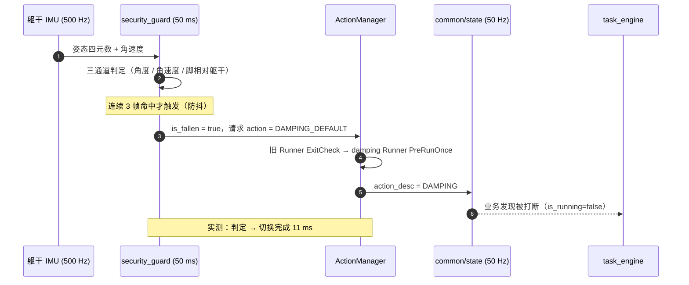

**实测时间线**（2026-10-28 15:26）：

| 时刻 | 事件 |
|---|---|
| 15:26:15.664554 | 看护判定命中 |
| 15:26:15.675410 | 切换到 damping 完成（**+11 ms**） |
| 15:26:15.680 | `common/state` 广播 |
| 15:26:15.684 | 业务侧发现被打断 |

**注意顺序**：先换动作，业务最后才知道。所以"业务日志里看到被打断"必然晚于"看护日志里看到跌倒"。

### 2.2 场景 B：指令断流

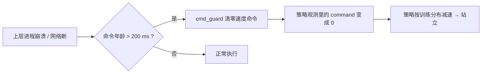

关键点：**网络看到的是 0 指令，不是"没有指令"**。所以行为是"平稳停下"，而不是"保持最后速度"。

### 2.3 场景 C：人工急停（三种入口）

| 入口 | 操作 | 效果 | 证据 |
|---|---|---|---|
| **手柄双键** | `LB+RB` | `PASSIVE_DEFAULT`（零力矩，瘫软） | 【设计】 |
| **手柄双键** | `LT+RT` | `DAMPING_DEFAULT`（阻尼，缓慢倒下） | 【设计】 |
| **系统模式** | 切 `EStop` 模式 | **停掉 `mc` 与 `task_engine`**，只留 `HAL`+`Diagnosis` | 【配置】SM |
| **软件接口** | `SetMcAction` 到安全动作 | 走正常动作通道（受拓扑约束） | 【配置】 |

`EStop` 模式的功能组配置原文：

```yaml
EStop:
  next_mode_list: [Ready, OTA]
  active_FG_list: [HAL, Diagnosis]
```

也就是说：**进入 EStop 后，运控进程本身被停**，此时电机侧靠驱动器/断电行为兜底——这是"最狠"的一级，也是为什么它只保留诊断。

### 2.4 场景 D：障碍与边缘

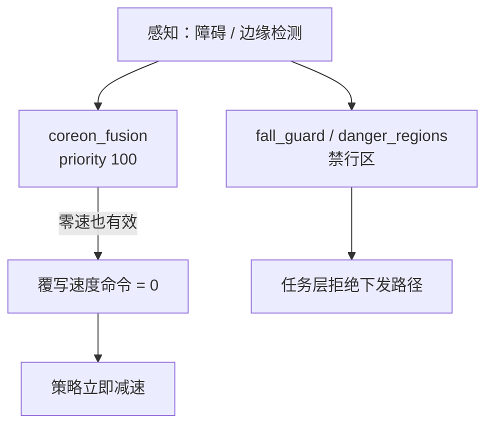

两个要点：

- **零速可抢占**：其他所有速度源"零速不能抢方向盘"，唯独 `coreon_fusion` 可以——这是为避障留的特权；
- **两套机制**：`coreon_fusion` 管"眼前"，`danger_regions` 管"规划层别往那走"。

### 2.5 场景 E：变形中失稳

变形（四足⇄双足）是全程最脆弱的窗口：接触点变化、重心抬升、舵机动作。

| 保护 | 参数 | 证据 |
|---|---|---|
| 任务准入 | 顶部 1.2 m 空间、障碍 0.4 m、回转半径 0.3 m、电量 ≥5% | 【设计】 |
| 拓扑校验 | 只允许从"行走档位"发起 | 【配置】 |
| 重力包络守护 | 偏离参考 30°/40°，连续 2 帧判失败 | 【设计】 |
| 落位门控 | WBC 退出需速度归零 + 步数下限 | 【配置】`exit_wait_stop_step` |

### 2.6 场景 F：极限动作与超速（容易被忽略的一层）

这一层不防"跌倒"，防的是"**人把机器用到超出寿命/能力**"：

| 机制 | 参数 | 说明 |
|---|---|---|
| 极限动作次数配额 | 30 天内 **30 次**；全生命周期 **720 次**，**648 次**预警 | 空翻/跳跃这类高冲击动作 |
| 高速解锁（双足） | 里程 0 / 3000 / 6000 / 9000 m → 限速 **1.6 → 1.9 → 2.2 → 2.5 m/s** | 新手不给全速 |
| 高速解锁（四足） | 同上 → **1.6 → 2.0 → 2.5 → 3.0 m/s** | 同上 |
| 状态持久化 | `/robot/persist/config/high_speed_unlock_state.json` | 重启不丢 |

【配置】`task_engine/cfg/extreme_action_progress.yaml`

> 这是很"产品化"的设计：**安全不只是防摔，还包括限制使用强度**。

---

## 3. 逻辑视图：八层防线

### 3.1 全景

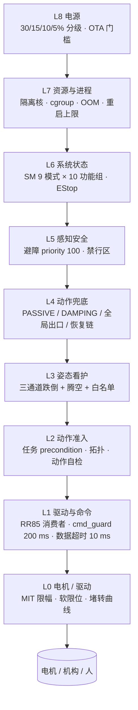

### 3.2 L0：电机与机构

| 项 | 值 | 证据 |
|---|---|---|
| MIT 量程 | 位置 ±10 rad、速度 ±60 rad/s、力矩 ±60 N·m、kp 0~500、kd 0~10 | 【配置】`mit_params` |
| 关节软限位 | 例：髋 roll ±0.4712、pitch −1.2217~4.3633、膝 ±2.618 rad | 【配置】`min/max_limits` |
| PD 力矩裁剪 | `clip_tau` 只约束 PD 纠偏力矩，重力前馈不受限（如 1.0/1.0/0.5 N·m） | 【配置】 |
| 堵转特性 | 驱动器 TN 曲线 | 【设计】 |
| 腰部舵机 | 运动 40% 力矩、到位 25% 保持（防冲击/防堵转发热） | 【设计】 |

### 3.3 L1：驱动与命令

| 保护 | 参数 | 作用 |
|---|---|---|
| 指令消费者最高优先级 | `rt_joint_pub` RR80、iceoryx 订阅 RR85 | 保证电机指令不被业务饿死 |
| 命令过期 | `cmd_guard 200 ms` | 速度命令断流 → 清零 |
| 上肢命令过期 | `custom_upper 200 ms` | 上肢指令断流 → 本周期不写 |
| 数据超时 | IMU/关节 **10 ms** | 反馈不新鲜 → 告警 |
| 诊断上报 | HDS 每 **1000 ms** | 上报节奏 |

### 3.4 L2：动作准入（三道门）

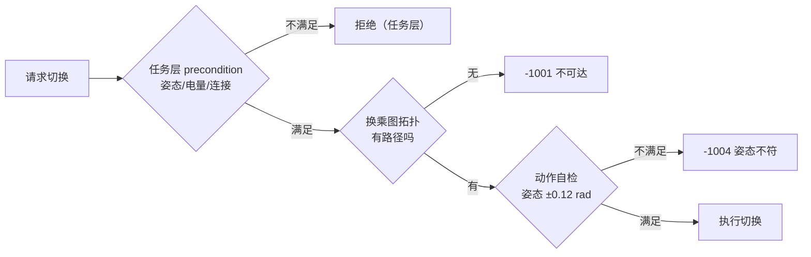

任务层 precondition 的真实字段（【配置】`task_rules.yaml`）：

```yaml
precondition:
  allow_posture: []
  block_posture: [DAMPING_DEFAULT]
  battery_min_percent: 30
  allow_charging_state: false
  check_app_conn: true
  check_network: true
```

### 3.5 L3：姿态看护（安全层里唯一的"在线算法"）

**周期**：50 ms（`security_guard` 组）。**先看白名单**：当前动作不在监护名单里就直接跳过（双足 14 个、四足 19 个）。

```text
每 50 ms:
  if current_action ∉ monitored_actions[form]: 跳过
  up    = 姿态 × 基准轴          # 双足取 x、四足取 z
  delta = angle(up, up_stand)     # 度
  ω     = 躯干角速度模长

  ch1 = delta > 60.0                      连续 3 次
  ch2 = |ω| > 6.0 且 delta > 48.0          连续 3 次
  ch3 = 仅双足：|脚-躯干 z| > 0.8 或 |x| < 0.4   连续 20 次

  复位：用 stand_arm_delta(45°) 迟滞回位【推断】
  触发：任一通道达标 → is_fallen → 切 DAMPING
```

| 参数 | 值 | 含义 |
|---|---|---|
| `fall_delta_threshold` | 60° | 角度通道阈值 |
| `fall_count_threshold` | 3 | 连续命中次数 |
| `gyro_norm_threshold_rad_s` | 6.0 rad/s | 角速度阈值 |
| `fall_delta_soft_threshold` | 48° | 角速度通道的软角度阈值 |
| `gyro_fall_count_threshold` | 3 | 角速度通道次数 |
| `biped_horizontal_abs_max` | 0.8 m | 脚-躯干水平超限 |
| `biped_vertical_abs_min` | 0.4 m | 脚-躯干竖直塌缩 |
| `count_threshold`（脚） | 20 | 脚部通道次数 |
| `stand_arm_delta` | 45° | 复位迟滞 |

**为什么通道 2 的角度阈值更低**：猛推时角速度先冲起来，角度还没到 60°，用"角速度大 + 角度中等"能提前 1~2 个周期发现。

**为什么通道 3 只有双足**：配置里只填了 `RL_FOOT_Link`/`RR_FOOT_Link`，四足没配脚链接。

### 3.6 L4：动作兜底

| 机制 | 内容 |
|---|---|
| 两个安全动作 | `PASSIVE_DEFAULT`（零力矩）、`DAMPING_DEFAULT`（阻尼） |
| 三个全局出口 | `PASSIVE` / `DAMPING` / `QUAD_LIE_DOWN`，任何状态 1 跳可达 |
| 安全动作配置 | `estimator.secure_action = DAMPING_DEFAULT` |
| 恢复链 | `DAMPING → PASSIVE → QUADRUPED_RECOVERY → STEP → STAND` |
| 恢复白名单 | `recovery_behaviors.actions` 9 个动作 |
| 恢复判据 | 姿态误差达标且**稳定 1 s** |

### 3.7 L5：感知安全

| 机制 | 参数 |
|---|---|
| 避障覆写 | `coreon_fusion` priority **100**，零速也接受，占用窗口 500 ms |
| 速度源心跳 | 各源 1000 ms 超时失权 |
| 边缘守卫 | `fall_guard/danger_regions`（感知侧） |
| 变形后布局切换 | 避障布局 dog↔human 随形态切换 |

### 3.8 L6：系统状态

| 模式 | 激活功能组 | 含义 |
|---|---|---|
| Startup / OpenBox / Ready | HAL, Business, Diagnosis, Motion, OTA | 正常 |
| Business | 上述 + Perception | 业务运行 |
| **EStop** | **HAL, Diagnosis** | 运控与任务都停 |
| OTA | OTA | 只留升级 |
| Shutdown | HAL, Business, Poweroff | 关机流程 |
| Standby/IdlePowerSave | 同 Ready | mc 仍在跑，只停 ToF 流 |

### 3.9 L7：资源与进程

| 机制 | 参数 | 作用 |
|---|---|---|
| 核隔离 | `isolcpus=2,3` | 运控独占，业务挤不进来 |
| 线程优先级 | RR85（订阅）> RR80（发布/控制）> 普通 | 保证实时链 |
| cgroup | `robot.slice` 分域（realtime/perception/system/auxiliary） | 防一个域吃满 |
| OOM 保护 | 运控进程免杀 | 内存紧张时先杀业务 |
| 重启上限 | `max_retries` 500 / 5 | 防无限重启风暴 |
| 场景化策略 | `sys_guard/cfg/t1_soc0/scene_*.yaml`，当前 **`enabled: false`** | 预留但未启用【配置】 |

### 3.11 L6.5：HDS 故障兜底（设备/系统级故障）

MC 的看护只管"身体姿态"；**设备与系统级故障**由 HDS 按"故障码 → 兜底计划"查表（`task_engine/cfg/hds/fallback_info.yaml`，H1~H5 分级）：

| 级别 | 示例计划 | 兜底动作 |
|---|---|---|
| **H1-Fatal** | 方案 A | **倒计时 30 s 关机** + 声光提示 |
| **H1-Fatal** | 人型方案 F / G / D | 安全停止 → **力控站立** → 任务暂停/结束；**站不住则允许（阻尼）摔倒** + 声光表情提示 |
| **H2-Critical** | 人型方案 C | 自动运行禁止、遥控允许；运行中安全停止 + 力控站立 + 任务暂停 |
| 5 | 值无效（HDS 自身异常） | 不告警中心提示，仅本地记录 |

> 这解释了现场常见困惑：**同样报"故障"，为什么有时要求"力控站立别倒"，有时又"允许倒下但要阻尼"**——
> 是 HDS 的兜底计划在决定，不是 MC 的跌倒看护。诊断码规模约 **335 KB 的 `diag_info.yaml`**。

### 3.10 L8：电源

| 电量 | 行为 | 证据 |
|---|---|---|
| >30% | 正常；低于 30% 拒绝多数任务（`battery_min_percent: 30`） | 【配置】 |
| 30% | 语音提示 | 【配置】`low_battery_voice` |
| 15% / 10% | 分级语音提示 | 【配置】 |
| 5% | 触发**趴下**（`battery_below_5_prone`） | 【配置】 |
| OTA | 需 ≥50% 电量、先趴下、倒计时 60 s | 【设计】 |
| 变形 | 需 ≥5% 电量 | 【设计】 |

---

## 4. 过程视图：谁在什么时候检查什么

### 4.1 周期表

| 检查 | 周期 | 执行者 |
|---|---|---|
| 关节 PD | 1 ms | `device_manager` |
| 关节命令发布 | ≈5.1 ms | `rt_joint_pub` |
| 命令过期检查 | 每周期 | 控制环 |
| **姿态看护** | **50 ms** | `security_guard` 线程 |
| 数据超时检查 | 每周期（阈值 10 ms） | 控制环 |
| 状态广播 | 20 ms | `common_state_publisher` |
| HDS 上报 | 1000 ms | 诊断模块 |

### 4.2 优先级阶梯与抢占

```
RR85  iceoryx 订阅线程   ← 关节/IMU 反馈，最高
RR80  rt_joint_pub       ← 关节命令发布
RR80  控制环线程          ← 策略推理（超期时 skip wait，不追帧）
RR80  security_guard     ← 50 ms 看护
普通   业务/日志/状态广播
```

**看护不是"插队"，而是"并行"**：它不参与控制环的时间片竞争，只在命中时通过动作通道把控制环"换人"。

### 4.3 超时族谱（最容易混的一组）

| 超时 | 阈值 | 计时对象 | 越过之后 |
|---|---|---|---|
| `cmd_guard` | 200 ms | 速度命令 | 清零 |
| `custom_upper` | 200 ms | 上肢命令 | 本周期不写 |
| 数据超时 | 10 ms | 关节/IMU 反馈 | 告警 |
| 速度源心跳 | 1000 ms | 某个 `source` | 失权（可被抢） |
| 动作切换 RPC | 1000 ms | `SetMcAction` | 超时返回 |
| HDS 上报 | 1000 ms | 诊断 | 周期上报 |

### 4.4 状态传播与可观测性

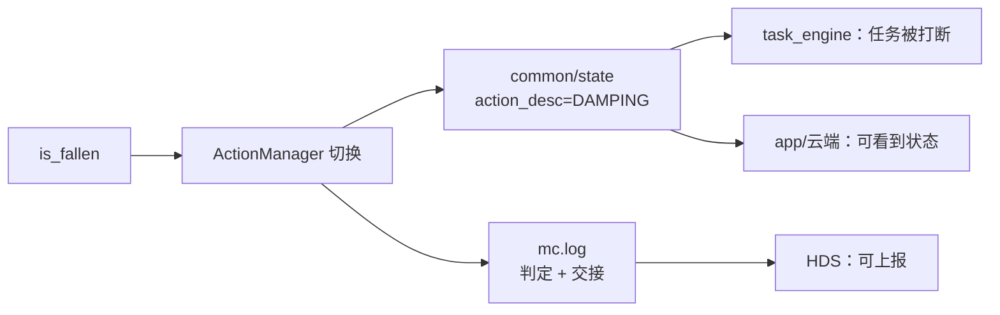

**排障口诀**：`mc.log` 找"判定/交接"，`common/state` 找"结果"，`task_engine` 找"业务侧感受"，三者时间差就是传播延迟。

---

## 5. 开发视图：配置在哪、怎么改、怎么验

### 5.1 配置地图

| 文件 | 管什么 | 改了会怎样 |
|---|---|---|
| `security_guard.yaml` | 看护周期、跌倒阈值、白名单、超时 | 直接决定"会不会判跌倒" |
| `action_state.yaml` | 状态分组、`secure_action`、恢复名单、IMU 姿态门 | 决定"跌倒后往哪退、能不能恢复" |
| `action_ruler.yaml` | 换乘边、全局出口、skip 列表 | 决定"哪些切换被允许" |
| `action_setting.yaml` | 动作→执行组→周期 | 看护动作本身也在里面 |
| `mc_T1.yaml` | 反馈频率、`wait_ready`、执行器 | 影响数据新鲜度 |
| `rl/*.yaml` | `cmd_guard` 之外的策略侧保护（clip/tau/exit） | 影响策略层行为 |
| `task_rules.yaml` | 任务 precondition（电量/姿态/连接） | 决定"业务能不能发起" |
| `hds/fallback_info.yaml` | 故障 → 兜底计划（H1~H5） | 决定"该站住还是允许倒下" |
| `sys_guard/cfg/*/scene_*.yaml` | 场景化 cgroup（当前未启用） | 启用后改变资源分配 |
| `device_manager/*.yaml` | MIT 量程、软限位、CAN | 物理极限 |

### 5.2 参数总表（速查）

| 类别 | 参数 | 值 |
|---|---|---|
| 看护 | 周期 / 角度 / 次数 | 50 ms / 60° / 3 |
| 看护 | 角速度 / 软角度 / 次数 | 6.0 rad/s / 48° / 3 |
| 看护 | 脚水平 / 脚竖直 / 次数 | 0.8 m / 0.4 m / 20 |
| 看护 | 监护名单 | 双足 14 / 四足 19 |
| 命令 | cmd_guard / 上肢 | 200 ms / 200 ms |
| 数据 | 反馈超时 | 10 ms |
| 电机 | p / v / t | ±10 rad / ±60 rad/s / ±60 N·m |
| 电机 | kp / kd | 0~500 / 0~10 |
| 策略 | `clip_tau` | 0.5~1.0 N·m（PD 项） |
| 准入 | IMU 姿态门 | ±0.12 rad（≈7°） |
| 电源 | 提示 / 趴下 | 30/15/10% / 5% |
| 极限 | 次数 / 预警 | 30 次/30 天、720/648 次 |
| 解锁 | 双足限速阶梯 | 1.6→1.9→2.2→2.5 m/s |

### 5.3 二次开发红线

| 不要做 | 原因 |
|---|---|
| 改 `fall_delta_threshold` / 次数 | 直接影响误判/漏判，必须整车验证 |
| 从监护名单里删动作 | 该动作将完全不受跌倒保护 |
| 改 `cmd_guard` 到很大 | 断流后机器人会带着旧速度继续走 |
| 关 `wait_ready` | 首帧脏数据可能直接进网络 |
| 改 MIT 量程 | 驱动器可能拒收或饱和，属硬件参数 |
| 用 `SetMcAction` 绕过任务 precondition | 电量/姿态/连接检查被跳过 |

### 5.4 验收测试矩阵

| 层 | 怎么测 | 期望现象 |
|---|---|---|
| L3 跌倒 | 站立时用手推躯干超过 60° | 3 帧内判定，11 ms 内切阻尼 |
| L3 角速度 | 快速侧向推 | 6 rad/s + 48° 通道提前触发 |
| L1 断流 | 杀掉 App/规划进程 | 200 ms 后速度归零，机器人减速站立 |
| L2 准入 | 低电量（<30%）下发任务 | 任务层拒绝 |
| L4 恢复 | 跌倒后下发恢复 | 走 recovery 链，稳定 1 s 后退出 |
| L5 避障 | 前方放障碍 | `coreon_fusion` 零速覆写 |
| L6 EStop | 切 EStop 模式 | mc 与 task_engine 被停 |
| L7 资源 | 制造内存压力 | 运控进程不被 OOM 杀 |
| L8 电源 | 放电到 5% | 触发趴下 |

---

### 5.5 症状 → 哪一层 → 看哪里

| 现象 | 先怀疑 | 看什么 |
|---|---|---|
| 走着走着突然瘫软 | L4 `PASSIVE` | `mc.log` 是否有 `PASSIVE_DEFAULT` 切换、是否 EStop |
| 走着走着变"软脚虾"慢慢倒 | L4 `DAMPING` | 看护日志是否有 `is_fallen` |
| 断网后还在走 | L1 `cmd_guard` | 命令年龄是否真被清零（看 `common/state` 的 command） |
| 上肢突然不动 | L1 `custom_upper` | 200 ms 超时是否触发 |
| 想切的动作切不过去 | L2 准入 | 返回码：-1001 不可达 / -1004 姿态 / -10001 频率 |
| 靠近障碍不停 | L5 避障 | `coreon_fusion` 是否使能、优先级是否 100 |
| 变形到一半失败 | L2/L5 | `transform_fall_check` 是否判失败、电量/空间是否满足 |
| 机器人整体"僵住" | L6/L7 | SM 当前模式、进程是否被停/重启、cgroup 是否被限 |
| 电量很低还不趴下 | L8 | 电量阈值、`low_battery_voice` / `prone` 是否触发 |
| 极限动作被拒 | 极限配额 | 30 天 30 次 / 生命周期 720 次是否用尽 |

## 6. 物理视图：硬件与机电

| 项 | 内容 |
|---|---|
| 总线 | CAN-FD 1 M/5 M，14 关节分 can0/can1，双路冗余 |
| 驱动 | MIT 模式，位置/速度/力矩闭环由驱动器完成 |
| 急停回路 | 手柄双键（软急停）+ 系统 EStop 模式；**是否有硬件断电回路未取证** |
| 机械限位 | URDF + `min/max_limits` 双保险 |
| 腰部舵机 | Feetech 串行总线，运动/保持力矩分级 |
| 电源 | 电池管理上报电量，任务层按阈值拒绝任务 |

> **边界**：本文没有拿到电气原理图，**"急停是否切断电机动力电"无法确认**。从软件侧只能确认"零力矩/阻尼/停进程"三类行为。

---

## 7. 已知边界与不保证

1. **不保证物理不摔**：跌倒检测是"事后 50 ms 级"，不是预测控制。
2. **不保证零误报**：大幅刻意动作（空翻、躺下）在监护名单内仍可能误判，靠名单规避。
3. **四足没有脚部几何通道**：只有角度 + 角速度两条。
4. **监护名单之外的动作完全不受保护**。
5. **`sys_guard` 场景化资源策略当前未启用**（`enabled: false`）。
6. **数据超时只告警不停机**：10 ms 超时不会自动切安全动作（由看护的动作超时另算）。
7. **EStop 之后的行为依赖驱动器/断电**：软件侧已停，电机侧行为未取证。
8. **设计文档与实现存在差异**：如变形时长设计文档写 ≈4.4 s，实测 4.806 s。

---

## 8. 证据索引

| 结论 | 来源 |
|---|---|
| 看护参数（60°/3、6 rad/s/48°/3、0.8/0.4/20、名单 14/19） | `cfg/security_guard.yaml` |
| cmd_guard 200 ms / 数据超时 10 ms | 同上 `cmd_guard` / `data_timeout_guard` |
| 安全动作 = DAMPING、恢复名单 9 个 | `cfg/action_state.yaml` |
| IMU 姿态门 ±0.12 rad | 同上 `action_imu_check` |
| 3 个全局出口 | `cfg/action_ruler.yaml` |
| EStop 功能组 = HAL+Diagnosis | `sm/cfg/qy3576_t1_v2d1_2X.yaml.dump` |
| 电量 30/15/10/5% | `task_engine/cfg/low_battery_voice.yaml`、`task_rules.yaml` |
| 极限动作 30/720/648、限速阶梯 | `task_engine/cfg/extreme_action_progress.yaml` |
| 跌倒判定→切换 11 ms | `mc.log` 2026-10-28 15:26:15 |
| MIT 量程、关节软限位 | `device_manager/cfg/t1_v2d0_config.yaml` |
| 手柄双键 LB+RB / LT+RT | 设计文档 §2.4 |
| 变形准入 1.2/0.4/0.3 m、重力包络 30°/40° | 设计文档 §8 |
| OTA ≥50% + 趴下 + 60 s | 设计文档 §8 |
| sys_guard 场景未启用 | `sys_guard/cfg/t1_soc0/scene_*.yaml` 的 `_meta.enabled: false` |
````


---

## FILE: raw/docs/t1_three_links.md

- bytes: 47890

````markdown
# 运控三大核心链路设计分析：安全 · 切换 · 整形

> 目标：**不是复述 T1，而是提炼出可迁移到其他四足机器人的架构**。
> 每个结论都给"T1 怎么做"与"通用化怎么做"两层，并标注证据来源。
> 三源交叉：① 本地文档（`T1运控安全设计详解.md` 等）；② Z 盘原始配置/日志；③ 站点 `192.168.10.35:8081`、`192.168.10.200:8211`。

---

## 0. 阅读方式与证据分级

| 标记 | 含义 | 主要来源 |
|---|---|---|
| 【配置】 | 板端 YAML 原文 | Z 盘 `robot_rk/software/*/bin/cfg` |
| 【日志】 | 真机日志原文 | Z 盘 `persist/log/mc/mc.log` |
| 【实测】 | 由日志时间戳/计数算出 | 同上 |
| 【站点】 | 两台分析站的报告 | site35 / site200 |
| 【设计】 | 4+1 设计文档 | `Design_T1Pro...简版.md` |
| 【推断】 | 多证据推理，未直接验证 | — |

**可迁移性原则**：凡是被标为【配置】的数值，都是"某台机器标定出来的"，迁移时**必须重标**；
凡是被标为【设计】的结构（分层、时序、接口），才是可以整段搬走的。

---

## 1. 全景：三条链路的分工

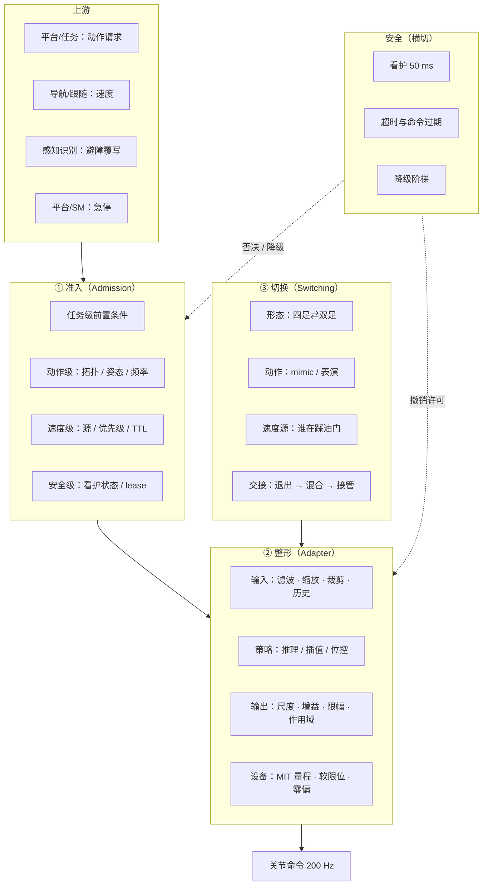

**三条链路的职责边界**（这是迁移时最先要划清的）：

| 链路 | 回答的问题 | 谁可以改 | 典型失败 |
|---|---|---|---|
| 准入 | 这个请求**允不允许**发生 | 策略/配置 | 不该切的动作被切了、该停的没停 |
| 整形 | 允许之后，**怎么变成**关节目标 | 标定/参数 | 量纲错、超限、抖动、走偏 |
| 切换 | 从 A 到 B **怎么过渡** | 状态机 | 跳变、卡死、双写冲突 |
| 安全 | 出问题时**怎么兜底** | 独立模块 | 漏判、误判、降级不及时 |

---

# Part A　安全层设计

## A1 失效模型：先定义"怕什么"

| 编号 | 危险 | 触发条件 | 后果 |
|---|---|---|---|
| H1 | 跌倒 | 被推、打滑、台阶、步态失稳 | 摔机、撞人、关节撞地 |
| H2 | 失控运动 | 指令断流、源抢占、遥控丢包 | 冲撞、坠楼 |
| H3 | 过力过速 | 堵转、撞障、参数误改 | 烧电机、断结构 |
| H4 | 夹伤碰撞 | 变形时有人靠近、手臂挥动 | 人员受伤 |
| H5 | 卡死失联 | 进程崩溃、内存耗尽、CPU 被抢 | 僵住或乱动 |

**通用原则**：安全设计从**失效模型**出发，而不是从"加个急停"出发。每一条 H 都要能回答：谁检测、多久检测到、检测到之后做什么、如果检测失败还有谁。

## A2 分层结构：八层纵深

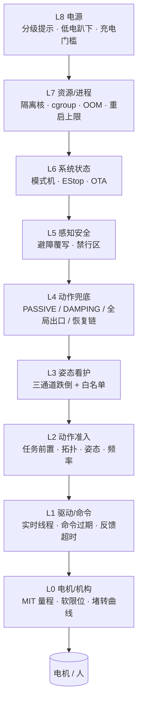

| 层 | T1 的实现 | 证据 | 迁移时是否照搬 |
|---|---|---|---|
| L0 | MIT p±10 / v±60 / t±60 / kp 0~500 / kd 0~10；关节软限位 | 【配置】`device_manager` | **参数重标**，机制照搬 |
| L1 | 实时线程 RR80/85；命令过期 200 ms；反馈超时 10 ms | 【配置】`mc_T1.yaml` | 照搬 |
| L2 | 任务 precondition（电量/姿态/连接）；动作拓扑；IMU 姿态门 ±0.12 rad | 【配置】`task_rules.yaml`、`action_state.yaml` | 照搬 |
| L3 | 三通道跌倒，50 ms 周期，白名单 | 【配置】`security_guard.yaml` | 算法照搬，阈值重标 |
| L4 | PASSIVE/DAMPING + 3 个全局出口 + 恢复链 | 【配置】`action_ruler.yaml` | 照搬 |
| L5 | `coreon_fusion` priority 100，零速可抢 | 【配置】 | 照搬 |
| L6 | SM 9 模式 × 10 功能组，EStop 只留 HAL+Diagnosis | 【配置】 | 按新系统裁剪 |
| L7 | `isolcpus=2,3`、cgroup、OOM 免杀、重启上限 | 【配置】 | 照搬 |
| L8 | 30/15/10% 提示，5% 趴下，变形 ≥5%，OTA ≥50% | 【配置】`low_battery_voice.yaml`、`extreme_action_progress.yaml` | 阈值按产品定 |

## A3 跌倒判定：三通道算法（可直接搬）

**核心思想**：单通道必然漏报或误报，所以用**三个正交信号**各自计数、任一触发。

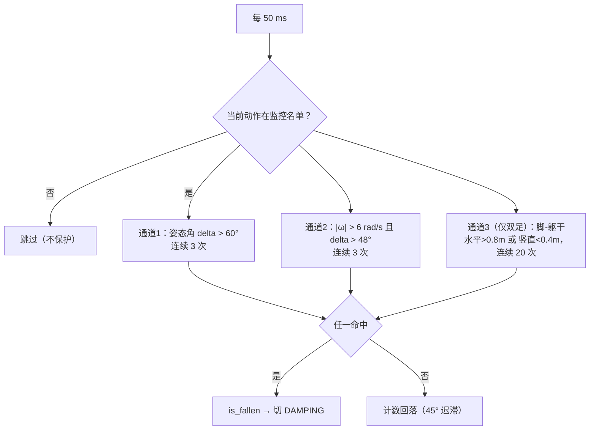

| 参数 | T1 值 | 含义 | 迁移建议 |
|---|---|---|---|
| `fall_delta_threshold` | **60°** | 角度阈值 | 按机身高度/腿长重标（越高越早判） |
| `fall_count_threshold` | **3** | 连续帧数 | 50 ms 周期下 = 150 ms 确认 |
| `gyro_norm_threshold_rad_s` | **6.0** | 角速度阈值 | 按最大角速度重标 |
| `fall_delta_soft_threshold` | **48°** | 角速度通道的软角度 | 保持"比主阈值低 12°"的比例 |
| `stand_arm_delta` | **45°** | 复位迟滞【推断】 | 与主阈值差 15° |
| 脚水平/竖直/次数 | **0.8 m / 0.4 m / 20** | 仅双足 | 双足才需要；四足可省 |
| 监控名单 | 双足 14 / 四足 19 | 只保护"该保护的动作" | 按动作表维护 |

**站点佐证**：`site200/t1-runtime` 记录的"跌倒切阻尼（S09）"样本与 11 ms 切换时延一致【站点】。

## A4 安全动作与恢复

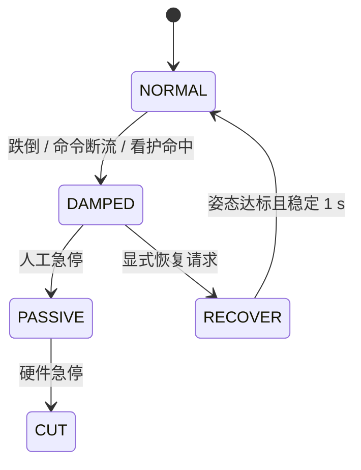

| 动作 | 语义 | 何时用 | 风险 |
|---|---|---|---|
| `PASSIVE` | 零力矩（瘫软） | 严重故障、人工急停 | 会直接倒下 |
| `DAMPING` | 阻尼（缓慢倒） | 跌倒、断流 | 需要时间 |
| `QUAD_LIE_DOWN` | 主动趴下 | 低电、关机前 | 需要空间 |
| 恢复链 | DAMPING→PASSIVE→RECOVERY→STEP→STAND | 跌倒后 | 需要足够空间 |

**恢复的两个硬条件**（T1 做法，可搬）：
1. 只有**白名单动作**允许在恢复态插入（9 个）；
2. 恢复完成判据 = 姿态误差达标 **且稳定 1 s**。

## A5 触发链路与时延（实测）

| 事件 | 检测 | 生效 | 证据 |
|---|---|---|---|
| 跌倒 → 阻尼 | 50 ms 周期 + 3 帧 | 判定后 **11 ms** 切完 | 【实测】`mc.log` 15:26:15 |
| 命令断流 → 速度清零 | 200 ms TTL | 下一拍 | 【配置】 |
| 反馈超时 → 告警 | 10 ms | 下一拍 | 【配置】 |
| 状态广播 → 上层可见 | 20 ms（50 Hz） | — | 【配置】 |
| 急停（SM） | 模式切换 | ≤100 ms | 【设计】 |

**通用结论**：安全链路的时延预算是"**检测周期 × 确认帧数 + 交接时间**"。50 ms × 3 + 11 ms ≈ 161 ms 是 T1 的最坏确认时间——迁移时这个数值必须重新算，并写进安全需求。

## A6 跨域安全：不是运控一家的事

| 机制 | 谁负责 | 与运控的接口 |
|---|---|---|
| 系统急停 | SM | 切 EStop 模式 → 停 mc 进程 |
| 故障兜底 | HDS | 故障码 → H1~H5 计划（如"力控站立或允许阻尼倒"） |
| 低电 | 平台 | 阈值触发 `SetMcAction(110)` |
| 避障 | 感知 | 覆写速度为 0（priority 100） |
| 被撞 | HAL/平台 | **当前无**，需新增 `IMPACT_DETECTED`【设计缺口】 |
| 跌倒告警（人） | 感知/大脑 | 与运控无关（运控只管自身） |

## A7 可迁移的安全设计（抽象版）

**把 T1 的"八层"抽象成四个可复用组件**：

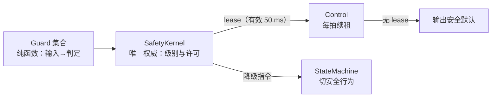

| 组件 | 职责 | 接口（建议） | 迁移注意 |
|---|---|---|---|
| `Guard` | 单一判据（跌倒/超时/温度/负载） | `evaluate(Inputs) -> Verdict` | 纯函数、可单测、可组合 |
| `SafetyKernel` | 级别推进、许可发放 | `renew()`, `request(level)`, `snapshot()` | **单一写者**，其它模块只能请求 |
| `LeaseProvider` | 许可令牌 | `lease{id, expire_ns}` | 有效期 = 3~5 个控制周期 |
| `Fallback` | 级别 → 行为映射 | `action_for(level)` | 安全行为必须内置、不可被普通请求选中 |

**参数化清单（换机器必须重标）**：跌倒角度/角速度/脚阈值、确认帧数、反馈超时、命令 TTL、看护周期、恢复稳定时长、电量分级。


---

# Part B　切换设计

## B1 三类切换的统一模型

切换看似五花八门，本质都是同一个四阶段：

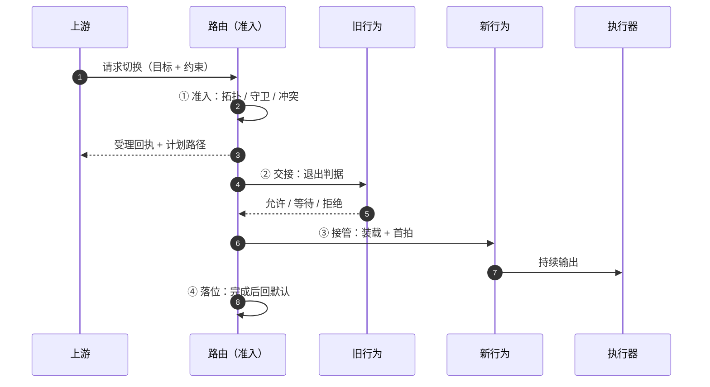

| 切换类型 | 触发 | 时间尺度 | 关键难点 |
|---|---|---|---|
| **形态**（四足⇄双足） | 平台请求 | **3.0~4.8 s** | 物理约束 + 多模块联动 |
| **动作**（mimic/表演） | 平台请求 + 资源 | 0.4 s ~ 18 s | 模型与轨迹绑定 |
| **速度源**（谁踩油门） | 上游持续发 | **毫秒级** | 优先级与抢占规则 |

## B2 形态切换（四足 ⇄ 双足）

### B2.1 拓扑：只有 6 个"门"

| 方向 | 动作 | ID | 实测时长 |
|---|---|---|---|
| 四足→双足 | `QUADRUPED_TO_BIPED` | 10 | 4.806 s（常规）【实测】 |
| 四足→双足 | `QUADRUPED_TO_BIPED_ROTATE` | 11 | 4.806 s（旋转变形） |
| 四足→双足 | `..._FRONTFLIP` | 12 | 特技 |
| 双足→四足 | `BIPED_TO_QUADRUPED` | 20 | 3.00 s【实测】 |
| 双足→四足 | `..._ROTATE` | 21 | 3.00 s |
| 双足→四足 | `..._FRONTFLIP` | 22 | 特技 |

**关键事实**：形态切换不是"随时可切"，而是**只能在特定动作下发起**（T1 要求从行走档位发起，且需先 WBC 站定）【配置+设计】。

### B2.2 时序：一次变形里发生了什么

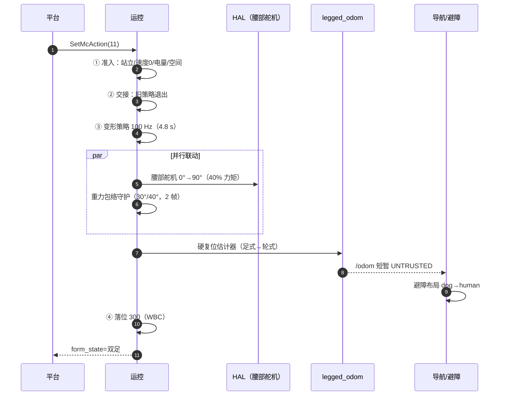

### B2.3 三个必须做对的细节

| 细节 | T1 做法 | 为什么重要 |
|---|---|---|
| **腰部舵机联动** | 运动 40% 力矩、到位 25% 保持 | 与策略开环并发；力矩太大会顶坏 |
| **重力包络守护** | 偏离参考 30°/40°，连续 2 帧判失败 | 用"成功样本包络"而非建模，轻量有效【设计】 |
| **估计器切换** | 变形即运动学模型切换，旧状态作废 | 不切换会导致 odom 跳变/漂移 |

### B2.4 失败与回退

| 失败 | 处理 | 用户可见 |
|---|---|---|
| 准入不满足 | 拒绝，保持原形态 | 错误码 |
| 变形中失稳 | 重力包络判失败 → 回退姿态 | 事件 |
| 变形中急停 | 中止，进安全态 | 事件 |
| 落位失败 | 停在 `stand`，等重试 | 状态 |

## B3 模仿与表演切换

### B3.1 绑定关系：动作 → 模型 + 轨迹

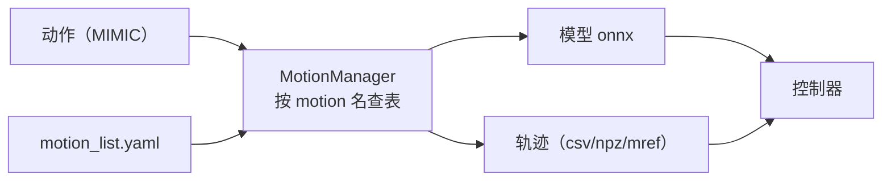

**三种轨迹载体的本质区别**（迁移时必须选一种）：

| 载体 | 内容 | 谁在用 | 迁移建议 |
|---|---|---|---|
| 上肢 CSV | 只有 6 个上肢关节 | ANIMATION（304 条） | **不要用于全身** |
| 全身 CSV | 关节 + 基座位姿 | 四足 MIMIC（实际只用基座 6 列） | 需显式声明用哪些列 |
| NPZ | 14 关节 + 17 刚体，50 Hz | 双足 NPZ MIMIC | 完整但慢 |
| ONNX 内嵌 | 轨迹烘进模型 | 灵创 | 换动作=换模型，体积大 |

### B3.2 切换方式

| 切换 | 机制 | 注意 |
|---|---|---|
| 换一支舞 | 换 `motion` 名（同一模型） | 模型复用，只换轨迹 |
| 换一套模型 | 换 `policy.path` | 需重新加载 session |
| 中断当前表演 | `interrupt=true` | 走交接协议 |
| 播完 | `return_to`（自动回默认动作） | 必须有，否则会"停在那" |

## B4 速度源切换（"谁在踩油门"）

### B4.1 规则表

| 规则 | T1 实现 | 迁移建议 |
|---|---|---|
| 优先级 | 7 源 70~100 | 保留分层：安全(100) > 应用(90) > 交互/导航(80) > 遥控(70) |
| 占用窗口 | 1000 ms（避障 500） | 与优先级配合，防止高频抢占 |
| 零速不能抢 | 除安全源外 | **保留**：否则"松手"会误清别人的指令 |
| 同优先级 | 等窗口 | 保留 |
| TTL | 1000 ms 失权 | 按上游频率设（建议 3~5 个周期） |
| 避障特权 | priority 100，零速有效 | 保留，这是安全必需 |

### B4.2 仲裁流程

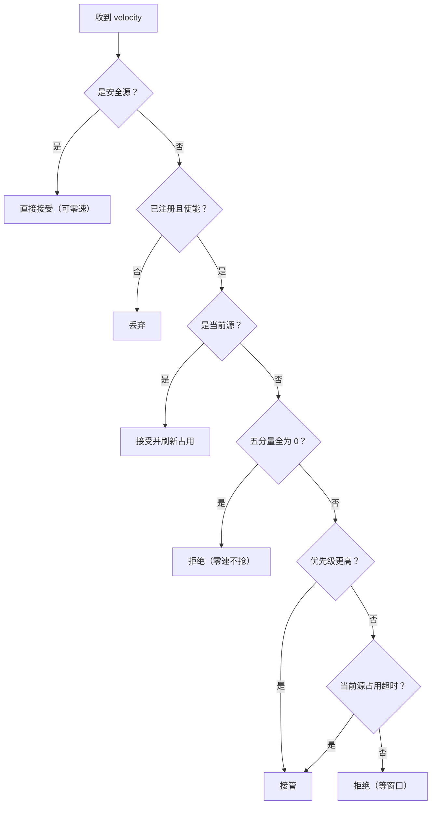

## B5 切换的四个共性问题（T1 踩过的坑）

| 问题 | 表现 | 根因 | 通用解法 |
|---|---|---|---|
| **隐式插站** | 日志里突然出现 121/115 | 图寻路自动插中转 | 中转必须显式声明，响应返回 `plan[]` |
| **交接判据分散** | 每个控制器自己判断"能不能走" | 无统一协议 | `prepare_exit` 三态：ready/wait/refuse |
| **双写冲突** | 两组写同一关节，谁后写谁生效 | 无归属声明 | `scope` / `owns` 显式声明，冲突启动期报错 |
| **缓存键陷阱** | 同名不同周期重复建实例 | 键含 period | 键显式含 `kind / path / rate`，并在日志打印 |

## B6 可迁移的切换设计

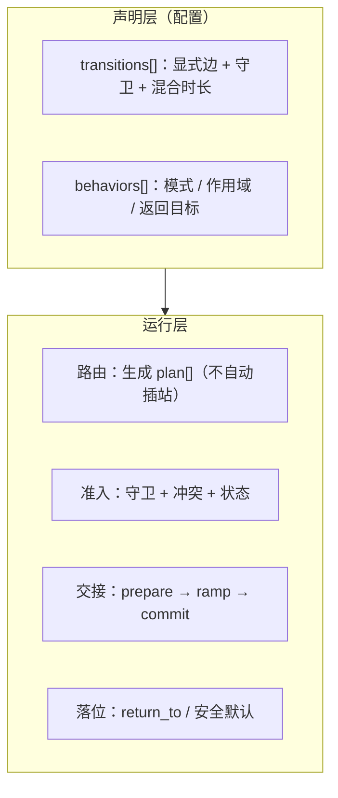

**四条通用规则**：

1. **能切的边写在配置里**，代码不猜；
2. **一次请求返回完整计划**，调用方在执行前就知道要经过什么；
3. **交接四段固定**（准备/混合/提交/清理），控制器只实现 `on_enter/step/on_exit`；
4. **混合由框架做**（目标与增益同步插值），避免每个控制器自己写过渡。

---

# Part C　准入与 Adapter 整形

## C1 命令全链路：一条速度到一帧 CAN

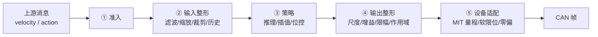

| 阶段 | 输入 | 输出 | 典型参数 |
|---|---|---|---|
| ① 准入 | 请求 | 允许/拒绝 | TTL、优先级、拓扑、姿态门 |
| ② 输入整形 | 原始反馈 + 指令 | 观测向量 | 截止频率 100 Hz、缩放 0.05/0.25/2.0、clip 20 |
| ③ 策略 | 观测 | 动作 | dt 0.01、历史 10 帧 |
| ④ 输出整形 | 动作 | 关节目标 + 增益 | action_scale、kp/kd、tau_limit、scope |
| ⑤ 设备适配 | 关节目标 | CAN 帧 | MIT 量程、软限位、零偏 |

## C2 准入：三层闸门

| 层 | 检查 | 失败码 | 谁实现 |
|---|---|---|---|
| 任务级 | 电量、姿态、连接、是否充电 | 任务层拒绝 | 平台 |
| 动作级 | 拓扑可达、IMU 姿态 ±0.12 rad、频率 | -1001 / -1004 / -10001 | 运控 |
| 速度级 | 源注册、优先级、TTL、零速规则 | 丢弃/拒绝 | 运控 |

**通用原则**：**准入越靠上游越便宜**（任务层拒绝不耗运控资源），但**安全相关准入必须放在运控**（不能依赖上游自觉）。

## C3 输入 Adapter：把异构反馈变成"策略能吃的观测"

### C3.1 五道处理

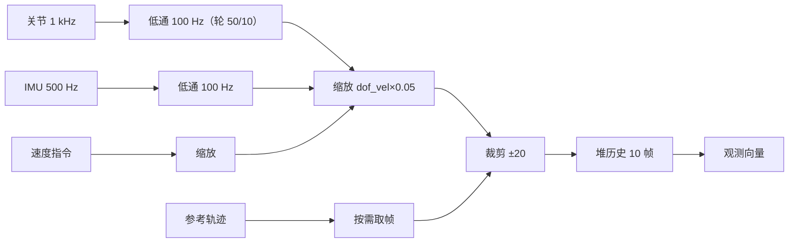

| 处理 | T1 值 | 作用 | 迁移注意 |
|---|---|---|---|
| IMU 低通 | 100 Hz | 抑制振动 | 按机身刚度重标 |
| 关节低通 | 100 Hz（轮 50/10） | 轮速噪声大，单独降 | 轮式必须单独设 |
| 缩放 | dof_vel 0.05、ang_vel 0.25、lin_vel 2.0 | 让输入落在 O(1) | **与训练时完全一致**，否则行为异常 |
| 裁剪 | obs_clip 20~200 | 防异常值 | 与缩放配套 |
| 历史 | 10 帧 | 提供速度/趋势信息 | 与训练帧数一致 |
| 缺失处理 | 超时→标记 stale | 让安全层决定降级 | 不要用 0 填充掩盖问题 |

### C3.2 一个反直觉的结论

**策略不吃"实测线速度"**（T1 46 份配置全是 0 份含 `lin_vel` 输入）【配置】。
原因：策略靠**关节速度（轮速是速度代理）+ 上一拍动作 + 历史**隐式推断运动状态。
迁移时如果强行加入线速度估计，必须重新训练，不能直接喂。

## C4 输出 Adapter：把动作变成关节目标

### C4.1 六道处理


| 处理 | T1 值 | 作用 | 迁移注意 |
|---|---|---|---|
| 动作裁剪 | 20/50/100/200（或 16） | 防单拍爆炸 | 与训练一致 |
| 尺度 | 腿 0.1~0.2、轮 2.0 | 网络输出→物理量 | **轮和腿语义不同**，必须逐维声明 |
| 默认位 | `default_dof_pos` | 动作是"增量" | 与训练初始姿态一致 |
| 增益 | 腿 30~100、上肢软 2~4 | 刚度 | 按负载重标 |
| 力矩限幅 | `tau_limit 15/30 N·m` | 保护机构 | 按电机/结构重标 |
| 作用域 | `owns` / `scope` | 决定谁写哪些关节 | **必须有**，否则双写冲突 |
| 过渡 | `transition_duration 0.1~0.3 s` | 切换平滑 | 与切换协议配合 |
| 里程计补偿 | `odom_kp/kd`、`disable_after_switch 1 s` | 修正长期漂移 | 可选，需实测 |

### C4.2 最容易出错的三处

| 错误 | 后果 | 检查方法 |
|---|---|---|
| 速度维用了位置增益 | 轮子被"锁"住或暴走 | 检查 `kps=0` 的维度是否就是速度维 |
| 缩放与训练不一致 | 步态变形、抖动 | 与训练配置逐项 diff |
| 作用域重叠 | 两个行为打架 | 启动期校验掩码互斥 |

## C5 设备 Adapter：最后一公里

| 项 | T1 值 | 迁移注意 |
|---|---|---|
| MIT 位置量程 | ±10 rad | 按关节行程重标 |
| 速度量程 | ±60 rad/s | 按电机重标 |
| 力矩量程 | ±60 N·m | 按电机/减速比重标 |
| kp/kd 量程 | 0~500 / 0~10 | 按驱动器重标 |
| 软限位 | 每关节 min/max | 必须来自 URDF 或标定 |
| 零偏/方向 | 每关节标定 | **换机器人必须重标** |
| 轮 vs 腿 | 轮速度控制、腿位置控制 | 逐维声明语义 |

## C6 参数迁移对照表（换机器人时按此重标）

| 参数 | T1 值 | 重标依据 |
|---|---|---|
| 跌倒角度/角速度 | 60° / 6 rad/s | 机身高度、腿长、最大角速度 |
| 关节低通 | 100 Hz（轮 50/10） | 采样率与噪声水平 |
| 观测缩放 | 0.05 / 0.25 / 2.0 | **训练配置**（不能改） |
| 动作尺度 | 0.1~2.0 | **训练配置** |
| 增益 | 腿 30~100 | 负载与结构刚度 |
| 力矩限幅 | 15/30 N·m | 电机与结构 |
| MIT 量程 | ±10/±60/±60 | 关节行程与电机 |
| 命令 TTL | 200 ms | 上游频率 |
| 看护周期 | 50 ms | CPU 预算 |
| 变形时长 | 4.8 s / 3.0 s | 策略相位时钟（非物理常数） |


---

# Part D　迁移到其他四足机器人

## D1 七个必须抽象的接口

迁移的本质不是"抄代码"，而是**先把接口定对**。下面七个接口定了，硬件/策略/上游都可以换。

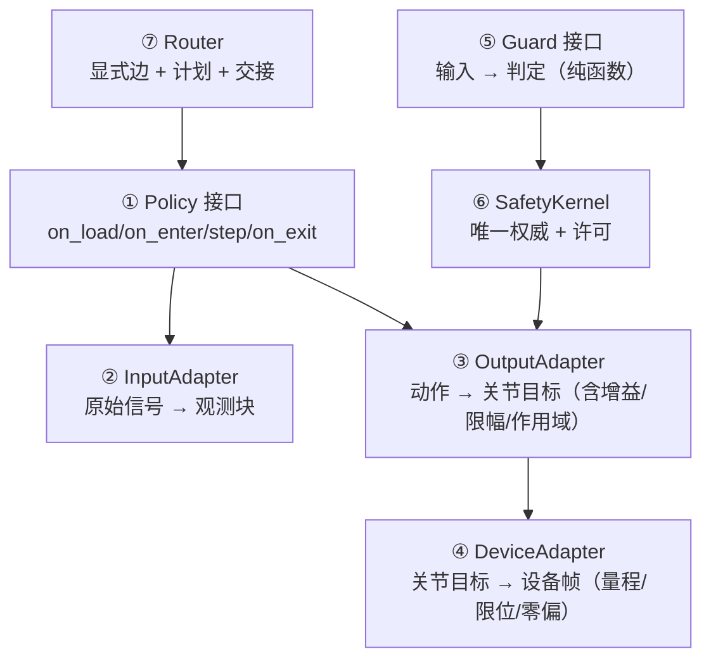

| # | 接口 | 方法（建议） | 迁移时谁实现 |
|---|---|---|---|
| ① | `Policy` | `on_load(spec) / on_enter(ctx) / step(obs, act) / on_exit()` | 算法团队（按契约） |
| ② | `InputAdapter` | `build(raw) -> ObsView` | 平台团队（按传感器） |
| ③ | `OutputAdapter` | `shape(act) -> JointCmd[]` | 平台团队（按机构） |
| ④ | `DeviceAdapter` | `encode(JointCmd) -> Frame` | 驱动团队 |
| ⑤ | `Guard` | `evaluate(inputs) -> Verdict` | 安全团队 |
| ⑥ | `SafetyKernel` | `renew() / request(level) / snapshot()` | 安全团队 |
| ⑦ | `Router` | `plan(from,to) -> Step[] / commit(step)` | 平台团队 |

**为什么是这七个**：它们正好对应三条链路 + 设备边界——换机器人时，①③④ 必改，② 视传感器改，⑤⑥⑦ 可原样复用。

## D2 必须重标的参数（12 项）

| # | 参数 | T1 值 | 重标依据 | 验证方法 |
|---|---|---|---|---|
| 1 | 跌倒角度阈值 | 60° | 机身高度/腿长 | 推倒试验（低速） |
| 2 | 跌倒角速度阈值 | 6 rad/s | 最大角速度 | 快速推倒 |
| 3 | 确认帧数 | 3（×50 ms） | 噪声水平 | 误报统计 |
| 4 | 脚部几何阈值 | 0.8/0.4 m | 腿长 | 双足专项 |
| 5 | 反馈超时 | 10 ms | 传感器频率 | 丢帧注入 |
| 6 | 命令 TTL | 200 ms | 上游频率 | 断流测试 |
| 7 | 观测缩放 | 0.05/0.25/2.0 | **训练配置** | 与训练 diff |
| 8 | 动作尺度 | 0.1~2.0 | **训练配置** | 与训练 diff |
| 9 | 增益 kp/kd | 腿 30~100 | 负载/刚度 | 阶跃响应 |
| 10 | 力矩限幅 | 15/30 N·m | 电机/结构 | 堵转试验 |
| 11 | MIT 量程 | ±10/±60/±60 | 关节/电机 | 驱动器确认 |
| 12 | 软限位 | 每关节 | URDF/标定 | 极限位置检查 |

**判定规则**：第 7、8 项**不能改**（属于训练分布）；其余必须重标。

## D3 最小可用架构（MVP，四步走）

```mermaid
flowchart LR
    S1["Step1<br/>单策略 + 速度<br/>（走起来）"] --> S2["Step2<br/>加安全内核<br/>（跌不倒）"]
    S2 --> S3["Step3<br/>加切换与交接<br/>（换得动）"]
    S3 --> S4["Step4<br/>Adapter 配置化<br/>（换机器不改码）"]
```

| 阶段 | 目标 | 交付 | 验收 |
|---|---|---|---|
| Step 1 | 一个行走策略 + 速度输入 + 关节输出 | 能按指令走 | 0.5 m/s 直线 10 m，偏差 <0.3 m |
| Step 2 | 看护 + 降级 | 推倒能切阻尼 | 推倒 → 阻尼 ≤200 ms |
| Step 3 | 显式转换图 + 四段交接 | 动作之间能切 | 切换无跳变（力矩尖峰 <1.5×） |
| Step 4 | 三个 Adapter 全部配置化 | 换机型只改配置 | 新机型 1 周内跑通 |

**经验**：Step 2 一定要在 Step 3 之前——先保证"摔不坏"，再谈"切得好"。

## D4 验收测试矩阵

| 类别 | 测试 | 通过标准 |
|---|---|---|
| 功能 | 速度跟踪 | 0.2/0.5/1.0 m/s 阶跃，超调 <10% |
| 功能 | 形态切换 | 四→双、双→四各 20 次，无失败 |
| 功能 | 动作切换 | 连续切 10 个动作，无卡死 |
| 性能 | 控制环 | 100 Hz，p99 ≤8 ms |
| 性能 | 命令发布 | 200 Hz，抖动 p99 ≤0.5 ms |
| 安全 | 推倒 | 3 通道各自可触发 |
| 安全 | 反馈冻结 | 10 ms 告警，200 ms 降级 |
| 安全 | 命令断流 | 200 ms 停车 |
| 安全 | 急停 | ≤100 ms 进安全态 |
| 迁移 | 换机型 | 改配置 + 重标 12 参数，1 周内跑通 |

## D5 T1 踩过的八个坑（迁移时直接避开）

| # | 坑 | 现象 | 对策 |
|---|---|---|---|
| 1 | 隐式中转 | 日志里突然出现 121/115 | 中转显式声明 + 返回 plan |
| 2 | 双写冲突 | 两组写同一关节 | `scope`/`owns` 声明 + 冲突校验 |
| 3 | 交接判据分散 | 每个控制器自己判断 | 统一 `prepare_exit` 三态 |
| 4 | 缓存键陷阱 | 同名不同周期重复实例 | 键含 `kind / path / rate` |
| 5 | 轨迹列不用还照抄 | 四足 CSV 12 关节列，实际只用 6 列基座 | 编译期声明 `use` 列 |
| 6 | 观测维度手工维护 | 46 份 obs_index 易错 | 块化 ObsSpec + 启动校验 |
| 7 | 错误码多套 | 3 套域，排障对不上 | 一套 5 段码 |
| 8 | 安全动作可被普通请求选中 | 一个 SetMcAction 就能退出阻尼 | 安全行为独占，普通请求拒绝 |

## D6 迁移检查清单（一页纸）

```text
□ 七个接口是否已定义并冻结？
□ 12 个参数是否逐项标定并记录？
□ 观测/动作缩放是否与训练配置 diff 过？
□ 速度源优先级是否定义（含安全源特权）？
□ 转换图是否显式（无自动插站）？
□ 交接四段是否统一实现？
□ 安全内核是否单一权威（只有它能降级）？
□ 故障注入矩阵是否全过？
□ 8h 长跑是否无泄漏/无许可丢失？
□ 换机型是否只改配置+重标参数？
```

---

# Part E　T1 实现细节（代码级）

> 这一部分回答"**它到底是怎么写出来的**"：有哪些运行期对象、每个控制器的算法步骤、日志里能反推出的真实常量。
> 数据全部来自真机 `mc.log`（2026-10-11 ~ 2026-10-21 多次启动）与板端配置。

## E1 运行期对象结构

### E1.1 五个核心对象

```mermaid
classDiagram
    class ActionDefinition {
      +string name
      +vector~Group~ groups
    }
    class Group {
      +vector~RunnerRef~ runners
      +int period_ms
      +int priority
      +vector~int~ cpu_affinity
    }
    class RunnerRef {
      +string name
      +string cfg_path
    }
    class RunnerInstance {
      +on_load()
      +pre_run_once()
      +step()
      +exit_check()
    }
    class RunnerFactory {
      -map~key,RunnerInstance~ cache
      +get_or_create(ref, period)
    }
    class SessionPool {
      -map~key,Session~ sessions
      +preload(models)
      +acquire(model)
    }
    ActionDefinition "1" --> "*" Group
    Group "1" --> "*" RunnerRef
    RunnerFactory --> RunnerInstance
    RunnerInstance --> SessionPool
```

**日志佐证**（`action_manager.cc` / `runner_factory.cc`）：

```text
Create transition action BIPED_LOCOMOTION_WBC, has 1 runners, period ms: 10, priority: 80, cpu affinity: []
Create transition action BIPED_LOCOMOTION_WBC, has 1 runners, period ms: 4,  priority: 80, cpu affinity: []
Runner [rl_bi_loco_wbc] (cfg: ./rl/bi_wbc_run.yaml, period: 10ms) is shared, skipping re-initialization
[RunnerFactory] Reusing cached runner instance: passive_default||1
```

**两个容易看错的点**：

1. `Create transition action` 打印的是**执行组**，不是 Action——同一个 Action 出现两条（period 10 与 4）就是这个原因；
2. **Runner 是共享的**：相同 `name|cfg|period` 不会重复初始化，直接复用（日志明确写 `is shared, skipping re-initialization`）。

### E1.2 会话池（SessionPool）

**初始化流程**（启动时一次性）：

```text
[SessionPool] Initializing...
[SessionPool] Found motion_list with 108 motions
[SessionPool] 5 unique models queued for preload (from 108 motions)
[SessionPool] Config: max_dynamic_sessions=10
[SessionPool] Loading 5 PRESET models from motion_list.yaml
[SessionPool] Preloaded PRESET session (new): t1_bi_wbc_pitch0522
   (key: t1_bi_wbc_pitch0522:onnx:cpu:PRESET:3934603435975883755)
[SessionPool] Initialized successfully with 5 preloaded sessions
```

**结构**：

| 项 | 实现 | 证据 |
|---|---|---|
| 预加载来源 | `motion_list.yaml` 去重后的模型 | 【日志】`5 unique models from 108 motions` |
| 缓存键 | `模型名:onnx:cpu:PRESET:哈希` | 【日志】 |
| 静态上限 | `max_dynamic_sessions = 10` | 【日志】 |
| 命中行为 | 已存在则复用（`Session already exists`） | 【日志】 |
| 预热收益 | 避免首次推理的图初始化开销（数十 ms） | 【推断】 |

**迁移含义**：会话池是"**用内存换切换时延**"的典型手段——预热 5 个模型 ≈ 几百 MB，换来"换动作不卡顿"。

## E2 安全看护的实现

### E2.1 它是一个 Runner，不是一段散落的代码

`security_guard_t1` 在 `action_setting.yaml` 里是一个**独立执行组**（period **50 ms**），
所以它有自己的线程、自己的节拍，与策略线程并行——这就是为什么它不会拖慢控制环。

**初始化日志（原文）**：

```text
T1 security_guard 已加载: delta软门槛=48  gyro|w|阈值=6 rad/s(<=0关闭通道2)  gyro_cnt=3
T1 security_guard monitored_actions_biped=[BIPED_STAND_DEFAULT, BIPED_LOCOMOTION_DEFAULT, BIPED_LOCOMOTION_RUN,
   BIPED_LOCOMOTION_TERRAIN, BIPED_LOCOMOTION_WBC, BIPED_CUSTOM_UPPER, BIPED_LOCOMOTION_ANIMATION, BIPED_MIMIC,
   BIPED_LINGCHUANG_MIMIC, BIPED_GIMBAL, BIPED_LOCOMOTION_MOONWALK, BIPED_RECORD_UPPER, BIPED_LOCOMOTION_WBCDANCE,
   BIPED_NPZ_MIMIC]
T1 security_guard monitored_actions_quadruped=[QUADRUPED_STAND_DEFAULT, QUADRUPED_LOCOMOTION_DEFAULT, ...（17 个）]
T1 foot_relative_guard enabled=true thresholds=(|z|>0.80, |x|<0.40) cnt>20
   urdf=qd1.urdf torso=BASELINK L=RL_FOOT_Link R=RR_FOOT_Link
T1 foot_relative_guard FK 就绪: nq=14 link_count=17 L_idx=12 R_idx=16（joint 映射将在首次 Run 时构建）
```

**从日志能确定的实现事实**：

| 项 | 值 | 说明 |
|---|---|---|
| 看护周期 | 50 ms | 执行组 period |
| 通道 2 软门槛 | **48°** | 与主阈值 60° 不同，是独立参数 |
| 通道 2 角速度 | **6 rad/s** | `<=0` 可关闭该通道 |
| 通道 2 次数 | **3** | 连续帧 |
| 双足监控动作 | **14 个** | 见上方列表 |
| 四足监控动作 | **17 个** | 去重后（含 STEP/SIT/CROUCH 等） |
| 脚部阈值 | z 偏移 > 0.80 m，或 x 偏移 < 0.40 m | 相对躯干（双足） |
| 脚部次数 | **20** | 连续帧 |
| FK 输入 | 14 个关节、17 个 link | URDF：`qd1.urdf` |
| 脚 link 索引 | L=12、R=16 | 由 URDF 得到，**首次 Run 时建立关节映射** |

### E2.2 三个通道的算法细节

```cpp
// 伪代码：与日志字段一一对应
void SecurityGuard::Run() {
  if (!monitored(current_action_, form_)) return;      // 名单门控

  // ---- 通道 1：姿态角 ----
  Vec3 up = R(quat_) * axis_up(form_);                 // 双足取 x，四足取 z
  double delta = degrees(acos(clamp(dot(up, up_stand_), -1.0, 1.0)));
  ch1_hit_ = (delta > 60.0);
  ch1_cnt_ = ch1_hit_ ? ch1_cnt_ + 1 : 0;

  // ---- 通道 2：角速度 + 软角度 ----
  double w = norm(gyro_);
  ch2_hit_ = (gyro_thr_ > 0) && (w > gyro_thr_) && (delta > soft_delta_);
  ch2_cnt_ = ch2_hit_ ? ch2_cnt_ + 1 : 0;

  // ---- 通道 3：脚相对躯干（仅双足、需 FK）----
  if (foot_guard_enabled_) {
    Vec3 L = fk_.footPos(link_idx_L_, q_);             // 躯干系
    Vec3 R = fk_.footPos(link_idx_R_, q_);
    ch3_hit_ = (fabs(L.z) > 0.80 || fabs(L.x) < 0.40 ||
                fabs(R.z) > 0.80 || fabs(R.x) < 0.40);
    ch3_cnt_ = ch3_hit_ ? ch3_cnt_ + 1 : 0;
  }

  if (ch1_cnt_ >= 3 || ch2_cnt_ >= 3 || ch3_cnt_ >= 20) {
    request_action(DAMPING_DEFAULT, "fall_detected");
  }
}
```

**四个实现层面的要点**：

1. **先过多重门控**：动作名单 + 形态（biped/quad），不在名单直接返回——这是"零成本保护"；
2. **通道 2 的 48° 是独立参数**（不是 60° 的比例），日志写死为"软门槛"；
3. **通道 3 依赖 FK**：nq=14、link_count=17，脚 link 固定为 RL/RR（**四足没有这一路**）；
4. **计数是"连续命中"**，一旦不命中清零——不是滑动窗口。

### E2.3 重力包络守护（变形专用）

```text
Loaded gravity guard: rows=300, cols=3
Gravity guard config loaded: threshold_deg=30.00, count_threshold=2
[BIPED_TO_QUADRUPED] transform fall check enabled: path=.../cfg/robot/qd1_t2d0/...
```

| 项 | 实现 | 含义 |
|---|---|---|
| 参考表 | **300 行 × 3 列** | 3 列是重力向量（gx, gy, gz）的采样 |
| 判定 | 偏离参考 **30°** | 当前重力方向与参考的夹角 |
| 确认 | **连续 2 帧** | 比跌倒判定更短（变形窗口短） |
| 触发 | 判失败 → 回退 | 不直接跌倒也保护 |

**为什么用"表"而不是"模型"**：录制一段成功变形中的重力向量作为基准，运行时查表比对——
轻量、无需建模、对机体差异不敏感。这是很值得抄的工程手法。

## E3 切换的实现

### E3.1 换乘图与路径

| 结构 | 实现 | 证据 |
|---|---|---|
| 节点 | 52 个（可停留的动作） | 【配置】`action_ruler.yaml` |
| 边 | 197 条 `next_actions` | 【配置】 |
| 全局出口 | 3 条（PASSIVE/DAMPING/LIE） | 【配置】`common_rules` |
| 禁跳 | 24 个（不能作为中转） | 【配置】`skip` |
| 寻路 | 图搜索，插入中转 | 【日志】`ActionManager` |
| 失败 | `-1001` 不可达 | 【日志】 |

**请求处理链**（与站点记录的流程图一致【站点】）：

```text
SetMcAction → 服务/状态管理（就绪检查） → 动作图可达性 → 当前 Runner 退出/阻挡条件
            → ActionManager 交接 → PreRunOnce → 周期运行 → 状态广播
```

### E3.2 三种控制器的退出判据（真实实现）

这是 T1 最"分散"的部分，也是迁移时最该统一的地方。三种控制器各有一套：

#### ① 步态桥（quad_step）：足端稳定性门控

```text
[2026-10-11 14:24:20.807904] IsStanceUnstable entry_frames=1 step=0
    front_diff=0.002 back_diff=0.000 max_pos_diff_xy=0.058(k=1)
    thr=(0.05/0.05/0.08) -> stable
```

**算法**（从日志字段反推）：

```text
每拍：
  front_diff = |前足当前xy - 前足默认xy|        # 前足两只
  back_diff  = |后足当前xy - 后足默认xy|
  max_pos_diff_xy = 四足中最大的 xy 偏移
  k = 连续满足阈值次数
  stable = (front_diff < 0.05 && back_diff < 0.05 && max_pos_diff_xy < 0.08) 连续 k 次
```

| 参数 | 值 | 含义 |
|---|---|---|
| `front_diff` 阈值 | **0.05 m** | 前足偏移 |
| `back_diff` 阈值 | **0.05 m** | 后足偏移 |
| `max_pos_diff_xy` 阈值 | **0.08 m** | 四足最大偏移 |
| `entry_frames` | 从进入算起 | 进入后至少等几拍 |
| `pos_diff_thr_quad_stand` | 从站立进入时用另一套阈值 | 站立→步态的特殊路径 |

**默认足端位置**（机器人常量，来自 URDF/FK）：

```text
default foot pos FL=(0.154, 0.166, -0.347)  FR=(0.154, -0.166, -0.347)
                 RL=(-0.208, 0.159, -0.290) RR=(-0.208, -0.159, -0.290)
```

#### ② 行走策略（WBC）：按速度插值等待步数

```text
QD1_BI_WBCRLController exit wait target steps=20 (vx=0.000, yaw=0.000, min=20, max=100)
```

**算法**：

```text
steps = clamp(min + (max - min) * max(|vx|/vx_max, |yaw|/yaw_max), min, max)
       = clamp(20 + 80 * r, 20, 100)        # vx=yaw=0 → r=0 → 20 步 = 0.2 s
```

| 参数 | 值 | 含义 |
|---|---|---|
| `exit_wait_stop_step_min` | **20** | 最低速度时的等待步数（0.2 s） |
| `exit_wait_stop_step` | **100** | 满速时的等待（1.0 s） |
| 插值依据 | vx 与 yaw 各自相对上限取较大者 | 速度越大，等待越久 |

#### ③ 位控（stand / sit / damping）：位置差 + 超时

```text
Timeout 9.076. current diff sum 0.22109080696105932
```

**算法**：

```text
每拍：diff_sum = Σ|q_current - q_target|
if (diff_sum < exit_position_threshold) 退出成功
if (elapsed > exit_timeout)             退出（打印 diff_sum 便于诊断）
```

| 参数 | 典型值 | 说明 |
|---|---|---|
| `phase_duration_time` | 1.0~1.5 s | 走到目标的时间 |
| `exit_position_threshold` | 0.1~0.2 rad | 到位判据（各关节和） |
| `exit_timeout` | 1.2~2.5 s | 兜底超时 |

### E3.3 模仿与表演的实现

**四足模仿（QuadMotionRLController）**：

```text
[ParseCsvTrajectory] Loading CSV trajectory: 602 rows, 28 cols from .../qd1_quad_scared.csv
[ParseCsvTrajectory] parsed 602 x 28, frame_nums=602
[PreloadCsvTrajectories] Preloaded 21 QUADRUPED_MIMIC trajectory CSV consumed time 130 ms
[LoadCsvMotionTrajectory] Trajectory cache hit: QUAD_MIMIC_TALK_FIVE (1400 frames)
```

| 实现点 | 细节 |
|---|---|
| 加载 | 解析 CSV → `frame_nums`；**21 条轨迹启动预加载，耗时 130 ms** |
| 缓存 | 按 motion 名缓存已解析轨迹（`Trajectory cache hit`） |
| 使用列 | 配置 `mimic_csv_cols` 只取 6 列（time + body xyz + rpy） |
| 播放 | 按 `timeCNT`（10 ms/帧）推进 → 写 command → 策略跟踪 |

**双足模仿（bi_mimic）**：

```text
# 手臂 smoothstep 回 default_dof_pos；Z/RPY 每拍写入 obs 供 RL 腿继续跑
```

**上肢播放（animation_player）**：

```text
Intr cycles: [50/1411] finished=false
AnimationPlayerController::Init: animation id=1001 animation_type=animation
AnimationPlayerController::Init: gravity_comp mode=planner enable=true
```

| 实现点 | 细节 |
|---|---|
| 播放进度 | `[已播帧/总帧]`，1411 帧 ≈ 14 s（100 Hz 采样） |
| 类型 | `animation`（柔性）/`hold`（保持末帧）/`rigid`（刚性） |
| 重力补偿 | **按模式独立开关**：planner/animation/idle 开，hold/rigid 关 |
| 增益档 | planner 4/2/4、animation 4/2/4、rigid 15、hold 30 |

**预设动作的白名单**：

```text
Current action: DAMPING_DEFAULT is not support preset motion
Current action: BIPED_MIMIC is not support preset motion
```

→ 预设动作（挥手等）**只能在特定动作下播放**，阻尼/模仿态会被拒。这是"防止上肢在最不该动的时候动"的保护。

## E4 Adapter 的实现细节

### E4.1 输入装配（obs）

```text
obs_index:
  imu_omega: 0   # 3
  imu_euler: 3   # 3
  pos:       6   # 12（14 - 2 轮）
  vel:      18   # 14
  action:   32   # 14
  command:  46   # 3 (或 1/4/6)
  [扩展段]  phase/cpg/ref/contact/...
```

**实现顺序**（与 obs_index 一一对应）：

```text
raw_joint[14] → 低通(100 Hz, 轮 50/10) → pos[12]/vel[14]
raw_imu       → 低通(100 Hz)           → omega[3]/euler[3]
velocity_cmd  → 缩放(lin_vel 2.0)      → command[N]
prev_action   → 直接                   → action[14]
扩展段        → phase/cpg/ref          → 追加
→ 逐段缩放 → clip(±20~200) → 堆 10 帧 → obs
```

**两个实现细节**：

1. **`pos` 只有 12 维**：两个轮没有绝对位置（连续旋转），所以只给 vel；
2. **滤波是一阶低通**：`alpha = 1 - exp(-2π·fc·dt)`【推断】；轮子单独设更低截止（50/10 Hz）。

### E4.2 输出整形（action → 关节）

```text
q_des[i] = action[i] * action_scale[i] + default_dof_pos[i]
q_des    = clip(q_des, joint_limit)
tau      = clip(kp*(q_des-q) - kd*dq, ±tau_limit) + tau_gravity
```

| 实现点 | 细节 | 证据 |
|---|---|---|
| 动作裁剪 | `action_clip 20~200`（或 16） | 【配置】 |
| 尺度 | 腿 0.1~0.2、轮 **2.0** | 【配置】`action_scale` |
| 默认位 | `default_dof_pos` | 【配置】 |
| 增益 | 腿 30~100、上肢软 2~4 | 【配置】`kps/kds` |
| 力矩裁剪 | `clip_tau`（只裁 PD 项，重力前馈不裁） | 【配置】注释 |
| reduction | `wheel_reduction 1.0/0.25`、`hip_reduction 0/0.5/1.0` | 【配置】 |
| 里程计补偿 | `yaw_comp_decimation: 2`（每 2 拍更新 = 50 Hz） | 【配置】 |
| 补偿禁用 | `odom_disable_after_switch_s: 1` | 【配置】 |

**轮子为什么是 2.0 的尺度**：轮子的动作直接是**速度目标**（不是位置增量），量纲不同，所以尺度大一个数量级。

### E4.3 设备编码（最后一步）

```text
MIT 帧：[p_des, v_des, kp, kd, tau_ff]
量程：  p ±10 rad, v ±60 rad/s, tau ±60 N·m, kp 0~500, kd 0~10
```

**每关节的零偏与方向**在 `device_manager` 配置里，不在 MC——这是"机构参数"与"算法参数"的分界。

## E5 从日志反推的关键常量（迁移时对照）

| 常量 | 值 | 出处 |
|---|---|---|
| 看护周期 | 50 ms | 执行组 |
| 跌倒角度/次数 | 60° / 3 | 配置 |
| 角速度/软角/次数 | 6 rad/s / 48° / 3 | 日志初始化 |
| 脚部阈值/次数 | 0.80 m / 0.40 m / 20 | 日志初始化 |
| 双足/四足监控数 | 14 / 17 | 日志初始化 |
| FK | nq=14, links=17, L=12, R=16 | 日志初始化 |
| 重力包络 | 300×3 表 / 30° / 2 帧 | 日志初始化 |
| 步态门限 | 0.05 / 0.05 / 0.08 m | 日志运行 |
| 退出等待步数 | min 20 / max 100（插值） | 日志运行 |
| 位控到位阈值 | 0.1~0.2 rad（和） | 配置 |
| 会话池 | 5 预加载 / 上限 10 | 日志初始化 |
| 轨迹预加载 | 21 条 / 130 ms | 日志初始化 |
| 命令整形 | acc_x=1.0、acc_x_accel=1.0、10 ms | 【站点】 |

## E6 结构总结：三条链路的调用关系

```mermaid
sequenceDiagram
    participant U as 上游
    participant AM as ActionManager
    participant RF as RunnerFactory
    participant SP as SessionPool
    participant RU as Runner 线程
    participant SG as security_guard
    participant IO as device_manager

    U->>AM: SetMcAction
    AM->>AM: 图寻路 + 准入
    AM->>RF: 取/建 Runner（缓存键 name|cfg|period）
    RF->>SP: 取 Session（预加载命中）
    AM->>RU: PreRunOnce
    loop 每 period
        RU->>RU: obs → step → 整形
        RU->>IO: 关节命令
        SG->>SG: 50 ms 看护
        SG-->>AM: 命中则请求 DAMPING
    end
    RU-->>AM: ExitCheck 通过 → 交接
```

**一句话总结实现**：**ActionManager 管"谁能跑"，RunnerFactory/SessionPool 管"跑什么"，Runner 线程管"怎么跑"，security_guard 管"该不该停"。**

---

## 附录 A　证据索引

| 结论 | 来源 |
|---|---|
| 八层安全、跌倒三通道参数 | 【配置】`security_guard.yaml` |
| 11 ms 跌倒切换 | 【实测】`mc.log` 2026-10-28 15:26:15 |
| 4.806 s / 3.00 s 变形时长 | 【实测】`mc.log` |
| 轨迹载体四种、四足只用 6 列 | 【配置】`motion_list.yaml`、`quad_mimic.yaml` |
| 速度源优先级、TTL、零速规则 | 【配置】`mc_T1.yaml` |
| 命令整形（acc_x、缩放、限幅、转向耦合） | 【站点】site35 `experiment_02_voice_motion` |
| 动作请求流程（服务→拓扑→退出判据→交接） | 【站点】site200 `t1-runtime` |
| 变形准入、重力包络、OTA 门槛 | 【设计】4+1 文档 §8 |
| 46 份配置无 `lin_vel` 输入 | 【配置】逐份扫描 |
| MIT 量程、软限位 | 【配置】`device_manager` |

## 附录 B　与 T1 的差异（一句话版）

| 维度 | T1 | 迁移版 |
|---|---|---|
| 安全 | 8 层分散 + 4 个守卫 | 内核 + 许可 + 阶梯（结构同，收敛） |
| 切换 | 自动寻路 + 隐式中转 | 显式边 + plan + 四段交接 |
| 整形 | 参数散在 4 份 YAML | 三个 Adapter 配置化 + 启动校验 |
| 轨迹 | 4 种格式 | 编译期统一为一种 |
| 迁移成本 | 改代码 | 改配置 + 重标 12 参数 |


---
````


---
