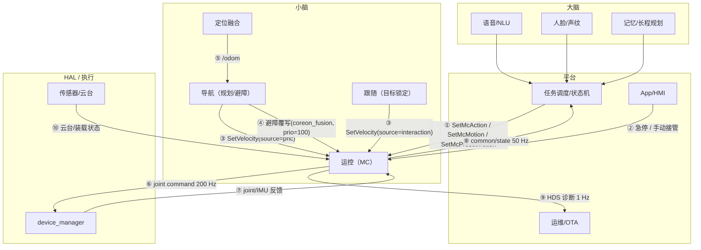
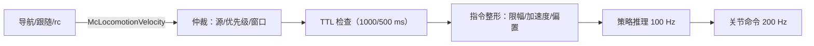
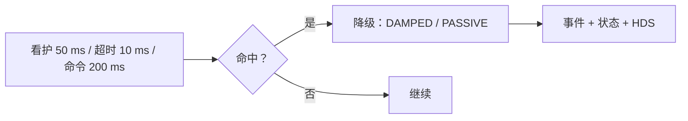
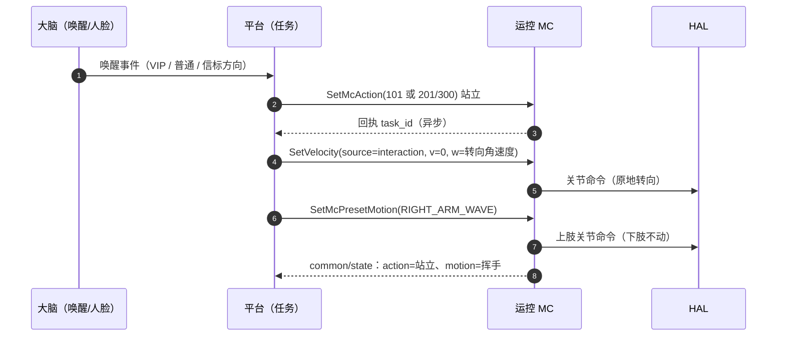
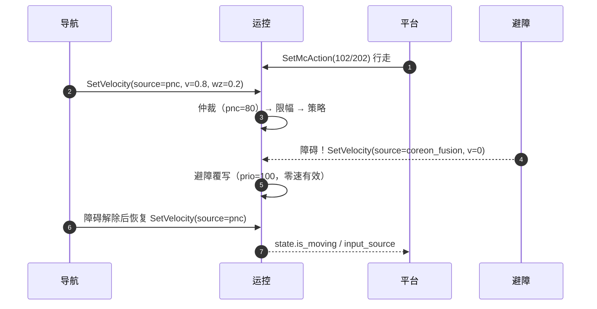
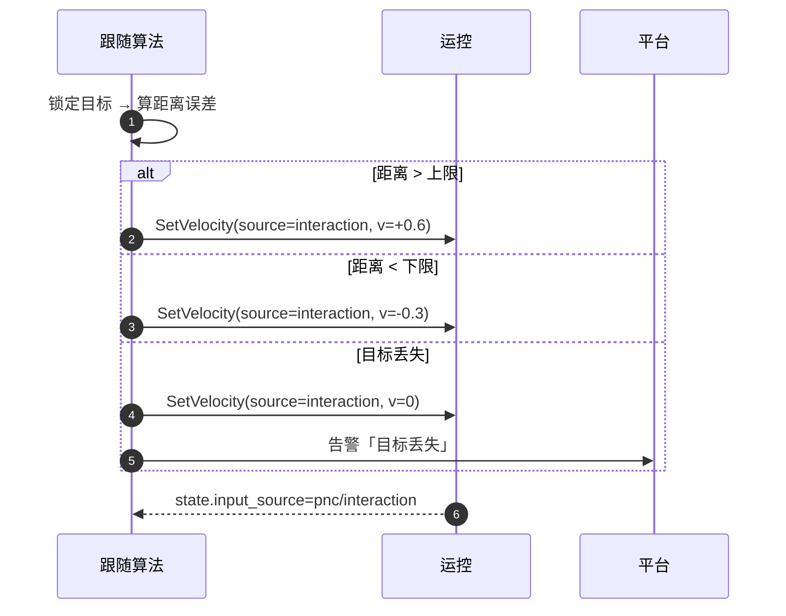
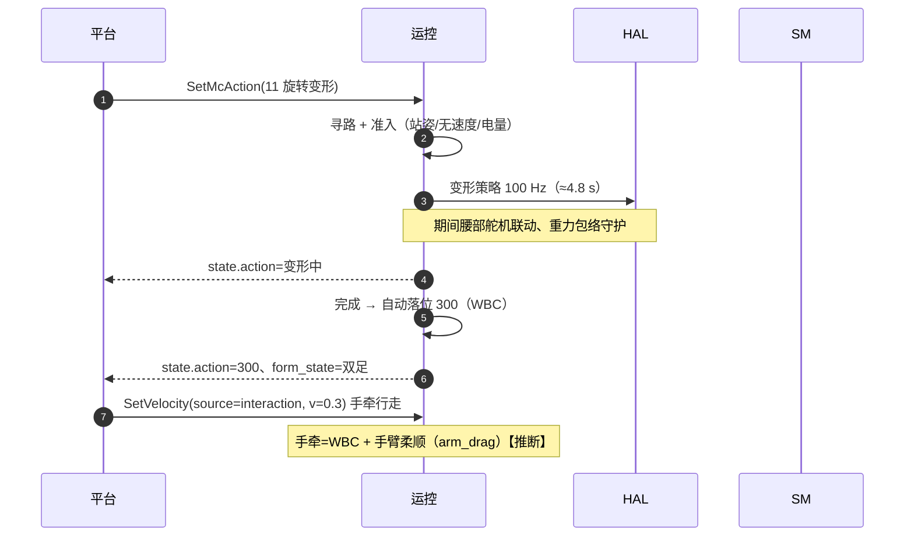
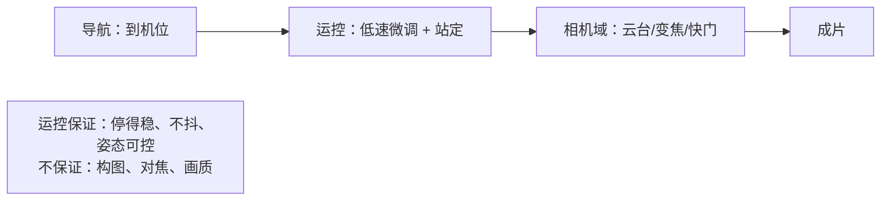
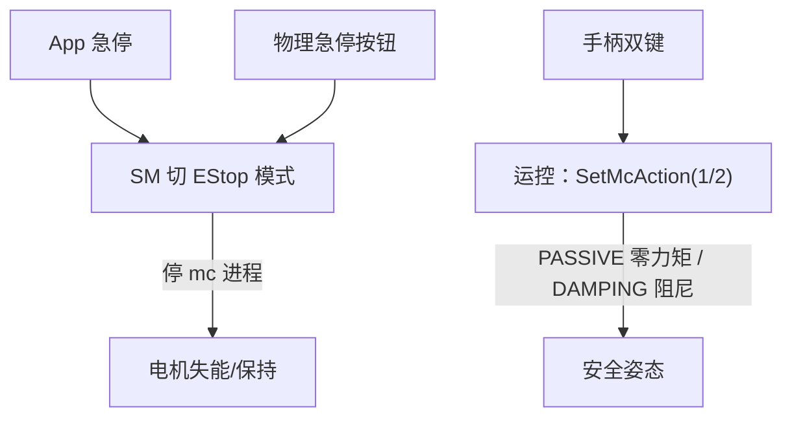
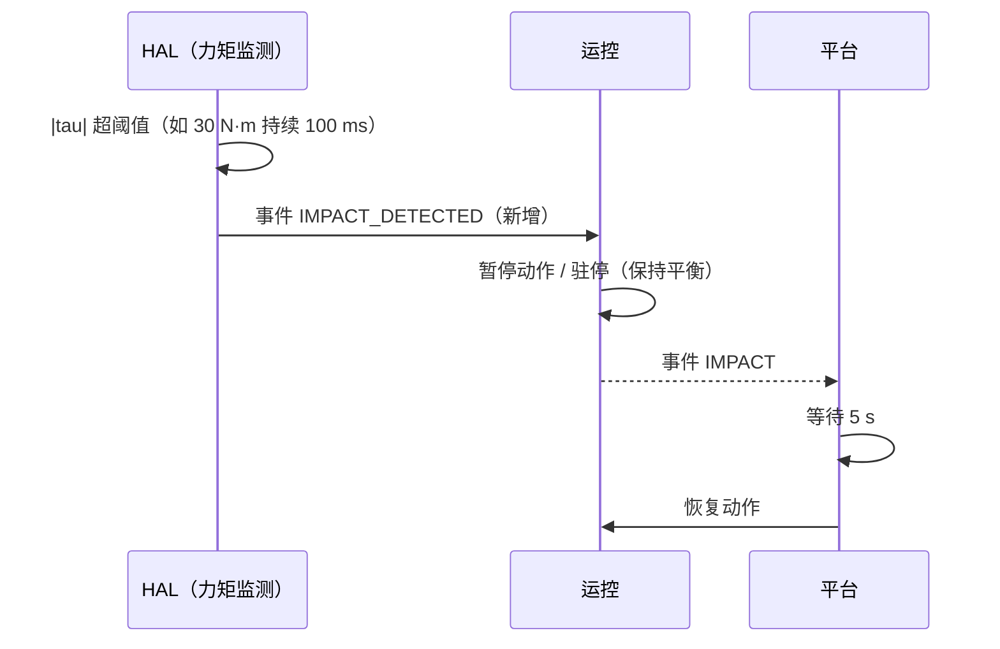

# 07_INTERFACES_AND_UPSTREAM · MC 接口、任务层、需求

> 自动生成的阅读包：把多个原始文件按主题拼接，便于一次读多份。
> 引用行号/上下文时请回到 `raw/` 下的同名文件；`FILE:` 行给出原始路径。
> 文件数：16

---

## FILE: raw/t1/interfaces/MC_INTERFACE_CATALOG.md

- bytes: 28122

````markdown
# MC Interface Catalog

> 由 `aimdk_msgs/share/aimdk_msgs/{action,common,motion,msg,srv}` 下与 MC/关节相关的 `.msg`/`.srv` 原文拼接生成。
> 这是 T1 真机接口语义的直接证据，不等于 `libmc_common_runner.so` 的 C++ ABI。

## action

### action/McAction.msg

```text
# 定义枚举字段
int32 value

# ============================================================================
# 急停
# ============================================================================

# 被动模式
int32 PASSIVE_DEFAULT = 1

# 阻尼模式
int32 DAMPING_DEFAULT = 2

# 四足躺下
int32 QUAD_LIE_DOWN = 3

# ============================================================================
# 形态切换
# ============================================================================

# 四足切换两足形态-常规
int32 QUADRUPED_TO_BIPED = 10

# 四足切换两足形态-带旋转
int32 QUADRUPED_TO_BIPED_ROTATE = 11

# 四足切换双足形态-前空翻
int32 QUADRUPED_TO_BIPED_FRONTFLIP = 12

# 两足切换四足形态-常规
int32 BIPED_TO_QUADRUPED = 20

# 两足切换四足形态-旋转
int32 BIPED_TO_QUADRUPED_ROTATE = 21

# 两足切换四足形态-前空翻
int32 BIPED_TO_QUADRUPED_FRONTFLIP = 22

# ============================================================================
# 四足相关动作 (100-199)
# ============================================================================

# 倒地四足站起
int32 QUADRUPED_RECOVERY = 100

# 四足站立模式
int32 QUADRUPED_STAND_DEFAULT = 101

# 四足行走/奔跑模式
int32 QUADRUPED_LOCOMOTION_DEFAULT = 102

# 四足奔跑模式
int32 QUADRUPED_LOCOMOTION_RUN = 112

# 四足越障行走模式
int32 QUADRUPED_LOCOMOTION_TERRAIN = 103

# 四足仿生模式
int32 QUADRUPED_LOCOMOTION_BIONIC = 104

# 四足前空翻
int32 QUADRUPED_LOCOMOTION_FRONTFLIP = 105

# 四足后空翻
int32 QUADRUPED_LOCOMOTION_BACKFLIP = 106

# 四足握手
int32 QUADRUPED_LOCOMOTION_HANDSHAKE = 107

# 四足坐下
int32 QUADRUPED_LOCOMOTION_SIT = 108

# 四足跳舞
int32 QUADRUPED_LOCOMOTION_DANCE = 109

# 四足趴下
int32 QUADRUPED_GET_DOWN_DEFAULT = 110

# 四足坐下
int32 QUADRUPED_SIT_DOWN_DEFAULT = 111

# 四足骄傲
int32 QUADRUPED_LOCOMOTION_PRIDE = 113

# 四足愉快
int32 QUADRUPED_LOCOMOTION_PLEASURE = 114

# 四足准备站立
int32 QUADRUPED_READY_STAND_DEFAULT = 115

# 四足跳跃
int32 QUADRUPED_LOCOMOTION_JUMP = 116

# 四足伸展
int32 QUADRUPED_LOCOMOTION_STRETCH = 117

# 四足俯卧撑
int32 QUADRUPED_PUSH_UP = 118

# 四足模仿动作
int32 QUADRUPED_MIMIC = 119

# 四足蜷缩
int32 QUADRUPED_CROUCH_DEFAULT = 120

# 四足踏步模式
int32 QUADRUPED_LOCOMOTION_STEP = 121

# 四足前肢手臂反轴站立
int32 QUADRUPED_STAND_REVERSE_DEFAULT = 122

# 四足反向行走模式
int32 QUADRUPED_LOCOMOTION_REVERSE_DEFAULT = 123

# 四足姿态调整
int32 QUADRUPED_BODY_ADJUST_DEFAULT = 124


# ============================================================================
# 两足相关动作 (200-299)
# ============================================================================

# 倒地两足站起
int32 BIPED_RECOVERY = 200

# 两足站立模式
int32 BIPED_STAND_DEFAULT = 201

# 两足行走/奔跑模式
int32 BIPED_LOCOMOTION_DEFAULT = 202

# 两足越障行走模式
int32 BIPED_LOCOMOTION_TERRAIN = 203

# 双足原地旋转(删除)
# int32 BIPED_LOCOMOTION_ROTATE_LOCAL = 204

# 双足下腰模式(删除)
# int32 BIPED_LOCOMOTION_BACKBEND = 205

# 双足太空步
int32 BIPED_LOCOMOTION_MOONWALK = 206

# 双足奔跑模式
int32 BIPED_LOCOMOTION_RUN = 207

# 双足模仿动作
int32 BIPED_MIMIC = 208

# 双足羽生结弦(删除)
# int32 BIPED_YUZURU = 209

# 双足劈叉(删除)
# int32 BIPED_SPLIT = 210

# 双足全身控制模式
int32 BIPED_LOCOMOTION_WBC = 300

# 双足动画控制模式
int32 BIPED_LOCOMOTION_ANIMATION = 301

# 双足控制上肢录制模式
int32 BIPED_RECORD_UPPER = 302

# 双足 gimbal 轨迹移动模式
int32 BIPED_GIMBAL = 303

# 双足 npz 模仿
int32 BIPED_NPZ_MIMIC = 304

# 双足小彩旗
int32 BIPED_LOCOMOTION_WBCDANCE = 305

# 双足转圈(删除)
# int32 BIPED_MIMIC_ROTATE_DANCE = 400

# ============================================================================
# Q 系列Action
# ============================================================================

# 折叠收储
int32 STORE_DEFAULT = 1001

# 走跑
int32 BIPED_WALK_RUN = 1002

# 模仿动作
int32 MIMIC = 1003

# 模仿动作-灵创
int32 MIMIC_LINKCRAFT = 1004

# 全身动作控制
int32 BIPED_WHOLE_BODY_CTRL = 1005

# 模仿动作-开源
int32 MIMIC_OPENSOURCE = 1006

# 站起
int32 STAND_UP = 1007

# 躺姿
int32 LYING_DEFAULT = 1008

# 躺下-俯卧
int32 LIE_FACE_DOWN = 1009

# 躺下-仰躺
int32 LIE_FACE_UP = 1010

# 轻柔步态(室内)
int32 BIPED_QUIET_WALK = 1011

# 越障模式(室外)
int32 BIPED_BLIND_TERRAIN = 1012

# 坐下
int32 BIPED_SIT_DOWN = 1013

# 二开上肢控制
int32 BIPED_CUSTOM_UPPER = 1014

# 超能模式/跑步模式
int32 BIPED_RUN = 1015

# 入座
int32 BIPED_TAKE_SEAT = 1016

# 离座
int32 BIPED_LEAVE_SEAT = 1017

# 模仿动作_V2
int32 MIMIC_V2 = 1018

# 模仿动作-开源_V2
int32 MIMIC_OPENSOURCE_V2 = 1019
```

### action/McActionCommand.msg

```text
# Action
McAction action

# 描述
string action_desc
```

### action/McActionInfo.msg

```text
# 当前运行的Action
McAction current_action

# 当前action的触发源
string source

# 描述
string action_desc

# Action状态
McActionStatus status

# action 切换是否就绪, false 未准备就绪, true 切换就绪
bool switch_ready
```

### action/McActionStatus.msg

```text
# 定义枚举字段
int32 value

# 未知状态
int32 IDLE = 0

# 运行中
int32 RUNNING = 100

# 切换中
int32 TRANSITION = 200
```

## common

### common/CommonTaskResponse.msg

```text
# 响应头
ResponseHeader header

# 任务ID
uint64 task_id

# 状态
CommonState state
```

### common/McFormState.msg

```text
# -----------------------------------------------------------------------------------
# 机器人运控状态 - 机器人形态
# -----------------------------------------------------------------------------------

uint8 current_form

# 未知形态
uint8 UNKNOWN = 0

# 四足形态
uint8 QUADRUPEDAL = 1

# 双足形态
uint8 BIPEDAL = 2
```

### common/McFsmState.msg

```text
# -----------------------------------------------------------------------------------
# 机器人运控状态 - 有限状态机状态
# -----------------------------------------------------------------------------------

uint32 current_state

# 未知状态
uint32 UNKNOWN = 0

# 预备状态
uint32 STARTING = 1

# 原地稳定状态
uint32 STABLE = 2

# 行走状态
uint32 MOVING = 3

# 安全状态
uint32 SAFE = 4

# 特殊状态
uint32 SPECIAL = 5

# 测试状态
uint32 TEST = 6
```

### common/McHandHeldState.msg

```text
# Robot motion-control hand-held state.

# The state is unknown when either hand has not produced a confirmed result.
uint8 UNKNOWN = 0

# Both hands are confirmed as not held.
uint8 BOTH_NOT_HELD = 1

# Only the left hand is held.
uint8 LEFT_HELD_ONLY = 2

# Only the right hand is held.
uint8 RIGHT_HELD_ONLY = 3

# Both hands are held.
uint8 BOTH_HELD = 4

# True when at least one hand is confirmed as held.
# False when neither hand is held or the combined state is unknown.
bool is_held

# Current combined hand-held state. The value must be one of the constants above.
uint8 hand_held
```

### common/McLiftState.msg

```text
# -----------------------------------------------------------------------------------
# Lift detector detailed state
# -----------------------------------------------------------------------------------

# Whether lift has been triggered and latched by the detector.
bool is_lifted

# Lift probability after logit smoothing and sigmoid.
float32 probability

# Probability threshold used by the detector.
float32 threshold
```

### common/McMotionStatus.msg

```text
# -----------------------------------------------------------------------------------
# 机器人运控状态 - 动作运行信息
# -----------------------------------------------------------------------------------

McPlayerState player_state             # 动作运行状态

McControlArea control_area             # 控制区域

string motion                          # 动作名称

McMotionType type                      # 动作类型

McMotionIntrInfo intr_info             # 动作断点信息

int32 current_steps                    # 当前动作执行进度
```

### common/McPosture.msg

```text
# -----------------------------------------------------------------------------------
# 机器人姿态信息
# -----------------------------------------------------------------------------------

# 横滚角
float64 roll

# 俯仰角
float64 pitch

# 航向角
float64 yaw
```

### common/McSquatStatus.msg

```text
# -----------------------------------------------------------------------------------
# 机器人运控状态 - 下蹲动作运行状态
# -----------------------------------------------------------------------------------
bool enable                             # 是否处于下蹲状态

float64 offset                          # 下蹲高度偏置         

uint32 squat_limit                      # 下蹲上下限位

# squat_limit = 0 - 未到限位
# squat_limit = 1 - 下蹲到下限
# squat_limit = 2 - 下蹲到上限
```

### common/McTaskInfo.msg

```text
# 任务 ID (0 表示未曾接收过任何请求)
uint64 task_id
```

### common/McTaskSource.msg

```text
# 定义 Action 触发源
int32 value

# 未知/未指定
int32 UNKNOWN     = 0

# APP
int32 APP         = 1

# 云端
int32 CLOUD       = 2

# 遥控器
int32 RC          = 3

# SDK/RPC 直接调用
int32 SDK_RPC     = 4

# agent
int32  AGENT  = 5

# task engine 自动任务
int32 TASK_ENGINE   = 6

# MC 内部自动切换（如 Moving → Stable 稳态复位）
int32 MC_INTERNAL = 7

# Insta360
int32 INSTA360 = 8

# 其他
int32 OTHER       = 255
```

## motion

### motion/McBodyPose.msg

```text
# 消息头
MessageHeader header

# 输入源
string source

# 站立高度 (站直/下蹲)， 正值站立， 负值下蹲
# 单位：m，距离地面的高度
float64 stand_height

# 身体前倾/后倾, 正值前倾， 负值后倾
# 单位：rad
float64 bend_forward

# 身体侧弯, 正值左侧弯， 负值右侧弯
# 单位：rad
float64 bend_sideways

# 腰部旋转， 正值左转， 负值右转
# 单位：rad
float64 twist_waist

# 点头/抬头，正值低头，负值抬头
# 单位：rad
float64 raise_head

# 头部旋转，正值左转，负值右转
# 单位：rad
float64 turn_head
```

### motion/McControlArea.msg

```text
int32 value

# 没有控制区域
int32 NONE = 0

# 左手
int32 LEFT_HAND = 1

# 右手
int32 RIGHT_HAND = 2

# 头部
int32 HEAD = 4

# 腰部
int32 WAIST = 8
```

### motion/McCustomJointCommand.msg

```text
# 消息头
MessageHeader header

# 上肢关节目标命令数组（mc内部自动按 name 匹配对应关节数据）
JointCommand[] joints
```

### motion/McHandStatus.msg

```text
# 手部状态

int32 value

# 灵巧手
int32 OMNI_HAND = 1000

# 夹爪
int32 OMNI_PICKER = 2000
```

### motion/McInputAction.msg

```text
# 输入源操作

int32 value

# 添加新的输入源
int32 INPUTACTION_ADD = 1001

# 修改输入源配置
int32 INPUTACTION_MODIFY = 1002

# 删除输入源
int32 INPUTACTION_DELETE = 1003

# 使能输入源
int32 INPUTACTION_ENABLE = 2001

# 下使能输入源
int32 INPUTACTION_DISABLE = 2002
```

### motion/McInputSource.msg

```text
# -----------------------------------------------------------------------------------
# 机器人运控状态 - 输入源信息
# -----------------------------------------------------------------------------------

string name                           # 输入源名称（rc/vr/app_proxy/interaction/pnc）

int32 priority                       # 输入源优先级(0-100)

int32 timeout                        # 超时时间(ms), 默认 1000 ms
```

### motion/McLocomotionGaitType.msg

```text
int32 value

# 步态: 走
int32 WALK = 0

# 步态: 站
int32 STANCE = 1

# 步态: 原地踏步
int32 STATIC_WALK = 2
```

### motion/McLocomotionVelocity.msg

```text
# 消息头
MessageHeader header

# 输入源
string source

# 前进速度 (m/s)
# 方向: +为前进, -为后退
float64 forward_velocity

# 侧移速度 (m/s)
# 方向: +为左移, -为右移
float64 lateral_velocity

# 旋转速度 (角速度) (m/s)
# 方向: +为左旋转, -为右旋转
float64 angular_velocity

# 弯腰速度 (角速度) (m/s) 
float64 pitch_velocity

# 等级
float64 level
```

### motion/McMotion.msg

```text
# Mc 动作接口

# 名称
string tag

# 动作类型
McMotionType type

# 打断信息
McMotionIntrInfo intr_info
```

### motion/McMotionIntrInfo.msg

```text
# -----------------------------------------------------------------------------------
# 动作断点信息
# -----------------------------------------------------------------------------------

# 打断类型
McMotionIntrType intr_type

# 断点列表
int32[] breakpoint_steps
```

### motion/McMotionIntrType.msg

```text
# 定义枚举字段
int32 value

# 不支持打断
int32 INTR_NO = 0

# 自由打断，任意时刻
int32 INTR_FREE = 1

# 断点打断
int32 INTR_BREAKPOINT = 2
```

### motion/McMotionType.msg

```text
int32 value

# NONE
int32 NONE = 0

# 动画，上肢动作
int32 ANIMATION = 1

# 模仿
int32 MIMIC = 2

# 基座
int32 FOUNDATION = 3

# 运动跟踪
int32 MIMIC_OPENSOURCE = 4
```

### motion/McPlayerState.msg

```text
# -----------------------------------------------------------------------------------
# 机器人运控状态 - 上肢动作运行状态
# -----------------------------------------------------------------------------------

uint32 value

# 无上肢动作
uint32 IDLE = 0

# IDLE 过渡至下一动作
uint32 PRE_PLAYING = 1

# 上肢动作正在播放
uint32 PLAYING = 2

# 打断当前动作过渡至下一动作
uint32 INTERRUPTING = 3

# 播放错误状态
uint32 ERROR = 4
```

### motion/McPresetMotion.msg

```text
# 预设动作

int32 value

# 恢复默认姿态
int32 DEFAULT_POS = 0

# 右手挥手
int32 RIGHT_ARM_WAVE = 1001

# 右手握手
int32 RIGHT_ARM_HANDSHAKE = 1002

# 左手握手1.5m上对象
int32 RIGHT_ARM_HANDSHAKE_FOR_1D5METER = 1003

# 左手挥手
int32 LEFT_ARM_WAVE = 1011

# 左手握手
int32 LEFT_ARM_HANDSHAKE = 1012

# 左手握手1.5m上对象
int32 LEFT_ARM_HANDSHAKE_FOR_1D5METER = 1013

# 双手比心
int32 BOTH_HANDS_MAKE_HEART = 2001

# 双手摆动，表达喜悦
int32 BOTH_HANDS_ACTION_HAPPY = 2002

# 双手动作，说话动作
int32 BOTH_HANDS_ACTION_TALKING = 2003

# 说话动作1
int32 T1_TALK1 = 2004

# 说话动作2
int32 T1_TALK2 = 2005

# 说话动作3
int32 T1_TALK3 = 2006

# 说话动作4
int32 T1_TALK4 = 2007

# 说话动作5
int32 T1_TALK5 = 2008

# 说话动作6
int32 T1_TALK6 = 2009

# 拍照动作1
int32 PHOTO_POSE_1 = 2011

# 拍照动作2
int32 PHOTO_POSE_2 = 2012

# 拍照动作3
int32 PHOTO_POSE_3 = 2013

# 拍照动作4
int32 PHOTO_POSE_4 = 2014

# 三连拍姿势
int32 PHOTO_THREE_SHOT = 2020

# -----------------------------------------------------------------------------------
# Q 预置的上肢动作
# -----------------------------------------------------------------------------------

# 招手
int32 Q_BECKON = 3001

# 握手
int32 Q_SHAKE_HANDS = 3002

# 碰拳
int32 Q_BUMP_FISTS = 3003

# 挥手
int32 Q_WAVE_HAND = 3004

# 情绪动作 - 开心
int32 Q_SHOW_HAPPINESS = 3005

# 双手比心
int32 Q_MAKE_HEART = 3007

# 加油
int32 Q_CHEER_ON = 3008

# 伸懒腰
int32 Q_STRETCH = 3010

# 讲话动作A
int32 Q_SPEAK_A = 3012

# 讲话动作B
int32 Q_SPEAK_B = 3013

# 讲话动作C
int32 Q_SPEAK_C = 3014

# 拥抱
int32 Q_HUG = 3018

# 拒绝
int32 Q_REFUSE = 3021

# 跳舞动作A
int32 Q_DANCE_A = 3046

# 跳舞动作B
int32 Q_DANCE_B = 3047

# 跳舞动作C
int32 Q_DANCE_C = 3048
```

### motion/McRuntimeModel.msg

```text
# -----------------------------------------------------------------------------------
# 机器人运控状态 - 运行模型信息
# -----------------------------------------------------------------------------------

bool waist_status                      # 腰部状态

McHandStatus left_hand_status          # 左手手部状态

McHandStatus right_hand_status         # 右手手部状态
```

## msg

### msg/JointCommand.msg

```text
string name
float64 position
float64 velocity
float64 effort
float64 stiffness
float64 damping
```

### msg/JointCommandArray.msg

```text
MessageHeader header

JointCommand[] joints
```

### msg/JointInfo.msg

```text
string name
string hardware_version
string software_version
uint8 mode
JointMitParams mit_params
JointProtectConfig protect_config
```

### msg/JointInfoArray.msg

```text
MessageHeader header

JointInfo[] joints
```

### msg/JointMitParams.msg

```text
int16 pos_max
int16 pos_min
int16 vel_max
int16 vel_min
int16 tor_max
int16 tor_min
int16 kp_max
int16 kp_min
int16 kd_max
int16 kd_min
```

### msg/JointProtectConfig.msg

```text
int16 l1_mos_protect
int16 l1_mos_recover
int16 l1_current_protect
int16 l1_current_recover
int16 l1_voltage_protect
int16 l1_voltage_recover
int16 l2_mos_protect
int16 l2_mos_recover
int16 l2_current_protect
int16 l2_current_recover
int16 l2_voltage_protect
int16 l2_voltage_recover
```

### msg/JointState.msg

```text
string name
float64 position
float64 velocity
float64 effort
int16 coil_temp
int16 motor_temp
uint8 motor_vol
```

### msg/JointStateArray.msg

```text
MessageHeader header

JointState[] joints
```

### msg/McCommonState.msg

```text
# -----------------------------------------------------------------------------------
# 机器人运控状态
# -----------------------------------------------------------------------------------

MessageHeader header

# ------------ 输入源信息 ------------ #
McInputSource input_source

# ----------- Action 信息 ----------- #
McActionInfo action_info

# --------- 机器运行模型信息 ---------- #
McRuntimeModel runtime_model

# --------- 动作运行信息 ---------- #
McMotionStatus motion_status

# --------- 有限状态机状态 ---------- #
McFsmState fsm_state

# --------- 机器人形态信息 ---------- #
McFormState form_state

# --------- 机器人姿态信息 ---------- #
McPosture posture

# ----------机器人是否处于运动状态 ----------
bool is_moving

# ----------机器人是否摔倒（防摔检测触发后置 true；重新解锁站立防摔检测时置 false）----------
bool is_fallen

# ---------- 机器人提起检测状态 ---------- #
McLiftState lift_state

# ---------- rpc 请求 执行状态 ----------
McTaskInfo  task_info

# ---------- 机器人牵手状态 ---------- #
McHandHeldState held_state
```

## srv

### srv/GetAllJointState.srv

```text
CommonRequest request

---

CommonResponse response

JointState[] head_joints
JointState[] arm_joints
JointState[] waist_joints
JointState[] leg_joints
```

### srv/GetAllJointState_Request.msg

```text
CommonRequest request
```

### srv/GetAllJointState_Response.msg

```text


CommonResponse response

JointState[] head_joints
JointState[] arm_joints
JointState[] waist_joints
JointState[] leg_joints
```

### srv/GetJointPowerState.srv

```text
# Request
CommonRequest request

---


# 响应头
CommonResponse header

uint8 power_state

uint8 POWER_ON=1   # 电机上电
uint8 POWER_OFF=2    # 电机下电
```

### srv/GetJointPowerState_Request.msg

```text
# Request
CommonRequest request
```

### srv/GetJointPowerState_Response.msg

```text


# 响应头
CommonResponse header

uint8 power_state

uint8 POWER_ON=1   # 电机上电
uint8 POWER_OFF=2    # 电机下电
```

### srv/GetMcAction.srv

```text
# Request 部分
CommonRequest request

---

# 响应头
ResponseHeader header

# Action信息
McActionInfo info
```

### srv/GetMcAction_Request.msg

```text
# Request 部分
CommonRequest request
```

### srv/GetMcAction_Response.msg

```text


# 响应头
ResponseHeader header

# Action信息
McActionInfo info
```

### srv/GetMcAvailableActions.srv

```text
# Request 部分
CommonRequest request

---


# 响应头
ResponseHeader header

# 可用的Action列表
string[] actions

# 可用的Action命令列表
McActionCommand[] commands
```

### srv/GetMcAvailableActions_Request.msg

```text
# Request 部分
CommonRequest request
```

### srv/GetMcAvailableActions_Response.msg

```text


# 响应头
ResponseHeader header

# 可用的Action列表
string[] actions

# 可用的Action命令列表
McActionCommand[] commands
```

### srv/GetMcJointState.srv

```text
# Request 部分
CommonRequest request

---

# 响应头
ResponseHeader header

# Joint信息
JointState[] joints
```

### srv/GetMcJointState_Request.msg

```text
# Request 部分
CommonRequest request
```

### srv/GetMcJointState_Response.msg

```text


# 响应头
ResponseHeader header

# Joint信息
JointState[] joints
```

### srv/GetMcLocomotionGait.srv

```text
# Request 部分
CommonRequest request

---

# 响应头
ResponseHeader header

McLocomotionGaitType gait
```

### srv/GetMcLocomotionGait_Request.msg

```text
# Request 部分
CommonRequest request
```

### srv/GetMcLocomotionGait_Response.msg

```text


# 响应头
ResponseHeader header

McLocomotionGaitType gait
```

### srv/GetMcMotions.srv

```text
# 请求头
RequestHeader header

---

CommonTaskResponse response

# 当前存在的动作列表
McMotion[] motion
```

### srv/GetMcMotions_Request.msg

```text
# 请求头
RequestHeader header
```

### srv/GetMcMotions_Response.msg

```text


CommonTaskResponse response

# 当前存在的动作列表
McMotion[] motion
```

### srv/GetMcPresetMotionState.srv

```text
# Request 部分
CommonTaskRequest request

---

CommonTaskResponse response
```

### srv/GetMcPresetMotionState_Request.msg

```text
# Request 部分
CommonTaskRequest request
```

### srv/GetMcPresetMotionState_Response.msg

```text


CommonTaskResponse response
```

### srv/GetMcTaskState.srv

```text
# Request 部分
CommonTaskRequest request

---

CommonTaskResponse response
```

### srv/GetMcTaskState_Request.msg

```text
# Request 部分
CommonTaskRequest request
```

### srv/GetMcTaskState_Response.msg

```text


CommonTaskResponse response
```

### srv/McMotionRecord.srv

```text
# Request 部分
CommonRequest request

# 操作区域部分
int32 record_area
# 上半身
int32 RECORD_UPPER = 1
# 下半身
int32 RECORD_LOWER = 2 
# 全身
int32 RECORD_ALL   = 3

# 操作模式部分
int32 operation_type
# 开始录制
int32 OPER_START  = 1
# 结束录制
int32 OPER_STOP   = 2
# 暂停录制(产品暂时没提)
int32 OPER_PAUSE  = 3
# 继续录制(产品暂时没提)
int32 OPER_RESUME = 4

# 录制时长限制
int32 max_duration

# 存储路径
string folder_path
# 文件名
string file_name

---

# Response 部分
CommonResponse response
```

### srv/McMotionRecord_Request.msg

```text
# Request 部分
CommonRequest request

# 操作区域部分
int32 record_area
# 上半身
int32 RECORD_UPPER = 1
# 下半身
int32 RECORD_LOWER = 2 
# 全身
int32 RECORD_ALL   = 3

# 操作模式部分
int32 operation_type
# 开始录制
int32 OPER_START  = 1
# 结束录制
int32 OPER_STOP   = 2
# 暂停录制(产品暂时没提)
int32 OPER_PAUSE  = 3
# 继续录制(产品暂时没提)
int32 OPER_RESUME = 4

# 录制时长限制
int32 max_duration

# 存储路径
string folder_path
# 文件名
string file_name
```

### srv/McMotionRecord_Response.msg

```text


# Response 部分
CommonResponse response
```

### srv/SetJointPower.srv

```text
# Request
CommonRequest request

#调用请求的模块名
string input_source
#命令
uint8 command

uint8 POWER_ON=1   # 电机上电
uint8 POWER_OFF=2    # 电机下电

---


# 响应头
CommonResponse header
```

### srv/SetJointPower_Request.msg

```text
# Request
CommonRequest request

#调用请求的模块名
string input_source
#命令
uint8 command

uint8 POWER_ON=1   # 电机上电
uint8 POWER_OFF=2    # 电机下电
```

### srv/SetJointPower_Response.msg

```text


# 响应头
CommonResponse header
```

### srv/SetMcAction.srv

```text
# 请求头
RequestHeader header

# 触发源 定义见 McTaskSource.msg 
string source

# Action命令
McActionCommand command

---

CommonTaskResponse response
```

### srv/SetMcAction_Request.msg

```text
# 请求头
RequestHeader header

# 触发源 定义见 McTaskSource.msg 
string source

# Action命令
McActionCommand command
```

### srv/SetMcAction_Response.msg

```text


CommonTaskResponse response
```

### srv/SetMcInputSource.srv

```text
# Request 部分
CommonRequest request

McInputAction action # ADD MODIFY DELETE DISABLE ENABLE

McInputSource input_source
---

CommonTaskResponse response
```

### srv/SetMcInputSource_Request.msg

```text
# Request 部分
CommonRequest request

McInputAction action # ADD MODIFY DELETE DISABLE ENABLE

McInputSource input_source
```

### srv/SetMcInputSource_Response.msg

```text


CommonTaskResponse response
```

### srv/SetMcLocomotionGait.srv

```text
# 请求头
RequestHeader header

# 步态
McLocomotionGaitType gait

---

CommonResponse response
```

### srv/SetMcLocomotionGait_Request.msg

```text
# 请求头
RequestHeader header

# 步态
McLocomotionGaitType gait
```

### srv/SetMcLocomotionGait_Response.msg

```text


CommonResponse response
```

### srv/SetMcMotion.srv

```text
# 此接口是播放全身动作接口

# 请求头
RequestHeader header

# 触发源 定义见 McTaskSource.msg 
string source

# 资源类型
int32 type

# 自有模型
int32 MIMIC_QY = 1

# 灵创模型
int32 MIMIC_LC = 2

# 全身动作名称，若motion为空，加载model中resource; 反之，从本地加载执行资源。
string motion

# onnx 模型绝对路径
string model

# 资源绝对路径，比如轨迹参考
string resource

# 是否打断(给后面animation接口合并预留)
bool interrupt

# 操作类型
int32 operation

# 预先加载
int32 PRELOAD = 1

# 开始执行
int32 EXECUTION = 2

---

# 响应头
CommonTaskResponse response
```

### srv/SetMcMotionSeq.srv

```text
# 此接口是播放动作序列接口(暂不使用)

# 请求头
RequestHeader header

# 动作序列
string[] motion_seq

# 打断
bool interrupt

---

CommonTaskResponse response
```

### srv/SetMcMotionSeq_Request.msg

```text
# 此接口是播放动作序列接口(暂不使用)

# 请求头
RequestHeader header

# 动作序列
string[] motion_seq

# 打断
bool interrupt
```

### srv/SetMcMotionSeq_Response.msg

```text


CommonTaskResponse response
```

### srv/SetMcMotion_Request.msg

```text
# 此接口是播放全身动作接口

# 请求头
RequestHeader header

# 触发源 定义见 McTaskSource.msg 
string source

# 资源类型
int32 type

# 自有模型
int32 MIMIC_QY = 1

# 灵创模型
int32 MIMIC_LC = 2

# 全身动作名称，若motion为空，加载model中resource; 反之，从本地加载执行资源。
string motion

# onnx 模型绝对路径
string model

# 资源绝对路径，比如轨迹参考
string resource

# 是否打断(给后面animation接口合并预留)
bool interrupt

# 操作类型
int32 operation

# 预先加载
int32 PRELOAD = 1

# 开始执行
int32 EXECUTION = 2
```

### srv/SetMcMotion_Response.msg

```text


# 响应头
CommonTaskResponse response
```

### srv/SetMcPresetMotion.srv

```text
# 请求头
RequestHeader header

# 触发源 定义见 McTaskSource.msg 
string source

# 控制区域
McControlArea area

# 预设动作
McPresetMotion motion

# 是否打断前一个动作
bool interrupt

# 自定义动作地址
string ani_path

---

CommonTaskResponse response
```

### srv/SetMcPresetMotion_Request.msg

```text
# 请求头
RequestHeader header

# 触发源 定义见 McTaskSource.msg 
string source

# 控制区域
McControlArea area

# 预设动作
McPresetMotion motion

# 是否打断前一个动作
bool interrupt

# 自定义动作地址
string ani_path
```

### srv/SetMcPresetMotion_Response.msg

```text


CommonTaskResponse response
```

---

共 89 个接口定义。
````


---

## FILE: raw/t1/interfaces/srv/SetMcAction.srv

- bytes: 162

```text
# 请求头
RequestHeader header

# 触发源 定义见 McTaskSource.msg 
string source

# Action命令
McActionCommand command

---

CommonTaskResponse response
```


---

## FILE: raw/t1/interfaces/srv/SetMcMotion.srv

- bytes: 661

```text
# 此接口是播放全身动作接口

# 请求头
RequestHeader header

# 触发源 定义见 McTaskSource.msg 
string source

# 资源类型
int32 type

# 自有模型
int32 MIMIC_QY = 1

# 灵创模型
int32 MIMIC_LC = 2

# 全身动作名称，若motion为空，加载model中resource; 反之，从本地加载执行资源。
string motion

# onnx 模型绝对路径
string model

# 资源绝对路径，比如轨迹参考
string resource

# 是否打断(给后面animation接口合并预留)
bool interrupt

# 操作类型
int32 operation

# 预先加载
int32 PRELOAD = 1

# 开始执行
int32 EXECUTION = 2

---

# 响应头
CommonTaskResponse response
```


---

## FILE: raw/t1/interfaces/action/McAction.msg

- bytes: 4911

```text
# 定义枚举字段
int32 value

# ============================================================================
# 急停
# ============================================================================

# 被动模式
int32 PASSIVE_DEFAULT = 1

# 阻尼模式
int32 DAMPING_DEFAULT = 2

# 四足躺下
int32 QUAD_LIE_DOWN = 3

# ============================================================================
# 形态切换
# ============================================================================

# 四足切换两足形态-常规
int32 QUADRUPED_TO_BIPED = 10

# 四足切换两足形态-带旋转
int32 QUADRUPED_TO_BIPED_ROTATE = 11

# 四足切换双足形态-前空翻
int32 QUADRUPED_TO_BIPED_FRONTFLIP = 12

# 两足切换四足形态-常规
int32 BIPED_TO_QUADRUPED = 20

# 两足切换四足形态-旋转
int32 BIPED_TO_QUADRUPED_ROTATE = 21

# 两足切换四足形态-前空翻
int32 BIPED_TO_QUADRUPED_FRONTFLIP = 22

# ============================================================================
# 四足相关动作 (100-199)
# ============================================================================

# 倒地四足站起
int32 QUADRUPED_RECOVERY = 100

# 四足站立模式
int32 QUADRUPED_STAND_DEFAULT = 101

# 四足行走/奔跑模式
int32 QUADRUPED_LOCOMOTION_DEFAULT = 102

# 四足奔跑模式
int32 QUADRUPED_LOCOMOTION_RUN = 112

# 四足越障行走模式
int32 QUADRUPED_LOCOMOTION_TERRAIN = 103

# 四足仿生模式
int32 QUADRUPED_LOCOMOTION_BIONIC = 104

# 四足前空翻
int32 QUADRUPED_LOCOMOTION_FRONTFLIP = 105

# 四足后空翻
int32 QUADRUPED_LOCOMOTION_BACKFLIP = 106

# 四足握手
int32 QUADRUPED_LOCOMOTION_HANDSHAKE = 107

# 四足坐下
int32 QUADRUPED_LOCOMOTION_SIT = 108

# 四足跳舞
int32 QUADRUPED_LOCOMOTION_DANCE = 109

# 四足趴下
int32 QUADRUPED_GET_DOWN_DEFAULT = 110

# 四足坐下
int32 QUADRUPED_SIT_DOWN_DEFAULT = 111

# 四足骄傲
int32 QUADRUPED_LOCOMOTION_PRIDE = 113

# 四足愉快
int32 QUADRUPED_LOCOMOTION_PLEASURE = 114

# 四足准备站立
int32 QUADRUPED_READY_STAND_DEFAULT = 115

# 四足跳跃
int32 QUADRUPED_LOCOMOTION_JUMP = 116

# 四足伸展
int32 QUADRUPED_LOCOMOTION_STRETCH = 117

# 四足俯卧撑
int32 QUADRUPED_PUSH_UP = 118

# 四足模仿动作
int32 QUADRUPED_MIMIC = 119

# 四足蜷缩
int32 QUADRUPED_CROUCH_DEFAULT = 120

# 四足踏步模式
int32 QUADRUPED_LOCOMOTION_STEP = 121

# 四足前肢手臂反轴站立
int32 QUADRUPED_STAND_REVERSE_DEFAULT = 122

# 四足反向行走模式
int32 QUADRUPED_LOCOMOTION_REVERSE_DEFAULT = 123

# 四足姿态调整
int32 QUADRUPED_BODY_ADJUST_DEFAULT = 124


# ============================================================================
# 两足相关动作 (200-299)
# ============================================================================

# 倒地两足站起
int32 BIPED_RECOVERY = 200

# 两足站立模式
int32 BIPED_STAND_DEFAULT = 201

# 两足行走/奔跑模式
int32 BIPED_LOCOMOTION_DEFAULT = 202

# 两足越障行走模式
int32 BIPED_LOCOMOTION_TERRAIN = 203

# 双足原地旋转(删除)
# int32 BIPED_LOCOMOTION_ROTATE_LOCAL = 204

# 双足下腰模式(删除)
# int32 BIPED_LOCOMOTION_BACKBEND = 205

# 双足太空步
int32 BIPED_LOCOMOTION_MOONWALK = 206

# 双足奔跑模式
int32 BIPED_LOCOMOTION_RUN = 207

# 双足模仿动作
int32 BIPED_MIMIC = 208

# 双足羽生结弦(删除)
# int32 BIPED_YUZURU = 209

# 双足劈叉(删除)
# int32 BIPED_SPLIT = 210

# 双足全身控制模式
int32 BIPED_LOCOMOTION_WBC = 300

# 双足动画控制模式
int32 BIPED_LOCOMOTION_ANIMATION = 301

# 双足控制上肢录制模式
int32 BIPED_RECORD_UPPER = 302

# 双足 gimbal 轨迹移动模式
int32 BIPED_GIMBAL = 303

# 双足 npz 模仿
int32 BIPED_NPZ_MIMIC = 304

# 双足小彩旗
int32 BIPED_LOCOMOTION_WBCDANCE = 305

# 双足转圈(删除)
# int32 BIPED_MIMIC_ROTATE_DANCE = 400

# ============================================================================
# Q 系列Action
# ============================================================================

# 折叠收储
int32 STORE_DEFAULT = 1001

# 走跑
int32 BIPED_WALK_RUN = 1002

# 模仿动作
int32 MIMIC = 1003

# 模仿动作-灵创
int32 MIMIC_LINKCRAFT = 1004

# 全身动作控制
int32 BIPED_WHOLE_BODY_CTRL = 1005

# 模仿动作-开源
int32 MIMIC_OPENSOURCE = 1006

# 站起
int32 STAND_UP = 1007

# 躺姿
int32 LYING_DEFAULT = 1008

# 躺下-俯卧
int32 LIE_FACE_DOWN = 1009

# 躺下-仰躺
int32 LIE_FACE_UP = 1010

# 轻柔步态(室内)
int32 BIPED_QUIET_WALK = 1011

# 越障模式(室外)
int32 BIPED_BLIND_TERRAIN = 1012

# 坐下
int32 BIPED_SIT_DOWN = 1013

# 二开上肢控制
int32 BIPED_CUSTOM_UPPER = 1014

# 超能模式/跑步模式
int32 BIPED_RUN = 1015

# 入座
int32 BIPED_TAKE_SEAT = 1016

# 离座
int32 BIPED_LEAVE_SEAT = 1017

# 模仿动作_V2
int32 MIMIC_V2 = 1018

# 模仿动作-开源_V2
int32 MIMIC_OPENSOURCE_V2 = 1019
```


---

## FILE: raw/t1/interfaces/msg/McCommonState.msg

- bytes: 1158

```text
# -----------------------------------------------------------------------------------
# 机器人运控状态
# -----------------------------------------------------------------------------------

MessageHeader header

# ------------ 输入源信息 ------------ #
McInputSource input_source

# ----------- Action 信息 ----------- #
McActionInfo action_info

# --------- 机器运行模型信息 ---------- #
McRuntimeModel runtime_model

# --------- 动作运行信息 ---------- #
McMotionStatus motion_status

# --------- 有限状态机状态 ---------- #
McFsmState fsm_state

# --------- 机器人形态信息 ---------- #
McFormState form_state

# --------- 机器人姿态信息 ---------- #
McPosture posture

# ----------机器人是否处于运动状态 ----------
bool is_moving

# ----------机器人是否摔倒（防摔检测触发后置 true；重新解锁站立防摔检测时置 false）----------
bool is_fallen

# ---------- 机器人提起检测状态 ---------- #
McLiftState lift_state

# ---------- rpc 请求 执行状态 ----------
McTaskInfo  task_info

# ---------- 机器人牵手状态 ---------- #
McHandHeldState held_state
```


---

## FILE: raw/t1/interfaces/msg/McActionStatus.msg

> **MISSING**

## FILE: raw/t1/interfaces/motion/McLocomotionVelocity.msg

- bytes: 399

```text
# 消息头
MessageHeader header

# 输入源
string source

# 前进速度 (m/s)
# 方向: +为前进, -为后退
float64 forward_velocity

# 侧移速度 (m/s)
# 方向: +为左移, -为右移
float64 lateral_velocity

# 旋转速度 (角速度) (m/s)
# 方向: +为左旋转, -为右旋转
float64 angular_velocity

# 弯腰速度 (角速度) (m/s) 
float64 pitch_velocity

# 等级
float64 level
```


---

## FILE: raw/t1/interfaces/common/McFormState.msg

- bytes: 339

```text
# -----------------------------------------------------------------------------------
# 机器人运控状态 - 机器人形态
# -----------------------------------------------------------------------------------

uint8 current_form

# 未知形态
uint8 UNKNOWN = 0

# 四足形态
uint8 QUADRUPEDAL = 1

# 双足形态
uint8 BIPEDAL = 2
```


---

## FILE: raw/t1/task_engine/t1_cfg.yaml

- bytes: 8787

```yaml
# 低电量限制忽略配置

# 是否忽略低电量动作限制
# false: 保持现有逻辑，低电量时限制动作（默认）
# true: 忽略电量限制，允许所有动作执行
ignore_low_battery_limit: false

# 忽略电源关机行为
ignore_power_off_behavior: false

# 是否启用开箱流程
# true: 启用开箱流程（Q1 每次开机均按进度执行，T1 仅首次执行一次）
# false: 跳过开箱流程，直接走正常自检
enable_openbox_flow: false

# 是否启用闲时行为
# true: 启用闲时行为，带有动作执行
enable_idle_behavior: false

# 是否启用建图功能
enable_mapping_function: false

# 是否启用地图定位功能
enable_map_localization_function: false

# 是否启用普通导航功能
enable_navigation_function: false

# 是否启用设置专座功能
enable_charge_point_setup_function: false

# 是否启用专座回坐/自主回充功能（APP、闲时、低电量）
enable_charge_point_sit_function: false

# 闲时网络断开测试开关；true: 强制按无网络处理，false: 使用网络状态 topic 的真实状态
force_idle_network_disconnected: false

# T1 闲时行为分层触发周期（秒）
l1_idle_period: 900
l2_idle_period: 1800
l3_idle_period: 2400
l4_idle_period: 5400

# 用户停止闲时动作后，下一次闲时动作额外增加的冷却时间（秒）
stop_idle_cooldown_extension: 10
# 用户语音打断闲时输出后，等待停止指令的有效时间（毫秒）
idle_stop_command_timeout_ms: 3000

# 闲时层级 Shuffle Bag 权重（一轮内 L1:L2:L3:L4，各层至少出现 1 次）
l1_idle_weight: 4
l2_idle_weight: 3
l3_idle_weight: 2
l4_idle_weight: 1

# 支持 SM 待机/闲时低功耗的 SKU；匹配 ROBOT_SKU，空列表或缺省表示不支持。
sm_power_save_skus: ["T1-2X", "T1-3X"]

# SM 自动低功耗独立开关，仅 ROBOT_SKU 匹配上述列表时生效。
# 与上面的闲时行为 enable_power_save 独立；修改后重启 TaskEngine 生效。
standby_power_save_enabled: true
idle_power_save_enabled: true

# 有线充电时，双足仅允许待机，四足允许待机和闲时；其他充电仍要求已完成 0 力矩。
# false 恢复充电拦截。
charging_power_save_enabled: true

# SM 低功耗超时，单位：秒，必须大于 0。
# 待机：连续无运动。无语音交互。
standby_power_save_timeout_s: 180
# 闲时：连续无外部交互及用户语音；Idle 自身动作不重置计时。
idle_power_save_timeout_s: 480

# 从待机/闲时低功耗恢复 Ready 后，算法请求的共享等待时长（毫秒，必须大于 0）
power_save_algorithm_ready_delay_ms: 1000

# 等待 SM 恢复 Ready + IN_READY 的超时（毫秒，必须大于 0），不包含上面的出流等待。
power_save_sm_ready_timeout_ms: 30000

# SM 已接受恢复请求但进入 IN_FALLBACK 后，首次请求之外的重试次数；0 表示不重试。
power_save_sm_ready_max_retries: 3
# 上述恢复重试间隔，单位秒，必须大于 0。
power_save_sm_ready_retry_interval_seconds: 5

# 低功耗逻辑的 App 在线/重连判定超时，单位秒，必须大于 0。
# 超过此间隔再次收到心跳，允许开启新一轮恢复；持续心跳不解除失败锁存。
power_save_app_heartbeat_timeout_seconds: 5

# 算法启停 RPC 超时，单位：毫秒，必须大于 0。
power_save_algorithm_rpc_timeouts_ms:
  brightness: 2000
  charge_point: 2000
  navigation: 2000
  perception: 2000
  retry_interval: 1000  # 失败后重试间隔（毫秒，必须大于 0）
  max_retries: 2  # 首次请求之外的重试次数；0 表示不重试

# 是否使用新的动作引擎（T1MotionEngine）替代 T1AnimationTaskDescription
# true: 使用 src/engine/t1/t1_motion_engine（基于 cfg/t1/motions.yaml 配置驱动）
# false: 使用原有的 T1AnimationTaskDescription（代码硬编码逻辑）
use_motion_engine: true

# 是否使用移动引擎（T1MoveEngine）处理移动任务
# true: 使用 src/task/engine/t1/t1_move_engine
# false: 使用原有的 T1MoveTaskDescription（代码硬编码逻辑）
use_move_engine: false

# 移动判定模式
# false（默认）：使用 MC is_moving 判定移动，不订阅 /aima/mc/locomotion/velocity
# true：订阅速度 topic，基于 moving_velocity_threshold 等参数判定移动
use_velocity_for_moving_detection: false

# 基于速度判断机器人是否在移动的阈值（线/角/垂直速度任一分量绝对值超过此值视为有速度）
moving_velocity_threshold: 0.05

# Acquire：速度持续超过阈值多久（毫秒）后判定为「在移动」（建议 ≤ release，防起步抖动误触发）
moving_duration_ms: 300

# Release：距上次速度超阈值多久（毫秒）后清除移动态（建议 ≥ acquire，防松手/零速抖动/停发 topic 误清除）
# 同时覆盖：连续发零速、摇杆松开后停发速度消息两种停止场景
moving_release_duration_ms: 500

# 参与移动判定的速度来源白名单（msg.source）；非白名单来源的消息会被忽略
moving_velocity_sources:
  - rc
  - app_proxy

# 动作示教单次最大录制时长（秒），APP 通过 GetTaskInfo 获取后用于录制进度展示
motion_record_max_duration_sec: 300

# 握手/松手状态持续稳定多久后生效，单位毫秒；0 表示不做时间防抖
hold_hand_nlg_delay_ms: 1000

# 模式速度配置（用于发布 interaction_state.mode_speed）
mode_speed:
  t_quadruped:
    indoors: 0.7
    outdoors: 0.7
    superpower: 0.7
    fold: 0.7
  t_biped:
    indoors: 0.7
    outdoors: 0.7
    superpower: 0.7
    fold: 0.7

# 是否启用执行动作前开启障碍物检测（AmRequest 服务）
# true: 启用障碍物检测，机器人在执行动作时会检查周围环境，避免碰撞
# false: 禁用障碍物检测，机器人不检查周围环境，可能会碰撞（默认）
enable_check_obstacle: true

# 是否启用 InteractWithId 服务中的变形动作障碍物检测
# true: 启用避障检查，T1 执行变形动作前会检查周围环境
# false: 禁用避障检查（默认）
enable_app_check_obstacle: true

# 是否启用双足形态下执行 kLieDown（趴下）前的障碍物检测
# true: 双足形态执行趴下前检查周围空间
# false: 禁用（默认）
enable_lie_down_biped_obstacle_check: true

# 是否启用环境感知(室内外检测)自动切换模式
# true: 订阅 percep/detect/env, 检测到室内外变化时自动切模式并播报
# false: 禁用(默认)
enable_percep_env: true

# 是否启用室内禁止极限模式(仅室外允许进入超能模式)
# true: 室内检测非室外时拒绝切换超能模式并播报提示(默认)
# false: 不限制, 室内也可切换超能模式
enable_super_outdoor_only: true

# 是否启用四足站立状态下执行 kStandUp（变形站起）前的障碍物检测
# true: 四足行走/站立状态执行站起变形前检查周围空间
# false: 禁用（默认）
enable_stand_up_obstacle_check: true

# 双足→四足障碍物检查前是否伸臂；关闭时直接检查障碍物，默认关闭
enable_biped_to_quad_safety_motion: false

# 双足→四足障碍物检查时，等待 MC 上肢动作（3065 到位并保持 / 0 收回完成）的超时时间，单位毫秒，默认 5000ms
mc_safety_motion_timeout_ms: 10000

# 3065 伸手到位（MC PLAYING）后的保持时间，单位毫秒，默认 800ms
mc_safety_hold_ms: 800

# motion 0 收回后，player IDLE 再等待的稳定时间，避免变形打断未完成的收回，单位毫秒，默认 1000ms
mc_safety_reset_stable_ms: 1000

# 距离上一次对话结束的时间间隔阈值，单位毫秒，默认 1000ms
last_conversation_interval_threshold_ms: 1000

# 机器人处于 THINKING 状态超过该时间时，视为不在对话状态，单位毫秒，默认 10000ms (10s)
thinking_timeout_ms: 10000

# agent 持续处于 LISTENING + VOICE_ACTIVE（用户语音活跃）超过该时间时，视为 VAD 卡死，
# 允许进入/保持在闲时阶段，单位毫秒，默认 120000ms (2min)；<=0 禁用此机制
voice_active_stuck_timeout_ms: 120000

# 低电量阈值，单位百分比，低于该电量时会限制动作执行，当前主要针对闲时动作
low_battery_threshold: 15

# 是否启用双足形态插充电线时的语音播报
# true: 检测到双足+充电时循环播报 NLG 提示（默认）
# false: 禁用语音播报
enable_biped_charge_audio: true

# 是否启用 PMU huoer 信号对 T1 双足→四足变形动作的抑制
# true: pmu_state.huoer=1 时阻止双足→四足变形（默认 false）
# false: 忽略 huoer 信号，变形不受限制
enable_pmu_huoer_block: true

# map_manager 本地地图根目录，task_engine 用于拼接 /navi/load_map 的 map_path
map_manager_data_path: "/robot/data/keyinfo/MapManagerModule"
```


---

## FILE: raw/t1/task_engine/actions_transfer.yaml

- bytes: 10997

```yaml
# T1 McAction 转换图（有向图）
# 描述从当前 McAction 状态跳转到目标状态时所需的直接转换关系。
#
# 字段说明：
#   from:     当前所处的 McAction 名称
#   to:       需要切换到的目标 McAction 名称
#   form:     适用的机器人形态（biped / quadruped）
#   delay_ms: 切换完成后需等待的毫秒数（0 = 不等待）
#   note:     触发场景说明
#
# 来源：src/task_description/t1_animation_task_description.cpp

transfers:

  # ─────────────────────────────────────────────
  # 双足（Biped）转换
  # ─────────────────────────────────────────────

  # 行走/运动模式 → WBC（播放上肢 motion_id 动作前）
  - from: "BIPED_LOCOMOTION_DEFAULT"
    to: "BIPED_LOCOMOTION_WBC"
    form: biped
    delay_ms: 150
    note: "非 WBC 行走模式下播放上肢动作，需先切换到 WBC"

  - from: "BIPED_LOCOMOTION_TERRAIN"
    to: "BIPED_LOCOMOTION_WBC"
    form: biped
    delay_ms: 150
    note: "地形行走模式下播放上肢动作，需先切换到 WBC"

  - from: "BIPED_LOCOMOTION_RUN"
    to: "BIPED_LOCOMOTION_WBC"
    form: biped
    delay_ms: 150
    note: "跑步模式下播放上肢动作，需先切换到 WBC"

  - from: "BIPED_MIMIC"
    to: "BIPED_LOCOMOTION_WBC"
    form: biped
    delay_ms: 150
    note: "MIMIC 动作模式下复位到双足默认姿态，需先切换到 WBC"

  - from: "QUADRUPED_TO_BIPED"
    to: "BIPED_LOCOMOTION_WBC"
    form: biped
    delay_ms: 150
    note: "变形到双足后尚未稳定，需先切换到 WBC"

  - from: "QUADRUPED_TO_BIPED_ROTATE"
    to: "BIPED_LOCOMOTION_WBC"
    form: biped
    delay_ms: 150
    note: "旋转变形到双足后尚未稳定，需先切换到 WBC"

  # WBC / ANIMATION / RUN 三者可直接相互切换（无需等待）
  - from: "BIPED_LOCOMOTION_WBC"
    to: "BIPED_LOCOMOTION_ANIMATION"
    form: biped
    delay_ms: 50
    note: "WBC → ANIMATION（播放全身动画动作）"

  - from: "BIPED_LOCOMOTION_ANIMATION"
    to: "BIPED_LOCOMOTION_WBC"
    form: biped
    delay_ms: 50
    note: "ANIMATION → WBC（动画结束后切回上肢 WBC 模式）"

  - from: "BIPED_LOCOMOTION_RUN"
    to: "BIPED_LOCOMOTION_DEFAULT"
    form: biped
    delay_ms: 0
    note: "RUN → DEFAULT（切换户外/室内模式前先退出跑步模式）"

  - from: "BIPED_LOCOMOTION_RUN"
    to: "BIPED_LOCOMOTION_ANIMATION"
    form: biped
    delay_ms: 50
    note: "RUN → ANIMATION（跑步模式下直接切换到动画模式）"

  - from: "BIPED_LOCOMOTION_ANIMATION"
    to: "BIPED_LOCOMOTION_RUN"
    form: biped
    delay_ms: 50
    note: "ANIMATION → RUN"

  # WBC → 太空步 / 退出太空步
  - from: "BIPED_LOCOMOTION_WBC"
    to: "BIPED_LOCOMOTION_MOONWALK"
    form: biped
    delay_ms: 0
    note: "kMoonwalk：从 WBC 进入太空步模式"

  - from: "BIPED_LOCOMOTION_MOONWALK"
    to: "BIPED_LOCOMOTION_WBC"
    form: biped
    delay_ms: 0
    note: "kExitMoonwalk：退出太空步，返回 WBC"

  # WBC → 变形（双足→四足）
  - from: "BIPED_LOCOMOTION_WBC"
    to: "BIPED_TO_QUADRUPED"
    form: biped
    delay_ms: 0
    note: "kEasyTransformate 双足形态：WBC → 简易变形到四足"

  - from: "BIPED_LOCOMOTION_WBC"
    to: "BIPED_TO_QUADRUPED_ROTATE"
    form: biped
    delay_ms: 0
    note: "kTransformateRotate 双足形态：WBC → 旋转变形到四足"

  # MODE_CARRY 双足：WBC → 变形 → STORE
  - from: "BIPED_LOCOMOTION_WBC"
    to: "BIPED_TO_QUADRUPED_ROTATE"
    form: biped
    delay_ms: 0
    note: "MODE_CARRY 双足形态：先变形到四足再进入搬运姿态"

  - from: "BIPED_RECORD_UPPER"
    to: "BIPED_LOCOMOTION_WBC"
    form: biped
    delay_ms: 50
    note: "录制模式下直接切换到 WBC"

  # ─────────────────────────────────────────────
  # 四足（Quadruped）转换
  # ─────────────────────────────────────────────

  # 被动/阻尼状态起身：直接进入四足稳定站立
  # 注：STAND_UP(1007) 属 Q 系列站起动作，T1 四足下发会报 can not find action，
  #     T1 四足站起的正确目标即 QUADRUPED_STAND_DEFAULT(101)，从 PASSIVE 可直达。
  - from: "DAMPING_DEFAULT"
    to: "PASSIVE_DEFAULT"
    form: quadruped
    delay_ms: 100
    note: "阻尼状态先恢复到被动状态"

  - from: "DAMPING_DEFAULT"
    to: "QUADRUPED_GET_DOWN_DEFAULT"
    form: quadruped
    delay_ms: 0
    note: "kLieDown：阻尼状态下允许直接进入四足趴下"

  - from: "PASSIVE_DEFAULT"
    to: "QUADRUPED_GET_DOWN_DEFAULT"
    form: quadruped
    delay_ms: 0
    note: "kLieDown：被动状态下允许直接进入四足趴下"

  - from: "PASSIVE_DEFAULT"
    to: "QUADRUPED_RECOVERY"
    form: quadruped
    delay_ms: 0
    note: "kRecoverPosture：被动状态下直接触发四足恢复"

  - from: "PASSIVE_DEFAULT"
    to: "QUADRUPED_STAND_DEFAULT"
    form: quadruped
    delay_ms: 1000
    note: "PASSIVE_DEFAULT 状态下直接进入四足站立锁定并等待稳定"

  # 快速运动模式 → DEFAULT（播放非行走动作前先降速）
  - from: "QUADRUPED_LOCOMOTION_RUN"
    to: "QUADRUPED_LOCOMOTION_DEFAULT"
    form: quadruped
    delay_ms: 0
    note: "快速奔跑时执行非行走动画，需先降速到 DEFAULT"

  # 模式切换：DEFAULT → RUN / TERRAIN（升挡）
  # 三种 locomotion gait 模式经由 DEFAULT 互切：
  #   MODE_INDOORS=DEFAULT / MODE_OUTDOORS=TERRAIN / MODE_SUPERPOWER=RUN
  # 补齐正向边后，RUN↔TERRAIN 可经 DEFAULT 中转（BFS 多跳）
  - from: "QUADRUPED_LOCOMOTION_DEFAULT"
    to: "QUADRUPED_LOCOMOTION_RUN"
    form: quadruped
    delay_ms: 0
    note: "MODE_SUPERPOWER：从默认行走切换到奔跑模式"

  - from: "QUADRUPED_LOCOMOTION_DEFAULT"
    to: "QUADRUPED_LOCOMOTION_TERRAIN"
    form: quadruped
    delay_ms: 0
    note: "MODE_OUTDOORS：从默认行走切换到地形模式"

  - from: "QUADRUPED_STAND_DEFAULT"
    to: "QUADRUPED_LOCOMOTION_JUMP"
    form: quadruped
    delay_ms: 0
    note: "向前跳动作：从四足默认行走模式切换到 JUMP"

  - from: "QUADRUPED_LOCOMOTION_TERRAIN"
    to: "QUADRUPED_LOCOMOTION_DEFAULT"
    form: quadruped
    delay_ms: 0
    note: "地形模式时执行非行走动画，需先切换到 DEFAULT"

  - from: "QUADRUPED_LOCOMOTION_DANCE"
    to: "QUADRUPED_LOCOMOTION_DEFAULT"
    form: quadruped
    delay_ms: 0
    note: "舞蹈模式执行复位/停止动作前，需先切换到 DEFAULT"

  - from: "QUADRUPED_LOCOMOTION_DANCE"
    to: "QUADRUPED_LOCOMOTION_RUN"
    form: quadruped
    delay_ms: 0
    note: "舞蹈模式执行复位/停止动作时，允许直接切换到 RUN"

  - from: "QUADRUPED_LOCOMOTION_DANCE"
    to: "QUADRUPED_LOCOMOTION_TERRAIN"
    form: quadruped
    delay_ms: 0
    note: "舞蹈模式执行复位/停止动作时，允许直接切换到 TERRAIN"

  # 任意非 STAND_DEFAULT 状态 → STAND_DEFAULT（播放全身 motion_name 前）
  - from: "QUADRUPED_LOCOMOTION_DEFAULT"
    to: "QUADRUPED_STAND_DEFAULT"
    form: quadruped
    delay_ms: 100
    note: "播放全身预设动作（motion_name）前需进入站立锁定姿态"

  - from: "QUADRUPED_LOCOMOTION_RUN"
    to: "QUADRUPED_STAND_DEFAULT"
    form: quadruped
    delay_ms: 100
    note: "播放全身预设动作前，经由 DEFAULT 降速后再进入 STAND_DEFAULT"

  - from: "QUADRUPED_LOCOMOTION_TERRAIN"
    to: "QUADRUPED_STAND_DEFAULT"
    form: quadruped
    delay_ms: 100
    note: "播放全身预设动作前，经由 DEFAULT 降速后再进入 STAND_DEFAULT"

  - from: "QUADRUPED_LOCOMOTION_DANCE"
    to: "QUADRUPED_STAND_DEFAULT"
    form: quadruped
    delay_ms: 100
    note: "舞蹈模式执行站立复位前，先退出舞蹈并进入 STAND_DEFAULT"

  # 低位/特殊状态 → STAND_DEFAULT（kProud/kJoy/kGreet/kRightHandshake/kLeftHandshake/kStretch 前）
  - from: "QUADRUPED_GET_DOWN_DEFAULT"
    to: "QUADRUPED_STAND_DEFAULT"
    form: quadruped
    delay_ms: 0
    note: "趴下状态执行 Proud/Joy/Greet/Handshake/Stretch 前需先站起"

  - from: "QUADRUPED_SIT_DOWN_DEFAULT"
    to: "QUADRUPED_STAND_DEFAULT"
    form: quadruped
    delay_ms: 800
    note: "坐下状态执行 Proud/Joy/Greet/Handshake/Stretch 前需先站起"

  - from: "STORE_DEFAULT"
    to: "QUADRUPED_STAND_DEFAULT"
    form: quadruped
    delay_ms: 0
    note: "搬运/收纳状态执行 Proud/Joy/Greet/Handshake/Stretch 前需先站起"

  - from: "QUADRUPED_LOCOMOTION_HANDSHAKE"
    to: "QUADRUPED_STAND_DEFAULT"
    form: quadruped
    delay_ms: 0
    note: "握手状态执行 Proud/Joy/Greet/Stretch 前需先退出握手姿态"

  # 坐姿起身：先进入 STAND_DEFAULT 稳定，再进入 DEFAULT
  - from: "QUADRUPED_STAND_DEFAULT"
    to: "QUADRUPED_LOCOMOTION_DEFAULT"
    form: quadruped
    delay_ms: 500
    note: "kStandUp：坐姿先切到站立锁定，稳定后再进入四足默认行走模式"

  # 变形：四足 → 双足
  - from: "QUADRUPED_LOCOMOTION_DEFAULT"
    to: "QUADRUPED_TO_BIPED"
    form: quadruped
    delay_ms: 0
    note: "kEasyTransformate 四足形态：DEFAULT → 简易变形到双足"

  - from: "QUADRUPED_MIMIC"
    to: "QUADRUPED_LOCOMOTION_DEFAULT"
    form: quadruped
    delay_ms: 0
    note: "QUADRUPED_MIMIC -> QUADRUPED_LOCOMOTION_DEFAULT: 退出 Mimic 模式，回到四足默认行走模式"

  - from: "QUADRUPED_MIMIC"
    to: "QUADRUPED_STAND_DEFAULT"
    form: quadruped
    delay_ms: 0
    note: "QUADRUPED_MIMIC -> QUADRUPED_STAND_DEFAULT: 退出 Mimic 模式，回到四足站立默认模式"

  - from: "QUADRUPED_STAND_DEFAULT"
    to: "BIPED_LOCOMOTION_WBC"
    form: quadruped
    delay_ms: 0
    note: "kStandUp：四足已处于 STAND_DEFAULT，触发变形到双足 WBC"

  # kStandUp 特殊：四足已在 STAND/DEFAULT 时触发变形到双足
  - from: "QUADRUPED_STAND_DEFAULT"
    to: "BIPED_LOCOMOTION_WBC"
    form: quadruped
    delay_ms: 0
    note: "kStandUp：四足已处于 STAND_DEFAULT，触发变形到双足 WBC"

  # kLieDown / MODE_CARRY 快速运动时先降速
  - from: "QUADRUPED_LOCOMOTION_RUN"
    to: "QUADRUPED_LOCOMOTION_DEFAULT"
    form: quadruped
    delay_ms: 0
    note: "kLieDown/MODE_CARRY：快速运动时先降速再趴下/搬运"

  # 俯卧撑结束后退出到默认行走
  - from: "QUADRUPED_PUSH_UP"
    to: "QUADRUPED_LOCOMOTION_DEFAULT"
    form: quadruped
    delay_ms: 0
    note: "俯卧撑动作结束/被打断后，恢复到四足默认行走模式"

  # 搬运模式：QUADRUPED 进入 STORE
  - from: "QUADRUPED_LOCOMOTION_DEFAULT"
    to: "STORE_DEFAULT"
    form: quadruped
    delay_ms: 0
    note: "MODE_CARRY 四足形态：进入搬运收纳姿态"
```


---

## FILE: raw/t1/task_engine/motions_posture.yaml

- bytes: 24022

```yaml
# T1 姿态变换动作列表（四足/双足变形机）
# 包含坐下/趴下/站起、四足⇔双足变形、模式切换等姿态/状态切换动作。
# 字段说明参见 cfg/t1/motions.yaml 文件头注释。

# ─── 本文件使用的黑名单锚点 ─────────────────────────────────────────────────

action_black_lists:
  t1_quadruped_posture: &t1_quadruped_posture_black_list
    - PASSIVE_DEFAULT
    - DAMPING_DEFAULT
    - STORE_DEFAULT
    - STAND_UP
    - QUADRUPED_RECOVERY
    - QUADRUPED_TO_BIPED
    - QUADRUPED_TO_BIPED_ROTATE
    - QUADRUPED_TO_BIPED_FRONTFLIP
    - BIPED_TO_QUADRUPED
    - BIPED_TO_QUADRUPED_ROTATE
    - BIPED_TO_QUADRUPED_FRONTFLIP

  t1_quadruped_motion: &t1_quadruped_motion_black_list
    - PASSIVE_DEFAULT
    - DAMPING_DEFAULT
    - STORE_DEFAULT
    - STAND_UP
    - QUADRUPED_RECOVERY
    - QUADRUPED_GET_DOWN_DEFAULT
    - QUADRUPED_SIT_DOWN_DEFAULT
    - QUADRUPED_TO_BIPED
    - QUADRUPED_TO_BIPED_ROTATE
    - QUADRUPED_TO_BIPED_FRONTFLIP
    - BIPED_TO_QUADRUPED
    - BIPED_TO_QUADRUPED_ROTATE
    - BIPED_TO_QUADRUPED_FRONTFLIP

  t1_transform: &t1_transform_black_list
    - PASSIVE_DEFAULT
    - DAMPING_DEFAULT
    - STORE_DEFAULT
    - STAND_UP
    - QUADRUPED_RECOVERY
    - QUADRUPED_GET_DOWN_DEFAULT
    - QUADRUPED_SIT_DOWN_DEFAULT
    - BIPED_RECOVERY
    - LYING_DEFAULT
    - LIE_FACE_DOWN
    - LIE_FACE_UP
    - BIPED_SIT_DOWN

  t1_rotate_transform: &t1_rotate_transform_black_list
    - PASSIVE_DEFAULT
    - DAMPING_DEFAULT
    - STORE_DEFAULT
    - STAND_UP
    - QUADRUPED_RECOVERY
    - BIPED_RECOVERY
    - LYING_DEFAULT
    - LIE_FACE_DOWN
    - LIE_FACE_UP
    - BIPED_SIT_DOWN

  t1_biped_upper_body: &t1_biped_upper_body_black_list
    - PASSIVE_DEFAULT
    - DAMPING_DEFAULT
    - STORE_DEFAULT
    - STAND_UP
    - LYING_DEFAULT
    - LIE_FACE_DOWN
    - LIE_FACE_UP
    - BIPED_SIT_DOWN
    - BIPED_RECOVERY
    - QUADRUPED_TO_BIPED
    - QUADRUPED_TO_BIPED_ROTATE
    - QUADRUPED_TO_BIPED_FRONTFLIP
    - BIPED_TO_QUADRUPED
    - BIPED_TO_QUADRUPED_ROTATE
    - BIPED_TO_QUADRUPED_FRONTFLIP

  t1_mode_switch: &t1_mode_switch_black_list
    - PASSIVE_DEFAULT
    - DAMPING_DEFAULT
    - STORE_DEFAULT
    - STAND_UP
    - QUADRUPED_RECOVERY
    - QUADRUPED_GET_DOWN_DEFAULT
    - QUADRUPED_SIT_DOWN_DEFAULT
    - LYING_DEFAULT
    - LIE_FACE_DOWN
    - LIE_FACE_UP
    - BIPED_SIT_DOWN
    - BIPED_RECOVERY
    - QUADRUPED_TO_BIPED
    - QUADRUPED_TO_BIPED_ROTATE
    - QUADRUPED_TO_BIPED_FRONTFLIP
    - BIPED_TO_QUADRUPED
    - BIPED_TO_QUADRUPED_ROTATE
    - BIPED_TO_QUADRUPED_FRONTFLIP

# ─── 姿态变换动作列表 ───────────────────────────────────────────────────────
# 该类动作的电量要求因动作不同差异较大，不设统一默认值；各 skill 均显式配置。
motions:
  - animation_id: 3     # kSitDown  坐下（四足）
    min_post_process_signal: 100
    animation_name: "sit_down"
    animation_name_zh: "坐下"
    sort_order: 47
    audio_delay_ms: 0
    motion_name_code: 1227
    motion_type: "app"
    motion_list_type: ["quadrupedal"]
    action_type: 4
    interrupt: false
    skill_list:
      - action_name: "QUADRUPED_LOCOMOTION_DEFAULT"
        motion_part: "posture"
        current_action_list:
          - PASSIVE_DEFAULT
        motion_action_name: "QUADRUPED_SIT_DOWN_DEFAULT"
        support_app: true
        lowest_battery: 1
        brightness_enable: false
        action_black_list: [""]
      - action_name: "QUADRUPED_SIT_DOWN_DEFAULT"
        motion_part: "posture"
        current_action_list:
          - QUADRUPED_GET_DOWN_DEFAULT
          - QUADRUPED_SIT_DOWN_DEFAULT
        interrupt: true
        obstacle_check: true
        safety_check_param:
          height: 1.0
          obstacle_range: 0.5
          radius: 0.3
          quad_directions: [15]
          quad_servo_angle: [0]
          timeout_ms: 1000
        support_app: true
        lowest_battery: 0
        action_black_list: []
      - action_name: "QUADRUPED_LOCOMOTION_DEFAULT"
        motion_part: "posture"
        motion_action_name: "QUADRUPED_SIT_DOWN_DEFAULT"
        support_app: true
        lowest_battery: 0
        brightness_enable: false
        action_black_list: *t1_quadruped_posture_black_list
      - action_name: "BIPED_LOCOMOTION_WBC"
        motion_part: "posture"
        motion_action_name: "BIPED_TO_QUADRUPED_ROTATE"
        motion_action_delay_ms: 5000
        goal_action: "QUADRUPED_SIT_DOWN_DEFAULT"
        obstacle_check: true
        safety_check_param:
          height: 1.0
          obstacle_range: 0.5
          radius: 0.3
          biped_direction: 15
          timeout_ms: 1000
        post_action_audio:
          audio_file: "/robot/data/system/hal_audio/audio/"
          quadruped: "transform4to2.wav"
          biped: "transform2to4.wav"
        pre_motor: "quad"
        support_app: true
        lowest_battery: 0
        brightness_enable: false
        action_black_list: *t1_transform_black_list
      - action_name: "BIPED_STAND_DEFAULT"
        motion_part: "posture"
        motion_action_name: "BIPED_TO_QUADRUPED_ROTATE"
        motion_action_delay_ms: 5000
        goal_action: "QUADRUPED_SIT_DOWN_DEFAULT"
        obstacle_check: true
        safety_check_param:
          height: 1.0
          obstacle_range: 0.5
          radius: 0.3
          biped_direction: 15
          timeout_ms: 1000
        post_action_audio:
          audio_file: "/robot/data/system/hal_audio/audio/"
          quadruped: "transform4to2.wav"
          biped: "transform2to4.wav"
        pre_motor: "quad"
        post_emoticon: 240
        support_app: true
        lowest_battery: 0
        brightness_enable: false
        action_black_list: *t1_transform_black_list


  - animation_id: 4     # kLieDown  趴下（四足）
    min_post_process_signal: 53
    animation_name: "lie_down"
    animation_name_zh: "趴下"
    sort_order: 48
    audio_delay_ms: 0
    motion_name_code: 1574
    motion_type: "app"
    motion_list_type: ["quadrupedal"]
    action_type: 4
    interrupt: false
    skill_list:
      - action_name: "QUADRUPED_LOCOMOTION_DEFAULT"
        motion_part: "posture"
        current_action_list:
          - PASSIVE_DEFAULT
        motion_action_name: "QUADRUPED_GET_DOWN_DEFAULT"
        support_app: true
        lowest_battery: 1
        brightness_enable: false
        action_black_list: [""]
      - action_name: "QUADRUPED_GET_DOWN_DEFAULT"
        motion_part: "posture"
        current_action_list:
          - DAMPING_DEFAULT
          - QUADRUPED_GET_DOWN_DEFAULT
        interrupt: true
        support_app: true
        lowest_battery: 0
        action_black_list: []
      - action_name: "QUADRUPED_SIT_DOWN_DEFAULT"
        motion_part: "posture"
        motion_action_name: "QUADRUPED_GET_DOWN_DEFAULT"
        current_action_list:
          - QUADRUPED_SIT_DOWN_DEFAULT
        support_app: true
        lowest_battery: 0
        brightness_enable: false
        action_black_list: *t1_quadruped_posture_black_list
      - action_name: "QUADRUPED_LOCOMOTION_DEFAULT"
        motion_part: "posture"
        motion_action_name: "QUADRUPED_GET_DOWN_DEFAULT"
        support_app: true
        lowest_battery: 0
        brightness_enable: false
        action_black_list:
          - DAMPING_DEFAULT
          - STORE_DEFAULT
          - STAND_UP
          - QUADRUPED_RECOVERY
          - QUADRUPED_TO_BIPED
          - QUADRUPED_TO_BIPED_ROTATE
          - QUADRUPED_TO_BIPED_FRONTFLIP
          - BIPED_TO_QUADRUPED
          - BIPED_TO_QUADRUPED_ROTATE
          - BIPED_TO_QUADRUPED_FRONTFLIP
      - action_name: "BIPED_LOCOMOTION_WBC"
        motion_part: "posture"
        motion_action_name: "BIPED_TO_QUADRUPED_ROTATE"
        motion_action_delay_ms: 5000
        goal_action: "QUADRUPED_GET_DOWN_DEFAULT"
        obstacle_check: true
        safety_check_param:
          height: 1.2
          obstacle_range: 0.5
          radius: 0.3
          biped_direction: 15
          timeout_ms: 1000
        post_action_audio:
          audio_file: "/robot/data/system/hal_audio/audio/"
          quadruped: "transform4to2.wav"
          biped: "transform2to4.wav"
        mid_motor: "quad"
        post_emoticon: 240
        support_app: true
        lowest_battery: 0
        brightness_enable: false
        action_black_list: *t1_transform_black_list

  - animation_id: 5     # kStandUp  站起（四足）
    min_post_process_signal: 100
    animation_name: "stand_up"
    animation_name_zh: "站起"
    sort_order: 49
    audio_delay_ms: 0
    motion_name_code: 1229
    motion_type: "app"
    motion_list_type: ["quadrupedal"]
    action_type: 4
    interrupt: false
    obstacle_check: true
    skill_list:
      - action_name: "QUADRUPED_LOCOMOTION_DEFAULT"
        motion_part: "posture"
        motion_action_name: "QUADRUPED_TO_BIPED_ROTATE"
        obstacle_check: true   # 从四足稳定站立态变形，需要做安全检测
        current_action_list:
          - QUADRUPED_STAND_DEFAULT
          - QUADRUPED_LOCOMOTION_DEFAULT
          - QUADRUPED_LOCOMOTION_RUN
          - QUADRUPED_LOCOMOTION_TERRAIN
        pre_audio:
          audio_file: "/robot/data/system/hal_audio/audio/"
          quadruped: "transform4to2.wav"
          biped: "transform2to4.wav"
        pre_motor: "biped"
        support_app: true
        lowest_battery: 6
        brightness_enable: true
        action_black_list: *t1_transform_black_list
        safety_check_param:
          height: 1.2
          obstacle_range: 0.4
          radius: 0.3
          quad_directions: [15, 30]
          quad_servo_angle: [0, 90]
          biped_direction: 15
          timeout_ms: 1000
      - action_name: "QUADRUPED_LOCOMOTION_DEFAULT"
        motion_part: "posture"
        current_action_list:
          - DAMPING_DEFAULT
          - PASSIVE_DEFAULT
        pre_audio:
          nlg_scene_id: stand_up_before_zero_torque
          delay_time: 4000
        support_app: true
        lowest_battery: 1
        brightness_enable: true
        action_black_list: [""]
        obstacle_check: false
      - action_name: "QUADRUPED_LOCOMOTION_DEFAULT"
        motion_part: "posture"
        current_action_list:
          - STORE_DEFAULT
          - STAND_UP
          - QUADRUPED_GET_DOWN_DEFAULT
          - QUADRUPED_SIT_DOWN_DEFAULT
        support_app: true
        lowest_battery: 1
        brightness_enable: true
        action_black_list: [""]
        obstacle_check: false

  - animation_id: 8     # kTransformateRotate  旋转变形
    min_post_process_signal: 100
    animation_name: "transforimate_rotate"
    animation_name_zh: "旋转变形"
    sort_order: 23
    motion_name_code: 1232
    motion_type: "app"
    motion_list_type: ["bipedal", "quadrupedal"]
    action_type: 4
    interrupt: false
    skill_list:
      - action_name: "QUADRUPED_LOCOMOTION_DEFAULT"
        motion_part: "posture"
        current_action_list:
          - PASSIVE_DEFAULT
        motion_action_name: "QUADRUPED_TO_BIPED_ROTATE"
        pre_audio:
          nlg_scene_id: stand_up_before_zero_torque
        pre_motor: "biped"
        audio:
          audio_file: "/robot/data/system/hal_audio/audio/"
          quadruped: "transform4to2.wav"
          biped: "transform2to4.wav"
        post_emoticon: 240
        support_app: true
        lowest_battery: 5
        brightness_enable: true
        action_black_list: [""]
      - action_name: "QUADRUPED_LOCOMOTION_DEFAULT"
        motion_part: "posture"
        motion_action_name: "QUADRUPED_TO_BIPED_ROTATE"
        motion_action_abort_task_on_failure: true
        audio:
          - audio_file: "/robot/data/system/hal_audio/audio/"
            quadruped: "transform4to2.wav"
            biped: "transform2to4.wav"
          - nlg_scene_id: app_transfer
        post_motor: "biped"
        post_emoticon: 240
        support_app: true
        lowest_battery: 5
        brightness_enable: true
        action_black_list: *t1_rotate_transform_black_list
      - action_name: "BIPED_LOCOMOTION_WBC"
        motion_part: "posture"
        motion_action_name: "BIPED_TO_QUADRUPED_ROTATE"
        audio:
          - audio_file: "/robot/data/system/hal_audio/audio/"
            quadruped: "transform4to2.wav"
            biped: "transform2to4.wav"
          - nlg_scene_id: app_transfer
        motor: "quad"
        post_emoticon: 240
        support_app: true
        lowest_battery: 1
        brightness_enable: true
        action_black_list: *t1_transform_black_list
    obstacle_check: true
    safety_check_param:
      height: 1.2
      obstacle_range: 0.4
      radius: 0.3
      quad_directions: [15, 30]
      quad_servo_angle: [0, 90]
      biped_direction: 15
      timeout_ms: 1000

  - animation_id: 9     # kEasyTransformate  简易变形
    min_post_process_signal: 100
    animation_name: "easy_transforimate"
    animation_name_zh: "简易变形"
    sort_order: 24
    motion_name_code: 1776
    motion_type: "app"
    motion_list_type: ["bipedal", "quadrupedal"]
    action_type: 2
    interrupt: false
    skill_list:
      - action_name: "QUADRUPED_LOCOMOTION_DEFAULT"
        motion_part: "posture"
        motion_action_name: "QUADRUPED_TO_BIPED"
        audio:
          audio_file: "/robot/data/system/hal_audio/audio/"
          quadruped: "transform4to2.wav"
          biped: "transform2to4.wav"
        motor: "biped"
        support_app: false
        lowest_battery: 5
        brightness_enable: true
        action_black_list: *t1_transform_black_list
      - action_name: "BIPED_LOCOMOTION_WBC"
        motion_part: "posture"
        motion_action_name: "BIPED_TO_QUADRUPED"
        audio:
          audio_file: "/robot/data/system/hal_audio/audio/"
          quadruped: "transform4to2.wav"
          biped: "transform2to4.wav"
        motor: "quad"
        support_app: false
        lowest_battery: 1
        brightness_enable: true
        action_black_list: *t1_transform_black_list
    obstacle_check: true
    safety_check_param:
      height: 1.2
      obstacle_range: 0.4
      radius: 0.3
      quad_directions: [15, 30]
      quad_servo_angle: [0, 90]
      biped_direction: 15
      timeout_ms: 1000

  # - animation_id: 39    # kLockPosture  锁定姿态（四足）
  #   min_post_process_signal: 100
  #   animation_name: "lock_posture"
  #   animation_name_zh: "锁定姿态"
  #   sort_order: 70
  #   motion_name_code: 1787
  #   motion_list_type: ["quadrupedal"]
  #   skill_list:
  #     - action_name: "QUADRUPED_LOCOMOTION_DEFAULT"
  #       motion_part: "posture"
  #       motion_action_name: "QUADRUPED_STAND_DEFAULT"
  #       support_app: false
  #       lowest_battery: 1
  #       action_black_list: *t1_quadruped_motion_black_list

  - animation_id: 46    # kRecoverPosture  任意姿态恢复（四足）
    min_post_process_signal: 100
    animation_name: "recover_posture"
    animation_name_zh: "任意姿态恢复"
    sort_order: 71
    motion_name_code: 1794
    motion_list_type: ["quadrupedal"]
    obstacle_check: true
    safety_check_param:
      height: 1.2
      obstacle_range: 0.5
      radius: 0.3
      quad_directions: [15]
      quad_servo_angle: [0]
      biped_direction: 15
      timeout_ms: 1000
    skill_list:
      - action_name: "QUADRUPED_RECOVERY"
        motion_part: "posture"
        support_app: false
        lowest_battery: 1
        action_black_list: [""]

  - animation_id: 55    # kFrontFlipTransform  前空翻变形
    min_post_process_signal: 100
    animation_name: "front_flip_transform"
    animation_name_zh: "前空翻变形"
    sort_order: 25
    motion_name_code: 1869
    motion_list_type: ["bipedal", "quadrupedal"]
    interrupt: false
    extreme_motion: true
    skill_list:
      - action_name: "QUADRUPED_LOCOMOTION_DEFAULT"
        motion_part: "posture"
        motion_action_name: "QUADRUPED_TO_BIPED_FRONTFLIP"
        pre_motor: "biped"
        support_app: false
        lowest_battery: 30
        brightness_enable: true
        action_black_list: *t1_transform_black_list
      - action_name: "BIPED_LOCOMOTION_WBC"
        motion_part: "posture"
        motion_action_name: "BIPED_TO_QUADRUPED_FRONTFLIP"
        motor: "quad"
        support_app: false
        lowest_battery: 30
        brightness_enable: true
        action_black_list: *t1_biped_upper_body_black_list
    obstacle_check: true
    safety_check_param:
      height: 1.5
      obstacle_range: 2
      radius: 2
      quad_directions: [15, 30]
      quad_servo_angle: [0, 90]
      biped_direction: 15
      timeout_ms: 1000

  - animation_id: 56    # kFrontFlip  前空翻（四足）TODO: 动作参数待确认
    min_post_process_signal: 100
    animation_name: "front_flip"
    animation_name_zh: "前空翻"
    sort_order: 26
    motion_name_code: 1279
    motion_list_type: ["quadrupedal"]
    interrupt: false
    extreme_motion: true
    obstacle_check: true
    safety_check_param:
      height: 1.2
      obstacle_range: 2
      radius: 0.3
      quad_directions: [15]
      quad_servo_angle: [0]
      biped_direction: 15
      timeout_ms: 1000
    skill_list:
      - action_name: "QUADRUPED_LOCOMOTION_DEFAULT"
        motion_part: "posture"
        motion_action_name: "QUADRUPED_LOCOMOTION_FRONTFLIP"
        support_app: false
        lowest_battery: 30
        action_black_list: *t1_transform_black_list

  - animation_id: 100   # kBipedDefaultPos  双足默认姿态
    min_post_process_signal: 53
    animation_name: "biped_default_pos"
    animation_name_zh: "双足默认姿态"
    motion_name_code: 1244
    motion_type: "app"
    motion_list_type: ["bipedal", "quadrupedal"]
    action_type: 2
    skill_list:
      - action_name: "BIPED_LOCOMOTION_WBC"
        motion_part: "posture"
        support_app: false
        lowest_battery: 0
        action_black_list: [""]
        last_mc_interface: ["action", "motion"]
      - action_name: "BIPED_LOCOMOTION_WBC"
        motion_part: "posture"
        motion_id: 100
        support_app: false
        lowest_battery: 0
        action_black_list: [""]
      - action_name: "QUADRUPED_LOCOMOTION_DEFAULT"
        motion_part: "posture"
        motion_action_name: "QUADRUPED_LOCOMOTION_DEFAULT"
        current_action_list:
          - QUADRUPED_LOCOMOTION_DEFAULT
        support_app: false
        lowest_battery: 0
        action_black_list: [""]
      - action_name: "QUADRUPED_STAND_DEFAULT"
        motion_part: "posture"
        motion_action_name: "QUADRUPED_LOCOMOTION_DEFAULT"
        current_action_list:
          - QUADRUPED_STAND_DEFAULT
          - QUADRUPED_LOCOMOTION_DEFAULT
          - QUADRUPED_LOCOMOTION_RUN
          - QUADRUPED_LOCOMOTION_TERRAIN
        support_app: false
        lowest_battery: 0
        action_black_list: [""]
      - action_name: "QUADRUPED_LOCOMOTION_PLEASURE"
        motion_part: "posture"
        motion_action_name: "QUADRUPED_LOCOMOTION_DEFAULT"
        current_action_list:
          - QUADRUPED_LOCOMOTION_PLEASURE
        support_app: false
        lowest_battery: 0
        action_black_list: [""]
      - action_name: "QUADRUPED_LOCOMOTION_STRETCH"
        motion_part: "posture"
        motion_action_name: "QUADRUPED_LOCOMOTION_DEFAULT"
        current_action_list:
          - QUADRUPED_LOCOMOTION_STRETCH
        support_app: false
        lowest_battery: 0
        action_black_list: [""]
      - action_name: "QUADRUPED_LOCOMOTION_DEFAULT"
        motion_part: "posture"
        motion_action_name: "QUADRUPED_LOCOMOTION_DEFAULT"
        support_app: false
        lowest_battery: 0
        action_black_list: *t1_quadruped_motion_black_list
      - action_name: "QUADRUPED_LOCOMOTION_RUN"
        motion_part: "posture"
        motion_action_name: "QUADRUPED_LOCOMOTION_RUN"
        support_app: false
        lowest_battery: 0
        action_black_list: *t1_quadruped_motion_black_list
      - action_name: "QUADRUPED_LOCOMOTION_TERRAIN"
        motion_part: "posture"
        motion_action_name: "QUADRUPED_LOCOMOTION_TERRAIN"
        support_app: false
        lowest_battery: 0
        action_black_list: *t1_quadruped_motion_black_list

  - animation_id: 4001  # MODE_INDOORS  室内模式
    min_post_process_signal: 53
    animation_name: "mode_indoors"
    animation_name_zh: "室内模式"
    motion_name_code: 1895
    motion_list_type: ["bipedal", "quadrupedal"]
    skill_list:
      - action_name: "QUADRUPED_LOCOMOTION_DEFAULT"
        motion_part: "posture"
        motion_action_name: "QUADRUPED_LOCOMOTION_DEFAULT"
        support_app: false
        lowest_battery: 1
        action_black_list: *t1_mode_switch_black_list
      - action_name: "BIPED_LOCOMOTION_WBC"
        motion_part: "posture"
        motion_action_name: "BIPED_LOCOMOTION_WBC"
        support_app: false
        lowest_battery: 1
        action_black_list: *t1_mode_switch_black_list

  - animation_id: 4002  # MODE_OUTDOORS  户外模式
    min_post_process_signal: 100
    animation_name: "mode_outdoors"
    animation_name_zh: "户外模式"
    motion_name_code: 1896
    motion_list_type: ["bipedal", "quadrupedal"]
    skill_list:
      - action_name: "QUADRUPED_LOCOMOTION_TERRAIN"
        motion_part: "posture"
        motion_action_name: "QUADRUPED_LOCOMOTION_TERRAIN"
        support_app: false
        lowest_battery: 5
        action_black_list: *t1_mode_switch_black_list
      - action_name: "BIPED_LOCOMOTION_DEFAULT"
        motion_part: "posture"
        motion_action_name: "BIPED_LOCOMOTION_RUN"
        support_app: false
        lowest_battery: 5
        action_black_list: *t1_mode_switch_black_list
      - action_name: "BIPED_LOCOMOTION_RUN"
        motion_part: "posture"
        motion_action_name: "BIPED_LOCOMOTION_RUN"
        support_app: false
        lowest_battery: 5
        action_black_list: *t1_mode_switch_black_list

  - animation_id: 4003  # MODE_SUPERPOWER  超能力模式
    min_post_process_signal: 100
    animation_name: "mode_superpower"
    animation_name_zh: "超能力模式"
    motion_name_code: 1897
    motion_list_type: ["bipedal", "quadrupedal"]
    skill_list:
      - action_name: "QUADRUPED_LOCOMOTION_RUN"
        motion_part: "posture"
        motion_action_name: "QUADRUPED_LOCOMOTION_RUN"
        support_app: false
        lowest_battery: 30
        action_black_list: *t1_mode_switch_black_list
      - action_name: "BIPED_LOCOMOTION_RUN"
        motion_part: "posture"
        motion_action_name: "BIPED_LOCOMOTION_RUN"
        support_app: false
        lowest_battery: 30
        action_black_list: *t1_mode_switch_black_list

  - animation_id: 4004  # MODE_CARRY  搬运模式
    min_post_process_signal: 100
    animation_name: "mode_carry"
    animation_name_zh: "搬运模式"
    motion_name_code: 1898
    audio_delay_ms: 1000
    motion_list_type: ["bipedal", "quadrupedal"]
    skill_list:
      - action_name: "QUADRUPED_LOCOMOTION_DEFAULT"
        motion_part: "posture"
        motion_action_name: "STORE_DEFAULT"
        support_app: false
        lowest_battery: 1
        action_black_list: *t1_mode_switch_black_list
      - action_name: "BIPED_LOCOMOTION_WBC"
        motion_part: "posture"
        motion_action_name: "BIPED_TO_QUADRUPED_ROTATE"
        audio:
          audio_file: "/robot/data/system/hal_audio/audio/"
          quadruped: "transform4to2.wav"
          biped: "transform2to4.wav"
        motor: "quad"
        goal_action: "STORE_DEFAULT"
        support_app: false
        lowest_battery: 1
        action_black_list: *t1_mode_switch_black_list

  - animation_id: 9999
    animation_name: "mock_animation"
    animation_name_zh: "模拟动画"
    motion_name_code: 1898
    audio_delay_ms: 1000
    safety_check_param:
      height: 0.5
      obstacle_range: 0.5
      radius: 0.5
      direction: 0
      timeout_ms: 1000
```


---

## FILE: raw/t1/task_engine/motions_whole_body.yaml

- bytes: 34561

```yaml
# T1 全身动作列表（四足/双足变形机）
# 包含以 whole_body 形式执行的表演/表情/舞蹈动作（四足全身、双足全身及跨形态）。
# 字段说明参见 cfg/t1/motions.yaml 文件头注释。

# ─── 本文件使用的黑名单锚点 ─────────────────────────────────────────────────

action_black_lists:
  t1_quadruped_posture: &t1_quadruped_posture_black_list
    - PASSIVE_DEFAULT
    - DAMPING_DEFAULT
    - STORE_DEFAULT
    - STAND_UP
    - QUADRUPED_RECOVERY
    - QUADRUPED_TO_BIPED
    - QUADRUPED_TO_BIPED_ROTATE
    - QUADRUPED_TO_BIPED_FRONTFLIP
    - BIPED_TO_QUADRUPED
    - BIPED_TO_QUADRUPED_ROTATE
    - BIPED_TO_QUADRUPED_FRONTFLIP

  t1_quadruped_motion: &t1_quadruped_motion_black_list
    - DAMPING_DEFAULT
    - STORE_DEFAULT
    - STAND_UP
    - QUADRUPED_RECOVERY
    - QUADRUPED_TO_BIPED
    - QUADRUPED_TO_BIPED_ROTATE
    - QUADRUPED_TO_BIPED_FRONTFLIP
    - BIPED_TO_QUADRUPED
    - BIPED_TO_QUADRUPED_ROTATE
    - BIPED_TO_QUADRUPED_FRONTFLIP

  t1_quadruped_dance: &t1_quadruped_dance_black_list
    - DAMPING_DEFAULT
    - STORE_DEFAULT
    - STAND_UP
    - QUADRUPED_RECOVERY
    - QUADRUPED_TO_BIPED
    - QUADRUPED_TO_BIPED_ROTATE
    - QUADRUPED_TO_BIPED_FRONTFLIP
    - BIPED_TO_QUADRUPED
    - BIPED_TO_QUADRUPED_ROTATE
    - BIPED_TO_QUADRUPED_FRONTFLIP

  t1_quadruped_low_posture_recover_motion: &t1_quadruped_low_posture_recover_motion_black_list
    - DAMPING_DEFAULT
    - STORE_DEFAULT
    - STAND_UP
    - QUADRUPED_RECOVERY
    - QUADRUPED_TO_BIPED
    - QUADRUPED_TO_BIPED_ROTATE
    - QUADRUPED_TO_BIPED_FRONTFLIP
    - BIPED_TO_QUADRUPED
    - BIPED_TO_QUADRUPED_ROTATE
    - BIPED_TO_QUADRUPED_FRONTFLIP

  t1_biped_motion: &t1_biped_motion_black_list
    - PASSIVE_DEFAULT
    - DAMPING_DEFAULT
    - STORE_DEFAULT
    - STAND_UP
    - LYING_DEFAULT
    - LIE_FACE_DOWN
    - LIE_FACE_UP
    - BIPED_SIT_DOWN
    - BIPED_RECOVERY
    - QUADRUPED_TO_BIPED
    - QUADRUPED_TO_BIPED_ROTATE
    - QUADRUPED_TO_BIPED_FRONTFLIP
    - BIPED_TO_QUADRUPED
    - BIPED_TO_QUADRUPED_ROTATE
    - BIPED_TO_QUADRUPED_FRONTFLIP

  t1_biped_upper_body: &t1_biped_upper_body_black_list
    - PASSIVE_DEFAULT
    - DAMPING_DEFAULT
    - STORE_DEFAULT
    - STAND_UP
    - LYING_DEFAULT
    - LIE_FACE_DOWN
    - LIE_FACE_UP
    - BIPED_SIT_DOWN
    - BIPED_RECOVERY
    - QUADRUPED_TO_BIPED
    - QUADRUPED_TO_BIPED_ROTATE
    - QUADRUPED_TO_BIPED_FRONTFLIP
    - BIPED_TO_QUADRUPED
    - BIPED_TO_QUADRUPED_ROTATE
    - BIPED_TO_QUADRUPED_FRONTFLIP

# ─── 全身动作共有默认值 ─────────────────────────────────────────────────────
# skill 未显式配置 lowest_battery 时使用 skill_lowest_battery。
# motion 未显式配置 safety_check_param 时使用下方默认值。
# 动作级或 skill 级的显式配置始终优先。
defaults:
  skill_lowest_battery: 5
  obstacle_check: true   # 设为 true 且配置了 safety_check_param 时，仲裁阶段会对此类动作执行障碍物检测
  interrupt: true
  safety_check_param:
    height: 1.0      # 单位：米
    obstacle_range: 0.5  # 障碍物检查距离，单位：米
    radius: 0.3      # 防跌落检测半径，单位：米
    quad_directions: [15]
    quad_servo_angle: [0]
    biped_direction: 15
    timeout_ms: 1000

# ─── 全身动作列表 ───────────────────────────────────────────────────────────
motions:
  - animation_id: 1     # kGreet  打招呼
    min_post_process_signal: 100
    animation_name: "greet"
    animation_name_zh: "打招呼"
    sort_order: 7
    audio_delay_ms: 2000
    motion_name_code: 1225
    motion_type: "app"
    motion_list_type: ["bipedal", "quadrupedal"]
    action_type: 4
    skill_list:
      - action_name: "QUADRUPED_SIT_DOWN_DEFAULT"
        current_action_list:
          - QUADRUPED_SIT_DOWN_DEFAULT
        motion_part: "whole_body"
        interrupt: false
        motion_action_name: "QUADRUPED_LOCOMOTION_HANDSHAKE"
        support_app: false
        obstacle_check: false
      - action_name: "QUADRUPED_STAND_DEFAULT"
        motion_part: "whole_body"
        interrupt: false
        motion_action_name: "QUADRUPED_LOCOMOTION_HANDSHAKE"
        support_app: true
        obstacle_check: false
        action_black_list: *t1_quadruped_low_posture_recover_motion_black_list
      - action_name: "BIPED_LOCOMOTION_WBC"
        motion_part: "upper_body"
        interrupt: true
        motion_id: 1003
        obstacle_check: false
        support_app: true
        action_black_list: *t1_biped_upper_body_black_list

  - animation_id: 2     # kRightHandshake  右手握手
    min_post_process_signal: 100
    animation_name: "right_handshake"
    animation_name_zh: "右手握手"
    sort_order: 9
    audio_delay_ms: 2000
    motion_name_code: 1226
    motion_type: "app"
    motion_list_type: ["bipedal", "quadrupedal"]
    action_type: 4
    skill_list:
      - action_name: "QUADRUPED_SIT_DOWN_DEFAULT"
        current_action_list:
          - QUADRUPED_SIT_DOWN_DEFAULT
        motion_part: "whole_body"
        interrupt: false
        motion_action_name: "QUADRUPED_LOCOMOTION_HANDSHAKE"
        support_app: false
        obstacle_check: false
      - action_name: "QUADRUPED_STAND_DEFAULT"
        motion_part: "whole_body"
        interrupt: false
        motion_action_name: "QUADRUPED_LOCOMOTION_HANDSHAKE"
        support_app: true
        obstacle_check: false
        action_black_list: *t1_quadruped_low_posture_recover_motion_black_list
      - action_name: "BIPED_LOCOMOTION_WBC"
        motion_part: "upper_body"
        interrupt: true
        motion_id: 1002
        obstacle_check: false
        support_app: true
        action_black_list: *t1_biped_upper_body_black_list

  - animation_id: 7     # kDance  跳舞
    min_post_process_signal: 100
    animation_name: "dance"
    animation_name_zh: "跳舞"
    audio_delay_ms: 0
    sort_order: 1
    motion_name_code: 1231
    motion_type: "app"
    motion_list_type: ["bipedal", "quadrupedal"]
    action_type: 4
    skill_list:
      - action_name: "QUADRUPED_LOCOMOTION_DEFAULT"
        motion_part: "whole_body"
        motion_action_name: "QUADRUPED_LOCOMOTION_DANCE"
        post_audio:
          - audio_file: "/robot/software/task_engine/resource/resource_audios/"
            quadruped: "四足舞蹈A.wav"
            biped: "四足舞蹈A.wav"
        support_app: true
        obstacle_check: false
        action_black_list: *t1_quadruped_dance_black_list
      - action_name: "BIPED_LOCOMOTION_WBC"
        motion_part: "whole_body"
        motion_name: "BIPED_MIMIC_SKATING"
        wait_motion_idle_before_motion: true
        wait_motion_idle_timeout_ms: 12000
        async_post_audio: true
        post_audio:
          - audio_file: "/robot/software/task_engine/resource/resource_audios/"
            quadruped: "人形舞蹈A-30s.wav"
            biped: "人形舞蹈A-30s.wav"
        support_app: true
        action_black_list: *t1_biped_upper_body_black_list

  - animation_id: 10    # kDance_C  跳舞B
    min_post_process_signal: 100
    animation_name: "dance_b"
    animation_name_zh: "跳舞B"
    sort_order: 2
    motion_name_code: 2510
    motion_type: "app"
    motion_list_type: ["bipedal", "quadrupedal"]
    action_type: 4
    skill_list:
      - action_name: "QUADRUPED_STAND_DEFAULT"
        motion_part: "whole_body"
        motion_name: "QUAD_MIMIC_DANCE_TWO"
        post_audio:
          - audio_file: "/robot/software/task_engine/resource/resource_audios/"
            quadruped: "四足舞蹈B.wav"
            biped: "四足舞蹈B.wav"
        support_app: true
        obstacle_check: false
        action_black_list: *t1_quadruped_motion_black_list
      - action_name: "BIPED_LOCOMOTION_WBC"
        motion_part: "whole_body"
        motion_id: 2023
        wait_motion_idle_before_motion: true
        wait_motion_idle_timeout_ms: 12000
        async_post_audio: true
        post_audio:
          - audio_file: "/robot/software/task_engine/resource/resource_audios/"
            quadruped: "人形舞蹈B.wav"
            biped: "人形舞蹈B.wav"
        support_app: true
        action_black_list: *t1_biped_upper_body_black_list

  - animation_id: 11    # kDance_D  跳舞C
    min_post_process_signal: 100
    animation_name: "dance_c"
    animation_name_zh: "跳舞C"
    sort_order: 3
    motion_name_code: 1777
    motion_type: "app"
    motion_list_type: ["bipedal", "quadrupedal"]
    action_type: 4
    skill_list:
      - action_name: "QUADRUPED_STAND_DEFAULT"
        motion_part: "whole_body"
        motion_name: "QUAD_MIMIC_DANCE_THREE"
        post_audio:
          - audio_file: "/robot/software/task_engine/resource/resource_audios/"
            quadruped: "四足舞蹈C.wav"
            biped: "四足舞蹈C.wav"
        support_app: true
        obstacle_check: false
        action_black_list: *t1_quadruped_motion_black_list
      - action_name: "BIPED_LOCOMOTION_WBC"
        motion_part: "whole_body"
        motion_id: 2043
        wait_motion_idle_before_motion: true
        wait_motion_idle_timeout_ms: 12000
        async_post_audio: true
        post_audio:
          - audio_file: "/robot/software/task_engine/resource/resource_audios/"
            quadruped: "人形舞蹈C.wav"
            biped: "人形舞蹈C.wav"
        support_app: true
        action_black_list: *t1_biped_upper_body_black_list

  - animation_id: 25    # kProud  骄傲
    min_post_process_signal: 100
    animation_name: "proud"
    animation_name_zh: "骄傲"
    sort_order: 29
    audio_delay_ms: 1000
    motion_name_code: 1238
    motion_type: "app"
    motion_list_type: ["bipedal", "quadrupedal"]
    action_type: 4
    skill_list:
      - action_name: "QUADRUPED_LOCOMOTION_DEFAULT"
        motion_part: "whole_body"
        motion_name: "QUAD_MIMIC_PRIDE"
        support_app: true
        obstacle_check: false
        action_black_list: *t1_quadruped_low_posture_recover_motion_black_list
      - action_name: "BIPED_LOCOMOTION_WBC"
        motion_part: "upper_body"
        motion_id: 2017
        obstacle_check: false
        support_app: true
        action_black_list: *t1_biped_upper_body_black_list

  - animation_id: 26    # kJoy  喜悦
    min_post_process_signal: 100
    animation_name: "joy"
    animation_name_zh: "喜悦"
    sort_order: 30
    audio_delay_ms: 1000
    motion_name_code: 1239
    motion_type: "app"
    motion_list_type: ["bipedal", "quadrupedal"]
    action_type: 4
    skill_list:
      - action_name: "QUADRUPED_LOCOMOTION_DEFAULT"
        motion_part: "whole_body"
        motion_action_name: "QUADRUPED_LOCOMOTION_PLEASURE"
        support_app: true
        obstacle_check: false
        action_black_list: *t1_quadruped_low_posture_recover_motion_black_list
      - action_name: "BIPED_LOCOMOTION_WBC"
        motion_part: "upper_body"
        motion_id: 2002
        obstacle_check: false
        support_app: true
        action_black_list: *t1_biped_upper_body_black_list

  - animation_id: 27    # kStretch  伸懒腰（四足）
    min_post_process_signal: 100
    animation_name: "stretch"
    animation_name_zh: "伸懒腰"
    sort_order: 50
    audio_delay_ms: 0
    motion_name_code: 1240
    motion_type: "app"
    motion_list_type: ["quadrupedal"]
    action_type: 4
    obstacle_check: false
    skill_list:
      - action_name: "QUADRUPED_LOCOMOTION_DEFAULT"
        motion_part: "whole_body"
        motion_action_name: "QUADRUPED_LOCOMOTION_STRETCH"
        current_action_list:
          - QUADRUPED_GET_DOWN_DEFAULT
          - QUADRUPED_SIT_DOWN_DEFAULT
        support_app: true
        action_black_list: *t1_quadruped_posture_black_list
      - action_name: "QUADRUPED_LOCOMOTION_DEFAULT"
        motion_part: "whole_body"
        motion_action_name: "QUADRUPED_LOCOMOTION_STRETCH"
        support_app: true
        action_black_list: *t1_quadruped_motion_black_list

  - animation_id: 38    # kPosing  摆姿势（四足）
    min_post_process_signal: 100
    animation_name: "posing"
    animation_name_zh: "摆姿势"
    sort_order: 69
    motion_name_code: 1786
    motion_type: "app"
    motion_list_type: ["quadrupedal"]
    action_type: 2
    obstacle_check: false
    skill_list:
      - action_name: "QUADRUPED_LOCOMOTION_DEFAULT"
        motion_part: "whole_body"
        motion_action_name: "QUADRUPED_LOCOMOTION_BIONIC"
        support_app: false
        action_black_list: *t1_quadruped_motion_black_list

  - animation_id: 40    # kPushUp  俯卧撑（四足）
    min_post_process_signal: 100
    animation_name: "push_up"
    animation_name_zh: "俯卧撑"
    sort_order: 51
    motion_name_code: 1788
    motion_type: "app"
    motion_list_type: ["quadrupedal"]
    action_type: 4
    interrupt: true
    obstacle_check: false
    skill_list:
      - action_name: "QUADRUPED_LOCOMOTION_DEFAULT"
        motion_part: "whole_body"
        motion_action_name: "QUADRUPED_PUSH_UP"
        post_emoticon: 240
        support_app: true
        action_black_list: *t1_quadruped_low_posture_recover_motion_black_list

  - animation_id: 41    # 向前跳
    min_post_process_signal: 100
    animation_name: "forward_jump"
    animation_name_zh: "向前跳"
    motion_name_code: 1789
    motion_type: "app"
    interrupt: false
    extreme_motion: true
    motion_list_type: ["quadrupedal"]
    action_type: 4
    skill_list:
      - action_name: "QUADRUPED_STAND_DEFAULT"
        motion_part: "whole_body"
        motion_action_name: "QUADRUPED_LOCOMOTION_JUMP"
        support_app: true
        lowest_battery: 30
        action_black_list: *t1_quadruped_motion_black_list

  - animation_id: 43    # kRhythm  律动
    min_post_process_signal: 100
    animation_name: "rhythm"
    animation_name_zh: "律动"
    sort_order: 38
    motion_name_code: 1791
    motion_type: "app"
    motion_list_type: ["bipedal", "quadrupedal"]
    action_type: 4
    skill_list:
      - action_name: "QUADRUPED_STAND_DEFAULT"
        motion_part: "whole_body"
        motion_name: "QUAD_MIMIC_RHYTHM"
        support_app: true
        obstacle_check: false
        action_black_list: *t1_quadruped_low_posture_recover_motion_black_list
      - action_name: "BIPED_LOCOMOTION_WBC"
        motion_part: "upper_body"
        motion_id: 2031
        obstacle_check: false
        support_app: true
        action_black_list: *t1_biped_upper_body_black_list

  - animation_id: 44    # kFear  害怕
    min_post_process_signal: 100
    animation_name: "fear"
    animation_name_zh: "害怕"
    sort_order: 32
    motion_name_code: 1792
    motion_type: "app"
    motion_list_type: ["bipedal", "quadrupedal"]
    action_type: 4
    skill_list:
      - action_name: "QUADRUPED_STAND_DEFAULT"
        motion_part: "whole_body"
        motion_name: "QUAD_MIMIC_SCARED"
        support_app: true
        obstacle_check: false
        action_black_list: *t1_quadruped_low_posture_recover_motion_black_list
      - action_name: "BIPED_LOCOMOTION_WBC"
        motion_part: "upper_body"
        motion_id: 2034
        obstacle_check: false
        support_app: true
        action_black_list: *t1_biped_upper_body_black_list

  - animation_id: 45    # kSad  难过
    min_post_process_signal: 100
    animation_name: "sad"
    animation_name_zh: "难过"
    sort_order: 33
    motion_name_code: 1793
    motion_type: "app"
    motion_list_type: ["bipedal", "quadrupedal"]
    action_type: 4
    skill_list:
      - action_name: "QUADRUPED_STAND_DEFAULT"
        motion_part: "whole_body"
        motion_name: "QUAD_MIMIC_SAD"
        support_app: true
        obstacle_check: false
        action_black_list: *t1_quadruped_low_posture_recover_motion_black_list
      - action_name: "BIPED_LOCOMOTION_WBC"
        motion_part: "upper_body"
        motion_id: 2033
        obstacle_check: false
        support_app: true
        action_black_list: *t1_biped_upper_body_black_list

  - animation_id: 49    # kListenPosture  聆听姿态
    min_post_process_signal: 100
    animation_name: "listen_posture"
    animation_name_zh: "聆听姿态"
    sort_order: 66
    motion_name_code: 1797
    motion_list_type: ["bipedal", "quadrupedal"]
    skill_list:
      - action_name: "QUADRUPED_STAND_DEFAULT"
        motion_part: "whole_body"
        motion_name: "QUAD_MIMIC_HEED"
        support_app: false
        obstacle_check: false
        action_black_list: *t1_quadruped_motion_black_list
      - action_name: "BIPED_LOCOMOTION_WBC"
        motion_part: "upper_body"
        motion_id: 2041
        obstacle_check: false
        support_app: false
        action_black_list: *t1_biped_upper_body_black_list

  - animation_id: 50    # kTalkPosture  说话姿态
    min_post_process_signal: 100
    animation_name: "talk_posture"
    animation_name_zh: "说话姿态"
    sort_order: 67
    motion_name_code: 1798
    motion_list_type: ["bipedal", "quadrupedal"]
    skill_list:
      - action_name: "QUADRUPED_STAND_DEFAULT"
        motion_part: "whole_body"
        obstacle_check: false
        motion_name: "QUAD_MIMIC_TALK"
        support_app: false
        action_black_list: *t1_quadruped_motion_black_list
      - action_name: "BIPED_LOCOMOTION_WBC"
        motion_part: "upper_body"
        motion_id: 2024
        obstacle_check: false
        support_app: false
        action_black_list: *t1_biped_upper_body_black_list

  - animation_id: 51    # kThinkPosture  思考姿态
    min_post_process_signal: 100
    animation_name: "think_posture"
    animation_name_zh: "思考姿态"
    sort_order: 68
    motion_name_code: 1799
    motion_list_type: ["bipedal", "quadrupedal"]
    skill_list:
      - action_name: "QUADRUPED_STAND_DEFAULT"
        motion_part: "whole_body"
        motion_name: "QUAD_MIMIC_PONDER"
        support_app: false
        obstacle_check: false
        action_black_list: *t1_quadruped_motion_black_list
      - action_name: "BIPED_LOCOMOTION_WBC"
        motion_part: "upper_body"
        motion_id: 2035
        obstacle_check: false
        support_app: false
        action_black_list: *t1_biped_upper_body_black_list

  - animation_id: 52    # kMoonwalk  太空步（双足）
    min_post_process_signal: 100
    animation_name: "moonwalk"
    animation_name_zh: "太空步"
    sort_order: 5
    motion_name_code: 1270
    motion_type: "app"
    motion_list_type: ["bipedal"]
    action_type: 4
    skill_list:
      - action_name: "BIPED_LOCOMOTION_WBC"
        motion_part: "whole_body"
        motion_action_name: "BIPED_LOCOMOTION_MOONWALK"
        pre_audio:
          audio_file: "/robot/software/task_engine/resource/resource_audios/"
          candidates: ["太空步18s.wav", "太空步16s.wav"]
        support_app: true
        action_black_list: *t1_biped_motion_black_list

  - animation_id: 53    # kExitMoonwalk  退出太空步（双足）
    min_post_process_signal: 53
    animation_name: "exit_moonwalk"
    animation_name_zh: "退出太空步"
    sort_order: 6
    motion_name_code: 1800
    motion_type: "app"
    motion_list_type: ["bipedal"]
    action_type: 2
    obstacle_check: false
    skill_list:
      - action_name: "BIPED_LOCOMOTION_WBC"
        motion_part: "whole_body"
        current_action_list:
          - BIPED_LOCOMOTION_MOONWALK
        pre_audio:
          param_type: "stop"
        motion_action_name: "BIPED_LOCOMOTION_WBC"
        support_app: false
        action_black_list: *t1_biped_motion_black_list

  - animation_id: 54    # kQuadrupedMimicGlance  四足四处打量
    min_post_process_signal: 100
    animation_name: "quadruped_mimic_glance"
    animation_name_zh: "四足四处打量"
    sort_order: 52
    motion_name_code: 1801
    motion_type: "app"
    motion_list_type: ["quadrupedal"]
    action_type: 4
    obstacle_check: false
    skill_list:
      - action_name: "QUADRUPED_STAND_DEFAULT"
        motion_part: "whole_body"
        motion_name: "QUAD_MIMIC_GLANCE"
        support_app: true
        action_black_list: *t1_quadruped_motion_black_list

  - animation_id: 57    # kRhythm2  律动2（四足）
    min_post_process_signal: 100
    animation_name: "rhythm_2"
    animation_name_zh: "律动2"
    sort_order: 39
    motion_name_code: 1870
    motion_list_type: ["quadrupedal"]
    obstacle_check: false
    skill_list:
      - action_name: "QUADRUPED_STAND_DEFAULT"
        motion_part: "whole_body"
        motion_name: "QUAD_MIMIC_RHYTHM_TWO"
        support_app: false
        action_black_list: *t1_quadruped_motion_black_list

  - animation_id: 62    # kQuadrupedTalk1  四足说话动作1
    min_post_process_signal: 100
    animation_name: "quadruped_talk_1"
    animation_name_zh: "四足说话动作1"
    sort_order: 61
    motion_name_code: 1803
    motion_list_type: ["quadrupedal"]
    obstacle_check: false
    skill_list:
      - action_name: "QUADRUPED_STAND_DEFAULT"
        motion_part: "whole_body"
        motion_name: "QUAD_MIMIC_TALK_ONE"
        support_app: false
        action_black_list: *t1_quadruped_motion_black_list

  - animation_id: 63    # kQuadrupedTalk2  四足说话动作2
    min_post_process_signal: 100
    animation_name: "quadruped_talk_2"
    animation_name_zh: "四足说话动作2"
    sort_order: 62
    motion_name_code: 1804
    motion_list_type: ["quadrupedal"]
    obstacle_check: false
    skill_list:
      - action_name: "QUADRUPED_STAND_DEFAULT"
        motion_part: "whole_body"
        motion_name: "QUAD_MIMIC_TALK_TWO"
        support_app: false
        action_black_list: *t1_quadruped_motion_black_list

  - animation_id: 64    # kQuadrupedTalk3  四足说话动作3
    min_post_process_signal: 100
    animation_name: "quadruped_talk_3"
    animation_name_zh: "四足说话动作3"
    sort_order: 63
    motion_name_code: 1805
    motion_list_type: ["quadrupedal"]
    obstacle_check: false
    skill_list:
      - action_name: "QUADRUPED_STAND_DEFAULT"
        motion_part: "whole_body"
        motion_name: "QUAD_MIMIC_TALK_THREE"
        support_app: false
        action_black_list: *t1_quadruped_motion_black_list

  - animation_id: 65    # kQuadrupedTalk4  四足说话动作4
    min_post_process_signal: 100
    animation_name: "quadruped_talk_4"
    animation_name_zh: "四足说话动作4"
    sort_order: 64
    motion_name_code: 1806
    motion_list_type: ["quadrupedal"]
    obstacle_check: false
    skill_list:
      - action_name: "QUADRUPED_STAND_DEFAULT"
        motion_part: "whole_body"
        motion_name: "QUAD_MIMIC_TALK_FOUR"
        support_app: false
        action_black_list: *t1_quadruped_motion_black_list

  - animation_id: 68    # 四足讲话动作5
    min_post_process_signal: 100
    animation_name: "quadruped_talk_5"
    animation_name_zh: "四足讲话动作5"
    sort_order: 65
    motion_name_code: 1875
    motion_list_type: ["quadrupedal"]
    obstacle_check: false
    skill_list:
      - action_name: "QUADRUPED_STAND_DEFAULT"
        motion_part: "whole_body"
        motion_name: "QUAD_MIMIC_TALK_FIVE"
        support_app: false
        action_black_list: *t1_quadruped_motion_black_list

  - animation_id: 77    # 呼吸动作（四足）
    min_post_process_signal: 100
    animation_name: "breath"
    animation_name_zh: "呼吸动作"
    sort_order: 40
    motion_name_code: 1884
    motion_list_type: ["quadrupedal"]
    obstacle_check: false
    skill_list:
      - action_name: "QUADRUPED_STAND_DEFAULT"
        motion_part: "whole_body"
        motion_name: "QUAD_MIMIC_BREATH"
        support_app: false
        action_black_list: *t1_quadruped_motion_black_list

  - animation_id: 80    # 随机跳舞：四足固定播 id=7；双足按权重从 7/10/11/3061 中选一个
    min_post_process_signal: 100
    animation_name: "random_dance"
    animation_name_zh: "随机跳舞"
    motion_type: "app"
    support_app: false
    motion_list_type: ["bipedal", "quadrupedal"]
    quadruped_dance_ids: [7]
    biped_dance_ids: [7, 10, 11, 3061]
    biped_dance_weights: [3, 1, 1, 1]   # 各候选 id 对应的相对权重，省略或长度不匹配时退化为均匀分布

  - animation_id: 3061     # kDance  跳舞（世界杯）
    min_post_process_signal: 100
    animation_name: "dance"
    animation_name_zh: "跳舞"
    sort_order: 4
    audio_delay_ms: 0
    motion_name_code: 1905
    motion_type: "app"
    motion_list_type: ["bipedal"]
    action_type: 4
    skill_list:
      - action_name: "BIPED_LOCOMOTION_WBC"
        motion_part: "whole_body"
        motion_name: "BIPED_MIMIC_DANCE_WORLDCUP_ONE"
        wait_motion_idle_before_motion: true
        wait_motion_idle_timeout_ms: 12000
        async_post_audio: true
        post_audio:
          - audio_file: "/robot/software/task_engine/resource/resource_audios/"
            quadruped: "世界杯跳舞音乐.wav"
            biped: "世界杯跳舞音乐.wav"
        support_app: true
        action_black_list: *t1_biped_upper_body_black_list

  - animation_id: 3081     # 影视飓风-狗拉小车
    min_post_process_signal: 100
    animation_name: "tow_pull_cart"
    animation_name_zh: "牵引拉车"
    sort_order: 72
    motion_name_code: 2555
    motion_type: "app"
    motion_list_type: ["quadrupedal"]
    interrupt: false
    action_type: 4
    skill_list:
      - action_name: "QUADRUPED_LOCOMOTION_DEFAULT"
        motion_part: "whole_body"
        motion_action_name: "QUADRUPED_LOCOMOTION_TERRAIN"
        support_app: true
        action_black_list: *t1_quadruped_low_posture_recover_motion_black_list

  # - animation_id: 3082     #影视飓风-从桌子上/后备箱跳下
  #   min_post_process_signal: 100
  #   animation_name: "light_leap_down"
  #   animation_name_zh: "轻巧跃下"
  #   sort_order: 73
  #   motion_name_code: 2556
  #   motion_type: "app"
  #   motion_list_type: ["quadrupedal"]
  #   interrupt: false
  #   action_type: 4
  #   obstacle_check: false
  #   skill_list:
  #     - action_name: "QUADRUPED_LOCOMOTION_DEFAULT"
  #       motion_part: "whole_body"
  #       motion_action_name: "QUADRUPED_LOCOMOTION_JUMP"
  #       support_app: true
  #       lowest_battery: 30
  #       action_black_list: *t1_quadruped_motion_black_list

  # - animation_id: 3083     # C罗空中旋转siu（人形） 世界杯
  #   min_post_process_signal: 100
  #   animation_name: "aerial_spin"
  #   animation_name_zh: "凌空回旋"
  #   sort_order: 74
  #   motion_name_code: 2548
  #   motion_type: "app"
  #   motion_list_type: ["bipedal"]
  #   interrupt: false
  #   action_type: 4
  #   skill_list:
  #     - action_name: "BIPED_LOCOMOTION_WBC"
  #       motion_part: "whole_body"
  #       motion_name: "BIPED_LINGCHUANG_MIMIC_CLUO_JUMP"
  #       post_audio:
  #         - audio_file: "/robot/software/task_engine/resource/resource_audios/"
  #           quadruped: "凌空回旋.wav"
  #           biped: "凌空回旋.wav"
  #       support_app: true
  #       action_black_list: *t1_biped_upper_body_black_list

  # - animation_id: 3084     # 梅西滑跪接双手指天（人形） 世界杯
  #   min_post_process_signal: 100
  #   animation_name: "victory_slide_kneel"
  #   animation_name_zh: "胜利滑跪"
  #   sort_order: 75
  #   motion_name_code: 2549
  #   motion_type: "app"
  #   motion_list_type: ["bipedal"]
  #   interrupt: false
  #   action_type: 4
  #   skill_list:
  #     - action_name: "BIPED_LOCOMOTION_WBC"
  #       motion_part: "whole_body"
  #       motion_name: "BIPED_LINGCHUANG_MIMIC_MEIXI"
  #       post_audio:
  #         - audio_file: "/robot/software/task_engine/resource/resource_audios/"
  #           quadruped: "胜利滑跪.wav"
  #           biped: "胜利滑跪.wav"
  #       support_app: true
  #       action_black_list: *t1_biped_upper_body_black_list

  # - animation_id: 3085     # 小彩旗（人形） China joy
  #   min_post_process_signal: 100
  #   animation_name: "energetic_spin"
  #   animation_name_zh: "元气转圈"
  #   sort_order: 76
  #   motion_name_code: 2550
  #   motion_type: "app"
  #   motion_list_type: ["bipedal"]
  #   interrupt: false
  #   action_type: 4
  #   skill_list:
  #     - action_name: "BIPED_LOCOMOTION_WBC"
  #       motion_part: "whole_body"
  #       motion_action_name: "BIPED_LOCOMOTION_WBCDANCE"
  #       post_audio:
  #         - audio_file: "/robot/software/task_engine/resource/resource_audios/"
  #           quadruped: "元气转圈.wav"
  #           biped: "元气转圈.wav"
  #       support_app: true
  #       action_black_list: *t1_biped_upper_body_black_list

  - animation_id: 3086     # 欢乐1（人形） 新动作
    min_post_process_signal: 100
    animation_name: "energetic_dance"
    animation_name_zh: "元气热舞"
    sort_order: 77
    motion_name_code: 2551
    motion_type: "app"
    motion_list_type: ["bipedal"]
    interrupt: false
    action_type: 4
    skill_list:
      - action_name: "BIPED_LOCOMOTION_WBC"
        motion_part: "whole_body"
        motion_name: "BIPED_NPZ_MIMIC_JOYOUS"
        post_audio:
          - audio_file: "/robot/software/task_engine/resource/resource_audios/"
            quadruped: "元气热舞.wav"
            biped: "元气热舞.wav"
        support_app: true
        action_black_list: *t1_biped_upper_body_black_list

  - animation_id: 3087     # 欢乐2（人形） 新动作
    min_post_process_signal: 100
    animation_name: "cheerful_dance"
    animation_name_zh: "欢快劲舞"
    sort_order: 78
    motion_name_code: 2552
    motion_type: "app"
    motion_list_type: ["bipedal"]
    interrupt: false
    action_type: 4
    skill_list:
      - action_name: "BIPED_LOCOMOTION_WBC"
        motion_part: "whole_body"
        motion_name: "BIPED_NPZ_MIMIC_JOYOUS2"
        post_audio:
          - audio_file: "/robot/software/task_engine/resource/resource_audios/"
            quadruped: "欢快劲舞.wav"
            biped: "欢快劲舞.wav"
        support_app: true
        action_black_list: *t1_biped_upper_body_black_list

  - animation_id: 3088     # 欢乐3（人形） 新动作
    min_post_process_signal: 100
    animation_name: "robotic_dance_step"
    animation_name_zh: "机械舞步"
    sort_order: 79
    motion_name_code: 2553
    motion_type: "app"
    motion_list_type: ["bipedal"]
    interrupt: false
    action_type: 4
    skill_list:
      - action_name: "BIPED_LOCOMOTION_WBC"
        motion_part: "whole_body"
        motion_name: "BIPED_NPZ_MIMIC_JOYOUS3"
        post_audio:
          - audio_file: "/robot/software/task_engine/resource/resource_audios/"
            quadruped: "机械舞步.wav"
            biped: "机械舞步.wav"
        support_app: true
        action_black_list: *t1_biped_upper_body_black_list

  # - animation_id: 3089     # 花样滑冰
  #   min_post_process_signal: 100
  #   animation_name: "figure_skating"
  #   animation_name_zh: "花样滑冰"
  #   sort_order: 80
  #   motion_name_code: 2554
  #   motion_type: "app"
  #   motion_list_type: ["bipedal"]
  #   interrupt: false
  #   action_type: 4
  #   skill_list:
  #     - action_name: "BIPED_LOCOMOTION_WBC"
  #       motion_part: "whole_body"
  #       motion_name: "BIPED_NPZ_MIMIC_FIGURE_SKATING"
  #       post_audio:
  #         - audio_file: "/robot/software/task_engine/resource/resource_audios/"
  #           quadruped: "花式轮滑.wav"
  #           biped: "花式轮滑.wav"
  #       support_app: true
  #       action_black_list: *t1_biped_upper_body_black_list

  # - animation_id: 3098     # 冰上旋舞
  #   min_post_process_signal: 100
  #   animation_name: "ice_spin_dance"
  #   animation_name_zh: "冰上旋舞"
  #   sort_order: 81
  #   motion_name_code: 3098
  #   motion_type: "app"
  #   motion_list_type: ["bipedal"]
  #   interrupt: false
  #   action_type: 4
  #   skill_list:
  #     - action_name: "BIPED_LOCOMOTION_WBC"
  #       motion_part: "whole_body"
  #       motion_name: "BIPED_NPZ_MIMIC_AABATTERY"
  #       async_post_audio: true
  #       post_audio:
  #         - audio_file: "/robot/software/task_engine/resource/resource_audios/"
  #           quadruped: "冰上旋舞.wav"
  #           biped: "冰上旋舞.wav"
  #       support_app: true
  #       action_black_list: *t1_biped_upper_body_black_list

  # - animation_id: 3099     # 极光冰舞
  #   min_post_process_signal: 100
  #   animation_name: "aurora_ice_dance"
  #   animation_name_zh: "极光冰舞"
  #   sort_order: 82
  #   motion_name_code: 3099
  #   motion_type: "app"
  #   motion_list_type: ["bipedal"]
  #   interrupt: false
  #   action_type: 4
  #   skill_list:
  #     - action_name: "BIPED_LOCOMOTION_WBC"
  #       motion_part: "whole_body"
  #       motion_name: "BIPED_NPZ_MIMIC_IWILLBETHERE"
  #       async_post_audio: true
  #       post_audio:
  #         - audio_file: "/robot/software/task_engine/resource/resource_audios/"
  #           quadruped: "极光冰舞.wav"
  #           biped: "极光冰舞.wav"
  #       support_app: true
  #       action_black_list: *t1_biped_upper_body_black_list

  # - animation_id: 3100     # 滑行登场
  #   min_post_process_signal: 100
  #   animation_name: "sliding_entrance"
  #   animation_name_zh: "滑行登场"
  #   sort_order: 83
  #   motion_name_code: 3107
  #   motion_type: "app"
  #   motion_list_type: ["bipedal"]
  #   interrupt: false
  #   action_type: 4
  #   skill_list:
  #     - action_name: "BIPED_LOCOMOTION_WBC"
  #       motion_part: "whole_body"
  #       motion_name: "BIPED_NPZ_MIMIC_101"
  #       support_app: true
  #       action_black_list: *t1_biped_upper_body_black_list

  # - animation_id: 3101     # 四月的谎言
  #   min_post_process_signal: 100
  #   animation_name: "april_lie"
  #   animation_name_zh: "四月的谎言"
  #   sort_order: 84
  #   motion_name_code: 3635
  #   motion_type: "app"
  #   motion_list_type: ["bipedal"]
  #   interrupt: false
  #   action_type: 4
  #   skill_list:
  #     - action_name: "BIPED_LOCOMOTION_WBC"
  #       motion_part: "whole_body"
  #       motion_name: "BIPED_NPZ_APRIL_LIE"
  #       async_post_audio: true
  #       post_audio:
  #         - audio_file: "/robot/software/task_engine/resource/resource_audios/"
  #           quadruped: "四月的谎言.wav"
  #           biped: "四月的谎言.wav"
  #       support_app: true
  #       action_black_list: *t1_biped_upper_body_black_list
```


---

## FILE: raw/t1/task_engine/action_manager.yaml

- bytes: 3498

```yaml
version: 1

# policies[running_category][incoming_category]: parallel | override | reject
# 技能类别仲裁：按 running / incoming 的 TaskCategory 匹配。
#
# policies.<group>.task_types[incoming_task_type]: parallel | override | reject
# TaskType 细粒度仲裁：running 任务类型由 group 决定
#   - follow：FollowTask 运行中
#   - SelfCheckTask：低电保护 / 摔倒阻尼 / 关机等运行中

default: parallel

all_parallel: &all_parallel
  motion: parallel
  audio: parallel
  emoticon: parallel
  light: parallel

all_reject: &all_reject
  motion: reject
  audio: reject
  emoticon: reject
  light: reject

# define in: https://primebot.feishu.cn/wiki/BoaYwCRG8ihSsgksnTmcSlfvnNd
policies:
  touch:
    motion: override
    follow: override
    touch: reject
    idle: reject

  motion:
    motion: override
    follow: override
    touch: reject
    idle: reject

  follow:
    motion: reject
    follow: override
    touch: reject
    idle: reject
    audio: parallel
    task_types:
      AnimationTask: reject  # 允许的动作见 follow_context_gate（模式并行 / 姿态取消跟随）
      PlayCustomMotionTask: reject
      RecordTask: reject
      ArrangeTask: reject
      AgentFlowTask: reject
      TouchTask: reject
      IdleTask: reject
      InteractionTask: reject
      RcTask: override
      MoveTask: parallel
      SelfCheckTask: override
      PostProcessTask: override
      SpeechTask: parallel

  SelfCheckTask:
    task_types:
      FollowTask: reject
      NavigationTask: reject
      ChargePointSitTask: reject
      TouchTask: reject
      IdleTask: reject
      SelfCheckTask: reject  # 同类任务正在执行时拒绝新来的，由上层重试
      AgentFlowTask: reject

  PostProcessTask:
    task_types:
      AnimationTask: reject

  RecordTask:
    task_types:
      FollowTask: reject
      NavigationTask: reject
      ChargePointSitTask: reject
      AgentFlowTask: reject

  PlayCustomMotionTask:
    task_types:
      FollowTask: reject
      NavigationTask: reject
      ChargePointSitTask: reject
      AgentFlowTask: reject

  ArrangeTask:
    task_types:
      AgentFlowTask: reject

  RcTask:
    task_types:
      AgentFlowTask: reject

  SceneTask:
    task_types:
      FollowTask: reject
      NavigationTask: reject
      ChargePointSitTask: reject
      RcTask: reject
      RecordTask: reject
      PlayCustomMotionTask: reject
      ArrangeTask: reject
      AgentFlowTask: reject
      MoveTask: reject
      AnimationTask: reject
      TouchTask: reject
      IdleTask: reject
      InteractionTask: reject
      SpeechTask: reject
      SetModeTask: reject
      GyroCtrlTask: reject
      PostProcessTask: reject
      McCommonTask: reject
      OrbitShotTask: reject
      HitchcockTask: reject
      GroupPhotoTask: reject
      MapLocalizationTask: reject
      ChargePointSetupTask: reject
      TextTask: reject
      PhotoTask: reject
      LowBatteryTask: reject
      PowerSaveTask: reject
      EmotionTask: reject
      LightTask: reject
      TimeTask: reject

  AgentFlowTask:
    task_types:
      FollowTask: reject
      NavigationTask: reject
      ChargePointSitTask: reject
      RcTask: reject
      RecordTask: reject
      PlayCustomMotionTask: reject
      ArrangeTask: reject
      SelfCheckTask: override
      MoveTask: override
      AnimationTask: override
      AgentFlowTask: reject

  idle:
    motion: override
    follow: override
    touch: override
    idle: override
```


---

## FILE: raw/t1/task_engine/robot_model.yaml

- bytes: 2886

```yaml
# SKU -> 型号映射
sku_map:
  T1-3X: { model_type: T, sku_name: T1典藏 }
  Q1-2X: { model_type: Q, sku_name: Q1高配 }
  T1-2X: { model_type: T, sku_name: T1高配 }
  Q1-1X: { model_type: Q, sku_name: Q1低配 }
  T1-1X: { model_type: T, sku_name: T1低配 }
  Q1: { model_type: Q, sku_name: Q1 }
  Q1_Explorer_Edition: { model_type: Q, sku_name: Q1探索版 }
  Q1_Pro: { model_type: Q, sku_name: Q1 Pro }
  Q1_Pro_Explorer_Edition: { model_type: Q, sku_name: Q1 Pro探索版 }

# 各型号模式配置
configs:
  # ===== T 系列 =====
  T:
    boot_mode: quiet
    mode_timeout_min: 2         # T 系列超能模式 2min 超时回退(覆盖顶层默认)
    bipedal:            # 双足模式
      modes:
        quiet:   # 轻音模式
          value: 1
          forward_speed_range: [0.5, 0.5]
          backward_speed_range: [0.2, 0.5]
          rotation_speed_range: [45, 60]
          lateral_speed: null
        terrain: # 越障模式
          value: 2
          forward_speed_range: [0.5, 1.2]
          backward_speed_range: [0.5, 0.9]
          rotation_speed_range: [45, 90]
          lateral_speed: null
        super:   # 超能模式
          value: 3
          forward_speed_range: [0.5, 2.5]
          backward_speed_range: [0.5, 0.9]
          rotation_speed_range: [75, 120]
          lateral_speed: null

    quadruped:          # 四足模式
      modes:
        quiet:   # 轻音模式
          value: 1
          forward_speed_range: [0.5, 0.5]
          backward_speed_range: [0.2, 0.5]
          rotation_speed_range: [30, 45]
          lateral_speed: 0.3
        terrain: # 越障模式
          value: 2
          forward_speed_range: [0.5, 1.2]
          backward_speed_range: [0.5, 0.9]
          rotation_speed_range: [45, 45]
          lateral_speed: 0.3
        super:   # 超能模式
          value: 3
          forward_speed_range: [0.5, 3]
          backward_speed_range: [0.5, 0.9]
          rotation_speed_range: [45, 45]
          lateral_speed: 0.3

  # ===== Q 系列 =====
  Q:
    boot_mode: quiet    # 开机默认进入轻音模式
    modes:
      quiet:   # 轻音模式
        value: 1
        forward_speed_range: [0.4, 0.4]
        backward_speed_range: [0.2, 0.5]
        rotation_speed_range: [45, 60]
        lateral_speed: 0.1
      terrain: # 越障模式
        value: 2
        forward_speed_range: [0.4, 0.6]
        backward_speed_range: [0.5, 0.6]
        rotation_speed_range: [45, 60]
        lateral_speed: 0.1
      super:   # 超能模式
        value: 3
        forward_speed_range: [0.6, 1.2]
        backward_speed_range: [0.5, 0.6]
        rotation_speed_range: [60, 90]
        lateral_speed: 0.2

mode_timeout_min: 15           # 超能模式超时默认值(min), 未配置型号级覆盖时生效
env_stable_min: 10              # 感知环境稳定10秒后采纳(室内/室外自动切换)
```


---

## FILE: raw/docs/requirements_scenarios.txt

- bytes: 53153

```text
    一、选取原则
    序号  标准  说明
    1   高频  交互与接待、跟随与导航、拍摄、陪同外出、门口收发；
    2   刚需  上下楼、过槛；
    3   科技感 唤醒与认主、变形/手牵/表演、移动构图/运镜；
    4   用户接受度   不吓到老人和儿童，不追逐陌生人，不正面冲突；
    5   技术难度    难度高的先列 P1/P2，不承诺首发；载物爬楼、看护等后置；
    6   平台先行    无负载多地形通过、自主回充是 P0 基础能力，先于载物与上下楼；
    7   首发排序    F3 交互与接待 > F5 拍摄 > F7 跟随导航；F1 平层、F4、F6 小区为 P1；F1 爬楼、F2、F6 公共空间为 P2。
    自主回充是横切能力，不单独占 UC。

    二、七个场景族
    场景族 包含 UC   接受度要点   优先级 技术难度
    F1 载物与上下楼   UC-01、UC-10 人装人取、不超载、不倾倒；机器狗不承诺卸货；载物爬楼后置    P1（平层）/ P2（爬楼）  高
    F2 看护与陪伴    UC-02、UC-05 老人/儿童高敏感；先提示、不突然靠近、不接触  P2  中
    F3 交互与接待    UC-04、UC-11、UC-13、UC-14 唤醒、认主（权签）、变形、手牵、表演；平视、低音量、不围堵访客 P0  中
    F4 安防与巡检    UC-06、UC-12 远距离提示与通知，不追逐、不正面冲突；不含燃气/烟雾/漏水检测 P1  中
    F5 拍摄与科技感   UC-07、UC-08、UC-09   构图/运镜 B 优先，Q 加增高杆；需防抖、运镜美学与成片质量控制   P0  高
    F6 户外机动与限制  UC-03   市政道路与公共空间须陪同；人多/夜间降级    P1（小区）/ P2（公共）  高
    F7 跟随与导航    UC-15、UC-16、UC-17   跟随距离、遮挡重识别、星闪信标 P0  中
    F3 4 个、F5 3 个、F7 3 个；其余 F1/F2/F4/F6 各 1–2 个。7 族覆盖 17 个 UC，不重不漏。

    三、UC 清单（17 条）
    ID  场景族 UC  任务叙事    主形态 工况包 优先级
    UC-01   F1  载物爬楼    家人把 ≤5 kg 菜放入背筐，机器狗从小区门口背到 6 楼；到点后家人取出。 Q   CP-STAIR-LOAD   P2
    UC-10   F1  门口收发    快递员/外卖员把包裹放入背筐，机器狗过门槛入户；垃圾由家人放入并随行到投放点取出。   Q   CP-BASE / CP-STAIR-LOAD P1
    UC-02   F2  儿童独处看护  家长短时外出，机器狗跟随儿童在客厅、书房、卧室与院子活动，接近危险区语音劝阻并通知家长。    B（户内）/ Q（院子）    CP-BASE + [PRIV]    P2
    UC-05   F2  老人看护与夜间查看   老人夜间起床无响应，机器狗进入卧室查看、陪到卫浴门口；白天在厨房门口识别跌倒并告警。  B / Q   CP-BASE / CP-BATH + [PRIV]  P2
    UC-13   F3  唤醒与认主   家人说“你好，跟我走”或靠近，机器狗唤醒并完成声纹/人脸/星闪权签校验；首次使用完成主人绑定。 B / Q   CP-BASE P0
    UC-14   F3  变形/手牵/表演    家人让机器狗从四足切双足、伸手让人牵着走，或执行一段表演动作；结束后回到安全姿态。   Q→B / B CP-SWITCH / CP-BASE P0
    UC-11   F3  居家信息交互  晚饭后家人坐在沙发上，机器狗双足站立平视对话、播报天气与日程，以灯光和手臂动作回应。  B   CP-BASE P0
    UC-04   F3  访客接待    访客按门铃，机器狗先四足到院门，切换双足站立核验身份、引路到门口。   Q→B CP-SWITCH   P0
    UC-12   F4  远程看家    家人外出时通过手机发起巡查，机器狗逐房间拍摄巡查，进入卧室切隐私模式，关键画面回传并语音应答。 B（单层）/ Q（多层）    CP-BASE（单层）/ CP-BASE + TER-05（多层）+ [PRIV]   P1
    UC-06   F4  夜间巡检与异常告警   夜间低姿巡客厅、厨房、院子与车库，识别异响、陌生人、宠物与画面可见异常，声光提示并通知家属。  Q   CP-RAIN-NIGHT   P1
    UC-08   F5  跟拍  家人散步、孩子玩耍或宠物跑动时，机器狗用自带相机稳定跟拍。   B / Q   CP-BASE / CP-OUT-BASE   P0
    UC-07   F5  移动构图    院子硬质铺装或小区广场的全家福/合影，机器狗移动到最佳机位，用云台 + 手机完成取景、构图与拍照。   B（Q+增高杆变体）  CP-OUT-BASE P0
    UC-09   F5  移动运镜    家人请求拍一段院子硬质铺装或小区广场的短片，机器狗按预设轨迹移动并同步云台。  B（Q+增高杆变体）  CP-OUT-BASE P0
    UC-03   F6  陪同外出    与家人乘电梯出小区，散步、遛狗或去公园；人多时靠边驻停；商超/展会为拓展变体。 Q   CP-OUT-BASE / CP-CROWD / CP-DENSE-CROWD P1（小区）/ P2（公共空间）
    UC-15   F7  跟随行走    家人在小区散步，机器狗在身后 1–3 m 跟随；路口、人群、遮挡时降速或驻停。 Q   CP-OUT-BASE / CP-CROWD  P0
    UC-16   F7  导航领路    家人说“带我去小区门口”，机器狗在前方领路，路口等待并回头确认，到达后驻停。  Q   CP-OUT-BASE P0
    UC-17   F7  星闪信标跟随  家人携带星闪信标，机器狗按信标信号跟随；信标丢失时原地驻停并告警，不盲目搜索。 Q   CP-OUT-BASE P0
    主形态是任务主形态；UC-02/05/12 的 Q 变体用于院子、多层与楼梯。UC-08 跟拍优先 Q（防抖），窄道或平视机位用 B。
    优先级：P0 首发 TOP3（F3/F5/F7）｜P1 首批扩展｜P2 后续或变体；平台底座含无负载多地形通过、自主回充。

    四、工况变体矩阵
    族 / UC  主要工况变体
    F1 UC-01 / UC-10    院子低台阶、雨天、无障碍坡道、菜站回家、垃圾投放、拖露营车（平地）
    F2 UC-02 / UC-05    户内/院子、厨房门口、夜间、卫浴门口
    F3 UC-04 / UC-11 / UC-13 / UC-14    白天/夜间、多人交谈、访客/外卖、唤醒距离/噪声、认主失败、变形/手牵/表演
    F4 UC-12 / UC-06    白天远程/夜间定时、车库、弱网、陌生人/宠物
    F5 UC-08 / UC-07 / UC-09    户外/户内、逆光、儿童宠物闯入、展会密集人群、Q+增高杆
    F6 UC-03    电梯、人车混行、公园越野、夜间、雨天、老人陪走、商超/展会
    F7 UC-15 / UC-16 / UC-17    跟随距离、遮挡、星闪信标丢失、路口/电梯、多人
    横切  自主回充（SK-13），不单独占 UC
    变体不单独占 UC 编号，按需在 UC 卡中展开；横切能力见原文 7.3。

    五、覆盖自检（摘要）
    维度  结果  说明
    场景族 7 族 / 17 UC F1–F7；F3 4 个、F5 3 个、F7 3 个，其余 1–2 个。
    基础通过    无负载 / TER-01～08 P0 首发基线；载物与爬楼在其上叠加。
    技能覆盖    15 / 15 SK-01～15 均出现在 UC 技能序列。
    工况包 10 个    CP-BASE、OUT-BASE、STAIR-LOAD、RAIN-NIGHT、NARROW、SWITCH、OFFLINE、CROWD、DENSE-CROWD、BATH。
    密集人群    UC-03、UC-08、UC-15   商超、展会、校门口；SEC-3/4 + [ESCORT]。
    载物  UC-01、UC-10 背筐 5 kg；拖拽 LOAD-D1/D2（平地）；人装人取，机器狗不卸载。
    统计口径：不按 20%/80% 配额；技能覆盖以第 8 章 UC 卡为准；夜间、弱网、隐私按变体和横切规则计，不做条数考核。

    IR 需求分析：展馆场景四足机器人主动迎宾、领路与站立讲解（场景描述）

    1. 场景概述 —— 五段闭环流程
    阶段  环节  流程描述    备注
    1   待机与识别   "展台入口指定区域巡游或低姿态待机；观众进入 1.5 米感知范围。
    • 普通观众：离线/在线语音唤醒词「你好，Collie」唤醒。
    • VIP 观众：基于本地预设 VIP 特征库（照片注册底库）主动人脸识别，免唤醒触发迎宾。"
    2   主动响应    起身前向移动，停在距离观众约 1 米交互舒适区，躯干晃动/前腿踏步 + 语音问候（普通/VIP 差异化，VIP 含姓名尊称）。
    3   意图理解与领路 观众确认前往「具身科技展台」→ 四轮滑行沿预设拓扑路径领路；后置感知监控后方观众距离（阈值 <5 米，超距减速等待）；前向感知实时避让穿插人流。
    4   站立讲解    到达点位平滑过渡为后双轮自平衡直立（感知视角提升至 80~100 cm，与人体胸腰平线对齐）；头部俯仰注视人脸，前肢随播报节奏小幅度抬举拟人手势，完成预设亮点讲解。
    5   流程闭环    讲解完成后状态转移（返回待机 / 送客），等待下一观众。

    2. 不清晰点清单（17 条，P0/P1/P2 分级）
    #   环节  不清晰点    澄清  澄清不合理点 / 待复核    级别
    1   本体  「四轮滑行 + 后双轮自平衡直立」暗示轮腿混合结构，但本体型号、站立稳定指标、最大负载未定义  自研本体，四足轮式，双足站立静态稳定无滑动，本场景本体无负载，最大负载能力是5KG.  ①「静态稳定」与「后双轮自平衡」术语矛盾（自平衡为动态稳定）；②「四足轮式」站立时承重轮数量需确认；③ 本场景无负载 vs 能力 5KG 需区分表述。 P0
    2   感知  "1.5m 入场感知、前后避让、人脸识别各用哪类传感器（LiDAR / 深度相机 / Mic 阵列）？「感知视角 80~100cm」指传感器高度还是头部高度
    趴着的时候，可能无法看到人脸。"    "1.5m 入场感知/人脸识别用RGBD，前后避让用lidar/tof。「感知视角 80~100cm」忽略该内容
    待澄清，趴着无法看清人脸，无法识别VIP"   ① 忽略「感知视角 80~100cm」后，站立高度/与人体胸腰平线对齐失去可测指标，建议改用「站立时头部离地高度」；② 前后避让用 Lidar/ToF，侧面人群覆盖需验证。  P0
    3   感知  多人同时进入 1.5m 时交互对象如何选中（最近/最先）？并发与排队机制    "优先VIP（已录入系统的用户），多个VIP时，按先识别优先
    mic与信标一体，语音唤醒时只看向信标方向。领路时，只看信标距离"   ① VIP 并发已定（先识别优先），但普通观众并发/排队策略未定义；②「先识别优先」依赖识别顺序，多人同时进入建议补充按距离/画面位置优先规则。    P0
    4   唤醒  离线/在线语音唤醒的切换策略未定义；观众进入范围但不说话时是否流失、是否主动引导    唤醒是本地硬件实现的。对话内容识别是在线的。识别VIP后主动引导，超时5秒不说话后，进入未被唤醒状态。 ① 对话内容识别在线的 → 展馆断网时对话能力降级方案未定义（与 AC-5 联动）；② 5s 未应答「进入未被唤醒状态」无提示语定义；③ 普通观众不说话时是否先欢迎未定（澄清仅覆盖 VIP 主动引导）。   P1
    5   VIP 特征库照片来源与注册/更新/撤销流程、人数上限、识别阈值（误识率/漏识率）、识别时延指标均未定义    用一个简单的调试命令输入，备注人物信息，每次能录入识别单人即可 ① 用调试命令录入 VIP 库，不满足合规审计与个保法删除权（P2 关联）；② VIP 人数上限、误识/漏识阈值、识别时延仍未定义 → AC-2 无法量化（需补）。  P0
    6   VIP 观众同时满足「语音唤醒 + VIP 人脸」时路径优先级？重复唤醒/重复迎宾防抖 VIP 人脸优先，主动跟VIP打招呼。语音仅从mic输入，不做远场输入。    ① VIP 防抖（同一 VIP 反复经过是否重复迎宾）未定义；② 需确认 mic 为阵列（影响「跟随说话人方向」的声源定位能力）。   P1
    7   响应  「约 1m 交互舒适区」起止如何判定？观众原地不动或持续移动时机器狗行为（固定停止/跟随后退） 仅唤醒，或者主动上前时，到达交互舒适区，后面不再移动，但是需要根据说话人的方向，要同步调整，面对说话人 ① 「1m 舒适区」到达判定依赖传感器（RGBD 距离）需明确实现口径；② 观众离开/逼近 1m 范围时的退出行为未定义。   P0
    8   响应  迎宾话术「XX 展区」可配置性；VIP 姓名未匹配时的尊称兜底规则       无澄清（P2，保留待确认）。  P2
    9   领路  「确认前往」输入方式：固定命令词还是自然语言 NLU？回答「其它展台」或无响应超时时的降级策略 自然语言。如非预期答复，则终止。响应其他任务  ① 「非预期答复，则终止」后回到哪个状态未明确；②「响应其他任务」含意需澄清；③ 无响应（不说话）超时行为未覆盖（原问题含该项）。   P0
    10  领路  拓扑路径图谁建、如何更新；多台机器狗并发时路径冲突处理 由小脑在演示前手动遥控创建。无多狗的场景    ① 「演示前手动建图」→ 运行中建图更新/临时堵路处理未定义；② 澄清「无多狗场景」与 IR 需求内容「单机或多机并行」冲突，需同步改 IR 范围为单机。   P1
    11  领路  观众中途离队/跟丢判定：<5m 减速等待的等待时长上限？超时后是否放弃返回   15s放弃（可配置），尝试后返回    ① 15s 等待期间观众重新接近是否恢复跟随未定义；②「返回」目标点（起点/待机位）未定义。  P1
    12  避让  前向避让人流与后置 <5m 跟随逻辑冲突时优先级    避让优先    ① 避让优先后的恢复逻辑（避让完毕序继续领路）、与后置 5m 跟距的联动未定义（低风险）。   P1
    13  讲解  预设亮点清单、单次时长；观众打断/提问是否响应；讲解完成后状态转移（返回待机/送客）  "打断要响应，询问讲解内容的，要恢复
    其他任务不恢复， 或者响应恢复指令"  ① 「不同类/同一类任务」分类口径未定义（需任务类型定义）；② 讲解完成「原地待命」与 IR 原「返回待机/送客」不一致，需同步 IR 与 FR-5。 P1
    14  安全  展馆儿童/拥挤人流下的限速、急停、防碰撞力度阈值    拥挤时，限速0.5~1.0m每秒，可配置。急停由人为判断，通过APP或者急停按钮操作。无防撞触发器。避障距离是30cm。被撞后（电机力矩判断），等待5秒再恢复。    ① 「被撞」由电机力矩判断但阈值未给；②「无防撞触发器 + 急停靠人（APP/按钮）」在无人值守场景存在安全缺口；③ 拥挤状态由谁判定、何时限速 0.5~1.0 m/s 未定义。   P1
    15  可靠  单次充电连续运行时长、换班充电策略、倒地自恢复、断网/传感器失效降级方案        无澄清（P1，保留待确认：充电运行时长/倒地自恢复/断网&传感器失效降级）。  P1
    16  合规  观众人脸/语音数据采集、留存、删除是否满足个保法        无澄清（P2，保留待确认：采集/留存/删除合规）。   P2
    17  验收  唤醒成功率、VIP识别时延、VIP 识别准确率、导航到达率、讲解完成率等量化验收指标未定义   侧脸场景可能不太准，置信度高才识别，比如95%?    无澄清（P1，保留待确认：唤醒成功率/VIP 准确率/到达率/完成率仍无量化指标）。  P1
    18  VIP VIP的识别是四足，还是双足站立状态下？    四足及双足站立时，都要求能够主动识别VIP       

    IR / FR 结构化分解表
    级别  编号  需求标题    需求内容    规格要求    异常分支    大脑子系统分解 小脑子系统分解 软件平台分解
    IR  IR-XXX  展馆场景四足机器人主动迎宾、领路与站立讲解   展台入口部署轮腿四足机器人「Collie」（单机单狗），以主动迎宾 + 领路 + 站立讲解形成具身科技品牌体验闭环；普通 / VIP 差异化服务提升观众粘性与展区引流转化。覆盖待机、识别、迎宾、领路、讲解五段流程（澄清：无多机并部署景）。 AC-1 普通观众进入感知范围后完成唤醒与迎宾启动（唤醒本地硬件实现，5s 无响应进入未唤醒状态）；AC-2 VIP 识别准确率指标待定（误识/漏识率、时延未定义；注册=调试命令单条录入）；AC-3 领路全程观众距离维持 <5m，超距减速等待 >15s（可配置）放弃返回；拥挤限速 0.5~1.0 m/s；避让优先；避障距离 30cm，全程无碰撞；AC-4 站立讲解完成全部预设亮点，平稳不倾倒，讲解完成原地待命；AC-5 断网/传感器失效降级方案待定（对话识别为在线，断网降级未定义）。    断网时在线对话识别不可用（降级待定）；观众中途离队/跟丢 >15s 放弃返回；避让优先与 5m 跟距联动；普通观众并发/排队策略待定；VIP 用调试命令注册，个保法合规待评估；站立高度指标（原 80~100cm）待重新定义；同/异类任务分类口径待定。   "大脑：语言交互（对话内容在线识别）、语义识别、记忆、长程任务规划、人脸识别（RGBD）、声纹。
    小脑：导航（演示前手动建图）、跟随（<5m+15s 放弃）、运动控制（限速 0.5~1.0 m/s）。
    平台：任务调度、状态机、HMI、运维工具、系统框架及驱动。"      

    FR  FR-1    待机与观众感知 指定区域巡游或低姿态待机；RGBD 感知 1.5m 内观众入场，区分普通 / VIP（VIP 优先）。 感知范围 1.5m（RGBD）；待机模式（巡游 / 低姿态）可配置；多人并发选择：优先 VIP（先识别优先），普通并发策略待定；入场无响应 5s 进入未被唤醒状态。  多普通观众并发：排队 / 忽略策略未定义；观众不说话时不主动欢迎（仅 VIP 主动引导）。   "RGBD 1.5m 入场感知检测并上报；
    人脸识别算法加载与底库比对（RGBD），优先 VIP 判定；普通观众MIC+信标唤醒" 待机姿态 / 巡游运动控制；前后避障传感器（Lidar/ToF）就绪  待机状态机维护；感知事件汇聚与分发；感知数据接入系统框架；运维界面展示感知状态
    FR  FR-2    差异化唤醒   普通观众本地语音唤醒（本地硬件，唤醒词「你好，Collie」）；VIP 基于本地特征库主动人脸识别（RGBD）免唤醒，VIP 人脸优先；对话内容识别为在线。  唤醒本地硬件实现（无联网依赖）；对话内容识别在线；VIP 优先（先识别优先）主动打招呼；mic 近场输入，不做远场；唤醒无响应 5s 进入未被唤醒状态；唤醒/识别时延待定。  断网时在线对话识别不可用（降级待定）；VIP 重复迎宾防抖待定；VIP 注册为调试命令单条录入「备注人物信息」，合规审计待评估。    本地唤醒词识别；VIP 人脸识别（RGBD）优先免唤醒；对话内容在线 NLU 识别   检测到观众后保持躯体稳定并转向观众（跟随说话人方向）  普通 / VIP 仲裁编排（VIP 优先，防重复触发）；状态机（含 5s 未应答→未唤醒）；HMI 展示唤醒方式；VIP 特征库管理接口（调试命令）
    FR  FR-3    主动迎宾响应  移动至约 1m 交互舒适区后停驻，根据说话人方向同步调整朝向，躯干晃动 / 前腿踏步 + 差异化语音问候（VIP 含姓名尊称）。    到达约 1m 舒适区后不再前移；按说话人方向调整朝向（需 mic 阵列/声源定位）；迎宾启动时延待定；话术可配置（P2 待确认）。   观众离开 / 逼近 1m 范围时的退出行为未定义；VIP 姓名未匹配时的尊称兜底（P2 待确认）。   迎宾话术生成（普通 / VIP 差异化，VIP 含姓名尊称）；TTS 语音合成输出   运动规划与执行：起身、前向移动至约 1m 停驻；躯干晃动 / 前腿踏步动作控制；按说话人方向调整朝向  迎宾状态机；动作与语音协同调度（时间轴编排）；HMI 展示迎宾信息；运行日志
    FR  FR-4    意图理解与领路 自然语言识别「前往具身科技展台」意图（NLU）；四轮滑行沿预设拓扑路径领路（小脑演示前手动建图）；后置感知维持观众距离 <5m（超距减速等待 >15s 放弃返回）；前向 Lidar/ToF 实时避让人流（避让优先）。    意图确认：自然语言 NLU，非预期答复则终止；领路全程观众距离 <5m；超距减速等待 >15s（可配置）放弃返回（目标点待定）；拥挤限速 0.5~1.0 m/s（可配置）；避让优先于跟随；避障距离 30cm；被撞（电机力矩判断）等待 5s 恢复。 无响应（不说话）超时行为未覆盖（#9 仅澄清非预期答复终止）；运行中建图更新 / 临时堵路处理未定义（演示前手动建图）；避让后恢复领路与 5m 跟距联动细节待定义；非「具身展台」目的地意图处理（终止）。   NLU 意图理解（自然语言）；对话管理；长程任务规划（领路 → 讲解拆为子任务）    沿预设拓扑路径导航（演示前手动遥控建图）；后置跟随监控 <5m，超距减速等待，>15s 放弃返回；前向 Lidar/ToF 人流避障（优先）；限速 0.5~1.0 m/s；电机力矩碰撞检测与 5s 恢复   "接收大脑领路任务并调度；领路状态机；拓扑路径配置管理；被撞/急停处理（APP/急停按钮，人为触发）；运维监控
    信标驱动及数据上报"
    FR  FR-5    站立讲解    到达点位平滑过渡后双轮自平衡直立（站立高度与人体胸腰平线对齐，原 80~100cm 指标已忽略、待重新定义）；头部俯仰注视人脸，前肢随语音节奏拟人手势，完成预设亮点讲解；打断响应、讲解完成原地待命。 站立讲解完成全部预设亮点，站立平稳不倾倒（AC-4）；站立高度指标待定义（原 80~100cm 已忽略）；讲解完成原地待命；单次讲解时长待定。 站立失稳 / 倒地自恢复（#15 待确认）；断网 / 传感器失效降级（待定）；「同类 / 不同类任务」分类口径待定义；连续打断不恢复规则需任务类型定义支撑；数据合规（待确认）。    讲解内容生成（预设亮点）；语音播报；交互响应（打断响应：不同类恢复 / 同类不恢复 / 连续打断不恢复）；记忆讲解进度 后双轮自平衡直立（动态稳定，站立高度待定义）；头部俯仰注视追踪人脸；前肢抬举手势随播报节奏协同 讲解状态机；打断 → 恢复 / 原地待命状态流转；HMI 展示讲解信息；运维工具监控运行状态

    IR 需求分析：展馆场景机器狗主动任务提醒与自主导航定位（场景描述）

    1. 场景概述 — 五段闭环流程
    阶段  环节  流程描述    备注
    1   主动发起    展台讲解完毕且单次停留时间达到设定阈值（如累计满 10 分钟），机器狗主动发起服务问询：「我们为您准备了一份小礼物/咖啡券，您需要我为您拿过来吗？」
    2   指令确认与任务下发   观众给出「好的/确定/谢谢」等正向回复后，机器狗语音回应：「请在原地等我哟，我马上回来。」
    3   自主取物（导航装载协同）    机器狗脱离当前停留点，依据全局规划路径自主滑行至展区服务台；服务台工作人员将装有礼品的礼品盒放入背部置物仓，触按确认开关（或语音提示「放好了」）。   命名建议：原「自主取物」实为导航+人工装载，建议改「导航装载协同」
    4   反向寻人    机器狗返航至原讲解区域近区，结合硬件定位模组锁定观众当前坐标粗略范围（应对观众 5~10 米内小幅走动），再通过视觉识别确认目标观众面部特征。
    5   送达取件    滑行至观众面前约 1 米处停稳，提示用户取件，完成闭环。

    需求分解：IR / FR 与子系统划分（一个 IR 分解多个 FR）

    三个子系统职责（FR 分解落点）
    子系统 职责范围
    大脑子系统   语言交互、语义识别（NLU）、记忆、长程任务规划、人脸识别、声纹识别
    小脑子系统   导航、跟随、运动控制（运控）、多模态定位融合
    软件平台    对大脑分解出来的任务进行调度、维护机器人状态的状态机、人机交互界面（HMI）、运维工具、系统框架及驱动

    IR / FR 结构化分解表
    级别  编号  需求标题    需求内容    规格要求    异常分支    大脑子系统分解 小脑子系统分解 软件平台分解
    IR  IR-B    主动任务提醒与自主导航定位（自主移动与多模态定位）   展会现场机器狗主动服务闭环：展台讲解后主动提供小礼物/咖啡券并自主送达。观众自由移动（5~10 m）条件下，机器狗自主完成「主动问询 → 任务确认 → 导航取物 → 反向寻人 → 送达取件」端到端闭环，形成讲解-关怀-引流一体的现场服务体验。   AC-1 端到端闭环（触发→问询→取物→寻人→送达→取件）成功率达标，无非讲解误触发；AC-2 目标再确认准确率达标（观众 5~10 m 离散移动下无误认、无丢单）；AC-3 满载（置物仓+礼品盒）启停停止平稳，无倾倒/滑动，停止精度达标；AC-4 多径/金属衰减区定位不中断，融合降级策略生效；AC-5 异常场景（拒绝/超时/目标丢失/低电）全部可回退或恢复，不失控。   观众拒绝/无应答；观众离开 5~10 m 范围；服务台无人装载超时；低电量；多径/金属衰减定位漂移；导航拥堵/阻塞；多观众并发排队；双通道确认同时失效 "大脑：语言交互、语义识别、记忆、长程任务规划、人脸识别、声纹。
    小脑：导航、跟随、运控、多模态定位融合。
    平台：任务调度、状态机、HMI、运维工具、系统框架及驱动。"

    FR  FR-B-01 主动服务触发  讲解完毕且驻留时长 ≥ 阈值（默认 10 min 可配置）时自动发起问询；计时口径单一；无路过误触发  触发事件 = 讲解结束 且 驻留 ≥ 阈值；阈值可配置（默认 10 min）；无非讲解场景误触发；计时口径唯一（待 Q1）   路人短暂路过误触发；「单次/累计」计时口径冲突（P0-Q1）  基于「讲解结束+驻留达标」事件做主动服务决策；长程任务规划编排问询→确认→取物→寻人→送达任务链；结合记忆避免重复服务；决策与阈值参数可配置  不参与触发判定；触发后由软件平台调起导航能力  维护驻留计时与讲解状态状态机，产出触发事件；阈值配置化；事件上报大脑；触发日志供运维
    FR  FR-B-02 语音问询与应答 问询话术播报；正向词（好的/确定/谢谢）触发任务；拒识/超时优雅退出；嘈杂展厅识别鲁棒 正向词表可配置；应答超时默认值待定；嘈杂展厅识别率指标待定   观众拒识/无应答超时；旁侧人员误答触发（需声纹区分）；噪声环境识别失败 问询话术生成与 TTS 播报；语音识别+语义理解判定正向/负向/无应答；声纹区分说话人防旁侧误触发；嘈杂环境降噪、拒识与置信度判定   不参与（问询阶段默认不发生移动）    音频采集/播放通道与驱动；交互状态同步（问询中/等待/成功/失败）；正向词表、超时值、话术模板配置化
    FR  FR-B-03 全局导航至服务台    取物指令后全局规划 + 动态避障 + 装载点精确停靠  全局规划成功率、装载点停靠精度（指标待定）；动态避障全程无碰撞 路径拥堵/阻塞；装载点被占用；导航中低电量   理解「同意取物」语义生成取物任务并下发；给出服务台装载点语义与优先级；接收导航结果推进下一阶段 全局路径规划；实时动态避障（人流、展架、临时障碍）；装载点精确停靠（位置+朝向满足人工装载操作空间）；导航异常上报   大脑任务转小脑导航指令；导航状态机（待导航/导航中/已到达/异常）；服务台装载点坐标注册表管理
    FR  FR-B-04 装载确认与状态同步   声控「放好了」/物理开关双通道任一确认进入返回态；装载超时提示与重试  双通道任一确认即进入返回态；通道冗余策略待定（P0-Q2）；装载超时默认值（如 60 s）   双通道同时失败/信号丢失；装载超时无人确认   识别到拍一拍+取物状态，认定为已经放好了    不参与确认逻辑（装载期间保持停靠稳定，由 FR-B-03/08 承接） "装载状态机（待装载→已确认/超时）；物理开关输入+大脑语音确认双通道触发迁移；超时提示重试/上报人工；状态回读 HMI 与运维
    拍一拍事件上报，"
    FR  FR-B-05 反向粗定位   返航近区后硬件定位模组锁定观众坐标粗略范围（应对 5~10 m 走动）；超范围兜底   粗定位误差指标待定；覆盖观众 5~10 m 离散移动；超范围兜底策略待定（P1-Q3） 观众走出 5~10 m 范围；金属展架遮挡定位信号   提供观众最后交互位置与交互记录，辅助粗定位搜索起始区域 返航至近区后调用硬件定位模组（UWB/BLE）扫描观众随身标签/目标，输出粗略坐标与置信度；目标超出范围输出丢失状态  返航任务状态维护；定位传感器驱动与数据接口统一接入系统框架
    FR  FR-B-06 视觉再确认与跟踪    粗定位引导下多帧连续识别目标面部防误认；观众走动保持跟踪；丢跟踪重捕  目标再确认准确率达标（无误认、无丢单，AC-2）；多帧连续确认策略定义 多人同框；侧脸/遮挡；光照变化；目标丢失    粗定位坐标引导摄像头朝向（FOV 衔接）；面部检测与识别比对目标特征，多帧连续确认降误认；输出目标 ID；丢失触发重捕/上报状态机   依据目标方位转向/跟踪移动，维持目标在感知范围；观众走动跟随逼近（为送达动态停靠提供连续位姿） 视觉传感器驱动与视频流接入通道；识别状态同步（待识别/已确认/跟踪中/丢失）
    FR  FR-B-07 送达停靠与取件闭环   跟踪引导至面前约 1 m 动态收敛停稳（相对距离+朝向）；提示取件；取件完成确认/超时回收   1 m 动态停靠判定与容差待定（P0-Q4）；取件确认方式、误拿/超时回收规则待定（P0-Q4）    观众持续移动不停留；误拿/他人取走；取件超时  取件提示话术生成与播报；识别观众取件动作/「谢谢」等确认语义；判定取件完成或超时，结果回传平台 基于视觉跟踪数据动态收敛，滑行至观众面前约 1 m 停稳（相对距离+朝向双判定）；观众移动时跟随调整；停稳保持姿态至取件确认  送达-取件状态机（停稳→提示→确认/超时回收）；取件事件日志；超时回收指令下发
    FR  FR-B-08 负载自适应运动控制   置物仓负载后质心变化自适应补偿；满载启停平稳、停止精度达标、不倾覆   负载重量上限、质心偏移容限、满载停止精度目标值（待定 P1-Q5）   过载；重心偏移过大；停止滑动/倾覆风险 不主导；可提供装载状态变更通知辅助运动参数切换 识别质心偏移自适应补偿；满载/空载工况启停、转弯动态响应调优；停止平稳性与停止精度控制；防倾覆保护与异常降速  负载状态配置接口（是否装载、重量档位）；运动参数下发通道；运维工具查看实时运动状态
    FR  FR-B-09 多模态定位融合抗干扰  无线 + 视觉 + 里程计/IMU 融合仲裁；多径/金属衰减区跳变剔除与降级  多径/金属衰减区定位不中断（AC-4）；融合降级策略生效；跳变剔除率（待定）  无线信号衰减跳变；单一传感器失效；金属展架遮挡 提供视觉定位结果（人脸/特征点位姿）作为融合输入之一；视觉置信度随光照变化上报仲裁   融合无线测距+视觉+里程计/IMU 多源定位并仲裁；多径/衰减测距跳变滤波、置信度加权、异常点剔除；传感器失效自动降级保证定位不中断  各传感器驱动接入与时钟同步；融合定位结果数据接口；定位质量日志供运维分析
    FR  FR-B-10 任务状态机与异常编排  待机→触发→问询→取物→装载→返回→寻人→送达→取件全状态流；覆盖拒绝/超时/目标丢失/低电/急停/并发排队；日志可追溯    正常+异常全路径状态覆盖；统一异常码表；全链路日志可追溯；低电量/急停最高优先级    低电量；急停触发；并发排队冲突 上报语义级异常（拒识、观众目标消失、确认超时）；接收软件平台回退/恢复指令并编排对应话术与语义动作   上报运动级异常（导航阻塞、停靠失败、低电量、急停触发）；执行平台下发的急停/停止/返回动作   完整任务状态机维护；统一异常码表与异常路由（回退/重试/放弃）；并发排队管理；全链路日志与运维工具接入；低电量/急停设最高优先级

    注：处理方式同参考：异常分支、规格要求中标记「待定」的项对应 HTML 第 5 章待确认问题 Q1~Q6，需经 P0/P1 澄清后回填；FR-B-07 为三子系统协同链路典型代表（小脑运控 + 大脑话术/确认理解 + 软件平台状态机）。

    IR 需求分析：展馆场景机器狗离场挽留与情绪价值转化（场景描述）

    1. 场景概述 —— 双分支闭环流程（挽留 → 合影 / 跟拍）
    阶段  环节  流程描述    备注
    1   离场挽留    流程结束或观众表达离场意向（说「拜拜 / 再见」或走向出口）或主动下达拍照命令（如「给我拍照」）时，机器狗发起视觉记录流程，提供「合影留念」与「跟拍短视频」两个选项；拒绝 / 无响应 → 礼貌送别，不纠缠、不阻塞通道。（C9 已澄清：触发改为命令机器狗拍照）   跟拍视频 --》 运镜视频
    2   分支选择    观众以自然语言确认选择：分支 A「合影留念」或分支 B「跟拍短视频」；低置信度二次追问，避免误路由。
    3   分支A 直立合影    观众选择拍照 → 切换后双轮自平衡直立 → 视觉识别人形数量（单 / 多人）→ 依目标画幅占比自动微调机位前后移动调整构图（半身 / 全身）→ 语音倒数 + 闪烁指示灯触发快门 → 落回四轮平稳态 → 交互屏渲染成片二维码，扫码下载。
    4   分支B 动态跟拍    观众选择短视频 → 锁定视觉目标 ID → 观众展台小范围走动，机器狗轮式伴随移动 → 支架配件搭载机载云台，机位移动 + 云台目标跟踪协同，观众始终锁定预设构图点（中心 / 三分线黄金分割点）→ 交付可下载短视频。
    5   流程闭环    拍摄 / 跟拍结束交付成片后状态复位（返回待机 / 服务下一位观众）；全程不纠缠、不阻塞通道。

    2. 不清晰点清单（12 条，P0/P1/P2 分级）
    #   环节  不清晰点    澄清  澄清存疑 / 不合理点 级别
    1   术语  「双足站立」标题 vs 正文「后双轮自平衡直立」矛盾；对外话术与内部口径需统一（本体实为四轮 + 后腿直立）  双足站立    「双足站立」对外口径已定，但正文 / FR（FR-2-1「后腿直立位姿」、场景概述「后双轮自平衡直立」）未同步替换，术语未全局统一；「双足」与四轮轮式结构事实冲突，工程 / 评审侧易误读为腿足式   P0
    2   硬件  交互屏（头部 / 背部）、语音外放、成像相机是否已有？识别相机与拍照相机是否同一台？画质 / 分辨率无约束   照相是单独的云台+手机。照片及视频在手机上显示，不同步到狗脸部的屏幕上。    未澄清：交互屏（头 / 背）、语音外放、成像相机是否已有、识别与拍照是否同一相机、画质 / 分辨率指标均无答案 P0
    3   硬件  机载云台为新增「支架配件」，是否自带视觉跟踪？与机器狗视觉目标锁定的分工与协同方式未定义    待与全场景刘远见讨论  澄清为「待与全场景刘远见讨论」，未给出结论：云台是否自带视觉跟踪、与机器狗视觉锁定分工悬空；阻塞 FR-3-3 / FR-3-4 边界与工作量评估   P0
    4   技术  直立态调距是「站定后调整」还是「直立中移动」？后者是另一级平衡控制，直接决定 FR-2-3 边界与工作量    通过手机相机变焦调整  变焦调距规避「直立中移动」平衡难题（利好），但依赖云台光学变焦能力（C3 未定）；多人合影画幅是否变焦可覆盖、构图精度无验证；原「机位前后微调」需求删除后 FR-2-3 边界与机位职责需收敛 P0
    5   技术  人脸框像素比例 → 半身 / 全身构图逻辑不成立：判半身 / 全身需人体检测，且机位仅前后移动、无俯仰角    由云台能力，及运镜算法决定   构图判定依赖云台能力 + 运镜算法，二者归属（大脑 / 小脑 / 平台）与实现方未定义；若云台无相应能力，半身 / 全身构图不成立；人体检测是否仍需保留不明确 P1
    6   技术  快门触发主体不清（倒数完自动拍 / 用户确认拍），缺防误触设计 自动触发，比如喊“茄子”，或者机器人到机器语音结束后拍照    「喊茄子」与「语音结束自动拍」双机制并存：优先级、超时（观众不喊时拍不拍？倒数几秒？）未定义；嘈杂环境误触发风险；原问题「防误触设计」仍无方案 P1
    7   技术  「锁定视觉目标 ID」「小范围走动」：遮挡、多人相似衣着的重识别机制未定义；范围无量化     未澄清：重识别机制（遮挡 / 相似衣着）、「小范围」量化（半径 / 距离上限）无答案，FR-3-1 / FR-3-2 指标悬空 P1
    8   技术  「落回四轮平稳态」假定拍完还能站得住 / 回得来：直立保持时长、满载站立稳定性无指标      未澄清：直立保持时长、稳定性、满载站立指标无量化；「双足站立静态稳定」仅为参考本体结论，场景 C 无专属指标  P1
    9   业务  离场意图判定仅靠关键词；流程结束信号、走向出口等行为信号未定义，触发准确率无法验收   改成命令机器狗拍照   触发由「机器狗主动挽留」改为「观众主动下命令（命令机器狗拍照）」，交互模式本质变化：命令词表未定义；观众未下命令直接离开时是否保留兜底挽留未定义；FR-1-1 语义需由「离场意图识别」调整为「拍照请求识别」 P1
    10  业务  A/B 互斥分支，无「先合影再跟拍」组合诉求定义；口头选择确认方式、误识别处理未定义  不组合，分开口令    「分开口令」具体口令词未定义；文档已按 A/B 互斥建模，与澄清一致；「先合影再跟拍」确认不纳入范围  P2
    11  合规  人脸拍照 + 跟拍录像：授权告知、存储期限、删除机制未提；公共场景人脸数据合规缺口，影响公开展示上线      未澄清：人脸 / 影像授权告知、存储期限、删除机制无方案，为公开展示上线阻断项（与参考场景 #16 未闭环一致）    P2
    12  环境  人流密度、光照、地面条件未约束；多人排队时单次产能未定义，识别率与平衡安全无边界    限定不超过5人，光照充足    「不超 5 人」人数上限明确，但「光照充足」未量化为照度（lux）指标，光照不足时行为（拒绝 / 降级 / 补光）未定义；排队场景单次产能、地面条件仍未约束  P2

    4. 待确认问题（P0 优先）
    #   问题  优先级
    Q1  术语：本体形态口径统一为「后双轮直立」还是保留「双足」营销说法？    P0
    Q2  硬件：交互屏 / 语音外放 / 成像相机是否已有？识别与拍照是否同一相机？画质指标？  P0
    Q3  云台：机载云台是否自带视觉跟踪？与机器狗视觉锁定的分工与协同方式？   P0
    Q4  技术：直立态构图调距是站定后调整，还是直立中移动？   P0
    Q5  技术：半身 / 全身构图判定是否引入人体检测？机位是否需要俯仰角？   P1
    Q6  技术：快门触发方式（自动 / 用户确认）与防误触设计？ P1
    Q7  技术：目标重识别机制与「小范围」量化（半径、距离上限）？    P1
    Q8  合规：人脸 / 影像授权告知、存储期限、删除机制方案？ P1

    需求分解：IR / FR 与子系统划分（一个 IR 分解多个 FR）
    三个子系统职责（FR 分解落点）
    子系统 职责范围
    大脑子系统   语言交互、语义识别（NLU）、记忆、长程任务规划、人脸识别、声纹识别
    小脑子系统   导航、跟随、运动控制（运控）
    软件平台    对大脑分解出来的任务进行调度、维护机器人状态的状态机、人机交互界面（HMI）、运维工具、系统框架及驱动

    IR / FR 结构化分解表
    级别  编号  需求标题    需求内容    规格要求    异常分支    大脑子系统分解 小脑子系统分解 软件平台分解
    IR  IR-1    离场挽留互动  观众表达拍照诉求（主动口令，如「给我拍照」）或离场场景时，机器狗发起视觉记录流程，提供「合影留念」与「跟拍短视频」双分支；覆盖拍照请求识别、邀请话术、双分支选择路由、拒绝 / 无响应优雅送别。（C9 已澄清：触发改为「命令机器狗拍照」）  AC-1-1 拍照请求识别准确率 / 漏识别率在指标内；AC-1-2 邀请话术清晰可听；AC-1-3 分支路由准确、误识别有兜底；AC-1-4 拒绝 / 无响应不纠缠、不阻塞通道。（指标待定；口令词表待定；C10 已澄清：不组合、分开口令）    口令误识别 / 未下命令直接离开；观众拒绝或无响应；分支选择低置信度；挽留流程与其他观众服务并发冲突  "大脑：拍照请求指令识别（口令语义）+ 流程上下文判定；挽留话术生成；NLU 理解分支选择并路由；拒绝 / 无响应判定。
    小脑：面向观众、保持姿态不阻塞通道。
    平台：视觉记录流程状态机；分支任务调度；TTS 播报；HMI 展示。"

    FR  FR-1-1  拍照请求识别（命令触发）    识别观众主动拍照 / 跟拍请求（口令词），替代被动离场意图检测（C9 已澄清：改成命令机器狗拍照）；口令词表待定义   触发视觉记录流程（AC-1-1 关联）；口令词表（拍照 / 合影 / 茄子等）待定；误判 / 漏判率在指标内  口令模糊 / 误触发；观众下命令但实际不拍；未下命令直接离开的兜底未定义    语义识别（拍照 / 跟拍口令）+ 流程上下文，判定是否发起视觉记录流程（C9：命令触发为主）  （无直接运动） 提供流程状态机阶段事件作为判定输入；登记视觉记录流程启动；HMI 展示状态；口令词表配置管理
    FR  FR-1-2  挽留话术播报  主动发起视觉记录邀请话术，清晰呈现「合影留念」与「跟拍短视频」两选项，不干扰其他观众。 邀请话术清晰可听（AC-1-2）；音量与环境适配；播报时机不打断流程关键环节。（触发已改命令式，话术为确认 / 引导型）    环境嘈杂听不清；话术与流程状态不一致；多观众场景音量冲突。   依观众状态、会话记忆与流程上下文生成邀请话术文本，决定播报时机与礼貌策略。   （无） TTS 语音播报执行，音量与环境适配；HMI 同步展示两选项。
    FR  FR-1-3  双分支选择确认 确认观众选择（合影 / 跟拍）并路由到对应分支；低置信度二次追问，误识别兜底处理。   分支路由准确（AC-1-3）；误识别有兜底处理（二次追问 / 默认路由策略待确认）；组合流程不纳入，A/B 分开口令确认（C10 已澄清）   答复含糊 / 低置信度；观众中途改口；识别为拒绝或超时无响应。 NLU 理解自然语言答复 + 语义消歧；低置信度二次追问；判定拒绝 / 无响应。    （无） 分支路由结果作为新任务下发（分支 A / 分支 B），维护任务生命周期与优先级。
    FR  FR-1-4  拒绝 / 无响应优雅送别    观众拒绝或无响应时礼貌送别，不纠缠、不阻塞通道。    拒绝 / 无响应场景不纠缠、不阻塞通道（AC-1-4）；送别后状态复位。    观众犹豫反复；送别后再次返回挽留；通道人流阻塞风险。  判定拒绝或超时无响应，输出送别话术与状态复位，结束挽留闭环。  （无） 播报送别话术；状态机复位至待机 / 下一流程阶段。
    IR  IR-2    直立合影留念  观众选择拍摄 → 双足站立（后双轮自平衡直立）→ 人形检测计数（≤5 人，C12）→ 云台相机变焦调距构图（C4/C5）→ 自动 / 口令触发快门（C6）→ 成片二维码扫码下载；单人或多人合影，形成可拍照传播的打卡体验   AC-2-1 双足站立切换与恢复平稳安全无惊扰、站立保持稳定不倾倒；AC-2-2 单人与多人合影构图可用（变焦调距，C4/C5）；AC-2-3 快门提示清晰、无意外误拍（自动触发双机制，C6）；AC-2-4 扫码可下载原图、成片画质满足留存。（环境：≤5 人、光照充足 C12；指标待定，对应 Q2/Q4/Q6）    切换失败 / 失稳；构图不达预期（变焦受限）；快门误触；成片生成失败或下载链接过期；人脸数据合规（C11）   "大脑：人形 / 人脸检测计数；构图判定与变焦量决策（C4/C5）；快门流程编排；成片质量校验建议。
    小脑：双足站立（后双轮自平衡直立）位姿切换与保持；落回四轮平稳态。
    平台：成像 / 云台相机驱动与帧流；变焦控制（C4）；快门 / 指示灯驱动；成片存储渲染二维码；合影状态机。"

    FR  FR-2-1  双足站立（后轮支撑）位姿切换与保持   四轮平稳态 ↔ 双足站立（后双轮自平衡直立）切换与保持，拍摄完成安全落回四轮平稳态（术语口径 C1：双足站立） 切换与恢复平稳安全无惊扰、站立保持稳定不倾倒（AC-2-1）；直立保持时长 / 稳定性 / 满载指标待 C8 定义   切换失败 / 失稳倒地；直立中平衡扰动；落回失败。   下发「开始 / 结束双足站立拍摄」高级任务指令与姿态需求，作为小脑运控输入。  执行双足站立（后轮支撑）位姿切换控制，自平衡算法维持直立稳定，接收恢复指令安全落回。  接收姿态就绪 / 完成 / 异常反馈并融入状态机。
    FR  FR-2-2  人形检测与计数 识别画面中人数（单 / 多人），上限不超过 5 人（C12 限定），输出数量、位置框与占比，供变焦构图与流程使用    检测计数准确（AC-2-2 关联）；合影上限 ≤5 人（C12）；识别 / 拍照是否同一相机待 C2 确认   遮挡 / 并排误计；强光反光失效；多人流动误检。    （无） 基于成像图像检测人形 / 人脸并计数，输出数量、位置框与画幅占比，作为构图调距感知输入。    
    FR  FR-2-3  变焦构图调距  通过云台相机变焦调整构图，覆盖半身 / 全身 / 多人（≤5）合影；不依赖机位前后移动（C4 已澄清：通过云台相机变焦调整）  单人与多人合影构图可用（AC-2-2）；变焦调距方案已定（C4），依赖云台能力（C3 待与刘远见讨论）；半身 / 全身构图由云台能力 + 运镜算法决定（C5），归属待定    目标占比计算偏差；变焦范围不足 / 构图不达预期；多人构图位置冲突；云台能力不足    （无） "计算目标占比与位置，判定构图类型，输出变焦量 / 构图指令（C4/C5）
    （机位移动职责收敛：C4 已改为云台变焦调距，无前后移动需求）"    
    FR  FR-2-4  快门触发    自动触发快门：观众口令（喊「茄子」）或语音播报结束自动拍照（C6 已澄清），防止误触  快门提示清晰、无意外误拍（AC-2-3）；触发双机制（口令「茄子」 / 语音完成自动拍）已定（C6），两机制优先级与防误触设计待细化  口令未触发 / 观众不喊；倒数期间观众走动；重复触发；嘈杂环境误触发  （无） 编排触发流程（口令识别 / 语音结束 + 指示灯同步），决定触发时机，下发快门指令并校验拍摄完成（C6）    返回拍摄完成事件
    FR  FR-2-5  成片生成与二维码交付  交互屏直接渲染成片二维码，观众微信 / 浏览器扫码下载成片。  扫码可下载原图、成片画质满足留存（AC-2-4）；下载有效期管理。   成片生成失败；二维码过期 / 扫码失败；存储空间不足。 （可选）成片选择与质量校验建议。    手机插看
    IR  IR-3    动 态走拍跟拍  --》更改为运镜视频 锁定观众视觉目标 ID，机器狗轮式伴随移动 + 机载云台协同构图跟踪（中心 / 三分线黄金分割点），交付可下载短视频（环境：≤5 人、光照充足 C12；云台能力 C3 待定） AC-3-1 目标锁定准确、走动中不掉线、重识别可恢复；AC-3-2 画面中目标保持在预设构图点；AC-3-3 伴随移动安全、不碰撞观众与设施；AC-3-4 成片可下载、时长达标。（指标待定；C3 云台能力待与刘远见讨论；C7 重识别与范围量化待定）   目标遮挡丢失；云台故障无降级；伴随移动碰撞风险；短视频处理失败；人脸数据合规（C11）。    "大脑：视觉目标 ID 分配与持续跟踪、遮挡 / 相似衣着重识别；构图偏差计算；成片剪辑建议。
    小脑：轮式伴随移动导航 / 跟随；云台与机位协同控制。
    平台：跟拍相机驱动与高帧率帧流；云台配件驱动接入（框架 / 驱动层）；视频存储裁剪与下载交付；跟拍状态机。"

    FR  FR-3-1  目标锁定与重识别    锁定观众视觉目标 ID，走拍过程中遮挡 / 相似衣着时恢复跟踪。    目标锁定准确、走动中不掉线、重识别可恢复（AC-3-1）；重识别机制与「小范围」量化（半径 / 距离上限）待 C7 定义。   多人相似衣着误切换目标；长时间遮挡丢失；目标走出展台范围。   为目标分配视觉 ID，基于人脸 / 外观特征持续跟踪，遮挡 / 相似衣着时重识别恢复，持续输出目标位置 / 姿态。   （无）
    FR  FR-3-2  运镜  机位移动与机载云台协同，观众始终锁定预设构图点（中心 / 三分线）。  画面中目标保持在预设构图点（AC-3-2）；云台是否自带视觉跟踪、与机器狗视觉锁定分工待 C3（与刘远见讨论）拍板   云台跟踪滞后；双系统协同冲突；云台抖动。    （无） "计算观众实际位置与预设构图点偏差，输出修正量供小脑执行。
    整合机位移动与云台控制（双自由度协同），修正画面偏移，维持预设构图点。"
    FR  FR-3-3  云台配件接入  支架 + 机载云台软硬件集成，作为独立装备项接入整机。 云台可驱动、可标定、故障可降级（AC-3-2 / AC-3-3 关联）；能力分工待 C3（与刘远见讨论）确认  云台故障无降级；固件 / 标定异常；供电与结构干涉。  （无） 若云台纳入运控控制环，提供控制指令接入通道与状态回读。
    FR  FR-3-4  跟拍成片交付  输出可下载的跟拍短视频完成交付。    成片可下载、时长达标（AC-3-4）；存储与下载有效期管理。  视频处理失败；存储 / 下载失效；时长不达标。 （可选）成片剪辑建议与内容筛选。    （无）

    注：1）2026-11-12 场景 C（展馆机器狗「情绪价值转化」）IR 分析草稿：IR × 3 / FR × 14，三大子系统划分沿用参考场景（大脑 / 小脑 / 软件平台）。2）澄清状态：已澄清 C1 术语（双足站立）/ C4 变焦调距 / C5 云台运镜构图 / C6 快门自动触发双机制 / C9 命令触发 / C10 不组合 / C12 ≤5 人与光照充足；待澄清 C2 硬件存量、C7 重识别、C8 直立指标、C11 合规；C3 云台能力待与全场景刘远见讨论。3）风险提示：C11 人脸数据合规为公开展示上线阻断项；FR-2-3 变焦调距依赖云台能力（C3 未定）为最大变动项；C9 触发改命令式后 FR-1-1 语义由「离场意图识别」调整为「拍照请求识别」。
```


---

## FILE: raw/docs/mc_external_interfaces.md

- bytes: 34527

````markdown
# 运控（MC）对外接口与场景交互说明

> 面向：大脑、小脑（导航/跟随/定位）、平台（任务调度/HMI/运维）、HAL、感知、App/云端
> 目的：**把"运控领域对外要什么、给什么、什么时候给、失败谁负责"讲清楚**，用于跨领域对齐与联调。
> 需求依据：`9CE6829CE6AF.txt`（7 族 17 UC + 3 个展馆 IR 场景）。
> 接口依据：真机 `mc_T1.yaml`、`aimdk_msgs`（`McAction` / `McLocomotionVelocity` / `SetMcMotion` / `SetMcPresetMotion` / `McCommonState`）。

---

## 0. 目的、边界与读法

### 0.1 一句话

**运控只做三件事：把"速度"变成关节目标、把"动作请求"变成行为、在异常时把机器带回安全态。**
凡是不属于这三件事的（导航怎么规划、人脸怎么识别、云台怎么转），运控**不实现，只约定接口**。

### 0.2 领域划分（按需求文档的三层）

| 领域 | 职责 | 与运控的关系 |
|---|---|---|
| **大脑** | 语音唤醒、NLU、记忆、人脸/声纹、长程任务规划 | 不直接调运控，经平台/任务层转译 |
| **小脑·导航** | 全局/局部规划、拓扑路径、避障 | 向运控**给速度** |
| **小脑·跟随** | 目标锁定、距离保持、重识别 | 向运控**给速度** |
| **小脑·运控（本域）** | 行为选择、姿态、平衡、关节输出、安全 | — |
| **小脑·定位** | 多模态定位融合、里程计 | 向运控**给状态**（间接经导航） |
| **平台** | 任务调度、状态机、HMI、运维、框架驱动 | 向运控**发动作请求**、**读状态**、**发急停** |
| **HAL** | 电机、IMU、舵机、传感器驱动 | 运控**下发关节命令**、**读取反馈** |
| **感知** | RGBD、LiDAR/ToF、人体/人脸 | 经导航给速度；避障可**直接覆写** |

### 0.3 读法

- 第 2 章是**接口字典**（按接口查：谁调、字段、超时、失败）；
- 第 3 章是**UC 映射**（按场景查：这个 UC 要调哪些接口）；
- 第 4 章是**交互模式**（按时序查：先调什么、后调什么、并发怎么处理）；
- 第 5 章是**三个展馆 IR 的逐段拆解**（开会用）；
- 第 6 章是**契约矩阵**（出问题找谁）；
- 第 8 章是**待对齐清单**（把需求文档里"待定"的项挑出来）。

---

## 1. 运控在全链路中的位置



**八条链路，每条都有明确的方向、频率和失败语义**（见第 2 章）。

---

## 2. 接口字典

### 2.1 运控提供（对外）

#### 2.1.1 动作类（离散，走换乘图）

| 项 | 内容 |
|---|---|
| 接口 | `mc_set_action_service`（`SetMcAction`） |
| 方向 | 平台/任务 → 运控 |
| 请求 | `source`、`McActionCommand{McAction action, string action_desc}` |
| 响应 | `CommonTaskResponse{ task_id, CommonState state }` |
| 语义 | **异步**：返回 `task_id` 只代表"受理"，不代表"已到位" |
| 超时 | 1000 ms（RPC 本身）；执行状态用 `GetState` 查 |
| 失败 | `-1001` 不可达 / `-1004` 姿态不符 / `-10001` 频率过高 / 忙（正在切换） |
| 频率约束 | 同一时刻只允许一个动作通道请求；连发会被拒或排队 |

**常用 Action 对照**（完整表见附录 A）：

| 场景 | Action | ID |
|---|---|---|
| 四足站立 | `QUADRUPED_STAND_DEFAULT` | 101 |
| 四足行走 | `QUADRUPED_LOCOMOTION_DEFAULT` | 102 |
| 四足越野 | `QUADRUPED_LOCOMOTION_TERRAIN` | 103 |
| 四足趴下 | `QUADRUPED_GET_DOWN_DEFAULT` | 110 |
| 四足起立预备 | `QUADRUPED_READY_STAND_DEFAULT` | 115 |
| 双足站立/WBC | `BIPED_STAND_DEFAULT` / `BIPED_LOCOMOTION_WBC` | 201 / 300 |
| 双足行走 | `BIPED_LOCOMOTION_DEFAULT` | 202 |
| 四足→双足 | `QUADRUPED_TO_BIPED(_ROTATE)` | 10 / 11 |
| 双足→四足 | `BIPED_TO_QUADRUPED(_ROTATE)` | 20 / 21 |
| 卸力 / 阻尼 | `PASSIVE_DEFAULT` / `DAMPING_DEFAULT` | 1 / 2 |

#### 2.1.2 全身动作类（模型 + 轨迹）

| 项 | 内容 |
|---|---|
| 接口 | `mc_set_motion_service`（`SetMcMotion`） |
| 请求 | `source`、`type`（`MIMIC_QY=1`/`MIMIC_LC=2`）、`motion`（动作名）、`model`（onnx 路径）、`resource`（轨迹路径）、`interrupt` |
| 用途 | 全身模仿（舞蹈、表演、变形特技） |
| 语义 | 三者任给：只给 `motion` 用动作库；给 `model`+`resource` 用指定资源 |
| 失败 | 动作名不存在、模型/轨迹不匹配、当前状态不允许 |

#### 2.1.3 预设动作类（上肢/头/腰）

| 项 | 内容 |
|---|---|
| 接口 | `mc_set_preset_motion_service`（`SetMcPresetMotion`） |
| 请求 | `source`、`area`（`NONE/LEFT_HAND/RIGHT_HAND/HEAD/WAIST`）、`preset`（如 `RIGHT_ARM_WAVE=1001`）、`interrupt`、`ani_path` |
| 用途 | 挥手、握手、比心、头部朝向、腰部动作 |
| 语义 | **只写上肢/头/腰**，不影响下肢行走 |
| 关键约束 | 与"动作类"并行：下肢动作不变，上肢叠加 |

#### 2.1.4 速度类（连续）

| 项 | 内容 |
|---|---|
| 接口 | 话题 `/aima/mc/locomotion/velocity`（`McLocomotionVelocity`） |
| 字段 | `source`、`forward_velocity`、`lateral_velocity`、`angular_velocity`、`pitch_velocity`、`level` |
| 源与优先级 | `app_proxy_t_mode`/`insta360`/`app_proxy`=90、`rc`/`interaction`/`pnc`=80、`vr`=70、`coreon_fusion`=100（硬编码） |
| TTL | 各源 1000 ms（避障 500 ms）；`cmd_guard` 200 ms 清零 |
| 语义 | 零速**不能**抢占其他源（避障除外）；同优先级需等占用窗口 |
| 失败 | 源未注册 / 未使能 → 丢弃；过期 → 失权 |

#### 2.1.5 状态与事件类

| 接口 | 内容 | 频率 |
|---|---|---|
| `/aima/mc/common/state`（`McCommonState`） | `input_source`、`action_info`、`runtime_model`、`motion_status`、`fsm_state`、`form_state`、`posture`、`is_moving` | 50 Hz |
| `/aima/hds/diagnostic_list` | 诊断码与健康 | 1 Hz |
| `/robot/trace/events` | 事件追踪 | 1 Hz |

**给平台的关键字段**：

| 平台想知道 | 看哪个字段 |
|---|---|
| 现在是什么形态 | `form_state`（四足/双足/变形中） |
| 现在在跑什么动作 | `action_info`（action + desc + status） |
| 动作跑到哪了 | `motion_status` |
| 谁在控速度 | `input_source.name` |
| 是否在动 | `is_moving` |
| 是否安全 | `fsm_state` + HDS 级别 |

### 2.2 运控依赖（别人提供给我们）

| # | 依赖 | 提供方 | 形式 | 频率 | 缺失后果 | 谁负责 |
|---|---|---|---|---|---|---|
| 1 | 关节反馈 | HAL/device_manager | `/aima/hal/joint/state` | 1 kHz | 无法闭环（10 ms 判超时） | HAL |
| 2 | 躯干 IMU | HAL/device_manager | `/aima/hal/imu/torso/state` | 500 Hz | 跌倒检测失效 | HAL |
| 3 | 速度指令 | 导航/跟随/rc | `McLocomotionVelocity` | 10~50 Hz | 200 ms 后停车 | 导航/跟随 |
| 4 | 避障覆写 | 感知/coreon_fusion | `McLocomotionVelocity(source=coreon_fusion)` | 事件 | 撞障风险（运控不感知障碍） | 感知 |
| 5 | 定位/里程计 | 定位/legged_odom | `/odom` | 50 Hz | 导航漂移（不影响运控闭环） | 定位 |
| 6 | 急停信号 | 平台/App/按钮 | SM 模式 或 `SetMcAction(1/2)` | 事件 | 无法远程急停 | 平台/硬件 |
| 7 | 装载状态（载物） | 平台/仓体传感器 | 事件/标志 | 事件 | 载荷变化不补偿（当前无闭环） | 平台 |
| 8 | 云台/相机状态（拍摄） | 相机域 | 事件 | 事件 | 运控不知云台是否就绪 | 相机 |

> **注意第 4、7、8 项**：它们是跨领域最容易扯皮的三处，见第 6 章契约。

---

### 2.3 运控全部 11 个 RPC 服务（谁可能用到）

| # | 服务 | 用途 | 主要使用方 | 频率 |
|---|---|---|---|---|
| 1 | `mc_set_action_service` | 换动作 | 平台/任务/SDK | 事件 |
| 2 | `mc_get_action_service` | 查当前动作 | 平台/HMI | 按需 |
| 3 | `mc_set_motion_service` | 全身动作（模型+轨迹） | 平台/内容 | 事件 |
| 4 | `mc_get_motion_service` | 查动作进度 | 平台/HMI | 按需 |
| 5 | `mc_set_preset_motion_service` | 上肢/头/腰预设动作 | 平台/大脑 | 事件 |
| 6 | `mc_get_preset_motion_state_service` | 查预设动作状态 | 平台 | 按需 |
| 7 | `mc_set_input_source_service` | 指定速度源 | 平台/调试 | 事件 |
| 8 | `mc_get_current_input_source_service` | 查当前速度源 | 平台/HMI | 按需 |
| 9 | `mc_set_robot_runtime_model_service` | 运行模型（手/腰） | 平台 | 事件 |
| 10 | `mc_get_robot_runtime_model_service` | 查运行模型 | 平台 | 按需 |
| 11 | `mc_motion_record_service` | 动作录制 | 调试/内容 | 事件 |

> **对外常用的只有 1、3、5 三个**；其余是查询/调试。开会时不需要全过。

### 2.4 三条业务流（指令从哪来、到哪去）

#### 流 A：动作流（离散）


**关键**：回执只代表"受理"，**执行结果看状态**（`action_info.status` 或事件）。

#### 流 B：速度流（连续）



**关键**：速控是"最新值优先"，丢一帧不会停，**超过 TTL 才停**。

#### 流 C：安流（旁路）



**关键**：安全流**不经过**任务层，直接由运控内部触发并通知。

## 3. 17 个 UC × 运控能力映射

| UC | 场景 | 主形态 | 运控要做的 | 关键接口 | 运控**不**负责 |
|---|---|---|---|---|---|
| UC-01 | 载物爬楼 | Q | 站立→行走→越野/爬楼步态、负载下姿态保持 | `SetMcAction(101/102/103)` + 速度 | 背筐装卸、负载识别 |
| UC-10 | 门口收发 | Q | 过门槛（越野步态）、低姿/站立切换 | `SetMcAction(103/101/110)` + 速度 | 门禁、取放 |
| UC-02 | 儿童看护 | B/Q | 低速跟随、危险区驻停、站立提示 | 速度 + `SetMcAction(202/102)` | 危险区判定、语音劝阻 |
| UC-05 | 老人看护/夜间 | B/Q | 低速进入、床边驻停、跌倒后切阻尼+恢复 | 速度 + `SetMcAction(2/100)` | 跌倒告警判定（运控只做自身跌倒保护） |
| UC-13 | 唤醒与认主 | B/Q | 侧向朝向说话人、站立姿态、上肢问候 | `SetMcPresetMotion` + 速度(0) + `SetMcAction(101/201)` | 声纹/人脸识别 |
| UC-14 | 变形/手牵/表演 | Q→B | 变形（10/11）、双足站立、手牵柔顺、表演动作 | `SetMcAction(10/11/300)` + 预设动作 | 表演编排、话术 |
| UC-11 | 居家信息交互 | B | 双足站立平视、手臂手势、灯光联动 | `SetMcAction(300)` + `SetMcPresetMotion` | 天气/日程、语音 |
| UC-04 | 访客接待 | Q→B | 四足到院门 → 变形 → 双足站立核验 → 引路 | `SetMcAction(102/11/300)` + 速度 | 身份核验、引路语义 |
| UC-12 | 远程看家 | B/Q | 逐房间低速移动、驻停拍摄、隐私模式（停动作/低姿） | 速度 + `SetMcAction(101/201)` | 拍摄、画面回传、隐私判定 |
| UC-06 | 夜间巡检 | Q | 低姿巡游（巡航速度）、异常时驻停 | 速度 + `SetMcAction(120/102)` | 异响/陌生人识别 |
| UC-08 | 跟拍 | B/Q | 稳定跟随移动、云台协同（不负责云台） | 速度（follow 源） | 构图、云台、成片 |
| UC-07 | 移动构图 | B | 精确停靠到机位、微调前后/朝向、站立保持 | 速度（小步距）+ `SetMcAction(201/300)` | 构图算法、变焦、快门 |
| UC-09 | 移动运镜 | B | 按预设轨迹移动（速度序列）、姿态稳定 | 速度 + 可能 `SetMcMotion` | 轨迹设计、云台运镜 |
| UC-03 | 陪同外出 | Q | 跟随/靠边驻停、密集人群限速（0.5~1.0 m/s）、避让优先 | 速度（pnc/follow）+ 避障覆写 | 人群判定、路线选择 |
| UC-15 | 跟随行走 | Q | 1~3 m 距离保持（速度闭环）、遮挡时驻停 | 速度（follow 源） | 重识别、目标锁定 |
| UC-16 | 导航领路 | Q | 沿路径行走、路口等待、到达驻停 | 速度（pnc 源） | 路径规划、等待逻辑 |
| UC-17 | 星闪信标跟随 | Q | 按信标速度跟随；信标丢失时驻停 | 速度（follow 源） | 信标信号处理 |
| 横切 | 自主回充 | Q | 对桩低速精调、到位后趴下/待机 | 速度 + `SetMcAction(110/101)` | 充电桩通信、电量管理 |

### 3.1 三个共性结论（对齐时先说这三条）

1. **运控不吃"意图"，只吃"动作"和"速度"**：所有语义（认主、讲解、构图）都要被上游翻译成 Action 或速度；
2. **17 个 UC 里，只有 4 个需要变形**（UC-04/11/13/14），其余都是"行走 + 上肢小动作"；
3. **运控不感知环境**：避障靠 `coreon_fusion` 覆写速度，运控只负责"执行得更快更稳"。


---

## 4. 八种交互模式（时序 + 接口逐项）

> 17 个 UC 可以归纳为 8 种交互模式。开会时按模式对，不用逐 UC 过。

### 4.1 模式 P1：唤醒 / 迎宾 / 朝向（"站好、转过来、挥个手"）



| 步骤 | 接口 | 关键字段 | 约束 |
|---|---|---|---|
| 站立 | `SetMcAction` | `action=101/201/300` | 需要 0.4~1.2 s 完成；异步 |
| 朝向 | `SetVelocity` | `wz=±0.3~0.8`、`ttl=300` | 原地转向；超过 200 ms 未续 → 停 |
| 手势 | `SetMcPresetMotion` | `area=RIGHT_HAND`、`preset=1001` | 只写上肢；下肢继续平衡 |
| 头部 | `SetMcPresetMotion` | `area=HEAD` | **需硬件支持**（当前 T1 头部为云台，属相机域） |

**异常分支**：

- 站立失败（姿态不符 `-1004`）→ 平台应重试或先 `QUADRUPED_READY_STAND`；
- 转向时被避障覆写（`coreon_fusion`）→ 优先避障，朝向中断；
- 挥手期间收到 `SetMcAction` → 默认**打断上肢**，需 `interrupt=false` 才保留。

### 4.2 模式 P2：领路（"跟我来 / 带我去"）



| 环节 | 接口 | 参数 | 说明 |
|---|---|---|---|
| 起步 | `SetMcAction` | `102`（四足）/`202`（双足） | 首次进入行走需先站立 |
| 巡航 | `SetVelocity` | `v=0.5~1.2`、`wz=±0.5` | 导航按路径下发 |
| 路口等待 | `SetVelocity` | `v=0,w=0` | 零速不抢占他人（同源可清零） |
| 避障 | `SetVelocity(coreon_fusion)` | `v=0` | **唯一能零速抢占的源** |
| 到达 | `SetVelocity` | `v=0` + `SetMcAction(101/201)` | 驻停→站立 |

**跨领域约定**：

- **限速归谁**：导航做"软限速"（按场景 0.5~1.0 m/s），运控做"硬限幅"（`cmd_x_max`）——两层都要有，不能只靠一层；
- **等待谁负责**：路口的"等待逻辑"在导航/平台，运控只执行 `v=0`。

### 4.3 模式 P3：跟随（"在我身后 1~3 米"）



| 情况 | 跟随算法 | 运控 |
|---|---|---|
| 正常保持 | 速度闭环 | 执行速度 |
| 遮挡 | 降速/驻停 | 执行 `v=0` |
| 丢目标 | `v=0` + 告警 | 驻停，等待新指令 |
| 人群密集 | 限速 0.5 m/s | 硬限幅兜底 |

**对齐点**：跟随的"距离保持"是**跟随域**的闭环，运控不参与；运控只保证"给多大速度就走多快"（时延 ≤10 ms）。

### 4.4 模式 P4：变形 / 手牵 / 表演



| 子动作 | 接口 | 参数 | 备注 |
|---|---|---|---|
| 变形 | `SetMcAction` | `10/11`（Q→B）、`20/21`（B→Q） | 约 4.8 s；期间拒绝其他动作 |
| 手牵 | `SetVelocity` + 手臂柔顺参数 | `source=interaction` | 手臂拖拽参数在人牵方向可配置【推断】 |
| 表演 | `SetMcAction(109)` / `SetMcMotion` | 舞蹈/模仿 | 全身动作，会占用动作通道 |
| 结束回安全 | `SetMcAction(101/201)` | 站立 | 表演结束默认回站立 |

**关键约束**：

- 变形窗口内**不接受**普通动作请求（忙 → 拒绝），紧急安全路径除外；
- 变形后 `form_state` 变化，导航/避障布局需同步切换（dog↔human）；
- 手牵时若人走太快，运控无法"跟上"——需要限速约定（建议 ≤0.6 m/s）。

### 4.5 模式 P5：拍摄（构图 / 运镜）

**运控只提供"精确的位移与姿态"，不碰云台和成像**。

| 环节 | 谁做 | 接口 | 说明 |
|---|---|---|---|
| 移动到机位 | 导航 | `SetVelocity(source=pnc)` | 粗定位 |
| 精调前后 | 运控 | `SetVelocity` 小步距（0.05~0.1 m/s） | 需低速平稳 |
| 停机保持 | 运控 | `SetVelocity(v=0)` → `SetMcAction(201/300)` | 站立保持 |
| 云台/变焦 | **相机域** | 独立接口 | 运控不参与 |
| 快门 | 相机域 | — | 运控只保证机身不抖 |



**对齐点**：需求里"依目标画幅占比自动微调机位"——**微调由谁算**（相机域建议给运控一个目标位移量，运控负责精确执行）。

### 4.6 模式 P6：载物 / 收发 / 爬楼

| 环节 | 接口 | 参数 | 说明 |
|---|---|---|---|
| 装载 | `SetMcAction(110)` 趴下/低姿 | — | 便于放物 |
| 起立 | `SetMcAction(101)` | — | 负载下起立 |
| 行走 | `SetVelocity` | `v≤0.8`（满载建议） | 需限速 |
| 爬楼/过槛 | `SetMcAction(103)` 越野步态 | — | 台阶地形 |
| 卸载 | 趴下 | — | 人取 |

**当前能力边界（必须说清）**：

- 运控**不做负载识别**，也不知道筐里有没有东西；
- 满载时质心变化，运控**没有闭环补偿**（需求文档里 FR-B-08 要求"负载自适应"，属**新增能力**，需单独立项）；
- 爬楼目前没有独立的"楼梯步态"动作，只能靠越野步态（103）——**需与算法团队确认是否满足 ≤5 kg 爬 6 楼**。

### 4.7 模式 P7：看护 / 巡检 / 远程

| 环节 | 接口 | 参数 | 说明 |
|---|---|---|---|
| 低速巡游 | `SetVelocity` | `v≤0.5` | 夜间/看护 |
| 低姿 | `SetMcAction(120)` 蹲伏/`110` 趴下 | — | 巡检姿态 |
| 驻停观察 | `SetVelocity(v=0)` | — | 定点 |
| 隐私模式 | `SetMcAction(101/110)` | — | 停动作/低姿，**不拍摄**由感知域控制 |
| 异常 | `Events` / HDS | — | 运控只上报自身状态 |

**边界**：隐私模式在运控侧只是"停止动作/降低姿态"，**摄像头是否关闭属感知/相机域**。

### 4.8 模式 P8：自主回充（横切）

| 环节 | 接口 | 参数 |
|---|---|---|
| 接近充电桩 | `SetVelocity(source=pnc)` | 低速（≤0.3 m/s） |
| 精确对桩 | `SetVelocity` 微调 | 小步距 + 姿态对齐 |
| 到位 | `SetMcAction(110/101)` | 趴下或待机 |
| 充电中 | `SetMcAction(101)` | 保持姿态 |

**注意**：对桩精度是**导航+运控协同**（导航给相对位姿，运控执行微动），充电握手协议属电源域。

---

## 5. 三个展馆 IR 的逐段拆解

### 5.1 IR-A：主动迎宾 + 领路 + 站立讲解

| 阶段 | 参与域 | 运控接口 | 关键参数 | 失败分支 |
|---|---|---|---|---|
| 1 待机与识别 | 感知/大脑/运控 | `SetMcAction(101)` 或 `120` 低姿 | 巡游速度 ≤0.3；低姿 `120` | 识别失败 → 继续待机 |
| 2 主动响应 | 平台/运控 | `SetVelocity(interaction, v≈0.4)` → `v=0`；`SetMcPresetMotion` 挥手 | 停在 1 m；朝向说话人 | 到不了 1 m → 停在最近安全点 |
| 3 意图理解与领路 | 大脑/导航/运控 | `SetMcAction(102)` + `SetVelocity(pnc)` | 限速 0.5~1.0；跟距 <5 m | 观众超距 15 s → 驻停返回 |
| 4 站立讲解 | 平台/运控 | `SetMcAction(300)`（双足）+ `SetMcPresetMotion` 手势 | 站立保持；手势随播报 | 站立失败 → 回四足 101 |
| 5 流程闭环 | 平台/运控 | `SetMcAction(101/110)` | 回待机/送客 | 被打断 → 优先安全 |

**跨域关键点**：

1. **"平滑过渡为双足直立"** = `SetMcAction(11)`（旋转变形）→ 自动落位 `300`，全程 ~4.8 s，平台需预留时间窗；
2. **"站立高度与人体胸腰平线对齐"** 运控做不到（取决于本体几何），需要产品定义"站立时头部离地高度"作为可测指标；
3. **"头部俯仰注视人脸"** 若头部是云台 → 相机域；若是颈部关节 → 运控（`area=HEAD`），**需硬件确认**。

### 5.2 IR-B：主动问询 + 导航取物 + 反向寻人

| 阶段 | 参与域 | 运控接口 | 关键参数 | 失败分支 |
|---|---|---|---|---|
| 1 主动发起 | 大脑/平台 | 无（运控保持站立 `300`/`101`） | — | 无响应 → 继续待机 |
| 2 指令确认 | 大脑/平台 | 无 | — | 拒识 → 退出 |
| 3 导航取物 | 导航/运控 | `SetMcAction(102)` + `SetVelocity(pnc)` | 全局路径；避障覆写 | 路径阻塞 → 重规划/驻停 |
| 4 装载确认 | 平台/运控 | `SetMcAction(110)` 趴下 → `101` 起立 | 双通道确认（声控/物理开关） | 装载超时 60 s → 提示重试 |
| 5 反向寻人 | 定位/感知/运控 | `SetVelocity(pnc)` 低速 + `v=0` 驻停 | 粗定位→视觉确认 | 目标丢失 → 回到最后交互点 |
| 6 送达取件 | 运控 | `SetVelocity` 微调至 1 m + `v=0` | 相对距离收敛 | 观众移动 → 停走结合 |

**跨域关键点**：

- **载物状态谁通知运控**：需求要求"装载状态变更通知，辅助运动参数切换"——目前运控**没有该接口**，需新增（建议事件 `LOAD_CHANGED{weight_est, cog_offset}`）【新增需求】；
- **"1 m 动态停靠"** 需要导航给相对位姿、运控做低速收敛，两边都要有精度指标（建议 ±0.1 m / ±5°）。

### 5.3 IR-C：离场拍摄（合影 / 跟拍）

| 阶段 | 参与域 | 运控接口 | 关键参数 | 失败分支 |
|---|---|---|---|---|
| 1 触发 | 大脑/平台 | 无 | — | — |
| 2 分支选择 | 大脑 | 无 | — | 低置信 → 二次追问 |
| 3A 合影 | 运控/相机 | `SetMcAction(300)` 站立 + `SetVelocity` 微调 + `v=0` | 站立保持；微调 0.05 m/s | 站立不稳 → 回 101 |
| 3B 跟拍 | 跟随/运控 | `SetVelocity(interaction)` | 低速跟随；构图由相机 | 目标丢失 → 驻停 |
| 4 成片 | 相机域 | — | — | — |
| 5 复位 | 运控 | `SetMcAction(101)` | — | — |

**跨域关键点**：

- **"直立中移动调距"** 是高难度平衡问题；需求已澄清"用变焦解决"——若坚持移动，运控需新增"站立行走"能力（当前无）；
- **"落回四轮平稳态"** = `SetMcAction(20)` 变形回四足，~3 s，需预留。


---

## 6. 域间契约矩阵（出问题找谁）

| # | 接口/数据 | 提供方 | 消费方 | 形式 | SLA | 失败归属 | 降级 |
|---|---|---|---|---|---|---|---|
| 1 | 关节反馈 | HAL | 运控 | 话题 1 kHz | ≤10 ms 新鲜 | HAL | 运控判超时→降级 |
| 2 | IMU | HAL | 运控 | 话题 500 Hz | ≤10 ms | HAL | 同上 |
| 3 | 速度指令 | 导航/跟随/rc | 运控 | 话题 | 20~50 Hz，TTL 300 ms | 提供方 | 运控 TTL 到期→减速 |
| 4 | 避障覆写 | 感知 | 运控 | 话题（prio 100） | 事件，≤50 ms 生效 | 感知 | 运控执行零速 |
| 5 | 动作请求 | 平台/任务 | 运控 | RPC | 回执 ≤50 ms；完成 0.4~5 s | 运控（执行）/平台（决策） | 拒绝并返回码 |
| 6 | 姿态/形态状态 | 运控 | 平台/导航 | 话题 50 Hz | ≤20 ms | 运控 | 平台超时→保守策略 |
| 7 | 急停 | 平台/硬件 | 运控/SM | RPC/模式 | ≤100 ms | 平台/硬件 | 运控进 PASSIVE |
| 8 | 定位/odom | 定位 | 导航 | 话题 50 Hz | ≤50 ms | 定位 | 导航降速 |
| 9 | 装载状态 | 平台/仓体 | 运控 | 事件 | 事件 | **待定（当前无）** | — |
| 10 | 云台状态 | 相机 | 平台 | 事件 | 事件 | 相机 | 拍摄降级 |

### 6.1 三条"最容易扯皮"的边界

| 争议点 | 常见误解 | 正确划分 |
|---|---|---|
| **限速** | "运控会限速，导航随便发" | **两层都要**：导航按场景软限（0.5~1.0），运控硬限幅兜底 |
| **避障** | "运控会自己躲" | 运控**不感知障碍**；避障是感知覆写速度，运控只执行 |
| **跌倒告警** | "运控会通知家属" | 运控只做**自身**跌倒保护（切阻尼）；"人跌倒了"是感知/大脑的事 |

---

## 7. 跨域异常链路

### 7.1 急停（三个入口，三条路径）



| 入口 | 路径 | 生效时间 | 运控角色 |
|---|---|---|---|
| App | SM `EStop` 模式 | ≤100 ms | 被停（不参与） |
| 物理按钮 | SM `EStop` | ≤100 ms | 被停 |
| 手柄双键 | 运控动作 | ≤50 ms | 执行 PASSIVE/DAMPING |

**对齐点**：需求文档写"急停由人为判断，通过 App 或急停按钮"——**手柄通道是否保留**需确认。

### 7.2 上游断流（任务崩溃/网络断）

| 现象 | 运控行为 | 时间 |
|---|---|---|
| 速度停发 | `cmd_guard` 清零 → 策略减速 | ≤200 ms |
| 动作请求停发 | 当前动作继续（一次性动作会跑完） | — |
| 上肢动作停发 | 保持最后姿态 / 回默认（可配） | ≤200 ms |
| 状态订阅方消失 | 无影响 | — |

### 7.3 跌倒

| 阶段 | 谁 | 时间 |
|---|---|---|
| 判定 | 运控看护（三通道） | 50 ms 周期，连续 3 帧 |
| 切阻尼 | 运控 ActionManager | +11 ms（T1 实测） |
| 通知 | `common/state` + 事件 | ≤20 ms |
| 恢复 | 平台请求恢复动作 | 人工/自动 |

### 7.4 低电

| 电量 | 行为 | 谁 |
|---|---|---|
| ≤30% | 拒绝多数任务（precondition） | 平台 |
| ≤15%/10% | 语音提示 | 平台 |
| ≤5% | 触发趴下（`SetMcAction(110)`） | 平台 → 运控 |

### 7.5 被撞（需求：力矩判断 + 5 s 恢复）

当前**没有**这条链路，需要新增：



**需对齐**：阈值多少、判定窗口、恢复由谁发起、5 s 期间是否允许新指令。

---

## 8. 待对齐清单（开会逐条过）

> 从需求文档的"待定/未定义"里挑出**与运控直接相关**的项，标注我方建议。

| # | 问题 | 涉及域 | 运控建议 | 优先级 |
|---|---|---|---|---|
| 1 | 人群限速 0.5~1.0 m/s 由谁执行 | 导航/运控 | 导航软限 + 运控硬限幅，双保险 | P0 |
| 2 | 避障距离 30 cm、无防撞触发器 | 感知/运控 | 感知负责检测与覆写；运控只执行零速 | P0 |
| 3 | 被撞判定（力矩阈值）与 5 s 恢复 | HAL/运控/平台 | 新增 `IMPACT_DETECTED` 事件；阈值建议 30 N·m/100 ms | P0 |
| 4 | 站立高度"对齐胸腰"如何度量 | 产品/运控 | 改为"站立时头部离地高度"，可测 | P0 |
| 5 | 手牵如何实现 | 运控/算法 | WBC + 手臂柔顺（arm_drag）；限速 ≤0.6 m/s | P1 |
| 6 | 装载状态通知（FR-B-08） | 平台/运控 | 新增 `LOAD_CHANGED{weight, cog_offset}` | P1 |
| 7 | 负载自适应补偿 | 运控/算法 | **当前无**，需单独立项 | P1 |
| 8 | 云台与头部控制归属 | 相机/运控 | 云台归相机；若颈部有自由度归运控 | P1 |
| 9 | 1 m 动态停靠精度 | 导航/运控 | 建议 ±0.1 m / ±5° | P0 |
| 10 | 直立中移动调距 | 运控/算法 | 当前无"站立行走"；建议变焦替代 | P0 |
| 11 | 急停入口是否保留手柄 | 平台/运控 | 建议保留（物理冗余） | P1 |
| 12 | 隐私模式边界 | 感知/运控 | 运控只停动作/降姿；摄像头由感知关 | P1 |
| 13 | 多机并发 | 平台 | 当前单机；多机需单独设计 | P2 |
| 14 | 跌倒自恢复 | 运控 | 已有恢复链，需定义触发条件 | P1 |

---

## 9. 附录

### 9.1 常用 Action ID（完整表见 `T1运控架构详解.md` 附录 C）

| ID | 名称 | 用途 |
|---|---|---|
| 1 / 2 / 3 | PASSIVE / DAMPING / QUAD_LIE_DOWN | 安全 |
| 10 / 11 / 12 | 四足→双足（常规/旋转/前空翻） | 变形 |
| 20 / 21 / 22 | 双足→四足 | 变形 |
| 101 / 110 / 115 / 120 | 四足站立/趴下/起立预备/蹲伏 | 姿态 |
| 102 / 103 / 112 | 四足行走/越野/奔跑 | 移动 |
| 121 | 四足踏步（中转） | 步态切换 |
| 201 / 202 / 203 / 207 | 双足站立/行走/越野/奔跑 | 移动 |
| 300 / 301 / 303 | 双足 WBC / 动画 / 云台 | 双足主力 |
| 208 / 304 | 双足模仿 / NPZ 模仿 | 表演 |
| 109 / 119 | 四足舞蹈 / 四足模仿 | 表演 |

### 9.2 状态字段速查（`McCommonState`）

| 字段 | 用途 | 平台常用 |
|---|---|---|
| `input_source` | 谁在控速度 | ✅ |
| `action_info` | 当前动作 + 状态 | ✅ |
| `form_state` | 四足/双足/变形中 | ✅ |
| `motion_status` | 动作进度 | ✅ |
| `fsm_state` | 运控内部阶段组 | 排障用 |
| `posture` | 姿态 | 排障用 |
| `is_moving` | 是否在动 | ✅ |
| `runtime_model` | 手/腰状态 | 硬件相关 |

### 9.3 错误码（运控返回给平台）

| 码 | 含义 | 平台应对 |
|---|---|---|
| -1001 | 动作不可达 | 查换乘图，改请求 |
| -1004 | 姿态不符 | 先站立/再请求 |
| -10001 | 频率过高 | 降频重试 |
| 忙 | 正在切换 | 等待或加中断 |
| 超时 | RPC 超时 | 用 `GetState` 确认实际状态 |

### 9.4 术语映射（需求文档 → 运控）

| 需求文档说法 | 运控说法 |
|---|---|
| 四轮滑行 | 四足行走（102）/ WBC（300） |
| 后双轮自平衡直立 | 双足站立（201/300） |
| 变形 | 四足⇄双足（10/11/20/21） |
| 前腿踏步/躯干晃动 | 四足踏步（121）/ 预设动作 |
| 伸手让人牵 | WBC + 手臂柔顺 |
| 平滑过渡为直立 | 变形动作（约 4.8 s） |
| 落回四轮平稳态 | 双足→四足（20） |
````


---
