# 08_ANALYSIS_AND_BASELINE · 当前 Collie 基线 + T1 拆解

> 自动生成的阅读包：把多个原始文件按主题拼接，便于一次读多份。
> 引用行号/上下文时请回到 `raw/` 下的同名文件；`FILE:` 行给出原始路径。
> 文件数：6

---

## FILE: raw/docs/current_runner_master.md

- bytes: 58183

````markdown
# Collie 运控策略 / Runner 架构对接总稿

**版本**：2026-11-18　**状态**：软件对接评审稿　**对象**：运控算法、软件平台、导航/感知、本体/驱动与测试。

本文可独立阅读，覆盖需求场景、策略与 Action、T1 参考接口、Collie Runner 输入输出、逐拍前后处理、策略切换、配置包装、软件承接模块及验收。文内相对链接指向原始证据，阅读本文不依赖另一份说明文档。`T1 实证` 表示本地 YAML、IDL、ONNX、源码或二进制符号可核；`Collie 建议` 是待评审实现契约；具体数值须由 Collie 本体、训练和试验签发。

## 阅读导航

| 要解决的问题 | 对应章节 |
|---|---|
| T1 的上下游、`RunnerBase` 和二进制能证明什么 | §1–2 |
| 给软件团队的外部接口、Runner 输入输出与类 | §3–4 |
| 哪些策略覆盖场景、如何切换 | §5 |
| 观测前处理、动作后处理、配置参数 | §6–8 |
| 软件包装、分工、验收和未决项 | §9–12 |

## 0. 执行摘要

1. 运控团队交付的是**策略契约、策略资产、观测/动作适配、切换约束和安全判据**；软件团队实现 Runner/Policy Manager、任务编排、进程/线程、RPC/话题、持久化与监控。策略的物理接管、输出限幅和异常降级必须由运控与软件共同签收，不能只在上层任务里实现。
2. 对上层明确三条运动接口：**离散 Action/模式请求**（站、趴、四足/双足、恢复等）、**连续机身速度/姿态参考**（领路、跟随、运镜、遥控）和**受关节所有权约束的局部动作请求**（头/臂手势）。相机快门、VIP 识别、NLU、导航路径、云台变焦不是腿轮策略。
3. P0 基座建议先有 `SafeHold/Damping`、`QuadStand`、`QuadWheelDrive`、`QuadStop`、`Q2B`、`BipedBalance/WBC`、`B2Q` 和 `Recovery`。四足→双足、双足→四足是**独立闭环过渡策略**，不是在两份行走权重之间插值。表演与头/臂手势须声明关节所有权及与平衡策略的组合限制。
4. T1 的真机配置可参考运行概念，但**不要复制其 Action 数字、关节映射或模型尺度**。本目录 T1 `qd1_t2d0` 是 14 关节；`roboto_origin-main` 默认 RPO 配置是 23 关节。T1 样例 ONNX 为当前观测和 10 帧历史的**双输入**；现有 roboparty 推理节点源码明确只接受单输入模型。
5. 本文中的 **[实证]** 指本地原始配置/接口/源码或 ONNX 图直接可读；**[建议]** 指 Collie 的待实现契约；**[待定]** 指需要本体、训练或产品验收确认。附带《需求场景.txt》是需求证据，不将其中的实现分工、阈值草案视为已批准的软件接口。

本稿内含可直接渲染的 Mermaid 模块图、类图及数据链路图；同目录的 draw.io 图可供软件评审时编辑。

## 1. 证据与适用范围

| 证据 | 本文使用方式 | 限制 |
|---|---|---|
| [T1 Action 配置](../../04_真机与模型数据/运控模型库/真机/qd1_t2d0/配置/action_setting.yaml)、[切换规则](../../04_真机与模型数据/运控模型库/真机/qd1_t2d0/配置/action_ruler.yaml)、[模型清单](../../04_真机与模型数据/运控模型库/清单/动作-执行组-runner.md) | 核对 Action→执行组→runner、周期和合法边 | 真机部署态，不是源代码；清单属于二次整理，以 YAML 为准 |
| [T1 四足行走配置](../../04_真机与模型数据/运控模型库/真机/qd1_t2d0/配置/rl/quad_walk.yaml)、[Q2B 配置](../../04_真机与模型数据/运控模型库/真机/qd1_t2d0/配置/rl/quad_to_bi_run.yaml)、[双足 WBC 配置](../../04_真机与模型数据/运控模型库/真机/qd1_t2d0/配置/rl/bi_wbc_run.yaml) | 观测索引、关节顺序、默认位、尺度、增益、模型路径 | 只适用于对应 T1 资产，不能作为 Collie 标定值 |
| [T1 IDL](../../04_真机与模型数据/真机资料/interface/aimdk_msgs/share/aimdk_msgs)、[真机资料说明](../../04_真机与模型数据/真机资料/README.md) | 对外消息语义、任务/状态字段 | 不等于 `libmc_common_runner.so` 的 C++ ABI |
| [roboparty 推理源码](../../03_参考库/roboto_origin-main/modules/roboparty_deploy/src/inference/src/inference_node.cpp)、[类定义](../../03_参考库/roboto_origin-main/modules/roboparty_deploy/src/inference/src/inference_node.hpp)、[观测实现](../../03_参考库/roboto_origin-main/modules/roboparty_deploy/src/inference/src/obs_manager.cpp)、[默认配置](../../03_参考库/roboto_origin-main/modules/roboparty_deploy/src/inference/robots/rpo/configs/default.yaml) | 评估代码复用点与缺口 | RPO 本体/训练契约与 T1 不同 |
| [17 UC 与展馆 3 IR](../../01_需求与场景/需求场景.txt) | 场景覆盖、P0/P1/P2、未决验收 | 从用户所附桌面文件复制的参考副本；场景内含待澄清项，参数须冻结后入配置 |

## 2. 系统边界与模块图

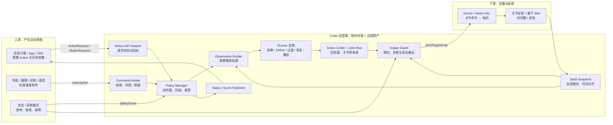

这张图表示**逻辑所有权**，不规定进程、线程或总线部署。唯一要求是 `Output Guard` 之后只有一个关节命令出口；任务、导航、拍摄模块都不能绕开该出口直接写同一组腿轮电机。安全抢占不依赖当前 ONNX 正常返回。

### 2.1 T1 上下游的实际接口定位

从 T1 [MC 进程配置](../../04_真机与模型数据/运控模型库/真机/qd1_t2d0/配置/mc_T1.yaml)、[Action 配置](../../04_真机与模型数据/运控模型库/真机/qd1_t2d0/配置/action_setting.yaml)和[IDL](../../04_真机与模型数据/真机资料/interface/aimdk_msgs/share/aimdk_msgs)可以核实 **MC 进程边界**。这些不等同于 `libmc_common_runner.so` 内部 C++ 函数，但足以作为 Collie 领域边界的参考。

| T1 方向 | 实际生产者 → 消费者 | 接口和关键数据 | 到 Runner 前/后的处理 | 原始依据 |
|---|---|---|---|---|
| 动作请求 | `task_engine`/SDK → MC ServiceManager | `mc_set_action_service`，`SetMcAction{source, McActionCommand{action, action_desc}}`；响应 `CommonTaskResponse{task_id,state}` | ActionManager 用 `action_ruler` 找边、校验退出/进入，再启动 `action_setting` 的执行组；`task_id` 是受理回执 | [`SetMcAction.srv`](../../04_真机与模型数据/真机资料/interface/aimdk_msgs/share/aimdk_msgs/srv/SetMcAction.srv)、[`McActionCommand.msg`](../../04_真机与模型数据/真机资料/interface/aimdk_msgs/share/aimdk_msgs/action/McActionCommand.msg)、[`CommonTaskResponse.msg`](../../04_真机与模型数据/真机资料/interface/aimdk_msgs/share/aimdk_msgs/common/CommonTaskResponse.msg) |
| 连续速度 | 导航/跟随/手柄/App 等 → MC InputManager | `/aima/mc/locomotion/velocity`；`source, forward_velocity, lateral_velocity, angular_velocity, pitch_velocity, level` | 按来源优先级与超时仲裁；Runner 读取**仲裁后的**速度，不应自己订阅所有来源 | [`mc_T1.yaml`](../../04_真机与模型数据/运控模型库/真机/qd1_t2d0/配置/mc_T1.yaml)、[`McLocomotionVelocity.msg`](../../04_真机与模型数据/真机资料/interface/aimdk_msgs/share/aimdk_msgs/motion/McLocomotionVelocity.msg) |
| 全身动作资源 | 任务/内容 → MC | `mc_set_motion_service`：`source,type,motion,model,resource,interrupt,operation` | 选择模仿/播放资源与 Action；`PRELOAD` 和 `EXECUTION` 需区分 | [`SetMcMotion.srv`](../../04_真机与模型数据/真机资料/interface/aimdk_msgs/share/aimdk_msgs/srv/SetMcMotion.srv)、[`motion_list.yaml`](../../04_真机与模型数据/运控模型库/真机/qd1_t2d0/配置/motion_list.yaml) |
| 局部预设动作 | 任务/交互 → MC | `mc_set_preset_motion_service`：`source,area,motion,interrupt,ani_path`；还有 `/aima/mc/custom/joint/command` | 上肢/头部叠加；必须明确与主 Runner 的关节所有权 | [`SetMcPresetMotion.srv`](../../04_真机与模型数据/真机资料/interface/aimdk_msgs/share/aimdk_msgs/srv/SetMcPresetMotion.srv)、[`McCustomJointCommand.msg`](../../04_真机与模型数据/真机资料/interface/aimdk_msgs/share/aimdk_msgs/motion/McCustomJointCommand.msg) |
| 机器人反馈 | `device_manager` → MC | `/aima/hal/joint/state`：`JointStateArray`，每关节 `name,position,velocity,effort,coil_temp,motor_temp,motor_vol`；`/aima/hal/imu/torso/state` | 读取、时间戳/丢帧检查、按训练关节顺序映射、滤波，再组 obs | [`JointStateArray.msg`](../../04_真机与模型数据/真机资料/interface/aimdk_msgs/share/aimdk_msgs/msg/JointStateArray.msg)、[`JointState.msg`](../../04_真机与模型数据/真机资料/interface/aimdk_msgs/share/aimdk_msgs/msg/JointState.msg)、[`mc_T1.yaml`](../../04_真机与模型数据/运控模型库/真机/qd1_t2d0/配置/mc_T1.yaml) |
| 电机关节目标 | MC → `device_manager` | `/aima/hal/joint/command`：`JointCommandArray`，逐关节 `name,position,velocity,effort,stiffness,damping` | Runner 输出经解码/增益/限幅/合成后发布；设备层映射电机并闭环 | [`JointCommandArray.msg`](../../04_真机与模型数据/真机资料/interface/aimdk_msgs/share/aimdk_msgs/msg/JointCommandArray.msg)、[`JointCommand.msg`](../../04_真机与模型数据/真机资料/interface/aimdk_msgs/share/aimdk_msgs/msg/JointCommand.msg)、[设备配置](../../04_真机与模型数据/真机资料/device_manager/cfg/t1_v2d0_config.yaml) |
| 状态/诊断 | MC → 任务、HMI、HDS | `/aima/mc/common/state`，`McCommonState`；`/aima/hds/diagnostic_list`；`/robot/trace/events` | 当前/目标 Action、运行状态、`switch_ready`、形态、跌倒等独立发布 | [`McCommonState.msg`](../../04_真机与模型数据/真机资料/interface/aimdk_msgs/share/aimdk_msgs/msg/McCommonState.msg)、[`McActionInfo.msg`](../../04_真机与模型数据/真机资料/interface/aimdk_msgs/share/aimdk_msgs/action/McActionInfo.msg)、[`mc_T1.yaml`](../../04_真机与模型数据/运控模型库/真机/qd1_t2d0/配置/mc_T1.yaml) |

**上游模块逐个对位**：T1 `task_engine`/SDK 发离散服务请求；导航规划、跟随和拍摄轨迹属于速度**生产者**，经 `/aima/mc/locomotion/velocity` 进入 MC，不直接调用 Runner；`rc`、`vr`、`app_proxy`、`interaction`、`pnc`、`app_proxy_t_mode`、`insta360` 是 [MC InputManager 配置](../../04_真机与模型数据/运控模型库/真机/qd1_t2d0/配置/mc_T1.yaml)中的来源名，优先级分别为 80/70/90/80/80/90/90，配置超时均为 1000 ms。这些是**来源标签**，不保证与进程一一对应。避障覆写 `coreon_fusion` 在[现有取证笔记](../../03_参考库/历史分析报告/raw/notes/原始取证笔记.md)中出现，但不在这七个配置源内；若 Collie 需要避障优先，应在自己的 `velocity_sources.yaml` 显式定义，不继承隐式特例。系统模式/硬件急停可绕过普通动作排队，直接触发安全路径。

**下游模块逐个对位**：Runner 的实际执行出口是 MC 的 joint publisher → `device_manager` 的 `/aima/hal/joint/command` subscriber → 电机驱动；反馈逆向从 `device_manager` 的关节/IMU publisher 回到 MC。`/aima/mc/common/state` 向任务/平台报告运行状态，诊断向 HDS 报告。`legged_odom`/导航使用反馈与状态作定位规划，但不是 Runner 的电机命令下游。T1 配置的关节命令发布 `frequency:200`、状态 `frequency:50`；Runner 的 `period_ms:10` 属另一层频率，不能把发布 200 Hz 当成推理 200 Hz。

T1 `ServiceManager` 的 11 个条目如下。这是 MC 的**对外服务表**，不是每个策略都要实现 11 个方法。配置只给内部服务名，没有逐项声明所绑定的 IDL；能由同名 IDL 核对的项列在右栏，其余应以运行期服务注册或头文件继续核实。

| T1 内部服务名 | 功能 | 可核对的 IDL / 补充说明 |
|---|---|---|
| `mc_set_action_service` | 请求离散 Action | [`SetMcAction.srv`](../../04_真机与模型数据/真机资料/interface/aimdk_msgs/share/aimdk_msgs/srv/SetMcAction.srv) |
| `mc_get_action_service` | 查询当前 Action | [`GetMcAction.srv`](../../04_真机与模型数据/真机资料/interface/aimdk_msgs/share/aimdk_msgs/srv/GetMcAction.srv) |
| `mc_set_motion_service` | 全身动作/模型/资源 | [`SetMcMotion.srv`](../../04_真机与模型数据/真机资料/interface/aimdk_msgs/share/aimdk_msgs/srv/SetMcMotion.srv) |
| `mc_get_motion_service` | 查询 motion | 精确 IDL 绑定未在配置中显式给出，需核实 |
| `mc_set_preset_motion_service` | 局部预设动作 | [`SetMcPresetMotion.srv`](../../04_真机与模型数据/真机资料/interface/aimdk_msgs/share/aimdk_msgs/srv/SetMcPresetMotion.srv) |
| `mc_get_preset_motion_state_service` | 查询局部动作状态 | [`GetMcPresetMotionState.srv`](../../04_真机与模型数据/真机资料/interface/aimdk_msgs/share/aimdk_msgs/srv/GetMcPresetMotionState.srv) |
| `mc_set_input_source_service` | 管理速度源 | [`SetMcInputSource.srv`](../../04_真机与模型数据/真机资料/interface/aimdk_msgs/share/aimdk_msgs/srv/SetMcInputSource.srv)；请求含 `ADD/MODIFY/DELETE/DISABLE/ENABLE` 动作 |
| `mc_get_current_input_source_service` | 查询有效速度源 | [`GetCurrentInputSource.srv`](../../04_真机与模型数据/真机资料/interface/aimdk_msgs/share/aimdk_msgs/srv/GetCurrentInputSource.srv) |
| `mc_set_robot_runtime_model_service` | 切换运行模型 | [`SetRobotRuntimeModel.srv`](../../04_真机与模型数据/真机资料/interface/aimdk_msgs/share/aimdk_msgs/srv/SetRobotRuntimeModel.srv) |
| `mc_get_robot_runtime_model_service` | 查询运行模型 | [`GetRobotRuntimeModel.srv`](../../04_真机与模型数据/真机资料/interface/aimdk_msgs/share/aimdk_msgs/srv/GetRobotRuntimeModel.srv) |
| `mc_motion_record_service` | 动作录制 | [`McMotionRecord.srv`](../../04_真机与模型数据/真机资料/interface/aimdk_msgs/share/aimdk_msgs/srv/McMotionRecord.srv) |

`/aima/mc/body_pose` 和 VR 话题在通道列表中出现，但此版本 SubscriberManager 没有启用，不能作为首版必接链路。T1 状态中的 `form_state`、`action_info.status`、`switch_ready` 分别表示形态、动作阶段和是否允许下一次切换，不能合并成一个布尔值。

### 2.2 `libmc_common_runner.so` 能说明到哪一步

Z 盘已恢复访问。2026-11-18 直接检查 `Z:\primebot-t1\robot_rk\software\mc\lib\libmc_common_runner.so`（AArch64 ELF，14,584 字节，SHA-256 `74ac8ad1fdd25ddf7320fe6be1b96db0e8890ca10f728b3c05cc49e0fdf210db`），并交叉检查相邻的 `libmc_manager_action.so`、`libmc_common_context.so`、`libmc_runner_rl_quad_loco.so`、`libmc_runner_rl_bi_loco_wbc.so` 和经典站立 Runner。检查方式为 ELF `.dynsym` 与 `DT_NEEDED`，未执行这些真机二进制，也未修改 Z 盘。

**现在可以证实的基类与装载关系：**

| 二进制证据 | 导出/依赖的符号（省略命名空间与 ABI 修饰） | 可下的结论 |
|---|---|---|
| `libmc_common_runner.so` | `mc::runner::RunnerBase::{Configure,PreInit,Init,Trig,Run,Pause,Resume,Shutdown,EnterCheck,ExitCheck,PreRunOnce,AfterExit}`；另有 `SetName/Name`、`SetCfgPath`、`SetPeriodMs/PeriodMs`、`SetRunnerContext`、`GetType`、`SkipPreRunOnceIfShared` | T1 **确有 `RunnerBase` 基类**及上述生命周期钩子；不再是分析文档的猜测 |
| `libmc_manager_action.so` | 动态依赖 `libmc_common_runner.so`；导出 `ActionManager`、`RunnerFactory::Load`、`TransitionTask::AddRunners/Transition/Run`、`ResidentTask::AddRunner/Run` | Action 管理器持有/装配 Runner；区分可切换任务与常驻任务，符合 `action_setting.yaml` 的两类配置 |
| 具体 Runner `.so` | `libmc_runner_rl_quad_loco.so`、`libmc_runner_quad_stand.so` 均导出 C 入口 `CreateRunner`/`DestroyRunner`，动态依赖基类与 context 库；具体类覆盖 `Run/Init/ExitCheck/PreRunOnce` 等 | 每个 Runner 库通过工厂装载实例，控制行为由具体派生类实现；不同类覆盖的钩子不同 |
| `libmc_common_context.so` | `RunnerContext`、`RunnerDataBoard`；`RunnerContext` 构造符号包含 `ActionContext` 与 `unordered_map<string,MotionCommand>` | 存在由 Manager/Context 向 Runner 传递动作上下文和命令数据的通道；仅凭符号不能排除具体 Runner 的其他输入来源 |

在四足行走 Runner 的符号中，还可见 `RunnerDataBoard` 绑定 `ImuState`、`JointStateArray`、`LocomotionVelocity`、`OdometryData`、`PostureState`、`SystemStatus`、`JointCommandArray`、`BodyDesire`、`MotionIntrState`、`OutputDB`、`RLDebugInfo` 等类型。**这是编译后的类型引用证据，不代表每种类型每拍都实际读取或写出**。外部话题到这些数据槽的精确映射，仍以 `mc_T1.yaml`、IDL 及对应 Manager 库为准。

二进制符号能确认方法名与部分参数类型，但 C++ mangling **不编码普通方法返回类型**，也不能仅凭导出表还原完整 `RunnerContext` 字段、虚函数表语义、每拍时序和内部数据所有权。软件团队若要二进制兼容 T1，还需同版本头文件与编译链；Collie 按本文 `IRunner` 新契约实现即可。此前文档中“找不到 `.so`”的结论已撤销。

## 3. Collie 对外接口：字段、提供方与消费者

建议软件团队做一个 `MotionApiAdapter`，把 ROS2/RPC/其他平台消息翻译为以下**稳定领域接口**；运控 Runner 只消费领域对象，不依赖任务层消息定义。

| 领域接口 | 提供方 → 消费者 | 必选字段及单位 | 接受/拒绝规则 | 反馈 |
|---|---|---|---|---|
| `ActionRequest`（离散） | 任务/SDK → `PolicyManager` | `request_id, source, action_id, issued_at, deadline, parameters, preempt_mode` | Action 已注册、当前形态和边合法、安全准入通过；重复 `request_id` 幂等 | 立即 `accepted/rejected + reason + request_id`；完成另走状态事件 |
| `BodyVelocityRef`（连续） | 导航/跟随/运镜/遥控 → `CommandArbiter` | `source, seq, stamp, ttl, frame_id=base_link, vx_mps, vy_mps, wz_radps`；可选姿态/高度参考 | 注册来源、序号递增、未过期、当前 Action 接受速度；超限裁剪并记原因 | `effective_source/effective_velocity` 状态；TTL 到期归零 |
| `OverlayRequest`（局部动作） | 任务/交互 → `PolicyManager/JointMux` | `area, motion_id/reference, interrupt, deadline` | 主 Runner 的关节所有权允许叠加；稳定态准入 | `overlay_phase/done/fault` |
| `RobotStateSample` | 关节 HAL、IMU、状态估计 → `StateSnapshot` | 每传感器独立 `stamp`；关节 `name,q,dq,tau,temp,voltage,valid`；IMU `quaternion,omega,acceleration,valid`；可选支撑/接触 | 时间倒退、重复、过期、关节缺失、NaN/Inf 标为 invalid；不能用全零代替失效 | `snapshot_freshness` 与故障事件 |
| `SafetyEvent` | 急停/设备/安全监测 → `PolicyManager` 和 `OutputGuard` | `kind,severity,stamp,latched,detail` | 高优先级异步抢占；安全出口不等待推理完成 | 故障锁存、复位条件与事件 |
| `JointTargetArray` | `OutputGuard` → 设备 HAL | `stamp,sequence,action_epoch`；每个关节 `name,mode,q_rad,dq_radps,tau_nm,kp,kd,enabled` | 只能有一个写入者；逐关节限位/变化率/模式校验 | HAL 回传接收/故障与关节反馈 |
| `MotionStatus` | `PolicyManager` → 任务/HMI/日志 | `request_id,current_action,target_action,phase,form,switch_ready,stable,effective_source,fault,stamp` | 阶段单调或显式失败；状态与实际物理判据一致 | 上层据此决定讲解、拍照、下一动作 |

`ActionRequest` 不能与 `BodyVelocityRef` 混为一条接口：前者决定**运行哪个策略及切换路径**，后者是当前运动策略每拍使用的**连续参考**。目标位置、行人 ID、VIP 信息、相机画幅由导航/感知/拍摄业务处理，运控接收由它们计算出的速度、停车或姿态请求。对接时必须写清每条速度的 `frame_id`、时间基准和有效期；不能把上一条非零速度永久保持。

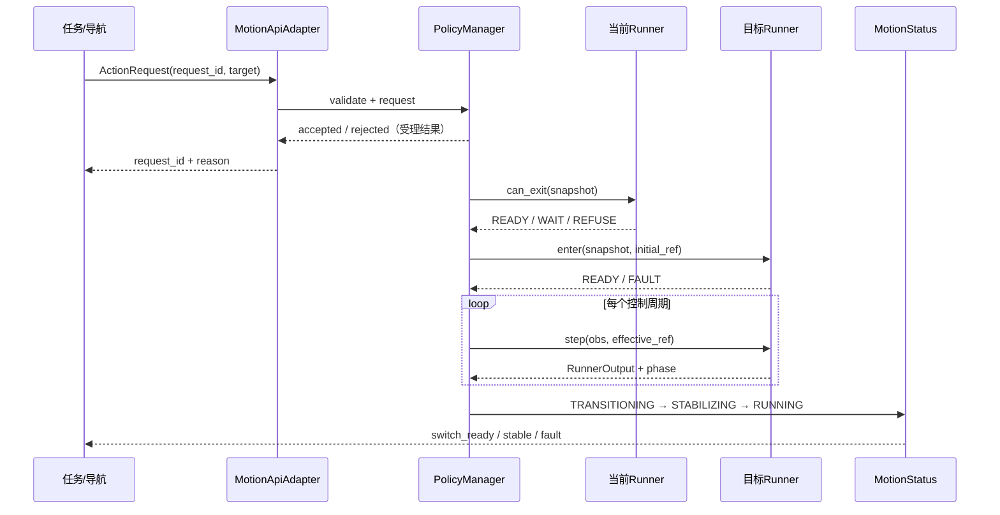

### 3.1 领域接口的最小类型关系

以下是**逻辑契约**，不是 T1 头文件或限定 ROS2 的 IDL。关节数组长度取自 `RobotDescription`，模型输入输出维度取自 `RunnerManifest`，软件加载时逐项校验。

```cpp
struct StepInput {
  RobotStateSnapshot state;      // 带各源时间戳、有效位及关节名
  MotionReference reference;    // 已完成来源仲裁、坐标转换和时效检查
  TransitionContext transition; // 当前 Action、阶段、接管 epoch
};
struct RunnerOutput {
  JointTargetArray targets;     // 逐关节 mode/q/dq/tau/kp/kd/enabled
  JointOwnership owns;          // 显式声明可写关节
  Phase phase;
  bool done, exit_ready;
  FaultCode fault;
};
class IRunner {
 public:
  virtual Result load(const RunnerManifest&, const RobotDescription&) = 0;
  virtual Result enter(const StepInput&) = 0;
  virtual ExitDecision can_exit(const RobotStateSnapshot&) = 0;
  virtual RunnerOutput step(const StepInput&) = 0;
  virtual void exit(ExitReason) = 0;
  virtual RunnerStatus status() const = 0;
  virtual ~IRunner() = default;
};
```

`load` 在非实时阶段校验和预分配；`enter` 初始化历史、phase 和控制目标；`step` 在配置的截止时间内返回；`exit_ready` 只表示当前 Runner 可移交，Manager 仍需验证目标 Runner 的进入守卫与稳定结果。`MotionStatus` 对上层分别报告请求受理、切换中、稳定和失败。

## 4. Runner 真正接收什么：静态配置与每拍数据分开

### 4.1 三层输入

| 层 | 何时提供 | 具体内容 | 归属 |
|---|---|---|---|
| **本体静态包 `RobotDescription`** | 启动/机型切换前 | 关节名与顺序、零点/方向、轮半径与传动、限位、控制模式、传感器外参、设备版本 | 本体/驱动提供；运控签字 |
| **策略静态包 `RunnerManifest`** | 加载/热切换前 | Action ID、Runner 类、模型/轨迹路径与 hash、输入 tensor 名称/shape/dtype、观测块次序/尺度/历史、输出语义/尺度/默认位、增益、所有权、控制周期、进入退出守卫 | 运控提供；软件加载校验 |
| **每拍输入 `StepInput`** | 每个 Runner tick | `RobotStateSnapshot`、仲裁后的 `MotionReference`、上一拍**该策略**动作、内部 phase/历史缓冲、当前切换上下文 | StateSnapshot/CommandArbiter/Runner 自身 |

这种区分很重要：`policy.onnx` 不是完整策略；它没有说明关节索引、时序、尺度、上一动作、指令限幅和后处理。每个 Action 的完整资产是 **模型/算法 + manifest + 本体映射 + 进入/退出条件 + 验收向量**。

### 4.2 T1 原始配置具体如何表达

T1 的 [`action_setting.yaml`](../../04_真机与模型数据/运控模型库/真机/qd1_t2d0/配置/action_setting.yaml) 把 `Action → execution group → runner name/cfg_path/period_ms/priority` 关联起来，例如 `QUADRUPED_LOCOMOTION_DEFAULT → rl_quad_loco → ./rl/quad_walk.yaml → 10 ms`，`QUADRUPED_TO_BIPED → rl_quad_to_bi → ./rl/quad_to_bi_run.yaml → 10 ms`。`BIPED_LOCOMOTION_WBC` 有两个执行组：`rl_bi_loco_wbc` 10 ms 和 `animation_player` 4 ms；**一个 Action 可以组合多个 runner**。这正是 Collie 需要 `ActionBundle` 与关节所有权而不是“一个 Action = 一个类 = 一个线程”的原因。

| T1 配置层 | 字段示例 | 给 Collie 的含义 |
|---|---|---|
| `action_setting.yaml` | `resident_actions`、`transition_actions`、`runners[].name/cfg_path`、`period_ms` | 常驻安全任务；Action 由一个主 Runner 加可选 overlay 构成；每组独立更新周期 |
| `action_ruler.yaml` | `common_rules`、`action_rules[].next_actions` | 允许的物理切换边；可走路径与安全直达出口 |
| `rl/quad_walk.yaml` | `policy.path`、`obs_nums`、`action_nums`、`seq/action_seq`、`frame_stack`、`obs_index`、`obs_scales`、`clips`、`action_scale`、`activation`、`kps/kds/default_dof_pos`、`filter`、`acc_*`、`tau_limit` | 模型 I/O 与前后处理配方；不是只交付 ONNX |
| `mc_T1.yaml` | 话题、服务、输入源 priority/timeout、状态/关节发布频率 | 软件封装和对外适配；不应该写进单个模型配置 |
| `robot_model.yaml` 与设备配置 | 关节名称/机械限位、电机通信/零点/方向 | 本体/设备层的静态事实，策略引用版本而不复制成多份 |

### 4.3 Collie 推荐的 `IRunner` 与 `ActionBundle`

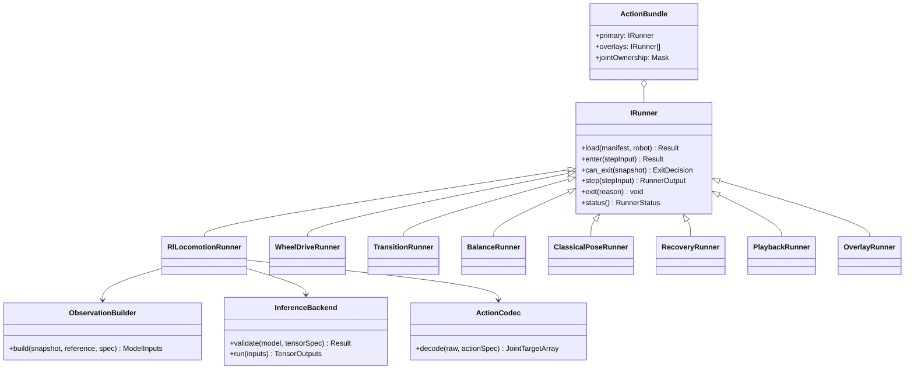

`IRunner` 是**运控策略接口**，`PolicyManager` 是**软件封装/切换器**。单个 ONNX 权重通常成为 `RlLocomotionRunner` 的不同配置实例，不需要每个权重写一份派生类；但过渡策略的 phase、退出门控、失败回退与持续行走不同，须有 `TransitionRunner` 的明确行为。`WheelDriveRunner` 是 Collie 四轮运动的策略承接点，具体由控制律还是新模型实现由运控决定。`ActionBundle` 用于平衡主 Runner 与头/臂手势等局部动作组合；启动时若 `owns_mask` 冲突，拒绝启用，不能靠“谁最后写”解决。

### 4.4 每种首批 Runner 的接口卡

| Action / 实现类 | 每拍主参考（来自上游） | 每拍反馈（来自本体） | Runner 原始输出及进入/退出 | 必交配置 |
|---|---|---|---|---|
| `QUAD_WHEEL_DRIVE` / `WheelDriveRunner` | `vx,vy,wz`，可选高度/转向模式 | 四轮与腿关节、IMU、有效支撑 | 轮/腿目标；进入需四足稳定，退出需速度与滑移降到阈值 | 速度域、轮腿控制模式、观测/动作逐维表、制动与侧滑阈值 |
| `QUAD_STOP` / `ClassicalPoseRunner` 或专用停止策略 | 目标零速度 | 同上，特别是轮速与接触 | 制动/驻留目标；稳定保持后 `exit_ready` | 减速曲线、稳定窗口、地面坡度与失败出口 |
| `QUAD_TO_BIPED` / `TransitionRunner` | 一次性变形请求；无持续导航速度 | 关节、IMU、接触/滑移、周围空间准入结果 | phase 驱动的全身目标；完成需姿态+接触+保持时间，异常走安全回退 | 模型/轨迹、初末态包络、phase、超时、重试/回退边 |
| `BIPED_BALANCE` / `BalanceRunner` | 可选机身姿态/头臂参考；静态讲解时速度为零 | 关节、IMU、后轮/支撑状态 | 持续平衡输出；失稳/失联抢占 | 模型与 obs/act 规格、允许扰动、姿态与滑移阈值 |
| `BIPED_TO_QUAD` / `TransitionRunner` 的另一 manifest | 一次性落回请求 | 同 Q2B | 全身目标；四轮支撑稳定才允许下一步滑行 | 独立模型/轨迹、初末态守卫、超时/回退 |
| `QUAD_STAND/GET_DOWN` / `ClassicalPoseRunner` | 姿态目标 | 关节、IMU | 位姿/增益目标；误差与稳定窗口决定完成 | 关键帧、增益、限速、机械限位 |
| `RECOVERY` / `RecoveryRunner` | 安全系统授权、倒地类型 | 关节、IMU、接触、环境清空信号 | 恢复目标；失败次数受限并回阻尼 | 可恢复姿态集合、场地条件、次数/超时、失败出口 |
| `GESTURE/HEAD` / `OverlayRunner` | 手势/视线轨迹与时标 | 对应关节与主平衡状态 | 仅声明拥有的关节目标；主策略退出时同步停止 | 所有权、可并行主 Action 列表、轨迹、增益 |

`QUAD_TERRAIN`、载物、楼梯和双足移动在后续版本按同一接口卡补充；没有训练资产与验收时保持未开放状态。这里的“每拍主参考”是 Runner 消费的接口，不表示 Runner 自己做导航、识别 VIP 或相机拍摄。

## 5. 首批策略清单与 Action 映射

| 优先级 | Collie 能力 / 建议 Runner | T1 对照 Action（仅参考） | 触发与出口 | 备注 |
|---|---|---|---|---|
| P0 | 安全驻留/阻尼 `SafeHold`、被动 `Passive` | `DAMPING_DEFAULT`、`PASSIVE_DEFAULT` | 任意态异常直达；人工复位+重新验证 | 不是 RL；急停硬件链另行保证 |
| P0 | 四足站立/起立/趴下 `ClassicalPoseRunner` | `QUADRUPED_READY_STAND_DEFAULT`、`QUADRUPED_STAND_DEFAULT`、`QUADRUPED_GET_DOWN_DEFAULT` | 待机、迎宾、退出任务 | 四足低姿态不是“零速行走” |
| P0 | 四轮滑行 `QuadWheelDrive` | 参考 T1 `QUADRUPED_LOCOMOTION_DEFAULT` 的 Runner 组织方式 | 领路、跟随、巡游、运镜机位 | Collie 轮式四足策略/控制律由运控提供；业务差异主要在速度参考 |
| P0 | 减速/支撑稳定 `QuadStop` | 参考 T1 `QUADRUPED_LOCOMOTION_STEP` 的切换门控 | 四轮滑行→变形/表演前 | 可用受验证的停止过渡实现，但不能省略稳定门控 |
| P0 | 四足→双足 `Q2B` | `QUADRUPED_TO_BIPED` | 站立讲解/合影/平视交互 | 独立过渡 runner；初态、目标高度待定 |
| P0 | 双足直立平衡 `BipedBalance` | `BIPED_LOCOMOTION_WBC` | 讲解、合影保持、手势叠加 | 静止也需闭环平衡；后轮接触/滑移判据待标定 |
| P0 | 双足→四足 `B2Q` | `BIPED_TO_QUADRUPED` | 讲解/合影结束、恢复四轮移动 | 独立过渡 runner |
| P0 | 四足/双足恢复 `RecoveryRunner` | `QUADRUPED_RECOVERY`、`BIPED_RECOVERY` | 跌倒后仅在场地清空且人工/安全授权 | 展馆拥挤时默认阻尼等待，不自主弹起 |
| P0 条件项 | 低幅迎宾/讲解手势 `OverlayRunner` | `BIPED_CUSTOM_UPPER`、`animation_player` 等 | 站稳后与平衡策略组合 | 若 Collie 无独立头/臂自由度，则改为语音/灯效；关节所有权先定 |
| P1 | 低速复杂地形 `QuadTerrain`、窄道 | 参考 T1 `QUADRUPED_LOCOMOTION_TERRAIN` 的策略切换组织 | 门槛、坡道、院子、户外 | 场景自动识别/切换证据不足；先显式请求和保护 |
| P1 | 载物配置 `LoadedQuadWheelDrive` 或参数化 `QuadWheelDrive` | T1 无可直接映射的 5 kg 保证 | UC-10 平层/门槛；IR-B 取物 | 载荷、质心、制动距离须重新训练/实测 |
| P1 | 室外/人群限速配置 | 复用四足走路 Action | UC-03/06/12/15 等 | 人群检测/限速判定来自感知/规划；运控执行硬上限 |
| P2 | 楼梯、载物爬楼、拖拽 | T1 `TERRAIN` 不能推出安全载物爬楼 | UC-01、UC-10 变体 | 独立样机验证与地形/负载策略；不写入首发承诺 |
| P2 | 特技/复杂表演 | T1 `FRONTFLIP`、`DANCE` 等 | UC-14 可选 | 展馆/老人儿童附近禁用高风险特技 |

**策略数 ≠ 场景数**：17 个 UC 和展馆 3 IR 中多数平层移动行为复用 `QuadWheelDrive`；导航、跟随、避障、轨迹跟踪负责输出不同速度和停止条件。`BipedBalance` 可支持站立对话与静态合影；若需要双足移动、牵手移动，应另立 `BipedLoco/HandHeld` 需求和验收，不把静态平衡暗称可行走。

### 5.1 场景覆盖：业务调用到运控动作

| 场景 | 运动序列与归属 | 首发边界 |
|---|---|---|
| UC-13 唤醒认主、UC-11 居家信息交互 | 待机 `QuadStand`；必要时 `Q2B→BipedBalance→B2Q`；人脸/声纹/权签由感知/大脑完成 | P0；VIP 识别不要求运控增加新 RL |
| UC-04 访客接待、UC-14 变形/手牵/表演 | `QuadStand→QuadWheelDrive→QuadStop→Q2B→BipedBalance`；返回 `B2Q→QuadWheelDrive`；手牵/表演走独立受限能力 | P0；手牵**移动**与动态表演需单列能力确认 |
| UC-07 合影、UC-08 跟拍、UC-09 运镜 | 移动机位/跟拍 `QuadWheelDrive`，静态平视合影 `Q2B→BipedBalance`；云台/相机并行任务 | P0；跟拍优先 Q；直立态不默认移动，变焦归相机 |
| UC-15 跟随、UC-16 领路、UC-17 信标跟随 | `QuadWheelDrive` 消费导航/跟随速度；遮挡、信标丢失时零速并驻停 | P0；重识别/路径规划不是 Runner |
| UC-10 门口收发、UC-03 陪同外出、UC-06 夜巡、UC-12 看家 | `QuadWheelDrive`；门槛/坡道需 `QuadTerrain`；夜间/雨天/人群限速由工况包约束 | P1；载物与地形均需验证 |
| UC-01 载物爬楼、UC-02/05 看护 | 前者 `LoadedTerrain/Stair` 待研发；后者主要复用 `QuadWheelDrive/Stand` 并由感知发危险区/跌倒事件 | P2；不把看护识别当运控策略 |
| 展馆 IR-A 迎宾→领路→直立讲解 | `QuadStand→QuadWheelDrive(约 1m 停驻/转向)→QuadWheelDrive(导航速度)→QuadStop→Q2B→BipedBalance(+手势)` | 单机；VIP/语音/NLU/路线/30 cm 避障由上游提供，运控做速度包络、接管与稳定 |
| 展馆 IR-B 问询→取物→寻人→送达 | `B2Q→QuadWheelDrive` 往返，载物用已验证参数/策略；到人前停止 | 双通道定位/寻人和人装人取归上游；载荷/质心验收未定 |
| 展馆 IR-C 命令触发合影或跟拍 | 合影 `QuadWheelDrive` 到位→`Q2B→BipedBalance`→`B2Q`；跟拍保持四足 `QuadWheelDrive` | 云台/手机/快门/成片不占腿轮 Runner；构图速度来自上游 |

### 5.2 策略切换图谱（建议冻结为配置）

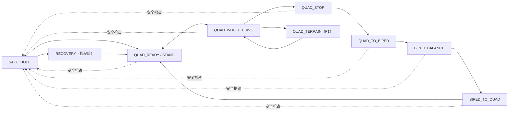

图示只表达建议路径；每条物理边的初态、守卫、完成和故障出口须在 Collie 上实测后开放。`SAFE_HOLD` 的安全抢占不经过普通路径搜索。

| 从 → 到 | 进入守卫 | 完成/失败 |
|---|---|---|
| `SafeHold → QuadReady → QuadStand` | 急停已复位、反馈新鲜、关节/IMU 有效、支撑可确认 | 位姿误差和稳定保持达标；否则保持安全态 |
| `QuadStand ↔ QuadWheelDrive` | 支撑可靠、速度命令有效；反向需速度衰减到阈值 | 轮速/机身速度稳定后 `switch_ready=true` |
| `QuadWheelDrive → QuadStop → Q2B` | 零速、支撑稳定、周围安全距离、地面平整、载荷许可 | `Q2B` 监测姿态/接触/滑移/超时；失败按已验证回退或阻尼 |
| `Q2B → BipedBalance` | 转换完成且后轮支撑有效 | 保持稳定窗口完成后才通知业务“可讲解/拍照” |
| `BipedBalance → B2Q → QuadStand/QuadWheelDrive` | 手势叠加已退出、速度零、前方空间清空 | 回到四轮支撑后才放行移动 |
| `QuadWheelDrive → QuadTerrain → QuadWheelDrive` | 地形请求明确，训练域/传感器/载荷满足 | 地形结束且稳定后回平地；不能仅凭速度大小自动推断 |
| `任意 → SafeHold/Damping` | 安全事件抢占 | 锁存原因；禁止自动回原动作 |
| `SafeHold → Recovery → QuadStand/BipedBalance` | 倒地类型已判定、场地无人与障碍、人工/产品授权 | 恢复失败回阻尼，次数受限 |

T1 的 [切换规则](../../04_真机与模型数据/运控模型库/真机/qd1_t2d0/配置/action_ruler.yaml) 中存在 `QUADRUPED_LOCOMOTION_DEFAULT→QUADRUPED_TO_BIPED→BIPED_LOCOMOTION_WBC` 和 `BIPED_LOCOMOTION_WBC→BIPED_TO_QUADRUPED→QUADRUPED_STAND_DEFAULT/QUADRUPED_LOCOMOTION_DEFAULT`；`QUADRUPED_LOCOMOTION_STEP` 是多个特殊动作前的稳定节点。Collie 只采用这类**物理交接逻辑**，边是否开放以新本体验证为准。常规切换不可越过未配置边；紧急动作独立直达。

### 5.3 接管协议与对外阶段

软件管理器负责注册并预加载 Runner、校验 Action 图、仲裁请求、锁定唯一设备出口、保存 `request_id/current_action/target_action` 并发布阶段事件。正常接管遵循 `REQUESTED → PREPARING → WAIT_EXIT → ENTERING → TRANSITIONING → STABILIZING → RUNNING`；任一阶段失败进入 `FAULT/SAFE`。旧 Runner 的 `can_exit()` 只表示物理上可以交出；目标 Runner 的 `enter()` 仍须检查初态、传感器和资产。移交电机写入权是原子步骤，不能让两个主 Runner 同时发布。

`Q2B/B2Q` 作为独立 Runner 按姿态、接触、关节误差和稳定保持时间判断完成。对外的“请求已受理”“正在切换”“机体已稳定”“失败”分别报告；`switch_ready` 仅在当前策略稳定且可接受下一动作时为真。安全抢占不等待推理完成，普通动作切换不得绕过配置中的过渡边。

## 6. 前处理：一拍观测怎么从反馈变成 tensor

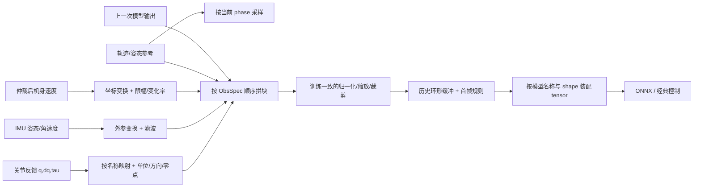

| 顺序 | 输入/处理 | T1 证据与例子 | Collie 必须固定的契约 |
|---|---|---|---|
| 1 | 获取同一拍 `RobotStateSnapshot` | MC 订阅关节/IMU，配置反馈发布间隔与延迟检查；T1 `JointState` 含位置/速度/力矩/温度/电压 | 各源采样时间、最大年龄、时间倒退/缺字段处理；陈旧反馈须故障化 |
| 2 | 机型映射 | T1 `quad_walk.yaml` 列出 `joints_name`、`seq`、`action_seq`；`robot_model.yaml` 定义限位 | 关节名 → 本体顺序 → 模型顺序；方向与零点必须版本化 |
| 3 | 状态滤波/姿态表示 | T1 `filter.imu_vel_cutoff_freq=100`、`q_vel_cutoff_freq` 分关节；观测索引有 `imu_omega/imu_euler` | 使用训练侧相同坐标系、滤波器形式、采样率、角度表示；仅截止频率不能完整确定滤波实现 |
| 4 | 参考命令整形 | T1 `command_scales` 有各向速度范围，另有 `acc_x/acc_y/acc_yaw`；InputManager 有来源与超时 | 先做来源仲裁、TTL、机身坐标转换和速度/加速度包络，再送给策略；`STOP` 可强制清零 |
| 5 | 组装当前观测 | T1 `obs_index` 给每块起始偏移；下方三种模型尺寸不同 | 每个 Runner 的 `ObsSpec` 声明块名、长度、来源、顺序、缺失处理和单位；启动期总维度校验 |
| 6 | 缩放、裁剪 | T1 `obs_scales.dof_vel=0.05, ang_vel=0.25`；`obs_clip` 随策略为 20/50 等 | 每维与训练配置逐项一致；NaN/Inf 不许经 `clip` 掩盖 |
| 7 | 历史/首帧 | T1 常见 `frame_stack=10`，ONNX 第二输入是 10 帧历史 | 冻结帧顺序、是否含当前帧、首次进入如何填充、切换后是否清空；离线 golden vector 验证 |
| 8 | 模型 tensor | ONNX 图可直接核实输入名称、shape、dtype | 不依赖向量总长度猜测；逐输入名称绑定并逐输出名称读取 |

**实证尺寸实例**（来自本地 ONNX 图和同名配置）：

| T1 Action / 模型 | 当前观测构成（`obs_index` 起点） | Tensor 输入 → 输出 | 尚需源码/向量验证的部分 |
|---|---|---|---|
| 四足行走 `quad_walk.yaml` | `omega[0:3]`、`euler[3:6]`、`pos[6:18]`、`vel[18:32]`、`prev_action[32:46]`、`command[46:49]`、`cpg[49:57]` | `observations[1,57]` + `observation_history[1,570]` → `action[1,14]`；另有 4 维辅助输出 | `euler` 的坐标约定、CPG 8 维编码、历史是否含当前帧、辅助输出语义 |
| 双足 WBC `bi_wbc_run.yaml` | 前 46 维同类块，`command[46:49]` | `observations[1,49]` + `observation_history[1,490]` → `action[1,14]` | 命令各维定义及退出门控实际算法 |
| 四足→双足 `quad_to_bi_run.yaml` | 前 46 维同类块，`phase[46]`、`q_ref[47:51]` | `observations[1,51]` + `observation_history[1,510]` → `action[1,14]` | `phase` 定义、4 维 `q_ref` 物理意义及初末帧规则 |

区间长度由相邻 `obs_index` 和 `obs_nums` 算得，**是结构映射，不是 T1 内部计算公式的逆向证实**。例如 `pos` 是否按 `q−default_q`、`prev_action` 是裁剪前还是后，必须拿控制器源码或 ONNX golden vector 核对。Collie 的训练/部署双方需共同出一张逐维 `ObsSpec.csv`，不能仅提交 `obs_nums=57`。

建议 Collie `ObsSpec.csv` 至少列：`index,block,element,joint_or_axis,source,unit,frame,offset,scale,clip,filter,history_lag,missing_policy`。一份模型一份规格，自动生成校验器与回放测试。

## 7. 后处理：模型输出怎么成为关节命令


| 阶段 | 逐项做什么 | 由谁定义/实现 |
|---|---|---|
| 输出校验 | 按 tensor **名字**选 `action`，检查 manifest 声明的目标维度、dtype、NaN/Inf、推理用时；辅助输出不能误当电机目标 | 运控定义 schema；软件实现运行时 |
| 裁剪与解码 | 逐维 `clip(raw_i, ±action_clip_i)`；若位置增量，`q_des_i=default_q_i+scale_i*raw_i`；若轮速，`dq_des_i=scale_i*raw_i`；若力矩则按力矩语义。`activation/owns_mask` 决定此 runner 是否写该关节 | 训练/运控提供**逐关节类型和配方**；软件实现通用 codec |
| 增益 | 给每关节 `kp/kd`，控制模式为 `POSITION/VELOCITY/TORQUE/DAMPING/PASSIVE`；切换时按经验证规则变更增益 | 运控签发；HAL 校验可执行范围 |
| 组合 | 主 Runner + 局部动作按关节所有权合成；若覆盖主平衡关节需显式受控混合、专门模型或禁止 | 运控批准组合；软件实现冲突检查 |
| 过渡 | 普通行走/驻留间可用经验证的平滑；Q2B/B2Q 由专门 `TransitionRunner` 闭环输出，不能被通用线性插值代替 | 运控定义物理条件；软件执行阶段机 |
| 最后安全闸 | 关节位置/速度、命令变化率、力矩/增益、反馈新鲜度、模型超时、急停状态检查；触发时切安全输出并锁存故障 | 运控给限值及动作；软件+HAL 分层实现 |

T1 [`quad_walk.yaml`](../../04_真机与模型数据/运控模型库/真机/qd1_t2d0/配置/rl/quad_walk.yaml) 明确列出 `action_clip=50`、14 维 `action_scale`、`default_dof_pos`、`kps/kds`、`activation`、`transition_duration=0.2`、`tau_limit`，所以“ONNX 输出 14 维角度直接下发”是错误理解。最终 T1 设备消息的物理字段可在 [`JointCommand.msg`](../../04_真机与模型数据/真机资料/interface/aimdk_msgs/share/aimdk_msgs/msg/JointCommand.msg) 核对。Collie 的数值由本体和训练重新给，不复制示例值。

### 7.1 一帧可复现实例（建议交付给软件的测试夹具）

```text
输入：带时间戳的 Collie 关节反馈 + IMU + 仲裁后的 vx/vy/wz + 上一拍 action
前处理产物：obs_current[name,shape] + obs_history[name,shape]
推理产物：raw_action[name,shape] + 可选诊断输出
后处理产物：每关节 {mode,q,dq,tau,kp,kd,enabled} + owns_mask
安全/设备产物：accepted_joint_command + clamp_reason/fault_reason
```

运控团队需提供实际 `.npz`/CSV golden fixture：`RobotStateSample`、速度、当前 Action/phase、期望两个输入 tensor、期望原始输出、期望逐关节目标。软件测试必须逐维比较 **输入 tensor** 和 **解码后目标**，仅比最终动作“看上去相似”不能发现关节顺序、帧序、单位错误。

## 8. 配置如何包装：一个 Action 的完整清单

以下是 **Collie 建议 schema 示例**，字段可改名，但信息不得丢。`<...>` 表示运控/本体团队尚未给出的资产或标定值，不是可运行参数。

```yaml
schema_version: 1
robot_profile: collie_wheel_quad_v1          # 关节/限位/设备版本另有独立配置
action_id: QUAD_WHEEL_GLIDE
form: QUADRUPEDAL
execution_groups:
  - role: primary
    runner: WheelDriveRunner                 # 或经训练验证的 RlLocomotionRunner
    period_ms: <trained_policy_period>
    owns: [front_left_leg, front_right_leg, rear_left_leg, rear_right_leg, four_wheels]
    config: wheel_glide_runner.yaml
  - role: overlay                            # 可选；若没有可删
    runner: OverlayRunner
    owns: [head]
    config: head_gesture.yaml

# wheel_glide_runner.yaml（策略资产）
asset:
  kind: onnx_or_classical
  path: <asset_path>
  sha256: <hash>
tensor_io:
  inputs:
    - {name: observations, dtype: float32, shape: [1, <obs_dim>]}
    - {name: observation_history, dtype: float32, shape: [1, <history_dim>]}
  outputs:
    - {name: action, dtype: float32, shape: [1, <act_dim>]}
observation:
  spec_file: obs_spec.csv                  # 逐维顺序/源/单位/尺度/滤波
  history_frames: <N>
  history_order: oldest_to_newest
  first_frame_fill: repeat_current         # 必须与训练侧一致，例子不代表既定值
  stale_state: fault
reference:
  accepted: [vx_mps, vy_mps, wz_radps]
  frame: base_link
  ttl_ms: <validated_ttl>
output:
  spec_file: action_spec.csv               # 逐关节模式/scale/default/gain/limit
  invalid: safe_hold
entry_guard: [form_is_quad, sensor_fresh, motor_ready, safety_clear]
exit_guard: [body_speed_below_threshold, support_confirmed]
failure_target: SAFE_HOLD
```

另设三份**系统级**配置：`velocity_sources.yaml`（来源优先级与 TTL）、`action_graph.yaml`（合法边及守卫）、`safety_limits.yaml`（输出与故障阈值）。不要把它们复制进 20 个 Runner 文件。加载顺序：本体包 → 系统级配置 → ActionBundle/RunnerManifest → 模型/轨迹与 tensor 验证 → 预分配缓冲 → 注册到 Manager → 开放请求。加载失败只能报错，不得把不完整 Action 暴露为可用。

## 9. 软件团队在 roboto_origin-main 中具体承接什么

现有 [`InferenceNode`](../../03_参考库/roboto_origin-main/modules/roboparty_deploy/src/inference/src/inference_node.cpp) 已有：`PolicyRuntime`、配置化观测块、历史缓冲、ONNX Runtime、`/cmd_vel` 接入、推理循环和电机控制循环。它的 [`setup_model`](../../03_参考库/roboto_origin-main/modules/roboparty_deploy/src/inference/src/inference_node.cpp) 当前明确拒绝多输入 ONNX；[`RobotInterface::apply_action`](../../03_参考库/roboto_origin-main/modules/roboparty_deploy/src/inference/include/robot_interface.hpp) 签名支持 `p/v/kp/kd/tau`，但现有控制路径主要调用位置向量。故应**复用驱动与推理基础设施，新增领域层**，不能只在原节点外面套一个 `switch(model_name)`。

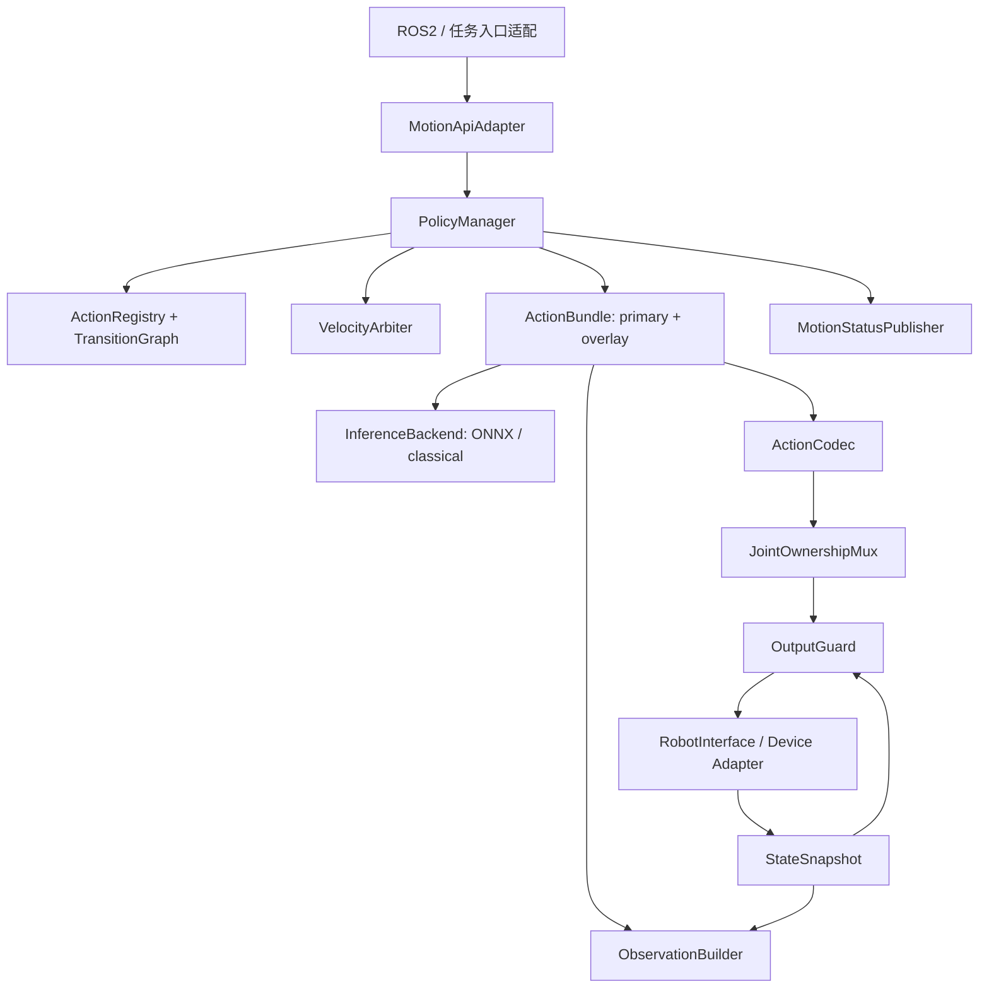

| 模块 / 建议文件 | 软件团队实现 | 运控团队交付/验收 |
|---|---|---|
| `motion_api_adapter` | ROS2/RPC 请求与领域对象互转、异步回执/状态关联、幂等 | Action ID 与错误/阶段语义 |
| `action_registry` + `transition_graph` | 解析配置、校验每个 ActionBundle/边、拒绝不可达请求 | 合法形态/边、守卫和回退路径 |
| `velocity_arbiter` | 来源优先级、TTL、序号、停止、被避障速度覆盖的规则 | 速度包络、优先级需求和失联动作 |
| `state_snapshot` + `observation_builder` | 关节/IMU缓存、时间对齐、逐策略观测、历史环 | `ObsSpec.csv`、训练一致滤波与黄金向量 |
| `inference_backend` | 多输入/多输出 ONNX 验证、预加载、定时统计 | ONNX 文件、tensor schema、耗时目标 |
| `runner/*` | `IRunner` 生命周期和经典/ONNX/过渡/恢复执行器 | 各策略进入、退出、完成、故障判据 |
| `action_codec` + `joint_mux` | 输出解码、控制模式、增益、关节所有权与叠加 | `action_spec.csv`、局部动作组合矩阵 |
| `output_guard` + `device_adapter` | 唯一命令出口、限位/变化率、安全替代、HAL 适配 | 物理包络、急停/跌倒/恢复规则；本体签字 |
| `motion_status` + replay tests | 阶段/故障状态、日志、离线回放 | 验收阈值与 golden fixtures |

软件架构不必照搬 T1 的 AimRT/线程布局。软件可决定是保留现有 ROS2 节点还是拆成多进程，但必须保持上述**领域接口**与单一设备出口。`roboparty_train/rsl_rl/runners` 是训练循环 Runner，不是部署态策略 Manager。

建议把上述领域层包装为 `roboparty_deploy` 内独立的 `motion_runtime` 库，节点/服务仅作外层适配。目录形态可以是：

```text
modules/roboparty_deploy/src/
  motion_runtime/
    include/motion/    types.hpp  runner.hpp  manifest.hpp  status.hpp
    src/               policy_manager.cpp  action_registry.cpp
                       state_snapshot.cpp  observation_builder.cpp
                       inference_backend.cpp  action_codec.cpp
                       joint_mux.cpp  output_guard.cpp
    runners/           wheel_drive.cpp  rl_locomotion.cpp
                       transition.cpp  balance.cpp  pose.cpp
                       recovery.cpp  playback.cpp  overlay.cpp
    tests/             golden_obs_action_replay.cpp  switch_graph_replay.cpp
  motion_ros_adapter/  motion_node.cpp  msg_translation.cpp
  inference/           （保留原节点作为迁移参考，逐步抽取共用代码）
  robots/collie/       robot_profile.yaml  action_registry.yaml
                       action_graph.yaml  velocity_sources.yaml
                       safety_limits.yaml  policies/<action>/manifest.yaml
```

**调用关系**：ROS/RPC callback 只做校验与入队，不在回调里做 ONNX 推理；`PolicyManager` 决定本拍 `ActionBundle` 与有效参考；`StateSnapshot` 给同一拍不可变反馈；各 Runner 使用 `ObservationBuilder/InferenceBackend/ActionCodec`；`JointMux` 合成后仅 `OutputGuard` 能调用 `RobotInterface`/设备发布。实际线程和调度由软件团队实现，但 `step()` 必须有确定的截止时间，过期输出不能沿用为新命令。这样增加新策略通常只需新增 manifest、模型与 golden fixture；新增执行机制才需要写新的 Runner 类。

## 10. 软件与运控之间最终应互交什么

| 运控团队交付 | 软件团队交付 | 联合验收 |
|---|---|---|
| `robot_profile` 审核；每个 Action 的 `RunnerManifest`、ONNX/经典控制资产及 hash | 可加载/可拒绝的 `ActionRegistry` 与 `PolicyManager` | 资产不匹配不开放 Action；模型版本可追踪 |
| `ObsSpec.csv`、`ActionSpec.csv`、进入/退出/完成/失败判据 | 前后处理、关节复用与安全出口 | 逐维 golden fixture、关节模式与限幅 |
| `action_graph.yaml`、局部叠加组合矩阵 | 路径规划、阶段机、冲突仲裁、异步状态 | 受理/运行/稳定/失败清晰区分 |
| 速度/载荷/地形包络 | 来源仲裁、TTL、上游接口 | 断流停车、避障优先、错误源拒绝 |
| 恢复与安全条件 | 硬件/软件急停链、故障锁存 | 推理挂死时仍可安全输出 |

首轮软件评审建议拿三条端到端链路逐字段走通：①四轮领路 `ActionRequest + VelocityRef → WheelDriveRunner → JointTarget`；②`QuadStop → Q2B → BipedBalance → B2Q` 的每阶段事件；③ IMU/关节过期或急停时，当前 Runner 无论处于哪一拍都能进入安全输出。场景需求中的速度、站立高度、载荷和自动恢复阈值尚待本体/产品签发，不在软件端猜常量。

## 11. 可直接给软件团队的验收契约

1. **加载期**：关节拓扑、模型 hash、输入输出名称/shape/dtype、观测配方、输出模式不匹配时拒绝启动；旧策略继续安全运行或进入安全态。
2. **回放期**：同一段时间戳反馈/速度/参考，经新旧离线实现对比，验证观测向量逐维一致、历史帧顺序、首次进入清零规则、manifest 所声明维度的输出反标定一致。每种模型至少提供一组 golden input/output。
3. **切换期**：非法边明确拒绝；正常边记录每阶段时间和守卫；任务收到“已接收、转换中、已稳定、失败”四种不同结果；变形期间不接受行走速度接管。
4. **异常期**：速度 TTL 到期、IMU/关节反馈过期、ONNX 异常、推理超时、输出 NaN/Inf、关节越界、跌倒、急停，都必须触发可追溯的安全输出；急停不能依赖 ONNX 或任务引擎存活。
5. **场景期**：展馆 IR-A 至少跑通迎宾/领路/直立讲解/回四足；IR-C 验证静态合影与四足跟拍两条路径；UC-15/16/17 验证同一四足 runner 承接三种速度来源。载物、楼梯、拥挤与手牵移动各设独立验证门槛。

验收记录字段：`request_id`、来源、当前/目标 Action、转换阶段、`switch_ready`、形态、输入新鲜度、速度源/TTL、模型版本/hash、推理耗时、输出限幅原因、安全事件及最终结果。可用离线回放+仿真完成接口验收；真机开放边必须再做本体安全试验。

## 12. 评审时必须拍板的最少问题

| 问题 | 当前依据/影响 | 建议决策责任人 |
|---|---|---|
| Collie 关节拓扑、轮/腿/头臂数，双足直立究竟是静态锁止还是动态后轮平衡 | 需求同时使用“四足轮式”“静态稳定”“后双轮自平衡”，表述冲突；决定控制模式和安全守卫 | 本体+运控 |
| Q2B/B2Q、双足保持、5 kg 载物、门槛/楼梯分别有哪些**Collie 自研权重/训练域/实测** | T1 资产不能直接迁移到不同机构 | 运控+训练 |
| 头/前肢手势与平衡策略是否争用关节 | 决定 `owns_mask`、叠加接口或重训练 | 本体+运控 |
| 展馆拥挤限速、30 cm 避障、被撞 5 s 恢复是否作为安全要求 | 需求里有草案但检测与自动恢复条件不完整；不能直接编码成常量 | 产品+安全+导航 |
| 断网、目标丢失、普通观众并发、VIP 识别失败、跟丢 15 s 后回哪里 | 属任务/感知策略；运控需要收到明确 `STOP/HOLD/RETURN` 意图 | 产品+平台+导航 |
| 直立高度、稳定时间、允许负载、目标速度、切换时限、跌倒后自动恢复许可 | 决定 Q2B/B2Q/Balance 的验收门槛 | 产品+本体+运控 |

上述未决项不妨碍软件团队先按契约实现 Manager、回放测试和安全出口；对应实体 Action 的开放必须等本体与策略验证完成。
````


---

## FILE: raw/docs/current_runner_interface.md

- bytes: 40757

````markdown
# Collie 运控 Runner 接口与数据链路设计（软件对接主文档）

**版本**：2026-11-18　**状态**：接口评审稿　**读者**：运控算法、软件平台、导航/感知、设备驱动与测试。

本文件回答四件事：**谁向运控提供什么、每个 Runner 每拍吃什么并吐什么、输出如何成为电机命令、软件团队应包装哪些模块**。场景与策略优先级见[场景/策略映射](./运控策略Runner架构对接说明.md#4-首批策略清单与-action-映射)。下文用 `T1 已证实` 和 `Collie 建议契约` 区分真机资料与待实现设计。T1 的接口命名供参考；Collie 具体中间件由软件团队决定。

## 1. 系统边界与模块图


这张图表示**逻辑所有权**，不规定进程、线程或总线部署。唯一要求是 `Output Guard` 之后只有一个关节命令出口；任务、导航、拍摄模块都不能绕开该出口直接写同一组腿轮电机。安全抢占不依赖当前 ONNX 正常返回。

### 1.1 T1 上下游的实际接口定位

从 T1 [MC 进程配置](../../04_真机与模型数据/运控模型库/真机/qd1_t2d0/配置/mc_T1.yaml)、[Action 配置](../../04_真机与模型数据/运控模型库/真机/qd1_t2d0/配置/action_setting.yaml)和[IDL](../../04_真机与模型数据/真机资料/interface/aimdk_msgs/share/aimdk_msgs)可以核实 **MC 进程边界**。这些不等同于 `libmc_common_runner.so` 内部 C++ 函数，但足以作为 Collie 领域边界的参考。

| T1 方向 | 实际生产者 → 消费者 | 接口和关键数据 | 到 Runner 前/后的处理 | 原始依据 |
|---|---|---|---|---|
| 动作请求 | `task_engine`/SDK → MC ServiceManager | `mc_set_action_service`，`SetMcAction{source, McActionCommand{action, action_desc}}`；响应 `CommonTaskResponse{task_id,state}` | ActionManager 用 `action_ruler` 找边、校验退出/进入，再启动 `action_setting` 的执行组；`task_id` 是受理回执 | [`SetMcAction.srv`](../../04_真机与模型数据/真机资料/interface/aimdk_msgs/share/aimdk_msgs/srv/SetMcAction.srv)、[`McActionCommand.msg`](../../04_真机与模型数据/真机资料/interface/aimdk_msgs/share/aimdk_msgs/action/McActionCommand.msg)、[`CommonTaskResponse.msg`](../../04_真机与模型数据/真机资料/interface/aimdk_msgs/share/aimdk_msgs/common/CommonTaskResponse.msg) |
| 连续速度 | 导航/跟随/手柄/App 等 → MC InputManager | `/aima/mc/locomotion/velocity`；`source, forward_velocity, lateral_velocity, angular_velocity, pitch_velocity, level` | 按来源优先级与超时仲裁；Runner 读取**仲裁后的**速度，不应自己订阅所有来源 | [`mc_T1.yaml`](../../04_真机与模型数据/运控模型库/真机/qd1_t2d0/配置/mc_T1.yaml)、[`McLocomotionVelocity.msg`](../../04_真机与模型数据/真机资料/interface/aimdk_msgs/share/aimdk_msgs/motion/McLocomotionVelocity.msg) |
| 全身动作资源 | 任务/内容 → MC | `mc_set_motion_service`：`source,type,motion,model,resource,interrupt,operation` | 选择模仿/播放资源与 Action；`PRELOAD` 和 `EXECUTION` 需区分 | [`SetMcMotion.srv`](../../04_真机与模型数据/真机资料/interface/aimdk_msgs/share/aimdk_msgs/srv/SetMcMotion.srv)、[`motion_list.yaml`](../../04_真机与模型数据/运控模型库/真机/qd1_t2d0/配置/motion_list.yaml) |
| 局部预设动作 | 任务/交互 → MC | `mc_set_preset_motion_service`：`source,area,motion,interrupt,ani_path`；还有 `/aima/mc/custom/joint/command` | 上肢/头部叠加；必须明确与主 Runner 的关节所有权 | [`SetMcPresetMotion.srv`](../../04_真机与模型数据/真机资料/interface/aimdk_msgs/share/aimdk_msgs/srv/SetMcPresetMotion.srv)、[`McCustomJointCommand.msg`](../../04_真机与模型数据/真机资料/interface/aimdk_msgs/share/aimdk_msgs/motion/McCustomJointCommand.msg) |
| 机器人反馈 | `device_manager` → MC | `/aima/hal/joint/state`：`JointStateArray`，每关节 `name,position,velocity,effort,coil_temp,motor_temp,motor_vol`；`/aima/hal/imu/torso/state` | 读取、时间戳/丢帧检查、按训练关节顺序映射、滤波，再组 obs | [`JointStateArray.msg`](../../04_真机与模型数据/真机资料/interface/aimdk_msgs/share/aimdk_msgs/msg/JointStateArray.msg)、[`JointState.msg`](../../04_真机与模型数据/真机资料/interface/aimdk_msgs/share/aimdk_msgs/msg/JointState.msg)、[`mc_T1.yaml`](../../04_真机与模型数据/运控模型库/真机/qd1_t2d0/配置/mc_T1.yaml) |
| 电机关节目标 | MC → `device_manager` | `/aima/hal/joint/command`：`JointCommandArray`，逐关节 `name,position,velocity,effort,stiffness,damping` | Runner 输出经解码/增益/限幅/合成后发布；设备层映射电机并闭环 | [`JointCommandArray.msg`](../../04_真机与模型数据/真机资料/interface/aimdk_msgs/share/aimdk_msgs/msg/JointCommandArray.msg)、[`JointCommand.msg`](../../04_真机与模型数据/真机资料/interface/aimdk_msgs/share/aimdk_msgs/msg/JointCommand.msg)、[设备配置](../../04_真机与模型数据/真机资料/device_manager/cfg/t1_v2d0_config.yaml) |
| 状态/诊断 | MC → 任务、HMI、HDS | `/aima/mc/common/state`，`McCommonState`；`/aima/hds/diagnostic_list`；`/robot/trace/events` | 当前/目标 Action、运行状态、`switch_ready`、形态、跌倒等独立发布 | [`McCommonState.msg`](../../04_真机与模型数据/真机资料/interface/aimdk_msgs/share/aimdk_msgs/msg/McCommonState.msg)、[`McActionInfo.msg`](../../04_真机与模型数据/真机资料/interface/aimdk_msgs/share/aimdk_msgs/action/McActionInfo.msg)、[`mc_T1.yaml`](../../04_真机与模型数据/运控模型库/真机/qd1_t2d0/配置/mc_T1.yaml) |

**上游模块逐个对位**：T1 `task_engine`/SDK 发离散服务请求；导航规划、跟随和拍摄轨迹属于速度**生产者**，经 `/aima/mc/locomotion/velocity` 进入 MC，不直接调用 Runner；`rc`、`vr`、`app_proxy`、`interaction`、`pnc`、`app_proxy_t_mode`、`insta360` 是 [MC InputManager 配置](../../04_真机与模型数据/运控模型库/真机/qd1_t2d0/配置/mc_T1.yaml)中的来源名，优先级分别为 80/70/90/80/80/90/90，配置超时均为 1000 ms。这些是**来源标签**，不保证与进程一一对应。避障覆写 `coreon_fusion` 在[现有取证笔记](../../03_参考库/历史分析报告/raw/notes/原始取证笔记.md)中出现，但不在这七个配置源内；若 Collie 需要避障优先，应在自己的 `velocity_sources.yaml` 显式定义，不继承隐式特例。系统模式/硬件急停可绕过普通动作排队，直接触发安全路径。

**下游模块逐个对位**：Runner 的实际执行出口是 MC 的 joint publisher → `device_manager` 的 `/aima/hal/joint/command` subscriber → 电机驱动；反馈逆向从 `device_manager` 的关节/IMU publisher 回到 MC。`/aima/mc/common/state` 向任务/平台报告运行状态，诊断向 HDS 报告。`legged_odom`/导航使用反馈与状态作定位规划，但不是 Runner 的电机命令下游。T1 配置的关节命令发布 `frequency:200`、状态 `frequency:50`；Runner 的 `period_ms:10` 属另一层频率，不能把发布 200 Hz 当成推理 200 Hz。

T1 `ServiceManager` 的 11 个条目如下。这是 MC 的**对外服务表**，不是每个策略都要实现 11 个方法。配置只给内部服务名，没有逐项声明所绑定的 IDL；能由同名 IDL 核对的项列在右栏，其余应以运行期服务注册或头文件继续核实。

| T1 内部服务名 | 功能 | 可核对的 IDL / 补充说明 |
|---|---|---|
| `mc_set_action_service` | 请求离散 Action | [`SetMcAction.srv`](../../04_真机与模型数据/真机资料/interface/aimdk_msgs/share/aimdk_msgs/srv/SetMcAction.srv) |
| `mc_get_action_service` | 查询当前 Action | [`GetMcAction.srv`](../../04_真机与模型数据/真机资料/interface/aimdk_msgs/share/aimdk_msgs/srv/GetMcAction.srv) |
| `mc_set_motion_service` | 全身动作/模型/资源 | [`SetMcMotion.srv`](../../04_真机与模型数据/真机资料/interface/aimdk_msgs/share/aimdk_msgs/srv/SetMcMotion.srv) |
| `mc_get_motion_service` | 查询 motion | 精确 IDL 绑定未在配置中显式给出，需核实 |
| `mc_set_preset_motion_service` | 局部预设动作 | [`SetMcPresetMotion.srv`](../../04_真机与模型数据/真机资料/interface/aimdk_msgs/share/aimdk_msgs/srv/SetMcPresetMotion.srv) |
| `mc_get_preset_motion_state_service` | 查询局部动作状态 | [`GetMcPresetMotionState.srv`](../../04_真机与模型数据/真机资料/interface/aimdk_msgs/share/aimdk_msgs/srv/GetMcPresetMotionState.srv) |
| `mc_set_input_source_service` | 管理速度源 | [`SetMcInputSource.srv`](../../04_真机与模型数据/真机资料/interface/aimdk_msgs/share/aimdk_msgs/srv/SetMcInputSource.srv)；请求含 `ADD/MODIFY/DELETE/DISABLE/ENABLE` 动作 |
| `mc_get_current_input_source_service` | 查询有效速度源 | [`GetCurrentInputSource.srv`](../../04_真机与模型数据/真机资料/interface/aimdk_msgs/share/aimdk_msgs/srv/GetCurrentInputSource.srv) |
| `mc_set_robot_runtime_model_service` | 切换运行模型 | [`SetRobotRuntimeModel.srv`](../../04_真机与模型数据/真机资料/interface/aimdk_msgs/share/aimdk_msgs/srv/SetRobotRuntimeModel.srv) |
| `mc_get_robot_runtime_model_service` | 查询运行模型 | [`GetRobotRuntimeModel.srv`](../../04_真机与模型数据/真机资料/interface/aimdk_msgs/share/aimdk_msgs/srv/GetRobotRuntimeModel.srv) |
| `mc_motion_record_service` | 动作录制 | [`McMotionRecord.srv`](../../04_真机与模型数据/真机资料/interface/aimdk_msgs/share/aimdk_msgs/srv/McMotionRecord.srv) |

`/aima/mc/body_pose` 和 VR 话题在通道列表中出现，但此版本 SubscriberManager 没有启用，不能作为首版必接链路。T1 状态中的 `form_state`、`action_info.status`、`switch_ready` 分别表示形态、动作阶段和是否允许下一次切换，不能合并成一个布尔值。

### 1.2 `libmc_common_runner.so` 能说明到哪一步

Z 盘已恢复访问。2026-11-18 直接检查 `Z:\primebot-t1\robot_rk\software\mc\lib\libmc_common_runner.so`（AArch64 ELF，14,584 字节，SHA-256 `74ac8ad1fdd25ddf7320fe6be1b96db0e8890ca10f728b3c05cc49e0fdf210db`），并交叉检查相邻的 `libmc_manager_action.so`、`libmc_common_context.so`、`libmc_runner_rl_quad_loco.so`、`libmc_runner_rl_bi_loco_wbc.so` 和经典站立 Runner。检查方式为 ELF `.dynsym` 与 `DT_NEEDED`，未执行这些真机二进制，也未修改 Z 盘。

**现在可以证实的基类与装载关系：**

| 二进制证据 | 导出/依赖的符号（省略命名空间与 ABI 修饰） | 可下的结论 |
|---|---|---|
| `libmc_common_runner.so` | `mc::runner::RunnerBase::{Configure,PreInit,Init,Trig,Run,Pause,Resume,Shutdown,EnterCheck,ExitCheck,PreRunOnce,AfterExit}`；另有 `SetName/Name`、`SetCfgPath`、`SetPeriodMs/PeriodMs`、`SetRunnerContext`、`GetType`、`SkipPreRunOnceIfShared` | T1 **确有 `RunnerBase` 基类**及上述生命周期钩子；不再是分析文档的猜测 |
| `libmc_manager_action.so` | 动态依赖 `libmc_common_runner.so`；导出 `ActionManager`、`RunnerFactory::Load`、`TransitionTask::AddRunners/Transition/Run`、`ResidentTask::AddRunner/Run` | Action 管理器持有/装配 Runner；区分可切换任务与常驻任务，符合 `action_setting.yaml` 的两类配置 |
| 具体 Runner `.so` | `libmc_runner_rl_quad_loco.so`、`libmc_runner_quad_stand.so` 均导出 C 入口 `CreateRunner`/`DestroyRunner`，动态依赖基类与 context 库；具体类覆盖 `Run/Init/ExitCheck/PreRunOnce` 等 | 每个 Runner 库通过工厂装载实例，控制行为由具体派生类实现；不同类覆盖的钩子不同 |
| `libmc_common_context.so` | `RunnerContext`、`RunnerDataBoard`；`RunnerContext` 构造符号包含 `ActionContext` 与 `unordered_map<string,MotionCommand>` | 存在由 Manager/Context 向 Runner 传递动作上下文和命令数据的通道；仅凭符号不能排除具体 Runner 的其他输入来源 |

在四足行走 Runner 的符号中，还可见 `RunnerDataBoard` 绑定 `ImuState`、`JointStateArray`、`LocomotionVelocity`、`OdometryData`、`PostureState`、`SystemStatus`、`JointCommandArray`、`BodyDesire`、`MotionIntrState`、`OutputDB`、`RLDebugInfo` 等类型。**这是编译后的类型引用证据，不代表每种类型每拍都实际读取或写出**。外部话题到这些数据槽的精确映射，仍以 `mc_T1.yaml`、IDL 及对应 Manager 库为准。

二进制符号能确认方法名与部分参数类型，但 C++ mangling **不编码普通方法返回类型**，也不能仅凭导出表还原完整 `RunnerContext` 字段、虚函数表语义、每拍时序和内部数据所有权。软件团队若要二进制兼容 T1，还需同版本头文件与编译链；Collie 按本文 `IRunner` 新契约实现即可。此前文档中“找不到 `.so`”的结论已撤销。

## 2. Collie 对外接口：字段、提供方与消费者

建议软件团队做一个 `MotionApiAdapter`，把 ROS2/RPC/其他平台消息翻译为以下**稳定领域接口**；运控 Runner 只消费领域对象，不依赖任务层消息定义。

| 领域接口 | 提供方 → 消费者 | 必选字段及单位 | 接受/拒绝规则 | 反馈 |
|---|---|---|---|---|
| `ActionRequest`（离散） | 任务/SDK → `PolicyManager` | `request_id, source, action_id, issued_at, deadline, parameters, preempt_mode` | Action 已注册、当前形态和边合法、安全准入通过；重复 `request_id` 幂等 | 立即 `accepted/rejected + reason + request_id`；完成另走状态事件 |
| `BodyVelocityRef`（连续） | 导航/跟随/运镜/遥控 → `CommandArbiter` | `source, seq, stamp, ttl, frame_id=base_link, vx_mps, vy_mps, wz_radps`；可选姿态/高度参考 | 注册来源、序号递增、未过期、当前 Action 接受速度；超限裁剪并记原因 | `effective_source/effective_velocity` 状态；TTL 到期归零 |
| `OverlayRequest`（局部动作） | 任务/交互 → `PolicyManager/JointMux` | `area, motion_id/reference, interrupt, deadline` | 主 Runner 的关节所有权允许叠加；稳定态准入 | `overlay_phase/done/fault` |
| `RobotStateSample` | 关节 HAL、IMU、状态估计 → `StateSnapshot` | 每传感器独立 `stamp`；关节 `name,q,dq,tau,temp,voltage,valid`；IMU `quaternion,omega,acceleration,valid`；可选支撑/接触 | 时间倒退、重复、过期、关节缺失、NaN/Inf 标为 invalid；不能用全零代替失效 | `snapshot_freshness` 与故障事件 |
| `SafetyEvent` | 急停/设备/安全监测 → `PolicyManager` 和 `OutputGuard` | `kind,severity,stamp,latched,detail` | 高优先级异步抢占；安全出口不等待推理完成 | 故障锁存、复位条件与事件 |
| `JointTargetArray` | `OutputGuard` → 设备 HAL | `stamp,sequence,action_epoch`；每个关节 `name,mode,q_rad,dq_radps,tau_nm,kp,kd,enabled` | 只能有一个写入者；逐关节限位/变化率/模式校验 | HAL 回传接收/故障与关节反馈 |
| `MotionStatus` | `PolicyManager` → 任务/HMI/日志 | `request_id,current_action,target_action,phase,form,switch_ready,stable,effective_source,fault,stamp` | 阶段单调或显式失败；状态与实际物理判据一致 | 上层据此决定讲解、拍照、下一动作 |

`ActionRequest` 不能与 `BodyVelocityRef` 混为一条接口：前者决定**运行哪个策略及切换路径**，后者是当前运动策略每拍使用的**连续参考**。目标位置、行人 ID、VIP 信息、相机画幅由导航/感知/拍摄业务处理，运控接收由它们计算出的速度、停车或姿态请求。对接时必须写清每条速度的 `frame_id`、时间基准和有效期；不能把上一条非零速度永久保持。


## 3. Runner 真正接收什么：静态配置与每拍数据分开

### 3.1 三层输入

| 层 | 何时提供 | 具体内容 | 归属 |
|---|---|---|---|
| **本体静态包 `RobotDescription`** | 启动/机型切换前 | 关节名与顺序、零点/方向、轮半径与传动、限位、控制模式、传感器外参、设备版本 | 本体/驱动提供；运控签字 |
| **策略静态包 `RunnerManifest`** | 加载/热切换前 | Action ID、Runner 类、模型/轨迹路径与 hash、输入 tensor 名称/shape/dtype、观测块次序/尺度/历史、输出语义/尺度/默认位、增益、所有权、控制周期、进入退出守卫 | 运控提供；软件加载校验 |
| **每拍输入 `StepInput`** | 每个 Runner tick | `RobotStateSnapshot`、仲裁后的 `MotionReference`、上一拍**该策略**动作、内部 phase/历史缓冲、当前切换上下文 | StateSnapshot/CommandArbiter/Runner 自身 |

这种区分很重要：`policy.onnx` 不是完整策略；它没有说明关节索引、时序、尺度、上一动作、指令限幅和后处理。每个 Action 的完整资产是 **模型/算法 + manifest + 本体映射 + 进入/退出条件 + 验收向量**。

### 3.2 T1 原始配置具体如何表达

T1 的 [`action_setting.yaml`](../../04_真机与模型数据/运控模型库/真机/qd1_t2d0/配置/action_setting.yaml) 把 `Action → execution group → runner name/cfg_path/period_ms/priority` 关联起来，例如 `QUADRUPED_LOCOMOTION_DEFAULT → rl_quad_loco → ./rl/quad_walk.yaml → 10 ms`，`QUADRUPED_TO_BIPED → rl_quad_to_bi → ./rl/quad_to_bi_run.yaml → 10 ms`。`BIPED_LOCOMOTION_WBC` 有两个执行组：`rl_bi_loco_wbc` 10 ms 和 `animation_player` 4 ms；**一个 Action 可以组合多个 runner**。这正是 Collie 需要 `ActionBundle` 与关节所有权而不是“一个 Action = 一个类 = 一个线程”的原因。

| T1 配置层 | 字段示例 | 给 Collie 的含义 |
|---|---|---|
| `action_setting.yaml` | `resident_actions`、`transition_actions`、`runners[].name/cfg_path`、`period_ms` | 常驻安全任务；Action 由一个主 Runner 加可选 overlay 构成；每组独立更新周期 |
| `action_ruler.yaml` | `common_rules`、`action_rules[].next_actions` | 允许的物理切换边；可走路径与安全直达出口 |
| `rl/quad_walk.yaml` | `policy.path`、`obs_nums`、`action_nums`、`seq/action_seq`、`frame_stack`、`obs_index`、`obs_scales`、`clips`、`action_scale`、`activation`、`kps/kds/default_dof_pos`、`filter`、`acc_*`、`tau_limit` | 模型 I/O 与前后处理配方；不是只交付 ONNX |
| `mc_T1.yaml` | 话题、服务、输入源 priority/timeout、状态/关节发布频率 | 软件封装和对外适配；不应该写进单个模型配置 |
| `robot_model.yaml` 与设备配置 | 关节名称/机械限位、电机通信/零点/方向 | 本体/设备层的静态事实，策略引用版本而不复制成多份 |

### 3.3 Collie 推荐的 `IRunner` 与 `ActionBundle`

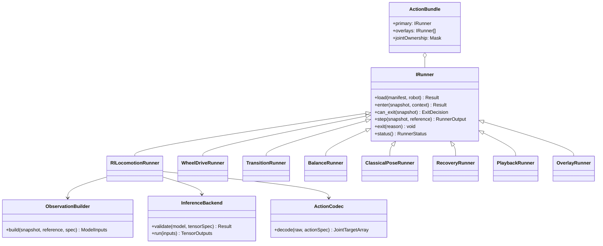

`IRunner` 是**运控策略接口**，`PolicyManager` 是**软件封装/切换器**。单个 ONNX 权重通常成为 `RlLocomotionRunner` 的不同配置实例，不需要每个权重写一份派生类；但过渡策略的 phase、退出门控、失败回退与持续行走不同，须有 `TransitionRunner` 的明确行为。`WheelDriveRunner` 是 Collie 四轮运动的策略承接点，具体由控制律还是新模型实现由运控决定。`ActionBundle` 用于平衡主 Runner 与头/臂手势等局部动作组合；启动时若 `owns_mask` 冲突，拒绝启用，不能靠“谁最后写”解决。

### 3.4 每种首批 Runner 的接口卡

| Action / 实现类 | 每拍主参考（来自上游） | 每拍反馈（来自本体） | Runner 原始输出及进入/退出 | 必交配置 |
|---|---|---|---|---|
| `QUAD_WHEEL_DRIVE` / `WheelDriveRunner` | `vx,vy,wz`，可选高度/转向模式 | 四轮与腿关节、IMU、有效支撑 | 轮/腿目标；进入需四足稳定，退出需速度与滑移降到阈值 | 速度域、轮腿控制模式、观测/动作逐维表、制动与侧滑阈值 |
| `QUAD_STOP` / `ClassicalPoseRunner` 或专用停止策略 | 目标零速度 | 同上，特别是轮速与接触 | 制动/驻留目标；稳定保持后 `exit_ready` | 减速曲线、稳定窗口、地面坡度与失败出口 |
| `QUAD_TO_BIPED` / `TransitionRunner` | 一次性变形请求；无持续导航速度 | 关节、IMU、接触/滑移、周围空间准入结果 | phase 驱动的全身目标；完成需姿态+接触+保持时间，异常走安全回退 | 模型/轨迹、初末态包络、phase、超时、重试/回退边 |
| `BIPED_BALANCE` / `BalanceRunner` | 可选机身姿态/头臂参考；静态讲解时速度为零 | 关节、IMU、后轮/支撑状态 | 持续平衡输出；失稳/失联抢占 | 模型与 obs/act 规格、允许扰动、姿态与滑移阈值 |
| `BIPED_TO_QUAD` / `TransitionRunner` 的另一 manifest | 一次性落回请求 | 同 Q2B | 全身目标；四轮支撑稳定才允许下一步滑行 | 独立模型/轨迹、初末态守卫、超时/回退 |
| `QUAD_STAND/GET_DOWN` / `ClassicalPoseRunner` | 姿态目标 | 关节、IMU | 位姿/增益目标；误差与稳定窗口决定完成 | 关键帧、增益、限速、机械限位 |
| `RECOVERY` / `RecoveryRunner` | 安全系统授权、倒地类型 | 关节、IMU、接触、环境清空信号 | 恢复目标；失败次数受限并回阻尼 | 可恢复姿态集合、场地条件、次数/超时、失败出口 |
| `GESTURE/HEAD` / `OverlayRunner` | 手势/视线轨迹与时标 | 对应关节与主平衡状态 | 仅声明拥有的关节目标；主策略退出时同步停止 | 所有权、可并行主 Action 列表、轨迹、增益 |

`QUAD_TERRAIN`、载物、楼梯和双足移动在后续版本按同一接口卡补充；没有训练资产与验收时保持未开放状态。这里的“每拍主参考”是 Runner 消费的接口，不表示 Runner 自己做导航、识别 VIP 或相机拍摄。

## 4. 前处理：一拍观测怎么从反馈变成 tensor


| 顺序 | 输入/处理 | T1 证据与例子 | Collie 必须固定的契约 |
|---|---|---|---|
| 1 | 获取同一拍 `RobotStateSnapshot` | MC 订阅关节/IMU，配置反馈发布间隔与延迟检查；T1 `JointState` 含位置/速度/力矩/温度/电压 | 各源采样时间、最大年龄、时间倒退/缺字段处理；陈旧反馈须故障化 |
| 2 | 机型映射 | T1 `quad_walk.yaml` 列出 `joints_name`、`seq`、`action_seq`；`robot_model.yaml` 定义限位 | 关节名 → 本体顺序 → 模型顺序；方向与零点必须版本化 |
| 3 | 状态滤波/姿态表示 | T1 `filter.imu_vel_cutoff_freq=100`、`q_vel_cutoff_freq` 分关节；观测索引有 `imu_omega/imu_euler` | 使用训练侧相同坐标系、滤波器形式、采样率、角度表示；仅截止频率不能完整确定滤波实现 |
| 4 | 参考命令整形 | T1 `command_scales` 有各向速度范围，另有 `acc_x/acc_y/acc_yaw`；InputManager 有来源与超时 | 先做来源仲裁、TTL、机身坐标转换和速度/加速度包络，再送给策略；`STOP` 可强制清零 |
| 5 | 组装当前观测 | T1 `obs_index` 给每块起始偏移；下方三种模型尺寸不同 | 每个 Runner 的 `ObsSpec` 声明块名、长度、来源、顺序、缺失处理和单位；启动期总维度校验 |
| 6 | 缩放、裁剪 | T1 `obs_scales.dof_vel=0.05, ang_vel=0.25`；`obs_clip` 随策略为 20/50 等 | 每维与训练配置逐项一致；NaN/Inf 不许经 `clip` 掩盖 |
| 7 | 历史/首帧 | T1 常见 `frame_stack=10`，ONNX 第二输入是 10 帧历史 | 冻结帧顺序、是否含当前帧、首次进入如何填充、切换后是否清空；离线 golden vector 验证 |
| 8 | 模型 tensor | ONNX 图可直接核实输入名称、shape、dtype | 不依赖向量总长度猜测；逐输入名称绑定并逐输出名称读取 |

**实证尺寸实例**（来自本地 ONNX 图和同名配置）：

| T1 Action / 模型 | 当前观测构成（`obs_index` 起点） | Tensor 输入 → 输出 | 尚需源码/向量验证的部分 |
|---|---|---|---|
| 四足行走 `quad_walk.yaml` | `omega[0:3]`、`euler[3:6]`、`pos[6:18]`、`vel[18:32]`、`prev_action[32:46]`、`command[46:49]`、`cpg[49:57]` | `observations[1,57]` + `observation_history[1,570]` → `action[1,14]`；另有 4 维辅助输出 | `euler` 的坐标约定、CPG 8 维编码、历史是否含当前帧、辅助输出语义 |
| 双足 WBC `bi_wbc_run.yaml` | 前 46 维同类块，`command[46:49]` | `observations[1,49]` + `observation_history[1,490]` → `action[1,14]` | 命令各维定义及退出门控实际算法 |
| 四足→双足 `quad_to_bi_run.yaml` | 前 46 维同类块，`phase[46]`、`q_ref[47:51]` | `observations[1,51]` + `observation_history[1,510]` → `action[1,14]` | `phase` 定义、4 维 `q_ref` 物理意义及初末帧规则 |

区间长度由相邻 `obs_index` 和 `obs_nums` 算得，**是结构映射，不是 T1 内部计算公式的逆向证实**。例如 `pos` 是否按 `q−default_q`、`prev_action` 是裁剪前还是后，必须拿控制器源码或 ONNX golden vector 核对。Collie 的训练/部署双方需共同出一张逐维 `ObsSpec.csv`，不能仅提交 `obs_nums=57`。

建议 Collie `ObsSpec.csv` 至少列：`index,block,element,joint_or_axis,source,unit,frame,offset,scale,clip,filter,history_lag,missing_policy`。一份模型一份规格，自动生成校验器与回放测试。

## 5. 后处理：模型输出怎么成为关节命令


| 阶段 | 逐项做什么 | 由谁定义/实现 |
|---|---|---|
| 输出校验 | 按 tensor **名字**选 `action`，检查 14/目标关节数、dtype、NaN/Inf、推理用时；辅助输出不能误当电机目标 | 运控定义 schema；软件实现运行时 |
| 裁剪与解码 | 逐维 `clip(raw_i, ±action_clip_i)`；若位置增量，`q_des_i=default_q_i+scale_i*raw_i`；若轮速，`dq_des_i=scale_i*raw_i`；若力矩则按力矩语义。`activation/owns_mask` 决定此 runner 是否写该关节 | 训练/运控提供**逐关节类型和配方**；软件实现通用 codec |
| 增益 | 给每关节 `kp/kd`，控制模式为 `POSITION/VELOCITY/TORQUE/DAMPING/PASSIVE`；切换时按经验证规则变更增益 | 运控签发；HAL 校验可执行范围 |
| 组合 | 主 Runner + 局部动作按关节所有权合成；若覆盖主平衡关节需显式受控混合、专门模型或禁止 | 运控批准组合；软件实现冲突检查 |
| 过渡 | 普通行走/驻留间可用经验证的平滑；Q2B/B2Q 由专门 `TransitionRunner` 闭环输出，不能被通用线性插值代替 | 运控定义物理条件；软件执行阶段机 |
| 最后安全闸 | 关节位置/速度、命令变化率、力矩/增益、反馈新鲜度、模型超时、急停状态检查；触发时切安全输出并锁存故障 | 运控给限值及动作；软件+HAL 分层实现 |

T1 [`quad_walk.yaml`](../../04_真机与模型数据/运控模型库/真机/qd1_t2d0/配置/rl/quad_walk.yaml) 明确列出 `action_clip=50`、14 维 `action_scale`、`default_dof_pos`、`kps/kds`、`activation`、`transition_duration=0.2`、`tau_limit`，所以“ONNX 输出 14 维角度直接下发”是错误理解。最终 T1 设备消息的物理字段可在 [`JointCommand.msg`](../../04_真机与模型数据/真机资料/interface/aimdk_msgs/share/aimdk_msgs/msg/JointCommand.msg) 核对。Collie 的数值由本体和训练重新给，不复制示例值。

### 5.1 一帧可复现实例（建议交付给软件的测试夹具）

```text
输入：带时间戳的 14 关节反馈 + IMU + 仲裁后的 vx/vy/wz + 上一拍 action
前处理产物：obs_current[name,shape] + obs_history[name,shape]
推理产物：raw_action[name,shape] + 可选诊断输出
后处理产物：每关节 {mode,q,dq,tau,kp,kd,enabled} + owns_mask
安全/设备产物：accepted_joint_command + clamp_reason/fault_reason
```

运控团队需提供实际 `.npz`/CSV golden fixture：`RobotStateSample`、速度、当前 Action/phase、期望两个输入 tensor、期望原始输出、期望 14 关节目标。软件测试必须逐维比较 **输入 tensor** 和 **解码后目标**，仅比最终动作“看上去相似”不能发现关节顺序、帧序、单位错误。

## 6. 配置如何包装：一个 Action 的完整清单

以下是 **Collie 建议 schema 示例**，字段可改名，但信息不得丢。`<...>` 表示运控/本体团队尚未给出的资产或标定值，不是可运行参数。

```yaml
schema_version: 1
robot_profile: collie_wheel_quad_v1          # 关节/限位/设备版本另有独立配置
action_id: QUAD_WHEEL_GLIDE
form: QUADRUPEDAL
execution_groups:
  - role: primary
    runner: WheelDriveRunner                 # 或经训练验证的 RlLocomotionRunner
    period_ms: <trained_policy_period>
    owns: [front_left_leg, front_right_leg, rear_left_leg, rear_right_leg, four_wheels]
    config: wheel_glide_runner.yaml
  - role: overlay                            # 可选；若没有可删
    runner: OverlayRunner
    owns: [head]
    config: head_gesture.yaml

# wheel_glide_runner.yaml（策略资产）
asset:
  kind: onnx_or_classical
  path: <asset_path>
  sha256: <hash>
tensor_io:
  inputs:
    - {name: observations, dtype: float32, shape: [1, <obs_dim>]}
    - {name: observation_history, dtype: float32, shape: [1, <history_dim>]}
  outputs:
    - {name: action, dtype: float32, shape: [1, <act_dim>]}
observation:
  spec_file: obs_spec.csv                  # 逐维顺序/源/单位/尺度/滤波
  history_frames: <N>
  history_order: oldest_to_newest
  first_frame_fill: repeat_current         # 必须与训练侧一致，例子不代表既定值
  stale_state: fault
reference:
  accepted: [vx_mps, vy_mps, wz_radps]
  frame: base_link
  ttl_ms: <validated_ttl>
output:
  spec_file: action_spec.csv               # 逐关节模式/scale/default/gain/limit
  invalid: safe_hold
entry_guard: [form_is_quad, sensor_fresh, motor_ready, safety_clear]
exit_guard: [body_speed_below_threshold, support_confirmed]
failure_target: SAFE_HOLD
```

另设三份**系统级**配置：`velocity_sources.yaml`（来源优先级与 TTL）、`action_graph.yaml`（合法边及守卫）、`safety_limits.yaml`（输出与故障阈值）。不要把它们复制进 20 个 Runner 文件。加载顺序：本体包 → 系统级配置 → ActionBundle/RunnerManifest → 模型/轨迹与 tensor 验证 → 预分配缓冲 → 注册到 Manager → 开放请求。加载失败只能报错，不得把不完整 Action 暴露为可用。

## 7. 软件团队在 roboto_origin-main 中具体承接什么

现有 [`InferenceNode`](../../03_参考库/roboto_origin-main/modules/roboparty_deploy/src/inference/src/inference_node.cpp) 已有：`PolicyRuntime`、配置化观测块、历史缓冲、ONNX Runtime、`/cmd_vel` 接入、推理循环和电机控制循环。它的 [`setup_model`](../../03_参考库/roboto_origin-main/modules/roboparty_deploy/src/inference/src/inference_node.cpp) 当前明确拒绝多输入 ONNX；[`RobotInterface::apply_action`](../../03_参考库/roboto_origin-main/modules/roboparty_deploy/src/inference/include/robot_interface.hpp) 签名支持 `p/v/kp/kd/tau`，但现有控制路径主要调用位置向量。故应**复用驱动与推理基础设施，新增领域层**，不能只在原节点外面套一个 `switch(model_name)`。


| 模块 / 建议文件 | 软件团队实现 | 运控团队交付/验收 |
|---|---|---|
| `motion_api_adapter` | ROS2/RPC 请求与领域对象互转、异步回执/状态关联、幂等 | Action ID 与错误/阶段语义 |
| `action_registry` + `transition_graph` | 解析配置、校验每个 ActionBundle/边、拒绝不可达请求 | 合法形态/边、守卫和回退路径 |
| `velocity_arbiter` | 来源优先级、TTL、序号、停止、被避障速度覆盖的规则 | 速度包络、优先级需求和失联动作 |
| `state_snapshot` + `observation_builder` | 关节/IMU缓存、时间对齐、逐策略观测、历史环 | `ObsSpec.csv`、训练一致滤波与黄金向量 |
| `inference_backend` | 多输入/多输出 ONNX 验证、预加载、定时统计 | ONNX 文件、tensor schema、耗时目标 |
| `runner/*` | `IRunner` 生命周期和经典/ONNX/过渡/恢复执行器 | 各策略进入、退出、完成、故障判据 |
| `action_codec` + `joint_mux` | 输出解码、控制模式、增益、关节所有权与叠加 | `action_spec.csv`、局部动作组合矩阵 |
| `output_guard` + `device_adapter` | 唯一命令出口、限位/变化率、安全替代、HAL 适配 | 物理包络、急停/跌倒/恢复规则；本体签字 |
| `motion_status` + replay tests | 阶段/故障状态、日志、离线回放 | 验收阈值与 golden fixtures |

软件架构不必照搬 T1 的 AimRT/线程布局。软件可决定是保留现有 ROS2 节点还是拆成多进程，但必须保持上述**领域接口**与单一设备出口。`roboparty_train/rsl_rl/runners` 是训练循环 Runner，不是部署态策略 Manager。

建议把上述领域层包装为 `roboparty_deploy` 内独立的 `motion_runtime` 库，节点/服务仅作外层适配。目录形态可以是：

```text
modules/roboparty_deploy/src/
  motion_runtime/
    include/motion/    types.hpp  runner.hpp  manifest.hpp  status.hpp
    src/               policy_manager.cpp  action_registry.cpp
                       state_snapshot.cpp  observation_builder.cpp
                       inference_backend.cpp  action_codec.cpp
                       joint_mux.cpp  output_guard.cpp
    runners/           wheel_drive.cpp  rl_locomotion.cpp
                       transition.cpp  balance.cpp  pose.cpp
                       recovery.cpp  playback.cpp  overlay.cpp
    tests/             golden_obs_action_replay.cpp  switch_graph_replay.cpp
  motion_ros_adapter/  motion_node.cpp  msg_translation.cpp
  inference/           （保留原节点作为迁移参考，逐步抽取共用代码）
  robots/collie/       robot_profile.yaml  action_registry.yaml
                       action_graph.yaml  velocity_sources.yaml
                       safety_limits.yaml  policies/<action>/manifest.yaml
```

**调用关系**：ROS/RPC callback 只做校验与入队，不在回调里做 ONNX 推理；`PolicyManager` 决定本拍 `ActionBundle` 与有效参考；`StateSnapshot` 给同一拍不可变反馈；各 Runner 使用 `ObservationBuilder/InferenceBackend/ActionCodec`；`JointMux` 合成后仅 `OutputGuard` 能调用 `RobotInterface`/设备发布。实际线程和调度由软件团队实现，但 `step()` 必须有确定的截止时间，过期输出不能沿用为新命令。这样增加新策略通常只需新增 manifest、模型与 golden fixture；新增执行机制才需要写新的 Runner 类。

## 8. 软件与运控之间最终应互交什么

| 运控团队交付 | 软件团队交付 | 联合验收 |
|---|---|---|
| `robot_profile` 审核；每个 Action 的 `RunnerManifest`、ONNX/经典控制资产及 hash | 可加载/可拒绝的 `ActionRegistry` 与 `PolicyManager` | 资产不匹配不开放 Action；模型版本可追踪 |
| `ObsSpec.csv`、`ActionSpec.csv`、进入/退出/完成/失败判据 | 前后处理、关节复用与安全出口 | 逐维 golden fixture、关节模式与限幅 |
| `action_graph.yaml`、局部叠加组合矩阵 | 路径规划、阶段机、冲突仲裁、异步状态 | 受理/运行/稳定/失败清晰区分 |
| 速度/载荷/地形包络 | 来源仲裁、TTL、上游接口 | 断流停车、避障优先、错误源拒绝 |
| 恢复与安全条件 | 硬件/软件急停链、故障锁存 | 推理挂死时仍可安全输出 |

首轮软件评审建议拿三条端到端链路逐字段走通：①四轮领路 `ActionRequest + VelocityRef → WheelDriveRunner → JointTarget`；②`QuadStop → Q2B → BipedBalance → B2Q` 的每阶段事件；③ IMU/关节过期或急停时，当前 Runner 无论处于哪一拍都能进入安全输出。场景需求中的速度、站立高度、载荷和自动恢复阈值尚待本体/产品签发，不在软件端猜常量。
````


---

## FILE: raw/docs/current_architecture_spec.md

- bytes: 33766

````markdown
# 运控软件架构设计（4+1 视图 · 交付版）

> 用途：向软件团队交底——**要开发什么、有哪些接口、怎么验收**。
> 参考：`Design_T1Pro运控软件系统4+1架构设计简版.md`（视图组织方式与分层命名）。
> 关联：`T1运控MC拆解与自主设计.md`（T1 的做法与取舍依据）、`T1运控安全设计详解.md`（安全细节）。

---

## 0. 目的、读者与范围

### 0.1 这份文档回答什么

| 读者 | 关心的问题 | 看哪章 |
|---|---|---|
| 软件负责人 | 要投多少人、分几块、风险在哪 | §9 |
| 架构师 | 分层、模块边界、接口契约 | §3、§7 |
| 开发工程师 | 我负责哪个模块、它的接口和验收标准 | §3.3、§5 |
| 测试工程师 | 怎么注入故障、怎么判定通过 | §4.5、§8.5 |
| 算法团队 | 我的模型要怎么交付才被接收 | §5.4 |

### 0.2 范围

| 在范围内 | 不在范围内 |
|---|---|
| 运控运行时（行为调度、观测装配、控制环、安全、工具链） | 策略训练（算法团队交付 onnx） |
| 与设备层/上游的接口契约 | 上层任务编排（task_engine） |
| 配置体系与启动校验 | 设备驱动固件 |
| 测试体系（SIL/HIL/故障注入） | App/云端功能 |

### 0.3 相对 T1，我们**简化了什么**（先看这张表）

| T1 的复杂度 | 我们的做法 |
|---|---|
| 61 个动作枚举、58 个动作、62 个执行组 | **只有 2 种行为**（连续 / 一次性） |
| 11 个 RPC（动作/动作播放/预设动作各一套） | **4 个 RPC** |
| 每执行组一条线程（共 36 线程） | **3 条实时线程 + 2 条普通线程** |
| 上肢动画单独一套"叠加"机制 | **同一个行为概念 + 作用域**（UPPER/LEGS） |
| 4 种轨迹格式（CSV/NPZ/ONNX 内嵌） | **1 种 `.mref`**（构建期统一编译） |
| 8 层安全散落各处 | **1 个安全内核 + lease + 阶梯** |

> 一句话：**T1 用"枚举 + 组 + runner"表达行为；我们用"行为 + 作用域"。**

---

## 1. 术语（只有 7 个词）

| 词 | 含义 | 举例 |
|---|---|---|
| **Behavior（行为）** | 一个可独立加载、按固定节拍输出的计算单元 | 行走、变形、跳舞、挥手、阻尼 |
| **Mode（模式）** | 行为的时间形态：`CONTINUOUS`（一直跑）/ `ONE_SHOT`（跑完即止） | 行走=连续；跳舞=一次性 |
| **Scope（作用域）** | 行为写哪些关节：`ALL` / `LEGS` / `UPPER` | 挥手=UPPER；行走=LEGS |
| **MotionRef** | 参考轨迹文件（关节/机身/相位，字段可缺省） | `dance_joyous.mref` |
| **GainProfile** | 一组关节增益（kp/kd/重力系数） | `track` / `soft` / `hold` |
| **Lease（许可）** | 安全内核发给控制环的"可以输出"凭证，50 ms 有效 | — |
| **Manifest** | 唯一配置事实源 | `robot_manifest.yaml` |

### 1.1 只有两种行为（这是最重要的简化）

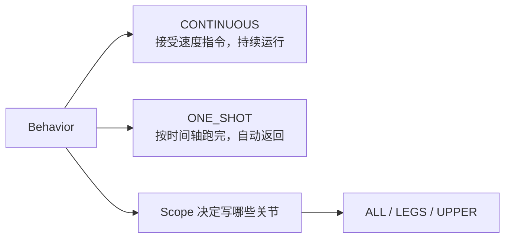

**把 T1 的所有动作映射过来，只有这几类**：

| T1 的动作 | 我们的表达 |
|---|---|
| 站立 / 行走 / 奔跑 / 越野 | `CONTINUOUS` + `scope=LEGS`（接受速度） |
| 四足⇄双足变形 | `ONE_SHOT` + `scope=ALL`（跑完自动回连续行为） |
| 跳舞 / 全身模仿 / 滑冰 | `ONE_SHOT` + `scope=ALL` + `ref=mref` |
| 挥手 / 比心 / 鼓掌（上肢） | `ONE_SHOT` + `scope=UPPER`（可与 LEGS 行为并行） |
| 阻尼 / 卸力 / 躺下 | 内置 `SAFE` 行为（只有安全内核能选） |

**没有"能力标签"、没有"执行组"、没有"叠加层"**——只有"连续还是跑完即止"和"写哪些关节"。

---

### 1.2 一页纸接口速查（开发先看这个）

```text
┌──────────────────────────── 4 个 RPC ────────────────────────────┐
│ SetVelocity(source, vx, vy, wz, ttl_ms)        → accepted, epoch │
│ SetBehavior(scope, id, ref?, params?, interrupt, via[])          │
│                                                → task_id, plan[] │
│ GetState()                                     → StateSnapshot   │
│ SetSafety(level, reason)                       → ok              │
└──────────────────────────────────────────────────────────────────┘
┌──────────────────────────── 2 个流 ───────────────────────────────┐
│ State   50 Hz   StateSnapshot（行为数组 + 速度 + 安全 + 健康）      │
│ Events  事件    切换完成 / 一次性完成 / 故障 / 降级                 │
└──────────────────────────────────────────────────────────────────┘
┌──────────────────────── 3 个作用域 / 2 种模式 ─────────────────────┐
│ Scope: ALL | LEGS | UPPER      （同域互斥，跨域并行）              │
│ Mode : CONTINUOUS | ONE_SHOT   （一次性必须有 return_to）          │
└──────────────────────────────────────────────────────────────────┘
```

**三个必记的约束**：

1. 同一 `scope` 同时只能有一个行为；`UPPER` 与 `LEGS` 可并行；
2. `ONE_SHOT` 必须声明 `return_to`（跑完自动回到连续行为）；
3. 安全行为（damp/passive）**只能由安全内核选择**，普通请求返回 `MC-SAFETY-5001`。

## 2. 场景视图（+1 Scenario）

五个场景覆盖了 95% 的日常使用与全部异常路径。**每个场景都标出用到的接口**，便于对照开发。

### 2.1 场景 A：跟随行走（连续行为 + 速度）

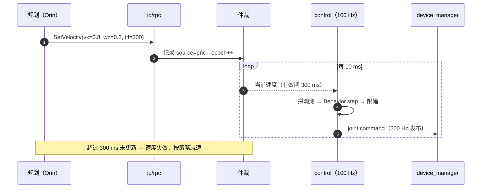

**用到的接口**：`SetVelocity`（唯一连续入口）。

### 2.2 场景 B：四足→双足变形（一次性行为）

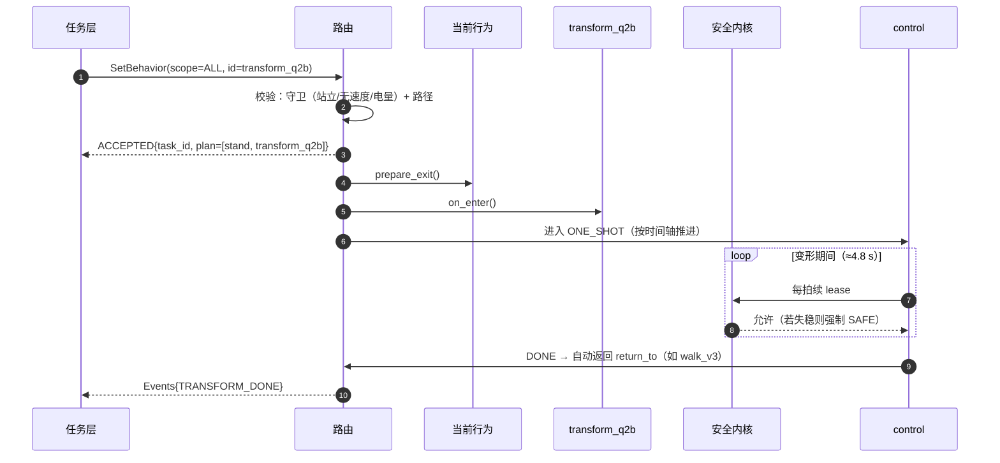

**用到的接口**：`SetBehavior`（一次性动作的唯一入口）、`Events`（完成通知）。

### 2.3 场景 C：播放舞蹈（一次性行为 + 参考轨迹）

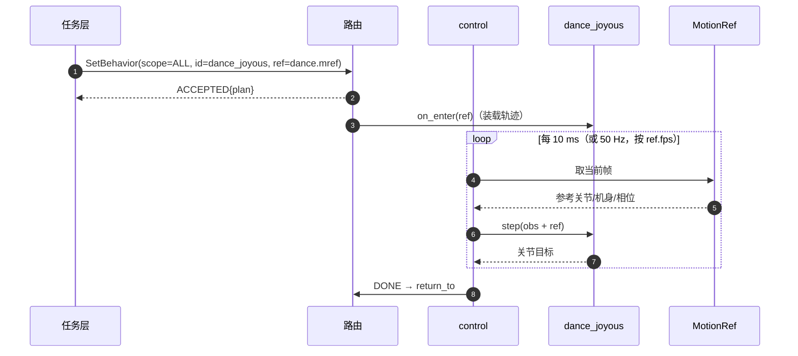

**用到的接口**：`SetBehavior`（带 `ref`）、`GetPlan`（查进度）。

### 2.4 场景 D：边走边挥手（两个作用域并行）

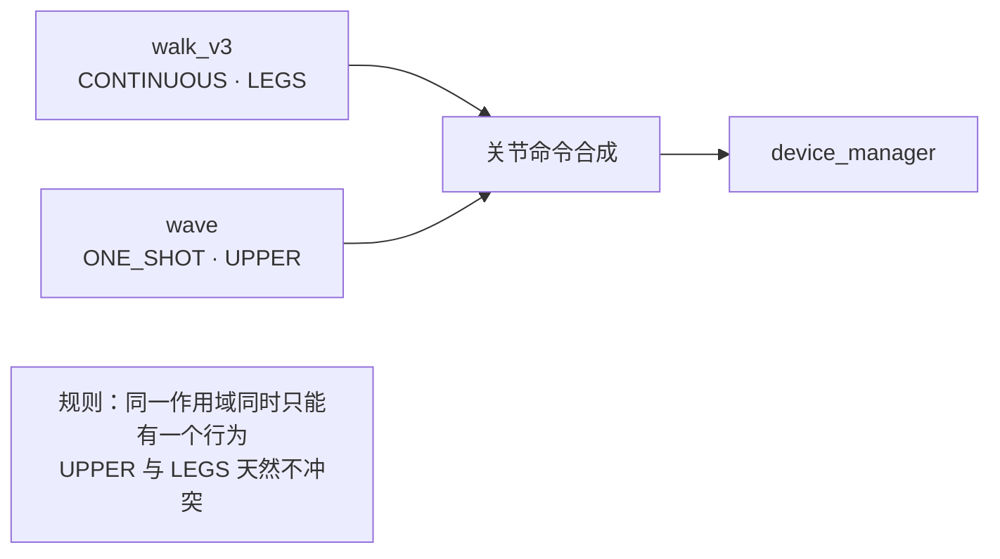

**用到的接口**：两次 `SetBehavior`（`scope=UPPER` 与 `scope=LEGS` 各一次），互不影响。

> 这就是 T1 "双 runner / animation_player 覆盖"的替代方案：**不靠"谁后写"，靠作用域隔离**。

### 2.5 场景 E：跌倒降级（安全路径）

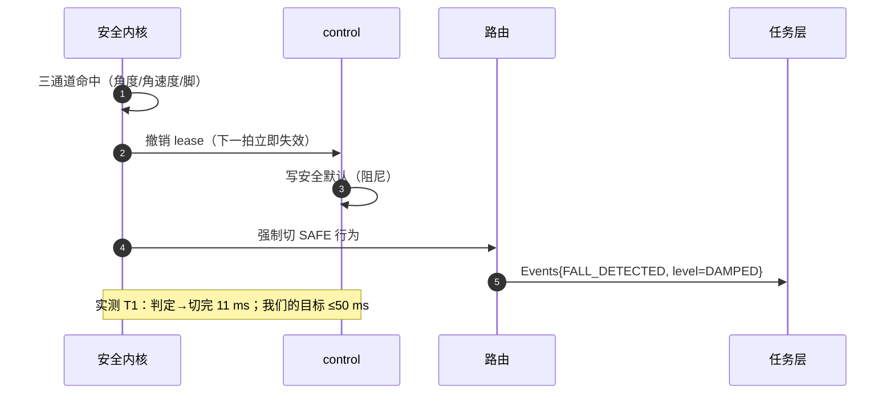

**用到的接口**：`Events`（安全事件）、`GetState`（查级别）。

### 2.6 场景与接口对照

| 场景 | 接口 | 说明 |
|---|---|---|
| A 跟随 | `SetVelocity` | 连续，带 TTL |
| B 变形 | `SetBehavior(ALL, ONE_SHOT)` | 跑完自动返回 |
| C 舞蹈 | `SetBehavior(ALL, ONE_SHOT, ref)` | 参考轨迹 |
| D 叠加 | `SetBehavior(UPPER, ONE_SHOT)` | 与 LEGS 并行 |
| E 跌倒 | `Events` / `GetState` | 安全内核驱动 |


---

## 3. 逻辑视图

### 3.1 分层（按数据流）

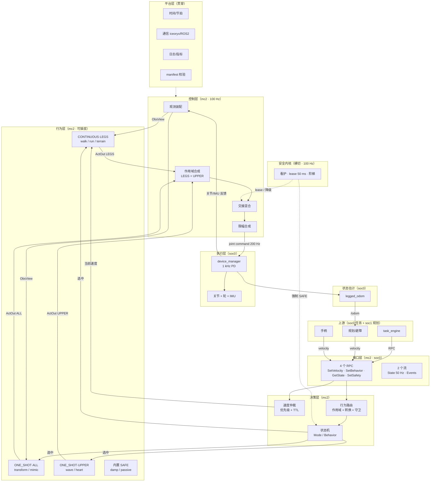

**读法**：实线是数据（意图向下、反馈向上、命令向下），虚线是约束（安全与平台）。每层标题里标了归属 SoC。

### 3.2 模块清单（这就是"要开发什么"）

| # | 模块 | 职责（一句话） | 对外接口 | 依赖 | 交付物 |
|---|---|---|---|---|---|
| 1 | `api/` | 稳定 ABI：Behavior 接口、Obs/Act、错误码 | 头文件 | 无 | `policy_api.h`、`error_code.h` |
| 2 | `core/manifest` | 解析 + 校验 + 生成运行期对象 | `load_and_validate()` | api | 库 + 单测 + 校验器 |
| 3 | `core/obs` | 多源输入 → 命名块观测（滤波/缩放/历史） | `on_*(...)`, `view(spec)` | api | 库 + 单测 |
| 4 | `core/scheduler` | 100 Hz 主循环、时间预算、超期统计 | `tick()` | obs, blender, limiter | 库 + 压测脚本 |
| 5 | `core/blender` | 交接混合（目标 + 增益淡化） | `apply(from,to,s)` | api | 库 + 单测 |
| 6 | `core/scope_sync` | 按作用域合成（LEGS+UPPER） | `merge(acts[])` | api | 库 + 单测 |
| 7 | `core/router` | 转换矩阵、守卫、plan 生成 | `plan(from,to)` | manifest | 库 + 单测 |
| 8 | `core/registry` | 行为加载（onnx/keyframe/builtin）、会话池 | `load(id)`, `preload(list)` | api | 库 + 单测 |
| 9 | `safety/kernel` | 唯一安全权威：lease、阶梯、故障 | `renew()`, `request()` | api | 库 + 故障注入测试 |
| 10 | `safety/guards` | 跌倒/超时/温度/负载判定 | `evaluate(inputs)` | 无 | 纯函数库 + 单测 |
| 11 | `io/rpc` | 4 个 RPC、参数校验、幂等 | RPC 服务 | router, arbiter | 服务实现 |
| 12 | `io/pubsub` | 命令发布（200 Hz）、状态（50 Hz）、订阅 | 话题 | obs, kernel | 服务实现 |
| 13 | `io/state` | 组装 `StateSnapshot`（同一采样） | `build()` | 全部只读 | 库 + 单测 |
| 14 | `tools/mrefc` | CSV/NPZ → `.mref` | CLI | — | 工具 |
| 15 | `tools/mcctl` | validate / plan / replay / bench | CLI | 全部 | 工具 |
| 16 | `test/` | SIL 回放 + HIL 故障注入 | — | 全部 | 测试套件 |

**每个模块都要交付**：代码 + 单测 + README（职责/接口/失败模式）。这是验收条件，不是"建议"。

### 3.3 关键模块的接口签名

```cpp
// 1) 行为接口（算法团队面向它交付，软件团队围绕它开发）
class Behavior {
public:
  virtual bool on_load(const BehaviorSpec&, const RobotModel&) = 0; // 启动期校验
  virtual bool on_enter(const EnterCtx&) = 0;                      // 装载参考（≤20 ms）
  virtual bool step(const ObsView&, ActOut&) = 0;                  // 每拍（≤5 ms）
  virtual void on_exit(ExitReason) = 0;
  virtual Progress progress() const = 0;                           // 一次性行为的进度
};

// 2) 观测：按命名块取
struct ObsView {
  const float* block(const char* name, size_t* len) const;  // "imu"/"joints"/"ref"/"cmd"
  uint64_t stamp_ns; bool fresh;
};

// 3) 输出：四段 + 作用域
struct ActOut {
  float q_des[14], dq_des[14], tau_ff[14], kp[14], kd[14];
  Scope scope;          // ALL / LEGS / UPPER
  uint32_t flags;       // DONE / FAULT / NEED_REF
};

// 4) 路由：先给计划，再执行
struct PlanStep { std::string behavior_id; uint32_t dwell_ms; };
Result<std::vector<PlanStep>> plan(const std::string& from, const std::string& to);
```

### 3.4 一次请求在模块间的流转

```mermaid
flowchart LR
    RPC["io/rpc"] -->|"校验参数"| RT["core/router"]
    RT -->|"plan[]"| RPC
    RT -->|"切换请求"| REG["core/registry"]
    REG -->|"实例"| SCH["core/scheduler"]
    OBS["core/obs"] -->|"ObsView"| SCH
    SCH -->|"ActOut"| BL["core/blender"]
    BL -->|"混合后"| SS["core/scope_sync"]
    SS -->|"合成"| IO["io/pubsub"]
    K["safety/kernel"] -.->|"lease"| SCH
    SCH -.->|"状态"| ST["io/state"]
```

---

### 3.5 模块依赖与并行开发顺序

```mermaid
flowchart LR
    API["api/"] --> MF["core/manifest"]
    API --> OB["core/obs"]
    API --> RG["core/registry"]
    MF --> RT["core/router"]
    OB --> SCH["core/scheduler"]
    RG --> SCH
    SCH --> BL["core/blender"]
    BL --> SS["core/scope_sync"]
    API --> SK["safety/"]
    SCH --> IO["io/"]
    SS --> IO
    SK --> IO
    MF --> TL["tools/"]
```

**建议的并行分工（5 条线可同时开工）**：

| 线 | 模块 | 前置 | 说明 |
|---|---|---|---|
| A | `api/` + `core/manifest` | 无 | 最先冻结，其他线依赖它 |
| B | `core/obs` + `core/scheduler` | A（接口） | 可用假行为先跑通 |
| C | `core/blender` + `scope_sync` + `router` | A | 纯算法，易单测 |
| D | `safety/` + `io/` | A | 独立线，互不阻塞 |
| E | `tools/` + `test/` | A | 可先做校验器与回放 |

**关键路径**：`api → manifest → scheduler → io → 集成`。其余线可并行，但**接口必须在 W2 前冻结**。

## 4. 过程视图

### 4.1 线程与周期

| 线程 | 频率 | 优先级 | 核 | 职责 |
|---|---|---|---|---|
| `th_control` | **100 Hz** | RR80 | CPU3 | 观测 → step → 混合 → 合成 → 写命令 |
| `th_safety` | **100 Hz** | **RR85** | CPU3 | 看护、lease、阶梯 |
| `th_publish` | **200 Hz** | RR80 | CPU3 | 关节命令发布 |
| `th_io` | 事件 | 普通 | CPU2 | RPC、订阅 |
| `th_log` | 10 Hz | 普通 | CPU2 | 日志、指标、状态发布 |

**只有 5 条线程**（T1 是 36 条）。原因：所有行为在同一拍内顺序执行，靠作用域与混合解决并发，不再"一组一线程"。

### 4.2 单拍预算（10 ms）

| 步骤 | 预算 |
|---|---|
| lease 续期 + 检查 | 0.1 ms |
| 观测装配 | 1.0 ms |
| Behavior.step（可能 2 个作用域） | ≤5.0 ms |
| 混合 + 作用域合成 + 限幅 | 0.7 ms |
| 写命令 + 统计 | 0.2 ms |
| **余量** | **3.0 ms** |

连续 3 拍超预算 → 请求 `DEGRADED`。

### 4.3 启动时序

```text
1. 加载 manifest 并校验（7 类检查，≤200 ms）
2. 注册内置行为（damp / passive）
3. 预加载 manifest 指定的 onnx（≤3 s）
4. 启动 th_safety → th_control → th_publish
5. 等待反馈就绪（5 s 超时 → 拒绝启动）
6. 进入 SAFE（阻尼），等待上层 SetBehavior
```

**永远从 SAFE 启动**，不做"上电即站立"。

### 4.4 切换规则（2 种模式 × 3 个作用域）

| 当前 \ 请求 | CONTINUOUS（同域） | ONE_SHOT（同域） | 不同作用域 |
|---|---|---|---|
| CONTINUOUS | 交叉淡化 150 ms | 淡出 → 执行 → 自动返回 | **允许并行** |
| ONE_SHOT | 完成后返回 | 排队或打断（参数控制） | **允许并行** |
| 空 | 直接进入 | 直接执行 | — |

**四条硬规则**：

1. **同一作用域同时只能有一个行为**（避免"谁覆盖谁"）；
2. **UPPER 与 LEGS 可并行**（上肢动画不影响行走）；
3. **SAFE 作用域 = ALL**，可抢占任何行为，且不可被普通请求打断；
4. **一次性行为必须有 `return_to`**（跑完自动回连续行为），否则拒绝加载。

### 4.5 切换时序（含混合）

```mermaid
sequenceDiagram
    autonumber
    participant U as 上游
    participant R as router
    participant OLD as 旧行为
    participant NEW as 新行为
    participant B as blender
    participant K as kernel

    U->>R: SetBehavior(id, scope, interrupt)
    R->>R: 作用域冲突？守卫？路径？
    R-->>U: ACCEPTED{plan}
    R->>OLD: prepare_exit()
    OLD-->>R: ready / wait / refuse
    R->>NEW: on_enter()
    R->>B: begin_ramp(150 ms)
    loop 混合期
        B->>B: q=(1-s)q_old+s·q_new，增益同步插值
        B->>K: 续 lease
    end
    B->>R: commit
    R->>OLD: on_exit
    R->>U: Events{BEHAVIOR_CHANGED}
```

### 4.6 失败与降级

| 场景 | 行为 |
|---|---|
| `on_enter` 失败 | 不切换，返回 `MC-BEHAVIOR-4092`，旧行为继续 |
| 混合中断（用户取消） | 反向混合 ≤100 ms 回到旧行为 |
| 混合中断（安全降级） | 立即中止，进 SAFE |
| step 连续超时 | `DEGRADED`，限制为白名单行为 |
| 反馈过期 | lease 不续 → 输出安全默认 |


---

## 5. 开发视图

### 5.1 目录与构建

```text
mc2/
├── api/                 # 稳定 ABI（对外只暴露这里）
├── core/                # 纯逻辑，不碰 IO
│   ├── manifest/ obs/ scheduler/ blender/ scope_sync/ router/ registry/
├── safety/              # 安全内核与守卫（不依赖 core）
├── io/                  # 唯一知道 ROS2/iceoryx 的层
├── tools/               # mrefc / mcctl
├── manifest/            # robot_manifest.yaml + schema
├── behaviors/           # 行为实现（可含第三方 .so）
├── motions/             # *.mref
└── test/                # 单测 / SIL / HIL
```

**构建约束**：

| 约束 | 原因 |
|---|---|
| `api/` 只依赖标准库 | 保证行为实现与框架解耦 |
| `core/` 不含 IO | 可单测、可回放 |
| `safety/` 不依赖 `core/` | 安全逻辑不被业务带偏 |
| 控制环禁用堆分配 / 文件 IO | 保证确定性 |
| 第三方库需评审（许可证/实时性/体积） | 避免供应链与性能风险 |

### 5.2 `robot_manifest.yaml`（全字段示例）

```yaml
manifest_version: 1
robot: { model: T1Pro, dof: 14, wheels: [9, 13] }

io:
  control_rate_hz: 100
  publish_rate_hz: 200
  feedback_timeout_ms: 10
  velocity_ttl_ms: 300

safety:
  fall: { delta_deg: 60, count: 3, gyro_rps: 6.0, gyro_delta_deg: 48, gyro_count: 3 }
  lease_ms: 50
  ladder: { degraded_hold_s: 1.0, auto_recover: true }

gains:
  track: { kp: [30,30,30,30,30,30,100,30,30,0,100,30,30,0], kd: [1.0,1.0,1.0,1.0,1.0,1.0,1.5,1.0,1.0,0.5,1.5,1.0,1.0,0.5] }
  soft:  { kp: [4,2,4,4,2,4], kd: 0.2, gravity: 0.9 }
  hold:  { kp: 30, kd: 1.0, gravity: 1.0 }

behaviors:
  - id: damp
    mode: CONTINUOUS
    scope: ALL
    impl: { kind: builtin, preset: damping }
    gains: hold
  - id: walk_v3
    mode: CONTINUOUS
    scope: LEGS
    impl: { kind: onnx, path: behaviors/walk_v3/model.onnx }
    obs: { blocks: [imu, joints, prev_action, cmd], history: 10 }
    gains: track
  - id: transform_q2b
    mode: ONE_SHOT
    scope: ALL
    impl: { kind: onnx, path: behaviors/q2b/model.onnx }
    return_to: walk_v3
    duration_s: 4.8
  - id: dance_joyous
    mode: ONE_SHOT
    scope: ALL
    impl: { kind: onnx, path: behaviors/mimic/model.onnx }
    ref: { kind: mref, path: motions/dance_joyous.mref, use: [joints, base] }
    return_to: walk_v3
  - id: wave
    mode: ONE_SHOT
    scope: UPPER
    impl: { kind: keyframe, path: motions/wave.mref }
    gains: soft
    return_to: null            # 上肢动作结束即释放作用域

transitions:
  - { from: walk_v3, to: transform_q2b, guards: [velocity_zero, feet_down, mode_quad], blend_ms: 200 }
  - { from: transform_q2b, to: walk_v3, guards: [mode_biped] }
  - { from: "*", to: damp, priority: emergency }
```

### 5.3 `behavior.yaml`（行为交付格式）

行为目录下必须有一份描述文件，软件侧据此自动校验：

```yaml
id: walk_v3
mode: CONTINUOUS
scope: LEGS
impl: { kind: onnx, path: model.onnx, opset: 18 }
obs: { blocks: [imu, joints, prev_action, cmd], history: 10,
       scales: { dof_pos: 1.0, dof_vel: 0.05, ang_vel: 0.25, cmd: 2.0 }, clip: 20 }
act:
  dim: 14
  semantics: [pos,pos,pos,pos,pos,pos,pos,pos,pos,vel,pos,pos,pos,vel]
  scale: [0.1,0.1,0.1,0.1,0.1,0.1,0.1,0.2,0.2,2.0,0.1,0.2,0.2,2.0]
  default_pos: [...]
gains: track
limits: { tau: 30, dq: 20 }
provenance: { team: 算法, date: 2026-11-01, dataset: sim_v7 }
```

### 5.4 策略接入规范（与算法团队的合同）

| # | 交付物 | 必需 | 校验方式 |
|---|---|---|---|
| 1 | `model.onnx`（fp32、静态形状、opset ≤18） | ✅ | 加载 + 形状校验 |
| 2 | `behavior.yaml` | ✅ | schema + 引用校验 |
| 3 | 验证报告（指标 + 失败案例） | ✅ | 人工评审 |
| 4 | 参考轨迹（MIMIC） | 视情况 | `mrefc` 编译 + 校验 |
| 5 | 训练配置摘要（reward/观测/随机化） | ✅ | 存档 |

**自动验收 6 项（CI 执行，任一失败不合并）**：

```text
1 形状：onnx 输入 == 观测块总维度 × history；输出 == act.dim
2 语义：act.semantics 与 kp 一致（速度维度 kp 必须 0）
3 数值：黄金样本 100 帧，误差 < 1e-4
4 性能：单帧 p99 ≤ 5 ms（目标硬件）
5 稳定：10 分钟随机输入，无 NaN/Inf/超限
6 冲突：scope 与已有行为不冲突（由 manifest 校验）
```

**边界**：算法团队负责"模型在给定观测下输出合理动作"；软件团队负责"把它安全、确定、可切换地跑起来"。**安全行为不在合同内**。

### 5.5 工具链

| 工具 | 用途 | 谁用 |
|---|---|---|
| `mcctl validate` | 校验 manifest + behaviors（CI 门禁） | 全部 |
| `mcctl plan --from walk --to dance` | 预演转换路径，不执行 | 集成 |
| `mcctl replay log.mcap` | 离线回放复现 | 测试/算法 |
| `mcctl bench --rate 100` | 压测控制环（p99） | 性能 |
| `mrefc csv2mref / npz2mref` | 轨迹统一编译 | 算法/内容 |

### 5.6 CI 门禁

| 门 | 条件 |
|---|---|
| 编译 | `-Werror`，无警告 |
| 单测 | 全绿；`core/` 覆盖率 ≥70% |
| 静态检查 | clang-tidy 无 error；clang-format 一致 |
| 配置 | `mcctl validate` 通过 |
| 行为 | `mcctl verify behaviors/` 通过 |
| 性能 | `mcctl bench` p99 不劣化 >10% |

---

## 6. 物理视图

```mermaid
flowchart LR
    subgraph SOC0["RK3576 运控板"]
        MC2["mc2"]
        DM["device_manager"]
        OD["legged_odom"]
        TE["task_engine"]
    end
    subgraph SOC1["Orin 感知板"]
        PNC["规划/避障/感知"]
    end
    subgraph MECH["执行机构"]
        J["14 关节"]
        W["2 轮"]
        I["躯干 IMU"]
        S["腰部舵机"]
    end
    TE <-->|"RPC / state"| MC2
    PNC -->|"velocity"| MC2
    MC2 -->|"joint command 200 Hz"| DM
    DM --> J
    DM --> W
    I --> DM
    DM -->|"反馈 1 kHz"| MC2
    DM --> OD
    OD -->|"odom"| PNC
    MC2 -.->|"腰部"| S
```

| 连接 | 介质 | 频率 | 备注 |
|---|---|---|---|
| mc2 ↔ device_manager | iceoryx（共享内存） | 200 Hz / 1 kHz | 零拷贝，同机 |
| mc2 ↔ task_engine | ROS2 RPC | 事件 | 跨进程 |
| mc2 ↔ 规划 | ROS2 话题 | 10~50 Hz | 跨板，带宽 ~2 Mbps |
| device_manager ↔ 关节 | CAN-FD 1M/5M | 1 kHz | 双路 can0/can1 |
| device_manager ↔ IMU | 串行/SPI | 500 Hz | — |

---

## 7. 接口规格

### 7.1 四个 RPC

| RPC | 用途 | 关键字段 | 返回 |
|---|---|---|---|
| `SetVelocity` | 连续控制 | `vx/vy/wz/ttl_ms/source` | `accepted, epoch` |
| `SetBehavior` | 离散行为 | `scope, id, ref?, params?, interrupt, via[], timeout_ms` | `task_id, plan[], state` |
| `GetState` | 查询 | — | `StateSnapshot` |
| `SetSafety` | 运维/急停 | `level, reason` | `ok` |

```text
SetBehavior 请求示例
  scope: ALL
  id: transform_q2b
  interrupt: false
  via: []
响应示例
  task_id: 100234
  plan: [stand_hub, transform_q2b]
  state: ACCEPTED
  error: null

失败示例
  state: REJECTED
  error: { code: MC-BEHAVIOR-4092, detail: "guard velocity_zero=false" }
```

### 7.2 两个流

| 流 | 频率 | 内容 |
|---|---|---|
| `State` | 50 Hz | `StateSnapshot`（模式/行为/速度/安全/健康） |
| `Events` | 事件 | 切换完成、一次性行为完成、故障、安全降级 |

```yaml
StateSnapshot:
  stamp_ns, seq
  mode: QUAD | BIPED | TRANSFORM | SAFE
  behaviors: [ { scope: LEGS, id: walk_v3, mode: CONTINUOUS, progress: 0.0 },
               { scope: UPPER, id: wave,   mode: ONE_SHOT,   progress: 0.4 } ]
  velocity: { vx, vy, wz, source, age_ms, epoch }
  safety:   { level: NORMAL|DEGRADED|DAMPED|PASSIVE|CUT, reason, since_ns }
  health:   { feedback_age_ms, cpu_pct, overrun_3s, lease_miss }
```

> 注意 `behaviors` 是**数组**：因为 LEGS 与 UPPER 可以同时存在。这是 T1 "5 个状态字段"的替代。

### 7.3 错误码

```text
MC-<DOMAIN>-<NNNN>
REQ:      4001 参数非法      4002 版本不兼容
BEHAVIOR: 4041 不存在        4091 无路径
          4092 守卫不满足     4093 作用域冲突
          4094 忙（不可打断） 4095 缺少 return_to
MOTION:   4221 参考不存在    4223 fps/长度不符
SAFETY:   5001 安全态拒绝     5002 lease 失效
IO:       6001 反馈超时       6002 发布失败
```

**规则**：一码一因；`detail` 只放字段名与数值。

### 7.4 版本兼容

- `api_version` 语义版本；次版本只加可选字段；
- 破坏性变更开新 RPC 名（`SetBehaviorV2`），旧接口保留一个发布周期；
- `StateSnapshot` 消费方必须容忍未知字段。

---

## 8. 安全设计（简化版）

### 8.1 机制：许可 + 阶梯

```mermaid
flowchart TB
    K["安全内核（100 Hz）"]
    K -->|"发放 lease（50 ms）"| C["控制环"]
    C -->|"每拍：反馈新鲜？未跌倒？命令有效？"| K
    K -->|"拒绝续租"| L["阶梯"]
    L --> D["DEGRADED：限速/白名单"]
    L --> M["DAMPED：切 damp"]
    L --> P["PASSIVE：零力矩"]
    L --> X["CUT：停使能"]
```

**只有内核能改安全级别**；控制环只能"请求"。

### 8.2 守卫清单

| Guard | 判定 | 后果 |
|---|---|---|
| Fall | 角度 60°/3 帧，或角速度 6 rad/s + 48°/3 帧，或脚 0.8/0.4 m/20 帧（双足） | DAMPED |
| Feedback | 关节/IMU 时间戳 >10 ms | DEGRADED |
| Cmd | 速度命令 >200 ms | DAMPED |
| Lease | 未续上 | 输出安全默认 |
| Temp | 关节温度超阈值 | DEGRADED |
| Load | 3 s 内超期 ≥3 次 | DEGRADED |

### 8.3 与 T1 的差别

| T1 | 我们 |
|---|---|
| 8 层散落，4 个守卫各自为政 | 1 个内核，统一 lease |
| 安全动作是普通 Action（可被任意切换） | SAFE 行为独占，普通请求被拒 `MC-SAFETY-5001` |
| 每层有自己的超时 | 超时统一表现为"lease 不续" |

---

## 9. 交付计划与人力

### 9.1 角色与工作量

| 角色 | 人数 | 负责模块 | 人日 |
|---|---|---|---|
| 架构师 | 1 | `api/`、manifest schema、评审、ADR | 20 |
| 实时控制工程师 | 2 | `core/obs`、`scheduler`、`blender`、`scope_sync`、`registry` | 70 |
| 安全工程师 | 1 | `safety/`、故障注入 | 30 |
| 平台工程师 | 1 | `io/`、`tools/`、CI | 45 |
| 测试工程师 | 1 | SIL/HIL/长跑 | 40 |
| 项目经理 | 0.5 | 计划/风险/对接 | 15 |
| **合计** | **6.5** | | **≈220 人日** |

### 9.2 里程碑

| 周 | 里程碑 | 交付 | 验收 |
|---|---|---|---|
| W2 | M1 接口冻结 | `api/` + 错误码 + schema | 评审签字 |
| W4 | M2 骨架 | scheduler + publish + 空行为 | 100/200 Hz 稳，p99 ≤2 ms |
| W6 | M3 首个行为 | walk + damp | 回放误差达标 |
| W8 | M4 切换与并行 | blender + scope_sync + router | 无跳变；LEGS/UPPER 并行 |
| W10 | M5 安全 | kernel + guards + 注入 | 故障矩阵 100% |
| W11 | M6 轨迹统一 | mrefc + 2 个 MIMIC | 与参考一致 |
| W12 | M7 交付 | 8 h 长跑 + 手册 | 发布标准全过 |

### 9.3 验收指标

| 指标 | 目标 |
|---|---|
| 控制环 | 100 Hz，单拍 p99 ≤8 ms |
| 命令发布 | 200 Hz，抖动 p99 ≤0.5 ms |
| 切换时延 | ≤150 ms（无预热）/ ≤600 ms（预热） |
| 跌倒→阻尼 | ≤50 ms |
| lease 丢失 | <1e-6 |
| 配置导致的现场故障 | 0 |

### 9.4 RACI

| 事项 | 架构 | 控制 | 安全 | 平台 | 测试 | 算法 |
|---|---|---|---|---|---|---|
| 接口 | A/R | C | C | C | I | C |
| 行为接口契约 | A | C | I | R | C | **R** |
| 安全策略 | A | C | **R** | I | C | I |
| 发布 | A | C | C | C | **R** | I |

---

## 10. 附录

### 10.1 术语映射（T1 → 本设计）

| T1 | 本设计 |
|---|---|
| Action（61 枚举） | Behavior（数据声明） |
| 执行组 / Runner | Behavior 实例（无分组概念） |
| `SetMcAction` | `SetBehavior` |
| `SetMcMotion` / `SetMcPresetMotion` | `SetBehavior` + `ref` |
| `action_ruler` | `transitions[]` |
| `action_setting` | manifest 的 `behaviors[]` |
| `action_state` | `mode` 字段 + 安全内核 |
| CSV/NPZ/ONNX 内嵌 | `.mref` |
| animation_player 覆盖 | `scope=UPPER` 并行 |
| `common/state` 9 组 | `StateSnapshot` |

### 10.2 错误码全表

见 §7.3。

### 10.3 与 T1 的架构对照（一页纸）

| 维度 | T1 | 本设计 |
|---|---|---|
| 行为表达 | 枚举 + runner + motion | manifest 声明 |
| 线程 | 36（每组一条） | 5（3 实时 + 2 普通） |
| 切换 | 自动寻路 + 隐式中转 | 显式 plan |
| 交接 | 各控制器自定义 | prepare/ramp/commit |
| 轨迹 | 4 种格式 | 1 种 |
| 安全 | 8 层分散 | 内核 + lease |
| 状态 | 5 字段 | 1 个 snapshot |
| 错误码 | 3 套域 | 1 套 |
| 配置 | 4 份 YAML | 1 份 manifest + CI |
````


---

## FILE: raw/docs/adr25_50hz.md

- bytes: 7551

````markdown
# ADR-25：Collie 策略推理采用 50 Hz（20 ms）

**状态**：提议（Proposed），尚未替换 V1.2 正文  
**日期**：2026-11-23  
**影响**：Worker 调度、RunnerManifest、`can_exit` 时效、RT 保持、黑匣子采样、测试基线  
**不改变**：T1 的 100 Hz 事实；`mc_safety` 100 Hz；HAL/PD 1 kHz；RT 200 Hz

---

## 1. 背景

Collie 训练侧使用 **50 Hz**：`dt = 0.02 s`，一个策略步 20 ms。  
V1.1/V1.2 的“Worker 100 Hz + 7.6/10 ms”来自 T1 的部署基线；T1 大多数策略是 `dt=0.01` + 10 ms，只有 `BIPED_NPZ_MIMIC` 是 50 Hz。Collie 的训练频率与 T1 不同，不能直接沿用 100 Hz。

T1 的证据（保留，不改）：

- [T1 运控架构详解 §6.6 关键点四～六](../01_总体架构/T1运控架构详解.md#L497-L606)；
- T1 策略逻辑 100 Hz，WBC 单拍 ~10.5 ms，已贴近 10 ms；
- T1 的 ≈196 Hz 关节发布是**零阶保持**，不是 50→100 插值；
- 唯一 50 Hz 策略是 `BIPED_NPZ_MIMIC`（`dt=0.02` + 20 ms）。

---

## 2. 决策

### 2.1 基线

| 项 | 决策 | 说明 |
|---|---|---|
| 策略推理 | **50 Hz / 20 ms** | `RunnerManifest.period_ms = 20` |
| Worker | **50 Hz / 20 ms** | 每个 tick 调一次 `step()`；不跑 100 Hz 空转 |
| RT | **200 Hz / 5 ms** | 保持 200 Hz；只读最新有效候选 |
| RT 发布 | **零阶保持（ZOH）** | 每个策略目标保持 4 个 RT tick；不默认插值 |
| HAL / PD | 1 kHz | 不变 |
| `mc_safety` | 100 Hz | 不变 |
| `MotionStatus` | 50 Hz | 不变 |

**Worker = 50 Hz，不是 100 Hz。**  
如果未来出现 100 Hz 策略，再把 `period_ms` 改为 10、Worker 改为 100 Hz；架构按 `period_ms` 配置，不写死。

### 2.2 为什么不是“Worker 100 Hz + 每两拍推理一次”

可以这样做，但没有收益：

- 多出来的 10 ms tick 不产生新策略目标；
- 观测/历史如果按 10 ms 更新，会与训练侧 20 ms 的 `dt` 不一致；
- 容易让读者误以为策略是 100 Hz；
- 50 Hz 策略在 20 ms 内算完，CPU 余量更大。

只有多 Runner 混频（例如 50 Hz 行走 + 100 Hz 上肢/动画）才需要 100 Hz 基 tick + `due` 计数器；Collie 首版不需要。

### 2.3 RT 200 Hz 发布：默认是保持，不是插值

50 Hz 策略每 20 ms 出一个关节目标；RT 每 5 ms 运行一次，因此一个目标会被发布 **4 次**：

```text
策略 tick：  T0        T1(20ms)      T2(40ms)
目标：       q0        q1            q2
RT 发布：    q0 q0 q0 q0  q1 q1 q1 q1  q2 ...
             ↑ 4 个 5ms tick = 零阶保持
```

**这不是插值**，是把最新目标重复发。它与训练侧“一个 action 保持 20 ms（control_decimation）”一致。

如果要做插值/斜坡，必须：

1. 明确它是**输出整形**，不是“策略以 200 Hz 推理”；
2. 确认训练侧也用了同样的 hold/interp；否则闭环动力学变了；
3. 在 `ActionCodec`/`OutputGuard` 中实现，限幅/限速，并在 HIL 验证；
4. 不能把 200 Hz 插值当成“提高策略频率”。

对位置目标，50 Hz ZOH + 1 kHz PD 是常见组合；对力矩/速度目标，要保持/整形的安全性单独评估。

---

## 3. 参数修改

| 参数 | 旧（100 Hz 基线） | 新（50 Hz） | 原因 |
|---|---:|---:|---|
| `RunnerManifest.period_ms` | 10 | **20** | 训练 `dt=0.02` |
| `Worker` tick | 10 ms | **20 ms** | 与策略同步 |
| `worker_budget_ms` | 7.6 / 10 | **15 / 20** | 5 ms 裕量；模型 WCET 待测 |
| `candidate deadline` | tick+8 ms | **tick+15 ms** | 不超过 20 ms |
| `exit_decision` `valid_until` | 10 ms | **25 ms** | 20 ms 周期 + 5 ms 裕量 |
| `max_hold_ns` | 10 ms | **25 ms** | 允许跨一个策略周期；超时走安全路径 |
| `snapshot_seq` 允许差 | ≤2（200/100） | **≤4（200/50）** | 4 个 RT tick/策略 tick |
| 黑匣子 Worker 采样 | 100 Hz | **50 Hz** | 采样率随 Worker |
| `can_exit` 竞态窗口 | 10 ms | **20 ms（更危险）** | P0 必须先修 |

> `worker_budget_ms=15` 是初始目标，不是 Collie 实测 WCET。若模型 >15 ms，50 Hz 也不够，必须先优化/换模型，不能靠 100 Hz“解决”。

### 3.1 关键：`can_exit` 的 TTL 不能还是 10 ms

50 Hz 下，一个 `READY` 决策从 t=0 到下一次决策 t=20 ms 之间都可能是“最新”的。  
如果 TTL 仍是 10 ms，RT 在 10–20 ms 之间会误判过期；如果 TTL 改成 25 ms，又会把 P0 的“READY 在 step 前发布”窗口放大到 20 ms。

所以：

- 先修 P0：`READY` 只在 `step()` 成功返回后发布，并绑定 `last_completed_step_seq/phase_seq/fault_seq`；
- RT 只接受“最近成功 step”的 READY；
- 再把 TTL 设为 25 ms；
- 测试必须覆盖“READY → step 挂死 50 ms / NaN / phase 变更 → RT 0 次提交”。

**50 Hz 不会让 P0 变轻，反而让窗口翻倍。**

### 3.2 `snapshot_seq` 差值

RT 200 Hz、Worker 50 Hz：一个 Worker 周期内 RT 最多推进 4 个 snapshot。  
`snapshot_seq` 差 ≤4 是名义值；调度抖动时可允许 ≤5，但必须同时满足 `age ≤25 ms`。不要把“≤4”单独当安全判据。

---

## 4. 文档影响清单

| 文档/章节 | 要改什么 |
|---|---|
| `00_导读` | 五层图 100→50；三时钟 50/200/1k；Worker 例子 10→20 ms |
| Part1 D0 / ADR-05 | “100 Hz 策略”改为“50 Hz 策略 + 200 Hz 发布（ZOH）”；进程表/时序表 |
| Part2 D3.1/D3.4/D3.5 | `period_ms=20`、`worker_budget=15`；`can_exit` TTL 25 ms；`on_10ms_tick`→`on_20ms_tick` |
| Part3 D5.7 | 标题/预算/时间轴 10→20 ms、7.6→15 ms；`max_hold` 25 ms；保持而非插值 |
| Part4 D7.5/D8.1 | `snapshot_seq` ≤4；Worker 10 ms/100 Hz→20 ms/50 Hz；TTL/CPU 表 |
| Part5 D9.1/D10.2 | Manifest 示例；黑匣子 100→50 Hz、819200→409600 B/s |
| Part6 ADR-05 | 改为 50 Hz；新增“为什么不是 100 Hz/插值” |
| Appendix B | `ExitDecision` 的 `snapshot_seq` 差、`valid_until`；`period_ms` 示例 |
| Deck | 第 2/3/4/9/10 页的 100 Hz/10 ms/7.6 全部改为 50 Hz/20 ms/15；备注同步 |
| `DECK_GUIDE` | 5/15/30 分钟讲法中的 100 Hz/10 ms |

**T1 证据不要改**：T1 的 100 Hz、196 Hz 发布、10.5 ms WBC 是实测/配置事实，保留并注明“T1 vs Collie 差异”。

---

## 5. 测试基线

必须新增/修改：

1. **50 Hz 调度**：20 ms tick，`step` 每拍一次；无 10 ms 空转。
2. **4:1 保持**：一个策略目标在 RT 200 Hz 下连续发 4 次；第 5 次前必须有新候选或进入安全路径。
3. **候选过期**：`age >25 ms` → 不发布正常目标；`max_hold` 生效。
4. **`snapshot_seq` 差**：0–4 正常，5 在 age 允许时可接受，>5 拒绝。
5. **`can_exit` P0**：READY→step 挂死/NaN/phase 变更→RT 0 次提交。
6. **频率不匹配防护**：Manifest `period_ms=20` 的模型不得按 10 ms 调用；配置校验拒绝。
7. **黑匣子**：50 Hz 采样下 30+10 s 窗口完整。
8. **HIL**：真实 HAL watchdog、1 kHz PD、50 Hz 策略的端到端时延/抖动。

---

## 6. 不做什么

- 不把 T1 的 100 Hz 事实改成 50 Hz；
- 不把 `mc_safety` 100 Hz、HAL 1 kHz、RT 200 Hz 改掉；
- 不默认在 RT 做 50→200 插值；
- 不在 P0 未修时开放切换；
- 不用“100 Hz Worker + 50 Hz 策略”制造“更高频率”的假象。

---

## 7. 结论

**Collie 首版：50 Hz 策略、50 Hz Worker、200 Hz RT、ZOH 发布、15/20 ms 预算、25 ms TTL/hold。**  
这不是降级，而是与训练 `dt=0.02` 对齐；T1 的 100 Hz 是 T1 的选择，不是 Collie 的默认。
````


---

## FILE: raw/docs/t1_mc_decomposition.md

- bytes: 42757

````markdown
# T1 运控 MC 深度拆解 与 自主运控软件重建设计

> 版本 2026-11-12　｜　上游依据：真机配置 `mc_T1.yaml` / `action_*.yaml` / `security_guard.yaml`、真机日志 `mc.log`、接口定义 `aimdk_msgs`、`Design_T1Pro运控软件系统4+1架构设计简版.md`
> 本文分两部分：**Part I 把 T1 的 MC 拆到底**（接口、调用、切换、安全）；**Part II 给出一套我们自己的设计**（统一行走/变形/模仿，去复杂化）。

---

# Part I　T1 的 MC 是怎么搭的

## 1. MC 在系统中的位置

```mermaid
flowchart TB
    subgraph UP["上游（发号施令）"]
        APP["App / 云端 Agent"]
        RC["手柄 rc"]
        SDK["SDK / 二开"]
        TE["task_engine<br/>任务编排"]
        PNC["Orin 规划：pnc / coreon_fusion"]
    end
    subgraph MC["mc（运控进程，RK3576）"]
        SVC["11 个 RPC 服务"]
        SUB["6 路订阅"]
        IM["InputManager<br/>速度源仲裁"]
        AM["ActionManager<br/>换乘图 + 交接"]
        RUN["Runner 线程组<br/>策略 / 位控 / 动画"]
        PUB["Publisher<br/>关节命令 / 状态 / 诊断"]
    end
    subgraph DOWN["下游（真正动的地方）"]
        DM["device_manager<br/>1 kHz PD + CAN-FD"]
        ODOM["legged_odom<br/>腿式 EKF"]
        HDS["HDS 诊断中心"]
    end
    APP --> TE
    TE -->|"SetMcAction / SetMcMotion<br/>SetMcPresetMotion"| SVC
    SDK --> SVC
    RC -->|"velocity source=rc"| SUB
    PNC -->|"velocity source=pnc/coreon_fusion"| SUB
    SVC --> AM
    SUB --> IM
    IM --> RUN
    AM --> RUN
    RUN --> PUB
    PUB -->|"/aima/hal/joint/command 200 Hz"| DM
    PUB -->|"/aima/mc/common/state 50 Hz"| TE
    PUB -->|"/aima/hds/diagnostic_list 1 Hz"| HDS["HDS 诊断中心"]
    DM -->|"/aima/hal/joint/state 1 kHz"| SUB
    DM -->|"/aima/hal/imu/torso/state 500 Hz"| SUB
```

一句话：**MC 只有两种输入——"换动作"（RPC，离散）和"给速度"（话题，连续）；只有一种输出——关节命令。**

### 1.1 MC 的线程与执行器清单（谁在跑）

| 执行器/线程 | 数量 | 调度 | 绑定核 | 干什么 |
|---|---|---|---|---|
| `rt_joint_pub` | 1 | **SCHED_RR:80** | CPU3 | 关节命令发布（5 ms） |
| `rt_joint_sub` / `rt_imu_sub` | 各 1 | 普通 | CPU3 | 关节/IMU 反馈接收 |
| `rt_iceoryx_sub`（listener） | 1 | **SCHED_RR:80** | CPU3 | 共享内存零拷贝订阅 |
| `common_server` | **2** | 普通 | CPU3 | 11 个 RPC 服务 |
| `mc_sm_thread` | 1 | SCHED_OTHER | CPU3 | SM 模式订阅 |
| `com_data_pub` | 1 | 普通 | CPU3 | 状态发布（50 Hz） |
| `event_trace_pub` / `hds_pub` | 各 1 | 普通 | CPU3 | 事件/诊断（1 Hz） |
| `main_executor` | 1 | 普通 | CPU3 | 主逻辑 |
| `hds_executor` / `event_executor` | 各 1 | 普通 | — | 诊断/事件处理 |
| ROS2 plugin executor | **2** | MultiThreaded | CPU3 | RPC 与话题的 ROS2 后端 |
| **策略 Runner 线程** | 每执行组 1 | 按组 `priority`（多为 RR80） | 按组 `cpu_affinity`（空=继承） | 策略推理/位控/动画 |

实测该进程共 **36 个线程**，其中 3 条实时（RR）。
**注意**：Runner 线程名会随当前执行组变化（如 `passive_default_t0`、`rl_quad_locomotion_t0`、`animation_player_t1`），
所以"线程数"是稳定的，"线程名"不是。

## 2. 接口全清单

### 2.1 RPC 服务（11 个，`common_server` 执行器，ROS2 RPC 后端）

| # | 服务名 | 请求关键字段 | 响应 | 谁调用 | 语义 |
|---|---|---|---|---|---|
| 1 | `mc_set_action_service` | `source`, `McActionCommand{action, action_desc}` | `task_id`, `state` | task_engine / SDK / App | **换动作**（走换乘图） |
| 2 | `mc_get_action_service` | — | `McActionInfo` | 上层查询 | 当前动作与任务号 |
| 3 | `mc_set_motion_service` | `source`, `type`(MIMIC_QY=1/MIMIC_LC=2), `motion`, `model`, `resource`, `interrupt` | 同上 | task_engine | **播放全身动作**（模型 + 轨迹） |
| 4 | `mc_get_motion_service` | — | 动作状态 | 上层查询 | 当前 motion |
| 5 | `mc_set_preset_motion_service` | `source`, `area`, `preset`, `interrupt`, `ani_path` | 同上 | task_engine / App | **预设动作**（上肢动画） |
| 6 | `mc_get_preset_motion_state_service` | — | 预设动作状态 | 上层查询 | 播到哪了 |
| 7 | `mc_set_input_source_service` | 源名 | — | 上层 | 显式指定速度源 |
| 8 | `mc_get_current_input_source_service` | — | `McInputSource` | 上层 | 当前谁在控 |
| 9 | `mc_set_robot_runtime_model_service` | 模型/手/腰状态 | — | 上层 | 运行模型（手、腰） |
| 10 | `mc_get_robot_runtime_model_service` | — | `McRuntimeModel` | 上层 | 同上 |
| 11 | `mc_motion_record_service` | 录制参数 | — | 上层 | 动作录制 |

**响应统一结构**：`CommonTaskResponse{ header, uint64 task_id, CommonState state }`
——注意 `task_id` 是**异步任务号**，不是"执行完成"。

### 2.2 发布（5 个）

| 话题 | 类型 | 频率 | 执行器 | 用途 |
|---|---|---|---|---|
| `/aima/hal/joint/command` | `JointCommandArray` | **200（实测 5.1 ms）** | `rt_joint_pub` | 关节目标（position/velocity/effort/stiffness/damping） |
| `/aima/mc/common/state` | `McCommonState` | 50 Hz | `com_data_pub` | **唯一状态出口**（9 组字段） |
| `/robot/trace/events` | trace | 1 Hz | `event_trace_pub` | 事件追踪 |
| `/aima/hds/diagnostic_list` | 诊断 | 1 Hz | `hds_pub` | 健康上报 |
| `/aima/mc/action/info` | `McActionInfo` | 5 Hz（**已注释**） | `com_data_pub` | 当前动作（已并入 state） |

### 2.3 订阅（6 个）

| 话题 | 类型 | 频率 | `wait_ready` | 用途 |
|---|---|---|---|---|
| `/aima/hal/joint/state` | `JointStateArray` | 1 kHz | **true** | 14 关节反馈（pos/vel/effort/温度/电压） |
| `/aima/hal/imu/torso/state` | IMU | 500 Hz | **true** | 躯干姿态与角速度 |
| `/aima/mc/locomotion/velocity` | `McLocomotionVelocity` | 事件 | false | **速度指令**（7 个源 + 避障） |
| `/aima/mc/custom/joint/command` | `McCustomJointCommand` | 事件 | false | 上肢关节直接下发（按 name 匹配） |
| `/aima/mc/body_pose` | — | 事件 | false | 机身位姿（**已注释**） |
| `/aima/teleop_bridge/vr_data` | — | 事件 | false | VR 遥操作（**已注释**） |

订阅侧还有**三道时间校验**（每个反馈都配）：`pub_inter_frame_interval_ns`、`recv_inter_frame_interval_ns`、`pub_to_recv_delay_ns`，均 **10 ms**。

### 2.4 速度源（7 个配置 + 1 个硬编码）

| 源 | 优先级 | 超时 |
|---|---|---|
| `rc` | 80 | 1000 ms |
| `vr` | 70 | 1000 ms |
| `app_proxy` | **90** | 1000 ms |
| `interaction` | 80 | 1000 ms |
| `pnc` | 80 | 1000 ms |
| `app_proxy_t_mode` | **90** | 1000 ms |
| `insta360` | **90** | 1000 ms |
| `coreon_fusion`（代码内） | **100** | 500 ms |

### 2.5 关键消息结构（设计自有接口时直接对标）

```text
McLocomotionVelocity: header, source,
                      forward_velocity, lateral_velocity, angular_velocity,
                      pitch_velocity, level
McCommonState:        input_source, action_info, runtime_model, motion_status,
                      fsm_state, form_state, posture, is_moving
JointCommand:         name, position, velocity, effort, stiffness, damping
McCustomJointCommand: header, JointCommand[] joints   # 按 name 匹配
McActionStatus:       IDLE=0 / RUNNING=100 / TRANSITION=200
```

### 2.6 谁能干什么（权限矩阵）

| 能力 | task_engine | SDK/二开 | App（经 task_engine） | 手柄 rc | Orin 规划 | 说明 |
|---|---|---|---|---|---|---|
| 换动作 `SetMcAction` | ✅ | ✅ | ✅（间接） | ❌ | ❌ | 离散，受拓扑约束 |
| 播放全身动作 `SetMcMotion` | ✅ | ✅ | ✅（间接） | ❌ | ❌ | 模型 + 轨迹 |
| 预设动作 `SetMcPresetMotion` | ✅ | ✅ | ✅ | ❌ | ❌ | 上肢动画 |
| 给速度 | ✅ | ✅ | ✅ | ✅ | ✅ | 连续，受优先级约束 |
| 指定速度源 | ✅ | ✅ | ✅ | ❌ | ❌ | 强制切换输入源 |
| 运行模型（手/腰） | ✅ | ✅ | ✅ | ❌ | ❌ | 硬件形态相关 |
| 动作录制 | ✅ | ✅ | ❌ | ❌ | ❌ | 高级功能 |
| 查询状态 | ✅ | ✅ | ✅ | — | ✅ | 只读 |

**两条隐含规则**（T1 没写文档但代码如此）：

1. **速度可以多源并发**，靠优先级 + 占用窗口解决；**动作只有一个**，后到者排队或拒绝；
2. **rc 只能给速度，不能换动作**——所以"手柄切模式"实际是 App/任务层在转译。

## 3. 一次 `SetMcAction` 的完整链路（9 步）

```mermaid
sequenceDiagram
    autonumber
    participant TE as task_engine
    participant SVC as mc_set_action_service
    participant AM as ActionManager
    participant RUL as action_ruler 换乘图
    participant ADM as 准入检查
    participant OLD as 旧 Runner 线程
    participant NEW as 新 Runner 线程
    participant PUB as 状态发布

    TE->>SVC: SetMcAction(source=app, action=102, desc="walk")
    SVC->>SVC: 1 校验：枚举合法、source 合法
    SVC->>AM: 2 生成 task_id，检查是否与当前相同
    AM->>RUL: 3 寻路：当前→目标，必要时插入中转
    RUL-->>AM: 路径 [121, 102]
    AM->>ADM: 4 准入：频率/姿态/电量/连接
    ADM-->>AM: 允许
    AM-->>TE: 5 立即回执 {task_id, state=RUNNING}
    AM->>OLD: 6 ExitCheck：允许下课？
    OLD-->>AM: ok
    AM->>NEW: 7 PreRunOnce：装载/预热/首拍
    NEW-->>AM: ready
    AM->>PUB: 8 状态广播 action_desc=102
    PUB-->>TE: 9 50 Hz 状态里可见
```

**失败点与码**（这套码是 T1 的，记住它们的"域"）：

| 阶段 | 失败 | 返回 |
|---|---|---|
| 校验 | 非法枚举 | `state.value` 负码 |
| 寻路 | 无路径 | **-1001** |
| 准入 | 姿态不符 | **-1004** |
| 准入 | 频率过高 | **-10001** |
| 交接 | 旧 Runner 拒绝退出 | 保持原动作 + 负码 |

**关键设计事实**：RPC 在第 5 步就返回成功，**真正的切换在返回之后完成**（第 6~7 步）。
所以"接口返回 OK" ≠ "已经动起来了"，要看 `common/state` 的 `action_desc` 或 `McActionStatus`。

## 4. 模型 / 策略切换的机制拆解

### 4.1 四份配置各管一件事

| 文件 | 回答的问题 | 规模（真机） |
|---|---|---|
| `action_ruler.yaml` | 从 A 能不能到 B、要不要中转 | 52 节点 / 197 边 / 3 全局出口 / 24 禁跳 |
| `action_setting.yaml` | 这个动作挂几个执行组、周期多少 | 58 动作 / 62 执行组 |
| `action_state.yaml` | 状态分组、安全动作、恢复名单 | 6 组状态 / 9 个恢复动作 |
| `rl/*.yaml` + `motion_list.yaml` | 每组用哪个模型、哪条轨迹 | 48 配置 / 108 条 motion |

### 4.2 运行时的三层对象

```mermaid
flowchart LR
    A["Action（58）"] -->|"1..N"| G["执行组（62）"]
    G -->|"恒 1"| R["Runner 实例"]
    R -->|"缓存键 name|cfg|period"| C["RunnerFactory 缓存"]
    R -->|"policy.path"| S["SessionPool<br/>ONNX Session 预加载"]
    R -->|"motion_list"| M["MotionManager<br/>轨迹/模型绑定"]
```

**缓存键**：`name|cfg_path|period`。同一个 runner 名配不同周期会创建**两个实例**（例如 `animation_player|...|4` 与 `...|2`）。

**SessionPool 预加载**：启动时把常用模型预加载成 ORT Session（日志 `[SessionPool] Preloaded PRESET session`），换动作时直接换 session 指针，避免首次推理卡顿。

### 4.3 交接协议（T1 是"每个控制器自己实现"）

| 阶段 | 谁做 | 做什么 |
|---|---|---|
| `ExitCheck` | 旧 Runner | 判断"现在下课安不安全"（速度归零、脚落地、步数下限…） |
| `PreRunOnce` | 新 Runner | 首拍初始化：装载参数、置默认位、**可阻塞** |
| 周期运行 | 新 Runner | 按 `period_ms` 出关节目标 |
| 结束 | 新 Runner | `auto_next_actions` 决定是否自动切下一个 |

**问题**：`ExitCheck` 的判据分散在各控制器里（`exit_wait_stop_step`、`settle_timeout`、`step_gate`…），没有统一契约。

### 4.4 换乘图的三个"坑"

| 坑 | 现象 | 根因 |
|---|---|---|
| 不可达 | 返回 -1001 | 197 边只覆盖 13% 的组合 |
| 隐式中转 | 日志里突然出现 121/115 | 图寻路自动插站 |
| 禁跳 | 24 个动作被 skip 列表排除 | 某些动作只能"被离开"，不能"被直连" |

### 4.5 模型加载的实际行为（三个容易误解的点）

| 行为 | 真实情况 | 证据 |
|---|---|---|
| **会话池预加载** | 启动时把常用模型预加载为 ORT Session，日志 `[SessionPool] Preloaded PRESET session (new): t1_bi_wbc_pitch0522` | 【日志】 |
| **session 复用** | 同一个 onnx 被多个动作引用时，按 `模型名:onnx:cpu:PRESET:哈希` 复用同一个 session，不重复占内存 | 【日志】`SessionPool` 键 |
| **首次推理延迟** | 换到"没预加载"的模型时，第一次 `Run` 会包含图初始化开销（几十 ms 级）；这就是为什么要预加载 | 【推断】 |

**Runner 缓存键**是 `name|cfg_path|period` 三元组：同一个 `animation_player` 在 300 里是 `period=4`、在 301 里是 `period=2`，
因此会创建**两个 Runner 实例**——不是复用。这一点配置上容易看漏。

### 4.6 切换为什么慢：以四足→双足为例（4.8 s 的分解）

| 阶段 | 耗时 | 是不是计算 |
|---|---|---|
| RPC 校验 + 寻路 | ~1 ms | 计算（可忽略） |
| ExitCheck（旧策略等速度归零/脚落地） | 0.2~1.0 s | **物理等待** |
| PreRunOnce（装载、置位） | 10~50 ms | 计算 |
| 过渡动作 121/115（若有） | 0.4~1.0 s | **物理过程** |
| **变形策略本体** | **4.806 s（实测）** | **物理过程**（重心转移、关节大范围运动） |
| 落位到 WBC | ~10 ms | 计算 |

结论：**切换的"慢"99% 来自物理约束，不是软件**。所以优化软件（更快的寻路/更快的 RPC）几乎没有意义，
真正要优化的是"减少不必要的物理过渡"——这正是我们设计里用**显式 via + 更少中转**的动机。

## 5. 安全设计的拆解

### 5.1 八层 + 一条旁路

| 层 | 机制 | 周期 | 关键参数 |
|---|---|---|---|
| L0 | 电机/机构 | — | MIT p±10 / v±60 / t±60 / kp 0~500 / kd 0~10 |
| L1 | 命令与数据 | 每周期 | `cmd_guard 200 ms`、`custom_upper 200 ms`、数据超时 10 ms |
| L2 | 动作准入 | 事件 | 拓扑、姿态 ±0.12 rad、频率 |
| L3 | 姿态看护 | **50 ms** | 60°/3、6 rad/s+48°/3、脚 0.8/0.4/20 |
| L4 | 动作兜底 | 事件 | `PASSIVE`/`DAMPING` + 3 全局出口 + 恢复链 |
| L5 | 感知安全 | 10~30 Hz | 避障 priority 100 零速可抢 |
| L6 | 系统状态 | 事件 | SM 9 模式 × 10 功能组，EStop 只留 HAL+Diagnosis |
| L7 | 资源/进程 | — | 隔离核、cgroup、OOM 保护、重启上限 |
| L8 | 电源 | 事件 | 30/15/10% 提示，5% 趴下 |

### 5.2 旁路的四个守卫

| 守卫 | 触发 | 后果 |
|---|---|---|
| `security_guard` | 跌倒三通道 | 切 `DAMPING` |
| `cmd_guard` | 命令 >200 ms | 速度清零 |
| `custom_upper` | 上肢命令 >200 ms | 本周期不写 |
| `data_timeout` | 反馈 >10 ms | 告警 + HDS 上报 |

### 5.3 实测时延

| 事件 | 时延 |
|---|---|
| 跌倒判定 → 切换完成 | **11 ms** |
| 命令断流 → 清零 | ≤200 ms |
| 状态广播 → 上层可见 | ≤20 ms |
| 关节命令 → 电机 | ~1~2 ms |

## 6. T1 复杂度的十个来源（这是我们要去掉的东西）

| # | 来源 | 数字 |
|---|---|---|
| 1 | 动作枚举 | 61 个，实际配置 58 个 |
| 2 | 执行组 | 62 个，每个 1 个 runner |
| 3 | 轨迹载体 | 4 种（CSV 上肢 / CSV 全身 / NPZ / ONNX 内嵌） |
| 4 | 速度源 | 7 + 1 |
| 5 | 状态字段 | 5 个独立字段描述"现在在干嘛" |
| 6 | 错误码域 | 3 套（MC `state.value` / 任务 `reason` / `header.code`） |
| 7 | 超时 | 6 种（200/200/10/1000/1000/1000 ms） |
| 8 | 周期档 | 1/2/4/10/20/50 ms 六档 |
| 9 | 配置联动 | 4 份 YAML + motion_list，漏一处运行时才炸 |
| 10 | 交接逻辑 | 每个控制器自己实现 ExitCheck/PreRunOnce |


---

> **注（版本更新）**：Part II 里最初的"五种能力（LOCO/TRANSFORM/MIMIC/OVERLAY/SAFE）"模型，
> 已在《运控软件架构设计说明书（4+1 视图）》中**简化为"2 种模式 × 3 个作用域"**（CONTINUOUS/ONE_SHOT × ALL/LEGS/UPPER）。
> 对外交底与开发请以该文档为准；本文 Part II 保留作为**设计推演过程**的记录。

# Part II　我们自己的设计：一套统一的运控软件

## 7. 设计目标（先定约束，再谈架构）

| # | 目标 | 可度量指标 |
|---|---|---|
| G1 | **策略统一**：行走/变形/模仿共用一套接口、一套参考格式、一套增益 | 策略种类从 4 类载体收敛到 **1 种 manifest 描述** |
| G2 | **切换可解释**：任何一次切换都能在执行前拿到完整路径 | 100% 切换在响应里返回 `plan[]` |
| G3 | **无隐式中转**：不允许"自动插站" | 中转必须显式声明 `hub` 或 `via` |
| G4 | **安全单一权威**：只有一个模块能决定"进入安全态" | 安全态转移只有 1 个写者 |
| G5 | **失败可诊断**：一次拒绝给出唯一原因码 | 错误码 < 40 个，一对一映射 |
| G6 | **配置即契约**：启动即校验，错配不允许启动 | schema 校验 + 图连通性校验 |
| G7 | **实时可控**：控制环 100 Hz、单拍预算 ≤6 ms | p99 单拍 < 8 ms |
| G8 | **可演进**：加一个新动作 = 加一条 manifest，不改代码 | 新动作接入 ≤ 0.5 人日 |

**不做什么**（明确排除，避免又长成 T1）：

- 不做"每个执行组一条线程"（统一一条控制环）
- 不做"61 个动作枚举硬编码"（动作是数据，不是枚举）
- 不做"多种轨迹格式并存"（构建期统一编译）
- 不做"每个控制器自己实现退出判据"（框架统一交接协议）
- 不做"多套错误码域"（一套码表）

## 8. 领域模型：五个一等公民

```mermaid
flowchart LR
    P["Policy<br/>策略（含能力标签）"] --> CAP["Capability<br/>LOCO / TRANSFORM / MIMIC / SAFE / OVERLAY"]
    P --> REF["MotionRef<br/>统一参考（可缺省）"]
    P --> G["GainProfile<br/>增益档（soft/track/hold/rigid）"]
    P --> OBS["ObsSpec<br/>所需观测块 + 缩放 + 历史"]
    M["Manifest<br/>唯一事实源"] --> P
    M --> TR["Transition<br/>显式边 + 守卫"]
    M --> SAFE["Safety 配置"]
    ST["StateSnapshot<br/>唯一状态"] --> UP["上游"]
```

**单一事实源原则**：所有"有哪些策略、怎么连、用哪个增益、要哪些观测"都写在**一份 `robot_manifest.yaml`** 里；
代码里不存在第二个真值（不像 T1 那样散在 4 份 YAML + 枚举 + 代码常量）。

### 8.1 与 T1 的映射（我们并不是从零发明）

| T1 概念 | 我们的对应 | 变化 |
|---|---|---|
| `Action`（61 枚举） | `Policy` + `capability` | 动作变成数据，不再占用枚举 |
| `执行组`（62） | **消失**：一条控制环 + `owns` 掩码 | 不再有"两组抢关节" |
| `Runner` | `Policy` 实现（.so / onnx / 内置） | 统一接口 |
| `motion_list` + CSV/NPZ | `MotionRef`（构建期编译产物） | 一种格式 |
| `action_ruler` 图 | `transitions[]`（显式边） | 不再自动插站 |
| `action_setting` 周期 | manifest 里 `rate_hz`（通常统一 100） | 周期不再自由 |
| `action_state` 分组 | `Mode` 枚举（QUAD/BIPED/TRANSITION/SAFE/OFF） | 收敛到 5 个 |
| `rl/*.yaml` 的 kp/kd | `GainProfile` 引用 | 不再逐配置抄 |

## 9. 统一策略接口

### 9.1 一个接口，五种能力

```cpp
// policy_api.h（我们的契约，稳定 ABI）
struct ObsBlock { const char* name; const float* data; size_t len; };

struct ObsView {                       // 框架提供的"观测只读视图"
  const ObsBlock* blocks; size_t n;    // 按名字取：imu/joints/prev_action/command/ref/contact/form
  uint64_t stamp_ns;
  bool fresh;                          // 反馈是否新鲜（由安全内核判定）
};

struct ActOut {                        // 策略输出（统一 4 段）
  float q_des[14];                     // 关节目标（位置）
  float dq_des[14];                    // 目标速度（轮子用）
  float tau_ff[14];                    // 前馈力矩（可选，重力补偿）
  float kp[14], kd[14];                // 增益（可选：缺省用 GainProfile）
  uint32_t owns;                       // 位掩码：本策略写哪些关节（解决"谁覆盖谁"）
  uint32_t flags;                      // 例如 DONE / FAULT / NEED_REF
};

class Policy {
public:
  virtual ~Policy() = default;
  virtual bool on_load(const PolicyDesc&, const RobotModel&) = 0;   // 启动期：校验 obs/action 契约
  virtual bool on_enter(const EnterCtx&) = 0;                       // 接管前：装载参考/预热
  virtual bool step(const ObsView&, ActOut&) = 0;                   // 每拍：必须 ≤ budget_ms
  virtual void on_exit(ExitReason) = 0;                             // 交出控制
  virtual PolicyStatus status() const = 0;                          // 进度/相位/剩余时间
};
```

**关键变化**：

| T1 | 我们 | 收益 |
|---|---|---|
| 每个控制器自己的 `ExitCheck`/`PreRunOnce` | 框架的 `prepare/ramp/commit/cleanup` | 退出判据统一，不再各自实现 |
| 多个 runner 写同名关节，靠"谁后写" | `owns` 掩码显式声明归属，冲突启动期报错 | 没有隐式覆盖 |
| 增益写在各 rl yaml | `GainProfile` 引用 | 改一次全局生效 |
| obs_index 逐配置手写 | `ObsSpec` 声明所需块，框架拼装 | 不会出现"维度对不上" |

### 9.2 观测：一份超集缓冲 + 声明式取用

```mermaid
flowchart LR
    J["关节反馈 1 kHz"] --> B["ObsBuffer<br/>超集（按块命名）"]
    I["躯干 IMU 500 Hz"] --> B
    C["速度命令（仲裁后）"] --> B
    R["MotionRef 当前帧"] --> B
    A["上一拍 action"] --> B
    B --> F["滤波 + 缩放 + 裁剪"]
    F --> H["历史环形缓冲（可选 N 帧）"]
    H --> P1["Policy A<br/>要 imu+joints+cmd"]
    H --> P2["Policy B<br/>要 imu+joints+ref"]
```

好处：**策略只声明"我要哪些块、缩放多少、要几帧历史"**，拼装逻辑只有一份，不存在 T1 那种 46 份 `obs_index` 手工维护。

### 9.3 输出：统一四段 + 关节归属

```yaml
# manifest 片段：策略声明
- id: walk_v3
  capability: LOCOMOTION
  impl: { kind: onnx, path: models/walk_v3.onnx }
  rate_hz: 100
  obs: { blocks: [imu, joints, prev_action, command], history: 10,
         scales: { dof_vel: 0.05, ang_vel: 0.25, cmd: 2.0 }, clip: 20 }
  gains: track            # 引用 GainProfile
  owns: legs+wheels       # 位掩码：0b0000_0011_1111_1111
  limits: { tau: 30, dq: 20 }

- id: upper_anim
  capability: OVERLAY
  impl: { kind: keyframe, source: motions/upper/*.mref }
  rate_hz: 250
  owns: arms              # 只写 6 个上肢关节
  gains: soft
```

## 10. 统一参考格式：`MotionRef`

**问题**：T1 有四种载体（上肢 CSV、全身 CSV、NPZ、ONNX 内嵌），每种列的语义都不同，还各有各的 fps。
**方案**：定义一种运行时格式 `*.mref`，构建期把 CSV/NPZ/模型内嵌轨迹统一编译过来。

```yaml
# motions/dance_joyous.mref.yaml（可读版；构建时压成二进制）
id: dance_joyous
fps: 50
duration_s: 15.76
channels:
  joints:                       # 可选：关节参考
    names: [FL_HIP_ROLL, ..., RR_KNEE]
    pos: [[...], [...]]         # N × J
    vel: [[...], [...]]         # 可选
  base:                         # 可选：机身参考
    xyz: [[...]]                # N × 3
    rpy: [[...]]                # N × 3
    twist: [[...]]              # 可选 N × 6
  phase: [0.0 ... 1.0]          # 可选：相位
loop: false
events:                         # 可选：动作内事件（音效/灯光由上层订阅）
  - { t: 0.2, name: "beat" }
```

**三种来源如何编译**：

| 来源 | 编译规则 |
|---|---|
| 上肢 CSV（7 列） | 只填 `channels.joints`（6 个上肢关节），`base` 缺省 |
| 全身 CSV（28 列） | 填 `joints` + `base`，**由 manifest 声明"用哪些通道"** |
| NPZ（50 fps，17 刚体） | 填 `joints` + `base`（取根刚体）+ 可选 `bodies` |
| ONNX 内嵌轨迹 | **不编译**：策略自己生成参考，manifest 标 `ref: internal` |

**关键规则**：**"文件里有"不等于"会被用"**——manifest 显式声明 `use: [joints, base]`，未声明的通道在编译期丢弃并打印警告。
（T1 的四足 MIMIC 就是典型反例：CSV 里 12 个关节列，实际只用了 6 列基座位姿，没人知道。）

## 11. 状态机与切换

### 11.1 两级状态机

```mermaid
stateDiagram-v2
    [*] --> QUAD
    QUAD --> TRANSITION: transform_to_biped
    TRANSITION --> BIPED: 完成
    TRANSITION --> QUAD: 失败回退
    BIPED --> TRANSITION: transform_to_quad
    QUAD --> SAFE: 跌倒/看护
    BIPED --> SAFE: 跌倒/看护
    SAFE --> QUAD: 恢复
    SAFE --> BIPED: 恢复
    QUAD --> OFF: 关机
    BIPED --> OFF: 关机
```

- **L1 `Mode`**：只有 5 个（QUAD / BIPED / TRANSITION / SAFE / OFF），由**安全内核与变换策略共同维护**；
- **L2 `PolicyState`**：`IDLE → PREPARING → RUNNING → DRAINING → DONE`，由框架维护。

### 11.2 转换是显式边，不是自动寻路

```yaml
transitions:
  - from: walk_v3
    to: dance_joyous
    via: [stand_hub]          # 必须显式声明中转
    guards: [velocity_zero, feet_down, mode_matches]
    blend: { ramp_s: 0.2, gain_crossfade: true }
    cost_ms: 400

  - from: "*"
    to: damp
    priority: emergency        # 任何状态都可直达（安全出口）
```

规则：

1. **没有 `via` 的两点之间不可直达**——请求会被拒（错误码 `POLICY-4091 NO_PATH`），而不是偷偷插站；
2. **响应必须返回完整 `plan[]`**（例如 `[walk_v3 → stand_hub → dance_joyous]`），调用方在执行前就知道要经过什么；
3. **`hub: true` 的策略**是唯一允许被自动插入的（如 `stand_hub`），数量控制在 1~2 个；
4. 安全出口用通配 `from: "*"`，优先级 `emergency`，不进普通规划。

### 11.3 统一交接协议（四步）

```mermaid
sequenceDiagram
    autonumber
    participant C as ControlLoop
    participant OLD as 旧 Policy
    participant FW as 框架（Blender）
    participant NEW as 新 Policy
    participant SK as SafetyKernel

    C->>OLD: prepare_exit()（可返回 not_ready）
    OLD-->>C: ready
    C->>NEW: on_enter(ref, ctx)（装载/预热，≤20 ms）
    NEW-->>C: ok
    C->>FW: begin_ramp(duration)
    loop ramp 期间（默认 0.2 s）
        FW->>C: 按权重混合 old/new 的 q_des 与增益
    end
    C->>FW: commit（原子切换 current = NEW）
    C->>OLD: on_exit(REPLACED)
    C->>SK: 报告新策略已接管（更新期望）
```

**与 T1 的差别**：T1 的 `ExitCheck` 是"旧控制器说能不能走"，我们把它标准化为 `prepare_exit()` 的三态返回（`ready / wait / refuse`），
并且**混合由框架做**，控制器不再需要自己写过渡逻辑。

## 12. 对外接口（我们的 IDL）

### 12.1 只有 5 个入口

```text
# 1) 连续控制（速度）
SetVelocity(source, vx, vy, wz, ttl_ms) -> { accepted, epoch }

# 2) 离散控制（换策略/换动作）
SetPolicy(req{capability, policy_id, motion_ref?, params?},
          opts{interrupt, via[], timeout_ms}) -> { task_id, plan[], state }

# 3) 查询
GetState() -> StateSnapshot
GetPlan(task_id) -> { phase, progress, remaining_ms }

# 4) 事件流
StreamState(topic, 50 Hz)   # 与 GetState 同结构
StreamEvents(topic)         # 切换/完成/故障/安全事件

# 5) 运维
SetSafety(command)          # 只有内核能执行；外部只能 request
```

### 12.2 `StateSnapshot`：一个结构说清"现在在干嘛"

```yaml
StateSnapshot:
  stamp_ns, seq
  mode: QUAD | BIPED | TRANSITION | SAFE | OFF
  policy: { id, capability, state, progress, remaining_ms }
  motion: { id, phase, loop }
  velocity: { vx, vy, wz, source, age_ms, epoch }
  safety: { level: NORMAL|DEGRADED|DAMPED|PASSIVE|CUT, reason, since_ns }
  health: { feedback_age_ms, cpu_pct, overrun_count }
```

**替代 T1 的 5 个字段**（action/input_source/motion_status/fsm_state/form_state）——一个结构、一次读取、不会不一致。

### 12.3 一套错误码（目标 < 40 个）

```text
MC-<DOMAIN>-<NNNN>
DOMAIN: REQ / POLICY / MOTION / SAFETY / IO
例：
  MC-REQ-4001    参数非法
  MC-POLICY-4041  策略不存在
  MC-POLICY-4091  无可达路径（附 plan 为空的原因）
  MC-POLICY-4092  守卫不满足（附具体哪个 guard）
  MC-POLICY-4093  忙（正在切换中）
  MC-MOTION-4221  参考轨迹版本不匹配
  MC-SAFETY-5001  当前处于安全态，拒绝普通请求
  MC-IO-6001      反馈超时
```

## 13. 线程与实时模型（比 T1 少一半线程）

| 线程 | 频率 | 优先级 | 核 | 职责 |
|---|---|---|---|---|
| `control` | **100 Hz** | RR80 | CPU3 | 观测拼装 → 策略 step → 混合 → 写命令 |
| `safety` | **100 Hz** | **RR85** | CPU3 | 看护、租约、故障判定 |
| `publish` | **200 Hz** | RR80 | CPU3 | 关节命令发布（5 ms） |
| `io` | 事件 | 普通 | CPU2 | 订阅反馈/速度、RPC 服务 |
| `log` | 10 Hz | 普通 | CPU2 | 状态/诊断/事件 |

**关键**：
- **没有 per-policy 线程**——所有策略在 `control` 里顺序执行（同一拍内），叠加用 `owns` 掩码；
- **safety 优先级高于 control**（T1 是同级），保证看护不被推理挤掉；
- 单拍预算：`obs 1 ms + policy ≤5 ms + blend 0.5 ms + publish 0.2 ms`。

## 14. 安全内核（SafetyKernel）

### 14.1 核心机制：许可租约（lease）

```mermaid
flowchart TB
    SK["SafetyKernel（100 Hz）"]
    SK -->|"发放 lease（有效期 50 ms）"| CL["control 线程"]
    CL -->|"每拍提交：反馈新鲜？未跌倒？命令未过期？"| SK
    SK -->|"续租"| CL
    SK -->|"拒租"| LAD["降级阶梯"]
    LAD --> D["DEGRADED：限速/禁用危险动作"]
    LAD --> M["DAMPED：切阻尼"]
    LAD --> P["PASSIVE：零力矩"]
    LAD --> X["CUT：停使能/断动力"]
```

**规则**：`control` 每拍必须持有**未过期 lease** 才能写关节命令；没有 lease 就写"安全默认值"（阻尼）。
这样把 T1 里分散的"超时/跌倒/命令过期"统一成一个机制：**它们都表现为"租约不续"**。

### 14.2 四级阶梯与触发条件

| 级别 | 触发 | 行为 | 恢复 |
|---|---|---|---|
| NORMAL | — | 正常 | — |
| DEGRADED | 反馈延迟 >10 ms、CPU 过载、单拍超期 3 次 | 限速 50%、禁用高冲击策略 | 自动（连续 1 s 正常） |
| DAMPED | 跌倒三通道命中、命令断流 >200 ms、租约丢失 | 切阻尼策略 | 需显式恢复 |
| PASSIVE | 人工急停、严重故障 | 零力矩 | 人工 |
| CUT | EStop / 硬件故障 | 停使能（若硬件支持） | 人工 + 重启 |

**单一写者**：只有 `safety` 线程能推进阶梯；`control` 只能"请求"（例如策略自检失败可 request DAMPED）。

### 14.3 与 T1 的对照

| 能力 | T1 | 我们 |
|---|---|---|
| 跌倒判定 | 50 ms 三通道 | **同算法**，但由 safety 线程统一持有 |
| 命令过期 | `cmd_guard 200 ms` 清零 | 表现为 lease 不续 → DAMPED |
| 上肢超时 | `custom_upper 200 ms` | overlay 策略无新帧即"不写"，由 `owns` 掩码自动回落 |
| 数据超时 | 10 ms 告警 | 10 ms 不进 lease → DEGRADED |
| 安全动作 | `PASSIVE`/`DAMPING` | 阶梯的 DAMPED/PASSIVE 两级（同一套实现） |
| 恢复 | `recovery_behaviors` 名单 | `SAFE` 模式下允许的 `transitions` 白名单 |

## 15. 配置与部署：一份 manifest + schema

```yaml
# robot_manifest.yaml（节选）
robot: { model: T1Pro, dof: 14, wheels: [9, 13] }
io:
  control_rate_hz: 100
  publish_rate_hz: 200
  feedback_timeout_ms: 10
safety:
  fall: { delta_deg: 60, count: 3, gyro_rps: 6.0, gyro_delta_deg: 48, gyro_count: 3 }
  cmd_ttl_ms: 200
  ladder: { degraded_hold_s: 1, damp_on_lease_miss: true }
gains:
  soft:  { kp: [4,2,4,4,2,4], kd: 0.2, gravity: 0.9 }
  track: { kp: [30,...,100], kd: [1.0,...,1.5] }
  hold:  { kp: 30, kd: 1.0, gravity: 1.0 }
policies:
  - id: passive
    capability: SAFE
    impl: { kind: builtin }
    owns: all
  - id: damp
    capability: SAFE
    impl: { kind: builtin, kd_scale: 1.0 }
    owns: all
  - id: stand_hub
    capability: TRANSFORM
    impl: { kind: onnx, path: models/stand_hub.onnx }
    hub: true
    gains: track
  - id: walk_v3
    capability: LOCOMOTION
    impl: { kind: onnx, path: models/walk_v3.onnx }
    obs: { blocks: [imu, joints, prev_action, command], history: 10 }
    gains: track
  - id: transform_q2b
    capability: TRANSFORM
    impl: { kind: onnx, path: models/q2b.onnx }
    phase: { duration_s: 4.8, check: gravity_envelope }
  - id: dance_joyous
    capability: MIMIC
    impl: { kind: onnx, path: models/mimic_generic.onnx }
    ref: { kind: mref, path: motions/dance_joyous.mref, use: [joints, base] }
  - id: upper_anim
    capability: OVERLAY
    impl: { kind: keyframe, path: motions/upper/wave.mref }
    owns: arms
    gains: soft
```

### 15.1 启动自检（fail-fast，不允许"带病启动"）

```text
1. schema 校验（字段/类型/必填）
2. 引用完整性：policies ↔ gains ↔ motions ↔ transitions
3. 图校验：每个 policy 可达 passive/damp（安全出口）；无孤立节点
4. 观测契约校验：obs 块存在、维度匹配、history ≤ 缓冲
5. 动作契约校验：owns 掩码不重叠（除声明的 overlay）
6. 参考校验：mref 的 fps/长度/关节名匹配
7. 资源校验：onnx 存在、opset 支持、输入输出形状匹配
任一项失败 → 拒绝启动并打印"哪一条 + 如何修"
```

## 16. 与 T1 的取舍对照

| 维度 | T1 | 我们 | 为什么改 |
|---|---|---|---|
| 动作表达 | 61 个枚举 + motion 名 + preset | **manifest 里的 policy 条目** | 加动作不改代码 |
| 执行组 | 62 组 / 每组一线程 | **1 条控制环 + owns 掩码** | 消除"谁覆盖谁" |
| 周期 | 1/2/4/10/20/50 六档 | **统一 100 Hz**（overlay 可 250） | 调度与验证简单 |
| 轨迹 | CSV/NPZ/ONNX 内嵌 | **mref 单一格式** | 列语义不再靠猜 |
| 切换 | 自动寻路 + 隐式中转 | **显式 via + 返回 plan** | 可预测、可审计 |
| 交接 | 各控制器自定义 | **prepare/ramp/commit/cleanup** | 行为一致 |
| 增益 | 散在 46 份 yaml | **GainProfile 引用** | 改一处生效 |
| 状态 | 5 个字段 | **1 个 StateSnapshot** | 不会不一致 |
| 安全 | 分散 8 层 + 4 守卫 | **SafetyKernel + lease + 阶梯** | 单一权威 |
| 错误码 | 3 套域 | **1 套 5 段码** | 一眼定位 |
| 速度源 | 7 + 1，优先级 70~100 | **保留优先级模型，源收敛到 4 个**（rc / app / auto / safety） | 少而清晰 |

**保留 T1 的好东西**（不要为了"统一"丢掉）：

1. 速度通道与动作通道解耦（这是核心洞察）；
2. 换乘图思想（收窄为显式边）；
3. 跌倒三通道算法（直接用）；
4. 避障优先级 100 + 零速可抢；
5. 隔离核 + SCHED_RR（硬件层不变）；
6. 统一的 50 Hz 状态出口（我们做成 snapshot）。

## 17. 迁移与验收

### 17.1 三阶段

| 阶段 | 目标 | 交付 |
|---|---|---|
| **P1 适配** | 用新接口包住 T1 现有策略 | `policy_api` + 3 个适配器（onnx / keyframe / builtin）；不改算法 |
| **P2 统一** | 轨迹统一为 mref，增益统一为 profile | 编译工具 `mrefc`；46 份 yaml → 1 份 manifest |
| **P3 收敛** | 换掉自动寻路与 per-group 线程 | 新状态机 + SafetyKernel 接管 |

### 17.2 验收指标

| 指标 | 目标 |
|---|---|
| 切换时延（请求→新策略首拍） | p99 ≤ 150 ms（不需预热）/ ≤ 600 ms（需预热） |
| 跌倒判定→阻尼 | ≤ 50 ms |
| 单拍耗时 | p99 ≤ 8 ms |
| lease 丢失率 | < 1e-6 |
| 配置错配导致的现场故障 | **0**（启动期拦截） |
| 新增一个模仿动作 | ≤ 0.5 人日（加 manifest + mref） |

### 17.3 测试矩阵

| 层 | 测试 | 通过标准 |
|---|---|---|
| 配置 | schema + 图 + 契约 | 全部非法配置被拒，且报错可读 |
| 单元 | 每个 policy 的 obs/act 契约 | 形状/量纲/掩码正确 |
| 回放 | 用 T1 日志回放 | 轨迹误差 < 阈值 |
| 故障注入 | 杀 cmd / 冻结反馈 / 拔网 / 推倒 | 阶梯按预期升级，无越级/无卡死 |
| 长跑 | 8 h | 无内存增长、无 lease 漂移 |

## 18. 风险与开放问题

| 风险 | 说明 | 缓解 |
|---|---|---|
| 统一 100 Hz 不够 | 某些高速动作可能需要 200 Hz | 预留 `rate_hz` 覆盖，但默认统一 |
| overlay 与主策略耦合 | 上肢 250 Hz、下肢 100 Hz 不同步 | 插值在框架做，`owns` 保证不冲突 |
| 显式 via 不够灵活 | 用户可能想要"随便切" | 提供 `plan` 预演接口，上层决定是否接受 |
| 迁移期双栈 | 旧 T1 策略与新框架并存 | P1 适配器隔离，接口不变 |
| 安全内核性能 | 100 Hz + 三通道 | 与 T1 同量级（实测 11 ms 内完成切换） |
| 团队习惯 | 习惯了"加个枚举就能加动作" | manifest + 代码生成，体验更好 |

---

## 19. 参考实现骨架（目录与模块）

```text
mc2/                              # 我们的运控进程
├── api/                          # 稳定 ABI（policy_api.h / state_snapshot.h）
├── core/
│   ├── manifest.{h,cc}           # 解析 + schema 校验 + 图校验
│   ├── obs_buffer.{h,cc}         # 超集观测 + 滤波/缩放/历史
│   ├── control_loop.{h,cc}       # 100 Hz：拼观测→step→混合→写命令
│   ├── blender.{h,cc}            # 交接混合（q_des / 增益交叉淡化）
│   ├── fsm.{h,cc}                # L1 Mode + L2 PolicyState
│   └── registry.{h,cc}           # policy 加载（onnx / keyframe / builtin）
├── safety/
│   ├── kernel.{h,cc}             # 100 Hz 看护 + lease + 阶梯
│   └── guards.{h,cc}             # 跌倒/超时/过温/命令年龄
├── io/
│   ├── sub_{joint,imu,velocity}.cc
│   ├── pub_joint_command.cc      # 200 Hz
│   ├── pub_state.cc              # 50 Hz
│   └── rpc_service.cc            # SetVelocity / SetPolicy / GetState
├── tools/
│   ├── mrefc                     # CSV/NPZ → .mref 编译器
│   └── mcctl                     # validate / plan / replay / bench
└── manifest/
    ├── robot_manifest.yaml
    └── schema/robot_manifest.schema.json
```

**关键工程约定**：

1. `api/` 只依赖标准库，保证策略实现与框架解耦；
2. `core/` 不含任何 IO，纯逻辑，可单测；
3. `safety/` 不允许依赖 `core/`（避免"安全逻辑被业务带偏"）——只通过 `StateSnapshot` 读取；
4. `tools/mcctl validate` 进 CI，**配置不合法直接失败**；
5. 所有周期常量集中在 manifest，代码里不允许出现魔法数字。

## 20. 90 天落地计划

| 周 | 目标 | 产出 | 验收 |
|---|---|---|---|
| 1~2 | 冻结接口 | `policy_api.h` + `StateSnapshot` + 错误码表 | 评审通过，签字 |
| 3~4 | manifest + 校验 | schema、`mcctl validate`、图校验 | 用 T1 现有配置反推一份 manifest，校验通过 |
| 5~6 | 控制环骨架 | obs_buffer + control_loop + 发布 | 空策略跑通 100/200 Hz，抖动 < 1 ms |
| 7~8 | 适配 T1 策略 | onnx 适配器 + 2 个动作（walk/damp） | 回放误差 < 阈值 |
| 9~10 | 交接与混合 | prepare/ramp/commit + blender | 切换无跳变（力矩尖峰 < 1.5×） |
| 11 | 安全内核 | lease + 阶梯 + 三通道跌倒 | 故障注入全部按预期降级 |
| 12 | 轨迹统一 | `mrefc` + 3 个 mimic 动作 | 与 T1 同动作目视一致 |
| 13 | 压测与文档 | 8 h 长跑 + 运维手册 | lease 丢失 0、无内存增长 |

## 附录 A　T1 接口速查（移植时对照）

| 方向 | 名称 | 类型 |
|---|---|---|
| RPC | `mc_set_action_service` | SetMcAction |
| RPC | `mc_get_action_service` | GetMcAction |
| RPC | `mc_set_motion_service` | SetMcMotion |
| RPC | `mc_get_motion_service` | GetMcMotion |
| RPC | `mc_set_preset_motion_service` | SetMcPresetMotion |
| RPC | `mc_get_preset_motion_state_service` | GetMcPresetMotionState |
| RPC | `mc_set_input_source_service` | SetInputSource |
| RPC | `mc_get_current_input_source_service` | GetCurrentInputSource |
| RPC | `mc_set_robot_runtime_model_service` | SetRobotRuntimeModel |
| RPC | `mc_get_robot_runtime_model_service` | GetRobotRuntimeModel |
| RPC | `mc_motion_record_service` | MotionRecord |
| pub | `/aima/hal/joint/command` | JointCommandArray @200 Hz |
| pub | `/aima/mc/common/state` | McCommonState @50 Hz |
| pub | `/aima/hds/diagnostic_list` | 诊断 @1 Hz |
| pub | `/robot/trace/events` | trace @1 Hz |
| sub | `/aima/hal/joint/state` | JointStateArray @1 kHz |
| sub | `/aima/hal/imu/torso/state` | IMU @500 Hz |
| sub | `/aima/mc/locomotion/velocity` | McLocomotionVelocity |
| sub | `/aima/mc/custom/joint/command` | McCustomJointCommand |

## 附录 B　我们的接口速查（实现时对照）

| 方向 | 名称 | 说明 |
|---|---|---|
| RPC | `SetVelocity` | 连续控制，带 ttl 与 epoch |
| RPC | `SetPolicy` | 离散控制，返回 plan[] |
| RPC | `GetState` / `GetPlan` | 查询 |
| RPC | `SetSafety` | 仅内核执行，外部只能 request |
| pub | `StateSnapshot` @50 Hz | 唯一状态 |
| pub | `Events` | 切换/完成/故障/安全 |
| pub | `JointCommand` @200 Hz | 与 T1 同构，便于复用 device_manager |
| sub | `JointState` / `ImuState` | 反馈 |
| sub | `MotionRefStream` | 可选：外部实时推参考 |
````


---

## FILE: raw/docs/t1_4plus1_design.md

- bytes: 112779

````markdown
# T1 Pro 运控软件系统架构设计（4+1 视图 · 简化版）

| 项 | 内容 |
|---|---|
| 文档版本 | v1.0（2026-11-09 首版） |
| 适用对象 | 启元 T1 Pro 双形态轮足机器人（SKU T1-2X，硬件 v2d2） |
| 文档用途 | **内部方案讨论用**简化版架构设计文档：聚焦架构设计与架构图解读，以运动控制（motion control）为重点展开；不含测试实例与实测记录 |
| 内容基础 | 依据部署快照（`t1_deploy/rk_robot/`、`t1_deploy/orin_robot/`）与既有逆向分析文档整理；清单与命名以系统自身配置文件为核对基准（`action_setting.yaml`、`motion_list.yaml`、`mc_T1.yaml` 等） |
| 与主文档关系 | 《T1Pro运控软件系统4+1架构视图》为完整版（含证据标注与实测记录），本文为其方案讨论用的精简重构；深入细节（观测契约逆向、变形策略差异、动作逐条对比）另见《Design_T1_运动控制系统设计方案逆向分析》《T1Pro四足双足形态切换运动控制技术分析报告》《T1Pro动作能力对比表_基于motion_list》 |

---

## 0. 视图总览

本文按 Kruchten **4+1 视图模型**组织：场景视图（+1）牵引四个结构视图，运动控制详细设计按视图归位展开。

```mermaid
flowchart LR
    SC["+1 场景视图（用户与云端看到的行为）"] --> LOG["逻辑视图（功能模块分解）"]
    SC --> PR["过程视图（进程 线程 实时调度）"]
    SC --> DV["开发视图（模块组织与构建产物）"]
    SC --> PH["物理视图（硬件部署与总线）"]
    LOG -.-> PR
    LOG -.-> DV
    PR -.-> PH
```

各视图回答的问题与本文落位：

| 视图 | 回答的问题 | 本文落位 |
|---|---|---|
| 场景视图（+1） | 用户/云端看到系统做什么，一条指令如何走完全链路 | §2（跟随、舞蹈、安全、形态切换四类核心场景） |
| 逻辑视图 | 功能分解为哪些模块，模块间如何协作 | §3（六层分解；运动控制层 mc 为重点） |
| 过程视图 | 运行态有哪些进程/线程，实时性如何保障 | §4（进程全景、mc 线程、调度阶梯、状态机、频率漏斗） |
| 开发视图 | 软件按什么模块组织、如何构建与平台化 | §5（部署模块、机型参数包、动作资产） |
| 物理视图 | 软件落到哪些硬件、走哪些总线 | §6（双 SoC、CAN-FD、传感器、外设） |

**全文内容提纲**：

| 章节 | 内容要点 |
|---|---|
| §1 系统概述 | 机型形态与执行机构（双形态、URDF 命名与语义、腰部舵机）；双 SoC 异构分工（soc0 实时域 / soc1 智能域、板间链路）；AimRT / ROS2 FastDDS / iceoryx 软件形态约定 |
| §2 场景视图 | 用例总览（用例 × 承载模块）；四个核心场景全链路时序/流程——目标跟随（速度级）、App/语音触发舞蹈（表演级）、安全守护（异常路径）、四足⇄双足形态切换（全栈联动） |
| §3 逻辑视图（全文重点） | §3.1 运控功能六层分解；§3.2 mc 详设——构件与输入（3.2.1–3.2.2）→ 动作体系两层 RPC 与动作全集（3.2.3）→ 调度与切换机制（3.2.4）→ 模型资产与 RL 推理（3.2.5）→ 三大能力域：模仿舞蹈 / 越障地形 / 拍照运镜（3.2.6–3.2.8）→ 安全与机型自适应（3.2.9–3.2.10）；§3.3–3.6 执行驱动层（device_manager）、状态估计层（legged_odom）、运动决策层（soc1）、交互与任务编排层 |
| §4 过程视图 | 两板进程全景；mc 36 线程架构；实时调度设计（优先级阶梯 + 核隔离 + cgroup）；SM 系统状态机；频率漏斗与实时性预算 |
| §5 开发视图 | 部署模块组织（两板 /robot/software）；mc 机型参数包机制与动作资产（平台化核心）；soc1 模型与地图资产（TensorRT 引擎 24 个）；AimRT 模块工程约定 |
| §6 物理视图 | 部署图（云端 / 双 SoC / CAN-FD 总线域 / 传感器 / 外设）；关键物理连接清单 |
| §7 接口清单 | 运控核心话题与 RPC：`/aima/hal/*`（joint/imu）、`/aima/mc/*`（velocity 等）、SetMcAction / SetMcMotion、ControlTask / FollowTaskCtrl / ControlInsta360 / InteractWithId 等 |
| §8 安全设计 | 九层纵深：电机 → 驱动 → 控制 → 变形专项 → 输入 → 决策 → 手动 → 系统 → 升级 |
| §9 设计特点与权衡 | 8 条设计取向供方案讨论：平台化单二进制、RL 优先、实时域单核收敛、板间解耦、分形态安全、仿真-实机同构、配置沉淀工程经验、"动作=数据"表驱动 |

**按需阅读路径**：快速建立架构概念 → §1 + §3.1 + §6.1；深入运动控制 → §3.2；关注实时性与部署 → §4 + §5；接口对接与二次开发 → §7 + §5.4 + t1-sdk；方案讨论与评审 → §8 + §9。

---

## 1. 系统概述

### 1.1 机型形态与执行机构

T1 Pro 是**双形态轮足机器人**，14 个旋转关节 + 2 个足端执行器 + 1 个腰部舵机：

- **四足形态（quadruped，form=1，z 轴向上）**：四条腿均为"髋滚转-髋俯仰-膝"3 关节构型，后腿足端为驱动轮（RL/RR_FOOT_Joint，行程 ±10 rad 连续旋转），即四轮足形态，支持行走/奔跑/越障/空翻；
- **双足形态（biped / 人形，form=2，x 轴向上）**：后腿站立承载，前腿作为双臂；支持站立、行走、奔跑、WBC（Whole Body Control，全身控制）、上肢动画、舞蹈模仿；
- 两形态经 **RL 过渡策略**切换（`QUADRUPED_TO_BIPED` / `BIPED_TO_QUADRUPED` 家族，含旋转变形 `_ROTATE` 与空翻式 `_FRONTFLIP` 变体）；
- **腰部舵机**是第 15 个自由度：位于前半躯干与后半躯干接合处，变双足时把前半躯干（连同前腿总成与头部）绕机体横轴翻转 90°。它不走 URDF/CAN 电机链路（RL 策略 action_nums=14 不含它），由 `hal_sensor` ServoModule 经 Feetech 串行总线驱动，与 RL 策略**开环并发**，时间对齐依赖策略相位时钟与技能编排顺序。

**URDF 命名不变，语义由形态决定**——14 个关节名按四足构型固化（FL/FR = 前左/前右腿，RL/RR = 后左/后右腿），两形态复用同一套名字，但同一批硬件扮演不同角色：

| URDF 关节（命名固定） | 四足形态（form=1）的角色 | 双足形态（form=2）的角色 |
|---|---|---|
| FL/FR_HIP_ROLL / HIP_PITCH / KNEE（6 个，挂 can0） | 前腿的髋外摆/髋俯仰/膝（行走支撑） | 左/右臂的肩部/上臂/肘部（手臂） |
| RL/RR_HIP_ROLL / HIP_PITCH / KNEE（6 个，挂 can1） | 后腿的髋/膝（行走支撑） | 站立腿的髋/膝（承重平衡） |
| RL/RR_FOOT（2 个，挂 can1） | 后腿足端驱动轮 | 站立足端的驱动轮（轮足） |

一个佐证：CAN 节点名就叫 `upper_node`（上肢）/`lower_node`（下肢）——总线命名按双足语义，关节命名按四足语义，两套语义指向同一批电机。

### 1.2 计算平台：双 SoC 异构分工

```mermaid
flowchart TB
    subgraph RK["soc0 RK3576 实时域"]
        direction TB
        RKK["内核 6.1.141-rk3576 aarch64"]
        RKC["8核 2xA72 6xA53 内存 8G"]
        RKCP["cpufreq 全核 performance"]
        RK1["运动控制 mc（200Hz）"]
        RK1B["电机驱动 device_manager（CAN-FD）"]
        RK2["状态估计 legged_odom"]
        RK2B["编排 process_manager sm sys_guard"]
        RK3["语音 agent"]
        RK3B["任务编排 task_engine"]
        RK3C["手柄遥控 rc"]
        RK3D["App 通道 app_proxy（TRRO webrtc）"]
        RK3E["OTA 云代理"]
    end

    subgraph OR["soc1 Jetson Orin 智能域"]
        direction TB
        ORK["内核 5.15.148-tegra"]
        ORC["6xCortex-A78AE nvpmodel 25W"]
        OR1["感知 percep（TensorRT）"]
        OR1B["融合避障 coreon_fusion"]
        OR2["导航 Nav2 定制栈"]
        OR2B["跟随 follow path_follow"]
        OR2C["人员跟踪 aimrt_person_track"]
        OR2D["SLAM 地图"]
    end

    RK -->|"板间 eth0 10.1.1.100/101，FastDDS /aima 话题 + HTTP EM，ptp4l 时间同步"| OR
```

**图的读法与解释**：

- 两个大框（subgraph）各代表一块物理 SoC（部署节点）；框内**一行一个方块**：最上方一组（内核 / 核数与内存 / cpufreq）是该芯片的算力基座，其余按功能角色一行一项排列；
- **soc0（RK3576）定位为实时控制域**：承载 200Hz 控制闭环。运动控制进程 mc、电机驱动进程 device_manager、状态估计进程 legged_odom 全部在此板；cpufreq 全核锁定 performance 档消除变频抖动，与绑核 + SCHED_RR 优先级阶梯共同达成确定性调度（§4.3）；
- **soc1（Jetson Orin）定位为吞吐型感知推理与导航域**：DNN 推理走 TensorRT（GPU），导航/跟随/融合避障在此板；
- **板间链路刻意极简**：跨板话题层为 ROS2 FastDDS（`/aima/...` 命名空间，QoS=BEST_EFFORT 尽力交付——不重传不阻塞，可靠性由 mc 侧 200ms 指令超时守护兜底），另有 HTTP 通道承载 EM 事件管理/诊断事件服务；双板常驻 ptp4l 做 IEEE 1588 PTP 时钟同步，保证跨板日志时间戳可对齐。

**分工原则**：

- soc0 上无任何感知/导航进程，soc1 上无 mc；
- 实时控制闭环全部收敛在 soc0 单一 CPU 核（CPU3）；soc1 只产生**速度级/任务级指令**，两板以低带宽容松耦合话题接口衔接（速度下行、里程计上行）；
- 感知/导航全故障时 soc0 侧运动控制完全自治（手柄仍可救援）——降级路径清晰是设计目标而非副产品；
- 形态切换是全栈事件：同一时刻 soc0（Runner 切换、腰部舵机、里程计估计器重置）与 soc1（form 字段、避障布局切换）同步动作（§2.5）。

### 1.3 软件形态约定

- **AimRT v0.9.1-rc5.10**（自研通信框架）：进程以 `aimrt_main`/独立 app 加载 `bin/cfg/*.yaml`，插件化启用 iceoryx / ros2 / sm / net / mqtt 后端；构建接口基线统一 `release-v1.2.1.patch1004`；线程可用环境变量统一设置（如 `AIMRTE_THREAD_SETTING_UDPany=[2,3]|SCHED_RR:80`、`AIMRTE_THREAD_SETTING_SHM=[2,3]|SCHED_RR:80`，即 AimRT UDP/SHM 后端线程绑 CPU2-3 且 RR:80）；
- **ROS2 Humble + FastDDS**：跨板标准话题层（`/aima/...` 命名空间），消息统一在 `software/interface/aimdk_msgs`（737 msg + 238 srv）；
- **iceoryx 共享内存**：同板高频实时话题（关节指令/状态）零拷贝，`iox-roudi` 常驻；
- 每个 AimRT 模块统一携带 `bin/em_run.sh`（process_manager 统一入口）、`cfg/hds/` + `cfg/event/` 诊断事件库、`version.json`/`pipeline.json` CI 溯源。

---

## 2. 场景视图（+1 Scenarios）

### 2.1 运控相关用例总览

```mermaid
flowchart TB
    USER["用户"]
    OPS["操作员"]
    APP["手机 App"]
    CLOUD["云端 OMP"]

    subgraph SYS["T1 Pro 运控系统"]
        direction TB
        UC_VOICE["语音与交互触发动作舞蹈"]
        UC_FOLLOW["目标跟随"]
        UC_NAV["导航与路径任务"]
        UC_RC["手柄遥控与两级急停"]
        UC_MORPH["四足与双足形态切换"]
        UC_SAFE["跌倒保护与指令超时守护"]
        UC_OTA["OTA 升级前安全趴下"]
        UC_REC["运控数据常驻录制与回放分析"]
        UC_CHARGE["低电量上充电与表情播报"]
        UC_ORBIT["运镜拍摄 环绕 希区柯克 跟随拍摄"]
    end

    USER --> UC_VOICE
    USER --> UC_FOLLOW
    USER --> UC_NAV
    USER --> UC_MORPH
    USER --> UC_ORBIT
    APP --> UC_VOICE
    APP --> UC_RC
    APP --> UC_ORBIT
    OPS --> UC_RC
    CLOUD --> UC_OTA
```

**用例与模块对应**（完整）：

| 用例 | 承载模块 |
|---|---|
| 语音/交互 | agent + task_engine |
| 跟随 | follow + coreon_fusion |
| 导航 | Nav2 + path_follow |
| 手柄 | rc |
| 形态切换与全部动作执行 | mc |
| 安全 | mc security_guard + sm EStop |
| OTA | ota |
| 录制 | drp |
| 上充电 | task_engine（SpeechTask/EmotionTask）+ app_proxy（BMS 上报） |
| 运镜拍摄 | task_engine（OrbitShotTask / HitchcockTask / FollowTask + PhotoSkill）+ insta360 + soc1 算法/follow 链路 |

下面四个核心场景覆盖了运动控制的三类指令形态：**速度级**（跟随）、**表演级**（舞蹈）、**模式级**（形态切换），以及贯穿所有场景的**异常路径**（安全守护）。

### 2.2 核心场景 A：目标跟随（速度级全链路）

```mermaid
sequenceDiagram
    autonumber
    participant PER as percep（soc1）
    participant FW as follow_node（soc1）
    participant CF as coreon_fusion（soc1）
    participant IM as mc InputManager（soc0）
    participant RL as RL Runner（100Hz RR80）
    participant JP as rt_joint_pub（200Hz RR80）
    participant MM as device_manager MotorModule
    participant MOT as 14 关节电机
    participant LO as legged_odom（soc0）

    PER->>FW: 目标位姿与融合障碍
    Note over FW: decoupled-PID 限幅 1.2 m/s 与 1.2 rad/s
    Note over FW: 入口速度取 odom 零相位低通去步态纹波
    FW->>CF: 期望速度
    CF->>CF: 行为树仲裁（避障 遮挡 边缘守卫）
    CF-->>IM: ros2 /aima/mc/locomotion/velocity（BEST_EFFORT）
    IM->>RL: 输入源仲裁（pnc 优先级 80 心跳 1s）

    loop RL 控制回路 100Hz（dt=0.01）
        RL->>RL: obs（49 维）经 onnxruntime 推理得 action（14 关节）
    end
    RL->>JP: 目标关节量（MIT 格式 p v t 加 kp kd）

    loop 关节指令 200Hz
        JP-->>MM: iceoryx /aima/hal/joint/command
        MM->>MOT: CAN-FD（can0 can1，数据相 5Mbps）
        MOT-->>MM: 关节反馈
    end

    MM-->>LO: iceoryx joint state（1kHz）imu（500Hz）
    LO-->>FW: ros2 /odom（EKF 融合）

    Note over IM,MM: 守护：速度指令 200ms 超时
    Note over IM,MM: 姿态守护 3 帧确认触发跌倒保护
```

**解释**：这是"智能域发速度、实时域管关节"分层的标准样本：

- **指令下行**：follow_node（soc1）用 decoupled-PID（线速度/角速度各自独立反馈控制）产生期望速度 → coreon_fusion 行为树安全仲裁 → BEST_EFFORT 话题下发 mc → InputManager 按 7 输入源优先级仲裁（§3.2.2）→ RL Runner 策略推理 → rt_joint_pub 以 200Hz MIT 格式指令经 iceoryx 零拷贝到 device_manager → CAN-FD 到电机；
- **反馈上行**：device_manager 以 1kHz/500Hz 回读关节与 IMU → legged_odom 融合成 `/odom` 上行 soc1，作为跟随与导航的定位基准——形成"速度下行、里程计上行"的闭环；
- **可靠性兜底**：BEST_EFFORT 的可靠性缺口由 mc 侧 200ms 指令超时守护兜底——指令断流即触发保护，上层崩溃机器人不失控。

### 2.3 核心场景 B：App/语音触发舞蹈（表演级动作链路）

```mermaid
sequenceDiagram
    autonumber
    participant APP as 手机 App
    participant APX as app_proxy（soc0）
    participant TE as task_engine T1MotionEngine
    participant MCR as mc ServiceManager
    participant SP as SessionPool
    participant RUN as Runner 线程（RR80 单TID复用）
    participant ANI as animation_player
    participant AU as audio_manager

    APP->>APX: 云端 MQTT 下发 InteractWithId（animation_id 7 跳舞）
    APX->>TE: InteractWithId（source: app）
    TE->>TE: 技能按当前形态自动路由（whole_body yaml）
    par 动作链路
        TE->>MCR: SetMcMotion（BIPED_MIMIC_SKATING，interrupt=true，source=task_engine）
        MCR->>SP: 预加载 session（t1_bi_wbc_pitch0522.onnx）
        SP-->>MCR: Session already exists（PRESET 直接复用）
        Note over ANI: 退出 WBC 前先 arm_exit_homing 手臂回位
        MCR->>RUN: Runner 线程换名 rl_bi_mimic（复用 TID，RR80）
        RUN->>RUN: 100Hz 推理（obs 51），上肢跟踪 CSV 参考，下肢 WBC 实时平衡
        RUN-->>MCR: 200Hz 关节指令，经 iceoryx 到 CAN-FD
        Note over RUN: 轨迹 3001 帧播完自动退出
        Note over RUN: NEXT_ACTION = BIPED_LOCOMOTION_WBC
    and 音频链路
        TE->>AU: 停止当前音频，异步播放伴奏 wav
    end
```

**解释**：表演级链路的关键设计有四点：

1. **统一技能入口**：App（`InteractWithId`，source 字段标识来源）与语音（agent → task_engine）共用技能编排层，动作体系与触发入口解耦；
2. **按形态自动路由**：同一个"跳舞"技能在四足/双足形态下路由到不同动作（whole_body.yaml），上层无需感知形态；
3. **动作与音频并行编排**：task_engine 生成动作任务的同时异步下发伴奏音频；
4. **"上层动作编排 + 底层 RL 平衡"解耦**：舞蹈技术内核是上肢跟踪 CSV 参考、下肢由 WBC 策略实时平衡（§3.2.6）；模仿动作逐帧推进、播完自动退出（frame 3000/3001 → NEXT_ACTION），无需上层干预；`interrupt_frames` 配置允许安全打断。

### 2.4 核心场景 C：安全守护（异常路径）

```mermaid
sequenceDiagram
    autonumber
    participant SRC as 上层指令源（soc1 App 手柄）
    participant SG as security_guard（mc 常驻 50ms）
    participant AM as ActionManager
    participant MOT as 关节电机

    alt 指令流中断
        SRC-->>SG: 指令停发（进程崩溃或网络断）
        Note over SG: cmd_guard 200ms 超时
        SG->>AM: 触发保护动作
    else 姿态异常
        SG->>SG: body_posture_guard 分形态阈值（fall_count 3 帧确认，delta 60 度）
        SG->>AM: fall_protection 跌倒处理
    else 手动急停（rc 手柄）
        Note over AM: LB+RB → PASSIVE_DEFAULT 零力矩
        Note over AM: LT+RT → DAMPING_DEFAULT 阻尼
    else 受扰跌倒恢复
        Note over AM: 行走模式下 state_manager 预设 recovery action
        Note over AM: QUADRUPED_LOCOMOTION_DEFAULT
    end
    AM->>MOT: 过渡动作（1 至 10ms 周期位控）
```

**解释**：安全守护不依赖正常路径，四条异常路径各有独立触发条件：

- **指令流中断**：200ms 超时兜底，上层崩溃机器人不失控；
- **姿态异常**：分形态阈值判定——双足（x 向上）/四足（z 向上）各自配置 `fall_count_threshold: 3` / `fall_delta_threshold: 60°` 与受监护动作白名单；
- **手动急停**：手柄双键组合提供人工两级急停（零力矩 PASSIVE / 阻尼 DAMPING）；
- **跌倒恢复**：走 `DAMPING_DEFAULT → PASSIVE_DEFAULT → QUADRUPED_RECOVERY → QUADRUPED_LOCOMOTION_STEP → QUADRUPED_STAND_DEFAULT` 恢复链，RecoveryRL 控制器以 ExitCheck 自检（姿态范数低于阈值且稳定 1s）后退出；
- **recovery action 兜底**：进入行走模式时 state_manager 预设 recovery action（双服务线程冗余下发，宁可重复不可丢失），跌倒/受扰后自动恢复行走模式。

### 2.5 核心场景 D：四足⇄双足形态切换（全栈联动）

形态切换不是独立的"变形管理器"，而是动作体系中的一类普通 transition action；但它同时是**贯穿全栈的状态变量**——同一变形窗口内，soc0 与 soc1 多模块同步联动。以四足→双足旋转变形（App 默认路径）为主线的全栈流程：

```mermaid
flowchart TB
    TRIG["触发：App InteractWithId（animation_id 8 旋转变形，source: app）"]
    TRIG2["触发：手柄 LT双击guide / SDK SetMcAction"]
    TE["task_engine T1MotionEngine 按 posture.yaml 匹配变形技能"]

    subgraph SKILL["变形技能六件套（并行编排）"]
        direction TB
        AS["ActionSkill：SetMcAction(11 QUADRUPED_TO_BIPED_ROTATE)"]
        AU1["AudioSkill：变形音效 transform4to2.wav"]
        AU2["AudioSkill：NLG 语音播报"]
        MS["MotorSkill：SetServo(90°) 升腰部舵机"]
        EM["EmoticonSkill：变形表情（3s 保护期）"]
        BR["BrightnessEnableSkill：亮屏"]
    end

    subgraph MCF["mc 控制层（soc0）"]
        direction TB
        AR["action_ruler 拓扑校验（仅行走档位可发起）"]
        RUN["Runner 线程换名 rl_quad_to_bi_rotate（单 TID 复用，RR80，100Hz）"]
        AR --> RUN
    end

    subgraph COORD["执行期联动（与 RL 策略并发）"]
        direction TB
        SV["hal_sensor：腰部舵机 0°→90°（运动 40% 力矩，到位 25% 保持）"]
        GF["transform_fall_check：重力包络守护（偏离参考 30° 连续 2 帧判失败）"]
    end

    DONE["变形完成（时长由策略相位时钟决定，约 4.4s）"]
    LAND["自动落位 BIPED_LOCOMOTION_WBC（rl_bi_loco_wbc + animation_player 双 Runner）"]

    subgraph POST["完成后全栈联动"]
        direction TB
        OD["legged_odom：enter wheel estimator 硬复位 → INITIALIZING → RUNNING"]
        OD2["/odom 短暂 UNTRUSTED（上游需容忍）"]
        FORM["soc1：form 1→2，coreon_fusion 避障布局 dog→human 切换"]
        OD --- OD2
    end

    TRIG --> TE
    TRIG2 --> TE
    TE --> SKILL
    SKILL --> AR
    AR --> RUN
    RUN --> COORD
    COORD --> DONE
    DONE --> LAND
    LAND --> POST
```

**图解释**（按流程阶段）：

- **触发与编排**：App（`InteractWithId`，source 标识来源）、手柄、SDK 三类入口统一收敛到 task_engine；posture.yaml 按当前动作匹配路由，生成**六件套 skill 并行编排**——ActionSkill 下发 `SetMcAction(11)`，AudioSkill 播变形音效与 NLG 播报，MotorSkill 升腰部舵机，EmoticonSkill 表情（3s 保护期），BrightnessEnableSkill 亮屏；
- **mc 控制层**：action_ruler 拓扑校验（仅行走档位可发起）→ Runner 线程换名 rl_quad_to_bi_rotate（同一实时线程复用，§3.2.4）→ 100Hz 策略推理；
- **执行期联动（与 RL 策略并发）**：腰部舵机 0°→90° 由 hal_sensor 经 Feetech 串行总线驱动（运动 40% 力矩防冲击、到位 25% 保持防堵转发热）——**与 RL 策略开环并发、无闭环耦合**，时间对齐依赖策略相位时钟与技能编排顺序；transform_fall_check 以成功经验重力包络线守护（§3.2.9）；
- **完成与落位**：时长由策略相位时钟确定性决定（约 4.4s），负载/地形不透传到时长——上层编排（音效/舵机时间对齐）可按常数处理；完成后自动落位 BIPED_LOCOMOTION_WBC（双 Runner：下肢 RL 平衡 + 上肢规划）；
- **完成后联动**：legged_odom 硬复位并切入轮式估计器（变形即运动学模型切换点——双足轮式 / 四足足式，旧状态全部作废；`/odom` 短暂 UNTRUSTED，上游 odom_plugin / Nav2 需容忍，§3.4）；soc1 侧 form 1→2（`/aima/interaction/state`，5s 周期订阅），coreon_fusion 切换避障布局 dog→human，跟随与路径规划按形态独立配置（`follow_params_dog/human.yaml`、`local_planner_path_follower_{dog,human}.yaml`）；
- **双足→四足方向对称**，差异三点：发起前需过 WBC 站定门控（见下拓扑规则）；腰部舵机 90°→0°；估计器走 exit wheel estimator + 站立门控后回到 RUNNING，form 2→1。

```mermaid
flowchart LR
    subgraph Q["四足域"]
        QL["QUADRUPED_LOCOMOTION_DEFAULT / RUN / TERRAIN"]
    end
    subgraph B["双足域"]
        BW["BIPED_LOCOMOTION_WBC 及各类双足表演态"]
    end
    QL -->|"SetMcAction"| Q2B["QUADRUPED_TO_BIPED（_ROTATE），RL 过渡约 4.4s"]
    Q2B -.->|自动落位| BW
    BW -->|"SetMcAction（需过 WBC 站定门控）"| B2Q["BIPED_TO_QUADRUPED（_ROTATE），RL 过渡约 3.5s"]
    B2Q -.->|自动落位| QL2["QUADRUPED_LOCOMOTION_DEFAULT / STAND"]
```

变形是动作体系中的普通 transition action：状态机拓扑校验、Runner 复用、线程复用、安全体系全部免费复用，上层零特判。拓扑规则（`action_ruler.yaml`）：

- **四足侧入口**：仅三个行走档位（DEFAULT / RUN / TERRAIN）可发起变形；踏步（STEP）态的变形出口被注释——踏步是表演类动作的"稳定闸门"，不兼做变形入口；
- **双足侧入口**：WBC 及全部双足表演态可发起变回四足，但需先过 WBC 退出门控（ExitCheck 要求速度指令归零 + 步数达到下限，期间上层以约 110ms 间隔重试 `SetMcAction` 直至放行）；
- **自动落位**：变形完成后自动落位到对侧基础态，无需上层干预；
- **越级拦截**：非法路径返回 `REASON_ACTION_NOT_MATCH` / `REASON_TRANSFORM_CONDITION`。

---

## 3. 逻辑视图（Logical View）——以运动控制为重点

### 3.1 运控功能六层分解

```mermaid
flowchart TB
    subgraph LX["交互与任务层（soc0）"]
        TE["task_engine T1MotionEngine 场景编排"]
        AGT["aimrt_agent 语音全链路（含讯飞 iflytek_esr ASR）"]
        RC["rc SDL3 手柄"]
        OT["app_proxy（python3，TRRO webrtc）"]
        OT2["lumina scene_engine display_ui flutter-pi"]
    end

    subgraph LD["运动决策层（soc1 Orin）"]
        FWP["follow path_follow_node Nav2 定制栈"]
        FWP2["explore aimrt_person_track 人员跟踪"]
        CF["coreon_fusion 行为树安全仲裁 形态联动"]
        FWP --> CF
        FWP2 --> CF
    end

    subgraph LC["运动控制层（soc0 mc）"]
        direction TB
        IM["InputManager 7 输入源优先级仲裁"]
        AM["ActionManager 动作与 Runner 调度"]
        subgraph RUNNERS["Runner 插件体系（86 个 so）"]
            R1["RL 家族：行走 奔跑 越障 舞蹈 空翻 模仿 形态互变"]
            R2["经典位控：stand lie_down crouch damping passive"]
            R3["animation_player custom_upper biped_record"]
            R4["security_guard fall_protection"]
        end
        PUB["PublisherManager rt_joint_pub 200Hz"]
        SUBM["SubscriberManager"]
        SVM["ServiceManager 11 个 RPC 服务"]
        IM --> AM
        AM --> RUNNERS
        RUNNERS --> PUB
        SUBM --> IM
        SVM --> AM
    end

    subgraph LE["执行驱动层（soc0）"]
        MM["device_manager MotorModule（MIT 模式 CAN-FD 驱动）"]
        HS["hal_sensor ServoModule 腰部舵机（enable_waist）"]
    end

    subgraph LS["状态估计（soc0）"]
        LO["legged_odom EKF 加 URDF 运动学"]
        LO2["轮足/足式运动学随机体动作自动切换"]
    end

    subgraph LP["感知支撑（soc1）"]
        PP["percep TensorRT hal_rgbd 5路ToF hal_camera"]
        PP2["aimrt_slam pointcloud_combiner"]
    end

    subgraph LSY["系统管理（soc0 贯穿全栈）"]
        SY["process_manager sm sys_guard hds ota secret_store"]
    end

    TE -->|mc RPC SetMcMotion 等| SVM
    AGT -->|技能到任务| TE
    RC -->|按键动作映射与速度指令| AM
    OT -->|App 任务| TE
    PP -->|目标 障碍 可通行区域| FWP
    CF -->|ros2 locomotion velocity| IM
    PUB -->|iceoryx joint command 200Hz MIT 格式| MM
    MM -->|iceoryx joint state 1kHz imu 500Hz| SUBM
    MM -->|关节与 IMU 反馈| LO
    AM -.->|变形窗口腰部舵机联动| HS
    LO -->|ros2 /odom| FWP
    SY -.->|进程编排 状态机 诊断 升级| LX
    SY -.-> LC
```

**图的读法与解释**：六个 subgraph 是逻辑分层，不是进程——每层的归属 SoC 标注在层标题中。关键结构 facts：

- **mc 是唯一同时连接决策层（速度输入）、执行层（关节输出）、估计层（状态反馈）的模块**，也是 software/ 下最大模块（1.4G，3057 文件）；
- 层间接口刻意单向化：交互层 → mc 走 RPC（SetMcAction/SetMcMotion 等），决策层 → mc 只走速度话题，mc → 执行层只走 iceoryx 关节指令，反馈沿反方向回流；
- 感知支撑层只喂决策层，不直接触碰 mc——感知/导航故障不影响运动控制闭环；
- 系统管理层（process_manager/sm/sys_guard）以虚线贯穿全栈，负责进程编排、系统状态机与诊断。

以下按"运动控制层（重点）→ 执行驱动层 → 状态估计层 → 运动决策层 → 交互任务层"的顺序展开。

### 3.2 运动控制层详细设计：mc（Motion Control Module）

**职责**：整机运动中枢。接收上层动作/速度指令，调度 Runner 产生 200Hz 关节指令，内置 RL 推理、WBC、安全守护。真机以 `mc_app_main --cfg_file_path=./cfg/mc_T1.yaml` 运行，环境变量 `ROBOT_CFG` 选择机型包（T1 生效 `qd1_t2d0`）。

#### 3.2.1 五大构件

| 构件 | 职责 | 设计要点 |
|---|---|---|
| InputManager | 7 输入源优先级仲裁 | 优先级 90/80/70 + 1000ms 心跳超时失权（§3.2.2） |
| ActionManager | 动作调度与 Runner 编排 | 两层 RPC + action_ruler 拓扑校验（§3.2.3/§3.2.4） |
| Runner 插件体系（86 个 `libmc_runner_*.so`） | 产生 200Hz 关节指令 | RL 家族 / 经典位控 / 安全 / 上肢播放器（§3.2.4） |
| PublisherManager / SubscriberManager | rt_joint_pub 200Hz 输出、反馈订阅 | iceoryx 同板零拷贝 |
| security_guard（常驻，period 50ms） | 指令超时 + 姿态守护 | 200ms / 3 帧确认，分形态阈值（§3.2.9） |

#### 3.2.2 输入源仲裁（InputManager）

7 类输入源按优先级 + 1000ms 心跳超时仲裁，超时失权防失效输入源卡死运动控制。配置来源 `mc_T1.yaml`：

| 输入源 | 优先级（0-100） | 心跳超时 | 说明 |
|---|---|---|---|
| app_proxy | 90 | 1000 ms | App 通道（App 摇杆速度经 `/aima/mc/locomotion/velocity` 下发） |
| app_proxy_t_mode | 90 | 1000 ms | App T 模式 |
| insta360 | 90 | 1000 ms | Insta360 拍摄稳定 |
| rc | 80 | 1000 ms | 手柄遥控（速度直发 mc） |
| interaction | 80 | 1000 ms | 交互（语音/任务引擎） |
| pnc | 80 | 1000 ms | 规划控制（soc1 经 coreon_fusion 下发） |
| vr | 70 | 1000 ms | VR 遥操作（`/aima/teleop_bridge/vr_data`） |

#### 3.2.3 动作体系：两层 RPC 与动作全集

本节是动作体系的**静态定义**——有哪些动作、两层入口如何分工；动作的调度与切换机制见 §3.2.4，模型资产清单见 §3.2.5。指令入口分**两层 RPC**，语义与资产边界如下：

| 维度 | SetMcAction（模式级） | SetMcMotion（表演级） |
|---|---|---|
| 语义 | 机器人**进入哪种运动模式/状态**（切到行走、越野、变形、急停、站立……） | 在模式基座上**具体表演什么内容**（跳哪支舞、放哪段上肢动画） |
| 定义来源 | `action_setting.yaml`：**57 个 transition action + 1 个常驻 action**（本节 ①） | `motion_list.yaml`：**108 项激活 + 12 项注释预留**（本节 ②） |
| 条目形态 | 动作名 → Runner 组合（cfg 固定绑定的编排表） | 动作名 → 类型 + 策略文件 + 参考轨迹 + 打断规则（**纯数据条目**） |
| 覆盖内容 | 行走档位、姿态、急停、恢复、变形、纯策略表演（空翻/太空步/舞蹈步态等）、云台、模仿基座 | 模仿类舞蹈（BIPED_MIMIC ×8 / QUADRUPED_MIMIC ×19 / BIPED_NPZ_MIMIC ×3）+ 上肢动画（ANIMATION ×78） |
| 模型加载 | Runner Init 时按 yaml 固定加载（RunnerFactory 启动预创建，不走动态会话） | 经 SessionPool 会话（PRESET 常驻 / DYNAMIC ≤10）；npz 类策略由 motion_list 逐条运行时下发 |
| 切换机制 | action_ruler 图上寻路 + 两阶段退出 + Runner 线程换名（§3.2.4） | 先按 motion_types 映射到底层模式级 action（走同样的切换机制），再下发轨迹与打断规则 |
| 打断语义 | 状态机拓扑裁决（非法路径拒绝） | `interrupt=true` 可打断当前（BIPED_NPZ_MIMIC 唯一不可打断） |

**两层的关系——表演级是"模式级动作 + 数据包"的封装，不是独立的执行通道**：`SetMcMotion` 先按 `motion_types` 映射到底层模式级动作完成 Runner 切换，再把轨迹与打断规则下发给该 Runner（`action_setting.yaml` 注释自述：`SetMcMotion(type=BIPED_NPZ_MIMIC) → SetNewAction("BIPED_NPZ_MIMIC")`，复用 rl_bi_npz_mimic 控制器）。映射关系：

| motion 类型（表演级） | 底层 action（模式级） | Runner（rl/*.yaml） | 模型来源 |
|---|---|---|---|
| BIPED_MIMIC | BIPED_MIMIC | rl_bi_mimic（bi_mimic.yaml） | t1_bi_wbc_pitch0522.onnx（runner 写死） |
| QUADRUPED_MIMIC | QUADRUPED_MIMIC | rl_quad_mimic（quad_mimic.yaml） | t2_quad_twist_xy_0725.onnx（runner 写死） |
| BIPED_NPZ_MIMIC | BIPED_NPZ_MIMIC | rl_bi_npz_mimic（bi_npz_mimic.yaml） | motion_list 逐条下发（policy.path 留空） |
| BIPED_LINGCHUANG_MIMIC | BIPED_LINGCHUANG_MIMIC | rl_bi_lingchuang_mimic | motion_list 逐条下发（轨迹内嵌 onnx，全部预留） |
| ANIMATION | BIPED_LOCOMOTION_WBC | rl_bi_loco_wbc + animation_player | 基座 wbcterrain2026092602.onnx（模式级资产）+ 上肢 CSV 零模型 |

模式级与表演级的**模型资产清单见 §3.2.5**——模式级按动作类别固定绑定；表演级仅 5 个模仿类模型 + ANIMATION 78 项零模型。

**动作全集（四层清单，完整）**——mc 两层入口的完整清单，加上层两个触发入口（技能层、手柄映射）：

**① mc 模式级动作（`action_setting.yaml`，57 个 transition action + 1 个常驻 action）**：

| 类别 | 动作（SetMcAction） |
|---|---|
| 常驻 | security_guard_t1（50ms 周期，resident_actions） |
| 急停 | PASSIVE_DEFAULT（零力矩急停）、DAMPING_DEFAULT（阻尼急停） |
| 四足姿态 | QUAD_LIE_DOWN、QUADRUPED_CROUCH_DEFAULT、QUADRUPED_GET_DOWN_DEFAULT、STORE_DEFAULT、QUADRUPED_SIT_DOWN_DEFAULT、QUADRUPED_READY_STAND_DEFAULT、QUADRUPED_STAND_DEFAULT、QUADRUPED_STAND_REVERSE_DEFAULT、QUADRUPED_BODY_ADJUST_DEFAULT |
| 四足行走/特技/仿生 | QUADRUPED_LOCOMOTION_DEFAULT、QUADRUPED_LOCOMOTION_REVERSE_DEFAULT、QUADRUPED_LOCOMOTION_STEP、QUADRUPED_LOCOMOTION_RUN、QUADRUPED_LOCOMOTION_TERRAIN、QUADRUPED_LOCOMOTION_JUMP、QUADRUPED_LOCOMOTION_HANDSHAKE、QUADRUPED_LOCOMOTION_FRONTFLIP、QUADRUPED_LOCOMOTION_BACKFLIP、QUADRUPED_LOCOMOTION_STRETCH、QUADRUPED_LOCOMOTION_DANCE、QUADRUPED_LOCOMOTION_BIONIC、QUADRUPED_LOCOMOTION_PRIDE、QUADRUPED_LOCOMOTION_PLEASURE、QUADRUPED_PUSH_UP、QUADRUPED_RECOVERY（任意姿态恢复四足） |
| 双足 | BIPED_STAND_DEFAULT、BIPED_RECOVERY、BIPED_LOCOMOTION_DEFAULT、BIPED_LOCOMOTION_RUN、BIPED_LOCOMOTION_TERRAIN、BIPED_LOCOMOTION_WBC、BIPED_LOCOMOTION_ANIMATION、BIPED_LOCOMOTION_WBCDANCE、BIPED_LOCOMOTION_ROTATE_LOCAL、BIPED_LOCOMOTION_BACKBEND、BIPED_LOCOMOTION_MOONWALK、BIPED_LOCOMOTION_DANCE、BIPED_GIMBAL（云台）、BIPED_YUZURU（羽生结弦）、BIPED_SPLIT（劈叉）、BIPED_RECORD_UPPER（录制）、BIPED_CUSTOM_UPPER（二开上肢） |
| 模仿 | BIPED_MIMIC、BIPED_NPZ_MIMIC、BIPED_LINGCHUANG_MIMIC、QUADRUPED_MIMIC |
| 形态切换 | QUADRUPED_TO_BIPED、QUADRUPED_TO_BIPED_ROTATE、QUADRUPED_TO_BIPED_FRONTFLIP、BIPED_TO_QUADRUPED、BIPED_TO_QUADRUPED_ROTATE、BIPED_TO_QUADRUPED_FRONTFLIP——共 6 条变形路径（§2.5） |
| 测试/工具 | TEST_PLATFORM、TRAJECTORY_GENERATOR、TEST_FOURIER |

> 注：两条 FRONTFLIP 变形路径（action ID 12/22）在 `action_ruler.yaml` 中入口被注释禁用（能力预留、现网不可达），Runner/onnx/估计器映射资产保留。

**② mc 表演级动作（`motion_list.yaml`，108 项激活 + 12 项注释预留）**：

| 分组 | 数量 | 明细 |
|---|---|---|
| 双足 npz 模仿（BIPED_NPZ_MIMIC） | 3 | BIPED_NPZ_MIMIC_JOYOUS、BIPED_NPZ_MIMIC_JOYOUS2、BIPED_NPZ_MIMIC_JOYOUS3 |
| 双足全身模仿（BIPED_MIMIC） | 8 | BIPED_MIMIC_SKATING（=App"跳舞"）、BIPED_MIMIC_SHOW、BIPED_MIMIC_DANCE_WORLDCUP_ONE、BIPED_MIMIC_YAOLAWU、BIPED_MIMIC_QIUMI、BIPED_MIMIC_NAOYANGYANG、BIPED_MIMIC_POSHUIWU、BIPED_MIMIC_POPPING |
| 四足全身模仿（QUADRUPED_MIMIC） | 19 | QUAD_MIMIC（通用）、QUAD_MIMIC_PRIDE、QUAD_MIMIC_PONDER、QUAD_MIMIC_HEED、QUAD_MIMIC_GLANCE、QUAD_MIMIC_DANCE_TWO、QUAD_MIMIC_DANCE_THREE、QUAD_MIMIC_TALK_ONE、QUAD_MIMIC_TALK_TWO、QUAD_MIMIC_TALK_THREE、QUAD_MIMIC_TALK_FOUR、QUAD_MIMIC_TALK_FIVE、QUAD_MIMIC_SCARED、QUAD_MIMIC_RHYTHM、QUAD_MIMIC_RHYTHM_TWO、QUAD_MIMIC_SAD、QUAD_MIMIC_HANDSHAKE、QUAD_MIMIC_GREET、QUAD_MIMIC_BREATH |
| 上肢动画（ANIMATION，数字 ID） | 78 | 1xxx 右手（7）：1001 右手挥手、1002 右手握手、1003 右手挥手（面对1.5m以上观众）、1004 右手碰拳、1005 右手加油欢呼、1006 右手抬起（持摄像杆）、1007 右手拍照抬起；1xxx 左手（6）：1011 左手挥手、1012 左手握手、1013 左手挥手（面对1.5m以上观众）、1014 左手碰拳、1015 左手加油欢呼、1016 左手抬起；2xxx（43）：2001 双手比心、2002 喜悦时双手挥动、2003 说话动作、2004 说话动作1、2005 说话动作2、2006 说话动作3、2007 说话动作4、2008 说话动作5、2009 说话动作6、2011 拍照动作1、2012 拍照动作2、2013 拍照动作3、2014 拍照动作4、2015 双手抬起、2016 双手加油欢呼（舞蹈动作1替换）、2017 骄傲、2020 三连拍、2021 跳舞动作、2022 蛇形舞动1、2023 舞蹈动作2和3拼接、2024 小幅度说话动作、2025 人形炫耀动作（只有上肢）、2026 人形拥抱、2027 人形炫耀（带腰部）、2028 人形炫耀（腰部更明显）、2029 人形滑冰30s（会下腰）、2030 人形滑冰、2031 人形律动、2032 人形喜悦、2033 人形难过、2034 人形害怕、2035 人形思考1、2036 人形思考2、2037 人形思考3、2038 人形思考4、2039 人形惯性转圈90度、2040 人形惯性转圈360度、2041 人形聆听、2042 人形31s配合讲话动作、2043 蛇形舞动2、2044 跳舞动作、2045 左手高举起不放下、2046 右手高举起不放下；3xxx（17）：3038 单臂击掌、3040 双手欢呼、3043 双手挥舞、3045 双手挥舞2、3046 双手挥舞3、3047 左右手挥舞、3048 双手欢呼1、3052 打招呼、3054 双手欢呼2、3055 双手欢呼3、3056 打招呼2、3061 全身跳舞2、3062 保持手臂动作1（点云采集）、3064 保持手臂动作2（点云采集）、3065 保持手臂动作3（点云采集）、3069 双足摇篮舞、3070 双足球迷舞蹈；5xxx 拍照姿势（5）：5001 放电脑用、5002 右手平举、5003 左手平举、5004 右手高举、5005 左手高举 |
| 注释预留（未激活） | 12 | 灵创模仿 6：BIPED_LINGCHUANG_MIMIC_DANCE_HISTORY、_HAICAO、_MEIXI、_QIUMI、_CLUO、_CLUO_JUMP；npz 模仿 5：BIPED_NPZ_MIMIC_FIGURE_SKATING、_AABATTERY、_IWILLBETHERE、_101、BIPED_NPZ_APRIL_LIE；上肢动画 1：100（Double_hand_default_pos.csv） |

> ANIMATION 78 项中 `animation_type` 区分「动画」（播完回默认位）与「保持末帧」（持物/拍照/点云采集保持）；播放 fps 混用 60（早期）/100（主流）/110~150（特殊剪辑）。108 项中约 70 项有 task_engine 技能入口。**二开注意**：同一数字在 mc 与 task_engine 语义可能不同（如 3069.csv 上肢版与全身版同名不同文件），引用必须以文件路径为准。

**③ 交互技能层（task_engine `motions/t1/`，约 100 项，App/语音入口）**：

| 分组 | 技能（animation_id → 名称） |
|---|---|
| 姿态 posture | 3 坐下、4 趴下、5 站起、8 旋转变形、9 简易变形、46 任意姿态恢复、55 前空翻变形、56 前空翻、100 双足默认姿态、4001~4004 室内/户外/超能力/搬运模式、9999 模拟动画 |
| 全身 whole_body | 1 打招呼、2 右手握手、7 跳舞、10 跳舞B、11 跳舞C、25 骄傲、26 喜悦、27 伸懒腰、38 摆姿势、40 俯卧撑、41 向前跳、43 律动、44 害怕、45 难过、49 聆听姿态、50 说话姿态、51 思考姿态、52 太空步、53 退出太空步、54 四处打量、57 律动2、62~65/68 四足说话×5、77 呼吸动作、80 随机跳舞、3061 跳舞、3081 牵引拉车、3086 元气热舞、3087 欢快劲舞、3088 机械舞步、凌空回旋、元气转圈、冰上旋舞、滑行登场、四月的谎言（部分预留） |
| 上肢 upper_body | 6 双手比心、20~22 拍照姿势×3、28/29 碰拳、30 左手握手、31 加油欢呼、32/33 单手抬起、34 双手抬起、35~37 放下、42 转圈、58~61/67 讲话动作、60 说话、66 掐腰、69~71 思考×3、72/73 惯性转圈90°/360°、74 拥抱（开箱）、75 人形舞蹈（开箱）、76 展示、78/79 举手过头顶、3038~3055 击掌/欢呼/挥舞×11 |
| 内置 inner | 3062 切菜、3063 投降、3064 敲门、3065 摇铃、3066 打羽毛球、3067 打鼓、3068 敲锣、3069 指挥、3070 打电话、3071 跳舞（上肢）、3072 拳击 |

**④ 手柄直达映射（rc `input_rules.yaml`，30+ 键位）**：

| 类别 | 按键 → 动作 |
|---|---|
| 急停 | LB+RB → PASSIVE_DEFAULT；LT+RT → DAMPING_DEFAULT |
| 四足模式 | LT+B 站立、LT+X 行走、LT+Y 越野、LT+A 奔跑、RS+X 反向行走、RS双击A 姿态调整 |
| 四足特技 | LS双击B 前空翻、LS双击Y 后空翻、LS双击A 跳跃、RS+B 四足舞蹈、Y+A 趴卧 |
| 仿生 | LT双击B 仿生、LT双击A 傲娇、LT三击A 愉快、LT双击Y 四足舞蹈 |
| 双足模式 | RS+Y 行走、RT+Y 越野、RT+A 奔跑、RT+X WBC、RT+B 原地旋转、RS+A 下腰、RS双击A 太空步、RS双击B 云台 |
| 变形 | LT+guide 变双足、LT双击guide 旋转变双足、LS+start 空翻变双足；RT+guide / RT双击guide / RS+start 对应变回四足 |
| 恢复 | LT双击back 四足自恢复、RT双击start 双足自恢复 |
| 组合技 | RT+start+X/Y/B/A、RS+start+X/Y → t1_skill_1~6 脚本（运镜环绕等，内含舵机 HTTP RPC 控制）；back+LS/RS+Y 挥手 |

**⑤ 变形路径六条（2 方向 × 3 风格，完整）**：

| 动作名 | action ID | Runner | 策略配置 | 机型包模型 |
|---|---|---|---|---|
| QUADRUPED_TO_BIPED | 10 | rl_quad_to_bi | quad_to_bi_run.yaml | t2.2_quad2bi_norm_0708.onnx |
| QUADRUPED_TO_BIPED_ROTATE | 11 | rl_quad_to_bi_rotate | quad_to_bi_rotate_run.yaml | t2_quad2bi_yaw_6837.onnx |
| QUADRUPED_TO_BIPED_FRONTFLIP | 12（禁用） | rl_quad_to_bi_frontflip | quad_to_bi_frontflip_run.yaml | t2_q2b_flip_0720.onnx |
| BIPED_TO_QUADRUPED | 20 | rl_bi_to_quad | bi_to_quad_run.yaml | t2_b2q_norm_v1.0_0601.onnx |
| BIPED_TO_QUADRUPED_ROTATE | 21 | rl_bi_to_quad_rotate | bi_to_quad_rotate_run.yaml | t15_bi2quad_rotate_v1.1_terrain.onnx |
| BIPED_TO_QUADRUPED_FRONTFLIP | 22（禁用） | rl_bi_to_quad_frontflip | bi_to_quad_frontflip_run.yaml | （frontflip 系） |

三种风格的设计差异（"从普通到旋转做加法，从旋转到空翻做减法"）：

| 维度 | 普通变形 | 旋转变形（App 默认路径） | 前空翻变形（现网禁用） |
|---|---|---|---|
| 观测维度 | 51 | 54（+imu_yaw_diff×2 + rotate_phase 独立相位时钟） | 47（裁掉 q_ref 参考） |
| 特有设计 | 无偏航观测 | 前腿髋滚转 action_scale=0 锁死、后腿 kp 100/80 承重、clip 50→200 放宽 | 收紧限幅（clip 20）、gravity_guard 放宽 40°、3s 超时兜底、落地渐进刚度 |
| 相位时间表 | start 0.5 / flip 1.5 | start 1.0 / flip 2.0 / rotate 2.5 | flip 2.0 + auto_switch_timeout 3.0 |
| 时长（相位时钟决定） | 约 2.2~3.0s | 约 4.4s（q2b）/ 3.5s（b2q） | 约 3.0s |

变形时长由策略相位时钟确定性决定（与重力参考 CSV 帧数、相位表参数三方吻合），负载/地形/起始微姿态不透传到时长——上层编排（音效/舵机时间对齐）可按常数做时间对齐。

#### 3.2.4 动作调度与切换机制（Runner 插件体系）

核心设计是**"动作（Action）= Runner 组合"的插件体系**，86 个 `libmc_runner_*.so` 按需加载：

```mermaid
flowchart TB
    MOTLIST["motion_list.yaml（108 项激活）"]
    MOTLIST2["动作名到 类型+策略+轨迹+打断规则 的映射"]
    AS["action_setting.yaml（57 个 transition action + 1 常驻）"]
    AS2["动作到 Runner 编排表"]
    subgraph KIND["动作三类"]
        K1["常驻动作 security_guard_t1（50ms）"]
        K2["过渡与安全动作 PASSIVE DAMPING QUAD_LIE_DOWN CROUCH"]
        K3["业务动作 RL 行走 舞蹈 模仿 变形"]
    end
    SESS["session_pool（max_dynamic_sessions=10）"]
    SESS2["策略按需加载 限量驻留"]
    MOTLIST --- MOTLIST2
    AS --- AS2
    AS --> K1
    AS --> K2
    AS --> K3
    MOTLIST -->|"映射到底层 action"| K3
    MOTLIST -->|"策略与轨迹下发"| SESS
    SESS --- SESS2
```

**Runner 家族**（按命名归纳，86 个 so 的完整分类）：

| 家族 | 代表 Runner | 说明 |
|---|---|---|
| 经典位控 | quad_stand / quad_lie_down / quad_crouch / biped_stand / damping_default_t1 | 关节空间 PD 轨迹跟踪（`classic/*.yaml` + `trajectory_generator.yaml`：dt=0.001s、kp=100/kd=1.5（get_down）、kp=50/kd=0.5 多项式插值） |
| RL 行走 | rl_quad_loco / rl_quad_loco_run / rl_quad_loco_terrain / rl_bi_loco / rl_bi_loco_run / rl_bi_terrain / rl_bi_loco_wbc | 四足/双足各档位行走策略（WBC 为组合 Runner，见本节组合 Runner 机制） |
| RL 表演 | rl_quad_dance / pushup / handshake / jump / backflip / frontflip / twist、rl_bi_dance / moonwalk / split / backbend / yuzuru | 舞蹈、空翻、特技——**纯策略动作**：整段动作端到端固化在策略权重中，不依赖轨迹资产，单模型对应单动作 |
| RL 模仿 | rl_mimic / rl_mimic_v2 / rl_bi_npz_mimic / rl_bi_lingchuang_mimic / rl_quad_mimic | **参考轨迹 + 策略**：动作内容外置在轨迹资产（CSV / npz）中，策略只学"跟踪参考 + 保持平衡"——同一模型配不同轨迹即得到不同动作（§3.2.6） |
| RL 变形 | rl_bi_to_quad（_frontflip / _rotate）/ rl_quad_to_bi（_frontflip / _rotate） | 双形态互变（含空翻式与旋转式变形） |
| 安全 | security_guard_t1 / fall_protection / passive_default / damping_default_t1 | 常驻守护与跌倒保护 |
| 上肢 | animation_player / custom_upper / biped_record | CSV 上肢动画回放、自定义上肢、动作录制（按需 TS→RR:80 实时化） |

> **RL 表演与 RL 模仿的区别在"动作内容的载体"**：表演类是纯策略动作——动作固化在 onnx 权重里，改动作必须重新训练；模仿类把动作内容外置为轨迹数据文件，策略只学跟踪与平衡，同一模型可复用出多个动作（motion_list 的 108 个表演级动作只依赖 5 个模型的根源，见 §3.2.5 模型清单），编舞迭代零模型成本。对照示例：四足"跳舞"技能路由到 `QUADRUPED_LOCOMOTION_DANCE`（纯策略步态），"跳舞B/C"走 `QUAD_MIMIC_DANCE_TWO/THREE`（CSV 轨迹模仿）——同一形态两类舞蹈并存。

支撑机制四件套（"动作=数据"的表驱动架构，108 项动作装进 8G 内存设备并持续扩展的关键）：

1. **Runner 线程单 TID 换名复用**：全部 RL 策略共享同一 RR:80 实时线程，切换 = 线程改名 + `SCHED_RR priority 80 set`，零线程创建开销；
2. **RunnerFactory 启动预创建 + SessionPool 会话管理**：全部 Runner 实例（含各档位 onnx 模型）在 mc 启动时创建并缓存；会话键 = `模型:后端:设备:类型:哈希`，PRESET 预置会话常驻、DYNAMIC 会话上限 `max_dynamic_sessions: 10`（motion_list.yaml 配置）——生效机型包 183 个 onnx/210M（六套机型包合计 640 个/849M）与 8G 内存的平衡点；
3. **表驱动的 policy 下发**：`bi_npz_mimic` / `bi_lingchuang_mimic` 的 `rl/*.yaml` 中 `policy.path` 为空，策略文件由 motion_list 每个动作条目运行时下发；
4. **极致复用**：motion_list.yaml 的 108 个表演级动作实际只依赖 **5 个推理模型**（全部为模仿类；ANIMATION 78 项零模型），差异全部收敛在轨迹资产（去重 99 个文件：96 CSV + 3 npz）——"同一模型 + 不同 CSV = 不同舞蹈"，编舞迭代零模型成本。

切换机制分三层——"谁发起、怎么翻译、怎么切"：

| 层 | 机制 |
|---|---|
| 触发层 | 四通道：App 模式按钮（`SetMode` RPC）、App 直连（app_proxy → `SetMcAction`）、语音（agent `AmRequest` + NLG 二次确认）、任务编排（task_engine 各 Task/Skill） |
| 编排层 | task_engine `T1MotionEngine`（动画→skill 编译）与 `ModeCore`（模式/速度持久状态机）；`SetMode.srv`：type=1 模式 / type=2 速度，mode 枚举 **1=标准、2=越障（Q 越障/T 越障）、3=超能**；机器人不可切换时（如坐下）SetMode 只记录偏好，站起进入行走态后延迟生效 |
| 执行层 | mc `action_ruler` 在**动作迁移图上做路径规划**（不直连的动作经中转节点多跳）→ 当前动作 controller 两阶段退出（ExitCheck）→ Runner 切换（单 TID 换名）→ 模型会话（RunnerFactory 启动预创建 + SessionPool 复用） |

三层协作总览：

```mermaid
flowchart TB
    subgraph TRIG["触发层（四通道）"]
        direction TB
        T1["App 模式按钮（SetMode RPC）"]
        T2["App 直连（app_proxy → SetMcAction）"]
        T3["语音（agent AmRequest + NLG 二次确认）"]
        T4["任务编排（task_engine 各 Task/Skill）"]
    end

    subgraph ORCH["编排层（task_engine）"]
        direction TB
        O1["T1MotionEngine：动画到 skill 编译"]
        O2["ModeCore：模式与速度持久状态机"]
        O3["SetMode.srv：type=1 模式，type=2 速度"]
        O3 --> O2
        O2 --> O1
    end

    subgraph EXEC["执行层（mc）"]
        direction TB
        E1["action_ruler：动作迁移图上路径规划"]
        E2["ExitCheck：当前动作两阶段退出"]
        E3["Runner 线程切换（单 TID 换名）"]
        E4["模型会话：RunnerFactory 预创建 + SessionPool 复用"]
        E1 --> E2
        E2 --> E3
        E3 --> E4
    end

    T1 --> O3
    T3 --> O1
    T4 --> O1
    T2 --> E1
    O1 --> E1
```

**图解释**：

- 四类触发入口在编排层收敛为统一的 `SetMcAction` / `SetMcMotion` 下发：App 模式按钮走 `SetMode` → ModeCore（模式偏好持久化，不可切换时只记录、可行走后延迟生效）→ ActionSkill；语音与任务编排走 T1MotionEngine 的 skill 编译；App 直连通道不经编排层直达 mc；
- 执行层内部是固定四步流水：寻路 → 两阶段退出 → Runner 切换 → 会话复用（下文①②③逐层展开）。

**① 动作图路径规划（action_ruler）——切换不是自由跳转，是图上寻路**。任意 `SetMcAction` 到达后，action_ruler 先在动作迁移图（`action_setting.yaml` 的邻接表）上搜索路径，再把中间动作逐一执行——**上层无需感知"要先踏步"，只声明目标动作，中转节点由规划器自动插入**。四足侧动作迁移图的典型局部：

```mermaid
flowchart TB
    DEF["QUADRUPED_LOCOMOTION_DEFAULT（标准行走）"]
    RUN["QUADRUPED_LOCOMOTION_RUN（奔跑）"]
    TER["QUADRUPED_LOCOMOTION_TERRAIN（越障）"]
    STEP["QUADRUPED_LOCOMOTION_STEP（踏步，档位切换万能中转）"]
    REC["QUADRUPED_RECOVERY（任意姿态恢复）"]
    RS["QUADRUPED_READY_STAND_DEFAULT（就绪站姿，恢复链中转）"]
    STAND["QUADRUPED_STAND_DEFAULT（站立）"]
    PAS["PASSIVE_DEFAULT（零力矩急停）"]
    GETD["QUADRUPED_GET_DOWN_DEFAULT（趴下）"]

    DEF <--> STEP
    RUN <--> STEP
    TER <--> STEP
    REC --> STEP
    STEP --> STAND
    PAS --> RS
    GETD --> RS
    RS --> STAND
    STAND --> DEF
```

**图解释**：两条中转规律：

- `QUADRUPED_LOCOMOTION_STEP`（踏步）是行走档位间切换的**万能中转节点**（DEFAULT / RUN / TERRAIN 互不直连，都经 STEP）——任何步态切换前先经踏步把质心收拢、速度归零，再进新步态；
- 姿态恢复链统一走 `QUADRUPED_READY_STAND_DEFAULT`（先锁定就绪站姿再展开）——如 PASSIVE_DEFAULT 上电回站立（一跳中转）、QUADRUPED_GET_DOWN_DEFAULT 趴下回行走（三跳）。

**② 两阶段退出 + ③ 零加载切换**：

- **两阶段退出（ExitCheck stage1/stage2）**：切换源头的 controller 先"冻结站稳等落脚"（stage1: freeze CPG to stand, wait feet down），四脚落稳后才释放（stage2: feet settled, release）——保证任意步态间切换无腾空突变；
- **零加载切换**：同族档位 Runner（如 `rl_quad_loco_terrain` 与 `rl_quad_loco`）仅策略模型不同、接口全同，切换 = 换 Runner 指针 + 线程改名；Runner 实例与模型在 mc 启动时已由 RunnerFactory 预创建缓存。

一次完整的 DEFAULT → TERRAIN 切换流程：

```mermaid
flowchart TB
    REQ["SetMcAction（action=103 QUADRUPED_LOCOMOTION_TERRAIN）"]
    RULER["action_ruler 图上寻路：DEFAULT → STEP → TERRAIN"]
    MID["中间动作执行：rl_quad_step（踏步）"]
    S1["ExitCheck stage1：freeze CPG to stand，wait feet down"]
    S2["ExitCheck stage2：feet settled，release"]
    SW["Runner 线程换名 rl_quad_loco_terrain（复用 TID，SCHED_RR 80 重设）"]
    SESS["模型会话直接复用：RunnerFactory 启动预创建（rl/quad_walk_terrain.yaml → t2_quad_terrain_push_0926.onnx）"]

    REQ --> RULER
    RULER --> MID
    MID --> S1
    S1 --> S2
    S2 --> SW
    SW --> SESS
```

**图解释**：全流程 = 图上寻路 + 踏步中转 + 两阶段落脚检查 + 线程换名；模型侧因启动预创建而**零加载开销**——切换动作本身不触发 onnx 读取，仅完成 Runner 指针替换与实时线程改名（SCHED_RR 80 重设）。

**④ 组合 Runner**：`BIPED_LOCOMOTION_WBC = rl_bi_loco_wbc（10ms）+ animation_player（4ms）` 双 Runner 并行：

- **rl_bi_loco_wbc**：下肢 RL 平衡；
- **animation_player**：上肢位控规划（ArmHomingPlanner：default_pos [0°,90°,30°]、tau [0.5,0.2,0.5]、重力补偿 scale 0.6）。

```mermaid
flowchart LR
    PRE["进入：animation_player 按需实时化（TS 升 RR:80）"]
    subgraph WBC["BIPED_LOCOMOTION_WBC（双 Runner 并行）"]
        LEG["rl_bi_loco_wbc（10ms）：下肢 RL 平衡"]
        ARM["animation_player（4ms）：上肢位控规划"]
    end
    POST["退出：先 arm_exit_homing 手臂回位"]
    PRE --> WBC
    WBC --> POST
```

**图解释**：上肢永远是"叠加层"，基座动作管平衡——进入 WBC 时 animation_player 由 TS 按需实时化升 RR:80，退出 WBC 前必须先 `arm_exit_homing` 手臂回位，保证任何编舞到任何后续动作平滑衔接。

**⑤ 模仿动作的自动退出**：`BiMimicRLController` 逐帧检查轨迹完成度（如 frame 3000/3001）后自动切回 `NEXT_ACTION`，无需上层干预。

#### 3.2.5 模型资产与 RL 推理设计

**模式级的模型**（qd1_t2d0，`rl/*.yaml` 固定绑定、RunnerFactory 启动预创建）：

| 类别 | 代表动作（SetMcAction） | 模型（rl_models/） |
|---|---|---|
| 四足行走/越野 | QUADRUPED_LOCOMOTION_DEFAULT / REVERSE / STEP / RUN / TERRAIN | t2_quad_walk_0902 / t2_quad_walk_re_0907 / t2_quad_walk_lite_0713 / t2_quad_run_new_cpg / t2_quad_terrain_push_0926 |
| 双足行走/越野 | BIPED_LOCOMOTION_DEFAULT / RUN / TERRAIN / WBC | lift0514_swing / t2_bifast_0730 / terrain0313 / wbcterrain2026092602 |
| 变形（6 条路径） | QUADRUPED_TO_BIPED（_ROTATE / _FRONTFLIP）、BIPED_TO_QUADRUPED（_ROTATE / _FRONTFLIP） | t2.2_quad2bi_norm_0708 / t2_quad2bi_yaw_6837 / t2_q2b_flip_0720 / t2_b2q_norm_v1.0_0601 / t15_bi2quad_rotate_v1.1_terrain / t1_flip2quad_v1.0_0307_40k（§3.2.3 ⑤） |
| 纯策略表演 | QUADRUPED_LOCOMOTION_DANCE / PUSH_UP / JUMP / FRONTFLIP / BACKFLIP，BIPED_LOCOMOTION_DANCE / MOONWALK / WBCDANCE，BIPED_SPLIT / BACKBEND / YUZURU | t2_quad_twist_xy_v1.0_0708（舞蹈步态与俯卧撑共用）、t15_quad_jump_platform、t2_quad_frontflip_0703、actor_critic_rightfirst_backflip；bi_dance_liuxingwu_acc_1_model_12750、t1_bi_moonwalk_v2_0807、biped_rotation0711、t1_bi_split_v1.0_0307_15mm、actor_critic_20251110、t1_bi_yuzuru_v1.0_0123——单模型单动作 |
| 恢复 | QUADRUPED_RECOVERY / BIPED_RECOVERY | t1_quad_recovery_v2.0_0814 / t15_bi_recovery_v1.2_0402 |
| 云台 | BIPED_GIMBAL | wbc2026071201 |
| 模仿基座 | BIPED_MIMIC / QUADRUPED_MIMIC / BIPED_NPZ_MIMIC / BIPED_LINGCHUANG_MIMIC | t1_bi_wbc_pitch0522 / t2_quad_twist_xy_0725；NPZ 与灵创由 motion_list 下发（见上映射表）——**在 action_setting 中定义、仅经表演级入口触达** |
| 经典位控 | QUADRUPED_STAND / LIE_DOWN / CROUCH / SIT_DOWN / GET_DOWN / STORE / READY_STAND / HANDSHAKE、PASSIVE / DAMPING 等 | 无模型（1ms 关节空间 PD） |

**表演级的模型**：仅 **5 个模仿类模型**（下表）+ ANIMATION 78 项零模型——这是 108 个表演级动作的模型复用根基。

**5 个推理模型清单**（qd1_t2d0 生效包 `rl_models/`，覆盖 motion_list.yaml 全部 108 个表演级动作）：

| 模型（rl_models/） | 服务的激活动作 | obs / 频率 | 加载方式 | 轨迹资产 | 作用 |
|---|---|---|---|---|---|
| t1_bi_wbc_pitch0522.onnx | BIPED_MIMIC 双足全身模仿 ×8（SKATING / SHOW / DANCE_WORLDCUP_ONE / YAOLAWU / QIUMI / NAOYANGYANG / POSHUIWU / POPPING） | 51 / 100Hz | runner 写死（Init 加载） | `res/biped_mimic_motion/` 的 CSV（如 T1_bi_skating_30s.csv、3061.csv） | 上肢 6 关节跟踪 CSV 参考，下肢 WBC 实时平衡（上肢旁路，§3.2.6） |
| t2_quad_twist_xy_0725.onnx | QUADRUPED_MIMIC 四足全身模仿 ×19（PRIDE / PONDER / HEED / TALK_ONE~FIVE / DANCE_TWO / DANCE_THREE 等） | 52 / 100Hz | runner 写死（Init 加载） | `res/quad_mimic_motion/` 的 CSV（21 个） | 四足全身关节参考跟踪（情绪表达与拟人化动作） |
| bi_npz_mimic_joyous_260827.onnx | BIPED_NPZ_MIMIC_JOYOUS（元气热舞） | 83 / 50Hz | motion_list 逐条下发 | bi_npz_mimic_joyous_260827_10s.npz | 端到端全身模仿（参考内嵌 31 维 command 观测，不可打断） |
| bi_npz_mimic_joyous2_260908.onnx | BIPED_NPZ_MIMIC_JOYOUS2（欢快劲舞） | 83 / 50Hz | motion_list 逐条下发 | bi_npz_mimic_joyous2_260908.npz | 同上 |
| bi_npz_mimic_joyous3_260828.onnx | BIPED_NPZ_MIMIC_JOYOUS3（机械舞步） | 83 / 50Hz | motion_list 逐条下发 | bi_npz_mimic_joyous3_260828_10s.npz | 同上 |

> 说明：① 本表范围为**表演级动作（motion_list.yaml，SetMcMotion 入口）**——5 个模型均为模仿类（参考轨迹 + 策略）；**不含模式级动作（action_setting.yaml，SetMcAction 入口）的模型**：行走/越野见 §3.2.7 对照表，变形见 §3.2.3 ⑤ 六条路径（各有独立模型），纯策略表演类（空翻 / 太空步 / 四足舞蹈步态等，单模型单动作）与云台（wbc2026071201.onnx）等亦不在此列；② ANIMATION 上肢动画 78 项本身零推理模型（animation_player 直接回放 CSV），其下肢基座 `BIPED_LOCOMOTION_WBC` 所用 `wbcterrain2026092602.onnx` 属模式级动作资产，不计入这 5 个；③ QUADRUPED_MIMIC 实际生效模型以 `rl/quad_mimic.yaml` 为准（motion_list 中记录的 `t15_quad_twist_xy_v1.0.onnx` 为陈旧信息）；④ 3 个 npz 轨迹即去重 99 个轨迹资产中的 3 个 npz，其余 96 个为 CSV。


**推理部署形态**：onnxruntime **CPU 推理**（`type: onnx, device: cpu`），保留 `type: rknn` NPU 注释选项未启用（配置注释中 device 值写作 rk3588，为配置模板原文，本机芯片为 RK3576）；频率 100Hz（普通/CSV 模仿，dt=0.01）/ 50Hz（npz 模仿，dt=0.02）。

代表性观测-动作接口（`rl/bi_walk.yaml`、`rl/bi_npz_mimic.yaml` 等）：

```yaml
policy: {type: onnx, device: cpu, path: "./rl_models/lift0514_swing.onnx"}
obs_nums: 49     # 观测维度
q_nums: 14       # 关节数
action_nums: 14  # 输出 = 目标关节位置增量
```

**npz 模仿策略的观测契约**（83 维，与训练侧 mjlab `robot_motion_command` 逐项对齐）：

```
obs(83) = command(31) + motion_anchor_ori_b(6D) + projected_gravity(3)
        + base_ang_vel(3) + joint_pos(12) + joint_vel(14) + last_actions(14)
command(31) = 腿部ref_qj(12) | ref_dqj(12) | anchor线速度(3) | anchor角速度(3) | anchor高度(1)
```

**观测维度谱系**（设计分层意图：越端到端的路线观测越重）：经典位控无模型 → 普通 RL 47~57 → BIPED_MIMIC 51 → npz 模仿 83 → 灵创模仿 264（轨迹内嵌策略的代价）。

**obs 构造的代码级设计惯例**（ELF 逆向核实的部署侧契约）：

| # | 惯例 |
|---|---|
| 1 | 姿态不用欧拉角：投影重力（轴序 [z,-y,x]）+ 局部角速度；配置项名 `imu_euler` 实际喂的是旋转重力向量 |
| 2 | 量纲缩放进 obs：角速度 ×0.25、关节速度 ×0.05 |
| 3 | 历史帧 10 帧旧到新、首帧用初始观测填满；上肢动作槽历史强制置零 |
| 4 | 6D 旋转表示：相对旋转矩阵前两列按行展开 |
| 5 | NPZ 参考速度用世界系（不旋转到局部系）；参考位置为绝对值不减默认角 |
| 6 | 动作语义：位置目标 = 默认角 + scale·clip(action)；CSV 裁剪 ±20、NPZ ±16；轮速 = 2·action |
| 7 | 每动作独立 kp_kd_set / action_scale_set 参数表（不走配置顶层默认） |

**辅助算法栈（mc3th/）**：pinocchio 2.7（刚体动力学/雅可比）、hpp-fcl + fcl（碰撞检测）、nlopt（非线性优化）、trac-ik（逆运动学）、urdfdom（URDF 解析）——支撑 WBC 与经典控制。

#### 3.2.6 模仿与舞蹈体系（三层）

**① 技能"跳舞"的分形态路由**（task_engine whole_body.yaml）：

| 当前形态 | 执行动作 | 模型 | 轨迹 | 伴奏 |
|---|---|---|---|---|
| 四足 form=1 | `QUADRUPED_LOCOMOTION_DANCE` | t2_quad_twist_xy_0725.onnx | 内置步态舞蹈 | 四足舞蹈A.wav |
| 双足 form=2 | `BIPED_MIMIC_SKATING` | t1_bi_wbc_pitch0522.onnx | `T1_bi_skating_30s.csv`（3001 帧） | 人形舞蹈A-30s.wav |

**② 五类 motion_types 机制对比**（motion_list.yaml 的类型体系，完整）：

| 类型 | 数量 | 执行部位 | 底层动作 | Runner（配置） | 策略模型 | 模型来源 | 推理/播放频率 | obs | 轨迹格式 | interrupt_type |
|---|---|---|---|---|---|---|---|---|---|---|
| BIPED_MIMIC 双足全身模仿 | 8 | 全身（上肢轨迹+下肢平衡） | BIPED_MIMIC | rl_bi_mimic（bi_mimic.yaml） | t1_bi_wbc_pitch0522.onnx | runner 写死（Init 加载） | 100Hz | 51 | CSV：上肢 6 关节 + 基座姿态/高度 | 1（可打断） |
| QUADRUPED_MIMIC 四足全身模仿 | 19 | 全身 | QUADRUPED_MIMIC | rl_quad_mimic（quad_mimic.yaml） | t2_quad_twist_xy_0725.onnx | runner 写死（Init 加载） | 100Hz | 52 | CSV | 1（可打断） |
| BIPED_NPZ_MIMIC 双足 npz 模仿 | 3 | 全身 | BIPED_NPZ_MIMIC | rl_bi_npz_mimic（bi_npz_mimic.yaml） | 每动作独立 onnx | motion_list 逐条下发（runner path 留空） | 50Hz | 83 | npz（二进制） | **0（不可打断）** |
| ANIMATION 上肢动画 | 78 | 上肢 | BIPED_LOCOMOTION_WBC（基座） | animation_player（classic/animation_player.yaml） | 无（基座 WBC 用 wbcterrain2026092602.onnx） | — | CSV 回放 60~150fps | — | CSV 上肢关节 | 1（可打断） |
| BIPED_LINGCHUANG_MIMIC 灵创模仿 | 0（+6 预留） | 全身 | BIPED_LINGCHUANG_MIMIC | rl_bi_lingchuang_mimic | 每动作独立（轨迹内嵌 onnx） | motion_list 下发 | 100Hz | 264 | onnx 内嵌 | 1（可打断） |

两条模仿技术路线并行演进：**BIPED_MIMIC（CSV 半身）** 是现役主力——分层解耦、上手快、编舞便宜；**BIPED_NPZ_MIMIC（NPZ 全身）** 是新一代——端到端全身、上限高、轨迹即数据、不可打断保证长动作完整演绎。灵创模仿是第三方动作资产的接入机制（轨迹内嵌 onnx 单文件交付）。

**③ BIPED_MIMIC 的上肢旁路（混合控制的精华）**——手臂 6 关节的指令公式：

```
τ_upper = clamp(kp·(q_ref − q) − kd·q̇, ±clip_tau)        # 纠偏力矩限幅
        + gravity_comp_scale · gravity_scale · τ_pinocchio(q)  # 重力前馈，不限幅
→ 折算回位置指令 + 符号摩擦补偿 + 软限位 → {pos, vel:0, kp, kd}
```

- kp=[4,2,4]、kd=0.2、clip_tau=[1,1,0.5,1,1,0.5] N·m——**无论编舞多剧烈，手臂纠偏力矩不超过 0.5~1.0 N·m**（可被外力推开，人机安全）；重力前馈不限幅（否则下垂）；
- **策略与手臂的唯一交互是感知**：手臂实际位置/速度进 obs，下肢平衡策略据此实时补偿手臂扰动——"上层动作编排 + 底层 RL 平衡"解耦在执行层的精确含义；
- **基座参考通道**：CSV 每帧的 z/yaw/roll/pitch 写 obs——策略"感知编舞"的唯一通道；
- **Exit Homing 退出回位状态机**：轨迹到末帧或打断 → 冻结帧推进、快照手臂位置 → `lerp(快照, default_dof_pos, smoothstep(α))`，时长按编舞高度偏移自适应，期间基座参考持续进 obs（RL 腿持续平衡）→ 完成后进 `auto_next_actions`——保证任何编舞到任何后续动作平滑衔接。

#### 3.2.7 越障与地形模式（复杂地形通过）

**模式入口（用户语义 → mc 动作）**：四足/双足行走各有标准与越野两档。

- 用户侧经 `SetMode`（type=1，mode 枚举 **1=标准、2=越障（Q 越障/T 越障）、3=超能**）表达偏好，task_engine ModeCore 持久化并翻译为 mc 模式级动作（App 直连通道可直达 `SetMcAction`）；
- 越野档的进入同样走 action_ruler 图上寻路（DEFAULT → STEP → TERRAIN，即 §3.2.4 的 DEFAULT → TERRAIN 切换流程图所示：踏步中转 + 两阶段落脚检查）；
- `SetMode` 同 RPC 的 `robot_speed` 字段携带该模式下行进速度，`persist/config/mode_state.json` 持久化，mc 重启后 ModeCore 自动同步。

**地形系模式 / 模型 / 配置对照**（qd1_t2d0 生效包，均为 `type: onnx, device: cpu`、100Hz）：

| mc 动作（SetMcAction） | Runner（rl/*.yaml） | 模型（rl_models/） | obs | 说明 |
|---|---|---|---|---|
| QUADRUPED_LOCOMOTION_DEFAULT（标准行走，对照） | rl_quad_loco（quad_walk.yaml） | t2_quad_walk_0902.onnx | 57 | 标准档 |
| QUADRUPED_LOCOMOTION_TERRAIN（四足越野，action=103） | rl_quad_loco_terrain（quad_walk_terrain.yaml） | t2_quad_terrain_push_0926.onnx | 57 | 与标准档接口全同，切换零加载（§3.2.4 ③） |
| BIPED_LOCOMOTION_WBC（双足行走基座） | rl_bi_loco_wbc + animation_player（bi_wbc_run.yaml） | wbcterrain2026092602.onnx | 49 | 双足 WBC 基座模型本身即 terrain 系（按复杂地形训练） |
| BIPED_LOCOMOTION_TERRAIN（双足越野） | rl_bi_terrain（bi_walk_terrain.yaml） | terrain0313.onnx | 49 | action_setting 中另注释备用 rl_bi_loco_wbc 组合 |
| BIPED_TO_QUADRUPED_ROTATE（变形回四足） | rl_bi_to_quad_rotate（bi_to_quad_rotate_run.yaml） | t15_bi2quad_rotate_v1.1_terrain.onnx | 54 | 变形系模型带 terrain 后缀（越野工况迭代） |

> `rl_models/` 中地形系历史版本众多（quad_t15_terrain、t1/t2_quad_terrain、terrain0313~0315、wbc_terrain / wbcterrain 系列等），是机型包中迭代最频繁的模型家族；上表为 `rl/*.yaml` 配置绑定的现网版本。

**配套的分形态/地形相关配置**：

- `security_guard.yaml` 分形态阈值（§3.2.9）；
- 跟随与局部规划的双形态配置：`follow_params_dog/human.yaml`、`local_planner_path_follower_{dog,human}.yaml`（§3.5）；
- `avoidance_config_t1.yaml` 的 human/dog 双套 ToF 布局；
- 部分技能运行态内置 TERRAIN：如"牵引拉车"（animation_id 3081）的 `motion_action_name: QUADRUPED_LOCOMOTION_TERRAIN`——拉车需要越障模型的牵引力策略。

#### 3.2.8 拍照与运镜模式（跟拍、环绕运镜、希区柯克运镜）

**"机器人即摄影机"的任务体系**（task_engine `rule/t1/`，与舞蹈/变形共用同一套任务仲裁与安全基础设施）：

- **camera_move 任务**（`rule/t1/camera_move.yaml`）：task_type=long_task，real_task_type=OrbitShotTask，priority 45，allow_preempt=true；前置条件：电量 ≥15%、非充电态、非趴/躺/急停姿态（block_posture: PASSIVE_DEFAULT / DAMPING_DEFAULT / LYING_DEFAULT / LIE_FACE_UP / LIE_FACE_DOWN / STORE_DEFAULT）、motion_state 须为 idle/preemptable；
- **运行中独占机体运动权**（完整仲裁策略）：reject——camera_move / move / app_joystick_ctrl / upper_body / wake_turn / touch / app_gyro_ctrl / app_canvas / app_teach_demo / factory_reset / motion_playback / motion_record / shutdown；override——whole_body / posture / follow / navigation / idle / localization / mapping；parallel——interaction；
- **follow 任务**（`rule/t1/follow.yaml`）：long_task，FollowTask，priority 50，电量 ≥6%；目标丢失防抖分形态（双足 1500ms / 室内四足 3000ms / 户外四足 1500ms）与 10s 语音抑制；启动要求 odom 为 TRUSTED 态。

**控制接口**：

- **`ControlTask.srv`**（ros2 RPC + HTTP 双后端）：control_type（START=1 / STOP=2 / RESUME=3 / CANCEL=4）+ task_type 完整枚举——INTERACTION=1、FOLLOW=2、FILE=3、ANIMATION=4、MOVE=5、PHOTO=6、PICTURE=7、MAPPING=8、LIGHT=9、CALL=10、**ORBIT_SHOT=11、HITCHCOCK=12**、GROUP_PHOTO=13；
- **`FollowTaskCtrl`**：type=3 跟随启停、type=8 录像启停（跟拍核心）、type=6/7 电梯进出场；
- **`ControlInsta360`**（task_engine PhotoSkill → insta360 模块）：云台回正、自动人像跟踪、录像启停、连续变焦；
- **`SetServo`**：position 0-90° 腰部舵机（保双足形态）。

**触发入口与前置检查**（三通道；运镜仅双足形态支持，这一隐式耦合在触发侧解决）：

- **语音**：agent `skills.json` 技能 `camera_mode_orbit` / `camera_mode_dolly_zoom`（NLG 二次确认）；`follow_start` 扫描找人 front → 左 30° → 右 60° → 回正 + `need_face_id` 人脸确认后才开始跟随；`recording_on/off` 前置 `camera_authorized`（App 摄像头授权）；
- **App**：app_proxy → ControlTask RPC；
- **rc 组合技**：`t1_skill_1.sh` 环绕——先 HTTP RPC `SetServo(position=90, speed=400)` 升腰部舵机保双足、sleep 2s 再 `ControlTask(task_type=11)`；`t1_skill_2.sh` 希区柯克——task_type=12。

```mermaid
flowchart TB
    subgraph TRIGC["触发（三通道）"]
        direction TB
        V1["语音：camera_mode_orbit / camera_mode_dolly_zoom / follow_start"]
        V2["App：ControlTask RPC（task_type 11 / 12 / 2）"]
        V3["rc 组合技：t1_skill_1.sh（先 SetServo 90° 保双足）"]
    end

    subgraph TASK["task_engine 任务编排"]
        direction TB
        CM["camera_move 任务：OrbitShotTask / HitchcockTask（priority 45，独占机体运动权）"]
        FW["follow 任务：FollowTask（priority 50）"]
        PS["PhotoSkill"]
    end

    subgraph ALGO["soc1 算法与跟随"]
        direction TB
        MCA["move_camera：路径跟随（max 0.3 m/s / 0.5 rad/s）"]
        FWN["follow_node：decoupled-PID"]
        CFN["coreon_fusion：行为树仲裁"]
    end

    subgraph MCQ["mc（soc0）"]
        direction TB
        IMQ["InputManager（insta360 输入源，优先级 90）"]
        WBCQ["BIPED_LOCOMOTION_WBC 速度级行走"]
        GBQ["BIPED_GIMBAL 云台模式（抬臂举持相机）"]
    end

    I360["insta360 模块：ControlInsta360（云台回正 人像跟踪 录像 连续变焦）"]

    V1 --> CM
    V2 --> CM
    V3 --> CM
    CM -->|"SpawnAlgorithmTask 算法动作"| MCA
    CM --> PS
    PS --> I360
    FW -->|"SetFollowTaskBiped"| FWN
    FWN --> CFN
    CFN -->|"/aima/mc/locomotion/velocity"| IMQ
    IMQ --> WBCQ
    MCA -.->|"速度级指令"| CFN
```

**图解释**：运镜三场景共用 camera_move 任务基础设施：

- **触发侧**解决形态耦合（rc 路径先升舵机保双足）；
- **task_engine 侧**：OrbitShotTask / HitchcockTask 经 `SpawnAlgorithmTask` 把运动规划下发给 soc1 的 move_camera 算法节点（速度级路径跟随），PhotoSkill 经 `ControlInsta360` 控制相机；跟拍场景复用跟随链路（follow_node → coreon_fusion → `/aima/mc/locomotion/velocity` → mc）；
- **mc 侧**：全程只收到速度级指令（WBC 行走），不出现关节级专用动作。

**三个场景的运动实现对照**：

| 场景 | 任务 | 运动规划 | 相机控制 |
|---|---|---|---|
| 环绕运镜 | OrbitShotTask | SpawnAlgorithmTask 算法动作：orbit_backward_action_1（后退取景）→ orbit_circle_2m（2m 半径环绕圆）；soc1 move_camera 执行（`move_camera_params.yaml`：kp_angular 1.5 / kp_linear 0.5 / max_linear_speed 0.3 m/s / max_angular_speed 0.5 rad/s / position_tolerance 0.1 m / angle_tolerance 0.05 rad / back_speed_kp 1.0） | PhotoSkill → ControlInsta360：云台回正 + 自动人像跟踪 + 录像 |
| 希区柯克运镜 | HitchcockTask | ACTION_ORBIT_BACKWARD_LINEAR 机器人后退 dolly，与 Insta360 连续变焦 zoom 构成**距离趋势闭环**（trend check 目标距离变化率、拐点切换变焦方向、3.0m 距离启动连续变焦） | 同上 + 连续变焦 |
| 跟随拍摄 | FollowTask | 复用跟随链路：follow_node decoupled-PID → coreon_fusion → `/aima/mc/locomotion/velocity` → mc InputManager | FollowTaskCtrl type=8 录像启停 |

**mc 侧的拍照相关模式与输入源**：

- **insta360 输入源**（InputManager，优先级 90，§3.2.2）：Insta360 拍摄稳定；
- **BIPED_GIMBAL 云台模式**（`action_setting.yaml` 注释自述"单 runner 下肢 RL + 上肢 gimbal"）：rl_bi_gimbal（`bi_gimbal.yaml` → wbc2026071201.onnx，obs 49，100Hz，period_ms 10）——机器人双足站立作为人形云台/相机支架，上肢经 gear_motion 轨迹抬起举持（默认 `classic/gimbal/arm_lift_smooth.csv` 90° 抬臂，可选 `arm_trajectory_120.csv` 120°）；user_arm 支持抬臂（level）、摆臂（roll）与左右手切换（motion id=4 UseRight）；rc 映射 RS双击B 进入；估计器将其归入 wheel standing 态（action value 303，§3.4）。

#### 3.2.9 mc 内安全机制

1. **指令超时守护**：`cmd_guard.expiration_time_ms: 200`——速度/动作指令 200ms 未刷新即保护，上层崩溃机器人不失控；
2. **姿态守护**（`body_posture_guard`）：分形态配置——双足（x 为上）与四足（z 为上）各自 `fall_count_threshold: 3` / `fall_delta_threshold: 60°` / `stand_arm_delta: 45°`，维护 `monitored_actions_biped/quadruped` 白名单（各 14 类动作受监护）；
3. **跌倒保护 Runner** + 过渡动作 `PASSIVE_DEFAULT`（零力矩软急停）/ `DAMPING_DEFAULT`（阻尼急停）——rc 手柄 LB+RB / LT+RT 直接映射两级急停；
4. **recovery action 兜底**：进入行走模式时 state_manager 预设 `Set recovery action: QUADRUPED_LOCOMOTION_DEFAULT`（双服务线程冗余下发）——跌倒/受扰后自动恢复行走模式；
5. **变形/模仿专用守护**：① `transform_fall_check`——为全部 6 个变形动作启用，绑定 `res/transition_gravity_record/*.csv` 成功经验重力包络线（按 100Hz 逐帧录制成功变形的机体系重力方向单位向量，运行时比对夹角，超 30°/40° 连续 2 帧判失败）——用"成功样本包络线"做异常检测，而非建模仿真；② `mimic_gravity_guard`（threshold_deg 30/40、count_threshold 2）——模仿动作的重力方向守护；③ `arm_drag`——手臂拖拽检测，触发时拒绝预置动作。

#### 3.2.10 机型自适应与运行态

- `robot_name: ${ROBOT_CFG}`：em_run.sh 按 `ROBOT_SERIES + 硬件版本` 映射机型包（T1→`qd1_t2d0`，T1 v1d5→`qd1_t1d5`，Q1→`q1_t2d0`…）——**同一 mc 二进制支持 Q1/T1/QD1 全系列 6 套机型包**（§5.2）；
- 运行态文件 `/robot/data/var/MotionControlModule/runtime.yaml`：`enable_waist`（腰部舵机联动开关）等；`mc_set/get_robot_runtime_model_service` 在线切换运行模型；
- `persist/config/mode_state.json`：用户可调运行态（mode 1/2 与 robot_speed）；
- `persist/config/high_speed_unlock_state.json`：高速解锁状态机制——按形态分别累计里程（`humanoid_distance_m` / `quadruped_distance_m`），维护 `lifetime_count` / `recent_30d_count` 计数与 `state_version` 递增版本号，支撑"按累计里程渐进解锁更高速度档位"的运营策略；
- 配套 `*_sim.yaml` 仿真配置 + device_manager 的 mujoco 话题，构成**仿真-实机同构**验证路径。

### 3.3 执行驱动层详细设计：device_manager / hal_sensor

**职责**：关节指令的最终消费者，把 `JointCommandArray` 转成 CAN-FD 帧驱动电机，并回读状态发布——运控链路的"最后一公里"。

**进程形态**：`aimrt_main` 加载 `libdevice_manager_pkg.so`，仅启用 `MotorModule`，按机型选 `cfg/t1_v2d0_config.yaml`（v2d2 硬件沿用 v2d0 命名配置）。

**线程与发布周期**：

| 线程/执行器 | 调度 | 周期 | 职责 |
|---|---|---|---|
| rt_iceoryx_sub | **SCHED_RR:85** | 事件驱动 | 订阅 `/aima/hal/joint/command`（全链路最高优先级，指令一到即处理） |
| rt_topic_sub | **SCHED_RR:85** | 事件驱动 | 话题订阅 |
| rt_topic_pub（joint） | SCHED_RR:80 | **1 ms** | 发布 `/aima/hal/joint/state`（1kHz 关节状态） |
| rt_topic_pub（imu） | — | 2 ms | 发布 `/aima/hal/imu/torso/state`（500Hz 躯干 IMU） |
| rt_dev_ioctl.0 / rt_dev_ioctl.1 + rt_dev_poll | SCHED_RR:80 | — | 双 CAN 口 ioctl + 轮询 |
| st_topic_pub | — | 2 ms 基拍 | 标准话题（HDS 诊断 500ms 等） |

**总线与关节拓扑**（`t1_v2d0_config.yaml`）：

| 节点 | 总线 | 波特率 | 关节（URDF 名） | module/submodule ID |
|---|---|---|---|---|
| upper_node（上肢 = 双足形态前腿/臂） | can0 | 1Mbps 仲裁 / **5Mbps FD** | FL/FR_HIP_ROLL、FL/FR_HIP_PITCH、FL/FR_KNEE（6 个） | 0x34 / 0x11~0x13、0x21~0x23 |
| lower_node（下肢 = 后腿） | can1 | 1Mbps / 5Mbps FD | RL/RR_HIP_ROLL、RL/RR_HIP_PITCH、RL/RR_KNEE、RL/RR_FOOT（8 个） | 0x34 / 0x41~0x44、0x51~0x54 |

**关键设计**：

- **电机协议为 MIT 模式**（力位混合）：每关节指令五元组 = 目标位置 p + 目标速度 v + 前馈力矩 t + 刚度 kp + 阻尼 kd，电机端执行 `τ = t + kp·(p_cmd − p_meas) + kd·(v_cmd − v_meas)`；每关节配置 pMin/pMax、vMin/vMax（±60rad/s）、tMin/tMax（±60Nm）、kp（0~500）、kd（0~10）区间——**力矩闭环在电机端执行**，mc 只做 100/200Hz 的规划/推理，用"指令通道余量 + 电机端闭环"换取对上层软件抖动的容忍度；
- 每关节带 `offset`（零位偏置，如 KNEE -2.618 rad）与 `direction`（方向翻转）——**运控栈用 URDF 语义关节名，驱动层翻译到硬件编号**；
- **限位双保险**：本层 `min/max_limits` + mc 层 `robot_model.yaml`（如 FL_HIP_ROLL ±0.43633 rad、max_velocity 17.802 rad/s、max_effort 30Nm、TN 曲线 tn_t0=56.67/tn_k=3.183 描述堵转扭矩-转速特性）——两层独立，任何一层配置错误都不会直接打坏机械；
- **三通道指令分治**：关节指令按 `UPPER_JOINT` / `LOWER_JOINT` / `WHEEL_JOINT` 三组标签分别聚合发布，各通道独立监控同步延迟——同一 14 维动作接口在不同模式下被不同 Runner 差异化消费（如 BIPED_MIMIC 舞蹈态上肢 kp 4/2/4 低刚度柔顺、下肢 kp 100/30/30 承重、足端轮 kp=0 速度型伺服）；
- 另发布 `/aima/hal/joint/mujoco/command`（默认关）——**同一驱动层可被 MuJoCo 仿真替换**，支撑软件在环测试。

**非关节执行器：腰部舵机（hal_sensor ServoModule）**——`runtime.yaml` `enable_waist: true` 时启用：

- 驱动方式：Feetech 串行总线（写寄存器 0x2A 位置 / 0x30 力矩限制）；
- 位置映射：0°（四足）↔ 703、90°（双足）↔ 303（400 步 × 0.225°/步）；
- SDK `SetServo` 契约：position 0-90°、speed 100-1000 步/s；
- 力矩策略：运动中限力矩 40% 防冲击、到位后 25% 保持防堵转发热；
- 另有头部升降舵机（GPIO120）。

### 3.4 状态估计层详细设计：legged_odom

`aima-legged-odom-app`：关节编码器（1kHz）+ 躯干 IMU（500Hz）+ 足端接触估计的 **EKF 融合里程计**，运动学模型用 URDF（`QD1-T1_5-URDF-140mm-0309.urdf`）。

| 输入 | 频率 | 提供的信息 |
|---|---|---|
| 关节编码器 | 1kHz | 经 URDF 运动学正解算出各足端相对机体的位移（足式模型）或轮子滚动里程（轮式模型） |
| 躯干 IMU | 500Hz | 加速度/角速度/姿态，提供运动学积分的短时基准 |
| 足端接触估计 | — | 判断哪只脚/轮着地（接触概率复用 mc RL 策略输出，比阈值法准），只有"着地的足"才提供位移观测 |

设计细节：

- `sensor_sync_strand` 串行化执行器——IMU/关节回调严格串行，避免状态估计竞态；
- `foot_contact_estimation_use_mc_rl`：**接触判断复用 mc 的 RL 状态**——估计器与控制器共享神经网络输出；
- **轮足切换门控**：按 MC action value 把动作分为五类，切换运动学模型：

| 估计器状态 | action values | 语义 |
|---|---|---|
| mode_transition | 10, 11, 12, 20, 21, 22 | 六条变形路径 |
| legged standing | 101, 102, 112, 103, 121 | 四足站立/行走/奔跑/越障/踏步 |
| wheel standing | 300, 201, 202, 203, 207, 303 | 双足 WBC/站立/行走/越障/奔跑/gimbal |
| action | 104~124, 204~210, 301/302, 400 | 表演类动作 |
| fallen | 1, 2, 3 | 跌倒 |

- 估计器对 action 的判定需 1.0s 稳定窗（`stable_duration 1.000s`）；变形窗口内 `/odom` 短暂 UNTRUSTED，上游（task_engine odom_plugin、Nav2）需容忍；
- 输出 `ros2:/odom`（best_effort, depth 10）上行 soc1——**导航栈定位基准来自 soc0 侧本体感知**，soc1 的 SLAM/激光定位只做增量修正。

### 3.5 运动决策层（soc1 侧）

soc1 不做关节级控制，只产生速度级指令，全部经 **coreon_fusion** 仲裁后下发。

**coreon_fusion（安全仲裁枢纽）**：AimRT 应用，三棵行为树（`bt_xml/`）：`avoidance_tree.xml`、`following_tree.xml`、`percep_fusion_tree.xml`，对应 `scene_avoidance/following/percep_fusion.yaml`。

- 输入：percep 融合点云 `/percep/fused_obstacle_cloud`、5 路 OFilm ToF 点云 `/ofilm/tof/{main,front,rear,left,right}/point_cloud`、双目/鱼眼图像、`/odom`、mc 状态；
- 输出：`ros2: /aima/mc/locomotion/velocity`、`/perception/target_info`；
- 形态联动：订阅 `/aima/interaction/state`（5s 周期），form 字段切换时同步重构避障传感器布局（dog/human 双套配置联动）；
- 避障设计（`avoidance_config_t1.yaml`）：双形态相机索引映射（human/dog 各自的前后左右 ToF 编号不同——变形后避障传感器布局随之切换）、遮挡检测（occlusion_analysis：无效点比例 + 低曝光 + 多帧确认 → 传感器失效诊断）、近光心脏污/飞点过滤（origin_noise_analysis：候选距离窗 + 体素聚类 + SVD 主轴分析区分细杆/墙面/飞线）、`/fall_guard/edge_xs` 台阶边缘检测输入。

**follow（目标跟随）**：纯 ROS2 包，按形态独立配置 `follow_params_dog.yaml` / `follow_params_human.yaml`。

- decoupled-PID：线速度 P 增益 0.8、角速度 -1.0、限幅 1.2 m/s / 1.2 rad/s、横向 0.4 m/s（四足开、人形另配）；
- 规划入口速度用 odom 零相位低通（fs 50Hz、fc 1.5Hz、窗口 15）去步态纹波；
- 目标位置做"离群剔除而非平滑"的取舍（`enable_target_velocity_outlier_reject`，拒绝物理不可能瞬跳）——"宁可滞后一点也不能画龙/翻车"的工程取向；
- 控制服务入口 `/aimdk_5Fmsgs/srv/SetFollowTaskBiped`。

**path_follow_node 与 Nav2 定制栈**：

- trajectory_tracker：预置轨迹 CSV（倒退、转向圆等密集采样）+ waypoint 导航，`local_planner_path_follower_{dog,human}.yaml` 双形态局部规划；
- Nav2 栈：`ros2 launch nav2_bringup` → component_container_mt + lifecycle_manager；定制点：**JPS（Jump Point Search，跳点搜索）全局规划器**、**nav2_recharge 自动回充**、静态 TF 链（map→odom→base_link→camera_point_cloud→前后 ToF）；地图为位姿图栅格 + 虚拟墙。

**感知支撑进程**：hal_camera（GMSL 双目/鱼眼）、hal_rgbd（5 路 ToF，跨板曝光联动 inter_board_topic）、pointcloud_combiner（点云合并）、percep（TensorRT 推理）、perception_node（Nav2 感知节点、点云滤波）、aimrt_person_track（人员跟踪）。

### 3.6 交互与任务编排层（触发运控的入口）

- **task_engine**：yaml 场景编排器（T1MotionEngine）。`action_manager.yaml` 定义任务仲裁矩阵（touch/motion/follow 等 running×incoming 的 parallel/override/reject）；`motions/{t1,q1}/` 动作定义（约 100 项技能，§3.2.3 ③）+ 中文命名动作轨迹 CSV + 语音资源——"语音→动作→mc RPC→RL Runner"表演链路在此编排；InteractWithId 为 App/语音统一技能入口（source 字段标识来源）；**运镜拍摄任务族**（camera_move.yaml 仲裁）：OrbitShotTask（环绕运镜）、HitchcockTask（希区柯克滑动变焦：机器人后退 dolly 与 Insta360 连续变焦 zoom 的距离趋势闭环）、FollowTask（跟随拍摄 + 录像控制，FollowTaskCtrl 控制族 type=3 跟随启停 / type=8 录像启停 / type=6/7 电梯进出场）——均仅双足形态支持，运动规划经 SpawnAlgorithmTask 下发算法动作（速度级指令，详见 §3.2.8）；低电量时 SpeechTask 播充电音 + EmotionTask 电量表情；
- **rc**：SDL3 读手柄，`input_rules.yaml` 按键→动作映射（双击/三击组合触发仿生模式、空翻、握手、跳跃，§3.2.3 ④）；`locomotion_velocity.yaml`/`body_pose.yaml` 直接产生速度/姿态指令；
- **agent**：技能调用 task_engine 或直接 mc 服务（含 `mc_status_exe` 线程监控运动状态）；含讯飞 iflytek_esr ASR；语音入口经 NLG 二次确认；
- **app_proxy**：python3，App 入口（TRRO/webrtc 上行、MQTT/云通道、BMS 状态上报）；App 摇杆速度经 `/aima/mc/locomotion/velocity`（优先级 90）下发；
- **VR**：`teleop_bridge` 遥操作入口。

---

## 4. 过程视图（Process View）

### 4.1 进程全景

```mermaid
flowchart TB
    ROOT["systemd → entry system_entry.sh → process_manager"]

    subgraph ROUDI["iox-roudi（root 常驻，iceoryx 共享内存中枢）"]
        RSHM["roudi_config.toml mempool"]
    end

    subgraph RKRT["soc0 实时域进程（run 用户，sudo 降权拉起）"]
        direction TB
        MCP["mc_main（36 线程，全绑 CPU3）"]
        DMP["device_manager（26 线程，绑核 0-1 4-7，显式排除 CPU3）"]
        LOP["legged_odom"]
    end

    subgraph RKBG["soc0 业务进程"]
        direction TB
        BG1["agent（语音交互）"]
        BG2["task_engine（任务编排）"]
        BG3["rc（手柄）"]
        BG4["drp_main（常驻 mcap 录制）"]
        BG5["app_proxy（App 通道）"]
        BG6["flutter-pi / lumina_server / display_ui（屏幕与 UI）"]
        BG7["audio_manager（音频）"]
        BG8["hal_camera（RK 侧，BMI08 头部 IMU）"]
        BG9["insta360（全景相机）"]
        BG10["sm / sys_guard / process_manager（系统管理）"]
        BG11["ota / cloud_proxy（升级与云）"]
    end

    subgraph ORNP["soc1 Orin 进程"]
        direction TB
        O1["Nav2 栈（component_container_mt / lifecycle_manager / perception_node）"]
        O2["pointcloud_combiner / static_transform_publisher"]
        O3["follow_node / trajectory_tracker"]
        O4["coreon_fusion / percep / aimrt_person_track"]
        O5["hal_camera（GMSL 双目鱼眼）"]
        O6["hal_rgbd（5 路 ToF）/ hal_sensor"]
    end

    ROOT --> ROUDI
    ROOT --> RKRT
    ROOT --> RKBG
    ROOT -.->|板间编排与状态| ORNP
```

**解释**：

- 进程拉起链路：systemd → `system_entry.sh` → process_manager（root），实时域进程以 run 用户降权运行；
- soc0 上分两个进程组：**实时域**（mc_main、device_manager、legged_odom——绑核与调度见 §4.3）与**业务进程**（交互、编排、录制、系统管理）；soc1 上为感知/导航进程组；
- iox-roudi 作为 iceoryx 共享内存中枢独立常驻，mc 与 device_manager 的高频实时话题经它零拷贝中转。

### 4.2 mc 线程架构

mc_main 共 36 线程，**全部绑 CPU3**（`taskset -c 3 ./mc_app_main`）：

| 线程 | 调度 | 职责 |
|---|---|---|
| rt_iceoryx_sub | **RR:85** | 订阅 joint/state、imu/state（输入），全链路最高优先级 |
| rl_* Runner | RR:80 | **RL 策略推理**（onnxruntime CPU）；随动作换名复用同一 TID |
| rt_joint_pub | RR:80 | **200Hz 关节指令发布**（hrtimer_nanosleep 定时） |
| animation_player | TS→**RR:80** | 上肢动画/手臂回位（4ms 周期）；按需实时化——WBC 激活时由 TS 升 RR:80 |
| com_data_pub | TS | 50Hz mc/common/state 等状态发布 |
| mc_sm_thread | TS | SM 状态联动 |
| security_guard | TS | 常驻 action（period 50ms），安全守护 |
| ros2_executor ×2 / RTPS* / UDP* | TS | FastDDS 收发 |
| MotionControlModule 执行器 ×2、common_server ×2 等 | TS | 业务/RPC |

device_manager 侧线程：`rt_iceoryx_sub` RR:85、`rt_topic_pub` RR:80（1kHz joint state）、`rt_dev_ioctl.0/.1` + `rt_dev_poll` RR:80（双 CAN 口 + 轮询）、`rt_topic_sub` RR:85。

**通信后端分工**：实时话题走 **iceoryx**（joint/command、joint/state、imu），控制性低速话题走 **ros2**（locomotion/velocity、body_pose、action），跨板只走 ros2。

### 4.3 实时调度设计（优先级阶梯 + 核隔离 + 资源域）

```mermaid
flowchart TB
    subgraph LADDER["调度优先级阶梯（soc0）"]
        direction TB
        P85["SCHED_RR 85：指令消费"]
        P85B["MotorModule rt_iceoryx_sub / rt_topic_sub，mc rt_iceoryx_sub"]
        P80["SCHED_RR 80：推理与指令发布"]
        P80B["Runner 推理 / rt_joint_pub 200Hz / rt_topic_pub"]
        P80C["rt_dev_ioctl / rt_dev_poll / animation_player"]
        PTS["SCHED_OTHER：业务线程"]
        PTSB["50Hz 状态发布 / security_guard 50ms / RPC"]
        P85 --- P85B
        P85 --> P80
        P80 --- P80B
        P80 --- P80C
        P80 --> PTS
        PTS --- PTSB
    end

    subgraph CORES["CPU 核分配"]
        C3["CPU3：mc 全部 36 线程独占"]
        CDM["CPU 0-1 / 4-7：device_manager 26 线程（显式排除 CPU3）"]
        C2["CPU 2-3：AimRT UDP / SHM 后端线程（SCHED_RR 80）"]
        C0["其他核：业务与系统进程"]
    end

    subgraph CG["cgroup 资源域"]
        RT["robot_realtime.slice（CPUWeight 10000）：mc / device_manager"]
        IN["robot_interaction.slice（CPUWeight 3000）：agent / task_engine"]
        SYS2["robot_system.slice：legged_odom / drp / app_proxy"]
        AU["robot_auxiliary.slice（CPUQuota 40）：data_exporter 等"]
    end
```

**解释**：在无 PREEMPT_RT 补丁的 6.1 内核上，以"绑核 + RR 优先级阶梯 + cgroup 权重 + cpufreq 全核 performance"组合达成确定性调度：

- **优先级语义**：指令消费者（RR 85，MotorModule 的 rt_iceoryx_sub——指令到达即抢占转发，不留排队延迟）高于状态订阅与推理（RR 80），保证指令→电机延迟抖动最小；业务线程退居 SCHED_OTHER；
- **核隔离语义**：mc 全线程独占 CPU3；device_manager 显式排除 CPU3（避免与 mc 抢核）；AimRT UDP/SHM 后端线程绑 CPU2-3 且 RR:80（环境变量统一设置）；
- **资源域语义**：四档 cgroup slice 按实时性分域，sys_guard 按场景（bootup/follow/ota/急停等）动态调整权重。

该取向的代价是单核收敛（mc 全部线程收敛在 CPU3 单核），实时余量依赖电机端 MIT 闭环兜底维持——若后续增加更重策略，合理的演进方向是 Runner 线程拆核或启用 NPU（rknn 选项已预留）。

### 4.4 SM 系统状态机（进程组随状态差量启停）

```mermaid
stateDiagram-v2
    [*] --> Startup
    Startup --> Ready
    state "OpenBox（开箱态）" as OB
    Ready --> OB
    OB --> Ready
    Ready --> Business
    Business --> Ready
    Ready --> EStop
    Business --> EStop
    note right of EStop
        EStop 态仅保留
        HAL 与 Diagnosis 功能组
    end note
    EStop --> Ready
    Ready --> OTA
    OTA --> Ready : 成功或回滚
    Ready --> Shutdown : 激活 Poweroff 组
    Business --> StandbyPowerSave : 待机低功耗
    StandbyPowerSave --> Business
    Business --> IdlePowerSave : 闲时低功耗
    IdlePowerSave --> Business
```

**解释**：sm 维护系统级状态机，**进程组随 SM 状态差量启停**（进某态拉起该态功能组、出态差量停止）。EStop 态仅保留 HAL 与 Diagnosis 功能组——急停时砍掉一切非必要负载；OTA 态承接升级流程（安装前电量 ≥50% + 趴下动作 + TTS 播报 + 倒计时 60s）。

### 4.5 频率漏斗与实时性预算

```mermaid
flowchart LR
    F1["电机端 MIT 力位闭环（kp kd 在电机侧执行）"] -->|关节指令 200Hz| F2["mc Runner：RL 100Hz（npz 模仿 50Hz）/ 位控 1kHz 插值 / animation_player 250Hz"]
    F2 -->|速度指令 10Hz 级| F3["决策层（follow / Nav2 / 行为树）"]
    F3 -->|任务与事件| F4["交互层（语音 / 手柄 / App）"]
```

```mermaid
flowchart TB
    V["速度指令（coreon_fusion 约 10Hz 或 App 摇杆，优先级 90）"] -->|DDS 板间| IM["mc InputManager 仲裁（输入源心跳超时 1s）"]
    IM --> RL["RL Runner 推理 100Hz（WBC 加 animation 250Hz）"]
    RL --> JP["rt_joint_pub 输出 200Hz（RR80，CPU3）"]
    JP -->|iceoryx 同板| MM["MotorModule（RR85，绑核 0-1 4-7）"]
    MM -->|CAN-FD 5Mbps| EM["电机 MIT 力位闭环"]

    MM -.->|1kHz joint state / 500Hz imu| FB["mc 与 legged_odom"]
    FB -.->|odom 处理| OD["soc1 导航与跟随"]
    OD -.-> V

    SG["守护链：cmd 200ms 超时 + 姿态 3 帧确认 + 50ms 巡检 + recovery 兜底"]
    SG -.-> IM
```

**频率设计表**（分层频率与"带宽递减、可靠递增"的漏斗一致）：

| 环节 | 设计频率 |
|---|---|
| 电机端力位闭环 | 电机 MCU（高带宽，闭环下沉） |
| 关节状态 | 1kHz |
| 躯干 IMU | 500Hz |
| 关节指令（rt_joint_pub） | 200Hz |
| RL 推理 | 100Hz（普通/CSV 模仿）、50Hz（npz 模仿） |
| animation_player | 250Hz（4ms） |
| mc 状态发布 | 50Hz |
| 里程计处理 | 40Hz 级（队列零积压设计） |
| 交互状态同步 | 5s 周期订阅 /aima/interaction/state |
| 安全巡检 | 20Hz（security_guard 50ms） |

反馈方向频率递增（odom ← joint 1kHz / imu 500Hz）——底层高频、上层低频，指令下行逐级降频、守护链全程伴随。

---

## 5. 开发视图（Development View）

> 说明：本视图基于部署产物快照（安装树、配置包组织与 CI 溯源文件）重建，无源码访问。

### 5.1 部署模块组织（两板 /robot/software）

```mermaid
flowchart TB
    subgraph RKSW["rk_robot software（soc0，37 个模块）"]
        direction TB
        RK1["启动与环境：entry / param"]
        RK2["统一接口：interface aimdk_msgs（737 msg + 238 srv，多语言绑定）"]
        RK3["系统管理：process_manager / sm / sys_guard / hds / housekeeper / ota / secret_store"]
        RK4["运动：mc（1.4G，最大）/ device_manager / legged_odom / rc"]
        RK5["交互：aimrt_agent / task_engine / scene_engine / lumina / display_ui / audio_manager / abox"]
        RK6["通信：conduit_router / mosquitto / cloud_proxy / app_proxy / connx / rtsp_server"]
        RK7["HAL：hal_camera（RK 侧 BMI08 头部 IMU）"]
        RK7B["HAL：hal_rgbd（soc0 侧曝光与 SPC 烧录）/ hal_sensor（腰部舵机）/ insta360"]
        RK8["数据与质量：drp / data_exporter / resource_manager / aimrt_pulsecore"]
    end

    subgraph ORSW["orin_robot software（soc1，21 个模块）"]
        direction TB
        OR1["algorithm（colcon 工作空间，纯 ROS2）"]
        OR1B["navigation（Nav2 定制栈）/ follow / path_follow_node"]
        OR1C["perception / target_follow_perception / explore / move_camera"]
        OR1D["models（共享 TensorRT 引擎）"]
        OR2["定位建图：aimrt_slam / aprilgrid_loc / map_manager"]
        OR3["融合：coreon_fusion"]
        OR4["HAL：hal_camera / hal_rgbd（采集）/ hal_sensor"]
        OR5["系统：process_manager / sys_guard / hds / ota / drp"]
    end

    SDK["t1-sdk（二开 SDK：aimdk_msgs 子集 + examples + 手册文档）"]

    RK2 -.->|消息同源| SDK
    OR1 -.->|消费 aimdk_msgs| RK2
```

**解释**：

- 两板各自维护 `/robot/software` 安装树，模块数 37（soc0）/ 21（soc1）；
- 运动相关模块全部在 soc0 侧 RK4 组（mc 为最大模块）；soc1 侧以 algorithm colcon 工作空间为主体；
- 接口消息 `aimdk_msgs` 统一定义（737 msg + 238 srv），二开 SDK 提供其子集 + Python/C++ 例程——PC/运控板/大脑板均可透明访问 `/aima/mc/*` 接口。

### 5.2 mc 机型参数包机制与动作资产（平台化核心）

```mermaid
flowchart LR
    BIN["mc_app_main 单一二进制"]
    ENV["em_run.sh 按 ROBOT_SERIES + 硬件版本映射 ROBOT_CFG 机型"]
    subgraph PACKS["cfg/robot/ 机型包（6 套）"]
        P1["q1_t0d0 / q1_t2d0（Q1 系列）"]
        P2["qd1_t0d0 / t0d5 / t1d5 / t2d0（T1 生效 qd1_t2d0）"]
    end
    subgraph ONE["每包内容"]
        C1["robot_model.yaml（限位 TN 曲线）"]
        C2["motion_list.yaml（动作表）"]
        C3["action_setting / action_ruler / action_state yaml"]
        C4["security_guard.yaml（分形态阈值）"]
        C5["trajectory_generator.yaml"]
        C6["rl/*.yaml（48 个）加 rl_models/（onnx）"]
        C7["res/（CSV npz 轨迹）加 urdf"]
    end
    BIN --> ENV
    ENV --> PACKS
    PACKS --> ONE
```

**解释**："一个 mc 二进制 + 机型参数包"的平台化设计——机型差异（运动学、限位、动作表、策略资产）全部收敛在 `cfg/robot/<机型>/`，同一二进制支持 Q1/T1/QD1 全系列，新产品线边际成本低。

**动作资产体系**（六套机型包合计 849M onnx（640 个）+ 128M CSV + 44M npz；生效包 qd1_t2d0 为 183 个 onnx / 210M）：

| 资产 | 位置 | 用途 |
|---|---|---|
| RL 策略 *.onnx | `cfg/robot/<机型>/rl_models/` | Runner 按动作加载 |
| 动作配置 rl/*.yaml（48 个） | 同上 | 观测构造、频率、关节映射；41 个含模型路径（均 `type: onnx, device: cpu`，保留 rknn 注释项）；bi_npz_mimic / bi_lingchuang_mimic 策略由 motion_list 运行时下发；cpg / test 无模型 |
| npz 参考轨迹（13 个/52M） | `res/biped_npz_mimic/` | npz 模仿动作参考 |
| 上肢动画 CSV（94 个） | `res/biped_upper_motion/` | animation_player 回放 |
| 四足模仿轨迹 CSV（21 个） | `res/quad_mimic_motion/` | QUADRUPED_MIMIC |
| 双足模仿轨迹 CSV（10 个） | `res/biped_mimic_motion/` | BIPED_MIMIC（8 舞蹈） |
| 变形重力记录（6 个）+ moonwalk（1 个） | `res/transition_gravity_record/` 等 | 变形过程重力参考（安全守护基准，非控制参考） |
| 机器人参数 | `robot_model.yaml` + `urdf/qd1.urdf` | 模型层约束 |
| 手柄映射 | `remote_controller_config/operation_config.yaml` | rc 输入 |

**模型家族**（qd1_t2d0）：

- quad 系（t2_quad×13、t15_quad×10 等）≈ 40+；
- 变形系（quad2bi / bi2quad / q2b / b2q 共 14+，统一小型 MLP actor，约 940KB，100Hz CPU 推理）；
- 双足系（bi_npz×13、bi_moonwalk×5、t1_bi_wbc×2 等）；
- 通用训练产物（actor_critic×7，含 flip2quad / flipstand 空翻系）。

### 5.3 soc1 模型与地图资产

**TensorRT 引擎 24 个**：

| 分组 | 引擎 |
|---|---|
| aimrt_slam（定位建图） | superpoint_v1/v2、eigenplaces_v1/v2、yolo26n-seg_v1/v2（arm + x86 双套） |
| algorithm/models（跟随/再识别） | clip_reid_vit_b16（b1/b3/b5）、swin_tiny_solider_msmt17（b3/b5/sim）、yolov8n（_seg_640x480） |
| perception（分割） | Segment_Qv0.2.1.0、Segment_v0.5.12.0 |

地图数据：`/robot/persist/log/mapData/`（位姿图栅格 + 虚拟墙）。GPU 推理为突发型负载，与 soc0 侧常载 CPU 推理形成互补的算力分工。

### 5.4 模块工程约定（AimRT 应用形态）

每个 AimRT 模块的标准产物：

| 产物 | 内容 |
|---|---|
| bin/ | 应用 或 aimrt_main + 模块 pkg so |
| bin/em_run.sh | process_manager 统一入口 |
| bin/cfg/*.yaml | 配置（含 dump 运行时转储） |
| bin/cfg/hds/ + cfg/event/ | 诊断事件标准库 |
| lib/ | AimRT 运行时、插件、typesupport |
| version.json / .version / pipeline.json | CI project_id、commit_sha、构建时间溯源 |

接口版本统一 `release-v1.2.1.patch1004`；Python 模块走 colcon 安装树。aimdk_msgs 在多个模块内各嵌一份副本（housekeeper/mc/scene_engine/lumina/rtsp_server 等）——部署侧免依赖的自包含打包策略，代价是接口升级需全量替换。

---

## 6. 物理视图（Physical View）

### 6.1 部署图

```mermaid
flowchart TB
    subgraph CLOUD["云端"]
        EMQX["OMP MQTT Broker（emqx.primebot.cn 8885 mTLS）"]
        S3["对象存储 S3 直传"]
    end

    subgraph RKB["soc0 RK3576 实时域（内核 6.1.141-rk3576，8核 2xA72 6xA53 8G，cpufreq performance）"]
        direction TB
        RKPMC["mc_main（CPU3 独占）/ device_manager（核 0-1 4-7）/ legged_odom"]
        RKPMC2["task_engine / agent / rc / sm / process_manager / sys_guard / ota"]
        RKPMC3["drp / app_proxy / flutter-pi / lumina / hal_camera（RK 侧）"]
        RKMOS["conduit_router / 本机 mosquitto"]
        RKNET["eth0 10.1.1.100（板间）/ wlan0 192.168.3.31"]
        RKNET2["p2p0 192.168.88.88（hotspot）/ ptp4l 常驻"]
        RKPMC --- RKPMC2
        RKPMC2 --- RKPMC3
        RKPMC3 --- RKMOS
        RKMOS --- RKNET
        RKNET --- RKNET2
    end

    subgraph ORB["soc1 Jetson Orin 智能域（内核 5.15.148-tegra，6xA78AE nvpmodel 25W，10.1.1.101，ptp4l 常驻）"]
        direction TB
        ORPROC["coreon_fusion / follow_node / trajectory_tracker"]
        ORPROC2["Nav2 栈 / percep / aimrt_person_track"]
        ORPROC3["hal_camera / hal_rgbd / hal_sensor"]
        GPU["TensorRT 引擎 24 个（detect segment stereo）"]
        ORPROC --- ORPROC2
        ORPROC2 --- ORPROC3
        ORPROC2 --- GPU
    end

    subgraph ACT["执行器 CAN-FD 总线域"]
        CAN0["can0（1Mbps 仲裁 / 5Mbps FD）：上肢 6 关节 MIT 模式，模块 0x34"]
        CAN1["can1（1Mbps / 5Mbps FD）：下肢 8 关节（含 2 个 FOOT 足端）"]
        SERVO["腰部舵机（Feetech 串行）"]
        SERVO2["头部升降舵机（GPIO120）"]
    end

    subgraph SEN["传感器"]
        TOF["5 路 OFilm ToF 深度相机（V4L2 video2 4-7 加 pwm_ts）"]
        TOF2["跨板曝光联动 inter_board_topic"]
        CAM["头部双目与鱼眼相机（GMSL MAX96724 帧同步 10Hz）"]
        IMU["躯干 IMU 500Hz 上报"]
        HBMI["BMI08 头部 IMU（hal_camera RK侧采集）"]
        TOUCH["触摸 input 事件"]
    end

    subgraph PERI["外设与交互"]
        AUD["音频（AD82128 功放 AW89xxx SmartPa 音频盒 abox ELink）"]
        DISP["屏幕（flutter-pi DRM 渲染）"]
        BT["蓝牙 WiFi（housekeeper AP 热点）"]
        MDM["4G modem"]
        UWB["UWB BLE 标签（connx）"]
        GAME["游戏手柄（SDL3）"]
        I360["Insta360 全景相机（BT WiFi 客户端）"]
        VR["VR 遥操作（teleop_bridge）"]
    end

    USRAPP["手机 App"]
    USR["用户"]

    RKB -->|板间 eth0 10.1.1.100 101 加 FastDDS 加 ptp4l 时间同步| ORB
    RKMOS -->|MQTT over TLS| EMQX
    RKB -->|AWS CRT| S3
    RKPMC -->|CAN-FD| CAN0
    RKPMC -->|CAN-FD| CAN1
    RKPMC -->|GPIO 加 ServoModule| SERVO
    ORB -->|V4L2| TOF
    ORB -->|GMSL Argus| CAM
    RKPMC ---|iceoryx 反馈| IMU
    RKPMC ---|采集| HBMI
    RKPMC ---|input 事件| TOUCH
    RKB --- AUD
    RKB --- DISP
    RKB --- BT
    RKB --- MDM
    RKB --- UWB
    RKB --- GAME
    RKB --- I360
    RKB --- VR
    USRAPP -.->|WiFi BT| BT
    USR --> GAME
    USR -.->|语音| AUD
```

**解释**：部署图的分层从上到下为"云端 → 双 SoC → 执行器总线域 → 传感器 → 外设"。要点：

- **执行器域**：14 个 MIT 关节电机分挂 can0（上肢 6）/ can1（下肢 8，含足端轮）；腰部舵机走独立的 Feetech 串行总线（第 15 自由度，不经 CAN 电机链路）；CAN-FD 双速率（仲裁段 1Mbps / 数据段 5Mbps）是 14 关节高频回读 + 指令下发挤进两条总线的关键；
- **传感器域按算力就近接入**：5 路 ToF 与头部相机挂 soc1（感知算力就近），躯干 IMU 与 BMI08 头部 IMU 由 soc0 侧采集（控制回路就近）；
- **板间只有一条 eth0 直连链路**（10.1.1.100/101），承载 FastDDS 话题 + HTTP EM + ptp4l 时间同步；
- 云端链路（MQTT over TLS / S3）只从 soc0 出——对外面世界，soc0 是唯一代理。

### 6.2 关键物理连接清单

| 连接 | 说明 |
|---|---|
| can0 = 上肢 6 关节（upper_node）、can1 = 下肢 8 关节（lower_node）、MIT 参数、模块 0x34 | device_manager `t1_v2d0_config.yaml` |
| 5 路 ToF 挂 soc1（V4L2 video2、4-7，pwm_ts），跨板曝光联动 | hal_rgbd `t1_v2d1_config.yaml`，inter_board_topic |
| 头部相机 GMSL、MAX96724 fsync 10Hz | hal_camera（soc1 侧） |
| 躯干 IMU 由 device_manager MotorModule 500Hz 发布 | 物理接入路径未证实（推测经 CAN 采集） |
| BMI08 头部 IMU 由 soc0 侧 hal_camera 采集 | 独立于躯干 IMU |
| 腰部舵机由 hal_sensor ServoModule 经 Feetech 串行总线驱动 | 0°（四足）↔ 703 / 90°（双足）↔ 303 |
| RL/RR_FOOT 行程 ±10 rad 连续旋转 → 足端驱动轮 | 行程范围 + 里程计轮足切换状态机佐证 |
| soc0 ↔ soc1 板间链路 eth0 10.1.1.100/101 | wlan0 192.168.3.31、p2p0 192.168.88.88（hotspot） |
| 双板时间同步 ptp4l 常驻 | 跨板日志时间戳秒级对齐，可直接按时间轴拼接 |

---

## 7. 运控核心接口清单

| 接口 | 类型/后端 | 频率 | 生产者 → 消费者 | 语义 |
|---|---|---|---|---|
| `/aima/hal/joint/command` | iceoryx，MIT 格式 JointCommandArray | **200Hz** | mc（rt_joint_pub）→ device_manager | 关节位置/速度/前馈力矩 + kp/kd |
| `/aima/hal/joint/state` | iceoryx | 1kHz | device_manager → mc / legged_odom / drp | 关节反馈 |
| `/aima/hal/imu/torso/state` | iceoryx | 500Hz | device_manager → mc / legged_odom / drp | 躯干 IMU |
| `/aima/mc/locomotion/velocity` | ros2，BEST_EFFORT | ~10-50Hz | coreon_fusion（pnc，优先级 80）/ app_proxy（App 摇杆，优先级 90）→ mc | 速度指令（vx/vy/wz），200ms 超时守护 |
| `/aima/mc/body_pose` | ros2 | 事件 | 上层 → mc | 机身姿态（高度/俯仰等） |
| `/aima/mc/custom/joint/command` | ros2 | — | 上层 → mc | 自定义关节指令（透传，二开上肢） |
| `/aima/mc/common/state` | ros2 | 50Hz | mc → 全系统 | 运动状态（hal_camera 订阅用于曝光适配） |
| `/aima/interaction/state` | ros2 | 5s 周期订阅 | soc0 交互层 → coreon_fusion（soc1） | 交互状态（action_id/form 字段），soc1 侧形态同步与避障布局切换依据 |
| `/odom` | ros2，best_effort | 40Hz 级 | legged_odom → soc1 | 里程计（导航栈定位基准） |
| `mc_set_action_service`（SetMcAction 模式级）/ SetMcMotion（表演级）/ mc_set_preset_motion_service 等 11 个 | ros2 RPC | — | task_engine / agent / rc / app → mc | 动作下发/查询/预设动作/运行模型切换/输入源切换（source 字段标识来源） |
| `ControlTask`（长任务控制） | ros2 RPC + HTTP | 事件 | agent（语音技能）/ app_proxy（App）/ rc 组合技脚本 → task_engine | 运镜/跟随/拍照等长任务触发与停止；task_type 枚举：11 ORBIT_SHOT 环绕运镜、12 HITCHCOCK 希区柯克、2 FOLLOW、6 PHOTO、13 GROUP_PHOTO |
| `ControlInsta360` | ros2 RPC | 事件 | task_engine PhotoSkill → insta360 模块 | Insta360 全景相机控制：云台回正、自动人像跟踪、录像启停、连续变焦 |
| `FollowTaskCtrl` | ros2 RPC + HTTP | 事件 | agent 技能（follow_start / recording_on/off）→ task_engine；task_engine → soc1 follow_node 经 SetFollowTaskBiped | 跟随拍摄控制族：type=3 跟随启停、type=8 录像启停（跟拍）、type=6/7 电梯进出场 |
| InteractWithId | task_engine 技能入口 | — | app_proxy / agent → task_engine | 技能触发（animation_id；source 标识来源） |
| BMS/PMU 状态 | 话题（drp 录制） | — | app_proxy / hal → 全系统 | 电量/充电/温度 |
| `/aima/teleop_bridge/vr_data` | ros2 | — | VR 桥 → mc | VR 遥操作 |

---

## 8. 安全设计（多层纵深）

| 层 | 机制 |
|---|---|
| 电机 | MIT kp/kd 限幅、位置限位、TN 堵转特性曲线 |
| 驱动 | 指令消费者最高优先级（RR85）、双 CAN 口 ioctl/轮询 RR80 |
| 控制 | cmd 200ms 超时、姿态守护（分形态阈值 + 动作白名单）、fall_protection、PASSIVE/DAMPING 两级急停、recovery action 兜底（双服务线程冗余下发） |
| 变形专项 | task_engine 准入（顶部 1.2m 空间 / 障碍 0.4m / 回转半径 0.3m / 电量 ≥5%）→ action_ruler 拓扑校验 → transform_fall_check 成功经验重力包络线（30°/40° 连续 2 帧判失败）→ WBC 退出门控（速度归零 + 步数下限） |
| 输入 | 7 源优先级仲裁 + 1s 心跳超时失权 |
| 决策 | coreon_fusion 行为树仲裁、避障/遮挡/边缘守卫、变形后避障传感器布局 dog/human 联动切换 |
| 手动 | rc 双键软急停/阻尼（LB+RB / LT+RT） |
| 系统 | SM EStop 态（仅 HAL+Diagnosis）、sys_guard 场景化资源、HDS 千条诊断码 + 降级预案 |
| 升级 | OTA 安装前电量 ≥50% + 趴下动作（ID 110）+ TTS 播报 + 倒计时 60s |

设计上值得注意的三点：① 姿态守护按形态（x 向上 / z 向上）分别配置阈值与监护动作白名单——**形态感知下沉到安全层**；② recovery action 冗余下发体现"宁可重复不可丢失"；③ transform_fall_check 用**录制成功样本做包络线**而非建模，是轻量而有效的工程手法。

---

## 9. 设计特点与权衡（供方案讨论）

1. **"一个 mc 二进制 + 机型参数包"平台化**：Q1/T1/QD1 三系列、六套机型包、双形态共用一套 Runner 体系，机型差异全部收敛在 `cfg/robot/<机型>/`——新产品线边际成本低；
2. **RL 优先的运控架构**：从行走到空翻到变形全部策略化（六套 640 个 onnx，生效包 183 个），经典控制退居安全与过渡角色；代价是策略资产体积（849M）与 CPU 推理开销，通过 SessionPool 限载与 onnxruntime CPU 推理（保留 rknn NPU 后备）控制；
3. **实时域单核收敛 + 优先级阶梯**：mc 全线程绑 CPU3、device_manager 绑 0-1/4-7（排除 CPU3）、85/80 两级 RR + AimRT 线程环境变量——在无 RT 补丁的 6.1 内核上用调度策略组合达成确定性；代价是单核余量有限，确定性实际依赖电机端 MIT 闭环兜底 + 指令通道余量维持；
4. **决策与控制解耦的板间接口**：soc1 只发速度（BEST_EFFORT + 200ms 超时兜底），感知/导航全故障时 soc0 侧运动控制完全自治（还能手柄救援）——降级路径清晰；
5. **安全是配置驱动且分形态的**：跌倒守护阈值、避障传感器布局、跟随控制参数全部 dog/human 双套——**形态切换是贯穿全栈的一等公民**；
6. **仿真-实机同构**：mc `*_sim.yaml` 配置 + device_manager mujoco 话题 + 训练侧 mjlab 对齐的观测定义——策略可先仿真再上车；
7. **工程痕迹浓厚**：avoidance/follow 配置注释里大量"真机实测→回退/放宽"的迭代记录（日期+数据），调参知识沉淀在配置注释中——对后续维护者是重要资产，也是二开时需谨慎对待的雷区；
8. **"动作=数据"的极致表驱动**：单 TID 换名复用（切换零线程创建开销）+ SessionPool 会话键复用（PRESET 常驻/DYNAMIC≤10）+ motion_list 运行时下发 policy/轨迹（同一模型+不同 CSV=不同舞蹈）——108 项表演动作、640 个模型装进 8G 内存且切换无抖动的关键机制。
````


---
