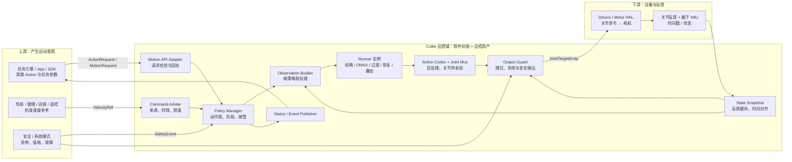
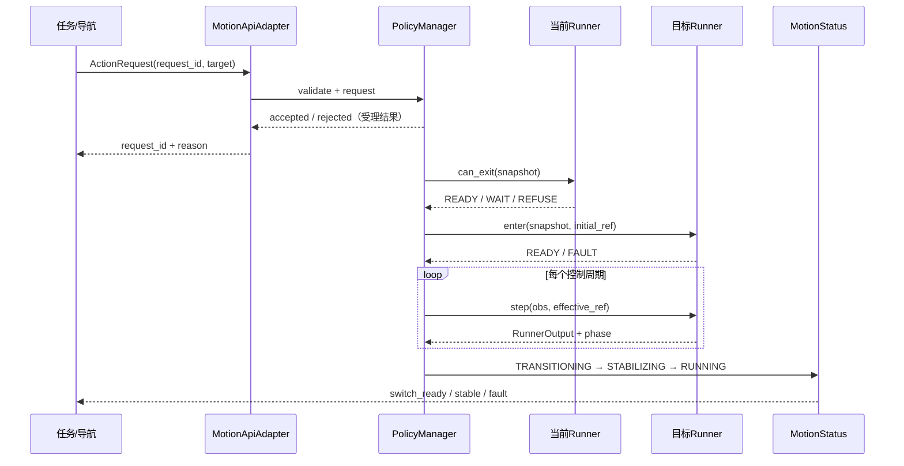
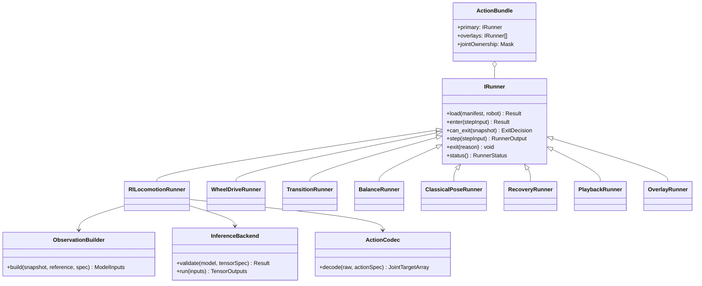
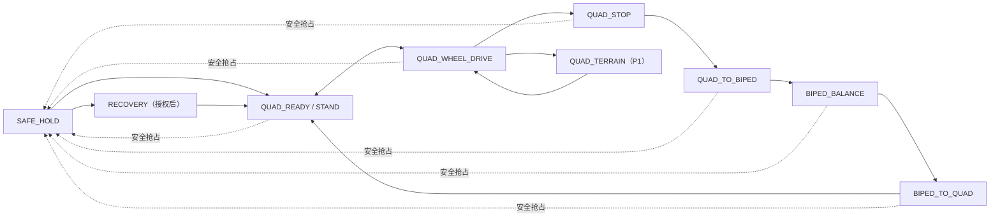
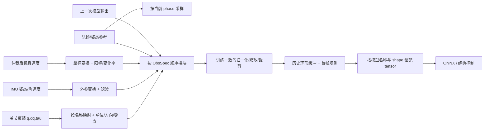
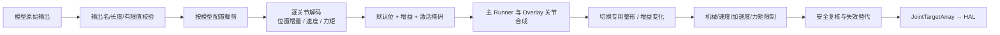
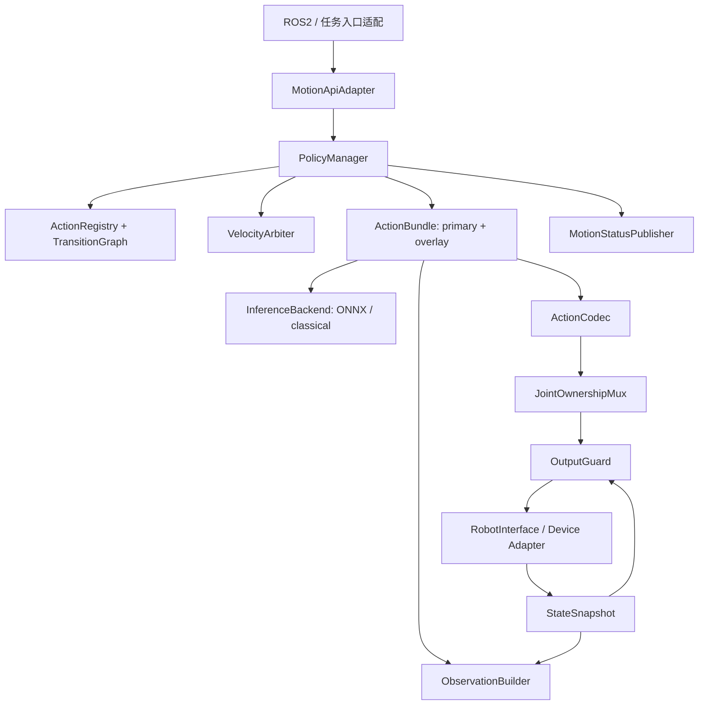

# Collie 运控策略 / Runner 架构对接总稿

**版本**：2026-11-18　**状态**：软件对接评审稿　**对象**：运控算法、软件平台、导航/感知、本体/驱动与测试。

本文可独立阅读，覆盖需求场景、策略与 Action、T1 参考接口、Collie Runner 输入输出、逐拍前后处理、策略切换、配置包装、软件承接模块及验收。文内相对链接指向原始证据，阅读本文不依赖另一份说明文档。`T1 实证` 表示本地 YAML、IDL、ONNX、源码或二进制符号可核；`Collie 建议` 是待评审实现契约；具体数值须由 Collie 本体、训练和试验签发。

## 阅读导航

| 要解决的问题 | 对应章节 |
|---|---|
| T1 的上下游、`RunnerBase` 和二进制能证明什么 | §1–2 |
| 给软件团队的外部接口、Runner 输入输出与类 | §3–4 |
| 哪些策略覆盖场景、如何切换 | §5 |
| 观测前处理、动作后处理、配置参数 | §6–8 |
| 软件包装、分工、验收和未决项 | §9–12 |

## 0. 执行摘要

1. 运控团队交付的是**策略契约、策略资产、观测/动作适配、切换约束和安全判据**；软件团队实现 Runner/Policy Manager、任务编排、进程/线程、RPC/话题、持久化与监控。策略的物理接管、输出限幅和异常降级必须由运控与软件共同签收，不能只在上层任务里实现。
2. 对上层明确三条运动接口：**离散 Action/模式请求**（站、趴、四足/双足、恢复等）、**连续机身速度/姿态参考**（领路、跟随、运镜、遥控）和**受关节所有权约束的局部动作请求**（头/臂手势）。相机快门、VIP 识别、NLU、导航路径、云台变焦不是腿轮策略。
3. P0 基座建议先有 `SafeHold/Damping`、`QuadStand`、`QuadWheelDrive`、`QuadStop`、`Q2B`、`BipedBalance/WBC`、`B2Q` 和 `Recovery`。四足→双足、双足→四足是**独立闭环过渡策略**，不是在两份行走权重之间插值。表演与头/臂手势须声明关节所有权及与平衡策略的组合限制。
4. T1 的真机配置可参考运行概念，但**不要复制其 Action 数字、关节映射或模型尺度**。本目录 T1 `qd1_t2d0` 是 14 关节；`roboto_origin-main` 默认 RPO 配置是 23 关节。T1 样例 ONNX 为当前观测和 10 帧历史的**双输入**；现有 roboparty 推理节点源码明确只接受单输入模型。
5. 本文中的 **[实证]** 指本地原始配置/接口/源码或 ONNX 图直接可读；**[建议]** 指 Collie 的待实现契约；**[待定]** 指需要本体、训练或产品验收确认。附带《需求场景.txt》是需求证据，不将其中的实现分工、阈值草案视为已批准的软件接口。

本稿内含可直接渲染的 Mermaid 模块图、类图及数据链路图；同目录的 draw.io 图可供软件评审时编辑。

## 1. 证据与适用范围

| 证据 | 本文使用方式 | 限制 |
|---|---|---|
| [T1 Action 配置](../../04_真机与模型数据/运控模型库/真机/qd1_t2d0/配置/action_setting.yaml)、[切换规则](../../04_真机与模型数据/运控模型库/真机/qd1_t2d0/配置/action_ruler.yaml)、[模型清单](../../04_真机与模型数据/运控模型库/清单/动作-执行组-runner.md) | 核对 Action→执行组→runner、周期和合法边 | 真机部署态，不是源代码；清单属于二次整理，以 YAML 为准 |
| [T1 四足行走配置](../../04_真机与模型数据/运控模型库/真机/qd1_t2d0/配置/rl/quad_walk.yaml)、[Q2B 配置](../../04_真机与模型数据/运控模型库/真机/qd1_t2d0/配置/rl/quad_to_bi_run.yaml)、[双足 WBC 配置](../../04_真机与模型数据/运控模型库/真机/qd1_t2d0/配置/rl/bi_wbc_run.yaml) | 观测索引、关节顺序、默认位、尺度、增益、模型路径 | 只适用于对应 T1 资产，不能作为 Collie 标定值 |
| [T1 IDL](../../04_真机与模型数据/真机资料/interface/aimdk_msgs/share/aimdk_msgs)、[真机资料说明](../../04_真机与模型数据/真机资料/README.md) | 对外消息语义、任务/状态字段 | 不等于 `libmc_common_runner.so` 的 C++ ABI |
| [roboparty 推理源码](../../03_参考库/roboto_origin-main/modules/roboparty_deploy/src/inference/src/inference_node.cpp)、[类定义](../../03_参考库/roboto_origin-main/modules/roboparty_deploy/src/inference/src/inference_node.hpp)、[观测实现](../../03_参考库/roboto_origin-main/modules/roboparty_deploy/src/inference/src/obs_manager.cpp)、[默认配置](../../03_参考库/roboto_origin-main/modules/roboparty_deploy/src/inference/robots/rpo/configs/default.yaml) | 评估代码复用点与缺口 | RPO 本体/训练契约与 T1 不同 |
| [17 UC 与展馆 3 IR](../../01_需求与场景/需求场景.txt) | 场景覆盖、P0/P1/P2、未决验收 | 从用户所附桌面文件复制的参考副本；场景内含待澄清项，参数须冻结后入配置 |

## 2. 系统边界与模块图



这张图表示**逻辑所有权**，不规定进程、线程或总线部署。唯一要求是 `Output Guard` 之后只有一个关节命令出口；任务、导航、拍摄模块都不能绕开该出口直接写同一组腿轮电机。安全抢占不依赖当前 ONNX 正常返回。

### 2.1 T1 上下游的实际接口定位

从 T1 [MC 进程配置](../../04_真机与模型数据/运控模型库/真机/qd1_t2d0/配置/mc_T1.yaml)、[Action 配置](../../04_真机与模型数据/运控模型库/真机/qd1_t2d0/配置/action_setting.yaml)和[IDL](../../04_真机与模型数据/真机资料/interface/aimdk_msgs/share/aimdk_msgs)可以核实 **MC 进程边界**。这些不等同于 `libmc_common_runner.so` 内部 C++ 函数，但足以作为 Collie 领域边界的参考。

| T1 方向 | 实际生产者 → 消费者 | 接口和关键数据 | 到 Runner 前/后的处理 | 原始依据 |
|---|---|---|---|---|
| 动作请求 | `task_engine`/SDK → MC ServiceManager | `mc_set_action_service`，`SetMcAction{source, McActionCommand{action, action_desc}}`；响应 `CommonTaskResponse{task_id,state}` | ActionManager 用 `action_ruler` 找边、校验退出/进入，再启动 `action_setting` 的执行组；`task_id` 是受理回执 | [`SetMcAction.srv`](../../04_真机与模型数据/真机资料/interface/aimdk_msgs/share/aimdk_msgs/srv/SetMcAction.srv)、[`McActionCommand.msg`](../../04_真机与模型数据/真机资料/interface/aimdk_msgs/share/aimdk_msgs/action/McActionCommand.msg)、[`CommonTaskResponse.msg`](../../04_真机与模型数据/真机资料/interface/aimdk_msgs/share/aimdk_msgs/common/CommonTaskResponse.msg) |
| 连续速度 | 导航/跟随/手柄/App 等 → MC InputManager | `/aima/mc/locomotion/velocity`；`source, forward_velocity, lateral_velocity, angular_velocity, pitch_velocity, level` | 按来源优先级与超时仲裁；Runner 读取**仲裁后的**速度，不应自己订阅所有来源 | [`mc_T1.yaml`](../../04_真机与模型数据/运控模型库/真机/qd1_t2d0/配置/mc_T1.yaml)、[`McLocomotionVelocity.msg`](../../04_真机与模型数据/真机资料/interface/aimdk_msgs/share/aimdk_msgs/motion/McLocomotionVelocity.msg) |
| 全身动作资源 | 任务/内容 → MC | `mc_set_motion_service`：`source,type,motion,model,resource,interrupt,operation` | 选择模仿/播放资源与 Action；`PRELOAD` 和 `EXECUTION` 需区分 | [`SetMcMotion.srv`](../../04_真机与模型数据/真机资料/interface/aimdk_msgs/share/aimdk_msgs/srv/SetMcMotion.srv)、[`motion_list.yaml`](../../04_真机与模型数据/运控模型库/真机/qd1_t2d0/配置/motion_list.yaml) |
| 局部预设动作 | 任务/交互 → MC | `mc_set_preset_motion_service`：`source,area,motion,interrupt,ani_path`；还有 `/aima/mc/custom/joint/command` | 上肢/头部叠加；必须明确与主 Runner 的关节所有权 | [`SetMcPresetMotion.srv`](../../04_真机与模型数据/真机资料/interface/aimdk_msgs/share/aimdk_msgs/srv/SetMcPresetMotion.srv)、[`McCustomJointCommand.msg`](../../04_真机与模型数据/真机资料/interface/aimdk_msgs/share/aimdk_msgs/motion/McCustomJointCommand.msg) |
| 机器人反馈 | `device_manager` → MC | `/aima/hal/joint/state`：`JointStateArray`，每关节 `name,position,velocity,effort,coil_temp,motor_temp,motor_vol`；`/aima/hal/imu/torso/state` | 读取、时间戳/丢帧检查、按训练关节顺序映射、滤波，再组 obs | [`JointStateArray.msg`](../../04_真机与模型数据/真机资料/interface/aimdk_msgs/share/aimdk_msgs/msg/JointStateArray.msg)、[`JointState.msg`](../../04_真机与模型数据/真机资料/interface/aimdk_msgs/share/aimdk_msgs/msg/JointState.msg)、[`mc_T1.yaml`](../../04_真机与模型数据/运控模型库/真机/qd1_t2d0/配置/mc_T1.yaml) |
| 电机关节目标 | MC → `device_manager` | `/aima/hal/joint/command`：`JointCommandArray`，逐关节 `name,position,velocity,effort,stiffness,damping` | Runner 输出经解码/增益/限幅/合成后发布；设备层映射电机并闭环 | [`JointCommandArray.msg`](../../04_真机与模型数据/真机资料/interface/aimdk_msgs/share/aimdk_msgs/msg/JointCommandArray.msg)、[`JointCommand.msg`](../../04_真机与模型数据/真机资料/interface/aimdk_msgs/share/aimdk_msgs/msg/JointCommand.msg)、[设备配置](../../04_真机与模型数据/真机资料/device_manager/cfg/t1_v2d0_config.yaml) |
| 状态/诊断 | MC → 任务、HMI、HDS | `/aima/mc/common/state`，`McCommonState`；`/aima/hds/diagnostic_list`；`/robot/trace/events` | 当前/目标 Action、运行状态、`switch_ready`、形态、跌倒等独立发布 | [`McCommonState.msg`](../../04_真机与模型数据/真机资料/interface/aimdk_msgs/share/aimdk_msgs/msg/McCommonState.msg)、[`McActionInfo.msg`](../../04_真机与模型数据/真机资料/interface/aimdk_msgs/share/aimdk_msgs/action/McActionInfo.msg)、[`mc_T1.yaml`](../../04_真机与模型数据/运控模型库/真机/qd1_t2d0/配置/mc_T1.yaml) |

**上游模块逐个对位**：T1 `task_engine`/SDK 发离散服务请求；导航规划、跟随和拍摄轨迹属于速度**生产者**，经 `/aima/mc/locomotion/velocity` 进入 MC，不直接调用 Runner；`rc`、`vr`、`app_proxy`、`interaction`、`pnc`、`app_proxy_t_mode`、`insta360` 是 [MC InputManager 配置](../../04_真机与模型数据/运控模型库/真机/qd1_t2d0/配置/mc_T1.yaml)中的来源名，优先级分别为 80/70/90/80/80/90/90，配置超时均为 1000 ms。这些是**来源标签**，不保证与进程一一对应。避障覆写 `coreon_fusion` 在[现有取证笔记](../../03_参考库/历史分析报告/raw/notes/原始取证笔记.md)中出现，但不在这七个配置源内；若 Collie 需要避障优先，应在自己的 `velocity_sources.yaml` 显式定义，不继承隐式特例。系统模式/硬件急停可绕过普通动作排队，直接触发安全路径。

**下游模块逐个对位**：Runner 的实际执行出口是 MC 的 joint publisher → `device_manager` 的 `/aima/hal/joint/command` subscriber → 电机驱动；反馈逆向从 `device_manager` 的关节/IMU publisher 回到 MC。`/aima/mc/common/state` 向任务/平台报告运行状态，诊断向 HDS 报告。`legged_odom`/导航使用反馈与状态作定位规划，但不是 Runner 的电机命令下游。T1 配置的关节命令发布 `frequency:200`、状态 `frequency:50`；Runner 的 `period_ms:10` 属另一层频率，不能把发布 200 Hz 当成推理 200 Hz。

T1 `ServiceManager` 的 11 个条目如下。这是 MC 的**对外服务表**，不是每个策略都要实现 11 个方法。配置只给内部服务名，没有逐项声明所绑定的 IDL；能由同名 IDL 核对的项列在右栏，其余应以运行期服务注册或头文件继续核实。

| T1 内部服务名 | 功能 | 可核对的 IDL / 补充说明 |
|---|---|---|
| `mc_set_action_service` | 请求离散 Action | [`SetMcAction.srv`](../../04_真机与模型数据/真机资料/interface/aimdk_msgs/share/aimdk_msgs/srv/SetMcAction.srv) |
| `mc_get_action_service` | 查询当前 Action | [`GetMcAction.srv`](../../04_真机与模型数据/真机资料/interface/aimdk_msgs/share/aimdk_msgs/srv/GetMcAction.srv) |
| `mc_set_motion_service` | 全身动作/模型/资源 | [`SetMcMotion.srv`](../../04_真机与模型数据/真机资料/interface/aimdk_msgs/share/aimdk_msgs/srv/SetMcMotion.srv) |
| `mc_get_motion_service` | 查询 motion | 精确 IDL 绑定未在配置中显式给出，需核实 |
| `mc_set_preset_motion_service` | 局部预设动作 | [`SetMcPresetMotion.srv`](../../04_真机与模型数据/真机资料/interface/aimdk_msgs/share/aimdk_msgs/srv/SetMcPresetMotion.srv) |
| `mc_get_preset_motion_state_service` | 查询局部动作状态 | [`GetMcPresetMotionState.srv`](../../04_真机与模型数据/真机资料/interface/aimdk_msgs/share/aimdk_msgs/srv/GetMcPresetMotionState.srv) |
| `mc_set_input_source_service` | 管理速度源 | [`SetMcInputSource.srv`](../../04_真机与模型数据/真机资料/interface/aimdk_msgs/share/aimdk_msgs/srv/SetMcInputSource.srv)；请求含 `ADD/MODIFY/DELETE/DISABLE/ENABLE` 动作 |
| `mc_get_current_input_source_service` | 查询有效速度源 | [`GetCurrentInputSource.srv`](../../04_真机与模型数据/真机资料/interface/aimdk_msgs/share/aimdk_msgs/srv/GetCurrentInputSource.srv) |
| `mc_set_robot_runtime_model_service` | 切换运行模型 | [`SetRobotRuntimeModel.srv`](../../04_真机与模型数据/真机资料/interface/aimdk_msgs/share/aimdk_msgs/srv/SetRobotRuntimeModel.srv) |
| `mc_get_robot_runtime_model_service` | 查询运行模型 | [`GetRobotRuntimeModel.srv`](../../04_真机与模型数据/真机资料/interface/aimdk_msgs/share/aimdk_msgs/srv/GetRobotRuntimeModel.srv) |
| `mc_motion_record_service` | 动作录制 | [`McMotionRecord.srv`](../../04_真机与模型数据/真机资料/interface/aimdk_msgs/share/aimdk_msgs/srv/McMotionRecord.srv) |

`/aima/mc/body_pose` 和 VR 话题在通道列表中出现，但此版本 SubscriberManager 没有启用，不能作为首版必接链路。T1 状态中的 `form_state`、`action_info.status`、`switch_ready` 分别表示形态、动作阶段和是否允许下一次切换，不能合并成一个布尔值。

### 2.2 `libmc_common_runner.so` 能说明到哪一步

Z 盘已恢复访问。2026-11-18 直接检查 `Z:\primebot-t1\robot_rk\software\mc\lib\libmc_common_runner.so`（AArch64 ELF，14,584 字节，SHA-256 `74ac8ad1fdd25ddf7320fe6be1b96db0e8890ca10f728b3c05cc49e0fdf210db`），并交叉检查相邻的 `libmc_manager_action.so`、`libmc_common_context.so`、`libmc_runner_rl_quad_loco.so`、`libmc_runner_rl_bi_loco_wbc.so` 和经典站立 Runner。检查方式为 ELF `.dynsym` 与 `DT_NEEDED`，未执行这些真机二进制，也未修改 Z 盘。

**现在可以证实的基类与装载关系：**

| 二进制证据 | 导出/依赖的符号（省略命名空间与 ABI 修饰） | 可下的结论 |
|---|---|---|
| `libmc_common_runner.so` | `mc::runner::RunnerBase::{Configure,PreInit,Init,Trig,Run,Pause,Resume,Shutdown,EnterCheck,ExitCheck,PreRunOnce,AfterExit}`；另有 `SetName/Name`、`SetCfgPath`、`SetPeriodMs/PeriodMs`、`SetRunnerContext`、`GetType`、`SkipPreRunOnceIfShared` | T1 **确有 `RunnerBase` 基类**及上述生命周期钩子；不再是分析文档的猜测 |
| `libmc_manager_action.so` | 动态依赖 `libmc_common_runner.so`；导出 `ActionManager`、`RunnerFactory::Load`、`TransitionTask::AddRunners/Transition/Run`、`ResidentTask::AddRunner/Run` | Action 管理器持有/装配 Runner；区分可切换任务与常驻任务，符合 `action_setting.yaml` 的两类配置 |
| 具体 Runner `.so` | `libmc_runner_rl_quad_loco.so`、`libmc_runner_quad_stand.so` 均导出 C 入口 `CreateRunner`/`DestroyRunner`，动态依赖基类与 context 库；具体类覆盖 `Run/Init/ExitCheck/PreRunOnce` 等 | 每个 Runner 库通过工厂装载实例，控制行为由具体派生类实现；不同类覆盖的钩子不同 |
| `libmc_common_context.so` | `RunnerContext`、`RunnerDataBoard`；`RunnerContext` 构造符号包含 `ActionContext` 与 `unordered_map<string,MotionCommand>` | 存在由 Manager/Context 向 Runner 传递动作上下文和命令数据的通道；仅凭符号不能排除具体 Runner 的其他输入来源 |

在四足行走 Runner 的符号中，还可见 `RunnerDataBoard` 绑定 `ImuState`、`JointStateArray`、`LocomotionVelocity`、`OdometryData`、`PostureState`、`SystemStatus`、`JointCommandArray`、`BodyDesire`、`MotionIntrState`、`OutputDB`、`RLDebugInfo` 等类型。**这是编译后的类型引用证据，不代表每种类型每拍都实际读取或写出**。外部话题到这些数据槽的精确映射，仍以 `mc_T1.yaml`、IDL 及对应 Manager 库为准。

二进制符号能确认方法名与部分参数类型，但 C++ mangling **不编码普通方法返回类型**，也不能仅凭导出表还原完整 `RunnerContext` 字段、虚函数表语义、每拍时序和内部数据所有权。软件团队若要二进制兼容 T1，还需同版本头文件与编译链；Collie 按本文 `IRunner` 新契约实现即可。此前文档中“找不到 `.so`”的结论已撤销。

## 3. Collie 对外接口：字段、提供方与消费者

建议软件团队做一个 `MotionApiAdapter`，把 ROS2/RPC/其他平台消息翻译为以下**稳定领域接口**；运控 Runner 只消费领域对象，不依赖任务层消息定义。

| 领域接口 | 提供方 → 消费者 | 必选字段及单位 | 接受/拒绝规则 | 反馈 |
|---|---|---|---|---|
| `ActionRequest`（离散） | 任务/SDK → `PolicyManager` | `request_id, source, action_id, issued_at, deadline, parameters, preempt_mode` | Action 已注册、当前形态和边合法、安全准入通过；重复 `request_id` 幂等 | 立即 `accepted/rejected + reason + request_id`；完成另走状态事件 |
| `BodyVelocityRef`（连续） | 导航/跟随/运镜/遥控 → `CommandArbiter` | `source, seq, stamp, ttl, frame_id=base_link, vx_mps, vy_mps, wz_radps`；可选姿态/高度参考 | 注册来源、序号递增、未过期、当前 Action 接受速度；超限裁剪并记原因 | `effective_source/effective_velocity` 状态；TTL 到期归零 |
| `OverlayRequest`（局部动作） | 任务/交互 → `PolicyManager/JointMux` | `area, motion_id/reference, interrupt, deadline` | 主 Runner 的关节所有权允许叠加；稳定态准入 | `overlay_phase/done/fault` |
| `RobotStateSample` | 关节 HAL、IMU、状态估计 → `StateSnapshot` | 每传感器独立 `stamp`；关节 `name,q,dq,tau,temp,voltage,valid`；IMU `quaternion,omega,acceleration,valid`；可选支撑/接触 | 时间倒退、重复、过期、关节缺失、NaN/Inf 标为 invalid；不能用全零代替失效 | `snapshot_freshness` 与故障事件 |
| `SafetyEvent` | 急停/设备/安全监测 → `PolicyManager` 和 `OutputGuard` | `kind,severity,stamp,latched,detail` | 高优先级异步抢占；安全出口不等待推理完成 | 故障锁存、复位条件与事件 |
| `JointTargetArray` | `OutputGuard` → 设备 HAL | `stamp,sequence,action_epoch`；每个关节 `name,mode,q_rad,dq_radps,tau_nm,kp,kd,enabled` | 只能有一个写入者；逐关节限位/变化率/模式校验 | HAL 回传接收/故障与关节反馈 |
| `MotionStatus` | `PolicyManager` → 任务/HMI/日志 | `request_id,current_action,target_action,phase,form,switch_ready,stable,effective_source,fault,stamp` | 阶段单调或显式失败；状态与实际物理判据一致 | 上层据此决定讲解、拍照、下一动作 |

`ActionRequest` 不能与 `BodyVelocityRef` 混为一条接口：前者决定**运行哪个策略及切换路径**，后者是当前运动策略每拍使用的**连续参考**。目标位置、行人 ID、VIP 信息、相机画幅由导航/感知/拍摄业务处理，运控接收由它们计算出的速度、停车或姿态请求。对接时必须写清每条速度的 `frame_id`、时间基准和有效期；不能把上一条非零速度永久保持。



### 3.1 领域接口的最小类型关系

以下是**逻辑契约**，不是 T1 头文件或限定 ROS2 的 IDL。关节数组长度取自 `RobotDescription`，模型输入输出维度取自 `RunnerManifest`，软件加载时逐项校验。

```cpp
struct StepInput {
  RobotStateSnapshot state;      // 带各源时间戳、有效位及关节名
  MotionReference reference;    // 已完成来源仲裁、坐标转换和时效检查
  TransitionContext transition; // 当前 Action、阶段、接管 epoch
};
struct RunnerOutput {
  JointTargetArray targets;     // 逐关节 mode/q/dq/tau/kp/kd/enabled
  JointOwnership owns;          // 显式声明可写关节
  Phase phase;
  bool done, exit_ready;
  FaultCode fault;
};
class IRunner {
 public:
  virtual Result load(const RunnerManifest&, const RobotDescription&) = 0;
  virtual Result enter(const StepInput&) = 0;
  virtual ExitDecision can_exit(const RobotStateSnapshot&) = 0;
  virtual RunnerOutput step(const StepInput&) = 0;
  virtual void exit(ExitReason) = 0;
  virtual RunnerStatus status() const = 0;
  virtual ~IRunner() = default;
};
```

`load` 在非实时阶段校验和预分配；`enter` 初始化历史、phase 和控制目标；`step` 在配置的截止时间内返回；`exit_ready` 只表示当前 Runner 可移交，Manager 仍需验证目标 Runner 的进入守卫与稳定结果。`MotionStatus` 对上层分别报告请求受理、切换中、稳定和失败。

## 4. Runner 真正接收什么：静态配置与每拍数据分开

### 4.1 三层输入

| 层 | 何时提供 | 具体内容 | 归属 |
|---|---|---|---|
| **本体静态包 `RobotDescription`** | 启动/机型切换前 | 关节名与顺序、零点/方向、轮半径与传动、限位、控制模式、传感器外参、设备版本 | 本体/驱动提供；运控签字 |
| **策略静态包 `RunnerManifest`** | 加载/热切换前 | Action ID、Runner 类、模型/轨迹路径与 hash、输入 tensor 名称/shape/dtype、观测块次序/尺度/历史、输出语义/尺度/默认位、增益、所有权、控制周期、进入退出守卫 | 运控提供；软件加载校验 |
| **每拍输入 `StepInput`** | 每个 Runner tick | `RobotStateSnapshot`、仲裁后的 `MotionReference`、上一拍**该策略**动作、内部 phase/历史缓冲、当前切换上下文 | StateSnapshot/CommandArbiter/Runner 自身 |

这种区分很重要：`policy.onnx` 不是完整策略；它没有说明关节索引、时序、尺度、上一动作、指令限幅和后处理。每个 Action 的完整资产是 **模型/算法 + manifest + 本体映射 + 进入/退出条件 + 验收向量**。

### 4.2 T1 原始配置具体如何表达

T1 的 [`action_setting.yaml`](../../04_真机与模型数据/运控模型库/真机/qd1_t2d0/配置/action_setting.yaml) 把 `Action → execution group → runner name/cfg_path/period_ms/priority` 关联起来，例如 `QUADRUPED_LOCOMOTION_DEFAULT → rl_quad_loco → ./rl/quad_walk.yaml → 10 ms`，`QUADRUPED_TO_BIPED → rl_quad_to_bi → ./rl/quad_to_bi_run.yaml → 10 ms`。`BIPED_LOCOMOTION_WBC` 有两个执行组：`rl_bi_loco_wbc` 10 ms 和 `animation_player` 4 ms；**一个 Action 可以组合多个 runner**。这正是 Collie 需要 `ActionBundle` 与关节所有权而不是“一个 Action = 一个类 = 一个线程”的原因。

| T1 配置层 | 字段示例 | 给 Collie 的含义 |
|---|---|---|
| `action_setting.yaml` | `resident_actions`、`transition_actions`、`runners[].name/cfg_path`、`period_ms` | 常驻安全任务；Action 由一个主 Runner 加可选 overlay 构成；每组独立更新周期 |
| `action_ruler.yaml` | `common_rules`、`action_rules[].next_actions` | 允许的物理切换边；可走路径与安全直达出口 |
| `rl/quad_walk.yaml` | `policy.path`、`obs_nums`、`action_nums`、`seq/action_seq`、`frame_stack`、`obs_index`、`obs_scales`、`clips`、`action_scale`、`activation`、`kps/kds/default_dof_pos`、`filter`、`acc_*`、`tau_limit` | 模型 I/O 与前后处理配方；不是只交付 ONNX |
| `mc_T1.yaml` | 话题、服务、输入源 priority/timeout、状态/关节发布频率 | 软件封装和对外适配；不应该写进单个模型配置 |
| `robot_model.yaml` 与设备配置 | 关节名称/机械限位、电机通信/零点/方向 | 本体/设备层的静态事实，策略引用版本而不复制成多份 |

### 4.3 Collie 推荐的 `IRunner` 与 `ActionBundle`



`IRunner` 是**运控策略接口**，`PolicyManager` 是**软件封装/切换器**。单个 ONNX 权重通常成为 `RlLocomotionRunner` 的不同配置实例，不需要每个权重写一份派生类；但过渡策略的 phase、退出门控、失败回退与持续行走不同，须有 `TransitionRunner` 的明确行为。`WheelDriveRunner` 是 Collie 四轮运动的策略承接点，具体由控制律还是新模型实现由运控决定。`ActionBundle` 用于平衡主 Runner 与头/臂手势等局部动作组合；启动时若 `owns_mask` 冲突，拒绝启用，不能靠“谁最后写”解决。

### 4.4 每种首批 Runner 的接口卡

| Action / 实现类 | 每拍主参考（来自上游） | 每拍反馈（来自本体） | Runner 原始输出及进入/退出 | 必交配置 |
|---|---|---|---|---|
| `QUAD_WHEEL_DRIVE` / `WheelDriveRunner` | `vx,vy,wz`，可选高度/转向模式 | 四轮与腿关节、IMU、有效支撑 | 轮/腿目标；进入需四足稳定，退出需速度与滑移降到阈值 | 速度域、轮腿控制模式、观测/动作逐维表、制动与侧滑阈值 |
| `QUAD_STOP` / `ClassicalPoseRunner` 或专用停止策略 | 目标零速度 | 同上，特别是轮速与接触 | 制动/驻留目标；稳定保持后 `exit_ready` | 减速曲线、稳定窗口、地面坡度与失败出口 |
| `QUAD_TO_BIPED` / `TransitionRunner` | 一次性变形请求；无持续导航速度 | 关节、IMU、接触/滑移、周围空间准入结果 | phase 驱动的全身目标；完成需姿态+接触+保持时间，异常走安全回退 | 模型/轨迹、初末态包络、phase、超时、重试/回退边 |
| `BIPED_BALANCE` / `BalanceRunner` | 可选机身姿态/头臂参考；静态讲解时速度为零 | 关节、IMU、后轮/支撑状态 | 持续平衡输出；失稳/失联抢占 | 模型与 obs/act 规格、允许扰动、姿态与滑移阈值 |
| `BIPED_TO_QUAD` / `TransitionRunner` 的另一 manifest | 一次性落回请求 | 同 Q2B | 全身目标；四轮支撑稳定才允许下一步滑行 | 独立模型/轨迹、初末态守卫、超时/回退 |
| `QUAD_STAND/GET_DOWN` / `ClassicalPoseRunner` | 姿态目标 | 关节、IMU | 位姿/增益目标；误差与稳定窗口决定完成 | 关键帧、增益、限速、机械限位 |
| `RECOVERY` / `RecoveryRunner` | 安全系统授权、倒地类型 | 关节、IMU、接触、环境清空信号 | 恢复目标；失败次数受限并回阻尼 | 可恢复姿态集合、场地条件、次数/超时、失败出口 |
| `GESTURE/HEAD` / `OverlayRunner` | 手势/视线轨迹与时标 | 对应关节与主平衡状态 | 仅声明拥有的关节目标；主策略退出时同步停止 | 所有权、可并行主 Action 列表、轨迹、增益 |

`QUAD_TERRAIN`、载物、楼梯和双足移动在后续版本按同一接口卡补充；没有训练资产与验收时保持未开放状态。这里的“每拍主参考”是 Runner 消费的接口，不表示 Runner 自己做导航、识别 VIP 或相机拍摄。

## 5. 首批策略清单与 Action 映射

| 优先级 | Collie 能力 / 建议 Runner | T1 对照 Action（仅参考） | 触发与出口 | 备注 |
|---|---|---|---|---|
| P0 | 安全驻留/阻尼 `SafeHold`、被动 `Passive` | `DAMPING_DEFAULT`、`PASSIVE_DEFAULT` | 任意态异常直达；人工复位+重新验证 | 不是 RL；急停硬件链另行保证 |
| P0 | 四足站立/起立/趴下 `ClassicalPoseRunner` | `QUADRUPED_READY_STAND_DEFAULT`、`QUADRUPED_STAND_DEFAULT`、`QUADRUPED_GET_DOWN_DEFAULT` | 待机、迎宾、退出任务 | 四足低姿态不是“零速行走” |
| P0 | 四轮滑行 `QuadWheelDrive` | 参考 T1 `QUADRUPED_LOCOMOTION_DEFAULT` 的 Runner 组织方式 | 领路、跟随、巡游、运镜机位 | Collie 轮式四足策略/控制律由运控提供；业务差异主要在速度参考 |
| P0 | 减速/支撑稳定 `QuadStop` | 参考 T1 `QUADRUPED_LOCOMOTION_STEP` 的切换门控 | 四轮滑行→变形/表演前 | 可用受验证的停止过渡实现，但不能省略稳定门控 |
| P0 | 四足→双足 `Q2B` | `QUADRUPED_TO_BIPED` | 站立讲解/合影/平视交互 | 独立过渡 runner；初态、目标高度待定 |
| P0 | 双足直立平衡 `BipedBalance` | `BIPED_LOCOMOTION_WBC` | 讲解、合影保持、手势叠加 | 静止也需闭环平衡；后轮接触/滑移判据待标定 |
| P0 | 双足→四足 `B2Q` | `BIPED_TO_QUADRUPED` | 讲解/合影结束、恢复四轮移动 | 独立过渡 runner |
| P0 | 四足/双足恢复 `RecoveryRunner` | `QUADRUPED_RECOVERY`、`BIPED_RECOVERY` | 跌倒后仅在场地清空且人工/安全授权 | 展馆拥挤时默认阻尼等待，不自主弹起 |
| P0 条件项 | 低幅迎宾/讲解手势 `OverlayRunner` | `BIPED_CUSTOM_UPPER`、`animation_player` 等 | 站稳后与平衡策略组合 | 若 Collie 无独立头/臂自由度，则改为语音/灯效；关节所有权先定 |
| P1 | 低速复杂地形 `QuadTerrain`、窄道 | 参考 T1 `QUADRUPED_LOCOMOTION_TERRAIN` 的策略切换组织 | 门槛、坡道、院子、户外 | 场景自动识别/切换证据不足；先显式请求和保护 |
| P1 | 载物配置 `LoadedQuadWheelDrive` 或参数化 `QuadWheelDrive` | T1 无可直接映射的 5 kg 保证 | UC-10 平层/门槛；IR-B 取物 | 载荷、质心、制动距离须重新训练/实测 |
| P1 | 室外/人群限速配置 | 复用四足走路 Action | UC-03/06/12/15 等 | 人群检测/限速判定来自感知/规划；运控执行硬上限 |
| P2 | 楼梯、载物爬楼、拖拽 | T1 `TERRAIN` 不能推出安全载物爬楼 | UC-01、UC-10 变体 | 独立样机验证与地形/负载策略；不写入首发承诺 |
| P2 | 特技/复杂表演 | T1 `FRONTFLIP`、`DANCE` 等 | UC-14 可选 | 展馆/老人儿童附近禁用高风险特技 |

**策略数 ≠ 场景数**：17 个 UC 和展馆 3 IR 中多数平层移动行为复用 `QuadWheelDrive`；导航、跟随、避障、轨迹跟踪负责输出不同速度和停止条件。`BipedBalance` 可支持站立对话与静态合影；若需要双足移动、牵手移动，应另立 `BipedLoco/HandHeld` 需求和验收，不把静态平衡暗称可行走。

### 5.1 场景覆盖：业务调用到运控动作

| 场景 | 运动序列与归属 | 首发边界 |
|---|---|---|
| UC-13 唤醒认主、UC-11 居家信息交互 | 待机 `QuadStand`；必要时 `Q2B→BipedBalance→B2Q`；人脸/声纹/权签由感知/大脑完成 | P0；VIP 识别不要求运控增加新 RL |
| UC-04 访客接待、UC-14 变形/手牵/表演 | `QuadStand→QuadWheelDrive→QuadStop→Q2B→BipedBalance`；返回 `B2Q→QuadWheelDrive`；手牵/表演走独立受限能力 | P0；手牵**移动**与动态表演需单列能力确认 |
| UC-07 合影、UC-08 跟拍、UC-09 运镜 | 移动机位/跟拍 `QuadWheelDrive`，静态平视合影 `Q2B→BipedBalance`；云台/相机并行任务 | P0；跟拍优先 Q；直立态不默认移动，变焦归相机 |
| UC-15 跟随、UC-16 领路、UC-17 信标跟随 | `QuadWheelDrive` 消费导航/跟随速度；遮挡、信标丢失时零速并驻停 | P0；重识别/路径规划不是 Runner |
| UC-10 门口收发、UC-03 陪同外出、UC-06 夜巡、UC-12 看家 | `QuadWheelDrive`；门槛/坡道需 `QuadTerrain`；夜间/雨天/人群限速由工况包约束 | P1；载物与地形均需验证 |
| UC-01 载物爬楼、UC-02/05 看护 | 前者 `LoadedTerrain/Stair` 待研发；后者主要复用 `QuadWheelDrive/Stand` 并由感知发危险区/跌倒事件 | P2；不把看护识别当运控策略 |
| 展馆 IR-A 迎宾→领路→直立讲解 | `QuadStand→QuadWheelDrive(约 1m 停驻/转向)→QuadWheelDrive(导航速度)→QuadStop→Q2B→BipedBalance(+手势)` | 单机；VIP/语音/NLU/路线/30 cm 避障由上游提供，运控做速度包络、接管与稳定 |
| 展馆 IR-B 问询→取物→寻人→送达 | `B2Q→QuadWheelDrive` 往返，载物用已验证参数/策略；到人前停止 | 双通道定位/寻人和人装人取归上游；载荷/质心验收未定 |
| 展馆 IR-C 命令触发合影或跟拍 | 合影 `QuadWheelDrive` 到位→`Q2B→BipedBalance`→`B2Q`；跟拍保持四足 `QuadWheelDrive` | 云台/手机/快门/成片不占腿轮 Runner；构图速度来自上游 |

### 5.2 策略切换图谱（建议冻结为配置）



图示只表达建议路径；每条物理边的初态、守卫、完成和故障出口须在 Collie 上实测后开放。`SAFE_HOLD` 的安全抢占不经过普通路径搜索。

| 从 → 到 | 进入守卫 | 完成/失败 |
|---|---|---|
| `SafeHold → QuadReady → QuadStand` | 急停已复位、反馈新鲜、关节/IMU 有效、支撑可确认 | 位姿误差和稳定保持达标；否则保持安全态 |
| `QuadStand ↔ QuadWheelDrive` | 支撑可靠、速度命令有效；反向需速度衰减到阈值 | 轮速/机身速度稳定后 `switch_ready=true` |
| `QuadWheelDrive → QuadStop → Q2B` | 零速、支撑稳定、周围安全距离、地面平整、载荷许可 | `Q2B` 监测姿态/接触/滑移/超时；失败按已验证回退或阻尼 |
| `Q2B → BipedBalance` | 转换完成且后轮支撑有效 | 保持稳定窗口完成后才通知业务“可讲解/拍照” |
| `BipedBalance → B2Q → QuadStand/QuadWheelDrive` | 手势叠加已退出、速度零、前方空间清空 | 回到四轮支撑后才放行移动 |
| `QuadWheelDrive → QuadTerrain → QuadWheelDrive` | 地形请求明确，训练域/传感器/载荷满足 | 地形结束且稳定后回平地；不能仅凭速度大小自动推断 |
| `任意 → SafeHold/Damping` | 安全事件抢占 | 锁存原因；禁止自动回原动作 |
| `SafeHold → Recovery → QuadStand/BipedBalance` | 倒地类型已判定、场地无人与障碍、人工/产品授权 | 恢复失败回阻尼，次数受限 |

T1 的 [切换规则](../../04_真机与模型数据/运控模型库/真机/qd1_t2d0/配置/action_ruler.yaml) 中存在 `QUADRUPED_LOCOMOTION_DEFAULT→QUADRUPED_TO_BIPED→BIPED_LOCOMOTION_WBC` 和 `BIPED_LOCOMOTION_WBC→BIPED_TO_QUADRUPED→QUADRUPED_STAND_DEFAULT/QUADRUPED_LOCOMOTION_DEFAULT`；`QUADRUPED_LOCOMOTION_STEP` 是多个特殊动作前的稳定节点。Collie 只采用这类**物理交接逻辑**，边是否开放以新本体验证为准。常规切换不可越过未配置边；紧急动作独立直达。

### 5.3 接管协议与对外阶段

软件管理器负责注册并预加载 Runner、校验 Action 图、仲裁请求、锁定唯一设备出口、保存 `request_id/current_action/target_action` 并发布阶段事件。正常接管遵循 `REQUESTED → PREPARING → WAIT_EXIT → ENTERING → TRANSITIONING → STABILIZING → RUNNING`；任一阶段失败进入 `FAULT/SAFE`。旧 Runner 的 `can_exit()` 只表示物理上可以交出；目标 Runner 的 `enter()` 仍须检查初态、传感器和资产。移交电机写入权是原子步骤，不能让两个主 Runner 同时发布。

`Q2B/B2Q` 作为独立 Runner 按姿态、接触、关节误差和稳定保持时间判断完成。对外的“请求已受理”“正在切换”“机体已稳定”“失败”分别报告；`switch_ready` 仅在当前策略稳定且可接受下一动作时为真。安全抢占不等待推理完成，普通动作切换不得绕过配置中的过渡边。

## 6. 前处理：一拍观测怎么从反馈变成 tensor



| 顺序 | 输入/处理 | T1 证据与例子 | Collie 必须固定的契约 |
|---|---|---|---|
| 1 | 获取同一拍 `RobotStateSnapshot` | MC 订阅关节/IMU，配置反馈发布间隔与延迟检查；T1 `JointState` 含位置/速度/力矩/温度/电压 | 各源采样时间、最大年龄、时间倒退/缺字段处理；陈旧反馈须故障化 |
| 2 | 机型映射 | T1 `quad_walk.yaml` 列出 `joints_name`、`seq`、`action_seq`；`robot_model.yaml` 定义限位 | 关节名 → 本体顺序 → 模型顺序；方向与零点必须版本化 |
| 3 | 状态滤波/姿态表示 | T1 `filter.imu_vel_cutoff_freq=100`、`q_vel_cutoff_freq` 分关节；观测索引有 `imu_omega/imu_euler` | 使用训练侧相同坐标系、滤波器形式、采样率、角度表示；仅截止频率不能完整确定滤波实现 |
| 4 | 参考命令整形 | T1 `command_scales` 有各向速度范围，另有 `acc_x/acc_y/acc_yaw`；InputManager 有来源与超时 | 先做来源仲裁、TTL、机身坐标转换和速度/加速度包络，再送给策略；`STOP` 可强制清零 |
| 5 | 组装当前观测 | T1 `obs_index` 给每块起始偏移；下方三种模型尺寸不同 | 每个 Runner 的 `ObsSpec` 声明块名、长度、来源、顺序、缺失处理和单位；启动期总维度校验 |
| 6 | 缩放、裁剪 | T1 `obs_scales.dof_vel=0.05, ang_vel=0.25`；`obs_clip` 随策略为 20/50 等 | 每维与训练配置逐项一致；NaN/Inf 不许经 `clip` 掩盖 |
| 7 | 历史/首帧 | T1 常见 `frame_stack=10`，ONNX 第二输入是 10 帧历史 | 冻结帧顺序、是否含当前帧、首次进入如何填充、切换后是否清空；离线 golden vector 验证 |
| 8 | 模型 tensor | ONNX 图可直接核实输入名称、shape、dtype | 不依赖向量总长度猜测；逐输入名称绑定并逐输出名称读取 |

**实证尺寸实例**（来自本地 ONNX 图和同名配置）：

| T1 Action / 模型 | 当前观测构成（`obs_index` 起点） | Tensor 输入 → 输出 | 尚需源码/向量验证的部分 |
|---|---|---|---|
| 四足行走 `quad_walk.yaml` | `omega[0:3]`、`euler[3:6]`、`pos[6:18]`、`vel[18:32]`、`prev_action[32:46]`、`command[46:49]`、`cpg[49:57]` | `observations[1,57]` + `observation_history[1,570]` → `action[1,14]`；另有 4 维辅助输出 | `euler` 的坐标约定、CPG 8 维编码、历史是否含当前帧、辅助输出语义 |
| 双足 WBC `bi_wbc_run.yaml` | 前 46 维同类块，`command[46:49]` | `observations[1,49]` + `observation_history[1,490]` → `action[1,14]` | 命令各维定义及退出门控实际算法 |
| 四足→双足 `quad_to_bi_run.yaml` | 前 46 维同类块，`phase[46]`、`q_ref[47:51]` | `observations[1,51]` + `observation_history[1,510]` → `action[1,14]` | `phase` 定义、4 维 `q_ref` 物理意义及初末帧规则 |

区间长度由相邻 `obs_index` 和 `obs_nums` 算得，**是结构映射，不是 T1 内部计算公式的逆向证实**。例如 `pos` 是否按 `q−default_q`、`prev_action` 是裁剪前还是后，必须拿控制器源码或 ONNX golden vector 核对。Collie 的训练/部署双方需共同出一张逐维 `ObsSpec.csv`，不能仅提交 `obs_nums=57`。

建议 Collie `ObsSpec.csv` 至少列：`index,block,element,joint_or_axis,source,unit,frame,offset,scale,clip,filter,history_lag,missing_policy`。一份模型一份规格，自动生成校验器与回放测试。

## 7. 后处理：模型输出怎么成为关节命令



| 阶段 | 逐项做什么 | 由谁定义/实现 |
|---|---|---|
| 输出校验 | 按 tensor **名字**选 `action`，检查 manifest 声明的目标维度、dtype、NaN/Inf、推理用时；辅助输出不能误当电机目标 | 运控定义 schema；软件实现运行时 |
| 裁剪与解码 | 逐维 `clip(raw_i, ±action_clip_i)`；若位置增量，`q_des_i=default_q_i+scale_i*raw_i`；若轮速，`dq_des_i=scale_i*raw_i`；若力矩则按力矩语义。`activation/owns_mask` 决定此 runner 是否写该关节 | 训练/运控提供**逐关节类型和配方**；软件实现通用 codec |
| 增益 | 给每关节 `kp/kd`，控制模式为 `POSITION/VELOCITY/TORQUE/DAMPING/PASSIVE`；切换时按经验证规则变更增益 | 运控签发；HAL 校验可执行范围 |
| 组合 | 主 Runner + 局部动作按关节所有权合成；若覆盖主平衡关节需显式受控混合、专门模型或禁止 | 运控批准组合；软件实现冲突检查 |
| 过渡 | 普通行走/驻留间可用经验证的平滑；Q2B/B2Q 由专门 `TransitionRunner` 闭环输出，不能被通用线性插值代替 | 运控定义物理条件；软件执行阶段机 |
| 最后安全闸 | 关节位置/速度、命令变化率、力矩/增益、反馈新鲜度、模型超时、急停状态检查；触发时切安全输出并锁存故障 | 运控给限值及动作；软件+HAL 分层实现 |

T1 [`quad_walk.yaml`](../../04_真机与模型数据/运控模型库/真机/qd1_t2d0/配置/rl/quad_walk.yaml) 明确列出 `action_clip=50`、14 维 `action_scale`、`default_dof_pos`、`kps/kds`、`activation`、`transition_duration=0.2`、`tau_limit`，所以“ONNX 输出 14 维角度直接下发”是错误理解。最终 T1 设备消息的物理字段可在 [`JointCommand.msg`](../../04_真机与模型数据/真机资料/interface/aimdk_msgs/share/aimdk_msgs/msg/JointCommand.msg) 核对。Collie 的数值由本体和训练重新给，不复制示例值。

### 7.1 一帧可复现实例（建议交付给软件的测试夹具）

```text
输入：带时间戳的 Collie 关节反馈 + IMU + 仲裁后的 vx/vy/wz + 上一拍 action
前处理产物：obs_current[name,shape] + obs_history[name,shape]
推理产物：raw_action[name,shape] + 可选诊断输出
后处理产物：每关节 {mode,q,dq,tau,kp,kd,enabled} + owns_mask
安全/设备产物：accepted_joint_command + clamp_reason/fault_reason
```

运控团队需提供实际 `.npz`/CSV golden fixture：`RobotStateSample`、速度、当前 Action/phase、期望两个输入 tensor、期望原始输出、期望逐关节目标。软件测试必须逐维比较 **输入 tensor** 和 **解码后目标**，仅比最终动作“看上去相似”不能发现关节顺序、帧序、单位错误。

## 8. 配置如何包装：一个 Action 的完整清单

以下是 **Collie 建议 schema 示例**，字段可改名，但信息不得丢。`<...>` 表示运控/本体团队尚未给出的资产或标定值，不是可运行参数。

```yaml
schema_version: 1
robot_profile: collie_wheel_quad_v1          # 关节/限位/设备版本另有独立配置
action_id: QUAD_WHEEL_GLIDE
form: QUADRUPEDAL
execution_groups:
  - role: primary
    runner: WheelDriveRunner                 # 或经训练验证的 RlLocomotionRunner
    period_ms: <trained_policy_period>
    owns: [front_left_leg, front_right_leg, rear_left_leg, rear_right_leg, four_wheels]
    config: wheel_glide_runner.yaml
  - role: overlay                            # 可选；若没有可删
    runner: OverlayRunner
    owns: [head]
    config: head_gesture.yaml

# wheel_glide_runner.yaml（策略资产）
asset:
  kind: onnx_or_classical
  path: <asset_path>
  sha256: <hash>
tensor_io:
  inputs:
    - {name: observations, dtype: float32, shape: [1, <obs_dim>]}
    - {name: observation_history, dtype: float32, shape: [1, <history_dim>]}
  outputs:
    - {name: action, dtype: float32, shape: [1, <act_dim>]}
observation:
  spec_file: obs_spec.csv                  # 逐维顺序/源/单位/尺度/滤波
  history_frames: <N>
  history_order: oldest_to_newest
  first_frame_fill: repeat_current         # 必须与训练侧一致，例子不代表既定值
  stale_state: fault
reference:
  accepted: [vx_mps, vy_mps, wz_radps]
  frame: base_link
  ttl_ms: <validated_ttl>
output:
  spec_file: action_spec.csv               # 逐关节模式/scale/default/gain/limit
  invalid: safe_hold
entry_guard: [form_is_quad, sensor_fresh, motor_ready, safety_clear]
exit_guard: [body_speed_below_threshold, support_confirmed]
failure_target: SAFE_HOLD
```

另设三份**系统级**配置：`velocity_sources.yaml`（来源优先级与 TTL）、`action_graph.yaml`（合法边及守卫）、`safety_limits.yaml`（输出与故障阈值）。不要把它们复制进 20 个 Runner 文件。加载顺序：本体包 → 系统级配置 → ActionBundle/RunnerManifest → 模型/轨迹与 tensor 验证 → 预分配缓冲 → 注册到 Manager → 开放请求。加载失败只能报错，不得把不完整 Action 暴露为可用。

## 9. 软件团队在 roboto_origin-main 中具体承接什么

现有 [`InferenceNode`](../../03_参考库/roboto_origin-main/modules/roboparty_deploy/src/inference/src/inference_node.cpp) 已有：`PolicyRuntime`、配置化观测块、历史缓冲、ONNX Runtime、`/cmd_vel` 接入、推理循环和电机控制循环。它的 [`setup_model`](../../03_参考库/roboto_origin-main/modules/roboparty_deploy/src/inference/src/inference_node.cpp) 当前明确拒绝多输入 ONNX；[`RobotInterface::apply_action`](../../03_参考库/roboto_origin-main/modules/roboparty_deploy/src/inference/include/robot_interface.hpp) 签名支持 `p/v/kp/kd/tau`，但现有控制路径主要调用位置向量。故应**复用驱动与推理基础设施，新增领域层**，不能只在原节点外面套一个 `switch(model_name)`。



| 模块 / 建议文件 | 软件团队实现 | 运控团队交付/验收 |
|---|---|---|
| `motion_api_adapter` | ROS2/RPC 请求与领域对象互转、异步回执/状态关联、幂等 | Action ID 与错误/阶段语义 |
| `action_registry` + `transition_graph` | 解析配置、校验每个 ActionBundle/边、拒绝不可达请求 | 合法形态/边、守卫和回退路径 |
| `velocity_arbiter` | 来源优先级、TTL、序号、停止、被避障速度覆盖的规则 | 速度包络、优先级需求和失联动作 |
| `state_snapshot` + `observation_builder` | 关节/IMU缓存、时间对齐、逐策略观测、历史环 | `ObsSpec.csv`、训练一致滤波与黄金向量 |
| `inference_backend` | 多输入/多输出 ONNX 验证、预加载、定时统计 | ONNX 文件、tensor schema、耗时目标 |
| `runner/*` | `IRunner` 生命周期和经典/ONNX/过渡/恢复执行器 | 各策略进入、退出、完成、故障判据 |
| `action_codec` + `joint_mux` | 输出解码、控制模式、增益、关节所有权与叠加 | `action_spec.csv`、局部动作组合矩阵 |
| `output_guard` + `device_adapter` | 唯一命令出口、限位/变化率、安全替代、HAL 适配 | 物理包络、急停/跌倒/恢复规则；本体签字 |
| `motion_status` + replay tests | 阶段/故障状态、日志、离线回放 | 验收阈值与 golden fixtures |

软件架构不必照搬 T1 的 AimRT/线程布局。软件可决定是保留现有 ROS2 节点还是拆成多进程，但必须保持上述**领域接口**与单一设备出口。`roboparty_train/rsl_rl/runners` 是训练循环 Runner，不是部署态策略 Manager。

建议把上述领域层包装为 `roboparty_deploy` 内独立的 `motion_runtime` 库，节点/服务仅作外层适配。目录形态可以是：

```text
modules/roboparty_deploy/src/
  motion_runtime/
    include/motion/    types.hpp  runner.hpp  manifest.hpp  status.hpp
    src/               policy_manager.cpp  action_registry.cpp
                       state_snapshot.cpp  observation_builder.cpp
                       inference_backend.cpp  action_codec.cpp
                       joint_mux.cpp  output_guard.cpp
    runners/           wheel_drive.cpp  rl_locomotion.cpp
                       transition.cpp  balance.cpp  pose.cpp
                       recovery.cpp  playback.cpp  overlay.cpp
    tests/             golden_obs_action_replay.cpp  switch_graph_replay.cpp
  motion_ros_adapter/  motion_node.cpp  msg_translation.cpp
  inference/           （保留原节点作为迁移参考，逐步抽取共用代码）
  robots/collie/       robot_profile.yaml  action_registry.yaml
                       action_graph.yaml  velocity_sources.yaml
                       safety_limits.yaml  policies/<action>/manifest.yaml
```

**调用关系**：ROS/RPC callback 只做校验与入队，不在回调里做 ONNX 推理；`PolicyManager` 决定本拍 `ActionBundle` 与有效参考；`StateSnapshot` 给同一拍不可变反馈；各 Runner 使用 `ObservationBuilder/InferenceBackend/ActionCodec`；`JointMux` 合成后仅 `OutputGuard` 能调用 `RobotInterface`/设备发布。实际线程和调度由软件团队实现，但 `step()` 必须有确定的截止时间，过期输出不能沿用为新命令。这样增加新策略通常只需新增 manifest、模型与 golden fixture；新增执行机制才需要写新的 Runner 类。

## 10. 软件与运控之间最终应互交什么

| 运控团队交付 | 软件团队交付 | 联合验收 |
|---|---|---|
| `robot_profile` 审核；每个 Action 的 `RunnerManifest`、ONNX/经典控制资产及 hash | 可加载/可拒绝的 `ActionRegistry` 与 `PolicyManager` | 资产不匹配不开放 Action；模型版本可追踪 |
| `ObsSpec.csv`、`ActionSpec.csv`、进入/退出/完成/失败判据 | 前后处理、关节复用与安全出口 | 逐维 golden fixture、关节模式与限幅 |
| `action_graph.yaml`、局部叠加组合矩阵 | 路径规划、阶段机、冲突仲裁、异步状态 | 受理/运行/稳定/失败清晰区分 |
| 速度/载荷/地形包络 | 来源仲裁、TTL、上游接口 | 断流停车、避障优先、错误源拒绝 |
| 恢复与安全条件 | 硬件/软件急停链、故障锁存 | 推理挂死时仍可安全输出 |

首轮软件评审建议拿三条端到端链路逐字段走通：①四轮领路 `ActionRequest + VelocityRef → WheelDriveRunner → JointTarget`；②`QuadStop → Q2B → BipedBalance → B2Q` 的每阶段事件；③ IMU/关节过期或急停时，当前 Runner 无论处于哪一拍都能进入安全输出。场景需求中的速度、站立高度、载荷和自动恢复阈值尚待本体/产品签发，不在软件端猜常量。

## 11. 可直接给软件团队的验收契约

1. **加载期**：关节拓扑、模型 hash、输入输出名称/shape/dtype、观测配方、输出模式不匹配时拒绝启动；旧策略继续安全运行或进入安全态。
2. **回放期**：同一段时间戳反馈/速度/参考，经新旧离线实现对比，验证观测向量逐维一致、历史帧顺序、首次进入清零规则、manifest 所声明维度的输出反标定一致。每种模型至少提供一组 golden input/output。
3. **切换期**：非法边明确拒绝；正常边记录每阶段时间和守卫；任务收到“已接收、转换中、已稳定、失败”四种不同结果；变形期间不接受行走速度接管。
4. **异常期**：速度 TTL 到期、IMU/关节反馈过期、ONNX 异常、推理超时、输出 NaN/Inf、关节越界、跌倒、急停，都必须触发可追溯的安全输出；急停不能依赖 ONNX 或任务引擎存活。
5. **场景期**：展馆 IR-A 至少跑通迎宾/领路/直立讲解/回四足；IR-C 验证静态合影与四足跟拍两条路径；UC-15/16/17 验证同一四足 runner 承接三种速度来源。载物、楼梯、拥挤与手牵移动各设独立验证门槛。

验收记录字段：`request_id`、来源、当前/目标 Action、转换阶段、`switch_ready`、形态、输入新鲜度、速度源/TTL、模型版本/hash、推理耗时、输出限幅原因、安全事件及最终结果。可用离线回放+仿真完成接口验收；真机开放边必须再做本体安全试验。

## 12. 评审时必须拍板的最少问题

| 问题 | 当前依据/影响 | 建议决策责任人 |
|---|---|---|
| Collie 关节拓扑、轮/腿/头臂数，双足直立究竟是静态锁止还是动态后轮平衡 | 需求同时使用“四足轮式”“静态稳定”“后双轮自平衡”，表述冲突；决定控制模式和安全守卫 | 本体+运控 |
| Q2B/B2Q、双足保持、5 kg 载物、门槛/楼梯分别有哪些**Collie 自研权重/训练域/实测** | T1 资产不能直接迁移到不同机构 | 运控+训练 |
| 头/前肢手势与平衡策略是否争用关节 | 决定 `owns_mask`、叠加接口或重训练 | 本体+运控 |
| 展馆拥挤限速、30 cm 避障、被撞 5 s 恢复是否作为安全要求 | 需求里有草案但检测与自动恢复条件不完整；不能直接编码成常量 | 产品+安全+导航 |
| 断网、目标丢失、普通观众并发、VIP 识别失败、跟丢 15 s 后回哪里 | 属任务/感知策略；运控需要收到明确 `STOP/HOLD/RETURN` 意图 | 产品+平台+导航 |
| 直立高度、稳定时间、允许负载、目标速度、切换时限、跌倒后自动恢复许可 | 决定 Q2B/B2Q/Balance 的验收门槛 | 产品+本体+运控 |

上述未决项不妨碍软件团队先按契约实现 Manager、回放测试和安全出口；对应实体 Action 的开放必须等本体与策略验证完成。
