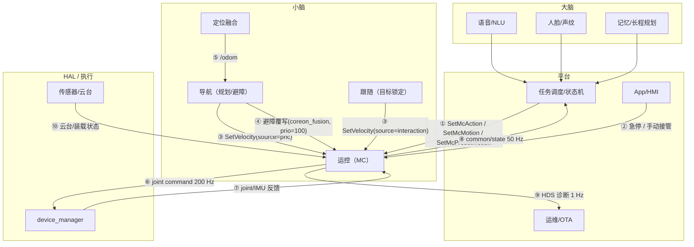
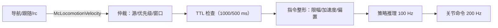
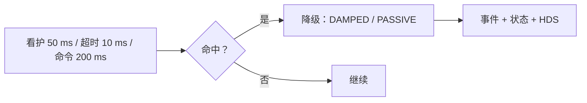
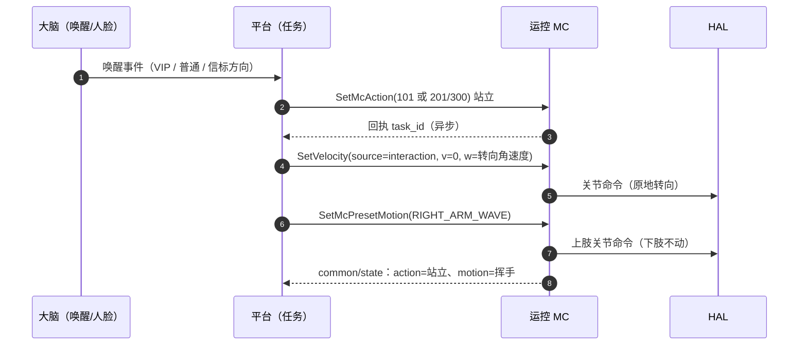
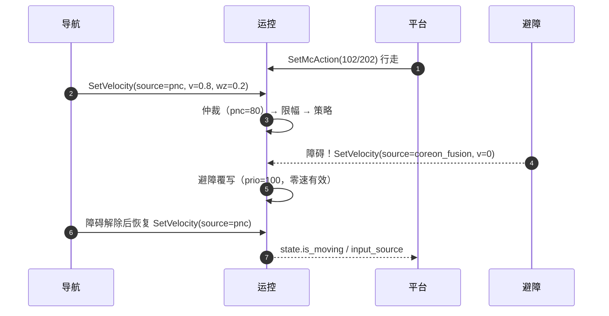
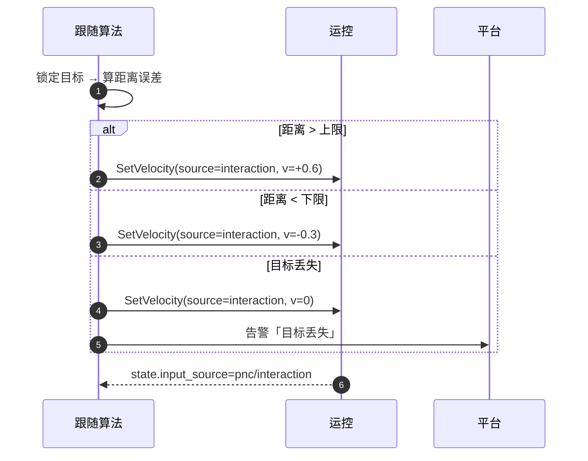
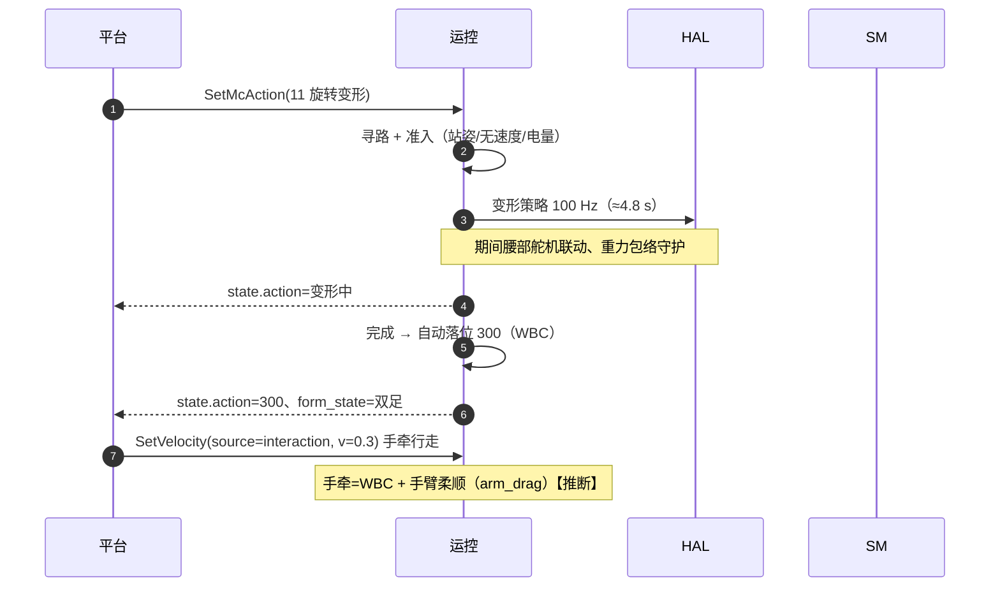
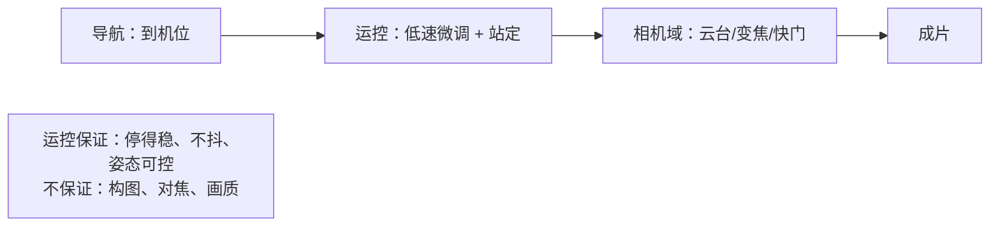
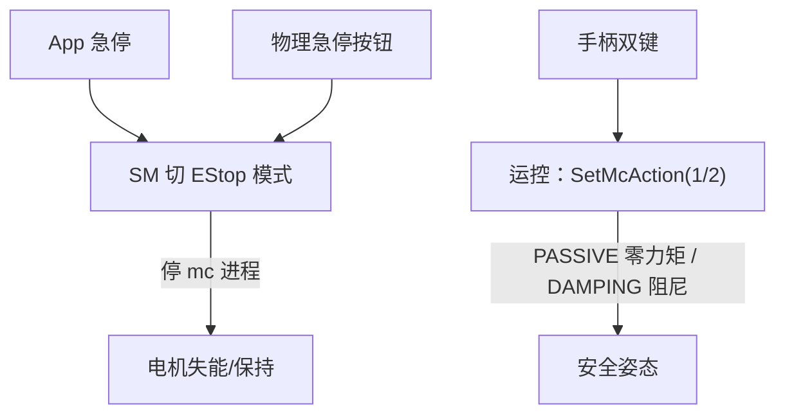
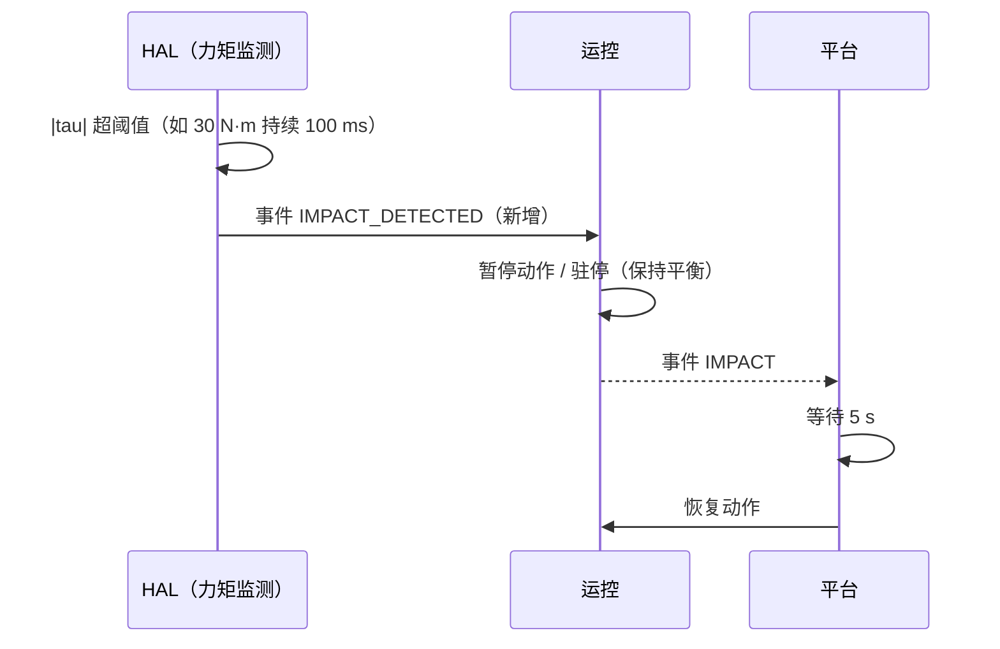

# 运控（MC）对外接口与场景交互说明

> 面向：大脑、小脑（导航/跟随/定位）、平台（任务调度/HMI/运维）、HAL、感知、App/云端
> 目的：**把"运控领域对外要什么、给什么、什么时候给、失败谁负责"讲清楚**，用于跨领域对齐与联调。
> 需求依据：`9CE6829CE6AF.txt`（7 族 17 UC + 3 个展馆 IR 场景）。
> 接口依据：真机 `mc_T1.yaml`、`aimdk_msgs`（`McAction` / `McLocomotionVelocity` / `SetMcMotion` / `SetMcPresetMotion` / `McCommonState`）。

---

## 0. 目的、边界与读法

### 0.1 一句话

**运控只做三件事：把"速度"变成关节目标、把"动作请求"变成行为、在异常时把机器带回安全态。**
凡是不属于这三件事的（导航怎么规划、人脸怎么识别、云台怎么转），运控**不实现，只约定接口**。

### 0.2 领域划分（按需求文档的三层）

| 领域 | 职责 | 与运控的关系 |
|---|---|---|
| **大脑** | 语音唤醒、NLU、记忆、人脸/声纹、长程任务规划 | 不直接调运控，经平台/任务层转译 |
| **小脑·导航** | 全局/局部规划、拓扑路径、避障 | 向运控**给速度** |
| **小脑·跟随** | 目标锁定、距离保持、重识别 | 向运控**给速度** |
| **小脑·运控（本域）** | 行为选择、姿态、平衡、关节输出、安全 | — |
| **小脑·定位** | 多模态定位融合、里程计 | 向运控**给状态**（间接经导航） |
| **平台** | 任务调度、状态机、HMI、运维、框架驱动 | 向运控**发动作请求**、**读状态**、**发急停** |
| **HAL** | 电机、IMU、舵机、传感器驱动 | 运控**下发关节命令**、**读取反馈** |
| **感知** | RGBD、LiDAR/ToF、人体/人脸 | 经导航给速度；避障可**直接覆写** |

### 0.3 读法

- 第 2 章是**接口字典**（按接口查：谁调、字段、超时、失败）；
- 第 3 章是**UC 映射**（按场景查：这个 UC 要调哪些接口）；
- 第 4 章是**交互模式**（按时序查：先调什么、后调什么、并发怎么处理）；
- 第 5 章是**三个展馆 IR 的逐段拆解**（开会用）；
- 第 6 章是**契约矩阵**（出问题找谁）；
- 第 8 章是**待对齐清单**（把需求文档里"待定"的项挑出来）。

---

## 1. 运控在全链路中的位置

**八条链路，每条都有明确的方向、频率和失败语义**（见第 2 章）。

---

## 2. 接口字典

### 2.1 运控提供（对外）

#### 2.1.1 动作类（离散，走换乘图）

| 项 | 内容 |
|---|---|
| 接口 | `mc_set_action_service`（`SetMcAction`） |
| 方向 | 平台/任务 → 运控 |
| 请求 | `source`、`McActionCommand{McAction action, string action_desc}` |
| 响应 | `CommonTaskResponse{ task_id, CommonState state }` |
| 语义 | **异步**：返回 `task_id` 只代表"受理"，不代表"已到位" |
| 超时 | 1000 ms（RPC 本身）；执行状态用 `GetState` 查 |
| 失败 | `-1001` 不可达 / `-1004` 姿态不符 / `-10001` 频率过高 / 忙（正在切换） |
| 频率约束 | 同一时刻只允许一个动作通道请求；连发会被拒或排队 |

**常用 Action 对照**（完整表见附录 A）：

| 场景 | Action | ID |
|---|---|---|
| 四足站立 | `QUADRUPED_STAND_DEFAULT` | 101 |
| 四足行走 | `QUADRUPED_LOCOMOTION_DEFAULT` | 102 |
| 四足越野 | `QUADRUPED_LOCOMOTION_TERRAIN` | 103 |
| 四足趴下 | `QUADRUPED_GET_DOWN_DEFAULT` | 110 |
| 四足起立预备 | `QUADRUPED_READY_STAND_DEFAULT` | 115 |
| 双足站立/WBC | `BIPED_STAND_DEFAULT` / `BIPED_LOCOMOTION_WBC` | 201 / 300 |
| 双足行走 | `BIPED_LOCOMOTION_DEFAULT` | 202 |
| 四足→双足 | `QUADRUPED_TO_BIPED(_ROTATE)` | 10 / 11 |
| 双足→四足 | `BIPED_TO_QUADRUPED(_ROTATE)` | 20 / 21 |
| 卸力 / 阻尼 | `PASSIVE_DEFAULT` / `DAMPING_DEFAULT` | 1 / 2 |

#### 2.1.2 全身动作类（模型 + 轨迹）

| 项 | 内容 |
|---|---|
| 接口 | `mc_set_motion_service`（`SetMcMotion`） |
| 请求 | `source`、`type`（`MIMIC_QY=1`/`MIMIC_LC=2`）、`motion`（动作名）、`model`（onnx 路径）、`resource`（轨迹路径）、`interrupt` |
| 用途 | 全身模仿（舞蹈、表演、变形特技） |
| 语义 | 三者任给：只给 `motion` 用动作库；给 `model`+`resource` 用指定资源 |
| 失败 | 动作名不存在、模型/轨迹不匹配、当前状态不允许 |

#### 2.1.3 预设动作类（上肢/头/腰）

| 项 | 内容 |
|---|---|
| 接口 | `mc_set_preset_motion_service`（`SetMcPresetMotion`） |
| 请求 | `source`、`area`（`NONE/LEFT_HAND/RIGHT_HAND/HEAD/WAIST`）、`preset`（如 `RIGHT_ARM_WAVE=1001`）、`interrupt`、`ani_path` |
| 用途 | 挥手、握手、比心、头部朝向、腰部动作 |
| 语义 | **只写上肢/头/腰**，不影响下肢行走 |
| 关键约束 | 与"动作类"并行：下肢动作不变，上肢叠加 |

#### 2.1.4 速度类（连续）

| 项 | 内容 |
|---|---|
| 接口 | 话题 `/aima/mc/locomotion/velocity`（`McLocomotionVelocity`） |
| 字段 | `source`、`forward_velocity`、`lateral_velocity`、`angular_velocity`、`pitch_velocity`、`level` |
| 源与优先级 | `app_proxy_t_mode`/`insta360`/`app_proxy`=90、`rc`/`interaction`/`pnc`=80、`vr`=70、`coreon_fusion`=100（硬编码） |
| TTL | 各源 1000 ms（避障 500 ms）；`cmd_guard` 200 ms 清零 |
| 语义 | 零速**不能**抢占其他源（避障除外）；同优先级需等占用窗口 |
| 失败 | 源未注册 / 未使能 → 丢弃；过期 → 失权 |

#### 2.1.5 状态与事件类

| 接口 | 内容 | 频率 |
|---|---|---|
| `/aima/mc/common/state`（`McCommonState`） | `input_source`、`action_info`、`runtime_model`、`motion_status`、`fsm_state`、`form_state`、`posture`、`is_moving` | 50 Hz |
| `/aima/hds/diagnostic_list` | 诊断码与健康 | 1 Hz |
| `/robot/trace/events` | 事件追踪 | 1 Hz |

**给平台的关键字段**：

| 平台想知道 | 看哪个字段 |
|---|---|
| 现在是什么形态 | `form_state`（四足/双足/变形中） |
| 现在在跑什么动作 | `action_info`（action + desc + status） |
| 动作跑到哪了 | `motion_status` |
| 谁在控速度 | `input_source.name` |
| 是否在动 | `is_moving` |
| 是否安全 | `fsm_state` + HDS 级别 |

### 2.2 运控依赖（别人提供给我们）

| # | 依赖 | 提供方 | 形式 | 频率 | 缺失后果 | 谁负责 |
|---|---|---|---|---|---|---|
| 1 | 关节反馈 | HAL/device_manager | `/aima/hal/joint/state` | 1 kHz | 无法闭环（10 ms 判超时） | HAL |
| 2 | 躯干 IMU | HAL/device_manager | `/aima/hal/imu/torso/state` | 500 Hz | 跌倒检测失效 | HAL |
| 3 | 速度指令 | 导航/跟随/rc | `McLocomotionVelocity` | 10~50 Hz | 200 ms 后停车 | 导航/跟随 |
| 4 | 避障覆写 | 感知/coreon_fusion | `McLocomotionVelocity(source=coreon_fusion)` | 事件 | 撞障风险（运控不感知障碍） | 感知 |
| 5 | 定位/里程计 | 定位/legged_odom | `/odom` | 50 Hz | 导航漂移（不影响运控闭环） | 定位 |
| 6 | 急停信号 | 平台/App/按钮 | SM 模式 或 `SetMcAction(1/2)` | 事件 | 无法远程急停 | 平台/硬件 |
| 7 | 装载状态（载物） | 平台/仓体传感器 | 事件/标志 | 事件 | 载荷变化不补偿（当前无闭环） | 平台 |
| 8 | 云台/相机状态（拍摄） | 相机域 | 事件 | 事件 | 运控不知云台是否就绪 | 相机 |

> **注意第 4、7、8 项**：它们是跨领域最容易扯皮的三处，见第 6 章契约。

---

### 2.3 运控全部 11 个 RPC 服务（谁可能用到）

| # | 服务 | 用途 | 主要使用方 | 频率 |
|---|---|---|---|---|
| 1 | `mc_set_action_service` | 换动作 | 平台/任务/SDK | 事件 |
| 2 | `mc_get_action_service` | 查当前动作 | 平台/HMI | 按需 |
| 3 | `mc_set_motion_service` | 全身动作（模型+轨迹） | 平台/内容 | 事件 |
| 4 | `mc_get_motion_service` | 查动作进度 | 平台/HMI | 按需 |
| 5 | `mc_set_preset_motion_service` | 上肢/头/腰预设动作 | 平台/大脑 | 事件 |
| 6 | `mc_get_preset_motion_state_service` | 查预设动作状态 | 平台 | 按需 |
| 7 | `mc_set_input_source_service` | 指定速度源 | 平台/调试 | 事件 |
| 8 | `mc_get_current_input_source_service` | 查当前速度源 | 平台/HMI | 按需 |
| 9 | `mc_set_robot_runtime_model_service` | 运行模型（手/腰） | 平台 | 事件 |
| 10 | `mc_get_robot_runtime_model_service` | 查运行模型 | 平台 | 按需 |
| 11 | `mc_motion_record_service` | 动作录制 | 调试/内容 | 事件 |

> **对外常用的只有 1、3、5 三个**；其余是查询/调试。开会时不需要全过。

### 2.4 三条业务流（指令从哪来、到哪去）

#### 流 A：动作流（离散）

**关键**：回执只代表"受理"，**执行结果看状态**（`action_info.status` 或事件）。

#### 流 B：速度流（连续）

**关键**：速控是"最新值优先"，丢一帧不会停，**超过 TTL 才停**。

#### 流 C：安流（旁路）

**关键**：安全流**不经过**任务层，直接由运控内部触发并通知。

## 3. 17 个 UC × 运控能力映射

| UC | 场景 | 主形态 | 运控要做的 | 关键接口 | 运控**不**负责 |
|---|---|---|---|---|---|
| UC-01 | 载物爬楼 | Q | 站立→行走→越野/爬楼步态、负载下姿态保持 | `SetMcAction(101/102/103)` + 速度 | 背筐装卸、负载识别 |
| UC-10 | 门口收发 | Q | 过门槛（越野步态）、低姿/站立切换 | `SetMcAction(103/101/110)` + 速度 | 门禁、取放 |
| UC-02 | 儿童看护 | B/Q | 低速跟随、危险区驻停、站立提示 | 速度 + `SetMcAction(202/102)` | 危险区判定、语音劝阻 |
| UC-05 | 老人看护/夜间 | B/Q | 低速进入、床边驻停、跌倒后切阻尼+恢复 | 速度 + `SetMcAction(2/100)` | 跌倒告警判定（运控只做自身跌倒保护） |
| UC-13 | 唤醒与认主 | B/Q | 侧向朝向说话人、站立姿态、上肢问候 | `SetMcPresetMotion` + 速度(0) + `SetMcAction(101/201)` | 声纹/人脸识别 |
| UC-14 | 变形/手牵/表演 | Q→B | 变形（10/11）、双足站立、手牵柔顺、表演动作 | `SetMcAction(10/11/300)` + 预设动作 | 表演编排、话术 |
| UC-11 | 居家信息交互 | B | 双足站立平视、手臂手势、灯光联动 | `SetMcAction(300)` + `SetMcPresetMotion` | 天气/日程、语音 |
| UC-04 | 访客接待 | Q→B | 四足到院门 → 变形 → 双足站立核验 → 引路 | `SetMcAction(102/11/300)` + 速度 | 身份核验、引路语义 |
| UC-12 | 远程看家 | B/Q | 逐房间低速移动、驻停拍摄、隐私模式（停动作/低姿） | 速度 + `SetMcAction(101/201)` | 拍摄、画面回传、隐私判定 |
| UC-06 | 夜间巡检 | Q | 低姿巡游（巡航速度）、异常时驻停 | 速度 + `SetMcAction(120/102)` | 异响/陌生人识别 |
| UC-08 | 跟拍 | B/Q | 稳定跟随移动、云台协同（不负责云台） | 速度（follow 源） | 构图、云台、成片 |
| UC-07 | 移动构图 | B | 精确停靠到机位、微调前后/朝向、站立保持 | 速度（小步距）+ `SetMcAction(201/300)` | 构图算法、变焦、快门 |
| UC-09 | 移动运镜 | B | 按预设轨迹移动（速度序列）、姿态稳定 | 速度 + 可能 `SetMcMotion` | 轨迹设计、云台运镜 |
| UC-03 | 陪同外出 | Q | 跟随/靠边驻停、密集人群限速（0.5~1.0 m/s）、避让优先 | 速度（pnc/follow）+ 避障覆写 | 人群判定、路线选择 |
| UC-15 | 跟随行走 | Q | 1~3 m 距离保持（速度闭环）、遮挡时驻停 | 速度（follow 源） | 重识别、目标锁定 |
| UC-16 | 导航领路 | Q | 沿路径行走、路口等待、到达驻停 | 速度（pnc 源） | 路径规划、等待逻辑 |
| UC-17 | 星闪信标跟随 | Q | 按信标速度跟随；信标丢失时驻停 | 速度（follow 源） | 信标信号处理 |
| 横切 | 自主回充 | Q | 对桩低速精调、到位后趴下/待机 | 速度 + `SetMcAction(110/101)` | 充电桩通信、电量管理 |

### 3.1 三个共性结论（对齐时先说这三条）

1. **运控不吃"意图"，只吃"动作"和"速度"**：所有语义（认主、讲解、构图）都要被上游翻译成 Action 或速度；
2. **17 个 UC 里，只有 4 个需要变形**（UC-04/11/13/14），其余都是"行走 + 上肢小动作"；
3. **运控不感知环境**：避障靠 `coreon_fusion` 覆写速度，运控只负责"执行得更快更稳"。

---

## 4. 八种交互模式（时序 + 接口逐项）

> 17 个 UC 可以归纳为 8 种交互模式。开会时按模式对，不用逐 UC 过。

### 4.1 模式 P1：唤醒 / 迎宾 / 朝向（"站好、转过来、挥个手"）

| 步骤 | 接口 | 关键字段 | 约束 |
|---|---|---|---|
| 站立 | `SetMcAction` | `action=101/201/300` | 需要 0.4~1.2 s 完成；异步 |
| 朝向 | `SetVelocity` | `wz=±0.3~0.8`、`ttl=300` | 原地转向；超过 200 ms 未续 → 停 |
| 手势 | `SetMcPresetMotion` | `area=RIGHT_HAND`、`preset=1001` | 只写上肢；下肢继续平衡 |
| 头部 | `SetMcPresetMotion` | `area=HEAD` | **需硬件支持**（当前 T1 头部为云台，属相机域） |

**异常分支**：

- 站立失败（姿态不符 `-1004`）→ 平台应重试或先 `QUADRUPED_READY_STAND`；
- 转向时被避障覆写（`coreon_fusion`）→ 优先避障，朝向中断；
- 挥手期间收到 `SetMcAction` → 默认**打断上肢**，需 `interrupt=false` 才保留。

### 4.2 模式 P2：领路（"跟我来 / 带我去"）

| 环节 | 接口 | 参数 | 说明 |
|---|---|---|---|
| 起步 | `SetMcAction` | `102`（四足）/`202`（双足） | 首次进入行走需先站立 |
| 巡航 | `SetVelocity` | `v=0.5~1.2`、`wz=±0.5` | 导航按路径下发 |
| 路口等待 | `SetVelocity` | `v=0,w=0` | 零速不抢占他人（同源可清零） |
| 避障 | `SetVelocity(coreon_fusion)` | `v=0` | **唯一能零速抢占的源** |
| 到达 | `SetVelocity` | `v=0` + `SetMcAction(101/201)` | 驻停→站立 |

**跨领域约定**：

- **限速归谁**：导航做"软限速"（按场景 0.5~1.0 m/s），运控做"硬限幅"（`cmd_x_max`）——两层都要有，不能只靠一层；
- **等待谁负责**：路口的"等待逻辑"在导航/平台，运控只执行 `v=0`。

### 4.3 模式 P3：跟随（"在我身后 1~3 米"）

| 情况 | 跟随算法 | 运控 |
|---|---|---|
| 正常保持 | 速度闭环 | 执行速度 |
| 遮挡 | 降速/驻停 | 执行 `v=0` |
| 丢目标 | `v=0` + 告警 | 驻停，等待新指令 |
| 人群密集 | 限速 0.5 m/s | 硬限幅兜底 |

**对齐点**：跟随的"距离保持"是**跟随域**的闭环，运控不参与；运控只保证"给多大速度就走多快"（时延 ≤10 ms）。

### 4.4 模式 P4：变形 / 手牵 / 表演

| 子动作 | 接口 | 参数 | 备注 |
|---|---|---|---|
| 变形 | `SetMcAction` | `10/11`（Q→B）、`20/21`（B→Q） | 约 4.8 s；期间拒绝其他动作 |
| 手牵 | `SetVelocity` + 手臂柔顺参数 | `source=interaction` | 手臂拖拽参数在人牵方向可配置【推断】 |
| 表演 | `SetMcAction(109)` / `SetMcMotion` | 舞蹈/模仿 | 全身动作，会占用动作通道 |
| 结束回安全 | `SetMcAction(101/201)` | 站立 | 表演结束默认回站立 |

**关键约束**：

- 变形窗口内**不接受**普通动作请求（忙 → 拒绝），紧急安全路径除外；
- 变形后 `form_state` 变化，导航/避障布局需同步切换（dog↔human）；
- 手牵时若人走太快，运控无法"跟上"——需要限速约定（建议 ≤0.6 m/s）。

### 4.5 模式 P5：拍摄（构图 / 运镜）

**运控只提供"精确的位移与姿态"，不碰云台和成像**。

| 环节 | 谁做 | 接口 | 说明 |
|---|---|---|---|
| 移动到机位 | 导航 | `SetVelocity(source=pnc)` | 粗定位 |
| 精调前后 | 运控 | `SetVelocity` 小步距（0.05~0.1 m/s） | 需低速平稳 |
| 停机保持 | 运控 | `SetVelocity(v=0)` → `SetMcAction(201/300)` | 站立保持 |
| 云台/变焦 | **相机域** | 独立接口 | 运控不参与 |
| 快门 | 相机域 | — | 运控只保证机身不抖 |

**对齐点**：需求里"依目标画幅占比自动微调机位"——**微调由谁算**（相机域建议给运控一个目标位移量，运控负责精确执行）。

### 4.6 模式 P6：载物 / 收发 / 爬楼

| 环节 | 接口 | 参数 | 说明 |
|---|---|---|---|
| 装载 | `SetMcAction(110)` 趴下/低姿 | — | 便于放物 |
| 起立 | `SetMcAction(101)` | — | 负载下起立 |
| 行走 | `SetVelocity` | `v≤0.8`（满载建议） | 需限速 |
| 爬楼/过槛 | `SetMcAction(103)` 越野步态 | — | 台阶地形 |
| 卸载 | 趴下 | — | 人取 |

**当前能力边界（必须说清）**：

- 运控**不做负载识别**，也不知道筐里有没有东西；
- 满载时质心变化，运控**没有闭环补偿**（需求文档里 FR-B-08 要求"负载自适应"，属**新增能力**，需单独立项）；
- 爬楼目前没有独立的"楼梯步态"动作，只能靠越野步态（103）——**需与算法团队确认是否满足 ≤5 kg 爬 6 楼**。

### 4.7 模式 P7：看护 / 巡检 / 远程

| 环节 | 接口 | 参数 | 说明 |
|---|---|---|---|
| 低速巡游 | `SetVelocity` | `v≤0.5` | 夜间/看护 |
| 低姿 | `SetMcAction(120)` 蹲伏/`110` 趴下 | — | 巡检姿态 |
| 驻停观察 | `SetVelocity(v=0)` | — | 定点 |
| 隐私模式 | `SetMcAction(101/110)` | — | 停动作/低姿，**不拍摄**由感知域控制 |
| 异常 | `Events` / HDS | — | 运控只上报自身状态 |

**边界**：隐私模式在运控侧只是"停止动作/降低姿态"，**摄像头是否关闭属感知/相机域**。

### 4.8 模式 P8：自主回充（横切）

| 环节 | 接口 | 参数 |
|---|---|---|
| 接近充电桩 | `SetVelocity(source=pnc)` | 低速（≤0.3 m/s） |
| 精确对桩 | `SetVelocity` 微调 | 小步距 + 姿态对齐 |
| 到位 | `SetMcAction(110/101)` | 趴下或待机 |
| 充电中 | `SetMcAction(101)` | 保持姿态 |

**注意**：对桩精度是**导航+运控协同**（导航给相对位姿，运控执行微动），充电握手协议属电源域。

---

## 5. 三个展馆 IR 的逐段拆解

### 5.1 IR-A：主动迎宾 + 领路 + 站立讲解

| 阶段 | 参与域 | 运控接口 | 关键参数 | 失败分支 |
|---|---|---|---|---|
| 1 待机与识别 | 感知/大脑/运控 | `SetMcAction(101)` 或 `120` 低姿 | 巡游速度 ≤0.3；低姿 `120` | 识别失败 → 继续待机 |
| 2 主动响应 | 平台/运控 | `SetVelocity(interaction, v≈0.4)` → `v=0`；`SetMcPresetMotion` 挥手 | 停在 1 m；朝向说话人 | 到不了 1 m → 停在最近安全点 |
| 3 意图理解与领路 | 大脑/导航/运控 | `SetMcAction(102)` + `SetVelocity(pnc)` | 限速 0.5~1.0；跟距 <5 m | 观众超距 15 s → 驻停返回 |
| 4 站立讲解 | 平台/运控 | `SetMcAction(300)`（双足）+ `SetMcPresetMotion` 手势 | 站立保持；手势随播报 | 站立失败 → 回四足 101 |
| 5 流程闭环 | 平台/运控 | `SetMcAction(101/110)` | 回待机/送客 | 被打断 → 优先安全 |

**跨域关键点**：

1. **"平滑过渡为双足直立"** = `SetMcAction(11)`（旋转变形）→ 自动落位 `300`，全程 ~4.8 s，平台需预留时间窗；
2. **"站立高度与人体胸腰平线对齐"** 运控做不到（取决于本体几何），需要产品定义"站立时头部离地高度"作为可测指标；
3. **"头部俯仰注视人脸"** 若头部是云台 → 相机域；若是颈部关节 → 运控（`area=HEAD`），**需硬件确认**。

### 5.2 IR-B：主动问询 + 导航取物 + 反向寻人

| 阶段 | 参与域 | 运控接口 | 关键参数 | 失败分支 |
|---|---|---|---|---|
| 1 主动发起 | 大脑/平台 | 无（运控保持站立 `300`/`101`） | — | 无响应 → 继续待机 |
| 2 指令确认 | 大脑/平台 | 无 | — | 拒识 → 退出 |
| 3 导航取物 | 导航/运控 | `SetMcAction(102)` + `SetVelocity(pnc)` | 全局路径；避障覆写 | 路径阻塞 → 重规划/驻停 |
| 4 装载确认 | 平台/运控 | `SetMcAction(110)` 趴下 → `101` 起立 | 双通道确认（声控/物理开关） | 装载超时 60 s → 提示重试 |
| 5 反向寻人 | 定位/感知/运控 | `SetVelocity(pnc)` 低速 + `v=0` 驻停 | 粗定位→视觉确认 | 目标丢失 → 回到最后交互点 |
| 6 送达取件 | 运控 | `SetVelocity` 微调至 1 m + `v=0` | 相对距离收敛 | 观众移动 → 停走结合 |

**跨域关键点**：

- **载物状态谁通知运控**：需求要求"装载状态变更通知，辅助运动参数切换"——目前运控**没有该接口**，需新增（建议事件 `LOAD_CHANGED{weight_est, cog_offset}`）【新增需求】；
- **"1 m 动态停靠"** 需要导航给相对位姿、运控做低速收敛，两边都要有精度指标（建议 ±0.1 m / ±5°）。

### 5.3 IR-C：离场拍摄（合影 / 跟拍）

| 阶段 | 参与域 | 运控接口 | 关键参数 | 失败分支 |
|---|---|---|---|---|
| 1 触发 | 大脑/平台 | 无 | — | — |
| 2 分支选择 | 大脑 | 无 | — | 低置信 → 二次追问 |
| 3A 合影 | 运控/相机 | `SetMcAction(300)` 站立 + `SetVelocity` 微调 + `v=0` | 站立保持；微调 0.05 m/s | 站立不稳 → 回 101 |
| 3B 跟拍 | 跟随/运控 | `SetVelocity(interaction)` | 低速跟随；构图由相机 | 目标丢失 → 驻停 |
| 4 成片 | 相机域 | — | — | — |
| 5 复位 | 运控 | `SetMcAction(101)` | — | — |

**跨域关键点**：

- **"直立中移动调距"** 是高难度平衡问题；需求已澄清"用变焦解决"——若坚持移动，运控需新增"站立行走"能力（当前无）；
- **"落回四轮平稳态"** = `SetMcAction(20)` 变形回四足，~3 s，需预留。

---

## 6. 域间契约矩阵（出问题找谁）

| # | 接口/数据 | 提供方 | 消费方 | 形式 | SLA | 失败归属 | 降级 |
|---|---|---|---|---|---|---|---|
| 1 | 关节反馈 | HAL | 运控 | 话题 1 kHz | ≤10 ms 新鲜 | HAL | 运控判超时→降级 |
| 2 | IMU | HAL | 运控 | 话题 500 Hz | ≤10 ms | HAL | 同上 |
| 3 | 速度指令 | 导航/跟随/rc | 运控 | 话题 | 20~50 Hz，TTL 300 ms | 提供方 | 运控 TTL 到期→减速 |
| 4 | 避障覆写 | 感知 | 运控 | 话题（prio 100） | 事件，≤50 ms 生效 | 感知 | 运控执行零速 |
| 5 | 动作请求 | 平台/任务 | 运控 | RPC | 回执 ≤50 ms；完成 0.4~5 s | 运控（执行）/平台（决策） | 拒绝并返回码 |
| 6 | 姿态/形态状态 | 运控 | 平台/导航 | 话题 50 Hz | ≤20 ms | 运控 | 平台超时→保守策略 |
| 7 | 急停 | 平台/硬件 | 运控/SM | RPC/模式 | ≤100 ms | 平台/硬件 | 运控进 PASSIVE |
| 8 | 定位/odom | 定位 | 导航 | 话题 50 Hz | ≤50 ms | 定位 | 导航降速 |
| 9 | 装载状态 | 平台/仓体 | 运控 | 事件 | 事件 | **待定（当前无）** | — |
| 10 | 云台状态 | 相机 | 平台 | 事件 | 事件 | 相机 | 拍摄降级 |

### 6.1 三条"最容易扯皮"的边界

| 争议点 | 常见误解 | 正确划分 |
|---|---|---|
| **限速** | "运控会限速，导航随便发" | **两层都要**：导航按场景软限（0.5~1.0），运控硬限幅兜底 |
| **避障** | "运控会自己躲" | 运控**不感知障碍**；避障是感知覆写速度，运控只执行 |
| **跌倒告警** | "运控会通知家属" | 运控只做**自身**跌倒保护（切阻尼）；"人跌倒了"是感知/大脑的事 |

---

## 7. 跨域异常链路

### 7.1 急停（三个入口，三条路径）

| 入口 | 路径 | 生效时间 | 运控角色 |
|---|---|---|---|
| App | SM `EStop` 模式 | ≤100 ms | 被停（不参与） |
| 物理按钮 | SM `EStop` | ≤100 ms | 被停 |
| 手柄双键 | 运控动作 | ≤50 ms | 执行 PASSIVE/DAMPING |

**对齐点**：需求文档写"急停由人为判断，通过 App 或急停按钮"——**手柄通道是否保留**需确认。

### 7.2 上游断流（任务崩溃/网络断）

| 现象 | 运控行为 | 时间 |
|---|---|---|
| 速度停发 | `cmd_guard` 清零 → 策略减速 | ≤200 ms |
| 动作请求停发 | 当前动作继续（一次性动作会跑完） | — |
| 上肢动作停发 | 保持最后姿态 / 回默认（可配） | ≤200 ms |
| 状态订阅方消失 | 无影响 | — |

### 7.3 跌倒

| 阶段 | 谁 | 时间 |
|---|---|---|
| 判定 | 运控看护（三通道） | 50 ms 周期，连续 3 帧 |
| 切阻尼 | 运控 ActionManager | +11 ms（T1 实测） |
| 通知 | `common/state` + 事件 | ≤20 ms |
| 恢复 | 平台请求恢复动作 | 人工/自动 |

### 7.4 低电

| 电量 | 行为 | 谁 |
|---|---|---|
| ≤30% | 拒绝多数任务（precondition） | 平台 |
| ≤15%/10% | 语音提示 | 平台 |
| ≤5% | 触发趴下（`SetMcAction(110)`） | 平台 → 运控 |

### 7.5 被撞（需求：力矩判断 + 5 s 恢复）

当前**没有**这条链路，需要新增：

**需对齐**：阈值多少、判定窗口、恢复由谁发起、5 s 期间是否允许新指令。

---

## 8. 待对齐清单（开会逐条过）

> 从需求文档的"待定/未定义"里挑出**与运控直接相关**的项，标注我方建议。

| # | 问题 | 涉及域 | 运控建议 | 优先级 |
|---|---|---|---|---|
| 1 | 人群限速 0.5~1.0 m/s 由谁执行 | 导航/运控 | 导航软限 + 运控硬限幅，双保险 | P0 |
| 2 | 避障距离 30 cm、无防撞触发器 | 感知/运控 | 感知负责检测与覆写；运控只执行零速 | P0 |
| 3 | 被撞判定（力矩阈值）与 5 s 恢复 | HAL/运控/平台 | 新增 `IMPACT_DETECTED` 事件；阈值建议 30 N·m/100 ms | P0 |
| 4 | 站立高度"对齐胸腰"如何度量 | 产品/运控 | 改为"站立时头部离地高度"，可测 | P0 |
| 5 | 手牵如何实现 | 运控/算法 | WBC + 手臂柔顺（arm_drag）；限速 ≤0.6 m/s | P1 |
| 6 | 装载状态通知（FR-B-08） | 平台/运控 | 新增 `LOAD_CHANGED{weight, cog_offset}` | P1 |
| 7 | 负载自适应补偿 | 运控/算法 | **当前无**，需单独立项 | P1 |
| 8 | 云台与头部控制归属 | 相机/运控 | 云台归相机；若颈部有自由度归运控 | P1 |
| 9 | 1 m 动态停靠精度 | 导航/运控 | 建议 ±0.1 m / ±5° | P0 |
| 10 | 直立中移动调距 | 运控/算法 | 当前无"站立行走"；建议变焦替代 | P0 |
| 11 | 急停入口是否保留手柄 | 平台/运控 | 建议保留（物理冗余） | P1 |
| 12 | 隐私模式边界 | 感知/运控 | 运控只停动作/降姿；摄像头由感知关 | P1 |
| 13 | 多机并发 | 平台 | 当前单机；多机需单独设计 | P2 |
| 14 | 跌倒自恢复 | 运控 | 已有恢复链，需定义触发条件 | P1 |

---

## 9. 附录

### 9.1 常用 Action ID（完整表见 `T1运控架构详解.md` 附录 C）

| ID | 名称 | 用途 |
|---|---|---|
| 1 / 2 / 3 | PASSIVE / DAMPING / QUAD_LIE_DOWN | 安全 |
| 10 / 11 / 12 | 四足→双足（常规/旋转/前空翻） | 变形 |
| 20 / 21 / 22 | 双足→四足 | 变形 |
| 101 / 110 / 115 / 120 | 四足站立/趴下/起立预备/蹲伏 | 姿态 |
| 102 / 103 / 112 | 四足行走/越野/奔跑 | 移动 |
| 121 | 四足踏步（中转） | 步态切换 |
| 201 / 202 / 203 / 207 | 双足站立/行走/越野/奔跑 | 移动 |
| 300 / 301 / 303 | 双足 WBC / 动画 / 云台 | 双足主力 |
| 208 / 304 | 双足模仿 / NPZ 模仿 | 表演 |
| 109 / 119 | 四足舞蹈 / 四足模仿 | 表演 |

### 9.2 状态字段速查（`McCommonState`）

| 字段 | 用途 | 平台常用 |
|---|---|---|
| `input_source` | 谁在控速度 | ✅ |
| `action_info` | 当前动作 + 状态 | ✅ |
| `form_state` | 四足/双足/变形中 | ✅ |
| `motion_status` | 动作进度 | ✅ |
| `fsm_state` | 运控内部阶段组 | 排障用 |
| `posture` | 姿态 | 排障用 |
| `is_moving` | 是否在动 | ✅ |
| `runtime_model` | 手/腰状态 | 硬件相关 |

### 9.3 错误码（运控返回给平台）

| 码 | 含义 | 平台应对 |
|---|---|---|
| -1001 | 动作不可达 | 查换乘图，改请求 |
| -1004 | 姿态不符 | 先站立/再请求 |
| -10001 | 频率过高 | 降频重试 |
| 忙 | 正在切换 | 等待或加中断 |
| 超时 | RPC 超时 | 用 `GetState` 确认实际状态 |

### 9.4 术语映射（需求文档 → 运控）

| 需求文档说法 | 运控说法 |
|---|---|
| 四轮滑行 | 四足行走（102）/ WBC（300） |
| 后双轮自平衡直立 | 双足站立（201/300） |
| 变形 | 四足⇄双足（10/11/20/21） |
| 前腿踏步/躯干晃动 | 四足踏步（121）/ 预设动作 |
| 伸手让人牵 | WBC + 手臂柔顺 |
| 平滑过渡为直立 | 变形动作（约 4.8 s） |
| 落回四轮平稳态 | 双足→四足（20） |
